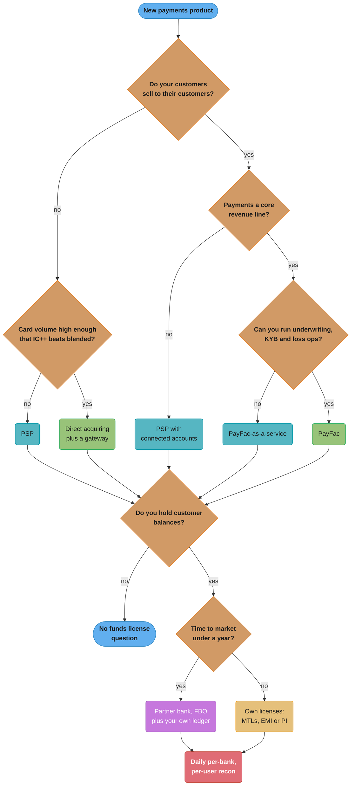
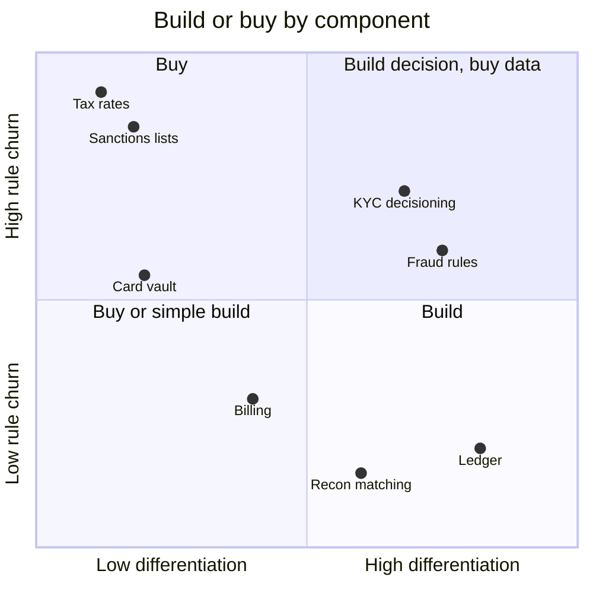
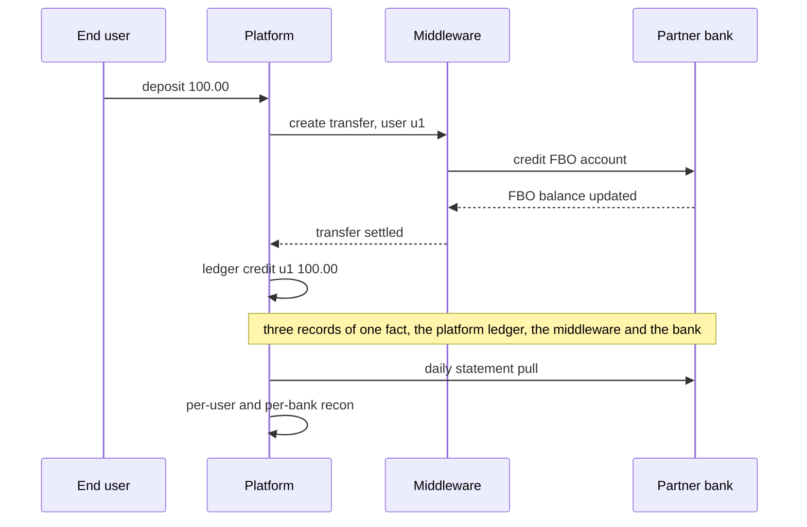

# Build vs Buy and Licensing Strategy

> Rules and figures checked 2026-11-06. Every date, threshold and fee on this page comes from the
> fact pins in fintech/CLAUDE.md. This page is an engineering view as of that date, not legal
> advice, and covers the US, the EU, the UK, India and Brazil only. Cost figures in examples are
> labelled assumptions, not quotes.

---

## 1. Concept Overview

Every fintech product makes the same five strategic choices early, and most of them are
expensive to reverse:

1. **How to accept payments.** Through a PSP, as a payment facilitator (PayFac) that boards
   its own sub-merchants, or by direct acquiring with your own merchant account.
2. **How many PSPs.** One, one plus a failover, or several behind a routing layer.
3. **Which components to build.** Ledger, billing, tax, KYC, fraud, reconciliation, card
   vault, issuing processor.
4. **Whose license holds the money.** A partner bank's (Banking as a Service, with funds in an
   FBO account), your own money transmitter licenses, an EU e-money or payment institution
   license, or a bank charter.
5. **For trading products, which parts of the venue and post-trade chain to own.** License or
   build a matching engine. Self-clear or use a clearing firm.

This page owns the scorecard and flowchart for those choices. It is also the index of every
decision model in the section (§4.6), because a build-or-buy call on a component is only as
good as your answer to that component's own design decision.

The roles behind choice 1 (issuer, acquirer, network, PSP, PayFac) are defined in
[PSPs, Acquirers, Issuers and Networks](../psps_acquirers_issuers_and_networks/psps_acquirers_issuers_and_networks.md).
An end-to-end payment system that assumes a PSP is designed in
[Design a Payment System](../../hld/case_studies/design_payment_system.md), and the KYC tier
table for a wallet in
[Design a Digital Wallet](../../hld/case_studies/design_digital_wallet.md).

---

## 2. Intuition

> **One-line analogy:** buying is renting a furnished flat, a PayFac is subletting rooms in it,
> direct acquiring is your own lease, and a license is owning the building. Each step up gives
> you more control and more of the repair bills, and the landlord's problems become yours.

**Mental model.** You can outsource work. You cannot outsource accountability. A PSP runs the
card integration, but a merchant still owns its own PCI compliance. A partner bank holds the
deposits, but if the platform's ledger and the bank's records disagree, the customer calls the
platform. So ask two questions for each layer: who does the work, and who answers when it
breaks and can prove the numbers.

**Why it matters.** These choices set unit cost, time to market, the size of the compliance
team, and which incidents can end the company. A wrong component build costs a year of
engineering. A wrong licensing model can freeze customer funds.

**Key insight.** Rent the rails and own the record. Whatever you buy, keep your own ledger of
what each customer is owed and reconcile it daily against every bank and provider that holds
the money. At Synapse the records and the money disagreed: the partner banks held less than
the records showed consumers were owed.

---

## 3. Core Principles

1. **Buy the commodity, build the differentiator.** Build where your product competes. Buy
   where a vendor amortizes rule changes across many customers (tax rates, sanctions lists,
   network certification).
2. **Liability does not transfer with the work.** A compliant PSP does not make the merchant
   compliant. A partner bank does not make the platform's ledger correct.
3. **Price the exit when you sign.** Data export, card token portability and notice periods
   decide whether a second vendor is a migration or a rewrite.
4. **Own the ledger of record for customer funds.** Reconcile it per customer and per bank,
   every day.
5. **Concentration is a risk you choose.** One PSP, one partner bank or one middleware vendor
   is one failure away from no product.
6. **The license follows the flow of funds.** If money passes through your control, the
   question of which license covers that is a design input, not a legal afterthought.
7. **Reversibility sets the pace.** Make reversible choices fast. Spend analysis on the ones
   that lock you in.

---

## 4. Types / Architectures / Strategies

### 4.1 Payment acceptance models

| Model | Merchant account | Who boards and underwrites merchants | Your liability for chargebacks and fraud | Typical fit |
|---|---|---|---|---|
| PSP (aggregator) | The PSP's, you are its merchant | The PSP | Your own transactions | Most merchants and early platforms |
| PayFac | A master merchant account with a sponsoring acquirer, with sub-merchants under it | You | Yours and your sub-merchants' | Platforms whose customers are merchants and where payments are the revenue line |
| PayFac-as-a-service | The provider's, with your brand on onboarding | The provider, with your input | Shared by contract | Platforms that want payment revenue without running underwriting |
| Direct acquiring | Your own with an acquirer, often through a processor or gateway | The acquirer | Your own transactions | High-volume merchants that want IC++ pricing and control |

### 4.2 PSP topology

| Topology | Gain | Cost |
|---|---|---|
| Single PSP | One integration, one recon feed | Outage and policy risk on one vendor |
| Primary plus failover | Survives an outage | Card tokens must work at both, or failover covers new cards only |
| Routed orchestration | Cost and approval-rate routing, regional coverage | A vault or network tokens, per-PSP recon, idempotency across PSPs |

### 4.3 Component build or buy

| Component | Default | Build when | Buy when |
|---|---|---|---|
| Ledger | Build on a database you run, or adopt a ledger database | Balances are the product (wallet, card program, exchange) | Payments are a feature and a PSP's balance reports suffice |
| Billing | Buy | Pricing is the product, or usage rating at a scale the vendor cannot hold | Standard subscriptions and invoices |
| Tax calculation | Buy | Never for rates. Build only the call site and the audit record | Always for rates and jurisdictions |
| KYC and KYB | Buy the checks, build the decision | Your risk policy is specific and drives conversion | Document, identity and registry checks |
| Fraud | Buy network and vendor signals, build rules and thresholds | Your fraud patterns are specific and labelled data exists | Early stage, low volume |
| Reconciliation | Build the matching on bought data feeds | Several PSPs and banks | One PSP with good reports |
| Card vault | Buy | Multi-PSP at scale with a PCI program you already run | Almost always |
| Card issuing processor | Buy | Rarely | Almost always, through a BIN sponsor |

### 4.4 Licensing models for holding customer funds

| Model | Who holds funds | Who holds the license | Records of what each customer owns | Main risk |
|---|---|---|---|---|
| BaaS partner bank, FBO account | Partner bank, in an account for the benefit of your customers | The bank | Platform, middleware or bank, by contract | Records split across parties disagree |
| Own US money transmitter licenses | Your safeguarded accounts | You, state by state | You | Licensing cost, exams in many states |
| EU e-money institution | Safeguarded accounts or assets | You | You | Safeguarding failures |
| EU payment institution | Safeguarded by segregation or insurance | You | You | Safeguarding failures |
| Bank charter | You, as deposits | You | You | Capital, supervision, years to obtain |

### 4.5 Trading infrastructure

| Choice | Options | Owner page for the detail |
|---|---|---|
| Matching | License a vendor engine, or build | [Order Books and Matching Engines](../order_books_and_matching_engines/order_books_and_matching_engines.md) |
| Venue core | Vendor platform, or a sequencer and replicated state machine you build | [Exchange Architecture and Determinism](../exchange_architecture_and_determinism/exchange_architecture_and_determinism.md) |
| Clearing | Self-clear as a clearing member, or a clearing broker | [CCP Clearing and Settlement](../ccp_clearing_and_settlement/ccp_clearing_and_settlement.md) |

### 4.6 Decision models in fintech/

Each decision has one owning page. A build-or-buy review links to these instead of restating
them.

| Owning page | Decision |
|---|---|
| [Money Representation and Currency](../money_representation_and_currency/money_representation_and_currency.md) | Money type and storage, rounding mode per context |
| [Double-Entry Ledger Design](../double_entry_ledger_design/double_entry_ledger_design.md) | Balance model: derived, materialized in the same transaction, or snapshot plus delta |
| [Hot Accounts and Ledger Scaling](../double_entry_ledger_design/hot_accounts_and_ledger_scaling.md) | Hot-account strategy and ledger store |
| [Idempotency and Exactly-Once Money Movement](../idempotency_and_exactly_once_money_movement/idempotency_and_exactly_once_money_movement.md) | Unknown outcome: retry with the same key, query, wait for evidence, reverse, never retry |
| [Card Payments Lifecycle](../card_payments_lifecycle/card_payments_lifecycle.md) | Sale vs auth and capture vs incremental, decline retry policy |
| [Interchange and Payment Economics](../card_payments_lifecycle/interchange_and_payment_economics.md) | Blended vs IC++, least-cost vs approval-rate routing |
| [Bank Rails: ACH, SEPA and Wires](../bank_rails_ach_sepa_and_wires/bank_rails_ach_sepa_and_wires.md) | Rail selection |
| [Strong Customer Authentication and 3DS](../strong_customer_authentication_and_3ds/strong_customer_authentication_and_3ds.md) | Exemption vs challenge vs out of scope |
| [PCI DSS Scope and Tokenization](../pci_dss_scope_and_tokenization/pci_dss_scope_and_tokenization.md) | Integration shape vs PCI scope |
| [Fraud and Risk Scoring](../fraud_and_risk_scoring/fraud_and_risk_scoring.md) | Rules vs model vs vendor vs network tools, threshold economics |
| [KYC, AML and Sanctions Screening](../kyc_aml_and_sanctions_screening/kyc_aml_and_sanctions_screening.md) | Screening points and threshold by risk tier, block vs hold vs alert |
| [Disputes, Chargebacks and Refunds](../disputes_chargebacks_and_refunds/disputes_chargebacks_and_refunds.md) | Fight vs accept |
| [Reconciliation and Settlement Files](../reconciliation_and_settlement_files/reconciliation_and_settlement_files.md) | Matching strategy, auto vs manual, batch vs streaming |
| [Wallets, Stored Value and Payouts](../wallets_stored_value_and_payouts/wallets_stored_value_and_payouts.md) | Instant vs standard payout, prefund vs post-fund |
| [Subscriptions, Billing and Invoicing](../subscriptions_billing_and_invoicing/subscriptions_billing_and_invoicing.md) | Proration policy, rating timing |
| [Treasury, Liquidity and FX Operations](../treasury_liquidity_and_fx_operations/treasury_liquidity_and_fx_operations.md) | Prefund vs credit line, quote-and-lock vs hedge |
| [Order Books and Matching Engines](../order_books_and_matching_engines/order_books_and_matching_engines.md) | Matching algorithm per product, book structure |
| [Exchange Architecture and Determinism](../exchange_architecture_and_determinism/exchange_architecture_and_determinism.md) | Hot standby with replay vs active-active vs Raft log |
| [Market Data Feeds and Multicast](../market_data_feeds_and_multicast/market_data_feeds_and_multicast.md) | Multicast vs TCP vs WebSocket, MBO vs MBP, conflation |
| [FIX Protocol and Order Entry](../fix_protocol_and_order_entry/fix_protocol_and_order_entry.md) | tag=value vs binary order entry |
| [Low-Latency Trading Systems](../low_latency_trading_systems/low_latency_trading_systems.md) | Tuned kernel vs kernel bypass vs FPGA, language |
| [CCP Clearing and Settlement](../ccp_clearing_and_settlement/ccp_clearing_and_settlement.md) | Self-clear vs clearing broker |
| [Margin, Liquidation and Derivatives Risk](../margin_liquidation_and_derivatives_risk/margin_liquidation_and_derivatives_risk.md) | Isolated vs cross vs portfolio margin, the loss waterfall |
| [Crypto Custody and On-Chain Operations](../crypto_custody_and_onchain_operations/crypto_custody_and_onchain_operations.md) | Hot, warm and cold split, MPC vs multisig vs HSM |
| [Regulatory Reporting and Audit Trails](../regulatory_reporting_and_audit_trails/regulatory_reporting_and_audit_trails.md) | Audit-trail store |
| This page | PSP vs PayFac vs direct, multi-PSP, vendor vs build, partner bank vs own license |

---

## 5. Architecture Diagrams

### 5.1 Decision flowchart: acceptance and licensing



Both funds paths end at the same control. The partner-bank path does not remove it, it makes it
harder because the records live with more than one party.

### 5.2 Components by differentiation and regulatory load



Rule churn is how often outside parties change the rules the component must follow. High churn
and low differentiation is where a vendor's shared maintenance pays for itself.

### 5.3 Flow of funds and records under BaaS



The bank sees one pooled FBO balance. Only the platform and middleware records say which user
owns which part, so those records must reconcile to the bank every day.

---

## 6. How It Works - Detailed Mechanics

### 6.1 The scorecard

Score each option from 1 to 5 per criterion, weight the criteria for your company, and treat the
total as the start of the conversation, not the answer. Weights below are an illustrative
assumption for a vertical SaaS platform with merchant customers.

| Criterion | Weight | PSP | PayFac | Direct acquiring |
|---|---|---|---|---|
| Time to market | 25 | 5 | 2 | 3 |
| Unit cost at target volume | 20 | 2 | 4 | 5 |
| Control of onboarding and payout UX | 15 | 2 | 5 | 3 |
| Liability and compliance load (5 = lowest) | 15 | 5 | 1 | 3 |
| Team size needed (5 = smallest) | 10 | 5 | 2 | 3 |
| Exit cost (5 = cheapest) | 10 | 2 | 3 | 3 |
| Concentration risk (5 = lowest) | 5 | 2 | 3 | 3 |

```java
import java.util.*;

public class Scorecard {
    record Criterion(String name, int weight) {}
    record Option(String name, Map<String, Integer> scores) {}

    static int total(List<Criterion> criteria, Option o) {
        int sum = 0;
        for (Criterion c : criteria) {
            Integer s = o.scores().get(c.name());
            if (s == null || s < 1 || s > 5) throw new IllegalArgumentException(o.name() + ": " + c.name());
            sum += c.weight() * s;
        }
        return sum;
    }

    public static void main(String[] args) {
        var criteria = List.of(new Criterion("time", 25), new Criterion("cost", 20),
                new Criterion("ux", 15), new Criterion("liability", 15), new Criterion("team", 10),
                new Criterion("exit", 10), new Criterion("concentration", 5));
        assert criteria.stream().mapToInt(Criterion::weight).sum() == 100;

        var psp = new Option("PSP", Map.of("time", 5, "cost", 2, "ux", 2, "liability", 5,
                "team", 5, "exit", 2, "concentration", 2));
        var payfac = new Option("PayFac", Map.of("time", 2, "cost", 4, "ux", 5, "liability", 1,
                "team", 2, "exit", 3, "concentration", 3));
        var direct = new Option("Direct", Map.of("time", 3, "cost", 5, "ux", 3, "liability", 3,
                "team", 3, "exit", 3, "concentration", 3));

        for (Option o : List.of(psp, payfac, direct)) {
            System.out.println(o.name() + ": " + total(criteria, o) + " / 500");
        }
        assert total(criteria, psp) == 350;
        assert total(criteria, payfac) == 285;
        assert total(criteria, direct) == 340;
    }
}
```

With these weights a PSP wins narrowly over direct acquiring (350 to 340), and PayFac comes
last at 285. Move 15 points of weight off time to market, 10 onto unit cost and 5 onto UX
control, and the order becomes direct 360, PayFac 320, PSP 305. That
sensitivity is the useful output: it shows which belief the decision rests on, so the team can
test that belief instead of arguing about the total.

### 6.2 Unit economics and break-even

The money side of the scorecard is a break-even volume: the annual card volume above which a
cheaper per-transaction rate pays for the fixed cost of the program.

```
annual saving  = volume x (rate_now - rate_new) - fixed_cost_new
break-even     = fixed_cost_new / (rate_now - rate_new)
```

Illustrative assumptions: a blended PSP rate of 2.50%, an effective IC++ rate through direct
acquiring of 2.05%, and $600,000 a year of fixed cost (payments engineers, a compliance share,
certification, a gateway minimum). The saving is 45 basis points, so break-even is
$600,000 / 0.0045, about $133.3M of annual volume.

```java
import java.math.BigDecimal;
import java.math.RoundingMode;

public class BreakEven {
    record Program(String name, BigDecimal rateBps, long fixedCostMinor) {}

    static long annualCostMinor(long volumeMinor, Program p) {
        BigDecimal variable = BigDecimal.valueOf(volumeMinor).multiply(p.rateBps())
                .divide(BigDecimal.valueOf(10_000), 0, RoundingMode.HALF_EVEN);
        return Math.addExact(variable.longValueExact(), p.fixedCostMinor());
    }

    static long breakEvenVolumeMinor(Program now, Program candidate) {
        BigDecimal savingBps = now.rateBps().subtract(candidate.rateBps());
        BigDecimal extraFixed = BigDecimal.valueOf(candidate.fixedCostMinor() - now.fixedCostMinor());
        return extraFixed.multiply(BigDecimal.valueOf(10_000))
                .divide(savingBps, 0, RoundingMode.CEILING).longValueExact();
    }

    public static void main(String[] args) {
        var psp = new Program("PSP blended", new BigDecimal("250"), 0);               // assumption
        var direct = new Program("Direct IC++", new BigDecimal("205"), 60_000_000);   // $600k, assumption
        long be = breakEvenVolumeMinor(psp, direct);
        System.out.printf("break-even volume: $%,d%n", be / 100);
        assert be == 13_333_333_334L; // cents, about $133.3M

        long volume = 20_000_000_000L;                                               // $200M in cents
        long saving = annualCostMinor(volume, psp) - annualCostMinor(volume, direct);
        System.out.printf("saving at $200M: $%,d%n", saving / 100);
        assert saving == 30_000_000L; // $300,000
    }
}
```

The rates are inputs, and the real ones come from your own pricing and the interchange mix of
your cards. How blended and IC++ pricing differ, and where interchange caps apply, is in
[Interchange and Payment Economics](../card_payments_lifecycle/interchange_and_payment_economics.md).

### 6.3 What a PayFac takes on

Becoming a PayFac moves work and liability from the PSP or acquirer to you:

| Obligation | What the engineering team builds |
|---|---|
| Sub-merchant onboarding and KYB | Identity, ownership and business checks, risk scoring, approval workflow |
| Underwriting and monitoring | Limits per sub-merchant, ongoing transaction monitoring, terminations |
| Funding sub-merchants | Split settlement, payout scheduling, reserves and holdbacks in the ledger |
| Chargeback and fraud loss | Dispute handling for every sub-merchant, recovery from sub-merchant balances, loss write-off |
| PCI DSS | The platform's own validation, since it handles the payment flow for others (PCI DSS v4.0.1 is the only active version) |
| Tax information reporting | A platform that is a third party settlement organization files Form 1099-K only when gross payments to a payee exceed $20,000 and transactions exceed 200 |

The reward is the margin between what you charge sub-merchants and what you pay, plus control
of onboarding and payouts. The cost is a risk operation that has to work every day.
PayFac-as-a-service sits in between: the provider runs underwriting and liability under its
program, and you keep more of the UX and some of the margin.

### 6.4 Multi-PSP and token portability

A PSP's card token works only at that PSP. A second PSP for failover or routing needs the card
details there as well. Three options:

1. **Your own vault.** You hold the PAN and send it to each PSP. Your systems enter full PCI
   scope. See [PCI DSS Scope and Tokenization](../pci_dss_scope_and_tokenization/pci_dss_scope_and_tokenization.md).
2. **A third-party vault.** A vault provider holds the PAN and forwards it to the PSP you pick,
   so your scope stays small.
3. **Network tokens.** A network-issued token that several PSPs can use for your merchant,
   which also helps keep cards current when they are reissued.

Then the work that grows with each PSP: one routing layer with health and cost inputs, one
reconciliation feed per PSP, and an idempotency key chain that stops a retry from charging
at two PSPs. That last one is the expensive bug, see
[Idempotency and Exactly-Once Money Movement](../idempotency_and_exactly_once_money_movement/idempotency_and_exactly_once_money_movement.md).
The full design is the
[Payment Orchestration Layer case study](../case_studies/design_a_payment_orchestration_layer.md).

### 6.5 Partner bank vs own license

**The BaaS model.** A licensed bank holds customer funds in an FBO account. The platform owns the
product and the customer relationship. Often a middleware company sits in between and keeps the
sub-ledger that maps the pooled balance to users. That gives three records of the same money:
the bank's account balance, the middleware's sub-ledger and the platform's ledger.

**Synapse.** The CFPB says Synapse's partner banks held less than Synapse's records showed
consumers were owed, a shortfall of between $60 million and $90 million. Consumers had no access
to funds for weeks or months, and many did not get their full balance. The court entered
a stipulated final judgment on 2025-09-12 with a $1 civil money penalty, which opened the Civil
Penalty Fund, and the CFPB has allocated $55,214,058 from that fund to harmed consumers.

The engineering lessons:

- Keep your own ledger per user, even if middleware keeps one too.
- Reconcile per bank and per user against bank statements daily, not only in total (§14).
- Get contractual and technical access to the bank's account data, so you can reconcile
  without the middleware.
- Know which bank holds which user's funds at every moment, including after sweeps between
  banks.

**Own licenses, US.** Money transmission is licensed by the states. CSBS reports that 31
states have enacted the Money Transmission Modernization Act in full or in part, as of September
2026. A model law adopted in part still leaves per-state differences, so the compliance
team tracks each state.

**Own licenses, EU.**

| License | Safeguarding rule | Other rules that shape the ledger |
|---|---|---|
| E-money institution | Safeguards funds received for issued e-money. Funds paid by payment instrument are safeguarded once credited, and in any case within five business days of issuance (EMD2 Art. 7) | Issue and redeem at par value at any moment. No interest tied to holding time (Arts. 11, 12) |
| Payment institution | Segregation (never commingled, and funds still held at the end of the business day after receipt go to a separate credit-institution account or secure liquid low-risk assets, insulated in insolvency) or insurance or comparable cover from outside the group (PSD2 Art. 10) | |

These rules translate into ledger features: a safeguarded-funds account per currency, a daily
check that safeguarded holdings cover e-money or payment liabilities, and a timer from receipt
to safeguarding.

**Data localization, India.** RBI requires all payment-system data to be stored only in India
(circular of 2018-04-06). A vendor that stores Indian payment-system data outside India
cannot hold that data, which narrows the buy list.

### 6.6 Building components: where teams go wrong

| Component | Hidden cost of building | Hidden cost of buying |
|---|---|---|
| Ledger | Invariants, migrations and audit trail are years of work | Vendor schema decides your reporting, and balances live off your database |
| Billing | Proration, credit notes, tax and dunning edge cases | Your pricing model must fit their catalogue |
| Tax | Rates, thresholds and product taxability change constantly. US states each set an economic nexus threshold after Wayfair | Per-call fees, and you still own the audit record |
| KYC | Document and liveness checks need vendors anyway | Vendor decision logic is opaque, false rejects cost conversion |
| Fraud | Labels arrive late and are biased | Generic models miss your patterns |
| Reconciliation | Every PSP and bank format | Vendor matching rules may not express your break taxonomy |

### 6.7 Trading: license or build

A licensed matching engine or exchange platform shortens time to launch and brings certified
interfaces. Building gives control over matching rules, determinism and latency, and you own
every bug. Many trading firms license the commodity parts (FIX engines, market data handlers,
clearing connectivity) and build the parts that define the product. On the post-trade side,
self-clearing needs clearing membership, margin funding and an operations team. A clearing
broker turns that into a fee and a dependency.

### 6.8 Exit planning

Write the exit into the first contract:

| Item | Ask for |
|---|---|
| Data export | Full transaction, customer and balance history in a documented format, on demand |
| Card data | PAN migration to a new provider through a PCI-compliant transfer |
| Funds | A tested path to move FBO or safeguarded balances to another bank |
| Notice | A termination notice period longer than your migration time |
| Parallel run | Rights to run two providers at once during migration |

---

## 7. Real-World Examples

**Synapse and its partner banks.** The shortfall between partner-bank holdings and Synapse's
records was between $60 million and $90 million. The stipulated final judgment of
2025-09-12 carried a $1 penalty that opened the Civil Penalty Fund, from which the CFPB has
allocated $55,214,058. The structural lesson for platforms: if a third party's sub-ledger
is your only record of who owns the pooled funds, you cannot show what each customer is owed
when that third party fails.

**Square Books (build).** Square describes Books as an immutable double-entry accounting
database service: journal entries must balance to 0, entries are append-only, and it runs on
Google Cloud Spanner and GKE. A ledger is the product core for a company that moves money
for sellers, so Square built one.

**Uber LedgerStore (build).** Uber describes LedgerStore as immutable storage that indexes
hundreds of billions of ledgers, with over 2 trillion unique indexes moved from DynamoDB to
Docstore. At that scale the store itself became a build.

**US money transmission licensing.** With 31 states having enacted the MTMA in full or in part
, a company that applies for its own licenses faces more uniform rules than before, and
still handles the states that have not adopted it.

**India data localization.** The RBI circular of 2018-04-06 gave payment system operators six
months to store all payment-system data only in India. Every vendor in the payment data
path had to store that data in India, so platforms had to check each one.

---

## 8. Tradeoffs

### 8.1 Acceptance models

| Criterion | PSP | PayFac | Direct acquiring |
|---|---|---|---|
| Time to market | Weeks | Many months | Months |
| Per-transaction cost | Highest | Margin on sub-merchants | Lowest |
| Liability | Own transactions | Own plus sub-merchants | Own transactions |
| Team needed | Small | Payments, risk, support | Payments engineering |
| Control of onboarding | Low | Full | Not applicable |

### 8.2 Funds holding

| Criterion | Partner bank (BaaS) | Own licenses | Bank charter |
|---|---|---|---|
| Time to launch | Short | Long | Very long |
| Cost to run | Revenue share and fees | Licensing, exams, compliance staff | Capital and supervision |
| Control of product rules | The bank's risk appetite limits you | Yours, within the license | Yours, within bank rules |
| Concentration risk | One bank or middleware failure | Your own operations | Your own operations |

### 8.3 Single vs multi-PSP

| Criterion | Single | Multi |
|---|---|---|
| Engineering | One integration | Routing, vault or network tokens, per-PSP recon |
| Resilience | Vendor outage is your outage | Failover |
| Pricing power | Low | Routing and negotiation |
| Approval rate | One PSP's | Best-of routing where cards and regions differ |

---

## 9. When to Use / When NOT to Use

**Use a PSP when:** you are pre-scale, payments are a feature, and time to market dominates.

**Become a PayFac when:** your customers are merchants, payments revenue matters to the business
model, and you can staff underwriting, KYB and loss operations.

**Go direct when:** card volume is past your break-even (§6.2) and you can run certification and
reconciliation yourself.

**Use a partner bank when:** you need to hold balances within a year and accept the partner's
rules, with your own ledger and daily per-bank reconciliation from day one.

**Get your own licenses when:** balances are the core product, the partner bank limits the
product, and the business can carry the compliance cost.

**Do not:**

- Build a card vault to avoid a vendor fee without a PCI program to run it.
- Build tax rate logic.
- Rely on a middleware sub-ledger as the only record of customer balances.
- Add a second PSP without a plan for card tokens and cross-PSP idempotency.

---

## 10. Common Pitfalls

### 10.1 An `int` in the cost model

An illustrative case: the break-even spreadsheet was moved into a pricing service. Monthly
volume was an `int` in cents, and annual volume was computed by multiplying by 12. At $5M a
month the product overflowed, the model showed $17.05M a year instead of $60M, and every forecast
built on that base was low by a factor of about 3.5.

```java
// BROKEN
public class AnnualVolumeOverflow {
    public static void main(String[] args) {
        int monthlyCents = 500_000_000;            // $5M a month
        int annualCents = monthlyCents * 12;       // overflows int, no error
        double saving = annualCents * 0.0045 - 60_000_000; // 45 bps minus $600k fixed, in cents
        System.out.println("annual volume $" + annualCents / 100);  // prints $17050327
        System.out.println("saving $" + saving / 100);              // prints a loss
    }
}
```

```java
// FIX
import java.math.BigDecimal;
import java.math.RoundingMode;

public class AnnualVolumeExact {
    public static void main(String[] args) {
        long monthlyCents = 500_000_000L;
        long annualCents = Math.multiplyExact(monthlyCents, 12L);
        long savingCents = BigDecimal.valueOf(annualCents).multiply(new BigDecimal("45"))
                .divide(BigDecimal.valueOf(10_000), 0, RoundingMode.HALF_EVEN)
                .longValueExact() - 60_000_000L;
        assert annualCents == 6_000_000_000L;
        assert savingCents == -33_000_000L;  // $60M a year is still below the $133.3M break-even
        System.out.printf("annual volume $%,d, saving $%,d%n", annualCents / 100, savingCents / 100);
    }
}
```

The broken version compiles and returns a wrong annual volume and a wrong saving, and both look
plausible. Money in minor units is a `long`, products use `Math.multiplyExact`, and rates are
`BigDecimal` basis points with an explicit rounding mode.

### 10.2 One PSP's tokens as the only card store

A platform stored only its PSP's card tokens. When the PSP changed its risk policy for the
platform's industry, the platform needed a second PSP within weeks and had no way to charge
existing subscribers there. Every customer had to re-enter a card. Ask for PAN migration rights
in the contract, or use network tokens or a third-party vault from the start.

### 10.3 Treating a compliant PSP as compliance

A merchant using an embedded payment form assumed it had no PCI obligations. An iframe alone
does not make a merchant SAQ A eligible. The SAQ A of January 2025, effective 2025-03-31, adds a
criterion that the merchant confirms its site is not susceptible to attacks from scripts, on
top of the core criteria such as card-not-present only and all account-data functions
outsourced. The merchant still owns its own validation.

### 10.4 The partner bank's risk appetite as a hidden product spec

A platform launched a feature its partner bank had not approved. The bank froze new account
openings for the program until review, and growth stopped for a quarter. Under BaaS, the bank's
program approvals are part of the release process. Put them in the launch checklist.

### 10.5 Building billing because the first plan was simple

A team built billing for one flat monthly plan. Within a year it had annual plans, seats,
usage tiers, proration, credits and tax, and half the payments team worked on invoices. Build
billing only when pricing is the product. Otherwise buy and keep your own revenue ledger, see
[Subscriptions, Billing and Invoicing](../subscriptions_billing_and_invoicing/subscriptions_billing_and_invoicing.md).

---

## 11. Technologies & Tools

| Tool | Role in a build-or-buy decision |
|---|---|
| Stripe Connect | PSP platform product for marketplaces and platforms with connected accounts |
| Adyen for Platforms | Adyen's product for platforms that onboard and pay out sub-merchants |
| Braintree | PayPal's payment gateway and processing service |
| Checkout.com | Global PSP and acquirer |
| Finix | PayFac and payments infrastructure provider |
| Spreedly | Third-party card vault and payment orchestration |
| Very Good Security | Vault and tokenization service (VGS) that keeps card data out of your systems |
| Avalara | Tax calculation and compliance service |
| Modern Treasury | Payment operations, ledgers and reconciliation for bank payments |
| TigerBeetle | Open-source financial transactions database with double-entry transfers |
| Marqeta | Card issuing processor |

---

## 12. Interview Questions with Answers

**Q: Does using a PCI-compliant PSP make the merchant PCI compliant?**
**Short:** No, the merchant still owns its own validation, and even an iframe integration needs the SAQ A criteria to be met, including the script criterion.

The PSP's compliance covers the PSP's systems. The merchant validates its own environment,
usually with a self-assessment questionnaire. The January 2025 SAQ A, effective 2025-03-31,
requires card-not-present only, all account-data functions outsourced to compliant third
parties, no electronic account data on merchant systems, and a confirmation that the site is
not susceptible to attacks from scripts.

**Q: What was the core engineering failure behind the Synapse collapse?**
**Short:** The records of who owned the pooled funds did not match what the partner banks held, a shortfall the CFPB puts at $60 million to $90 million.

Consumers could not reach funds for weeks or months, and many did not get their full balance
. The lesson is records, not rails: a platform must keep its own per-user ledger and
reconcile it daily per bank against bank data. A single middleware sub-ledger as the only
record leaves the platform unable to prove what each customer is owed.

**Q: PSP, PayFac or direct acquiring: what decides it?**
**Short:** Whether your customers are merchants, whether payments revenue matters, your card volume against the break-even, and whether you can run underwriting and loss operations.

A PSP wins on time to market and team size. A PayFac fits platforms whose customers sell to
others and who want the payments margin and onboarding control, at the cost of sub-merchant
liability. Direct acquiring fits high-volume merchants for whom IC++ pricing beats the fixed
cost of running it. Use the scorecard to find which belief the decision rests on.

**Q: How do you compute the break-even volume for direct acquiring?**
**Short:** Divide the extra fixed annual cost of the direct program by the per-unit rate saving, with money in long minor units and rates as BigDecimal.

With illustrative inputs of 2.50% blended against 2.05% effective IC++ and $600,000 of fixed
cost, break-even is $600,000 / 0.0045, about $133.3M a year. Below that the PSP is cheaper.
The rates are your own, and the interchange mix of your cards moves the IC++ figure more than
any other input.

**Q: What does a platform take on when it becomes a PayFac?**
**Short:** Sub-merchant onboarding and KYB, underwriting and monitoring, split funding and reserves, chargeback and fraud loss for every sub-merchant, and its own PCI validation.

Each obligation is a system: an onboarding flow with risk decisions, a monitoring job, a
ledger with reserves and holdbacks, a dispute process, and a recovery path when a sub-merchant
leaves with a negative balance. The reward is margin and control. Teams that cannot staff the
loss operation choose PayFac-as-a-service instead.

**Q: Why is a second PSP harder than a second integration?**
**Short:** Saved cards are tokens only the first PSP can use, so failover needs a vault, network tokens or PAN migration, plus cross-PSP idempotency and recon.

Without portable card data, the second PSP serves only new customers. Routing adds health and
cost signals, and every retry across PSPs needs one idempotency key chain so a timeout at PSP A
followed by a charge at PSP B does not charge twice. Each PSP also brings its own settlement
report to reconcile.

**Q: When should a company build its own ledger?**
**Short:** When balances are the product, such as a wallet, card program or exchange, and the team can own invariants, migrations and the audit trail.

A ledger is cheap to start and expensive to get right: conservation per currency, append-only
history with reversals, idempotent posting, and reconciliation. Square built Books on Spanner
 and Uber built LedgerStore because money movement is their core. A business where
payments are a feature usually relies on the PSP's balance and payout reports plus a simple
revenue ledger.

**Q: Why should tax rate logic almost never be built?**
**Short:** Rates, product taxability and nexus thresholds change across thousands of jurisdictions, and a vendor spreads that maintenance across all its customers.

After Wayfair, each US state sets its own economic nexus threshold, so the threshold is a
variable per state. Build only the call site, the record of what was charged and why, and
the fallback when the vendor is down. Keep the vendor's response with each invoice for audit.

**Q: What does a partner-bank model change about reconciliation?**
**Short:** It adds parties holding records of the same money, so recon must run per user and per bank against bank data, not only on program totals.

The bank sees a pooled FBO balance. Only the platform and middleware know which user owns which
part. A total-level recon can pass while one bank is short and another long. Reconcile each bank
account against the sum of the users assigned to it, daily, and alert on any difference that
outlives a settlement window.

**Q: What do EU e-money safeguarding rules mean for the ledger?**
**Short:** Funds received for e-money are safeguarded once credited and within five business days of issuance at the latest, and e-money is issued and redeemed at par.

EMD2 Art. 7 sets the safeguarding rule, and Arts. 11 and 12 require par value at any
moment and ban interest tied to holding time. The ledger needs a safeguarded-funds
account per currency, a timer from receipt to safeguarding, and a daily check that safeguarded
holdings cover outstanding e-money.

**Q: How does a payment institution safeguard funds under PSD2?**
**Short:** By segregation, moving funds still held at the end of the business day after receipt to a separate account or low-risk assets, or by insurance or comparable cover from outside its group.

PSD2 Art. 10 allows both methods. Segregated funds are never commingled and are
insulated from other creditors in insolvency. The engineering work is the daily movement to
the safeguarding account, the proof that it happened, and a reconciliation of safeguarded
holdings against user balances.

**Q: Why does the MTMA matter to a US startup that wants its own licenses?**
**Short:** It is a model law for state money transmission rules, and CSBS reports 31 states have enacted it in full or in part, which reduces but does not remove per-state differences.

Money transmission is licensed state by state. More uniform rules lower the cost of a
multi-state license program. The states that have not adopted it, or adopted it in part,
still need individual tracking, so the compliance calendar stays per state.

**Q: How does India's data localization rule affect vendor choice?**
**Short:** RBI requires payment-system data to be stored only in India, so any vendor in the payment data path for Indian payments must store that data in India.

The circular of 2018-04-06 set the rule and the compliance timeline. For a global platform
it narrows the vendor list for Indian payments and can force a separate deployment. Check
every component that stores payment data, including logs, analytics and support tools.

**Q: Why put exit terms into the first vendor contract?**
**Short:** At signing the vendor wants your business, and the terms for data export, PAN migration, funds transfer and notice decide whether leaving is a migration or a rewrite.

Vendors rarely refuse these up front and rarely add them later. A termination notice shorter
than your migration time forces a rushed cutover. Test the export once a year so the format is
known before you need it.

**Q: Should a trading venue license or build its matching engine?**
**Short:** License when time to market and certified interfaces matter most, and build when matching rules, determinism and latency are the product.

A licensed engine brings tested order types and interfaces, and you inherit its limits. A
built engine gives control over the matching algorithm per product and the replay model, and
you own every bug. Many firms license FIX engines and market data handlers and build only the
core. The design trade-offs are in
[Order Books and Matching Engines](../order_books_and_matching_engines/order_books_and_matching_engines.md).

**Q: What does PayFac-as-a-service give up compared with a full PayFac?**
**Short:** Part of the payments margin and some control, in exchange for the provider running underwriting and carrying liability under its program.

It suits platforms that want branded onboarding and payment revenue without staffing a risk
operation. The platform still owns the customer experience and often first-line support. Read
the contract for which losses flow back to the platform, because "shared" liability is
defined there.

**Q: What is concentration risk in a fintech stack, and how do you reduce it?**
**Short:** It is one vendor or bank whose failure stops the product, and you reduce it with a second provider, portable data, your own records and a tested switch.

One PSP, one partner bank, one middleware or one KYC vendor each qualifies. A second provider
is only useful if data and tokens move to it and the switch has been run at least once. Your
own ledger and audit trail are what let you keep serving customers while the switch happens.

**Q: What reporting duty can come with acting as a third party settlement organization?**
**Short:** Form 1099-K for each payee whose gross payments exceed $20,000 with more than 200 transactions in the year.

The One, Big, Beautiful Bill retroactively restored that threshold. A platform that acts
as a TPSO for its sellers needs payee tax identity data from onboarding, a per-payee annual
aggregation in the ledger, and a filing pipeline. Collect the data at onboarding, since asking
later costs payouts.

**Q: How do you keep a build-or-buy scorecard honest?**
**Short:** Agree the weights before scoring, score with the people who will run the system, and test how far a weight must move to change the winner.

A total of 350 against 340 is not a decision, it is a tie. The useful output is the
sensitivity: which criterion, if weighted differently, flips the order. Name that belief and
test it (a pricing quote, a hiring plan, a vendor reference) instead of debating the score.

---

## 13. Best Practices

1. Keep your own per-user ledger for customer funds, whoever holds the money.
2. Reconcile per bank and per user every day against bank data, and alert on breaks that outlive
   a settlement window.
3. Write data export, PAN migration, funds transfer and notice terms into the first contract.
4. Use network tokens or a third-party vault before adding a second PSP.
5. Use one idempotency key chain across PSPs.
6. Compute cost models with `long` minor units and `BigDecimal` rates with explicit rounding.
7. Buy tax rates and sanctions lists. Build the decisions that use them.
8. Put partner-bank program approvals into the release checklist.
9. Agree scorecard weights before scoring, and report the sensitivity with the total.
10. Run the vendor switch once in a test environment before you need it.

---

## 14. Case Study

### A payouts platform moving from one partner bank to two

**Context.** A US platform pays gig workers and holds their balances in FBO accounts. It started
with one partner bank through a middleware provider. After the Synapse failure, the
board asked for a second bank and the platform's own per-user ledger. Design inputs
(assumptions): 400,000 users, balances split across bank A and bank B by user cohort, and daily
statements from both banks.

**First attempt.** The platform built its ledger and a daily reconciliation that compared total
user balances with total FBO holdings across both banks:

```sql
CREATE TABLE user_account (
    user_id     text PRIMARY KEY,
    bank        text NOT NULL CHECK (bank IN ('A', 'B'))
);

CREATE TABLE ledger_entry (
    id          bigint GENERATED ALWAYS AS IDENTITY PRIMARY KEY,
    user_id     text   NOT NULL REFERENCES user_account,
    amount_minor bigint NOT NULL,
    ref         text   NOT NULL UNIQUE
);

CREATE TABLE bank_statement (
    bank        text   NOT NULL,
    as_of       date   NOT NULL,
    balance_minor bigint NOT NULL,
    PRIMARY KEY (bank, as_of)
);

INSERT INTO user_account VALUES ('u1', 'A'), ('u2', 'A'), ('u3', 'B'), ('u4', 'B');
INSERT INTO ledger_entry (user_id, amount_minor, ref) VALUES
    ('u1', 60000000, 'dep-1'), ('u2', 40000000, 'dep-2'),
    ('u3', 70000000, 'dep-3'), ('u4', 30000000, 'dep-4');
-- a sweep for bank A users landed at bank B
INSERT INTO bank_statement VALUES ('A', '2026-11-05', 90000000), ('B', '2026-11-05', 110000000);
```

```sql
-- BROKEN
SELECT (SELECT sum(amount_minor) FROM ledger_entry) AS owed,
       (SELECT sum(balance_minor) FROM bank_statement WHERE as_of = '2026-11-05') AS held,
       (SELECT sum(amount_minor) FROM ledger_entry)
         = (SELECT sum(balance_minor) FROM bank_statement WHERE as_of = '2026-11-05')
         AS reconciled;
-- owed 200000000 | held 200000000 | reconciled true
```

The totals match, so the report is green. Bank A holds $900,000 against $1,000,000 owed to its
users, and bank B holds $100,000 that belongs to bank A's users. If bank A failed, its users'
records would show $100,000 more than bank A holds for them.

**Fix.** Reconcile per bank, and fail the run on any per-bank difference:

```sql
CREATE VIEW bank_recon AS
SELECT s.bank, s.as_of,
       coalesce(sum(l.amount_minor), 0) AS owed_minor,
       s.balance_minor                  AS held_minor,
       s.balance_minor - coalesce(sum(l.amount_minor), 0) AS break_minor
FROM bank_statement s
LEFT JOIN user_account u ON u.bank = s.bank
LEFT JOIN ledger_entry l ON l.user_id = u.user_id
GROUP BY s.bank, s.as_of, s.balance_minor;

SELECT * FROM bank_recon WHERE as_of = '2026-11-05' ORDER BY bank;
-- A | 100000000 owed | 90000000 held  | break -10000000
-- B | 100000000 owed | 110000000 held | break  10000000

DO $$
BEGIN
    IF (SELECT count(*) FROM bank_recon WHERE as_of = '2026-11-05' AND break_minor <> 0) <> 2 THEN
        RAISE EXCEPTION 'expected both banks to show a break';
    END IF;
END $$;
```

The per-bank view shows both breaks, and operations moves $100,000 back from bank B to bank A
the same day. Production adds three controls the query cannot show: the bank assignment per
user changes only through a ledger event (so the view stays correct after cohort moves),
statements come from the banks' own feeds rather than the middleware, and the run alerts on any
break that lasts past one settlement window.

**Result.** The platform can state what each user is owed and where it is held, per bank, every
day, from records it controls. The cost was a ledger team and two bank integrations, in exchange
for records that do not depend on the middleware. Reconciliation strategy in depth is in
[Reconciliation and Settlement Files](../reconciliation_and_settlement_files/reconciliation_and_settlement_files.md).
