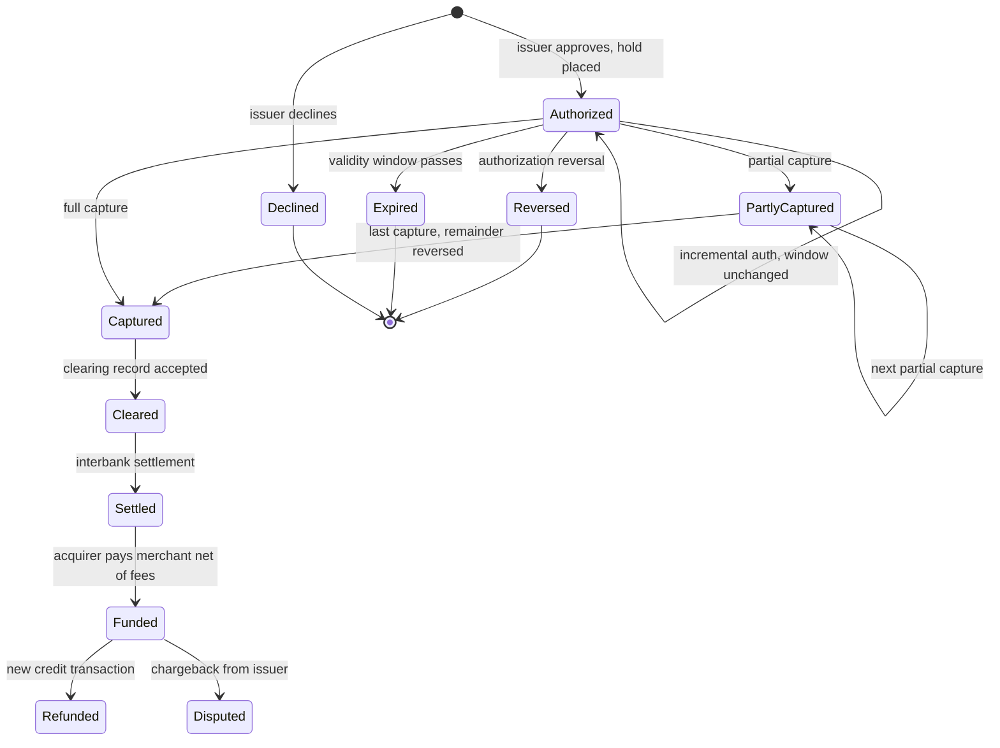
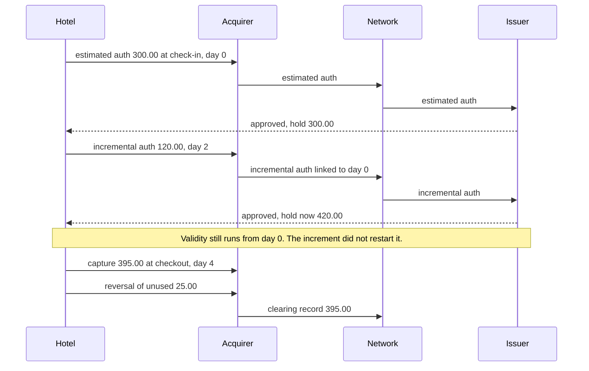

# Card Payments Lifecycle

> Rules and figures checked 2026-11-06. Dates, windows and limits on this page come from the fact
> pins in fintech/CLAUDE.md or from the Visa Core Rules and Visa Product and Service Rules,
> edition of 24 October 2026. They are Visa rules. Mastercard and other network rules are not
> stated here.

---

## 1. Concept Overview

One card payment is a sequence of separate messages and money movements, spread over days:

| Stage | What happens | Money moves? |
|---|---|---|
| Authorization | The issuer approves or declines and, on approval, places a hold | No |
| Incremental authorization | The merchant asks for more on top of an estimated authorization | No |
| Capture | The merchant tells its acquirer or PSP to collect an authorized amount | No |
| Clearing | Acquirer and issuer exchange the transaction details through the network, which fixes what each owes | No, it fixes the amounts |
| Settlement | Funds move between issuer, network and acquirer to discharge what clearing fixed | Yes, between banks |
| Funding | The acquirer or PSP pays the merchant, net of fees | Yes, to the merchant |
| Authorization reversal | The merchant cancels an approval it will not use | No, it releases the hold |
| Refund | The merchant sends a new credit to the cardholder for an earlier sale | Yes, as a new transaction |

Around this core sit the rules that decide whether money moves at all: how long an authorization
stays valid, which declines may be retried, how a stored card is set up and reused, how network
tokens and account updaters keep a stored card working, and what the network does when the
issuer does not answer.

The message formats descend from ISO 8583. Each network publishes its own specification with the
message type codes and fields. This module teaches the lifecycle at the level a merchant,
platform or PSP engineer designs against.

The saga that drives a charge through a PSP, with timeout handling and a ledger, is designed in
the [payment processor case study](../../backend/case_studies/design_payment_processor/design_payment_processor.md).
The browser side (card iframe, 3DS redirect, no client-side totals) is in the
[checkout case study](../../react/case_studies/design_a_checkout_and_payment_flow.md). This page
links to both and does not repeat them.

---

## 2. Intuition

**One-line analogy.** An authorization is a restaurant reservation, not a meal. It holds a table
for a limited time. The capture is the order. Clearing is the bill. Settlement is the card
machine paying the restaurant at the end of the week.

**Mental model.** Every authorization starts a clock. Before the clock runs out the merchant
must capture, reverse or let the hold drop. Every capture creates an obligation that clearing
will fix and settlement will pay. A refund starts a new, separate clock in the other direction.

**Why it matters.** Many card bugs in production are lifecycle bugs: a capture after the
authorization expired, a refund issued where a reversal was enough, a retry of a decline the
issuer will never approve, a stored card used without the indicator the issuer expects.

**Key insight.** The approval code is a promise with an expiry date. Design the data model
around that promise and its clock, not around a single "paid" flag.

---

## 3. Core Principles

1. **Authorization reserves, it does not pay.** The issuer reduces the cardholder's available
   balance by the hold. No ledger outside the issuer moves.
2. **Every authorization has a validity window.** Visa sets a maximum time between a valid
   authorization and processing by transaction type, from 2 hours to 30 days.
3. **An incremental authorization does not extend that window**. The clock runs from the
   original estimated authorization.
4. **Cancel unused approvals.** Visa defines an Authorization Reversal as a message "that cancels
   an Approval Response", and an acquirer that receives one "must accept the Authorization
   Reversal and immediately forward it to Visa" (§7.3.7.1).
5. **A refund is a new transaction.** It has its own clearing, settlement and fees. A void or
   reversal before capture is cheaper and faster for the cardholder.
6. **Retry by category, not by hope.** Visa groups decline codes into 4 categories. Category 1
   is never retried with the same credential. Categories 2, 3 and 4 allow up to 20 attempts in
   30 days, and a retry must not change data elements such as MCC, POS entry mode or ECI.
7. **A stored credential has a setup transaction.** The first use gets an approved
   authorization or account check with the right indicator, and later merchant-initiated
   transactions point back to it.

---

## 4. Types / Architectures / Strategies

### 4.1 Authorization types

| Type | What the merchant asks for | Typical use |
|---|---|---|
| Final authorization (sale) | Authorization and capture together, for the final amount | Digital goods, immediate fulfilment |
| Authorization then capture | Hold now, capture on fulfilment | Physical goods shipped later |
| Estimated plus incremental | An estimate, then more as charges accrue | Hotels, car rental, cruises |
| Partial authorization | The issuer approves less than requested | Prepaid and debit cards at a split-tender POS |
| Account verification | A zero-amount check that the card can be used | Saving a card when no payment is due |

The Visa rules define the last three:

- An **Estimated Authorization Request** is "for the amount that a Merchant expects a Cardholder
  to spend in an individual Transaction and that is submitted before the final Transaction amount
  is known".
- A **Partial Authorization** is "an approval response for an amount less than the amount
  requested by a Merchant".
- An **Account Verification** is a message "using a currency unit of zero, for confirmation that
  a Transaction can be completed using the Card".

### 4.2 Decision model: sale vs auth and capture vs incremental

| Pattern | Use when | Hold risk | Refund risk | Main failure mode |
|---|---|---|---|---|
| Sale (auth and capture at once) | The goods ship or unlock now and the amount is final | None after capture | High if fulfilment can fail after payment | Refunds instead of reversals when fulfilment fails |
| Auth, then capture | Fulfilment happens later, within the validity window | Hold sits on the cardholder's balance until capture or reversal | Low, unused amounts are reversed | Capture after the window expires |
| Auth, then partial captures | One order ships in parts | Remaining hold must be reversed after the last capture | Low | Forgetting to reverse the remainder |
| Estimated, then incremental | The final amount grows during the service | Grows with each increment | Low | Assuming each increment restarts the clock |
| Account verification, then MIT | No payment at setup, charges come later | None | Not applicable | Charging without the stored-credential indicators |

Rule of thumb for an online store: use auth then capture when fulfilment takes longer than a
checkout request and fits inside the validity window. Use a sale when fulfilment is instant.
Re-authorize, do not capture, when the window has passed.

### 4.3 Decision model: decline retry policy (Visa)

| Visa category | Meaning | Example codes from Table 7-2 | Merchant action |
|---|---|---|---|
| 1 | Issuer will never approve | 04, 07, 12, 14, 15, 41, 43, 46, 57, R0, R1, R3 | Never resubmit for the same credential |
| 2 | Issuer cannot approve at this time | 51 (not sufficient funds), 59, 61, 91 (issuer or switch inoperative), 96 | Retry later, up to 20 attempts in 30 days |
| 3 | Data quality: revalidate payment information | 54 (expired card), N7 (CVV2 failure), 1A in the Europe and CEMEA regions (additional customer authentication required) | Fix the data or authenticate, then retry within the same limit |
| 4 | Generic response codes | All other decline codes | Retry within the same limit |

Retry spacing inside those limits is a design choice. For category 2, space retries toward the
times the cardholder's balance is likely to change, such as after payday. For code 1A, retrying
without strong customer authentication only burns attempts: see
[Strong customer authentication and 3DS](../strong_customer_authentication_and_3ds/strong_customer_authentication_and_3ds.md).

Mastercard and other networks set their own retry rules and advice codes. Read each network's
current rules before you add them to the same policy table.

### 4.4 Stored credentials: CIT and MIT

| Kind | Who starts it | Example | Authentication |
|---|---|---|---|
| Customer-initiated transaction (CIT) | The cardholder, in session | One-click checkout with a saved card | The merchant validates the cardholder, for example with a login |
| Merchant-initiated transaction (MIT) | The merchant, under an agreement | Monthly subscription, no-show fee, split shipment | None at the time of the charge, the agreement covers it |

The Visa processing requirements for stored credentials (Table 5-21) set the setup and use
rules:

- Before the first transaction, after the cardholder agreement, the merchant submits an
  authorization for the amount, or an account verification if no payment is due. Recurring,
  installment and unscheduled credential-on-file transactions carry the matching indicator.
- If that first request is not approved, the merchant must not store the credential.
- Before a CIT with a stored credential the merchant validates the cardholder's identity, for
  example with a login ID and password.
- If an MIT is declined, the merchant notifies the cardholder in writing and gives "at least 7
  calendar days to pay by other means".

---

## 5. Architecture Diagrams

### 5.1 The lifecycle as states



Only the states from Settled onward involve money moving between banks. Everything above
Captured changes a hold at the issuer and nothing else.

### 5.2 A hotel stay with incremental authorizations



The hotel captures the final bill and reverses the unused 25.00 so the cardholder's available
balance recovers at once instead of waiting for the hold to drop.

### 5.3 Timeline of one sale

```mermaid
flowchart LR
    classDef io      fill:#61afef,stroke:#2e86c1,color:#1a1a1a,font-weight:bold
    classDef frozen  fill:#c678dd,stroke:#9b59b6,color:#fff
    classDef train   fill:#98c379,stroke:#27ae60,color:#1a1a1a
    classDef mathOp  fill:#d19a66,stroke:#e67e22,color:#1a1a1a,font-weight:bold
    classDef lossN   fill:#e06c75,stroke:#c0392b,color:#fff,font-weight:bold
    classDef req     fill:#56b6c2,stroke:#0097a7,color:#1a1a1a
    classDef base    fill:#e5c07b,stroke:#f39c12,color:#1a1a1a
    auth(["Day 0<br/>authorize"]) --> cap(["Day 2<br/>capture"])
    cap --> clr(["Day 2 night<br/>clearing batch"])
    clr --> stl(["Day 3<br/>interbank settlement"])
    stl --> fund(["Day 4<br/>merchant funding"])
    fund --> disp(["Weeks later<br/>refund or dispute"])
    class auth,cap req
    class clr mathOp
    class stl,fund train
    class disp lossN
```



The day numbers are illustrative. The acquirer contract sets the funding schedule, and dispute
time limits come from network rules (see
[Disputes, chargebacks and refunds](../disputes_chargebacks_and_refunds/disputes_chargebacks_and_refunds.md)).

---

## 6. How It Works - Detailed Mechanics

### 6.1 Authorization request and response

A card-absent authorization request carries the amount and currency, the PAN or network token,
the expiry date, the CVV2 for a first use, the billing address for AVS where supported, the MID,
the MCC, the POS entry mode, the electronic commerce indicator (ECI) and, for authenticated
transactions, the 3DS cryptogram. The response carries an approve or decline code, an approval
code on success, and result codes for CVV2 and AVS.

The issuer decides on its own ledger and risk model. On approval it places a hold. The merchant
or PSP stores the approval code, the network transaction identifier and the authorization time,
because capture, reversal, incremental authorization and later MITs all refer back to them.

### 6.2 Validity windows (Visa)

Visa sets a maximum time between a valid authorization and processing, by transaction type
(Visa Core Rules §5.7.3.5, Tables 5-11 and 5-12):

| Transaction type | Maximum time |
|---|---|
| Card-absent CIT | 10 days |
| Card-absent CIT with the extended-authorization indicator | 30 days |
| Estimated authorization at cruise, lodging and vehicle rental | 30 days |
| Estimated authorization at other rental MCCs | 10 days |
| Other card-present | 5 days |
| Automated fuel dispenser preauthorization completion or reversal | 2 hours |

Country overrides exist, for example India card-absent untokenized domestic 2 days and Japan
domestic 30 days. An incremental authorization does not extend the window.

The sketch below counts calendar days from the authorization timestamp in UTC. That counting
convention is an assumption of this example. Take the exact convention from the acquirer's
specification.

```java
import java.time.Duration;
import java.time.Instant;

public class AuthWindow {

    enum AuthKind {
        CARD_ABSENT_CIT(Duration.ofDays(10)),
        CARD_ABSENT_CIT_EXTENDED(Duration.ofDays(30)),
        ESTIMATED_LODGING_CRUISE_VEHICLE(Duration.ofDays(30)),
        ESTIMATED_OTHER_RENTAL(Duration.ofDays(10)),
        OTHER_CARD_PRESENT(Duration.ofDays(5)),
        AFD_PREAUTH(Duration.ofHours(2));

        final Duration validity;
        AuthKind(Duration validity) { this.validity = validity; }
    }

    record Authorization(String networkTxnId, AuthKind kind, Instant authorizedAt, long amountMinor) {
        Instant expiresAt() { return authorizedAt.plus(kind.validity); }
        boolean capturableAt(Instant t) { return !t.isAfter(expiresAt()); }
    }

    public static void main(String[] args) {
        Instant t0 = Instant.parse("2026-11-01T10:00:00Z");
        var ecom = new Authorization("txn-1", AuthKind.CARD_ABSENT_CIT, t0, 4_999);
        var hotel = new Authorization("txn-2", AuthKind.ESTIMATED_LODGING_CRUISE_VEHICLE, t0, 30_000);
        var fuel = new Authorization("txn-3", AuthKind.AFD_PREAUTH, t0, 15_000);

        Instant day12 = t0.plus(Duration.ofDays(12));
        assert !ecom.capturableAt(day12) : "e-commerce auth expired after 10 days";
        assert hotel.capturableAt(day12) : "lodging estimate still valid at day 12";
        assert !fuel.capturableAt(t0.plus(Duration.ofHours(3)));
        System.out.println(ecom.expiresAt() + " " + hotel.expiresAt() + " " + fuel.expiresAt());
    }
}
```

### 6.3 Capture, partial capture, reversal and refund

The data model below stores authorizations and captures and enforces two rules in the database:
the captured total never exceeds the authorized total, and no capture lands after the window.
The trigger locks the authorization row, so two concurrent partial captures cannot both pass the
check. Over-capture rules for tips and similar cases differ by network and MCC, so this schema
does not allow over-capture at all.

```sql
CREATE TABLE card_authorization (
    auth_id         bigint GENERATED ALWAYS AS IDENTITY PRIMARY KEY,
    network_txn_id  text        NOT NULL UNIQUE,
    currency        char(3)     NOT NULL,
    authorized_minor bigint     NOT NULL CHECK (authorized_minor > 0),
    authorized_at   timestamptz NOT NULL,
    expires_at      timestamptz NOT NULL CHECK (expires_at > authorized_at),
    status          text        NOT NULL DEFAULT 'authorized'
        CHECK (status IN ('authorized', 'partly_captured', 'captured', 'reversed', 'expired'))
);

CREATE TABLE card_capture (
    capture_id      bigint GENERATED ALWAYS AS IDENTITY PRIMARY KEY,
    auth_id         bigint      NOT NULL REFERENCES card_authorization,
    idempotency_key text        NOT NULL UNIQUE,
    amount_minor    bigint      NOT NULL CHECK (amount_minor > 0),
    captured_at     timestamptz NOT NULL,
    is_final        boolean     NOT NULL DEFAULT false
);

CREATE FUNCTION check_capture() RETURNS trigger LANGUAGE plpgsql AS $$
DECLARE
    a card_authorization%ROWTYPE;
    already bigint;
BEGIN
    SELECT * INTO a FROM card_authorization WHERE auth_id = NEW.auth_id FOR UPDATE;
    IF a.status NOT IN ('authorized', 'partly_captured') THEN
        RAISE EXCEPTION 'auth % is %', a.auth_id, a.status;
    END IF;
    IF NEW.captured_at > a.expires_at THEN
        RAISE EXCEPTION 'auth % expired at %', a.auth_id, a.expires_at;
    END IF;
    SELECT coalesce(sum(amount_minor), 0) INTO already FROM card_capture WHERE auth_id = a.auth_id;
    IF already + NEW.amount_minor > a.authorized_minor THEN
        RAISE EXCEPTION 'capture % + % exceeds authorized %', already, NEW.amount_minor, a.authorized_minor;
    END IF;
    UPDATE card_authorization
       SET status = CASE WHEN NEW.is_final OR already + NEW.amount_minor = a.authorized_minor
                         THEN 'captured' ELSE 'partly_captured' END
     WHERE auth_id = a.auth_id;
    RETURN NEW;
END $$;

CREATE TRIGGER capture_guard BEFORE INSERT ON card_capture
    FOR EACH ROW EXECUTE FUNCTION check_capture();

INSERT INTO card_authorization (network_txn_id, currency, authorized_minor, authorized_at, expires_at)
VALUES ('txn-100', 'USD', 10000, '2026-11-01 10:00Z', '2026-11-11 10:00Z');

INSERT INTO card_capture (auth_id, idempotency_key, amount_minor, captured_at)
VALUES (1, 'ship-1', 6000, '2026-11-02 09:00Z');
INSERT INTO card_capture (auth_id, idempotency_key, amount_minor, captured_at, is_final)
VALUES (1, 'ship-2', 3500, '2026-11-04 09:00Z', true);

DO $$
BEGIN
    ASSERT (SELECT status FROM card_authorization WHERE auth_id = 1) = 'captured';
    ASSERT (SELECT sum(amount_minor) FROM card_capture WHERE auth_id = 1) = 9500;
END $$;
```

The final capture of 95.00 against a 100.00 authorization leaves 5.00 held at the issuer. The
merchant sends a reversal for the remainder. The reversal is a message to the issuer, not a row
in `card_capture`.

A capture past the window fails in the database, before any message leaves:

```sql
-- BROKEN: error
INSERT INTO card_authorization (network_txn_id, currency, authorized_minor, authorized_at, expires_at)
VALUES ('txn-200', 'USD', 5000, '2026-11-01 10:00Z', '2026-11-11 10:00Z');
INSERT INTO card_capture (auth_id, idempotency_key, amount_minor, captured_at)
SELECT auth_id, 'late-1', 5000, '2026-11-15 10:00Z'
FROM card_authorization WHERE network_txn_id = 'txn-200';
-- ERROR:  auth 2 expired at 2026-11-11 10:00:00+00
```

When the window has passed, the right move is a new authorization, not a late capture.

**Void or refund.** Before capture, cancel with a reversal: the hold drops and no clearing record
exists. After clearing, the only way back is a refund, which is a new credit transaction with
its own processing fees and its own delay before the cardholder sees the money. A store that
captures at checkout and refunds failed orders pays for two transactions and holds the
customer's money for days. That is the cost a capture-on-fulfilment design avoids.

### 6.4 Clearing, settlement and funding

Clearing is the exchange of transaction details between acquirer and issuer through the network,
which fixes what each party owes. The acquirer sends the captured transactions as clearing
records. Settlement then moves funds between the parties to discharge what clearing fixed. The
issuer pays the network, the network pays the acquirer, and the acquirer funds the merchant net
of fees. The fee split is in
[Interchange and payment economics](./interchange_and_payment_economics.md), and the parties are
in [PSPs, acquirers, issuers and networks](../psps_acquirers_issuers_and_networks/psps_acquirers_issuers_and_networks.md).

The clearing record must match its authorization through the network transaction identifier.
Issuers match clearing to authorization to release the hold and post the transaction. A clearing
record for a different amount, or with no matching authorization, is a dispute waiting to happen.

### 6.5 Decline handling and retries

The policy below follows Visa Table 7-2 and its reattempt limits. It keys attempts by credential, refuses any
retry after a category 1 code, caps the rest at 20 attempts in a rolling 30 days, and rejects a
retry whose MCC, POS entry mode or ECI differs from the original.

```java
import java.time.Duration;
import java.time.Instant;
import java.util.ArrayDeque;
import java.util.Deque;
import java.util.HashMap;
import java.util.Map;
import java.util.Set;

public class VisaRetryPolicy {

    static final Set<String> CATEGORY_1 =
            Set.of("04", "07", "12", "14", "15", "41", "43", "46", "57", "R0", "R1", "R3");
    static final int MAX_ATTEMPTS = 20;
    static final Duration WINDOW = Duration.ofDays(30);

    record DataElements(String mcc, String posEntryMode, String eci) {}
    record Attempt(String credentialRef, DataElements data, Instant at) {}

    enum Verdict { RETRY_ALLOWED, NEVER_RETRY, LIMIT_REACHED, DATA_CHANGED }

    private final Map<String, Deque<Instant>> attempts = new HashMap<>();
    private final Set<String> blocked = new java.util.HashSet<>();

    Verdict onDecline(Attempt original, String code) {
        record(original);
        if (CATEGORY_1.contains(code)) {
            blocked.add(original.credentialRef());
            return Verdict.NEVER_RETRY;
        }
        return canRetry(original, original);
    }

    Verdict canRetry(Attempt original, Attempt retry) {
        if (blocked.contains(retry.credentialRef())) return Verdict.NEVER_RETRY;
        if (!retry.data().equals(original.data())) return Verdict.DATA_CHANGED;
        Deque<Instant> seen = attempts.getOrDefault(retry.credentialRef(), new ArrayDeque<>());
        long inWindow = seen.stream().filter(t -> t.isAfter(retry.at().minus(WINDOW))).count();
        return inWindow >= MAX_ATTEMPTS ? Verdict.LIMIT_REACHED : Verdict.RETRY_ALLOWED;
    }

    void record(Attempt a) {
        attempts.computeIfAbsent(a.credentialRef(), k -> new ArrayDeque<>()).add(a.at());
    }

    public static void main(String[] args) {
        var policy = new VisaRetryPolicy();
        var data = new DataElements("5968", "10", "07");
        Instant t0 = Instant.parse("2026-11-01T00:00:00Z");

        var stolen = new Attempt("cred-A", data, t0);
        assert policy.onDecline(stolen, "43") == Verdict.NEVER_RETRY;
        assert policy.canRetry(stolen, new Attempt("cred-A", data, t0.plusSeconds(86_400)))
                == Verdict.NEVER_RETRY;

        var nsf = new Attempt("cred-B", data, t0);
        assert policy.onDecline(nsf, "51") == Verdict.RETRY_ALLOWED;
        var changedEci = new Attempt("cred-B", new DataElements("5968", "10", "05"), t0.plusSeconds(60));
        assert policy.canRetry(nsf, changedEci) == Verdict.DATA_CHANGED;

        for (int day = 1; day < 20; day++) {
            policy.record(new Attempt("cred-B", data, t0.plus(Duration.ofDays(day))));
        }
        var twentyFirst = new Attempt("cred-B", data, t0.plus(Duration.ofDays(20)));
        assert policy.canRetry(nsf, twentyFirst) == Verdict.LIMIT_REACHED;
        var later = new Attempt("cred-B", data, t0.plus(Duration.ofDays(45)));
        assert policy.canRetry(nsf, later) == Verdict.RETRY_ALLOWED;
        System.out.println("retry policy checks passed");
    }
}
```

The MCC and ECI values in the example are placeholders. The point is that the retry carries the
same values as the original attempt.

### 6.6 Network tokens and account updater

A network token is a network-issued substitute for a PAN, usable only in a restricted domain such
as one merchant or one device. When the issuer replaces a card, the token service can keep the
token pointing at the new card, so a stored credential keeps working without the cardholder
typing a new number. A token transaction carries a cryptogram: the Visa rules name the Token
Authentication Verification Value (TAVV) in the authorization request.

Visa reported more than 10 billion tokens issued since the 2014 launch (release of 2024-06-04).
Mastercard committed in June 2024 to 100% e-commerce tokenization in Europe by 2030.

An account updater covers stored PANs that are not tokenized. Visa Account Updater (VAU) lets
merchants request updated card details from issuers. The Visa rules require issuers in the AP,
Canada, CEMEA, Europe, LAC and US regions to enroll their BINs in VAU, with listed exceptions
(§8.6.1.1). A merchant that stores PANs runs updater queries before a billing run, and replaces
the stored PAN and expiry with the answer.

Tokens and vault design for PCI scope are in
[PCI DSS scope and tokenization](../pci_dss_scope_and_tokenization/pci_dss_scope_and_tokenization.md).

### 6.7 Stand-in processing

The Visa rules define Stand-In Processing (STIP) as the component that "provides Authorization
services on behalf of an Issuer when the Issuer, its VisaNet Processor, or a Visa Scheme
Processor is unavailable, when Issuer responses exceed the maximum response time, or when the
Issuer has instructed Visa to process a Transaction on behalf of the Issuer".

For a merchant, a stand-in approval looks like any other approval. For an issuer, stand-in
approvals arrive afterwards as advices that must post to the cardholder's ledger, even when the
issuer's own rules would have declined. An issuer platform must replay those advices
idempotently after an outage. The issuer-side design is in the
[card issuing case study](../case_studies/design_a_card_issuing_platform.md).

---

## 7. Real-World Examples

- **Visa decline categories.** Table 7-2 of the Visa Product and Service Rules (24 October 2026
  edition) lists each decline code under one of 4 categories, from "Issuer will never approve"
  to "Generic response codes". After a category 1 code, "a Merchant must never resubmit an
  Authorization Request or Account Verification for the same Payment Credential".
- **Stored-credential setup.** The same edition (Table 5-21) says that if the initial
  authorization or account verification "is not approved, the Merchant must not store the
  credential".
- **Validity windows.** The Visa windows in §6.2 range from 2 hours for automated fuel
  dispensers to 30 days for lodging, cruise and vehicle rental estimates.
- **Network tokens at scale.** Visa reported more than 10 billion tokens issued since 2014.
- **Partial authorization as a requirement.** Visa requires acquirers to support the Partial
  Authorization Service for specified MCCs and regions (§7.3.9.1). A POS that cannot accept a
  partial approval cannot take split tender on a prepaid card.

---

## 8. Tradeoffs

| Decision | Option A | Option B | What decides it |
|---|---|---|---|
| When to capture | At checkout (sale) | At fulfilment | Fulfilment time against the validity window, and the cost of refunds |
| Unused authorization | Reverse at once | Let the hold expire | Reversal frees the cardholder's balance and avoids complaints. Expiry is free to build and costs customer trust |
| Saving a card with no payment due | Account verification | Small charge then refund | Verification is zero amount and cleaner. A charge and refund costs two transactions |
| Stored card freshness | Network tokens | PAN plus account updater | Tokens update without batch jobs and carry a cryptogram. Updater works for every stored PAN |
| Retry timing for category 2 | Fixed schedule | Schedule tuned to balance changes | Tuned schedules recover more without spending the 20-attempt budget |
| Late capture | Re-authorize | Capture anyway | Re-authorize. A late capture invites a decline at clearing or a dispute |

---

## 9. When to Use / When NOT to Use

**Use auth then capture** for physical goods, marketplaces with seller acceptance, and any
order that can fail after the customer pays.

**Use a sale** for digital goods that unlock immediately, top-ups, and anything where fulfilment
cannot fail after the approval.

**Use estimated plus incremental** only in merchant categories the network allows it for, such
as lodging and vehicle rental, and send the reversal for the unused part at checkout.

**Do not use account verification** as a fraud check on every checkout. It is a setup step for
stored credentials.

**Do not retry declines blindly** from a job queue. Classify the code first.

**Do not hold an authorization as a deposit** beyond the window. Take a new authorization or a
different deposit product.

---

## 10. Common Pitfalls

**The retry job that retried everything.** A subscription business ran a dunning job that
retried every failed renewal once a day for 30 days. It also switched the ECI to a value that
had approved more often in the past. Codes 14 and 43 were retried like code 51, and the
changed ECI broke the rule that a retry keeps the same data elements. The pattern below is
illustrative.

```java
// BROKEN
import java.util.List;

public class NaiveDunning {
    record Renewal(String credentialRef, String declineCode, String eci) {}

    public static void main(String[] args) {
        List<Renewal> failed = List.of(
                new Renewal("cred-1", "51", "07"),
                new Renewal("cred-2", "14", "07"),
                new Renewal("cred-3", "43", "07"));
        int sent = 0;
        for (int day = 1; day <= 30; day++) {
            for (Renewal r : failed) {
                String eci = day > 3 ? "05" : r.eci(); // "try another ECI"
                sent++;
            }
        }
        System.out.println("retries sent: " + sent); // 90, including 60 for category 1 codes
    }
}
```

The fix classifies each code and keeps the original data elements. It sends 5 spaced retries for
the category 2 renewal, inside the limit of 20 in 30 days, and none for the category 1 codes.

```java
// FIX
import java.util.List;
import java.util.Set;

public class CategorizedDunning {
    static final Set<String> NEVER = Set.of("04", "07", "12", "14", "15", "41", "43", "46", "57", "R0", "R1", "R3");
    static final int MAX_IN_30_DAYS = 20;

    record Renewal(String credentialRef, String declineCode, String eci) {}

    public static void main(String[] args) {
        List<Renewal> failed = List.of(
                new Renewal("cred-1", "51", "07"),
                new Renewal("cred-2", "14", "07"),
                new Renewal("cred-3", "43", "07"));
        int sent = 0;
        for (Renewal r : failed) {
            if (NEVER.contains(r.declineCode())) continue;   // ask the customer for a new card
            int[] retryDays = {1, 3, 7, 14, 21};              // assumption: spaced schedule
            for (int day : retryDays) {
                String eci = r.eci();                         // same data elements as the original
                assert eci.equals("07");
                sent++;
            }
        }
        assert sent <= MAX_IN_30_DAYS : sent;
        assert sent == 5 : sent;
        System.out.println("retries sent: " + sent);
    }
}
```

**Capture after expiry.** A marketplace captured when the seller shipped, and some sellers
shipped after 10 days. The late captures cleared against expired authorizations. Track
`expires_at` per authorization and re-authorize before capture once the window has passed.

**Refund instead of reversal.** A ticketing site captured at checkout and refunded every order
its inventory service later rejected. Each rejected order cost two transactions in fees and left
the customer without the money for days. Authorize at checkout and capture after the inventory
confirms.

**Treating an incremental authorization as a new authorization.** A car-rental system computed
the validity window from the latest increment. It kept long rentals open past the window from
the original estimate. §14 shows the fix.

**Storing a credential after a decline.** A signup flow saved the card before the account
verification returned. Declined cards were stored and charged later as MITs. Store only after an
approval, as Table 5-21 requires.

**Double capture on a timeout.** A capture call timed out and the worker sent it again with a
new request id. The PSP processed both. Use one idempotency key per capture intent, as the
`UNIQUE` key in §6.3 does. The cross-rail key rules are in
[Idempotency and exactly-once money movement](../idempotency_and_exactly_once_money_movement/idempotency_and_exactly_once_money_movement.md).

---

## 11. Technologies & Tools

| Tool | What it is | Lifecycle role |
|---|---|---|
| Visa Token Service | Visa's network token service | Tokens and cryptograms for stored credentials |
| Mastercard MDES | Mastercard Digital Enablement Service | Network tokens for Mastercard cards |
| Visa Account Updater | Visa's card-on-file update service | Updated PAN and expiry for stored cards |
| Adyen | Payment platform with gateway, processing and acquiring | Authorization, capture and refund APIs |
| Braintree | Payment gateway and processing service | Authorization, capture and vaulting APIs |
| Checkout.com | Payment platform with acquiring | Authorization, capture and retry tooling |
| Spreedly | Payment orchestration and card vault | Stores credentials and routes them to several gateways |

---

## 12. Interview Questions with Answers

**Q: Does an approved authorization mean the merchant has the money?**
**Short:** No, an approval only places a hold on the cardholder's available balance, and money moves after capture, clearing and settlement.

The approval is the issuer's promise to honor a capture within the validity window. The merchant
receives funds when its acquirer funds it, net of fees, usually days later. A ledger books a
receivable on capture and cash on funding. Booking revenue or cash on approval overstates both
when some approvals are never captured.

**Q: Does an incremental authorization restart the validity window?**
**Short:** No, Visa states that an incremental authorization does not extend the window, so the clock keeps running from the original estimated authorization.

A hotel that took an estimate at check-in and increments every night still has 30 days from
check-in under the lodging rule. Long stays need a new authorization before the window ends. A
system that stores only the latest authorization time gets this wrong, so store the original
time on the authorization record and derive the expiry from it.

**Q: Can a merchant retry a card declined with code 14 or 43?**
**Short:** No, both are Visa category 1 codes, and after a category 1 decline the merchant must never resubmit for the same payment credential.

Category 1 means the issuer will never approve: invalid account number, stolen card, closed
account and similar codes. A retry breaks the Visa rule and cannot succeed. The right action is to ask the customer for a different card. For a subscription, that means a
dunning email, not a retry job.

**Q: How many times may a merchant retry a decline for insufficient funds?**
**Short:** Code 51 is a Visa category 2 code, so the merchant may reattempt up to 20 times in 30 days with the same data elements.

The limit is per credential. Spacing matters more than count: time retries for when the
cardholder's balance is likely to change, such as after payday. A budget spent in the first week
leaves no attempts for those days.

**Q: Why must a retry keep the same MCC, POS entry mode and ECI?**
**Short:** Visa forbids changing data elements such as MCC, POS entry mode or ECI on a reattempt, because the change disguises the transaction to get a different decision.

The issuer declined a specific transaction. Sending it again as a different kind of transaction
is a misrepresentation, even if it raises approval rate. A retry engine should copy the original
data elements and compare them before sending, as the `DATA_CHANGED` check in §6.5 does.

**Q: What is the difference between a void, an authorization reversal and a refund?**
**Short:** A void or reversal cancels an approval before capture so the hold drops, while a refund is a new credit transaction after the sale has cleared.

Reversals move no money and cost little. Refunds go through clearing and settlement again, carry
their own fees and take days to reach the cardholder. Many PSP APIs call a pre-capture
cancellation a void. Under the hood it is an authorization reversal that the acquirer forwards to
the network immediately.

**Q: When should a merchant use a sale instead of auth then capture?**
**Short:** Use a sale when fulfilment is immediate and cannot fail after approval, and auth then capture when fulfilment happens later or can fail.

A sale saves one call and one state. It turns every failed fulfilment into a refund. Auth then
capture keeps failed orders cheap, because a reversal replaces the refund. The limit is the
validity window: fulfilment beyond it needs a new authorization.

**Q: How long is a Visa card-absent authorization valid before processing?**
**Short:** For a card-absent customer-initiated transaction Visa allows 10 days, or 30 days when the extended-authorization indicator is set.

Other types differ: 30 days for estimates at lodging, cruise and vehicle rental, 10 days at other
rental MCCs, 5 days for other card-present transactions and 2 hours for fuel dispenser
completions. Country overrides exist, such as 2 days for untokenized domestic card-absent
transactions in India.

**Q: What is a partial authorization and what must the POS do with it?**
**Short:** The issuer approves less than the amount requested, and the POS must collect the rest by another tender or cancel the approval.

Partial approval is common on prepaid and debit cards with a low balance. A POS that ignores the
approved amount and captures the full amount creates a clearing record above the authorization.
Visa requires acquirers to support the Partial Authorization Service for specified MCCs and
regions, so a POS integration should handle it from the start.

**Q: What is an account verification and when is it the right call?**
**Short:** It is a zero-amount request that confirms a card can be used, and it is the right setup step when a card is saved with no payment due.

A free trial that converts to a paid plan is the classic case. Verification avoids the charge and
refund pair that some merchants use instead. Visa Table 5-21 accepts an account verification as
the setup for a stored credential when no payment is required.

**Q: What is the difference between a CIT and an MIT?**
**Short:** The cardholder starts a CIT in session, while the merchant starts an MIT without the cardholder present, under an agreement the cardholder gave earlier.

Subscriptions, installments, no-show fees and delayed charges are MITs. They carry indicators
that point to the original stored-credential setup. Issuers treat them differently from CITs,
and in the EU they are outside the scope of strong customer authentication by classification.

**Q: What must a merchant do before it stores a card for later use?**
**Short:** After the cardholder agrees, it must get an approved authorization or account verification, and it must not store the card if that request is declined.

The setup request carries the indicator for the intended use: recurring, installment or
unscheduled credential-on-file. The approval and its network transaction identifier become the
reference for later MITs. A flow that stores the card before the response arrives stores
declined cards.

**Q: What does Visa require when a merchant-initiated charge on a stored card is declined?**
**Short:** The merchant must notify the cardholder in writing and give at least 7 calendar days to pay by other means.

This rule from Table 5-21 shapes the dunning design. A failed renewal opens a grace period with a
written notice, not a silent cancellation. The retry schedule runs inside that period and inside
the 20-in-30 limit for retryable codes.

**Q: How do network tokens keep stored cards working after a card is replaced?**
**Short:** The token service maps the token to the new card when the issuer replaces it, so the merchant keeps charging the same token without a new card number.

The merchant never stores the PAN for that card, and each token transaction carries a
cryptogram. Visa reported more than 10 billion tokens issued since 2014. Mastercard committed to
100% e-commerce tokenization in Europe by 2030. Tokens also shrink PCI scope, which the PCI
module covers.

**Q: What is an account updater and how does it differ from a network token?**
**Short:** An account updater returns new card details for a stored PAN in a query, while a network token updates in place and the merchant never handles the new PAN.

Updater queries run before a billing run, so a card replaced the day after the run still fails.
Tokens follow the card continuously. Many merchants run both: tokens where the issuer supports
them and updater queries for the rest. Visa requires issuers in many regions to enroll their BINs
in Visa Account Updater.

**Q: What is stand-in processing, and what does it mean for an issuer?**
**Short:** Stand-in processing is the network authorizing on the issuer's behalf when the issuer is down or too slow, and the issuer must post those approvals afterwards.

Visa's STIP also runs when the issuer has told Visa to process on its behalf. Stand-in decisions
use limits the issuer sets in advance. After an outage the issuer receives the stand-in advices
and must post them to its ledger idempotently, even where its own rules would have declined.

**Q: What is the difference between clearing, settlement and funding?**
**Short:** Clearing fixes what each bank owes, settlement moves funds between the banks, and funding is the acquirer paying the merchant net of fees.

Clearing records come from the acquirer's captures and must match their authorizations.
Settlement happens between the network's members on the network's schedule. Funding follows the
acquirer contract, which also sets fee netting, reserves and the payout delay. Each stage produces
its own file, and reconciliation matches them.

**Q: What should a merchant do with code 1A from a European issuer?**
**Short:** Run strong customer authentication and send the payment again, because 1A means the issuer requires additional customer authentication.

Visa lists 1A in category 3, data quality, for the Europe and CEMEA regions, so the reattempt
limit of 20 in 30 days applies. A plain retry without authentication gets the same answer. The
flow is a soft decline followed by a 3DS challenge, covered in
[Strong customer authentication and 3DS](../strong_customer_authentication_and_3ds/strong_customer_authentication_and_3ds.md).

**Q: How should an order shipped in three parcels be captured?**
**Short:** Authorize once for the order total, capture each parcel as a partial capture when it ships, and reverse whatever remains after the last one.

All captures must fall inside the validity window of the single authorization. Each capture needs
its own idempotency key so a retried capture call does not collect twice. If the last parcel
ships after the window, re-authorize for its amount instead of capturing against the expired
authorization.

**Q: Why does a clearing record need to match its authorization?**
**Short:** The issuer matches clearing to the authorization to release the hold and post the transaction, so a mismatch leaves a double hold or invites a dispute.

The network transaction identifier links the two. A clearing record without a matching
authorization, or for more than was authorized, is a weak position if the cardholder disputes.
Store the identifier from the authorization response and put it on every capture.

**Q: How should a platform handle a capture call that times out?**
**Short:** Send the same capture again with the same idempotency key, and query the PSP before giving up, because the first call may have succeeded.

A new key turns one capture intent into two captures. The database constraint in §6.3 stops a
second capture row above the authorized amount, but it cannot stop the PSP from processing a
second request. Resolution of unknown outcomes is covered in
[Idempotency and exactly-once money movement](../idempotency_and_exactly_once_money_movement/idempotency_and_exactly_once_money_movement.md).

---

## 13. Best Practices

- Store the network transaction identifier, approval code, authorization type and original
  authorization time on every authorization.
- Derive `expires_at` from the original authorization time and the Visa window for its type,
  never from the latest increment.
- Capture on fulfilment and reverse unused amounts at once.
- Use one idempotency key per capture, reversal and refund intent.
- Classify every decline code into its Visa category before any retry, and copy the original
  data elements onto the retry.
- Keep one retry budget per credential across all jobs that can retry it.
- Set up stored credentials with an approved authorization or account verification and the
  right indicator, and store nothing after a decline.
- Use network tokens where the issuer supports them, and account updater for the rest.
- Notify the cardholder in writing after a declined MIT, with at least 7 calendar days to pay.

---

## 14. Case Study

**Scenario (illustrative).** A car-rental company takes an estimated authorization at pickup and
adds incremental authorizations for extensions. Long rentals and rentals extended many times
produced late captures that issuers rejected or that cardholders disputed. All volumes and
outcomes here are illustrative.

**Root cause.** The rental system recomputed the validity window from the latest incremental
authorization. Visa states that an incremental authorization does not extend the window, so the
real deadline was 30 days after the original estimate, the vehicle rental rule.

```java
// BROKEN
import java.time.Duration;
import java.time.Instant;
import java.util.List;

public class RentalWindowBroken {
    static final Duration VEHICLE_RENTAL = Duration.ofDays(30);

    public static void main(String[] args) {
        Instant estimate = Instant.parse("2026-10-01T09:00:00Z");
        List<Instant> increments = List.of(
                Instant.parse("2026-10-15T09:00:00Z"),
                Instant.parse("2026-10-28T09:00:00Z"));
        Instant latest = increments.isEmpty() ? estimate : increments.getLast();
        Instant deadline = latest.plus(VEHICLE_RENTAL);
        System.out.println("capture by " + deadline); // 2026-11-27: 27 days too late
    }
}
```

**Fix.** The authorization aggregate keeps the original time, accepts increments that add to the
held amount, and derives one deadline. A rental that will outlast the deadline triggers a new
estimated authorization a few days before it, and the old one is captured for the charges so far.

```java
// FIX
import java.time.Duration;
import java.time.Instant;
import java.util.ArrayList;
import java.util.List;

public class RentalWindowFixed {
    static final Duration VEHICLE_RENTAL = Duration.ofDays(30);
    static final Duration RENEW_MARGIN = Duration.ofDays(3); // assumption

    record Increment(Instant at, long amountMinor) {}

    static final class EstimatedAuth {
        final Instant originalAt;
        final long estimateMinor;
        final List<Increment> increments = new ArrayList<>();

        EstimatedAuth(Instant originalAt, long estimateMinor) {
            this.originalAt = originalAt;
            this.estimateMinor = estimateMinor;
        }
        void increment(Instant at, long amountMinor) {
            if (at.isAfter(deadline())) throw new IllegalStateException("window passed, re-authorize");
            increments.add(new Increment(at, amountMinor));
        }
        Instant deadline() { return originalAt.plus(VEHICLE_RENTAL); }
        long heldMinor() { return estimateMinor + increments.stream().mapToLong(Increment::amountMinor).sum(); }
        boolean needsRenewal(Instant now, Instant expectedReturn) {
            return expectedReturn.isAfter(deadline()) && !now.isBefore(deadline().minus(RENEW_MARGIN));
        }
    }

    public static void main(String[] args) {
        var auth = new EstimatedAuth(Instant.parse("2026-10-01T09:00:00Z"), 50_000);
        auth.increment(Instant.parse("2026-10-15T09:00:00Z"), 20_000);
        auth.increment(Instant.parse("2026-10-28T09:00:00Z"), 15_000);

        assert auth.deadline().equals(Instant.parse("2026-10-31T09:00:00Z")) : auth.deadline();
        assert auth.heldMinor() == 85_000;
        assert auth.needsRenewal(Instant.parse("2026-10-28T10:00:00Z"),
                                 Instant.parse("2026-11-05T09:00:00Z"));
        try {
            auth.increment(Instant.parse("2026-11-02T09:00:00Z"), 5_000);
            throw new AssertionError("increment after the window must fail");
        } catch (IllegalStateException expected) {
            System.out.println("deadline " + auth.deadline() + ", held " + auth.heldMinor());
        }
    }
}
```

**Design decisions.**

- The deadline is a function of the original time and the authorization type. Nothing stores a
  second copy that can drift.
- Renewal runs before the deadline with a margin, so a slow capture job still lands inside the
  window. The margin is an assumption to tune against the capture job's real latency.
- At return, the system captures the final amount against the open authorization and reverses
  the unused hold in the same workflow.

**Outcome (illustrative).** Late captures stopped. Disputes for "transaction not recognized" on
long rentals fell, because each capture now matched a live authorization. The renewal step added
one authorization per long rental, a small cost against the disputes it removed.
