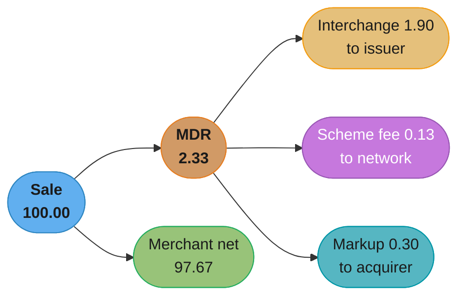
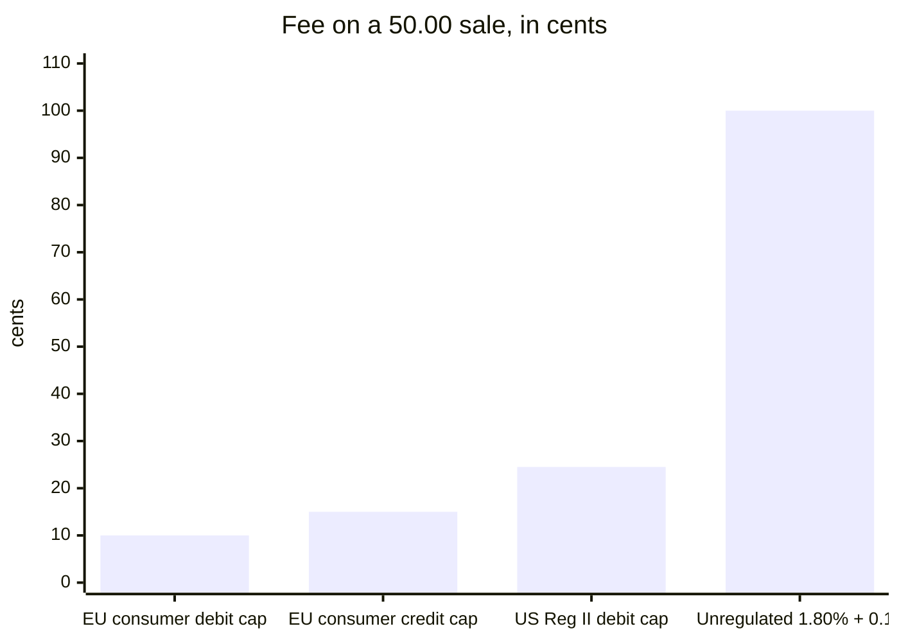
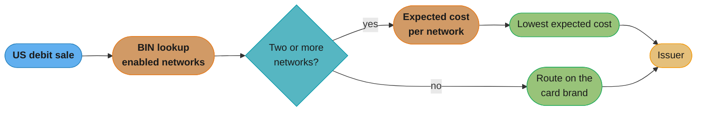

# Interchange and Payment Economics

> Rules and figures checked 2026-11-06. Caps, dates and limits on this page come from the fact
> pins in fintech/CLAUDE.md, from the Visa Core Rules and Visa Product and Service Rules
> (edition of 24 October 2026), and from the Federal Reserve's Regulation II overview page
> (updated 2024-05-17). Interchange rates, prices and approval rates in worked examples are
> illustrative assumptions, not published rates.

---

## 1. Concept Overview

Every card sale pays three parties besides the merchant. The merchant sees one number, the
merchant discount rate (MDR). Underneath it are three fees:

| Fee | Paid by | Paid to | Who sets it |
|---|---|---|---|
| Interchange | Acquirer | Issuer | The network publishes the rate tables, regulators cap some of them |
| Scheme fee | Acquirer (and issuer, for its side) | Network | The network |
| Acquirer markup | Merchant | Acquirer or PSP | The merchant's contract |

**MDR = interchange + scheme fees + acquirer markup.**

Interchange varies by card product, merchant category, channel and geography. That variation
drives the two decisions this page owns:

1. **Pricing model.** Does the merchant pay a blended rate, where the acquirer absorbs the
   variation, or interchange plus plus (IC++), where the merchant pays the variation at cost?
2. **Routing.** When a transaction can go over more than one network or acquirer, does the
   merchant route for the lowest fee or for the highest approval rate?

The page also covers the two regulatory caps engineers meet first (the EU Interchange Fee
Regulation and US Regulation II), dual-network debit routing, network tokens as a cost and
approval lever, and surcharging.

The parties are defined in
[PSPs, acquirers, issuers and networks](../psps_acquirers_issuers_and_networks/psps_acquirers_issuers_and_networks.md).
The lifecycle that produces each fee is in
[Card payments lifecycle](./card_payments_lifecycle.md).

---

## 2. Intuition

**One-line analogy.** Interchange is a toll the merchant's bank pays the cardholder's bank for
every trip across the network. The network posts the toll schedule. The merchant's bank passes
the toll on, with its own fee added.

**Mental model.** Picture a price list with thousands of rows, one per combination of card
product, merchant category, channel and region. Each transaction lands on one row. Blended
pricing averages the list into one number. IC++ hands the merchant the row for each
transaction.

**Why it matters.** At scale, a few basis points of payment cost are a material line in the
income statement. A merchant with USD 1 billion of annual card volume (illustrative) pays
USD 100,000 for each basis point of MDR.

**Key insight.** The cheapest route is not the cheapest outcome. A route that saves 5 basis points
and declines 1% more transactions loses the margin on every declined sale.

---

## 3. Core Principles

1. **Interchange flows from the acquirer to the issuer.** The network sets and publishes the
   rates. It does not keep interchange.
2. **Regulation caps some interchange, not all.** The EU IFR caps consumer debit at 0.2% and
   consumer credit at 0.3% (Arts. 3 and 4). US Regulation II caps covered debit at 21 cents plus
   5 basis points of value, plus up to 1 cent for the fraud-prevention adjustment (12 CFR
   235.3(b)).
3. **The pricing model decides who carries the variance.** Under blended pricing the acquirer
   carries it and prices that risk into the rate. Under IC++ the merchant carries it and sees it.
4. **Routing choices exist only where the card supports them.** US debit cards must be enabled on
   at least two unaffiliated networks under Regulation II, and the merchant may direct routing
   among them. Credit cards route over their one brand's network.
5. **Expected cost includes declines.** Compare routes on fee plus the expected margin lost to
   declines, not on fee alone.
6. **Every number in this domain has a date.** Interchange tables change on network release
   cycles, caps change by regulation, and a Fed proposal to lower the Reg II cap was published on
   2023-10-25 and is proposed, not finalized, as of 2026-11-06.

---

## 4. Types / Architectures / Strategies

### 4.1 Pricing models

| Model | What the merchant pays | Who carries interchange variance | Statement complexity |
|---|---|---|---|
| Blended (flat) | One rate, often with a fixed fee per transaction | Acquirer | Low |
| Interchange plus (IC+) | Interchange at cost plus one combined markup | Merchant, on interchange | High |
| Interchange plus plus (IC++) | Interchange and scheme fees at cost plus a stated acquirer markup | Merchant, on both | Highest |
| Tiered | Rates by bucket the acquirer defines (for example qualified, non-qualified) | Split, set by the acquirer's bucket rules | Medium, and opaque |

### 4.2 Decision model: blended vs IC++

| Factor | Favors blended | Favors IC++ |
|---|---|---|
| Volume | Low, where the acquirer's markup on a flat rate is small in absolute terms | High, where basis points matter |
| Card mix | Mostly low-cost cards that the blended rate overcharges less | A mix with many regulated or low-interchange cards that a blended rate overcharges |
| Finance capacity | No one to reconcile per-transaction fees | A team that reads fee files and reconciles them |
| Predictability | The business needs a fixed cost per sale | The business can absorb monthly variation |
| Negotiating power with the acquirer | None | Enough volume to negotiate the markup |

### 4.3 Decision model: least-cost vs approval-rate routing

| Factor | Route for lowest fee | Route for highest approval |
|---|---|---|
| Margin per sale | Low margin, many small tickets | High margin, where a lost sale costs more than the fee gap |
| Approval-rate gap between routes | Small or not measured as significant | Large and measured |
| Retry behavior | A declined sale is retried on the other route | A declined sale is lost |
| Card type | US debit with two unaffiliated networks | Any card where only one route exists, so routing is about acquirers |

Pick the route with the lowest expected cost:

```
expected cost = fee + (1 - approval rate) x margin lost per declined sale
```

### 4.4 Cost drivers inside interchange

Interchange tables price by these dimensions. The rates themselves are network publications and
are not reproduced here.

| Driver | Example values |
|---|---|
| Card product | Consumer debit, consumer credit, premium credit, commercial, prepaid |
| Channel | Card present (chip, contactless), card absent (e-commerce, stored credential) |
| Merchant category | The MCC places the sale in a category with its own rate |
| Geography | Domestic, intra-regional, inter-regional (cross-border) |
| Regulation | Capped (EU consumer cards, US covered debit) or not |
| Issuer size | Under Reg II, certain small issuers are exempt from the debit cap |

---

## 5. Architecture Diagrams

### 5.1 Where each part of the MDR goes



Illustrative rates on a 100.00 sale: interchange 1.80% plus 0.10, scheme fee 0.13%, markup
0.30%. Under IC++ the merchant's statement shows the three lines. Under blended pricing it shows
one rate, and the acquirer keeps whatever the blended rate earns above interchange and scheme
fees.

### 5.2 Regulated caps against an illustrative unregulated rate



On a 50.00 sale: the IFR debit cap is 0.2% = 10 cents and the credit cap is 0.3% = 15 cents.
The Reg II cap is 21 cents + 5 basis points of 50.00 (2.5 cents) + 1 cent fraud adjustment =
24.5 cents. The fourth bar uses the illustrative rate from §5.1, not a published rate. The US cap
is a fixed fee plus a small percentage, so it costs more than the EU caps on small tickets.

### 5.3 Dual-network debit routing



Regulation II requires at least two unaffiliated networks on a covered debit card and lets the
merchant direct routing among the networks the issuer enabled. The router scores each enabled
network on fee and measured approval rate.

---

## 6. How It Works - Detailed Mechanics

### 6.1 The regulated caps in code

The cap calculation below keeps every amount in minor units and every rate as `BigDecimal`. The
IFR caps are percentages. The Reg II cap is a fixed fee, an ad valorem part in basis points and
an optional fraud-prevention adjustment. The rounding mode is a modelling assumption: the
regulation states a cap, and an issuer must stay at or below it, so this code rounds down.

```java
import java.math.BigDecimal;
import java.math.RoundingMode;

public class InterchangeCaps {

    static final BigDecimal IFR_DEBIT_PCT = new BigDecimal("0.2");
    static final BigDecimal IFR_CREDIT_PCT = new BigDecimal("0.3");
    static final long REG_II_FIXED_CENTS = 21;
    static final BigDecimal REG_II_BPS = new BigDecimal("5");
    static final long REG_II_FRAUD_ADJ_CENTS = 1;

    static long percentCap(long amountMinor, BigDecimal pct) {
        return BigDecimal.valueOf(amountMinor).multiply(pct)
                .divide(BigDecimal.valueOf(100), 0, RoundingMode.DOWN).longValueExact();
    }

    static long regIICap(long amountCents, boolean fraudAdjustment) {
        long adValorem = BigDecimal.valueOf(amountCents).multiply(REG_II_BPS)
                .divide(BigDecimal.valueOf(10_000), 0, RoundingMode.DOWN).longValueExact();
        return REG_II_FIXED_CENTS + adValorem + (fraudAdjustment ? REG_II_FRAUD_ADJ_CENTS : 0);
    }

    public static void main(String[] args) {
        assert percentCap(5_000, IFR_DEBIT_PCT) == 10;     // EUR 50.00 debit: 10 cents
        assert percentCap(5_000, IFR_CREDIT_PCT) == 15;    // EUR 50.00 credit: 15 cents
        assert regIICap(5_000, true) == 24;                // USD 50.00: 21 + 2 + 1, half cent dropped
        assert regIICap(100_000, true) == 72;              // USD 1,000.00: 21 + 50 + 1
        assert regIICap(1_000, false) == 21;               // USD 10.00: 21 + 0
        System.out.printf("IFR debit 10, IFR credit 15, Reg II 50.00 -> %d, 1000.00 -> %d%n",
                regIICap(5_000, true), regIICap(100_000, true));
    }
}
```

The 50.00 case shows why the rounding rule must be explicit. The exact cap is 24.5 cents.
Rounding half up would put the fee half a cent over the cap.

### 6.2 Blended vs IC++ on a real card mix

The comparison below prices one month of an illustrative merchant under both models. All rates
and the mix are assumptions. The method is the point: price each card product at its own
interchange under IC++ and compare with one blended rate.

```java
import java.math.BigDecimal;
import java.math.RoundingMode;
import java.util.List;

public class PricingCompare {

    record Bucket(String product, long txCount, long avgTicketMinor, BigDecimal icPct, long icFixedMinor) {
        long volumeMinor() { return txCount * avgTicketMinor; }
        long interchangeMinor() {
            BigDecimal pct = BigDecimal.valueOf(avgTicketMinor).multiply(icPct)
                    .divide(BigDecimal.valueOf(100), 4, RoundingMode.HALF_EVEN);
            return pct.add(BigDecimal.valueOf(icFixedMinor)).multiply(BigDecimal.valueOf(txCount))
                    .setScale(0, RoundingMode.HALF_EVEN).longValueExact();
        }
    }

    static long percentOf(long amountMinor, BigDecimal pct) {
        return BigDecimal.valueOf(amountMinor).multiply(pct)
                .divide(BigDecimal.valueOf(100), 0, RoundingMode.HALF_EVEN).longValueExact();
    }

    public static void main(String[] args) {
        List<Bucket> mix = List.of(                                   // all illustrative
                new Bucket("regulated debit", 40_000, 3_000, new BigDecimal("0.05"), 22),
                new Bucket("consumer credit", 30_000, 6_000, new BigDecimal("1.80"), 10),
                new Bucket("premium credit", 10_000, 9_000, new BigDecimal("2.40"), 10),
                new Bucket("commercial", 2_000, 25_000, new BigDecimal("2.50"), 10));

        long volume = mix.stream().mapToLong(Bucket::volumeMinor).sum();
        long tx = mix.stream().mapToLong(Bucket::txCount).sum();
        long interchange = mix.stream().mapToLong(Bucket::interchangeMinor).sum();

        long schemeFees = percentOf(volume, new BigDecimal("0.13"));
        long icppMarkup = percentOf(volume, new BigDecimal("0.20")) + tx * 5;
        long icpp = interchange + schemeFees + icppMarkup;

        long blended = percentOf(volume, new BigDecimal("2.40")) + tx * 20;

        System.out.printf("volume %d, IC++ %d (%.2f%%), blended %d (%.2f%%)%n",
                volume, icpp, 100.0 * icpp / volume, blended, 100.0 * blended / volume);
        assert icpp < blended : "this mix favors IC++";
        assert interchange + schemeFees + icppMarkup == icpp;
    }
}
```

With this mix, IC++ costs less because 40,000 of 82,000 transactions are regulated debit. A
blended rate charges those at the same rate as premium credit. A merchant whose mix is mostly
premium credit could see the opposite result.

### 6.3 Routing tables and expected cost

The routing data lives in a table the router reads. Fee and approval rate are measured per route
and refreshed from the merchant's own traffic. All values below are illustrative.

```sql
CREATE TABLE debit_route (
    bin_prefix      text    NOT NULL,
    network         text    NOT NULL,
    fee_bps         numeric(8,3) NOT NULL CHECK (fee_bps >= 0),
    fee_fixed_cents numeric(8,3) NOT NULL CHECK (fee_fixed_cents >= 0),
    approval_rate   numeric(6,5) NOT NULL CHECK (approval_rate > 0 AND approval_rate <= 1),
    PRIMARY KEY (bin_prefix, network)
);

INSERT INTO debit_route VALUES
    ('411111', 'brand_network',   5.0, 22.0, 0.97500),
    ('411111', 'pinless_network', 4.0, 14.0, 0.95000);

CREATE TABLE sale_context (
    sale_id       text PRIMARY KEY,
    bin_prefix    text NOT NULL,
    amount_cents  bigint NOT NULL CHECK (amount_cents > 0),
    margin_cents  bigint NOT NULL CHECK (margin_cents >= 0)
);

INSERT INTO sale_context VALUES
    ('low-margin',  '411111', 2000,  100),
    ('high-margin', '411111', 2000, 1200);
```

### 6.4 Network tokens in the economics

A network token changes three numbers a merchant tracks:

| Effect | Mechanism |
|---|---|
| Fewer declines for expired or replaced cards | The token service maps the token to the replacement card |
| Fewer fraud declines on card-absent sales | Each token transaction carries a cryptogram the issuer can validate |
| Smaller PCI scope | The merchant stores tokens, not PANs |

Visa reported more than 10 billion tokens issued since the 2014 launch, and Mastercard committed
in June 2024 to 100% e-commerce tokenization in Europe by 2030. The approval-rate effect for
a given merchant is an empirical number. Measure it with a holdout before using it in the routing
table.

### 6.5 Surcharging

A surcharge passes part of the acceptance cost to the cardholder. The rules are network rules
and local law, and they differ by region. The Visa rules (24 October 2026 edition) set these for
the US region and US territories:

- A merchant may assess a fixed or variable surcharge on Visa credit card transactions, subject
  to applicable law (§5.5.1.7).
- The surcharge applies at the brand level (all Visa credit) or at the product level (one credit
  product type), not both.
- The maximum is 3.00% (§5.5.1.8).
- The point-of-transaction disclosure states that the surcharge is "not greater than the
  applicable Merchant Discount Rate for Visa Credit Card Transactions at the Merchant" (§5.5.1.9).
- The surcharge is included in the transaction amount and identified in the transaction data.
- On a refund, the merchant refunds the surcharge, pro-rated for a partial refund.
- For transactions outside the credit allowance, Visa §1.5.5.2 forbids a surcharge unless law
  expressly requires that the merchant be permitted to impose one.

In the Europe region, the Visa rules require the merchant to communicate the surcharge amount
before the transaction and the cardholder to agree to it. Local law can ban surcharging outright
for some card types. A checkout that surcharges must compute the fee on the final amount after
discounts and show it before the customer confirms.

---

## 7. Real-World Examples

- **EU consumer card caps.** Regulation (EU) 2015/751 caps consumer debit interchange at 0.2%
  (Art. 3) and consumer credit at 0.3% (Art. 4).
- **US covered debit cap.** Regulation II caps covered debit interchange at 21 cents plus 5 basis
  points of value, with up to 1 cent more for the fraud-prevention adjustment (12 CFR 235.3(b)).
  The Federal Reserve proposed a lower cap on 2023-10-25 (docket R-1818). The comment period
  closed on 2024-05-12, and the proposal is not finalized as of 2026-11-06.
- **Reg II routing.** The Federal Reserve's Regulation II page states that the rule prohibits
  issuers and networks "from restricting the number of networks over which debit transactions may
  be processed to less than two unaffiliated networks, and from inhibiting a merchant's ability to
  direct the routing" over any network the issuer has enabled. It also exempts certain small
  issuers, government-administered payment programs and reloadable general-use prepaid cards from
  the fee cap.
- **Visa US surcharge cap.** 3.00% on Visa credit card transactions in the US region and US
  territories (Visa §5.5.1.8).

---

## 8. Tradeoffs

| Choice | Benefit | Cost |
|---|---|---|
| IC++ | Pays interchange at cost, shows every fee | Monthly cost varies, reconciliation needs fee files per transaction |
| Blended | Fixed price per sale, simple statements | Overpays on low-interchange cards, the acquirer keeps the spread |
| Least-cost debit routing | Lower fee on dual-network debit | Can lower approval rate, and the router needs BIN data and measurement |
| Approval-first routing | Fewer lost sales | Higher fees on some routes |
| Network tokens | Fewer lifecycle declines, smaller PCI scope | Integration work with each network's token service or a PSP that wraps them |
| Surcharging credit | Recovers part of the acceptance cost | Disclosure rules, refund handling, customer friction, and legal limits by region |

---

## 9. When to Use / When NOT to Use

**Use blended pricing** below the volume where a finance team can read fee files, or when cost
predictability per sale matters more than the last basis point.

**Use IC++** when monthly volume is large, the card mix has many low-interchange cards, and
someone owns fee reconciliation.

**Use least-cost routing** on US dual-network debit when measured approval rates on the cheaper
network are close to the brand network, or when margin per sale is small.

**Do not route on fee alone** for high-margin sales. Compute expected cost.

**Do not surcharge** without the network's disclosure flow and a refund path that returns the
surcharge.

**Do not hard-code interchange rates** in application code. They change on network release
cycles. Load them from a dated table.

---

## 10. Common Pitfalls

**Basis points read as percent.** A billing team computed the Reg II cap with "5" as a percent.
On a USD 50.00 purchase the computed cap was 272 cents instead of 24. The monitoring check that
compared issuer interchange against the cap never fired, because nothing could exceed 272 cents.
The incident is illustrative.

```java
// BROKEN
public class RegIICapBroken {
    public static void main(String[] args) {
        long amountCents = 5_000;
        double adValorem = amountCents * 5 / 100.0;   // 5 treated as percent, and a double
        double cap = 21 + adValorem + 1;
        System.out.println("cap cents: " + cap);      // 272.0, should be 24
    }
}
```

The fix names the unit, divides by 10,000 for basis points, and keeps money in integers with an
explicit rounding mode.

```java
// FIX
import java.math.BigDecimal;
import java.math.RoundingMode;

public class RegIICapFixed {
    static final int BPS_PER_UNIT = 10_000;

    static long capCents(long amountCents, long adValoremBps, long fixedCents, long fraudAdjCents) {
        long adValorem = BigDecimal.valueOf(amountCents).multiply(BigDecimal.valueOf(adValoremBps))
                .divide(BigDecimal.valueOf(BPS_PER_UNIT), 0, RoundingMode.DOWN).longValueExact();
        return fixedCents + adValorem + fraudAdjCents;
    }

    public static void main(String[] args) {
        long cap = capCents(5_000, 5, 21, 1);
        assert cap == 24 : cap;
        System.out.println("cap cents: " + cap);
    }
}
```

**Comparing pricing offers on the headline rate.** A merchant compared a blended rate with an
IC++ markup and picked the lower headline number. The IC++ offer left interchange and scheme fees
out of the headline, so the comparison was between a total and a part. Price both offers on the
merchant's own card mix, as §6.2 does.

**Least-cost routing with no measurement.** A merchant switched all dual-network debit to the
cheaper network and saved fees. Approval rate on that network was lower for one large issuer.
The lost sales cost more than the fee saved. §14 shows the expected-cost query.

**Reconciling IC++ statements against a fixed rate.** Finance reconciled the acquirer's IC++
invoice against "expected" fees from a single rate. Every line broke. IC++ needs the acquirer's
per-transaction fee file, matched on transaction identifier. See
[Reconciliation and settlement files](../reconciliation_and_settlement_files/reconciliation_and_settlement_files.md).

**Surcharge left in place on refund.** A checkout refunded the item price and kept the surcharge.
The Visa US rules require the merchant to refund the surcharge, pro-rated on a partial refund.

---

## 11. Technologies & Tools

| Tool | What it is | Role in payment economics |
|---|---|---|
| Adyen | Payment platform with gateway, processing and acquiring | Offers IC++ pricing and multi-network routing |
| Checkout.com | Payment platform with acquiring | Acquiring with network token support |
| Spreedly | Payment orchestration and card vault | Routes stored cards to several gateways or acquirers |
| Visa Token Service | Visa's network token service | Network tokens for Visa cards |
| Mastercard MDES | Mastercard Digital Enablement Service | Network tokens for Mastercard cards |

Interchange tables come from the networks and are distributed to acquirers. Merchants get them
through their acquirer's fee files, not from a public API.

---

## 12. Interview Questions with Answers

**Q: Does the card network keep the interchange fee?**
**Short:** No, interchange is paid by the acquirer to the issuer, while the network publishes the rates and earns its own separate scheme fees.

The confusion comes from the name on the rate table. The network writes it, but the money goes
from one member bank to another. The network's income is scheme fees, charged to acquirers and
issuers for using the network. On an IC++ statement the two appear as separate lines.

**Q: What does the merchant discount rate consist of?**
**Short:** MDR is interchange plus scheme fees plus the acquirer's markup, expressed as what the merchant pays per transaction.

Under blended pricing the merchant sees only the total. Under IC++ it sees each part. The markup
is the only part the merchant negotiates directly. Interchange and scheme fees are set by the
network and by regulation.

**Q: Under blended pricing, who carries the risk that interchange changes?**
**Short:** The acquirer carries it, because it pays the actual interchange per transaction while charging the merchant one fixed rate.

The acquirer prices that risk into the blended rate. When interchange falls on part of the
merchant's mix, the acquirer keeps the difference unless the contract is repriced. Under IC++ the
change passes to the merchant at once, in both directions.

**Q: When is IC++ cheaper than a blended rate?**
**Short:** IC++ is cheaper when the card mix holds many low-interchange cards, such as regulated debit, that a blended rate charges at the same price as premium credit.

The comparison has to use the merchant's own mix. A merchant whose customers mostly pay with
premium credit cards can pay less under a blended rate, because the acquirer averages in cheaper
cards from other merchants. Run both models on a month of real transactions before signing.

**Q: What are the EU interchange caps on consumer cards?**
**Short:** The EU Interchange Fee Regulation caps consumer debit interchange at 0.2% and consumer credit interchange at 0.3% of the transaction value.

Articles 3 and 4 of Regulation (EU) 2015/751 set the caps. On a EUR 50.00 sale that is 10 cents
for debit and 15 cents for credit. The caps make interchange on consumer cards in the EU a small
part of MDR, so scheme fees and the markup matter more there than in uncapped markets.

**Q: How is the US Regulation II debit interchange cap calculated?**
**Short:** The cap is 21 cents plus 5 basis points of the amount, plus up to 1 cent if the issuer qualifies for the fraud-prevention adjustment.

On a USD 50.00 debit purchase that is 21 + 2.5 + 1 = 24.5 cents. Because the fixed part
dominates, the cap is a high percentage on small tickets and a low one on large tickets. The Fed
proposed a lower cap in October 2023, and that proposal is not finalized as of 2026-11-06.

**Q: Which issuers are outside the Regulation II fee cap?**
**Short:** Certain small debit card issuers, government-administered payment programs and reloadable general-use prepaid cards are exempt from the fee cap.

The exemption is from the interchange fee limit only. The routing rules apply to all issuers and
networks. A merchant sees the difference in its fee file: the same debit transaction on an exempt
issuer can carry a higher interchange rate.

**Q: What does Regulation II require for debit routing?**
**Short:** Issuers and networks may not limit a debit card to fewer than two unaffiliated networks, and may not stop the merchant from choosing among enabled networks.

That is what makes least-cost routing possible on US debit. The merchant or its acquirer reads
the BIN data to see which networks a card is enabled on, then routes. Credit cards have no such
rule, so routing on credit is a choice between acquirers, not networks.

**Q: Why can least-cost routing cost a merchant money?**
**Short:** A cheaper network can approve fewer transactions, and each lost sale costs its margin, which can exceed the fee saved.

Compare routes on fee plus decline rate times margin lost per decline. For a low-margin sale the
fee dominates. For a high-margin sale a small approval gap dominates. The approval rates must be
measured on the merchant's own traffic, per issuer where volume allows.

**Q: What are scheme fees, and how do they differ from interchange?**
**Short:** Scheme fees are what the network charges its member banks for using the network, while interchange moves between the two banks.

Acquirers pass scheme fees to merchants at cost under IC++ and inside the rate under blended
pricing. They include per-transaction and volume-based fees and often a cross-border component.
Their structure is set in each network's fee schedule, which acquirers receive.

**Q: Why does a three-party scheme have no interchange line?**
**Short:** In a three-party scheme one company is both issuer and acquirer, so no fee passes between two banks and the merchant is priced directly.

The merchant still pays a discount rate. It is set in one contract with the network company. This
is why routing and fee analysis for such cards uses that network's own merchant pricing instead
of an interchange table.

**Q: How does the MCC affect what a sale costs?**
**Short:** The MCC places the sale in an interchange category, and categories carry different rates for the same card product.

A wrong MCC can put a sale in a more expensive category or an ineligible one. On a PayFac or
marketplace each seller's MCC must be right for its own business. Audit MCCs whenever fee files
show categories that do not match the business.

**Q: How do network tokens affect payment economics?**
**Short:** They reduce declines from replaced cards, carry a cryptogram that supports approval, and shrink PCI scope, but the approval effect must be measured per merchant.

Visa reported more than 10 billion tokens issued since 2014, and Mastercard committed to 100%
e-commerce tokenization in Europe by 2030. Neither figure tells one merchant its own lift. Run a
holdout: tokenize a share of stored cards and compare approval rates.

**Q: What does Visa allow for credit card surcharges in the US?**
**Short:** A US merchant may surcharge Visa credit transactions at the brand or product level, up to 3.00%, and must disclose it and refund it with the sale.

The disclosure says the surcharge is not greater than the merchant's discount rate for Visa
credit. The surcharge goes into the transaction amount and is identified in the data. State law
can restrict surcharging further, so the checkout needs a per-state switch.

**Q: Why does IC++ make reconciliation harder?**
**Short:** Every transaction carries its own interchange and scheme fee, so expected cost cannot be computed from one rate and must be matched to the acquirer's fee file.

Finance needs the per-transaction fee records and a match on transaction identifier. Fee
adjustments arrive later for downgrades and corrections. A blended contract needs only a rate
check, which is part of what the acquirer charges for.

**Q: Why should interchange tables live in data, not in code?**
**Short:** Networks change interchange rates on their own release cycles and regulators change caps, so rates hard-coded in services go stale silently.

Store rates in a table with effective dates and a source reference, and look them up by
transaction date. Then a historical cost report uses the rate that applied on the day, and a rate
change is a data load, not a deployment.

**Q: How should a router choose between two acquirers for a credit card?**
**Short:** Score each acquirer on its total fee and its measured approval rate for that BIN range, and pick the lower expected cost, with health checks as a gate.

Acquirers differ on markup and on approval rate, because issuers treat acquirers and their
merchants differently. The router should also stop sending to an acquirer that is failing. The
orchestration design is in the
[payment orchestration case study](../case_studies/design_a_payment_orchestration_layer.md).

**Q: How should a refund handle a surcharge?**
**Short:** Refund the surcharge with the sale, and pro-rate it on a partial refund, because the Visa US rules require it.

The refund record should carry the surcharge as its own line, linked to the original. A refund
service that knows only the item price leaves the cardholder short and breaks the network rule.

---

## 13. Best Practices

- Model MDR as three fees in the ledger: interchange, scheme fees and markup.
- Keep interchange tables, caps and surcharge rules in dated data, not code.
- Compute caps and fees in minor units with `BigDecimal` and an explicit rounding mode.
- Compare pricing offers on the merchant's own card mix, never on headline rates.
- Route on expected cost: fee plus decline rate times margin lost.
- Measure approval rate per route and per issuer where volume allows, and refresh it.
- Tokenize stored cards and measure the approval effect with a holdout.
- Reconcile IC++ invoices against per-transaction fee files.
- Show any surcharge before the customer confirms, and refund it with the sale.

---

## 14. Case Study

**Scenario (illustrative).** A US grocery delivery service has thin margins on most orders and
high margins on a premium membership. Most customers pay by debit, and most debit cards are
enabled on two networks. The routing team switched all debit to the cheaper network. Fees fell,
and membership revenue fell more. All figures are assumptions.

**Problem.** The router used fee only.

```sql
-- BROKEN
SELECT s.sale_id, r.network,
       round(s.amount_cents * r.fee_bps / 10000 + r.fee_fixed_cents, 3) AS fee_cents
FROM sale_context s
JOIN LATERAL (
    SELECT * FROM debit_route d
    WHERE d.bin_prefix = s.bin_prefix
    ORDER BY s.amount_cents * d.fee_bps / 10000 + d.fee_fixed_cents
    LIMIT 1
) r ON true
ORDER BY s.sale_id;
-- high-margin | pinless_network | 14.800
-- low-margin  | pinless_network | 14.800
```

Both sales go to the cheaper network. For the membership sale, 2.5 more declines per 100 cost
2.5% of 1,200 cents in expected margin, which is 30 cents against a fee saving of 8.2 cents.

**Fix.** The router ranks routes on expected cost, which adds the margin lost to declines.

```sql
CREATE VIEW route_choice AS
SELECT s.sale_id, r.network, r.expected_cost_cents
FROM sale_context s
JOIN LATERAL (
    SELECT d.network,
           round(s.amount_cents * d.fee_bps / 10000 + d.fee_fixed_cents
                 + (1 - d.approval_rate) * s.margin_cents, 3) AS expected_cost_cents
    FROM debit_route d
    WHERE d.bin_prefix = s.bin_prefix
    ORDER BY 2 ASC, d.network
    LIMIT 1
) r ON true;

DO $$
BEGIN
    ASSERT (SELECT network FROM route_choice WHERE sale_id = 'low-margin') = 'pinless_network';
    ASSERT (SELECT network FROM route_choice WHERE sale_id = 'high-margin') = 'brand_network';
END $$;

SELECT * FROM route_choice ORDER BY sale_id;
-- high-margin | brand_network   | 53.000
-- low-margin  | pinless_network | 19.800
```

For the low-margin sale the cheaper network wins (19.8 cents against 25.5). For the membership
sale the brand network wins (53.0 against 74.8), because the approval gap costs more than the fee
gap.

**Design decisions.**

- Approval rates come from the merchant's own traffic per BIN range and network, refreshed daily,
  with a minimum sample size before a measured rate replaces the default.
- Margin per sale is passed in by the order service, so the router does not need to know the
  product catalogue.
- A declined debit sale on the cheaper network is retried once on the brand network where the
  decline code allows it, under the retry rules in
  [Card payments lifecycle](./card_payments_lifecycle.md).

**Outcome (illustrative).** Fees stayed close to the fee-only level, because most orders were
low margin. Membership approvals returned to their old level. The team added a weekly report of
expected cost against realized cost per route, so a shift in approval rates shows up before it
costs a month of revenue.
