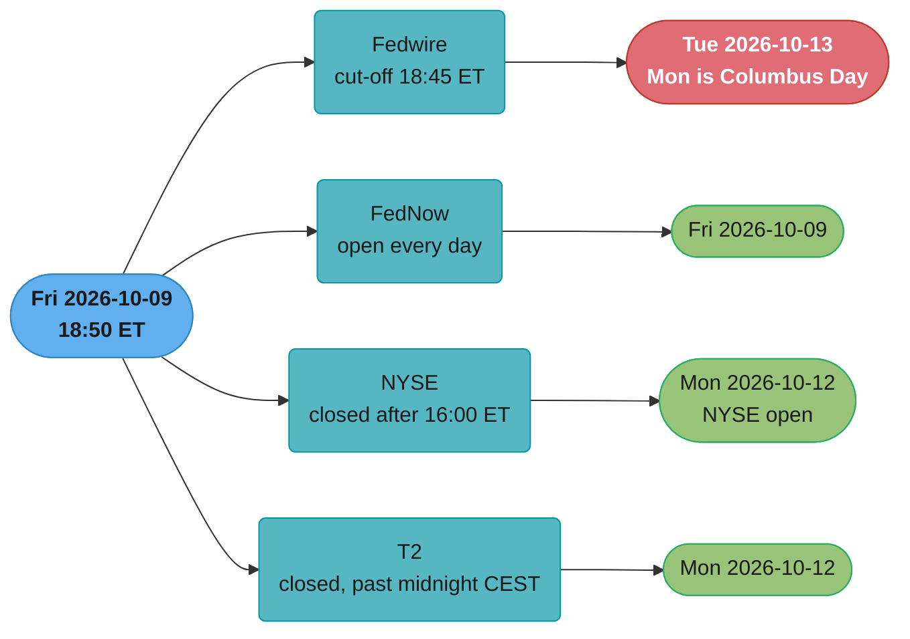
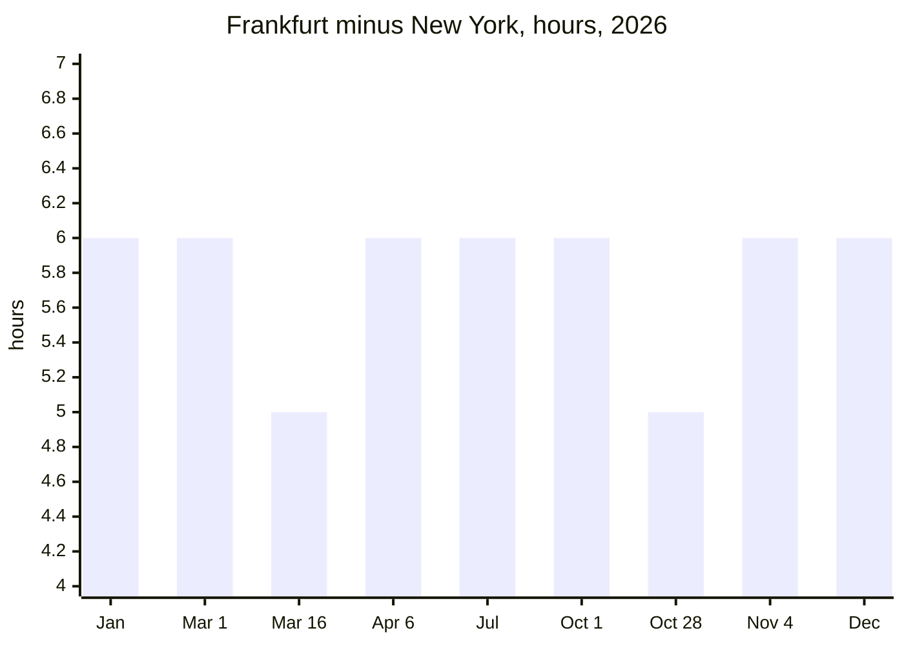

# Business Days, Cut-offs and Value Dates

> Rules and figures checked 2026-11-06. Every date, threshold and fee on this page comes from the fact pins in fintech/CLAUDE.md, or from these primary pages read on 2026-11-06: the Federal Reserve holiday list (federalreserve.gov, updated 2026-07-08), the Fedwire Funds Service operating hours (frbservices.org), the FedNow Service page (federalreserve.gov), the NYSE holidays and trading hours page (nyse.com) and the T2 page (ecb.europa.eu).
>
> Cross-cutting reference for the fintech case studies. This file covers the calendar and clock side of money movement: which days a rail or market is open, when an instruction misses its day, which of the several dates on a payment drives what, and how time zones and month ends break naive date code. The java.time API itself, `ZonedDateTime` versus `LocalDateTime` and DST gap and overlap resolution, is in [java.time and date handling](../../../java/java_time_datetime/java_time_datetime.md). This file does not teach the API again.

---

## 1. Concept Overview

A payment has more than one date. The customer pressed **Pay** on one date, the ledger booked the entry on a second, the bank credited the funds with a third as the value date, and the banks settled with each other on a fourth. Most of the time these are the same day, so code treats them as one. A weekend, a holiday, a missed cut-off or a time zone splits them, and every system that assumed they were one value breaks at once: reconciliation, payout ETAs, interest, billing anchors and regulatory deadlines.

Four ideas cover the topic:

- **Calendars.** Each rail and each market has its own list of open days. They differ. In 2026 the Federal Reserve Banks are closed on Columbus Day (October 12) and Veterans Day (November 11), and the NYSE is open on both days. The NYSE is closed on Good Friday (April 3), and the Fed is open. T2, the euro RTGS system, is closed on Good Friday, Easter Monday and 1 May. FedNow has no closed days.
- **Cut-offs.** A rail accepts an instruction for a processing date only until a wall-clock time in its own zone. After the cut-off, the instruction belongs to the next open day. The Fedwire Funds Service takes customer transfers until 6:45 p.m. ET and bank transfers until 7:00 p.m. ET.
- **Date kinds.** Transaction date, booking date, value date and settlement date are four fields. Each one drives a different downstream system.
- **Clock arithmetic.** "T+1", "within 5 banking days", "120 calendar days" and "the 31st of each month" are each a different calculation. Each needs a calendar, a zone and a rule for what happens when the result lands on a closed day or a short month.

The rail rules themselves (ACH windows, wire finality, instant-rail limits) are in [bank rails: ACH, SEPA and wires](../../bank_rails_ach_sepa_and_wires/bank_rails_ach_sepa_and_wires.md) and [real-time payments and open banking](../../real_time_payments_and_open_banking/real_time_payments_and_open_banking.md). This file uses those rules and covers only the date and calendar arithmetic around them.

---

## 2. Intuition

**One-line analogy.** Each rail is a train station with its own timetable. The last train of the day leaves at the cut-off, the station is shut on its own list of holidays, and the station clock runs on local time. A parcel handed in after the last train sits on the platform until the next train, even if the next station along the line is open.

**Mental model.** Keep two kinds of time apart. An instant is a point on the global timeline: store it in UTC. A business date is a label that a calendar puts on an instant: it needs the calendar's zone, its cut-off and its list of closed days. "When did it happen" is an instant. "Which day's file does it go in" is a business date. Code that stores only a `date` has lost the instant. Code that stores only an instant must recompute the business date with the right calendar each time.

**Why it matters.** Date bugs in money systems are silent. A payout ETA that ignores Columbus Day shows "arrives Monday" to every customer who withdraws on Friday, and support gets the calls on Tuesday. A ledger that books in UTC puts every New York card sale after 20:00 EDT (19:00 EST) on the next day's books, so the daily totals never match the processor's report. A billing job that adds one month to the previous bill date drifts a January 31 customer to the 28th for the rest of the year.

**Key insight.** "Add one day" is never the right operation in a money system. The right operation is "the next business day on calendar X after the cut-off in zone Z", and each of X, Z and the cut-off is data that changes per rail, per market and per year.

---

## 3. Core Principles

- **Store the instant, derive the date.** Persist `timestamptz` or `Instant` for every event. Compute business dates with a named calendar. Persist the computed business date too, with the calendar id, when a downstream system needs a fixed label.
- **One calendar per rail or market, with its zone.** Fedwire, FedNow, the NYSE and T2 each have their own open days. A cross-currency movement needs a day that is open on every calendar it touches.
- **A cut-off is a wall-clock time in the rail's zone.** It is not a UTC time. DST moves its UTC instant twice a year, and the US and the EU move on different dates.
- **Name the date.** Transaction date, booking date, value date and settlement date are separate columns. Reconciliation matches on the one the counterparty uses.
- **Count the way the rule counts.** A rule in calendar days, a rule in business days and a rule in banking days give different deadlines. Read which one the rule uses, and keep the count type next to the deadline in code.
- **Calendars are data with versions.** Holiday lists are published per year. Load them from the operator's page, store them with an effective date, and alert when next year's list is missing.
- **Month arithmetic is anchored.** Compute the nth billing date from the anchor, never from the previous bill date. A short month clamps the day, and the next month must recover.

---

## 4. Types / Architectures / Strategies

### 4.1 The dates on a payment

| Date | Definition | Who sets it | Drives |
|---|---|---|---|
| Transaction date | When the business event happened, in the customer's or merchant's zone | The merchant or the platform | Receipts, disputes, customer statements |
| Booking date | When the ledger posted the entry | The ledger | Accounting period, daily close |
| Value date | The date from which funds count for interest and availability | The bank or the rail | Interest, available balance, overdraft |
| Settlement date | When funds move between the institutions | The rail or the clearing system | Bank statement, cash position, reconciliation |
| Effective entry date | The date an ACH originator asks the entry to settle | The originator, in the ACH file | Expected settlement for ACH reconciliation |
| Trade date and settlement date | When a securities trade executed, and when it settles (T+1 for most US broker-dealer securities transactions since 2024-05-28) | The venue, then the settlement system | Positions, buying power, cash projection |

### 4.2 Calendar types

| Calendar | Open days | Closed days in 2026 (weekdays) | Zone |
|---|---|---|---|
| Fedwire Funds Service | Every day that is not a Saturday, a Sunday or a Federal Reserve Banks holiday | Jan 1, Jan 19, Feb 16, May 25, Jun 19, Sep 7, Oct 12, Nov 11, Nov 26, Dec 25 | ET |
| FedNow Service | Every day. FedNow states "a 24-hour business day each day of the week, including weekends and holidays" | None | ET for reporting |
| NYSE | Weekdays that are not NYSE holidays | Jan 1, Jan 19, Feb 16, Apr 3, May 25, Jun 19, Jul 3, Sep 7, Nov 26, Dec 25 | ET |
| T2 (euro RTGS) | Monday to Friday, except its closing days | Jan 1, Apr 3 (Good Friday), Apr 6 (Easter Monday), May 1, Dec 25. Dec 26 is a Saturday in 2026 | CET or CEST |

Two Federal Reserve rules move a holiday that falls on a weekend. For a Saturday holiday, "Federal Reserve Banks and Branches will be open the preceding Friday". For a Sunday holiday, "all Federal Reserve offices will be closed the following Monday". So on Friday 2026-07-03 the Fed Banks are open, and the NYSE is closed for Independence Day (observed). The same split happens on Friday 2027-06-18 and Friday 2027-12-24.

### 4.3 Cut-off types

- **Hard rail cut-off.** The operator stops processing after it. The Fedwire Funds Service stops processing core bank transfers (`pacs.009` BTRC) at 7:00 p.m. ET unless the Federal Reserve Banks extend the cut-off. A participant can queue a message after the close, and Fedwire releases it when the next funds-transfer business day opens.
- **Window cut-off.** A batch rail has several windows per day. The third Same Day ACH window takes files until 4:45 p.m. ET and settles at 6:00 p.m. ET. The ACH Operators set the exact schedules, not the Nacha Rules.
- **Bank internal cut-off.** Your bank needs time before the rail cut-off to screen, approve and release. It is earlier than the rail cut-off, it is in your bank agreement, and it is the one your code must use.
- **Platform cut-off.** Your own system's time for building a payout file. It is earlier still, so retries fit before the bank cut-off.

### 4.4 Roll conventions

When arithmetic lands on a closed day, a rule decides where it goes:

| Convention | Rule | Typical use |
|---|---|---|
| Following | The next open day | Payments due on a weekend, T+n settlement |
| Modified following | The next open day, unless that crosses into the next month, then the previous open day | Month-end interest and coupon dates, so the payment stays in its month |
| Preceding | The previous open day | Payroll that must arrive before a weekend |
| No roll | Keep the date, and let the rail defer it | Instant rails with no closed days |

### 4.5 Day-count types in rules

| Rule | Count | Day type |
|---|---|---|
| Nacha reversal of an erroneous entry | Must reach the RDFI within 5 banking days after the original settlement date | Banking days |
| Reg E error notice and investigation | Notice within 60 days after the statement is sent. Investigate in 10 business days, or up to 45 days with provisional credit within 10 business days | Days, then business days |
| Reg Z billing error | Notice within 60 days of the first statement. Acknowledge within 30 days. Resolve within 2 complete billing cycles and never more than 90 days | Days and billing cycles |
| Visa Dispute Condition 10.4 | 120 calendar days from the processing date | Calendar days |
| Visa authorization to processing, card-absent CIT | 10 days. AFD preauth completion or reversal within 2 hours | Days, then hours |
| Bank SAR filing | No later than 30 calendar days after initial detection | Calendar days |
| EMD2 safeguarding of funds paid by payment instrument | Once credited, and in any case within five business days of issuance | Business days |
| PSD2 safeguarding by segregation | Funds still held at the end of the business day after receipt go to a separate account or safe assets | Business days |
| MiFIR transaction report | As soon as possible, and no later than the close of the following working day | Working days |
| ViDA intra-EU B2B e-invoice, from 2030-07-01 | Issued within 10 days of the chargeable event | Days |

The day type is part of the rule. A field called `deadline_days` with no type is a bug that has not fired yet.

---

## 5. Architecture Diagrams

### One instant, four calendars



The same instant gets four business dates. The NYSE and T2 dates assume an instruction that misses the day's close and goes to the next session.

### Fedwire Funds business day for Tuesday 2026-10-13

```text
           Mon 2026-10-12 (Federal Reserve holiday)          Tue 2026-10-13
time ET    ...  18:45  19:00  21:00 ................................. 18:45  19:00
           |                    |                                     |      |
           |   no Monday        |<---- Tuesday funds-transfer day --->|      |
           |   business day     |      opens 21:00 ET on Monday       |      |
           |                    |                                     |      |
                                                                customer   bank
                                                                cut-off    transfer
                                                                (pacs.008  cut-off,
                                                                 CTRC)     close
```

A funds-transfer business day starts at 9:00 p.m. ET on the preceding calendar day, even when that day is a holiday, and ends at 7:00 p.m. ET. A wire sent at 21:30 ET on Columbus Day settles on Tuesday's business day.

### The New York to Frankfurt gap through 2026



The US starts DST on 2026-03-08 and the EU on 2026-03-29. The EU ends DST on 2026-10-25 and the US on 2026-11-01. For about four weeks a year the gap is 5 hours, so a cut-off in Frankfurt falls one hour later on a New York clock than it does for the rest of the year. The program in §6.2 computes these values from the JDK's time-zone data.

---

## 6. How It Works - Detailed Mechanics

### 6.1 A calendar in SQL

The calendar is a table of closed days and two functions. The first function adds business days. The second turns an instant into a processing date with a cut-off in the rail's zone. The holiday rows are the Federal Reserve list for 2026. Fedwire also treats every Saturday and Sunday as a holiday.

```sql
CREATE TABLE rail_holiday (
    calendar text NOT NULL,
    day      date NOT NULL,
    PRIMARY KEY (calendar, day)
);

INSERT INTO rail_holiday (calendar, day)
SELECT 'fed', d::date FROM unnest(ARRAY[
    '2026-01-01', '2026-01-19', '2026-02-16', '2026-05-25', '2026-06-19',
    '2026-09-07', '2026-10-12', '2026-11-11', '2026-11-26', '2026-12-25']) AS d;

CREATE FUNCTION is_business_day(cal text, d date) RETURNS boolean LANGUAGE sql STABLE AS $$
    SELECT extract(isodow FROM d) < 6
       AND NOT EXISTS (SELECT 1 FROM rail_holiday h WHERE h.calendar = cal AND h.day = d)
$$;

CREATE FUNCTION add_business_days(cal text, d date, n int) RETURNS date LANGUAGE plpgsql STABLE AS $$
DECLARE
    x date := d;
    left_to_add int := n;
BEGIN
    WHILE left_to_add > 0 LOOP
        x := x + 1;
        IF is_business_day(cal, x) THEN
            left_to_add := left_to_add - 1;
        END IF;
    END LOOP;
    RETURN x;
END $$;

CREATE FUNCTION processing_date(cal text, at timestamptz, zone text, cutoff time)
RETURNS date LANGUAGE plpgsql STABLE AS $$
DECLARE
    local_ts timestamp := at AT TIME ZONE zone;
BEGIN
    IF is_business_day(cal, local_ts::date) AND local_ts::time < cutoff THEN
        RETURN local_ts::date;
    END IF;
    RETURN add_business_days(cal, local_ts::date, 1);
END $$;

DO $$
BEGIN
    -- customer wire 5 minutes after the 18:45 ET cut-off on the Friday before Columbus Day
    ASSERT processing_date('fed', timestamptz '2026-10-09 18:50-04', 'America/New_York', time '18:45')
           = date '2026-10-13';
    ASSERT processing_date('fed', timestamptz '2026-10-09 18:30-04', 'America/New_York', time '18:45')
           = date '2026-10-09';
    -- Nacha reversal deadline: 5 banking days after a Friday 2026-11-06 settlement, Veterans Day skipped
    ASSERT add_business_days('fed', date '2026-11-06', 5) = date '2026-11-16';
    -- the day after Thanksgiving
    ASSERT add_business_days('fed', date '2026-11-25', 1) = date '2026-11-27';
END $$;
```

The reversal deadline assumes the ODFI counts banking days on the Federal Reserve calendar. A bank that is closed on other days counts those too. The function takes the calendar as an argument for that reason.

### 6.2 Calendars, cut-offs, rolls and DST in Java

The program below holds the four 2026 calendars from §4.2, then checks each rule on this page against them. Every assertion is a date that a support ticket or a reconciliation break would otherwise find.

```java
import java.time.*;
import java.util.*;

public class BusinessCalendars {
    record Calendar(String name, ZoneId zone, Set<LocalDate> closed, boolean weekendsOpen) {
        boolean isOpen(LocalDate d) {
            boolean weekend = d.getDayOfWeek() == DayOfWeek.SATURDAY || d.getDayOfWeek() == DayOfWeek.SUNDAY;
            return (weekendsOpen || !weekend) && !closed.contains(d);
        }
        LocalDate next(LocalDate d) {
            LocalDate x = d.plusDays(1);
            while (!isOpen(x)) x = x.plusDays(1);
            return x;
        }
        LocalDate previous(LocalDate d) {
            LocalDate x = d.minusDays(1);
            while (!isOpen(x)) x = x.minusDays(1);
            return x;
        }
        LocalDate plusBusinessDays(LocalDate d, int n) {
            LocalDate x = d;
            for (int i = 0; i < n; i++) x = next(x);
            return x;
        }
        LocalDate processingDate(Instant at, LocalTime cutoff) {
            ZonedDateTime local = at.atZone(zone);
            LocalDate d = local.toLocalDate();
            return isOpen(d) && local.toLocalTime().isBefore(cutoff) ? d : next(d);
        }
        LocalDate modifiedFollowing(LocalDate d) {
            if (isOpen(d)) return d;
            LocalDate f = next(d);
            return f.getMonth() == d.getMonth() ? f : previous(d);
        }
    }

    record Joint(Calendar... cals) {
        boolean isOpen(LocalDate d) { return Arrays.stream(cals).allMatch(c -> c.isOpen(d)); }
        LocalDate next(LocalDate d) {
            LocalDate x = d.plusDays(1);
            while (!isOpen(x)) x = x.plusDays(1);
            return x;
        }
    }

    static final ZoneId NY = ZoneId.of("America/New_York");
    static final ZoneId FRA = ZoneId.of("Europe/Berlin");

    static Set<LocalDate> days(String... iso) {
        Set<LocalDate> s = new HashSet<>();
        for (String d : iso) s.add(LocalDate.parse(d));
        return s;
    }

    static final Calendar FED = new Calendar("fed", NY, days("2026-01-01", "2026-01-19", "2026-02-16",
            "2026-05-25", "2026-06-19", "2026-09-07", "2026-10-12", "2026-11-11", "2026-11-26", "2026-12-25"), false);
    static final Calendar FEDNOW = new Calendar("fednow", NY, Set.of(), true);
    static final Calendar NYSE = new Calendar("nyse", NY, days("2026-01-01", "2026-01-19", "2026-02-16",
            "2026-04-03", "2026-05-25", "2026-06-19", "2026-07-03", "2026-09-07", "2026-11-26", "2026-12-25"), false);
    static final Calendar T2 = new Calendar("t2", FRA, days("2026-01-01", "2026-04-03", "2026-04-06",
            "2026-05-01", "2026-12-25", "2026-12-26"), false);

    static void check(Object got, Object want, String what) {
        if (!got.equals(want)) throw new AssertionError(what + ": got " + got + ", want " + want);
        System.out.println(what + " -> " + got);
    }

    static Instant ny(String localDateTime) {
        return LocalDateTime.parse(localDateTime).atZone(NY).toInstant();
    }

    static long gapHours(LocalDate d) {
        Instant noonUtc = d.atTime(12, 0).toInstant(ZoneOffset.UTC);
        int fra = FRA.getRules().getOffset(noonUtc).getTotalSeconds();
        int ny = NY.getRules().getOffset(noonUtc).getTotalSeconds();
        return (fra - ny) / 3600;
    }

    public static void main(String[] args) {
        LocalTime wireCustomerCutoff = LocalTime.of(18, 45);
        check(FED.processingDate(ny("2026-10-09T18:50"), wireCustomerCutoff), LocalDate.parse("2026-10-13"),
                "wire Fri 18:50 ET, Columbus Day Monday");
        check(FED.processingDate(ny("2026-10-12T21:30"), wireCustomerCutoff), LocalDate.parse("2026-10-13"),
                "wire Mon 21:30 ET on the holiday");
        check(FEDNOW.processingDate(ny("2026-10-10T03:00"), LocalTime.MAX), LocalDate.parse("2026-10-10"),
                "FedNow on a Saturday");

        check(NYSE.plusBusinessDays(LocalDate.parse("2026-07-02"), 1), LocalDate.parse("2026-07-06"),
                "T+1 on the NYSE calendar from Thu Jul 2");
        check(FED.plusBusinessDays(LocalDate.parse("2026-07-02"), 1), LocalDate.parse("2026-07-03"),
                "T+1 on the Fed calendar from Thu Jul 2");
        check(FED.plusBusinessDays(LocalDate.parse("2026-11-06"), 5), LocalDate.parse("2026-11-16"),
                "5 banking days after Fri Nov 6");

        check(new Joint(FED, T2).next(LocalDate.parse("2026-04-02")), LocalDate.parse("2026-04-07"),
                "first day open on both Fed and T2 after Apr 2");

        check(FED.next(LocalDate.parse("2026-05-29")), LocalDate.parse("2026-06-01"), "following for Sun May 31");
        check(FED.modifiedFollowing(LocalDate.parse("2026-05-31")), LocalDate.parse("2026-05-29"),
                "modified following for Sun May 31");

        check(gapHours(LocalDate.parse("2026-03-16")), 5L, "Frankfurt minus New York on Mar 16");
        check(gapHours(LocalDate.parse("2026-04-06")), 6L, "Frankfurt minus New York on Apr 6");
        check(gapHours(LocalDate.parse("2026-10-28")), 5L, "Frankfurt minus New York on Oct 28");
        check(gapHours(LocalDate.parse("2026-11-04")), 6L, "Frankfurt minus New York on Nov 4");

        LocalTime frankfurtCutoff = LocalTime.of(17, 0);
        for (String d : List.of("2026-03-16", "2026-04-06")) {
            LocalTime inNy = LocalDate.parse(d).atTime(frankfurtCutoff).atZone(FRA)
                    .withZoneSameInstant(NY).toLocalTime();
            System.out.println("17:00 Frankfurt on " + d + " is " + inNy + " in New York");
        }

        List<String> split = new ArrayList<>();
        for (LocalDate d = LocalDate.parse("2026-01-01"); d.getYear() == 2026; d = d.plusDays(1)) {
            if (d.getDayOfWeek().getValue() > 5) continue;
            boolean f = FED.isOpen(d), n = NYSE.isOpen(d), t = T2.isOpen(d);
            if (f != n || f != t) split.add(d + " fed=" + f + " nyse=" + n + " t2=" + t);
        }
        split.forEach(System.out::println);
        check(split.size(), 12, "weekdays in 2026 where the three calendars disagree");
    }
}
```

The last loop prints the 12 weekdays in 2026 where at least one of the three calendars is open and another is closed. Columbus Day and Veterans Day close only the Fed. Good Friday closes the NYSE and T2 and leaves the Fed open. Easter Monday and 1 May close only T2. July 3 closes only the NYSE. The six US federal holidays that fall on weekdays and close both US calendars still split from T2.

The FedNow check uses `LocalTime.MAX` as a stand-in for "no cut-off". The FedNow page does not say at what hour one 24-hour business day rolls to the next, so the code takes the boundary as a parameter instead of a constant. Read it from the operator's documentation before you rely on it for a ledger date.

### 6.3 Which date to book

A ledger entry carries at least three dates. The rule for each:

1. `occurred_at` is the instant, in UTC. It never changes.
2. `booking_date` is the date of the book that posts the entry, in the zone of the legal entity that owns the book. For example, a New York entity books in ET and a Frankfurt entity in CET or CEST. Never UTC by default.
3. `value_date` comes from the rail or the bank. For an outgoing wire it is the processing date from §6.2. For an incoming credit it is the date on the bank statement line.

The available balance follows the value date. Interest follows the value date. The accounting period follows the booking date. Reconciliation against a bank statement matches on the value date, with a tolerance window counted in business days of the bank's calendar.

### 6.4 Month end

October 31, 2026 is a Saturday. In this example, a card settlement that the PSP sends for Saturday posts to the bank account on Monday November 2. The ledger booked the receivable in October. The bank shows the cash in November. The October close shows a gap equal to Saturday's net settlement, and that gap is correct: it is cash in transit. A reconciliation that matches only within one calendar month calls it a break. Match across the month boundary on value date, and report open items as "in transit, expected value date 2026-11-02".

### 6.5 Hourly rating on a DST day

On 2026-11-01 New York has a 25-hour day. At 02:00 EDT the clocks go back to 01:00 EST, so the hour from 01:00 to 01:59 happens twice. A usage meter that buckets by local hour gets two buckets labelled 01:00. A meter that assumes 24 buckets per day drops one hour of usage. On 2026-03-08 the day has 23 hours, and the 02:00 bucket does not exist. Bucket by UTC hour, and convert to local time only for display and for the customer's invoice day.

---

## 7. Real-World Examples

- **Fedwire Funds Service.** The Federal Reserve Banks state that each calendar day that is not one of their holidays is a funds-transfer business day, and they list all Saturdays and all Sundays among those holidays. The business day begins at 9:00 p.m. ET on the preceding calendar day, including when that preceding day is a holiday, and ends at 7:00 p.m. ET. Customer transfers (`pacs.008` CTRC) cut off at 6:45 p.m. ET. Bank transfers (`pacs.009` BTRC) cut off at 7:00 p.m. ET. Fedwire Funds moved to ISO 20022 in a single-day cutover on 2025-07-14.
- **FedNow Service.** FedNow went live on 2023-07-20. The Federal Reserve describes "uninterrupted 24x7x365 processing" and "a 24-hour business day each day of the week, including weekends and holidays". A platform that offers FedNow payouts needs ledger posting, sanctions screening and reconciliation that run on weekends, even when its bank statements arrive only on weekdays.
- **NYSE.** Core trading on NYSE markets runs from 9:30 a.m. to 4:00 p.m. ET. In 2026 the NYSE closes early at 1:00 p.m. ET on November 27 and December 24. An order management system that computes "market close" as 16:00 every day sends late orders into a closed market twice a year.
- **T2.** The ECB states that T2 is open Monday to Friday and is closed for euro settlement on 1 January, Good Friday, Easter Monday, 1 May, 25 December and 26 December. A USD and EUR movement on Easter Monday 2026 has an open US side and a closed euro side.
- **Securities settlement.** The SEC moved most broker-dealer securities transactions to T+1 with a compliance date of 2024-05-28. The EU moves to T+1 on 2027-10-11, with ESMA's earlier step for allocation and confirmation changes by 2026-12-07. The UK moves on 2027-10-11 under a draft SI. Each move halves the business days between trade and settlement. With one day left, a holiday on a second calendar, such as the calendar of the funding currency, leaves no spare day to fund the trade.

---

## 8. Tradeoffs

### Where the calendar lives

| Option | Pros | Cons |
|---|---|---|
| Table in your database, loaded from the operator pages each year | Joins in SQL. Versioned with the data. One source for every service | Someone must load next year's rows. Needs an alert when they are missing |
| Library or vendor feed | Many calendars, maintained by someone else | A second source of truth. The library's list and your bank's list can differ |
| Hard-coded in each service | No dependency | Diverges by service within a year. The first new holiday breaks one service and not another |

### How to represent a business date

| Option | Pros | Cons |
|---|---|---|
| Store only the instant, compute the date on read | One fact, no drift | Every reader must know the calendar, the zone and the cut-off |
| Store the instant and the computed date with a calendar id | Fast reads, a stable label for files and reports | A calendar correction needs a backfill of stored dates |
| Store only a date | Simple | The instant is gone. A late-night event cannot be moved to the right day later |

### Cut-off margin

| Margin before the rail cut-off | Effect |
|---|---|
| None | Every retry and every slow approval spills to the next business day |
| Fixed (for example 30 minutes, illustrative) | Retries fit. Some late customers miss a day they could have made |
| Per bank, from the bank agreement | Correct, but each new bank partner is a config change with a test |

---

## 9. When to Use / When NOT to Use

**Use a named calendar and cut-off when:**
- The system promises a date to a customer: payout ETAs, "funds available on", "settles on".
- The system counts a deadline in business or banking days: returns, reversals, disputes, safeguarding.
- The system moves money across two rails or two currencies.
- The system bills on an anchor day or rates usage by hour.

**Plain UTC arithmetic is enough when:**
- The value is a duration between two instants, such as a webhook retry backoff or a token expiry.
- The rail has no closed days and no cut-off, and the date is not shown to anyone. Even then, store the instant.

**Do NOT:**
- Use the server's default time zone for any business date.
- Treat the NYSE calendar as the bank calendar, or the reverse. They split on four weekdays in 2026.
- Hard-code "skip Saturday and Sunday" and call it a business-day function.
- Compute a regulatory deadline without writing down which day type the rule counts.

---

## 10. Common Pitfalls

### 10.1 A billing date chained from the previous bill

A customer subscribes on January 31, 2026. The billing job computes each next bill date from the last one.

```java
// BROKEN
import java.time.LocalDate;

public class ChainedAnchor {
    public static void main(String[] args) {
        LocalDate bill = LocalDate.of(2026, 1, 31);
        StringBuilder out = new StringBuilder(bill.toString());
        for (int i = 0; i < 4; i++) {
            bill = bill.plusMonths(1);
            out.append(" ").append(bill);
        }
        System.out.println(out);
        // prints: 2026-01-31 2026-02-28 2026-03-28 2026-04-28 2026-05-28
        // February clamps to the 28th, and every later month stays on the 28th.
    }
}
```

The fix computes the nth bill date from the anchor. `plusMonths` clamps a short month, and the next month recovers because it starts from the anchor again.

```java
// FIX
import java.time.LocalDate;
import java.util.List;

public class AnchoredBilling {
    static LocalDate nthBill(LocalDate anchor, int n) {
        return anchor.plusMonths(n);
    }

    public static void main(String[] args) {
        LocalDate anchor = LocalDate.of(2026, 1, 31);
        List<LocalDate> want = List.of(LocalDate.of(2026, 1, 31), LocalDate.of(2026, 2, 28),
                LocalDate.of(2026, 3, 31), LocalDate.of(2026, 4, 30), LocalDate.of(2026, 5, 31));
        for (int n = 0; n < want.size(); n++) {
            if (!nthBill(anchor, n).equals(want.get(n))) throw new AssertionError("bill " + n);
        }
        System.out.println("bills: " + want);
    }
}
```

Store the anchor day on the subscription. Proration for a clamped month uses the actual days in that period, which [subscriptions, billing and invoicing](../../subscriptions_billing_and_invoicing/subscriptions_billing_and_invoicing.md) covers.

### 10.2 A business date taken in the session zone

The ledger database runs with `TimeZone = 'UTC'`. A report casts each `timestamptz` to `date` to get the booking date. A US card sale at 23:30 ET on Friday November 6, 2026 lands on Saturday's books.

```sql
-- BROKEN
SET TimeZone = 'UTC';
SELECT (timestamptz '2026-11-06 23:30:00-05')::date AS booking_date;
-- booking_date = 2026-11-07, a Saturday, so the sale misses Friday's close
```

The fix converts to the book's zone before the cast. The zone comes from the legal entity that owns the book, not from the session.

```sql
-- FIX
SET TimeZone = 'UTC';
DO $$
BEGIN
    ASSERT (timestamptz '2026-11-06 23:30:00-05' AT TIME ZONE 'America/New_York')::date = date '2026-11-06';
END $$;
```

The same bug shows up as a one-hour shift twice a year when a team hard-codes `-05` instead of the zone name. `America/New_York` follows DST. A fixed offset does not.

### 10.3 Other pitfalls seen in production

- **One US calendar for everything.** A broker uses the Fed calendar for trade dates. On Good Friday 2026 its order system accepts orders for a closed NYSE. On Columbus Day it rejects orders for an open NYSE. Fix: a calendar per venue and per settlement system.
- **The cut-off in UTC.** A payout service stores "22:45 UTC" as the Fedwire customer cut-off, which is 18:45 EDT. After DST ends on 2026-11-01, 22:45 UTC is 17:45 EST, and the service closes an hour early all winter. Fix: store `18:45` with `America/New_York`.
- **Next year's holidays missing.** The holiday table has 2026 rows only. On 2027-01-01 the business-day function treats New Year's Day as open, and the payout file goes to a closed bank. Fix: an alert in October when next year's rows are absent.
- **The day after a holiday.** Monday after a Friday holiday carries two or three days of ACH returns and card settlements. A reconciliation job sized for one day's volume misses its morning deadline. Fix: size for the largest post-holiday day in the calendar, not the average day.
- **Month-end matching inside one calendar month.** Weekend settlements at month end show up as breaks every month. Fix: match on value date across the month boundary and report in-transit items.

---

## 11. Technologies & Tools

| Tool | Role | Note |
|---|---|---|
| java.time | `ZonedDateTime`, `ZoneId`, `LocalDate.plusMonths` with month-end clamping | Uses the time-zone rules shipped with the JDK |
| IANA Time Zone Database | The source of DST rules for `America/New_York` and `Europe/Berlin` | Update the JDK or the tzdata package when the rules change |
| PostgreSQL | `timestamptz`, `AT TIME ZONE`, calendar tables and SQL functions | The fences on this page run on PostgreSQL 18 |
| Quartz Scheduler | Cron triggers with holiday calendars for batch jobs | Holds dates to skip. The business-day logic stays in your code |

---

## 12. Interview Questions with Answers

**Q: Why is T+1 not the same as adding one day to the trade date?**
**Short:** T+1 means one business day on the settlement calendar. A Friday trade settles on Monday, and a holiday pushes it further.

Count forward over open days only, on the calendar of the system that settles the trade. On the NYSE calendar, a trade on Thursday 2026-07-02 rolls past the closed Friday July 3 to Monday July 6. On the Federal Reserve calendar, Friday July 3 is open, because the Fed opens on the Friday before a Saturday holiday. Ask your clearing firm which calendar it uses for settlement and load that one.

**Q: Why do two US calendars disagree on whether a day is open?**
**Short:** The Federal Reserve Banks and the NYSE publish separate holiday lists. In 2026 the Fed closes on Columbus Day and Veterans Day and the NYSE does not, and the NYSE closes on Good Friday and the Fed does not.

The weekend rules also differ. For a Saturday holiday the Fed Banks open on the preceding Friday, so on 2026-07-03 the Fed is open and the NYSE is closed. A broker needs the venue calendar for trading and the bank calendar for cash movements. A payment platform needs the bank calendar and should never read the market one.

**Q: What is the difference between value date, booking date and settlement date?**
**Short:** The booking date is when your ledger posted the entry, the value date is when funds count for interest and availability, and the settlement date is when the institutions moved the money.

They are the same on a normal weekday and split on weekends, holidays and late instructions. Each one drives something different: the accounting period follows the booking date, the available balance and interest follow the value date, and the bank statement follows settlement. Store each as its own column. Reconciliation against a bank matches on the date the bank uses.

**Q: How do you compute the processing date of a wire sent in the evening?**
**Short:** Convert the instant to the rail's zone. If that local date is open and the local time is before the cut-off, use it. Otherwise use the next open day.

For a Fedwire customer transfer the cut-off is 6:45 p.m. ET. A wire at 18:50 ET on Friday 2026-10-09 skips the weekend and Columbus Day and gets Tuesday 2026-10-13. Use your bank's internal cut-off, which is earlier than the rail's, because the bank needs time to screen and release.

**Q: Why does a Fedwire instruction sent at 21:30 ET on a Monday belong to Tuesday?**
**Short:** A Fedwire funds-transfer business day starts at 9:00 p.m. ET on the calendar day before it, so Tuesday's business day is already open at 21:30 on Monday.

The business day ends at 7:00 p.m. ET and the next one opens at 9:00 p.m. ET, even when the evening belongs to a holiday. So a wire sent on the evening of Columbus Day 2026 settles on Tuesday's business day. Code that labels the wire with the calendar date of the instant gets Monday, which is a closed day.

**Q: Why store timestamps in UTC if business dates need a local zone?**
**Short:** The instant is the fact and must never change. The business date is a label you derive from it with a calendar, a zone and a cut-off, and different consumers need different labels.

One card sale has a booking date in the merchant entity's zone, a settlement date on the network's calendar and a value date on the bank's calendar. If you store only a local date, you cannot recompute the others. Store the instant, and also store a derived date with its calendar id when a file or report needs a fixed label.

**Q: What goes wrong with a cut-off between New York and Frankfurt during DST changes?**
**Short:** The US and the EU change clocks on different Sundays, so for about four weeks a year the gap is 5 hours instead of 6, and a Frankfurt cut-off moves one hour on a New York clock.

In 2026 the US starts DST on March 8 and the EU on March 29, and the EU ends DST on October 25 and the US on November 1. A 17:00 Frankfurt cut-off is 12:00 in New York on March 16 and 11:00 on April 6. Store each cut-off as a local time with its zone name, and convert it each time you use it.

**Q: Does FedNow have business days?**
**Short:** FedNow has a 24-hour business day every day of the week, including weekends and holidays, so a FedNow payment has no closed day to roll over.

Your platform then needs ledger posting, sanctions screening, limits and alerting that run on Sunday at 3 a.m. Your bank's statement may still arrive on business days only, so reconciliation for weekend FedNow traffic catches up on Monday. Keep the business-date boundary hour as configuration from the operator's documentation.

**Q: How do calendar-day and business-day deadlines differ in practice?**
**Short:** A calendar-day deadline counts every day, and a business-day deadline skips weekends and holidays, so the same number gives different dates and the rule text says which one applies.

Visa Dispute Condition 10.4 runs 120 calendar days from the processing date. Reg E investigations run 10 business days. A Nacha reversal must reach the RDFI within 5 banking days after the original settlement date, so a Friday 2026-11-06 settlement gives Monday 2026-11-16 on the Fed calendar, because Veterans Day is closed. Store the count and the day type together.

**Q: How do you bill a customer whose anchor day is the 31st?**
**Short:** Compute each bill date from the anchor as anchor plus n months, so February clamps to the 28th and March returns to the 31st.

Chaining from the previous bill date locks the customer on the 28th for the rest of the year. Store the anchor on the subscription. Bill at local midnight in the customer's billing zone, and prorate a clamped period with its actual day count.

**Q: Why does reconciliation break at month end?**
**Short:** Settlements dated on a weekend at month end post to the bank on the next business day, which is in the next month, so a match limited to one calendar month reports correct in-transit cash as breaks.

October 31, 2026 is a Saturday. The ledger books Saturday's card settlement in October and the bank credits it on Monday November 2. Match on value date with a window in business days that crosses the month boundary. Report the open items as in transit, with an expected value date, so the close shows them as timing, not as errors.

**Q: What is modified following and when do you use it?**
**Short:** It rolls a closed date to the next open day unless that moves into the next month, in which case it rolls back to the previous open day.

It keeps month-end payments inside their month, which matters for interest periods and coupons. On the Fed calendar, Sunday 2026-05-31 rolls to Friday May 29 under modified following, and to Monday June 1 under plain following. Store the convention with the schedule, because two schedules on one account can use different ones.

**Q: How do you find the settlement day for a movement that touches two currencies?**
**Short:** Use a joint calendar: a day is open only if every calendar the movement touches is open, and you roll forward until all of them are.

A USD and EUR movement on the Fed and T2 calendars cannot settle on Good Friday 2026 (T2 closed) or on Easter Monday (T2 closed), so the next day open on both after April 2 is April 7. [Treasury, liquidity and FX operations](../../treasury_liquidity_and_fx_operations/treasury_liquidity_and_fx_operations.md) owns which pairs settle how. The date arithmetic is always the intersection of open days.

**Q: How do you keep holiday calendars correct over years?**
**Short:** Load each year's list from the operator's own page into a versioned table, alert when next year's rows are missing, and record the source and fetch date with each row.

The Federal Reserve publishes its list per year with Saturday and Sunday rules. The NYSE and the ECB publish their own. Never derive one calendar from another. Add a test that fails on January 1 if that year has no rows, and a review step each October.

**Q: How do you compute an "arrives by" date for a payout?**
**Short:** Take the processing date from your platform cut-off on the sending rail's calendar, add the rail's settlement lag in its business days, and show that date in the customer's zone.

With a one-day lag (an assumption for this example), a next-day ACH payout submitted before the cut-off on Friday 2026-10-09 settles on Tuesday October 13, because Monday is Columbus Day. A FedNow payout has no closed day to wait for, so it can settle on a weekend or a holiday. Show the date that the calendar computes, not a fixed "1 business day" string, and keep the calendar and the rail in the payout record.

**Q: What does a holiday do to batch volume?**
**Short:** The first business day after a holiday carries the files, returns and settlements of every closed day before it, so its volume is a multiple of a normal day.

After a three-day weekend, a Tuesday can carry three days of card settlements and ACH returns. Reconciliation, return processing and payout file builds all hit their deadlines on that day. Size each batch job for the largest post-holiday day in the calendar.

**Q: Why does usage rating break on a DST change day?**
**Short:** A local day has 23 hours in spring and 25 in autumn, so hourly buckets keyed by local time either miss an hour or merge two hours under one label.

On 2026-11-01 New York repeats the 01:00 hour. A meter that assumes 24 buckets drops one hour of usage, and one keyed on local hour adds two hours into one bucket. Bucket by UTC hour. Convert to local time only to choose the invoice day and to display.

**Q: Which time zone should a global ledger use for its business date?**
**Short:** The zone of each legal entity's book. Each entity closes its own day and period in its own zone, and the ledger stores the UTC instant with every entry.

A New York entity closes in ET, a Frankfurt entity in CET or CEST. A transfer between them posts in two books and can carry two booking dates for one instant. Consolidation converts at period level. A single UTC business date for all entities puts evening US activity on the next day's books.

---

## 13. Best Practices

- Store every event as an instant in UTC. Derive business dates with a named calendar, zone and cut-off.
- Keep one calendar per rail, market and settlement system. Never reuse the NYSE calendar for cash or the Fed calendar for trading.
- Store cut-offs as a local time with an IANA zone name, never as a UTC time or a fixed offset.
- Use the bank's internal cut-off, minus a margin for retries, as the platform cut-off.
- Keep booking date, value date and settlement date as separate columns. Match reconciliation on the date the counterparty uses.
- Store each deadline with its count and its day type: calendar, business, banking or working days.
- Compute recurring dates from the anchor, never from the previous occurrence.
- Bucket metered usage by UTC hour.
- Load holiday lists per year from the operator's page. Alert in October when next year's rows are missing.
- Size batch jobs for the first business day after the longest closure in the calendar.
- For any movement across currencies or rails, use the intersection of the calendars.
- Apply the invariant checklist in [money movement invariants](money_movement_invariants.md) with the expected settlement delay from this file, so a break is opened only after the calendar says the money is late.

---

## 14. Case Study

### Scenario: payout ETAs over the Columbus Day weekend

A marketplace pays sellers by next-day ACH. The numbers here are illustrative. On Friday 2026-10-09, 18,000 sellers request a payout before the platform cut-off. The app shows each seller an "arrives by" date. The ETA code skips weekends and nothing else, so every seller sees Monday October 12. That Monday is a Federal Reserve holiday. The money arrives on Tuesday. On Monday support receives about 2,400 tickets from sellers who checked their bank account.

The ETA code:

```java
// BROKEN
import java.time.DayOfWeek;
import java.time.LocalDate;

public class PayoutEtaWeekendsOnly {
    static LocalDate eta(LocalDate submitted) {
        LocalDate d = submitted.plusDays(1);
        while (d.getDayOfWeek() == DayOfWeek.SATURDAY || d.getDayOfWeek() == DayOfWeek.SUNDAY) d = d.plusDays(1);
        return d;
    }

    public static void main(String[] args) {
        System.out.println("ETA for Fri 2026-10-09 = " + eta(LocalDate.of(2026, 10, 9)));
        // prints: ETA for Fri 2026-10-09 = 2026-10-12, a Federal Reserve holiday
    }
}
```

The fix uses the calendar of the rail that carries the payout, applies the platform cut-off in the rail's zone, and adds the rail's lag in that calendar's business days. The ETA is then a fact the platform can defend, and the same function feeds reconciliation with the expected settlement date.

```java
// FIX
import java.time.*;
import java.util.Set;

public class PayoutEtaCalendar {
    record RailCalendar(ZoneId zone, Set<LocalDate> holidays, LocalTime platformCutoff, int lagDays) {
        boolean open(LocalDate d) {
            return d.getDayOfWeek().getValue() <= 5 && !holidays.contains(d);
        }
        LocalDate next(LocalDate d) {
            LocalDate x = d.plusDays(1);
            while (!open(x)) x = x.plusDays(1);
            return x;
        }
        LocalDate eta(Instant requested) {
            ZonedDateTime local = requested.atZone(zone);
            LocalDate processing = open(local.toLocalDate()) && local.toLocalTime().isBefore(platformCutoff)
                    ? local.toLocalDate() : next(local.toLocalDate());
            LocalDate d = processing;
            for (int i = 0; i < lagDays; i++) d = next(d);
            return d;
        }
    }

    public static void main(String[] args) {
        ZoneId ny = ZoneId.of("America/New_York");
        RailCalendar nextDayAch = new RailCalendar(ny,
                Set.of(LocalDate.of(2026, 10, 12), LocalDate.of(2026, 11, 11), LocalDate.of(2026, 11, 26)),
                LocalTime.of(15, 0), 1);
        Instant friday = LocalDateTime.of(2026, 10, 9, 11, 0).atZone(ny).toInstant();
        Instant fridayLate = LocalDateTime.of(2026, 10, 9, 16, 0).atZone(ny).toInstant();
        LocalDate a = nextDayAch.eta(friday);
        LocalDate b = nextDayAch.eta(fridayLate);
        if (!a.equals(LocalDate.of(2026, 10, 13))) throw new AssertionError("before cut-off: " + a);
        if (!b.equals(LocalDate.of(2026, 10, 14))) throw new AssertionError("after cut-off: " + b);
        System.out.println("before cut-off -> " + a + ", after cut-off -> " + b);
    }
}
```

The 15:00 ET platform cut-off and the one-day lag are design inputs for this example. The real values come from the bank agreement and the ACH Operator's schedule.

**The rest of the fix:**

1. The payout record stores `rail`, `calendar_id`, `processing_date` and `expected_value_date`. Support and the app read the stored date, so they agree.
2. The reconciliation job opens a break only when the bank statement has no matching line one business day after `expected_value_date`. Before the fix it opened 18,000 breaks on Monday and closed them on Tuesday.
3. The holiday table has an alert in October for next year's rows. The 2027 Federal Reserve list is on the same page. Juneteenth and Christmas 2027 fall on Saturdays, so the Fed Banks stay open on Friday 2027-06-18 and Friday 2027-12-24, while the NYSE closes on both Fridays.
4. Sellers who need the money on a holiday get a FedNow option in the app, with its own fee and a same-day ETA, because FedNow has no closed days.

The [payment reconciliation platform](../design_a_payment_reconciliation_platform.md), [subscription billing engine](../design_a_subscription_billing_engine.md) and [broker order management system](../design_a_broker_order_management_system.md) studies use these calendars for expected settlement, billing anchors and T+1. [Wallets, stored value and payouts](../../wallets_stored_value_and_payouts/wallets_stored_value_and_payouts.md) owns the instant-versus-standard payout decision.
