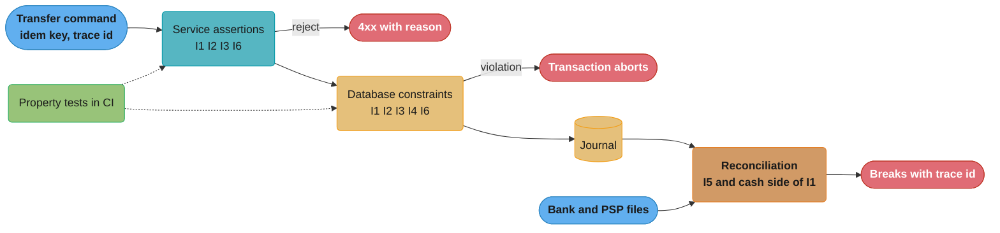
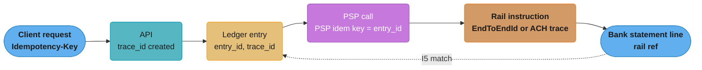

# Money Movement Invariants

> Rules and figures checked 2026-11-06. Every date, threshold and fee on this page comes from the fact pins in fintech/CLAUDE.md.
>
> Cross-cutting reference for the fintech case studies. This file defines the six invariants that every money-moving system keeps, and maps each one to a database constraint, a runtime assertion and a property test. Each case study's §8 Operational Playbook uses the checklist in §13 of this file. The accounting model behind the invariants is in [double-entry ledger design](../../double_entry_ledger_design/double_entry_ledger_design.md). The Postgres ledger with SERIALIZABLE isolation, row-level security and a CQRS read model is in the [banking ledger case study](../../../database/case_studies/design_banking_ledger/design_banking_ledger.md). This file does not repeat either.

---

## 1. Concept Overview

An invariant is a statement about the books that is true after every committed transaction. "Alice has $75.00" is a fact. "Every journal entry sums to zero in each currency" is an invariant. A fact can change. An invariant cannot change, and when one breaks, money has been created, lost or moved twice.

Money movement has six invariants. The fintech case studies all depend on them:

| ID | Invariant | What breaks without it |
|---|---|---|
| I1 | Conservation per currency: every journal entry sums to zero in each currency | Money appears or disappears inside the books |
| I2 | No negative available balance unless the account has an overdraft product, and then not below its limit | The platform lends money that no product approved |
| I3 | Idempotent effect: one business intent produces one effect, however many times it is sent | Double charges, double payouts |
| I4 | Append-only with reversals: a posted entry never changes, and a correction is a new entry | The audit trail can no longer prove what happened |
| I5 | One internal transfer per external movement, and one external movement per internal transfer that touches a bank or PSP account | Cash at the bank and the books disagree with no record of why |
| I6 | An end-to-end trace id that joins the client request, the ledger entry and the rail reference | A break cannot be traced to its cause |

Each invariant has three enforcement layers, and a production system uses all three:

- **Database constraint.** The store refuses a write that breaks the invariant. This is the last line, and it holds even when application code has a bug.
- **Runtime assertion.** The service checks the invariant before it writes and fails the request with a clear error. This gives a better error message and catches the problem before a lock is held.
- **Property test.** A test generates thousands of random command sequences and checks the invariant after each step. This finds the sequences that no example-based test thought of.

A fourth layer, reconciliation, checks the invariants that span systems you do not own (I5, and the cash side of I1). [Reconciliation and settlement files](../../reconciliation_and_settlement_files/reconciliation_and_settlement_files.md) owns the matching method. This file states what reconciliation must prove.

The idempotency-key pattern, its race and its storage are in [distributed transactions](../../../hld/distributed_transactions/distributed_transactions.md) and the [Spring idempotent payment API](../../../spring/case_studies/design_idempotent_payment_api.md). The cross-rail key chain and unknown-outcome handling are in [idempotency and exactly-once money movement](../../idempotency_and_exactly_once_money_movement/idempotency_and_exactly_once_money_movement.md). This file uses those results and adds the invariant view.

---

## 2. Intuition

**One-line analogy.** The invariants are the rules of a bank vault with a logbook. Nothing enters or leaves the vault without a logbook line (I5). Each logbook line has a matching line on the other side (I1). No drawer goes below empty unless the drawer has an agreed credit line (I2). Nobody erases a line, they write a correcting line under it (I4). A second copy of the same withdrawal slip does nothing (I3). Every slip carries the ticket number of the customer request that started it (I6).

**Mental model.** Think of the ledger as a closed system of pipes. Money flows between accounts and never leaks inside the system (I1). The only openings are the external movements: bank credits and debits, PSP settlements and card network clearing. Each opening has exactly one pipe joint to an internal transfer (I5). The other invariants keep the flow honest over time: no draining a tank below its floor (I2), no flowing twice for one valve turn (I3), no rewriting the flow meter (I4), and a tag on every drop that says which valve turn sent it (I6).

**Why it matters.** Most payment incidents are a broken invariant that nobody checked. A retry with a new idempotency key breaks I3 and pays a seller twice. A refund that edits the original row breaks I4, and the dispute team cannot show the issuer what happened. A bank credit with no matching transfer breaks I5 and sits as unexplained cash for months. The CFPB says Synapse's partner banks held less than Synapse's records showed consumers were owed, a shortfall of between $60 million and $90 million. That is the aggregate form of I5: the sum of customer balances in the books did not match the cash at the banks.

**Key insight.** An invariant that lives only in application code is a hope. Put each invariant in the layer that cannot be bypassed (a constraint or a trigger), check it in the service for a good error, and test it with random sequences. Then run reconciliation for the invariants that cross a system boundary, because no constraint can reach into a bank.

---

## 3. Core Principles

- **Conservation is per currency.** A USD 10.00 debit and a EUR 10.00 credit sum to zero as numbers and are still wrong. An FX trade is two balanced legs, one per currency, through FX clearing accounts.
- **Available is derived, and the floor is on available.** Available balance is the ledger balance minus holds and pending debits. The constraint is on available, because a customer spends available, not ledger.
- **Exactly once is an effect, never a delivery.** Messages arrive more than once. The ledger accepts the effect once per idempotency key and returns the stored result for a repeat.
- **History is written once.** Posted rows are never updated or deleted. A correction is a reversing entry that points at the original. A partial refund is a new transfer, not a partial reversal.
- **Every external movement has one internal twin.** An unexpected bank credit still gets an internal transfer, to a suspense account. Then I5 stays exact, and the break is visible as a suspense balance with an age.
- **Authority is scoped.** The PSP or network record proves the card event. The ledger proves the obligation. The bank statement proves cash. Reconciliation finds and resolves the disagreements. No single record is the final arbiter.
- **Three layers per invariant.** Constraint, assertion, property test. Remove one and a class of bug gets through.
- **The trace id is created once, at the edge.** Every later hop copies it. A hop that mints its own id breaks the chain.

---

## 4. Types / Architectures / Strategies

### 4.1 The six invariants, stated precisely

**I1. Conservation per currency.** For every journal entry `e` and every currency `c`, the sum of `amount` over the postings of `e` in `c` is zero. An entry has at least two postings. Each posting's currency equals its account's currency. A corollary: the trial balance (the sum of all postings per currency) is zero at every instant.

**I2. Available floor.** For every account `a` that has a spending floor: `ledger_balance(a) - holds(a) >= -overdraft_limit(a)`, where `overdraft_limit` is 0 unless an overdraft product sets it. Accounts with no customer behind them, such as `psp_receivable` or `fx_clearing`, have no floor. Their sign moves with timing, and reconciliation watches them.

**I3. Idempotent effect.** For every idempotency key `k` in its scope (a client, a merchant, an API version), at most one journal entry exists. A repeat request with `k` and the same body returns the stored result. A repeat with `k` and a different body is rejected.

**I4. Append-only with reversals.** No posted entry or posting is updated or deleted. A reversal is a new entry whose postings are the exact negation of the original's postings, and each entry is reversed at most once.

**I5. One-to-one external match.** Every external movement (a bank statement line, a PSP settlement line, a card clearing record) maps to exactly one internal transfer. Every internal transfer that posts to an account that mirrors an outside balance (a bank account, a PSP receivable) maps to exactly one external movement, after the expected settlement delay. Amounts and currencies match. Fees are separate transfers, each with its own external evidence (a fee line in the settlement file).

**I6. End-to-end trace.** Every journal entry carries a non-empty `trace_id` that the edge created for the business intent. Every external instruction carries a rail reference that is stored with the entry: an ISO 20022 `EndToEndId` or UETR, an ACH trace number, or a card ARN. From any one of these ids you can reach all the others.

### 4.2 Where each invariant can be enforced

| Invariant | Database constraint | Runtime assertion | Property test | Reconciliation |
|---|---|---|---|---|
| I1 | Deferred constraint trigger: sum per currency is zero at commit | Sum postings per currency before the write | Random entries, trial balance stays zero | Daily trial balance per currency |
| I2 | `CHECK (posted - held >= -overdraft_limit)` on a balance row updated in the same transaction | Compute available after the entry, reject below floor | Random debits and holds, floor never crossed | Accounts below floor (should be none) |
| I3 | `UNIQUE (scope, idem_key)` | Return the stored result, compare request hash | Each command applied 1 to 3 times, shuffled, same final state | Duplicate external refs |
| I4 | No `UPDATE` or `DELETE` grant, plus a trigger that raises | The repository has no update method | Replay the journal from zero, same balances | Journal hash chain or row counts per day |
| I5 | Primary key on `(rail, rail_ref)` and `UNIQUE (entry_id)` on the match table | Before release, compare the outgoing instruction with its one transfer | Generated bank files match all generated transfers | The three-way match itself |
| I6 | `trace_id NOT NULL`, rail ref stored | Reject an entry with no trace id | Every generated flow is reachable from its origin id | Breaks report their trace id |

### 4.3 Strategies for the hard cases

- **Multi-leg transfers.** A payout with a fee and an FX step is one entry with four or more postings, or several entries linked atomically. TigerBeetle has a `linked` transfer flag for this. In Postgres it is one transaction.
- **Holds.** A card authorization or a pending payout creates a hold. The hold reduces available, not ledger. A capture posts and releases the hold in the same transaction. TigerBeetle models this with `pending`, `post_pending_transfer` and `void_pending_transfer`.
- **Unexpected inbound cash.** Post it to a suspense account with the full rail reference. When ops identify the owner, a second transfer moves it from suspense to the customer. Both transfers keep the same external evidence, and only the first matches the bank line.
- **Cross-shard transfers.** When accounts live on different ledger shards, a transfer posts to a per-shard clearing account on each side. Each shard balances on its own (I1 per shard), and the clearing accounts net to zero across shards. [Hot accounts and ledger scaling](../../double_entry_ledger_design/hot_accounts_and_ledger_scaling.md) owns the sharding choice.

---

## 5. Architecture Diagrams

### Enforcement layers on one write



The service check gives a readable error. The database check holds when the service has a bug. Reconciliation is the only layer that sees the bank.

### The trace chain for one payout



Each arrow copies an id forward. The dotted arrow is reconciliation closing the loop through the rail reference.

### Where each account sits relative to the floor

```text
account kind          normal side   floor (I2)                  watched by
--------------------  -----------   -------------------------   -------------------------
customer wallet       credit        available >= 0              constraint + assertion
customer with OD      credit        available >= -limit         constraint + assertion
merchant payable      credit        available >= 0 at payout    assertion at payout time
bank cash (FBO)       debit         none, mirrors the bank      reconciliation (I5)
psp receivable        debit         none, timing moves sign     reconciliation (I5)
fx clearing           either        none, nets per trade        trial balance per currency
suspense              either        none, must age out          aging report
```

---

## 6. How It Works - Detailed Mechanics

### 6.1 The schema: each invariant as a constraint

The fences in this section run in order in one PostgreSQL 18 database. Amounts are `bigint` minor units. Debits are positive and credits negative, the convention Square describes for its Books service. A customer wallet is a liability, so its balance is the negative of its posting sum.

```sql
CREATE TABLE account (
    account_id  text PRIMARY KEY,
    currency    char(3) NOT NULL CHECK (currency ~ '^[A-Z]{3}$'),
    normal_side text NOT NULL CHECK (normal_side IN ('debit', 'credit')),
    UNIQUE (account_id, currency)
);

CREATE TABLE journal_entry (
    entry_id  text PRIMARY KEY,
    scope     text NOT NULL DEFAULT 'platform',                    -- I3: the client or merchant that owns the key
    idem_key  text NOT NULL,
    trace_id  text NOT NULL CHECK (length(trace_id) > 0),          -- I6
    reverses  text UNIQUE REFERENCES journal_entry (entry_id),     -- I4: at most one reversal
    booked_at timestamptz NOT NULL DEFAULT now(),
    UNIQUE (scope, idem_key)                                       -- I3
);

CREATE TABLE posting (
    entry_id   text NOT NULL REFERENCES journal_entry (entry_id),
    line_no    smallint NOT NULL,
    account_id text NOT NULL,
    currency   char(3) NOT NULL,
    amount     bigint NOT NULL CHECK (amount <> 0),
    PRIMARY KEY (entry_id, line_no),
    FOREIGN KEY (account_id, currency) REFERENCES account (account_id, currency)  -- I1: no currency mix-up
);

CREATE TABLE spendable (                                           -- I2
    account_id      text PRIMARY KEY REFERENCES account (account_id),
    posted          bigint NOT NULL DEFAULT 0,
    held            bigint NOT NULL DEFAULT 0 CHECK (held >= 0),
    overdraft_limit bigint NOT NULL DEFAULT 0 CHECK (overdraft_limit >= 0),
    CONSTRAINT available_floor CHECK (posted - held >= -overdraft_limit)
);

CREATE TABLE external_movement (                                   -- I5
    rail       text NOT NULL,
    rail_ref   text NOT NULL,
    direction  text NOT NULL CHECK (direction IN ('in', 'out')),
    currency   char(3) NOT NULL,
    amount     bigint NOT NULL CHECK (amount > 0),
    value_date date NOT NULL,
    entry_id   text UNIQUE REFERENCES journal_entry (entry_id),
    PRIMARY KEY (rail, rail_ref)
);
```

The composite foreign key `(account_id, currency)` makes it impossible to post EUR to a USD account. The sum-to-zero rule is a deferred constraint trigger, because a `CHECK` cannot see other rows. The [payment processor study](../../../backend/case_studies/design_payment_processor/design_payment_processor.md) §4.1 explains that trigger. The fences below add the other invariants to the same schema.

```sql
CREATE FUNCTION entry_must_balance() RETURNS trigger LANGUAGE plpgsql AS $$
BEGIN
    IF (SELECT count(*) FROM posting WHERE entry_id = NEW.entry_id) < 2 THEN
        RAISE EXCEPTION 'entry % has fewer than 2 postings', NEW.entry_id;
    END IF;
    IF EXISTS (SELECT 1 FROM posting WHERE entry_id = NEW.entry_id
               GROUP BY currency HAVING sum(amount) <> 0) THEN
        RAISE EXCEPTION 'entry % does not sum to zero per currency', NEW.entry_id;
    END IF;
    RETURN NULL;
END $$;

CREATE CONSTRAINT TRIGGER entry_balanced AFTER INSERT ON journal_entry
    DEFERRABLE INITIALLY DEFERRED FOR EACH ROW EXECUTE FUNCTION entry_must_balance();
CREATE CONSTRAINT TRIGGER posting_balanced AFTER INSERT ON posting
    DEFERRABLE INITIALLY DEFERRED FOR EACH ROW EXECUTE FUNCTION entry_must_balance();

CREATE FUNCTION reversal_must_mirror() RETURNS trigger LANGUAGE plpgsql AS $$
BEGIN
    IF NEW.reverses IS NOT NULL AND EXISTS (
        (SELECT account_id, currency, -amount FROM posting WHERE entry_id = NEW.reverses
         EXCEPT ALL
         SELECT account_id, currency, amount FROM posting WHERE entry_id = NEW.entry_id)
        UNION ALL
        (SELECT account_id, currency, amount FROM posting WHERE entry_id = NEW.entry_id
         EXCEPT ALL
         SELECT account_id, currency, -amount FROM posting WHERE entry_id = NEW.reverses)) THEN
        RAISE EXCEPTION 'entry % is not the exact negation of %', NEW.entry_id, NEW.reverses;
    END IF;
    RETURN NULL;
END $$;

CREATE CONSTRAINT TRIGGER reversal_mirrors AFTER INSERT ON journal_entry
    DEFERRABLE INITIALLY DEFERRED FOR EACH ROW EXECUTE FUNCTION reversal_must_mirror();

CREATE FUNCTION apply_to_spendable() RETURNS trigger LANGUAGE plpgsql AS $$
BEGIN
    UPDATE spendable SET posted = posted - NEW.amount WHERE account_id = NEW.account_id;
    RETURN NULL;
END $$;

CREATE TRIGGER posting_moves_spendable AFTER INSERT ON posting
    FOR EACH ROW EXECUTE FUNCTION apply_to_spendable();

CREATE FUNCTION refuse_change() RETURNS trigger LANGUAGE plpgsql AS $$
BEGIN
    RAISE EXCEPTION '% is append-only, % refused', TG_TABLE_NAME, TG_OP;
END $$;

CREATE TRIGGER posting_append_only BEFORE UPDATE OR DELETE ON posting
    FOR EACH ROW EXECUTE FUNCTION refuse_change();
CREATE TRIGGER entry_append_only BEFORE UPDATE OR DELETE ON journal_entry
    FOR EACH ROW EXECUTE FUNCTION refuse_change();
```

Two notes on the triggers. The `UPDATE spendable` statement takes a row lock on the wallet, so two concurrent debits on one wallet serialize there, and the `available_floor` check sees the committed value of the first. PostgreSQL fires `TRUNCATE` triggers only per statement, so the row triggers above never see one. The append-only rule also needs `REVOKE UPDATE, DELETE, TRUNCATE` on the writer role, which the [banking ledger study](../../../database/case_studies/design_banking_ledger/design_banking_ledger.md) sets up.

### 6.2 A top-up and a transfer that keep every invariant

```sql
INSERT INTO account VALUES
    ('bank:fbo:usd', 'USD', 'debit'),
    ('wallet:alice', 'USD', 'credit'),
    ('wallet:bob',   'USD', 'credit'),
    ('revenue:fees', 'USD', 'credit');
INSERT INTO spendable (account_id) VALUES ('wallet:alice'), ('wallet:bob');

BEGIN;
INSERT INTO journal_entry (entry_id, idem_key, trace_id) VALUES ('e1', 'topup-7781', 'tr-a1');
INSERT INTO posting VALUES
    ('e1', 1, 'bank:fbo:usd', 'USD',  10000),
    ('e1', 2, 'wallet:alice', 'USD', -10000);
INSERT INTO external_movement VALUES
    ('ach', '091000019000001', 'in', 'USD', 10000, DATE '2026-11-06', 'e1');
COMMIT;

BEGIN;
INSERT INTO journal_entry (entry_id, idem_key, trace_id) VALUES ('e2', 'p2p-5512', 'tr-b7');
INSERT INTO posting VALUES
    ('e2', 1, 'wallet:alice', 'USD',  2500),
    ('e2', 2, 'wallet:bob',   'USD', -2450),
    ('e2', 3, 'revenue:fees', 'USD',   -50);
COMMIT;

DO $$
BEGIN
    ASSERT (SELECT posted FROM spendable WHERE account_id = 'wallet:alice') = 7500;
    ASSERT (SELECT posted FROM spendable WHERE account_id = 'wallet:bob') = 2450;
    ASSERT NOT EXISTS (SELECT 1 FROM posting GROUP BY currency HAVING sum(amount) <> 0),
        'trial balance per currency must be zero';
END $$;
```

The transfer `e2` touches no bank account, so I5 asks for no external movement. The top-up `e1` posts to `bank:fbo:usd`, so it has exactly one external movement, with the ACH trace number as its rail reference.

### 6.3 What each constraint refuses

An entry that does not balance. The fence sets the deferred triggers to immediate so the check runs at the end of the statement instead of at a commit.

```sql
-- BROKEN: error
SET CONSTRAINTS ALL IMMEDIATE;
WITH e AS (
    INSERT INTO journal_entry (entry_id, idem_key, trace_id)
    VALUES ('e3', 'p2p-5513', 'tr-b8') RETURNING entry_id)
INSERT INTO posting
SELECT entry_id, 1, 'wallet:alice', 'USD', 2500 FROM e
UNION ALL
SELECT entry_id, 2, 'wallet:bob', 'USD', -2400 FROM e;
-- ERROR: entry e3 does not sum to zero per currency
```

A debit that takes Alice below zero. She has 7500 and the entry debits 9000. The `available_floor` check fails on the trigger's `UPDATE`.

```sql
-- BROKEN: error
INSERT INTO journal_entry (entry_id, idem_key, trace_id) VALUES ('e4', 'p2p-5514', 'tr-b9');
INSERT INTO posting VALUES
    ('e4', 1, 'wallet:alice', 'USD',  9000),
    ('e4', 2, 'wallet:bob',   'USD', -9000);
-- ERROR: new row for relation "spendable" violates check constraint "available_floor"
```

A second entry with a used idempotency key, and an edit of a posted row:

```sql
-- BROKEN: error
INSERT INTO journal_entry (entry_id, idem_key, trace_id) VALUES ('e5', 'topup-7781', 'tr-a1');
-- ERROR: duplicate key value violates unique constraint "journal_entry_scope_idem_key_key"
```

```sql
-- BROKEN: error
UPDATE posting SET amount = 9999 WHERE entry_id = 'e1' AND line_no = 1;
-- ERROR: posting is append-only, UPDATE refused
```

A correct reversal of `e2`, and the check that a reversal must mirror its original:

```sql
BEGIN;
INSERT INTO journal_entry (entry_id, idem_key, trace_id, reverses)
VALUES ('e2r', 'p2p-5512-reversal', 'tr-b7', 'e2');
INSERT INTO posting VALUES
    ('e2r', 1, 'wallet:alice', 'USD', -2500),
    ('e2r', 2, 'wallet:bob',   'USD',  2450),
    ('e2r', 3, 'revenue:fees', 'USD',    50);
COMMIT;

DO $$
BEGIN
    ASSERT (SELECT posted FROM spendable WHERE account_id = 'wallet:alice') = 10000;
    ASSERT (SELECT posted FROM spendable WHERE account_id = 'wallet:bob') = 0;
END $$;
```

The reversal keeps the original trace id, because it belongs to the same business intent. It has its own idempotency key, because "reverse e2" is a separate command that can also be retried.

### 6.4 The reconciliation side of I5

No constraint can see the bank. The match table makes one-to-one structural (the primary key and `UNIQUE (entry_id)`), and a query finds what is still missing. In production this query runs per bank account and per value date, after the statement file arrives.

```sql
INSERT INTO external_movement VALUES
    ('ach', '091000019000002', 'in', 'USD', 4200, DATE '2026-11-06', NULL);

CREATE VIEW i5_breaks AS
SELECT 'external line with no transfer' AS break_kind, x.rail_ref AS ref, x.amount
FROM external_movement x
WHERE x.entry_id IS NULL
UNION ALL
SELECT 'bank posting with no external line', p.entry_id, p.amount
FROM posting p
WHERE p.account_id LIKE 'bank:%'
  AND NOT EXISTS (SELECT 1 FROM external_movement x WHERE x.entry_id = p.entry_id)
UNION ALL
SELECT 'amount differs', x.rail_ref, x.amount
FROM external_movement x
JOIN posting p ON p.entry_id = x.entry_id AND p.account_id LIKE 'bank:%'
WHERE abs(p.amount) <> x.amount OR p.currency <> x.currency;

DO $$
BEGIN
    ASSERT (SELECT count(*) FROM i5_breaks) = 1, 'only the unmatched 4200 credit is a break';
END $$;
```

The 4200 credit with no transfer is the case from §4.3. The fix is to post it to suspense with its rail reference, which closes the I5 break and opens an aging item for ops.

The aggregate check is the one that the Synapse records failed. For each currency and each statement date, the sum of customer liabilities must not exceed the cash in the FBO accounts:

```sql
CREATE VIEW fbo_coverage AS
SELECT a.currency,
       sum(CASE WHEN a.account_id LIKE 'bank:fbo:%' THEN p.amount ELSE 0 END)  AS fbo_cash,
       -sum(CASE WHEN a.account_id LIKE 'wallet:%' THEN p.amount ELSE 0 END)   AS owed_to_customers
FROM posting p JOIN account a USING (account_id)
GROUP BY a.currency;

DO $$
BEGIN
    ASSERT (SELECT fbo_cash >= owed_to_customers FROM fbo_coverage WHERE currency = 'USD');
END $$;
```

This view compares two ledger numbers. The real control compares `owed_to_customers` with the balance on the bank's own statement, which is the cash record the bank controls.

### 6.5 Runtime assertions and a property test

The service checks I1, I2, I3, I4 and I6 before it writes. The property test drives an in-memory model of the same rules with random commands, sends some commands two or three times, and checks every invariant after every step. It also replays the journal from zero and compares the balances, which is the operational meaning of I4.

```java
import java.util.*;

public class InvariantProperties {
    record Posting(String account, String currency, long amount) {}
    record Entry(String id, String idemKey, String traceId, String reverses, List<Posting> postings) {}

    static final class Ledger {
        final Map<String, Long> floor = new HashMap<>();      // accounts with a spending floor
        final Map<String, Long> credit = new HashMap<>();     // credit-normal balance of those accounts
        final Map<String, Entry> byKey = new HashMap<>();
        final Map<String, Entry> byId = new HashMap<>();
        final Set<String> reversed = new HashSet<>();
        final List<Entry> journal = new ArrayList<>();

        Entry post(Entry e) {
            Entry prior = byKey.get(e.idemKey());
            if (prior != null) {                                                   // I3
                if (!prior.postings().equals(e.postings()))
                    throw new IllegalArgumentException("idempotency key reused with a different body");
                return prior;
            }
            if (e.traceId() == null || e.traceId().isBlank())                      // I6
                throw new IllegalArgumentException("missing trace id");
            if (e.postings().size() < 2) throw new IllegalArgumentException("fewer than 2 postings");
            Map<String, Long> perCurrency = new HashMap<>();                       // I1
            for (Posting p : e.postings()) perCurrency.merge(p.currency(), p.amount(), Math::addExact);
            if (perCurrency.values().stream().anyMatch(v -> v != 0))
                throw new IllegalArgumentException("does not sum to zero per currency");
            if (e.reverses() != null) {                                            // I4
                Entry orig = byId.get(e.reverses());
                if (orig == null || reversed.contains(orig.id()) || !mirrors(orig, e))
                    throw new IllegalArgumentException("bad reversal");
            }
            Map<String, Long> delta = new HashMap<>();                             // I2
            for (Posting p : e.postings())
                if (floor.containsKey(p.account())) delta.merge(p.account(), -p.amount(), Math::addExact);
            for (var d : delta.entrySet()) {
                long after = Math.addExact(credit.getOrDefault(d.getKey(), 0L), d.getValue());
                if (after < -floor.get(d.getKey())) throw new IllegalStateException("insufficient funds");
            }
            delta.forEach((a, v) -> credit.merge(a, v, Math::addExact));
            if (e.reverses() != null) reversed.add(e.reverses());
            byKey.put(e.idemKey(), e);
            byId.put(e.id(), e);
            journal.add(e);
            return e;
        }

        static boolean mirrors(Entry orig, Entry rev) {
            List<Posting> negated = orig.postings().stream()
                    .map(p -> new Posting(p.account(), p.currency(), -p.amount())).toList();
            return new HashSet<>(negated).equals(new HashSet<>(rev.postings()))
                    && negated.size() == rev.postings().size();
        }
    }

    public static void main(String[] args) {
        long seed = 20261106L;
        Random rnd = new Random(seed);
        String[] wallets = {"w1", "w2", "w3", "w4"};
        int accepted = 0, rejected = 0, replays = 0;
        for (int run = 0; run < 200; run++) {
            Ledger l = new Ledger();
            for (String w : wallets) l.floor.put(w, w.equals("w4") ? 5_000L : 0L);  // w4 has an overdraft product
            List<Entry> sent = new ArrayList<>();
            for (int step = 0; step < 300; step++) {
                Entry e = randomEntry(rnd, wallets, sent, run, step);
                int copies = 1 + rnd.nextInt(3);
                for (int c = 0; c < copies; c++) {
                    try {
                        Entry stored = l.post(e);
                        if (stored == e) accepted++; else replays++;
                    } catch (IllegalArgumentException | IllegalStateException ex) {
                        rejected++;
                    }
                }
                sent.add(e);
                checkInvariants(l);
            }
            Ledger replay = new Ledger();
            replay.floor.putAll(l.floor);
            for (Entry e : l.journal) replay.post(e);
            if (!replay.credit.equals(l.credit)) throw new AssertionError("replay differs, seed " + seed);
        }
        System.out.printf("accepted=%d replays=%d rejected=%d%n", accepted, replays, rejected);
    }

    static Entry randomEntry(Random rnd, String[] wallets, List<Entry> sent, int run, int step) {
        String id = "r" + run + "s" + step;
        if (!sent.isEmpty() && rnd.nextInt(10) == 0) {
            Entry orig = sent.get(rnd.nextInt(sent.size()));
            List<Posting> neg = orig.postings().stream()
                    .map(p -> new Posting(p.account(), p.currency(), -p.amount())).toList();
            return new Entry(id, id + "-rev", orig.traceId(), orig.id(), neg);
        }
        long amount = 1 + rnd.nextInt(20_000);
        if (rnd.nextInt(4) == 0)                                                    // top-up from the bank
            return new Entry(id, id, "tr-" + id, null, List.of(
                    new Posting("bank", "USD", amount),
                    new Posting(wallets[rnd.nextInt(wallets.length)], "USD", -amount)));
        String from = wallets[rnd.nextInt(wallets.length)];
        String to = wallets[rnd.nextInt(wallets.length)];
        long fee = amount / 100;
        return new Entry(id, id, "tr-" + id, null, List.of(
                new Posting(from, "USD", amount),
                new Posting(to, "USD", -(amount - fee)),
                new Posting("fees", "USD", -fee)));
    }

    static void checkInvariants(Ledger l) {
        Map<String, Long> trial = new HashMap<>();
        for (Entry e : l.journal)
            for (Posting p : e.postings()) trial.merge(p.currency(), p.amount(), Math::addExact);
        if (trial.values().stream().anyMatch(v -> v != 0)) throw new AssertionError("I1 trial balance " + trial);
        l.floor.forEach((a, lim) -> {
            if (l.credit.getOrDefault(a, 0L) < -lim) throw new AssertionError("I2 floor crossed on " + a);
        });
        if (l.byKey.size() != l.journal.size()) throw new AssertionError("I3 one entry per key");
        if (l.journal.stream().anyMatch(e -> e.traceId().isBlank())) throw new AssertionError("I6 trace id");
    }
}
```

The seed is fixed so a failure reproduces. In CI, a library such as jqwik adds shrinking: when a sequence fails, it removes commands until it finds the shortest sequence that still fails. The checks stay the same.

---

## 7. Real-World Examples

- **Square Books.** Square describes Books as "an immutable double-entry accounting database service". Journal entries must balance to 0, books hold balances, entries are append-only, debits are positive and credits negative. It runs on Google Cloud Spanner and GKE. That is I1 and I4 as a service contract, with the sign convention this page uses.
- **Uber LedgerStore.** Uber describes LedgerStore as immutable storage that indexes hundreds of billions of ledgers. Uber built over 2 trillion unique indexes and moved them from DynamoDB to Docstore. Immutability (I4) is a design input there, and the index count shows what I6-style lookups cost at scale: every id you want to search by is an index.
- **TigerBeetle.** The account flag `debits_must_not_exceed_credits` rejects a transfer that would push an account's debits past its credits. That is I2 with a zero floor, enforced by the ledger, not the caller. Amounts and balances are u128. Transfers have `linked` (atomic chains for multi-leg entries), `pending`, `post_pending_transfer` and `void_pending_transfer` (holds). The latest release at the pin date is 0.17.9.
- **Synapse.** The CFPB says Synapse's partner banks held less than Synapse's records showed consumers were owed, a shortfall of between $60 million and $90 million, and consumers had no access to funds for weeks or months. The FBO coverage check in §6.4, run against the bank's statement, is the control for that state.
- **Citibank and Revlon.** On 2020-08-11 Citibank meant to send Revlon's lenders about $7.8M of interest and sent $894M of principal plus the $7.8M. The outgoing instruction did not match the internal obligation it was meant to carry out. I5 at release time compares each outgoing instruction with the single transfer it implements, amount and currency included.

---

## 8. Tradeoffs

### Where to enforce

| Layer | Catches | Misses | Cost |
|---|---|---|---|
| Database constraint | Every write path, including scripts and new services | Anything outside the database (the bank, the PSP) | Write latency, lock time, a harder schema change |
| Runtime assertion | Bad input early, with a clear error | A second service that writes without it | Code in each writer |
| Property test | Sequences no person thought of | Bugs in the real database or network | CI time |
| Reconciliation | Disagreements with outside records | Anything before the next statement or settlement file arrives | A delay, plus an ops team for breaks |

### Deferred trigger versus application check for I1

| Option | Pros | Cons |
|---|---|---|
| Deferred constraint trigger | No writer can bypass it | One `SELECT ... GROUP BY` per posting at commit. A wide entry pays quadratic work |
| Statement-level trigger with transition tables | One check per statement | More complex. A multi-statement entry still needs a commit-time check |
| Application check only | Zero database cost | Any new writer can skip it |
| Ledger engine (TigerBeetle) | Balance is built into the transfer model | A second store to run. The chart of accounts lives outside SQL |

### Balance row versus derived balance for I2

| Option | I2 enforcement | Cost |
|---|---|---|
| Balance row updated in the same transaction, with `CHECK` | Immediate, by the constraint | A hot row per busy account. See [hot accounts](../../double_entry_ledger_design/hot_accounts_and_ledger_scaling.md) |
| Derived from postings at read time | Needs `SERIALIZABLE` or a lock on the account | Read cost grows with history |
| Snapshot plus delta | Check against snapshot plus recent postings | Snapshot job and its own correctness proof |

[Double-entry ledger design](../../double_entry_ledger_design/double_entry_ledger_design.md) holds the balance-model decision. This table shows only how each choice affects I2.

---

## 9. When to Use / When NOT to Use

**Use all six when:**
- The system holds or moves money for other people: wallets, marketplaces, payroll, card issuing, brokerage cash.
- More than one service writes to the ledger.
- An outside party (bank, PSP, network, auditor) will check your records against theirs.

**Use a subset when:**
- The system only displays money, such as an analytics read model. It needs I6 to trace a number back, and I1 holds by construction if it copies the ledger.
- The system is a pricing or quoting engine. It needs the money representation rules from [money representation and currency](../../money_representation_and_currency/money_representation_and_currency.md), not a ledger.

**Do NOT:**
- Put a floor (I2) on accounts that mirror outside balances. A PSP receivable or a bank clearing account goes negative for timing reasons. Reconciliation watches those.
- Enforce I5 as a database constraint across the ledger and a bank file. The bank line arrives after the transfer, often on the next business day. A constraint would block the transfer. Make it a reconciliation check with an expected delay.
- Treat a passing property test as proof that the database enforces the invariant. The test runs against a model. The constraints in §6.1 are what protect production.

---

## 10. Common Pitfalls

### 10.1 A sum check that ignores currency

A team checks that an FX conversion entry sums to zero. It does, as a number. The entry moves USD 1,000.00 out of one wallet and puts EUR 1,000.00 into another, and the books now hold more value than before.

```java
// BROKEN
import java.util.List;

public class CurrencyBlindCheck {
    record Posting(String account, String currency, long amount) {}

    static boolean balanced(List<Posting> ps) {
        return ps.stream().mapToLong(Posting::amount).sum() == 0;
    }

    public static void main(String[] args) {
        List<Posting> fx = List.of(
                new Posting("wallet:alice:usd", "USD", 100_000),
                new Posting("wallet:alice:eur", "EUR", -100_000));
        System.out.println("accepted = " + balanced(fx));
        // prints: accepted = true. USD 1,000.00 became EUR 1,000.00 at a 1.0 rate nobody quoted.
    }
}
```

The fix sums per currency and requires an FX clearing account in each currency. The rate lives in the amounts of the two legs.

```java
// FIX
import java.util.*;

public class CurrencyAwareCheck {
    record Posting(String account, String currency, long amount) {}

    static boolean balanced(List<Posting> ps) {
        Map<String, Long> sums = new HashMap<>();
        for (Posting p : ps) sums.merge(p.currency(), p.amount(), Math::addExact);
        return sums.values().stream().allMatch(v -> v == 0);
    }

    public static void main(String[] args) {
        List<Posting> blind = List.of(
                new Posting("wallet:alice:usd", "USD", 100_000),
                new Posting("wallet:alice:eur", "EUR", -100_000));
        List<Posting> twoLegs = List.of(
                new Posting("wallet:alice:usd", "USD", 100_000),
                new Posting("fx_clearing:usd", "USD", -100_000),
                new Posting("fx_clearing:eur", "EUR", 92_150),
                new Posting("wallet:alice:eur", "EUR", -92_150));
        if (balanced(blind)) throw new AssertionError("currency mix must be rejected");
        if (!balanced(twoLegs)) throw new AssertionError("two balanced legs must pass");
        System.out.println("blind=" + balanced(blind) + " twoLegs=" + balanced(twoLegs));
    }
}
```

The 0.9215 rate here is illustrative. The FX clearing accounts end the day with a position per currency, and treasury hedges or settles it. The [payment system study](../../../hld/case_studies/design_payment_system.md) §4.2 walks through a full cross-currency payout with its rounding residual.

### 10.2 A match table with no key

The reconciliation job loads the bank file into a table with no primary key. The bank resends the file after a partial delivery, and every line matches twice. Two transfers now claim one bank credit, and the dashboard shows a 100% match rate.

```sql
-- BROKEN
CREATE TEMP TABLE bank_line_loose (rail text, rail_ref text, amount bigint);
INSERT INTO bank_line_loose VALUES ('ach', '091000019000003', 1500);
INSERT INTO bank_line_loose VALUES ('ach', '091000019000003', 1500);   -- the resent file
SELECT count(*) AS rows_for_one_credit FROM bank_line_loose;
-- rows_for_one_credit = 2
```

The fix is the primary key on `(rail, rail_ref)` that `external_movement` already has, and a load that ignores a line it has seen.

```sql
-- FIX
INSERT INTO external_movement VALUES
    ('ach', '091000019000003', 'in', 'USD', 1500, DATE '2026-11-06', NULL)
ON CONFLICT (rail, rail_ref) DO NOTHING;
INSERT INTO external_movement VALUES
    ('ach', '091000019000003', 'in', 'USD', 1500, DATE '2026-11-06', NULL)
ON CONFLICT (rail, rail_ref) DO NOTHING;

DO $$
BEGIN
    ASSERT (SELECT count(*) FROM external_movement WHERE rail_ref = '091000019000003') = 1;
END $$;
```

`DO NOTHING` is correct only because the rail reference identifies the line. If the same reference arrives with a different amount, that is a break for ops, not a duplicate. A load job compares the stored amount and raises on a mismatch.

### 10.3 Other pitfalls seen in production

- **The refund that edits the charge.** A support tool sets `amount = 0` on a charge row to "refund" it. The balance looks right. The dispute team cannot show the issuer that a charge happened and was refunded. Fix: a refund is a new transfer. A full reversal is a mirrored entry with `reverses` set.
- **A trace id minted per hop.** Each service creates its own request id. The ledger has one id, the PSP call has another, and the payout file has a third. A reconciliation break takes an engineer hours to trace. Fix: create the trace id once at the edge and copy it. Store the rail reference on the entry.
- **A floor on the PSP receivable.** A team adds `CHECK (balance >= 0)` to every account. The first time the PSP nets a refund batch before a sales batch, the receivable goes negative and the nightly settlement posting fails. Fix: floors only on accounts where a product promises one.
- **Suspense as a dumping ground.** Lines with no match go to suspense, and nobody watches the age. A year later suspense holds an amount nobody can explain. Fix: every suspense posting has an owner, a rail reference and an age alert.
- **Idempotency key scoped too wide.** A global unique key across all merchants lets merchant A's key block merchant B's request. Fix: `UNIQUE (merchant_id, idem_key)`.

---

## 11. Technologies & Tools

| Tool | Role | Note |
|---|---|---|
| PostgreSQL | Constraints, deferred constraint triggers, row locks for I2 | The fences on this page run on PostgreSQL 18 |
| TigerBeetle | Ledger with balance and floor rules built into transfers | 0.17.9 at the pin date. u128 amounts. `linked`, `pending` and account flags |
| jqwik | Property-based testing on the JUnit platform | Generators and shrinking for command sequences |
| pgTAP | Unit tests for SQL constraints and triggers | Tests that each constraint refuses what it should |
| OpenTelemetry | Trace context propagation across services | Carries the trace id. The ledger stores it as a column |

---

## 12. Interview Questions with Answers

**Q: Why is "debits equal credits" not enough to prove an entry is correct?**
**Short:** Because the check must hold per currency. A USD debit and a EUR credit of the same number sum to zero and still create value out of nothing.

A single sum over all postings treats currencies as one unit. An FX conversion entry must have two balanced legs, one per currency, through FX clearing accounts. The posting's currency must also equal its account's currency, which a composite foreign key on `(account_id, currency)` enforces. The rate is then implicit in the two legs, and treasury sees the clearing positions.

**Q: Can a CHECK constraint enforce that a journal entry sums to zero?**
**Short:** No. A CHECK constraint sees one row, and the rule spans all postings of an entry, so it needs a deferred constraint trigger that runs at commit.

The trigger groups the entry's postings by currency and raises if any sum is not zero, or if the entry has fewer than two postings. It must be deferred, because the postings arrive in several statements and the entry is unbalanced between them. Fire it on inserts into both the entry table and the posting table, so a posting added later to an old entry is also checked. The cost is one grouped query per posting at commit.

**Q: Is a negative balance always a bug?**
**Short:** No. A customer account may go negative only to an overdraft limit that a product sets, and accounts that mirror outside balances, such as a PSP receivable, move sign with timing.

The floor rule applies to available balance on accounts with a customer promise. Put `overdraft_limit` on the balance row, zero by default, and check `posted - held >= -overdraft_limit`. A bank clearing account or a PSP receivable has no floor, because the PSP can net refunds before sales. Reconciliation watches those accounts instead.

**Q: Does an idempotency key give you exactly-once money movement?**
**Short:** It gives exactly-once effect inside one system for one key scope. A retry with a new key, or a downstream call with no key, still moves money twice.

The key must flow down the chain: the client key maps to a ledger entry id, and the entry id becomes the PSP idempotency key and the basis of the rail reference. A same-key request with a different body must be rejected, not replayed. Rails without a key (an ACH file) need a stored file and batch id, and reconciliation catches what slips through. The [idempotency module](../../idempotency_and_exactly_once_money_movement/idempotency_and_exactly_once_money_movement.md) covers the unknown-outcome cases.

**Q: Why reverse an entry instead of fixing it in place?**
**Short:** An edit destroys the record of what happened. A reversal keeps the original, shows the correction as a separate dated entry, and keeps balances replayable from the journal.

Auditors, disputes and regulators ask what the books showed on a given date. An edited row cannot answer that. A reversal is the exact negation of the original's postings and points at it. Enforce one reversal per entry with a unique column, and enforce the mirror shape in a deferred trigger. Block updates and deletes with a trigger and with revoked grants, since row triggers do not cover `TRUNCATE`.

**Q: What is the difference between a reversal and a refund?**
**Short:** A reversal undoes an entry exactly and points at it. A refund is a new transfer with its own amount, which can be partial and can come days later.

Use a reversal for an error in the books, such as a duplicate posting. Use a refund for a business event, such as a returned item. A partial refund as a "partial reversal" breaks the mirror rule and confuses reconciliation, because the card network sees a refund as its own transaction with its own clearing record.

**Q: Why does each external movement need exactly one internal transfer, not at least one?**
**Short:** With two transfers on one bank line, cash is counted twice in the books. With zero, cash sits at the bank with no record of whose it is.

The one-to-one rule makes the match a structural property: a primary key on the rail reference and a unique entry id on the match table. An unexpected credit still gets one transfer, to suspense. Fees get their own transfers, each matched to a fee line. The rule must also hold in the other direction: a transfer to a bank account with no external line after the expected delay is a break.

**Q: What does an end-to-end trace id buy you that an idempotency key does not?**
**Short:** The key deduplicates one hop. The trace id joins every hop of one business intent, from the client request to the bank statement line, so a break can be traced in one query.

A payout may have a client key, a ledger entry id, a PSP key, a rail reference and a statement line. Each is scoped to one system. The trace id is created once at the edge and stored on each record. A reversal or a retry keeps the trace id of the intent it belongs to, while it gets its own idempotency key.

**Q: Which invariant does a shortfall like the one in the Synapse case break?**
**Short:** The aggregate form of the external match: total customer balances in the books must be covered by the cash on the banks' own statements, per currency, every day.

The CFPB says Synapse's partner banks held less than Synapse's records showed consumers were owed, by between $60 million and $90 million. A daily control compares the sum of customer liability accounts with the FBO balances on the bank statements. The control works only if the cash number comes from the bank, not from a second copy of the ledger.

**Q: How do you property-test money invariants?**
**Short:** Generate random command sequences, send some commands two or three times, and check every invariant after every step, plus a full journal replay at the end.

Commands include top-ups, transfers with fees, reversals of random earlier entries, and overdraws. The checks: the trial balance is zero per currency, no floor is crossed, one entry per key, and the replayed balances equal the live ones. Fix the seed so failures reproduce. A library with shrinking, such as jqwik, reduces a failing sequence to a short one.

**Q: Where does the available-balance check live when holds exist?**
**Short:** On the balance row, as posted minus held at or above the negative overdraft limit, updated in the same transaction as the posting or the hold.

A hold raises `held` and leaves `posted` alone. A capture posts the entry and lowers `held` in one transaction. Because the check uses both columns, an authorization and a payout cannot both spend the same funds. The `UPDATE` on the balance row takes a row lock, so two concurrent debits serialize there.

**Q: What does a deferred constraint trigger cost at scale?**
**Short:** One grouped read per posting at commit, so an entry with n postings costs about n squared row reads, which is small for 2 to 6 postings and large for a wide batch entry.

For normal entries it is a few index lookups. For a settlement entry with thousands of lines, split it into balanced sub-entries or use a statement-level trigger with transition tables. Measure commit latency under load before you choose. A ledger engine such as TigerBeetle moves this cost into its own transfer validation.

**Q: How does TigerBeetle express the no-negative-balance rule?**
**Short:** With the account flag debits_must_not_exceed_credits, which rejects any transfer that would push the account's debits past its credits.

It is the zero-floor case of the available-balance rule, enforced by the ledger for every caller. Pending transfers reserve amounts in `debits_pending`, so the rule covers holds too. An overdraft limit needs a modeling choice, such as a linked credit-line account. A multi-leg entry uses the `linked` flag so all transfers in the chain succeed or fail together.

**Q: Why is a floor on a PSP receivable a mistake?**
**Short:** The receivable mirrors what the PSP owes you, and it goes negative whenever refunds or chargebacks net before sales. A floor turns normal timing into failed postings.

Accounts that mirror an outside party's balance follow that party's timing. Put them under reconciliation: match each settlement line, track the expected balance per settlement date, and alert on breaks that age past the expected delay. Floors belong on accounts where a product promises the customer something.

**Q: How do conservation rules survive a sharded ledger?**
**Short:** Each shard balances on its own, and a cross-shard transfer posts to a clearing account on each shard. The clearing accounts must net to zero across shards.

A transfer from shard A to shard B posts debit customer and credit `clearing:B` on A, and debit `clearing:A` and credit customer on B. The two sides commit through a durable workflow, not one database transaction. A periodic job checks that the clearing pair nets to zero. A nonzero pair is an in-flight transfer or a bug, and its age tells you which.

**Q: What should happen to a bank credit nobody can identify?**
**Short:** Post it to a suspense account with its full rail reference on the day it arrives, then move it to the owner with a second transfer once ops identify them.

The first transfer keeps the one-to-one match exact and puts the money on the books. The suspense balance gets an owner and an age alert. Returning unidentified funds to the sender is a third transfer with its own external movement. Leaving the credit off the books hides a liability you hold.

**Q: How do you keep the trace id when a retry or a reversal happens?**
**Short:** Retries and reversals copy the trace id of the intent they belong to, and each gets its own idempotency key, so deduplication and tracing stay separate.

A retry of the same command reuses its key, so the ledger returns the stored result. A reversal is a new command: new key, same trace id, `reverses` set. A support action that refunds an order starts a new intent and gets a new trace id with a link to the original. Mixing these up either blocks valid retries or hides a refund's history.

**Q: Which invariant does a pre-release payment check protect?**
**Short:** The external match. Before an instruction leaves, the service compares its amount, currency and beneficiary with the one internal transfer it implements, and stops it on any difference.

In the Citibank and Revlon case, Citibank meant to send about $7.8M of interest and sent $894M of principal plus that amount. The outgoing instruction did not match the obligation behind it. A release check in code compares the instruction field by field with the ledger entry before the rail sees it. A human approval step does not replace that comparison.

**Q: How do you monitor invariants after deployment?**
**Short:** Run continuous checks: trial balance per currency, accounts below floor, duplicate rail references, aged suspense and the FBO coverage ratio, each with an alert.

Each check is a query that should return zero rows. Page on I1 and I2 violations, because they mean a constraint was bypassed or a migration broke a trigger. Ticket the I5 breaks by age bucket. Track the counts on a dashboard per day, so a slow rise shows up before a large break.

---

## 13. Best Practices

The checklist below is what each case study's §8 uses. One row per invariant, and each row must name all four controls.

| Invariant | Database constraint | Runtime assertion | Property test | Production signal |
|---|---|---|---|---|
| I1 per-currency conservation | Deferred constraint trigger on entry and posting. Composite FK on `(account_id, currency)` | Group postings by currency before write | Trial balance zero after every random step | Daily trial balance per currency equals zero |
| I2 available floor | `CHECK (posted - held >= -overdraft_limit)` on a row updated in the same transaction | Compute available after entry, reject below floor | Random debits and holds never cross a floor | Count of accounts below floor equals zero |
| I3 idempotent effect | `UNIQUE (scope, idem_key)` | Replay stored result. Reject a body mismatch | Each command sent 1 to 3 times, same final state | Duplicate rail references equals zero |
| I4 append-only | Revoke `UPDATE`, `DELETE`, `TRUNCATE`. Trigger raises on update and delete. `UNIQUE (reverses)` | Repository has no update path | Journal replay equals live balances | Row counts per day never shrink |
| I5 one-to-one external match | PK `(rail, rail_ref)`, `UNIQUE (entry_id)` on the match table | Pre-release compare of instruction and transfer | Generated bank files match all generated transfers | Breaks by age bucket. FBO coverage against the bank statement |
| I6 end-to-end trace | `trace_id NOT NULL`, rail ref stored on the match row | Reject an entry with no trace id | Every flow reachable from its origin id | Breaks without a trace id equals zero |

Also:

- Create the trace id at the edge. Copy it, never mint a second one.
- Give every suspense posting an owner and an age alert.
- Put floors only on accounts with a product promise.
- Keep fixtures for the property test seeded and record the seed in the failure message.
- Test the constraints themselves: one test per constraint that shows it refuses a bad write.
- Read cut-off and value-date rules for I5's expected delay from [business days, cut-offs and value dates](business_days_cutoffs_and_value_dates.md).

---

## 14. Case Study

### Scenario: duplicate seller payouts after a PSP timeout

A marketplace pays sellers daily through a payout PSP. The numbers here are illustrative. About 40,000 payouts go out each day. One morning the PSP's API returns timeouts for 20 minutes. The payout worker retries each timed-out call. Two days later the bank statement shows 1,214 more outgoing payouts than the ledger has transfers.

**Which invariants broke.** I3 broke at the PSP hop: the worker generated a new idempotency key on each attempt, so the PSP saw each retry as a new payout. I5 then broke at the bank: 1,214 outgoing lines had no internal transfer. I6 made the cleanup slow: the PSP payout ids were not stored with the trace id, so finding the duplicates meant joining on seller, amount and time.

The worker code looked like this:

```java
// BROKEN
import java.util.*;

public class PayoutRetryNewKey {
    static final Map<String, String> pspByKey = new HashMap<>();
    static int pspPayouts = 0;
    static int calls = 0;

    static String pspCreatePayout(String idemKey, String seller, long amount) {
        String existing = pspByKey.get(idemKey);
        if (existing != null) return existing;
        pspPayouts++;
        String id = "po_" + pspPayouts;
        pspByKey.put(idemKey, id);
        if (++calls == 1) throw new RuntimeException("timeout after the PSP accepted the payout");
        return id;
    }

    public static void main(String[] args) {
        for (int attempt = 1; attempt <= 3; attempt++) {
            try {
                String key = UUID.randomUUID().toString();     // a new key on every attempt
                pspCreatePayout(key, "seller-42", 125_000);
                break;
            } catch (RuntimeException e) {
                System.out.println("attempt " + attempt + ": " + e.getMessage());
            }
        }
        System.out.println("payouts at PSP = " + pspPayouts);
        // prints: payouts at PSP = 2. The seller was paid twice for one ledger transfer.
    }
}
```

The fix derives the PSP key from the ledger transfer id, which exists before the first call. Every retry sends the same key, and the PSP returns the payout it already created. The [payment processor study](../../../backend/case_studies/design_payment_processor/design_payment_processor.md) §4.3 shows the same derived-key rule for card charges. This case adds the invariant checks around it.

```java
// FIX
import java.util.*;

public class PayoutRetrySameKey {
    static final Map<String, String> pspByKey = new HashMap<>();
    static int pspPayouts = 0;
    static int calls = 0;

    static String pspCreatePayout(String idemKey, String seller, long amount) {
        String existing = pspByKey.get(idemKey);
        if (existing != null) return existing;
        pspPayouts++;
        String id = "po_" + pspPayouts;
        pspByKey.put(idemKey, id);
        if (++calls == 1) throw new RuntimeException("timeout after the PSP accepted the payout");
        return id;
    }

    public static void main(String[] args) {
        String transferId = "tr_2026-11-06_seller-42";       // written to the ledger before any call
        String payoutId = null;
        for (int attempt = 1; attempt <= 3 && payoutId == null; attempt++) {
            try {
                payoutId = pspCreatePayout(transferId, "seller-42", 125_000);
            } catch (RuntimeException e) {
                System.out.println("attempt " + attempt + ": " + e.getMessage());
            }
        }
        if (pspPayouts != 1) throw new AssertionError("one payout per transfer");
        System.out.println("payouts at PSP = " + pspPayouts + ", stored payout id = " + payoutId);
    }
}
```

**The rest of the remediation, mapped to the checklist:**

1. I3: the payout row stores `psp_idem_key = transfer_id` before the first call. A unique constraint on that column stops a second payout row for one transfer.
2. I6: the PSP payout id and the rail reference are written back to the transfer's match row. The trace id goes into the PSP's metadata field, so the PSP dashboard can be searched by it.
3. I5: the reconciliation job alerts when outgoing bank lines exceed matched transfers for a value date, instead of waiting for the monthly close. The alert would have fired on day one.
4. Recovery: each duplicate payout gets an internal transfer from the payouts clearing account to a "recoverable from seller" receivable, so I5 holds again at once. Recovery from sellers then runs as normal collections, each one a transfer with its own evidence.
5. Property test: the payout worker's test harness adds a fake PSP that times out after accepting a request, and checks one PSP payout per ledger transfer across random retry schedules.

The [payment reconciliation platform](../design_a_payment_reconciliation_platform.md) and the [payment orchestration layer](../design_a_payment_orchestration_layer.md) studies apply the same checklist at larger scale. [Wallets, stored value and payouts](../../wallets_stored_value_and_payouts/wallets_stored_value_and_payouts.md) covers the payout rails.
