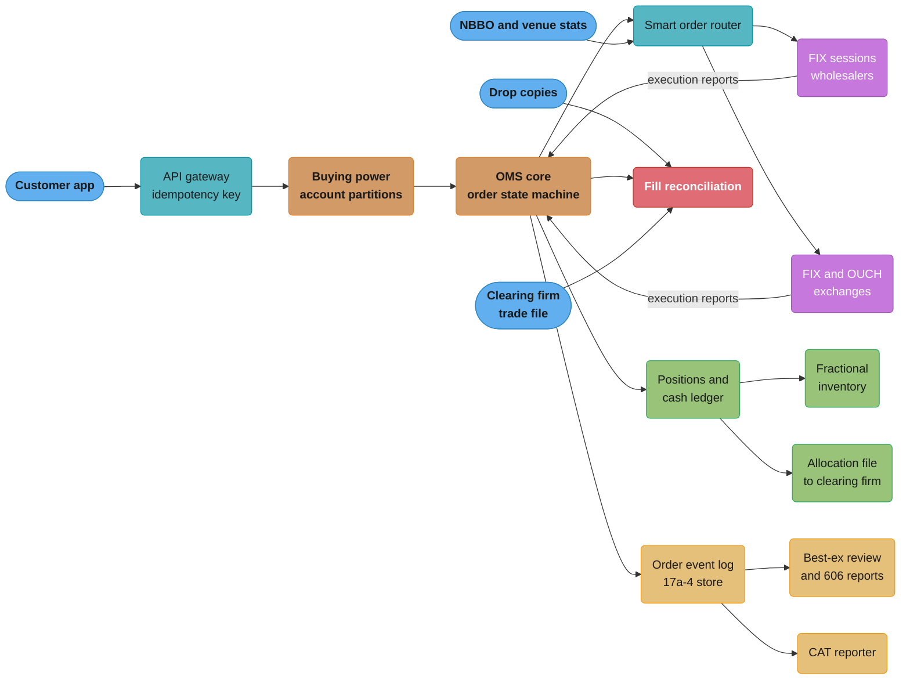
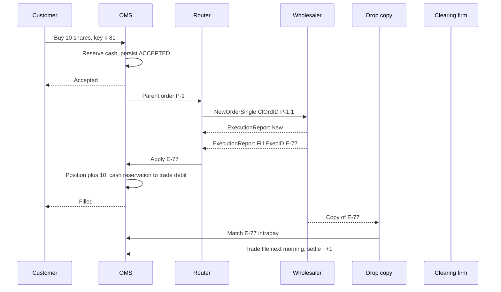
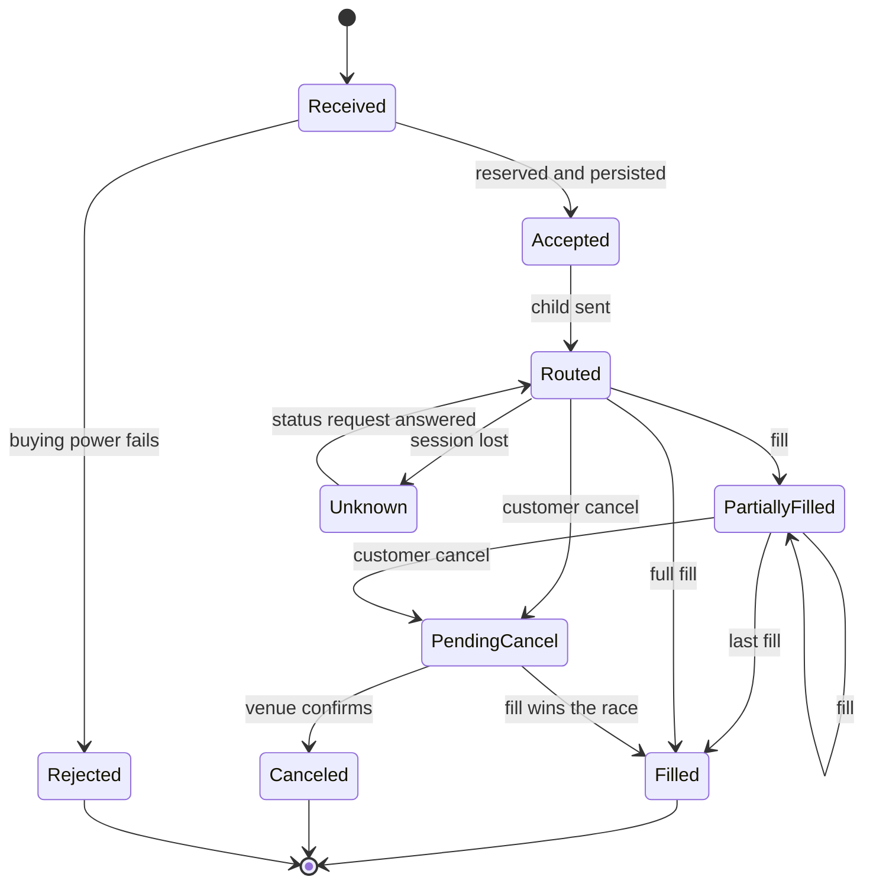
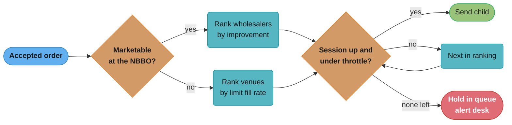
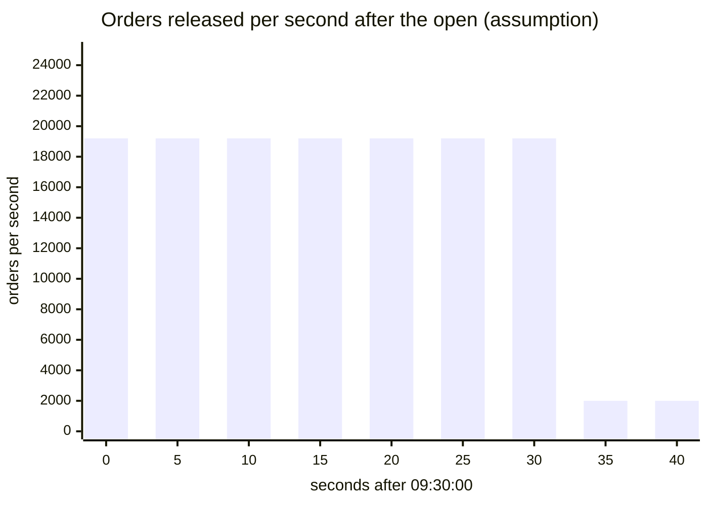

# Case Study: Design a Broker Order Management System

> Rules and figures checked 2026-11-06. Every date, threshold and fee on this page comes from the fact pins in fintech/CLAUDE.md or from the primary source named next to it. Scale figures are design assumptions. This page is an engineering view of US equities as of the pin date, not legal advice.

## Intuition

> **Design intuition**: An exchange owns the order book. A retail broker owns nothing in the market except its promises to its customers. The broker's order management system (OMS) is the customer's agent: it decides whether the customer can afford the order, where to send it, and what the customer now owns. It never sees the trade happen. It learns about each fill from an execution report, later from a drop copy, and on the next morning from the clearing firm's file. Those three records disagree for short periods. The OMS is a state machine that turns this evidence into positions and cash, and that can show later that it booked each fill exactly once.

The venue side of this story is already in the repo. [Design a Stock Exchange](../../hld/case_studies/design_stock_exchange.md) owns the matching engine, the sequencer, the exchange's own pre-trade risk gate, halts and market data. [Order Matching Engine](../../lld/system_design_problems/OrderMatchingEngine.md) owns the price-time book. [Design a Low-Latency Market Data Handler](../../java/case_studies/design_low_latency_market_data_handler.md) owns the GC-free feed path. This study repeats none of them. It covers the parts that exist only on the broker side: the account-level buying-power reservation, the parent and child order chain across several venues and wholesalers, fractional shares and the firm inventory account, the reconciliation of fills against drop copies and the clearing firm, T+1 settlement through a clearing firm, and the data that a best-execution review needs.

The specific question: **what must the OMS of a retail broker look like to accept 20,000 orders per second at the US equity open across 5 million accounts, never sell buying power twice, never book a fill twice, route to wholesalers and exchanges over FIX, sell fractions of a share, and settle T+1 through a clearing firm?**

**Key insight for this design**: the hard problem is not throughput. It is that every money-moving decision is made on evidence that arrives late, twice, or out of step. A buy reserves cash before any venue sees it. A fill arrives as an execution report that the venue can resend after a reconnect. The clearing firm's view arrives the next day. So the design has three rules. Reserve at accept and release only on evidence. Key every effect on the venue's execution id, never on arrival. Treat the clearing firm's record as the authority for cash and the OMS record as the authority for what the customer asked for, and let reconciliation find the gaps.

Everything here builds on: [Market Microstructure and Order Types](../market_microstructure_and_order_types/market_microstructure_and_order_types.md), [FIX Protocol and Order Entry](../fix_protocol_and_order_entry/fix_protocol_and_order_entry.md), [Idempotency and Exactly-Once Money Movement](../idempotency_and_exactly_once_money_movement/idempotency_and_exactly_once_money_movement.md), [Double-Entry Ledger Design](../double_entry_ledger_design/double_entry_ledger_design.md), [CCP Clearing and Settlement](../ccp_clearing_and_settlement/ccp_clearing_and_settlement.md), [Reconciliation and Settlement Files](../reconciliation_and_settlement_files/reconciliation_and_settlement_files.md), [Regulatory Reporting and Audit Trails](../regulatory_reporting_and_audit_trails/regulatory_reporting_and_audit_trails.md), and the two cross-cutting files [Money Movement Invariants](cross_cutting/money_movement_invariants.md) and [Business Days, Cut-offs and Value Dates](cross_cutting/business_days_cutoffs_and_value_dates.md).

---

## 1. Requirements Clarification

### Functional Requirements

- **Order entry.** Customers place market, limit and stop orders for US-listed stocks and ETFs, with day and good-till-canceled time in force. They can cancel and replace an open order. Each request carries a client idempotency key.
- **Notional and fractional orders.** A customer can buy "$25 of a stock" or "0.125 shares". The broker fills fractional quantity from its own inventory account and buys whole shares on the street to refill that inventory.
- **Buying-power check.** Every buy order reserves cash before the OMS routes it. Cash accounts can only spend settled cash plus proceeds that settle in time. Margin accounts use a margin model that the risk service owns. The OMS calls it and does not compute margin itself.
- **Smart order routing (SOR).** The router sends each order, or child orders split from it, to wholesalers (market makers that trade against retail flow as principal) and to exchanges, over FIX sessions.
- **Execution handling.** The OMS applies execution reports to the parent and child orders, updates positions and cash, and sends status to the customer's app.
- **Reconciliation.** The OMS matches its fills against the venue drop copies during the day and against the clearing firm's trade file after the close.
- **Settlement.** Trades settle T+1 through a clearing firm. The broker is an introducing broker: the clearing firm carries the customer accounts and clears the trades at the clearinghouse, and the broker keeps its own books of record.
- **Best execution and disclosure.** The OMS stores the data for the quarterly best-execution review and the routing disclosure reports.
- **Audit.** Every order event is kept in a store that meets the broker-dealer record rules.

### Non-Functional Requirements

All figures below are design assumptions unless a pin is named.

- **Peak load:** 20,000 parent orders per second for the first 30 seconds after the 09:30 ET open, and 2,000 per second for most of the session.
- **Accept latency:** p99 under 30 ms from the API edge to "accepted" (reserved, persisted, acknowledged). The customer app shows this state.
- **Route latency:** p99 under 5 ms from accept to the FIX message on the wire. This is a retail broker, not a market maker. Microseconds do not matter here, but seconds at the open do.
- **No double spend:** the sum of open reservations never exceeds the spendable cash of an account, under any interleaving.
- **No double booking:** a fill changes a position once, whatever the number of times its execution report arrives.
- **Durability:** RPO 0 for accepted orders and applied fills. An acknowledged order is never lost.
- **Availability:** 99.95% during market hours. The order path degrades to "cancel only" before it degrades to "down".
- **Retention:** 6 years for blotters and ledgers, per SEC Rule 17a-4.

### Out of Scope (and where it lives instead)

| Topic | Where it lives |
|---|---|
| Matching engine, sequencer, venue-side risk gate, halts | [Design a Stock Exchange](../../hld/case_studies/design_stock_exchange.md) |
| Price-time order book and FOK dry run | [Order Matching Engine](../../lld/system_design_problems/OrderMatchingEngine.md) |
| Feed handler, off-heap ring buffer | [Low-Latency Market Data Handler](../../java/case_studies/design_low_latency_market_data_handler.md), [Market Data Feeds and Multicast](../market_data_feeds_and_multicast/market_data_feeds_and_multicast.md) |
| FIX session layer: logon, gap fill, resend, sequence reset | [FIX Protocol and Order Entry](../fix_protocol_and_order_entry/fix_protocol_and_order_entry.md) |
| Margin model, maintenance calls, liquidation | [Margin, Liquidation and Derivatives Risk](../margin_liquidation_and_derivatives_risk/margin_liquidation_and_derivatives_risk.md) |
| Clearinghouse netting, the CCP loss waterfall, self-clear vs clearing broker | [CCP Clearing and Settlement](../ccp_clearing_and_settlement/ccp_clearing_and_settlement.md) |
| Customer onboarding, KYC and sanctions screening | [KYC, AML and Sanctions Screening](../kyc_aml_and_sanctions_screening/kyc_aml_and_sanctions_screening.md) |
| Ledger storage at scale, RLS, CQRS read model | [Design a Banking Ledger](../../database/case_studies/design_banking_ledger/design_banking_ledger.md) |

---

## 2. Scale Estimation

### Order and message arithmetic

```
Funded accounts                     5,000,000          (given)
Daily active traders                  500,000          (assumption: 10%)
Parent orders per day               4,000,000          (assumption: 8 per active trader)
Orders queued before the open         600,000          (assumption: overnight market orders)
Open burst                     600,000 / 30 s = 20,000 parent orders/s
Child orders per parent                   1.2          (assumption: SOR splits 1 in 5)
Child orders at peak            20,000 x 1.2 = 24,000/s
Execution reports per child                 3          (ack, one or two fills, done)
Execution reports at peak       24,000 x 3  = 72,000/s
Drop-copy messages at peak                  72,000/s   (one per execution report)
```

The open burst is the design point. During the rest of the day the system runs at about a tenth of that load. The burst also has a shape that a steady-state test does not show: the 600,000 queued orders all target the same 50 or so popular symbols, and most of them are market buys. Every one of them reserves cash in the same second, and every fractional one touches the same firm inventory account.

### Account-state writes

```
Writes per parent order:
  reserve at accept                         1
  adjust on each fill                     1.5  (average fills per order)
  release on done or cancel                 1
  ---------------------------------------------
  total                                   3.5
Peak account writes      20,000 x 3.5 = 70,000/s
Account partitions                         32  (assumption)
Per partition                   70,000 / 32 = about 2,200 writes/s
```

Retail accounts are independent of each other, so the account partition spreads cleanly. One account does not: the **firm inventory account** for fractional shares. If 30% of orders are fractional (assumption), that account sees 20,000 x 0.3 x 2 = 12,000 writes per second at the open. A single row cannot take that load with row locks. Section 4.4 covers the fix.

### Storage

```
Order events per parent order       6       (accept, route, ack, fills, done)
Bytes per event                   500
Per day     4,000,000 x 6 x 500 = 12 GB
Per year    12 GB x 252 trading days = about 3 TB
Retention   6 years (F32b)          = about 18 TB before replication
Best-ex snapshot per child order   64 B    (NBBO bid, ask, sizes, timestamp)
Per day     4,800,000 x 64 B = about 300 MB
```

18 TB over 6 years is small for object storage. The cost driver is not bytes. It is the rule that the record store must be either write-once or keep a full audit trail of every change, which section 4.7 covers.

---

## 3. High-Level Architecture



The order path runs left to right. The gateway removes duplicate requests by idempotency key. The buying-power service reserves cash in the account's partition. The OMS core persists the order and hands it to the router. The router picks venues and sends child orders over FIX. Execution reports come back to the OMS on the same sessions, and the OMS applies them to the ledger. The drop copies and the clearing firm's file arrive on separate paths and meet the OMS record in reconciliation.

The OMS core is partitioned by account, like the buying-power service. An order and all its children live in the partition of the account that placed it. This keeps the reservation, the order state and the position update for one account on one thread, so they need no cross-partition lock. A venue session is not partitioned by account, so a router instance owns each FIX session and forwards each execution report to the partition named in the ClOrdID prefix.

### Order lifecycle across the three records



---

## 4. Component Deep Dives

### 4.1 The order state machine and the execution-report key

A broker OMS tracks two levels of order. The **parent** is what the customer asked for. A **child** is what the router sent to one venue. A parent of 1,000 shares can have three children at three venues, and a cancel-replace on a child creates a new ClOrdID linked to the old one by OrigClOrdID. The FIX module owns the ClOrdID chain and the OrdStatus values. This section covers how the OMS applies them to money.



Two transitions are the ones that break naive designs. **PendingCancel to Filled**: a cancel is a request, and the venue may fill the order before it sees the cancel. The OMS keeps the reservation until the venue says which one won. **Routed to Unknown**: when a FIX session drops after a NewOrderSingle and before its acknowledgment, the OMS does not know if the venue has the order. Sending a new order with a new ClOrdID can buy twice. The OMS marks the child Unknown, keeps the reservation, and asks for order status when the session comes back. The idempotency module owns this unknown-outcome rule for all rails.

The second break is in how a fill changes the order. After a reconnect, the venue's FIX engine can resend messages with PossDupFlag or PossResend set. The same fill arrives twice.

#### BROKEN: add LastQty for every report that arrives

```java
// BROKEN
public class BrokenFillApply {
    record ExecReport(String execId, String clOrdId, long lastQty, long pxE4) {}

    static final class Order {
        final long qty;
        long filled;
        long notionalE4;
        Order(long qty) { this.qty = qty; }

        void apply(ExecReport r) {
            filled += r.lastQty();
            notionalE4 += r.lastQty() * r.pxE4();
        }
    }

    public static void main(String[] args) {
        var order = new Order(100);
        var fill = new ExecReport("E-77", "C-1", 60, 1_872_500);
        order.apply(fill);
        order.apply(fill);
        System.out.println("filled " + order.filled + " of " + order.qty);
    }
}
```

It prints `filled 120 of 100`. The customer now holds 20 shares that no venue sold them, and the cash debit is 20 shares too large. The code is correct for a network that delivers each message once. FIX does not promise that, and a resend after a reconnect is normal behavior.

#### FIX: key the effect on ExecID and check CumQty

```java
import java.util.HashSet;
import java.util.Set;

public class FillApply {
    enum Status { NEW, PARTIALLY_FILLED, FILLED }
    enum Outcome { APPLIED, DUPLICATE, NEEDS_STATUS }
    record ExecReport(String execId, String clOrdId, long lastQty, long pxE4, long cumQty) {}

    static final class Order {
        final long qty;
        final Set<String> execIds = new HashSet<>();
        long filled;
        long notionalE4;
        Status status = Status.NEW;
        Order(long qty) { this.qty = qty; }

        Outcome apply(ExecReport r) {
            if (execIds.contains(r.execId())) return Outcome.DUPLICATE;
            if (r.cumQty() != filled + r.lastQty() || r.cumQty() > qty) return Outcome.NEEDS_STATUS;
            execIds.add(r.execId());
            filled = r.cumQty();
            notionalE4 += r.lastQty() * r.pxE4();
            status = filled == qty ? Status.FILLED : Status.PARTIALLY_FILLED;
            return Outcome.APPLIED;
        }
    }

    public static void main(String[] args) {
        var order = new Order(100);
        var first = new ExecReport("E-77", "C-1", 60, 1_872_500, 60);
        var second = new ExecReport("E-78", "C-1", 40, 1_872_600, 100);
        assert order.apply(first) == Outcome.APPLIED;
        assert order.apply(first) == Outcome.DUPLICATE;
        assert order.apply(new ExecReport("E-80", "C-1", 10, 1_872_700, 80)) == Outcome.NEEDS_STATUS;
        assert order.apply(second) == Outcome.APPLIED;
        assert order.filled == 100 && order.status == Status.FILLED;
        System.out.println("filled " + order.filled + ", avg px E4 " + order.notionalE4 / order.filled);
    }
}
```

The fix uses two checks. The ExecID check makes a resend a no-op. The CumQty check catches the other failure: a report whose cumulative quantity does not equal what the OMS has plus this fill means the OMS missed a report, or the venue sent a correction. The OMS does not guess. It returns NEEDS_STATUS, holds the reservation, and sends an order status request. Prices are `long` in units of $0.0001, the same 4 implied decimals that Nasdaq ITCH 5.0 uses, so a sub-penny midpoint fill fits without a `double`.

In production the ExecID set is a unique constraint, not a `HashSet`. The constraint is on `(venue, exec_id)`, because two venues can issue the same ExecID string. The schema in section 4.2 has it.

### 4.2 Buying power: reserve at accept, release on evidence

The buying-power service answers one question for each buy order: can this account pay for it? For a limit buy, the cost is quantity times limit price plus estimated fees. For a market buy, the OMS uses a protection price: the current ask times a collar, for example 1.05 (assumption). The order becomes a marketable limit at that price, so a fill can never cost more than the reservation.

Spendable cash in a cash account is not the cash balance. Regulation T requires that a customer pay in full for a purchase in a cash account. If the customer sells a security before paying for it in full, the account loses the privilege of delaying payment beyond the trade date for 90 calendar days (12 CFR 220.8(a) and (c), read 2026-11-06 on the eCFR text at Cornell LII). Under T+1, a sale and a buy made on the same day both settle on the next business day. So proceeds of a sale can pay for a buy with the same settlement date, but the OMS must track which lots are paid for. The [Business Days, Cut-offs and Value Dates](cross_cutting/business_days_cutoffs_and_value_dates.md) file owns the date arithmetic. This section owns the reservation.

The schema keeps the reservation in the account row so that a single conditional update can check and reserve in one step:

```sql
CREATE TABLE account (
    id              bigint PRIMARY KEY,
    kind            text   NOT NULL CHECK (kind IN ('cash', 'margin')),
    settled_cents   bigint NOT NULL CHECK (settled_cents >= 0),
    reserved_cents  bigint NOT NULL DEFAULT 0 CHECK (reserved_cents >= 0),
    frozen_until    date,
    CHECK (reserved_cents <= settled_cents)
);

CREATE TABLE reservation (
    order_id     text   PRIMARY KEY,
    account_id   bigint NOT NULL REFERENCES account (id),
    amount_cents bigint NOT NULL CHECK (amount_cents > 0),
    released     boolean NOT NULL DEFAULT false
);

CREATE TABLE fill (
    venue        text   NOT NULL,
    exec_id      text   NOT NULL,
    order_id     text   NOT NULL,
    qty_micro    bigint NOT NULL CHECK (qty_micro > 0),
    px_e4        bigint NOT NULL CHECK (px_e4 > 0),
    PRIMARY KEY (venue, exec_id)
);

INSERT INTO account (id, kind, settled_cents) VALUES (1, 'cash', 100000);
```

#### BROKEN: read the balance in the application, then write the total

```sql
-- BROKEN
-- Two order threads each read settled_cents = 100000 and reserved_cents = 0,
-- and each checks 100000 - 0 >= 60000 in application code. Then each writes its total.
UPDATE account SET reserved_cents = 0 + 60000 WHERE id = 1;
UPDATE account SET reserved_cents = 0 + 60000 WHERE id = 1;
SELECT settled_cents, reserved_cents FROM account WHERE id = 1;
```

The final row shows `reserved_cents = 60000`, but two orders worth $1,200 are live against $1,000 of cash. This is a lost update. Both writes pass the CHECK constraint, because each one writes a value that is valid alone. A load test with one order per account never shows it. At the open, one customer double-taps the buy button and both requests run in the same millisecond.

#### FIX: one conditional update that checks and reserves

```sql
INSERT INTO reservation (order_id, account_id, amount_cents) VALUES ('P-1', 1, 60000);
UPDATE account
   SET reserved_cents = reserved_cents + 60000
 WHERE id = 1
   AND settled_cents - reserved_cents >= 60000
RETURNING reserved_cents;

INSERT INTO reservation (order_id, account_id, amount_cents) VALUES ('P-2', 1, 60000);
UPDATE account
   SET reserved_cents = reserved_cents + 60000
 WHERE id = 1
   AND settled_cents - reserved_cents >= 60000
RETURNING reserved_cents;

DELETE FROM reservation r
 WHERE r.order_id = 'P-2'
   AND (SELECT reserved_cents FROM account WHERE id = 1) = 60000;

SELECT settled_cents, reserved_cents,
       (SELECT count(*) FROM reservation WHERE account_id = 1) AS live_reservations
  FROM account WHERE id = 1;
```

The first update returns one row with `60000`. The second returns no rows, so the OMS rejects order P-2 and deletes its reservation row, in the same transaction in the real service. The update reads and writes the row under its row lock, so two concurrent updates serialize on the row. The `CHECK (reserved_cents <= settled_cents)` constraint is the second defense: a code path that forgets the `WHERE` clause fails at the database instead of overspending. [Concurrency Control and Locking](../../database/concurrency_control_and_locking/concurrency_control_and_locking.md) covers the lock behavior. The release path is the same shape in reverse, keyed on `reservation.order_id` with `released = false` in the `WHERE` clause, so a duplicate "done" message releases nothing.

The buying-power service does not run this SQL per order at 20,000 per second. It keeps each partition's accounts in memory on a single thread, applies the same check, and appends the reservation to the partition's log before it acknowledges. The SQL is the model the in-memory code must match, and the nightly check that compares the two.

### 4.3 Smart order routing to wholesalers and exchanges

The router chooses where each order goes. For a US retail broker there are two kinds of destination:

| Destination | What it does with the order | What the broker can measure |
|---|---|---|
| Wholesaler | Trades against the order as principal, often at a price better than the NBBO | Price improvement per share, fill rate, speed, payment for order flow if any |
| Exchange | Puts the order on its book, where it trades with other orders | Fill rate, fees and rebates, queue position for limit orders |
| ATS | Matches against other subscribers' orders | Fill rate, size, information leakage |

The router is a policy with inputs, not a model that learns in production. Its inputs are the NBBO at route time, each destination's measured execution quality per symbol group and order type, session health, fees and rebates, and any payment for order flow. Its output is a ranked list of destinations per order. A typical policy sends marketable orders to the wholesaler with the best measured price improvement for that symbol group, sends non-marketable limit orders where they get the best fill rate, and fails over to the next destination when a session is down.

The legal frame for that policy is best execution. FINRA Rule 5310 requires a member to use reasonable diligence to find the best market for the security, so that the price to the customer is as favorable as possible under prevailing market conditions. A firm that routes automatically must do a "regular and rigorous review" of execution quality at least quarterly, security by security and by order type, against what competing markets would give (FINRA Rule 5310 and Supplementary Material .09, version effective 2014-05-09, read 2026-11-06). Section 4.7 shows the data the router must keep for that review.

Two Reg NMS facts change the router's job. The SEC proposed on 2026-06-11 to rescind Rule 611, the trade-through rule, and Rule 610(e) on locked and crossed quotes. It is a proposal only. The 2024 amendments that set a $0.005 tick for certain NMS stocks at or above $1.00 and a $0.001 access-fee cap are under exemptive relief until the first business day of November 2027. The router must not hard-code either: tick size and fee caps belong in a reference table with an effective date, because both can change by order of the SEC.

#### A worked routing decision

A customer sends a market buy for 100 shares. The NBBO is $187.24 bid and $187.25 offer. The router reads its ranking table for this symbol group and order type. The figures in the table are illustrative, and the review in section 4.7 produces the real ones each quarter.

| Destination | Measured improvement (cents per share) | Fill rate | Session state | Cost to the broker per share |
|---|---|---|---|---|
| WHOLESALER_A | 0.40 | 99.8% | up | none |
| WHOLESALER_B | 0.10 | 99.9% | up | none |
| EXCHANGE_X | 0.00 | 97.0% | up | take fee |

The router sends the order to WHOLESALER_A, with WHOLESALER_B as the fallback. The expected price is $187.25 minus 0.4 cents, or $187.246 per share, so the expected cost is $18,724.60 against a reservation at the protection price of 100 x $187.25 x 1.05 = $19,661.25. The reservation is larger than the expected cost on purpose. The difference returns to the customer's buying power when the fill arrives.



The loop ends in a held order, not in a forced send to a worse destination with no limit. A held order keeps its reservation and its place in the queue, and the desk sees it at once.

#### The child order chain

The router names each child order `<parent>.<n>` and keeps the parent's partition id in the prefix, so an execution report on any session finds its partition without a lookup. When the router replaces a child (a price change), it sends OrderCancelReplaceRequest with a new ClOrdID and OrigClOrdID pointing to the old one. The OMS keeps one row per ClOrdID and one row per parent, and the parent's filled quantity is the sum over its children's CumQty.

The router never sends a second child for a quantity that is still open at another venue. If a child is in Unknown state, its quantity counts as open. This rule costs fill rate during a session outage, and it is the rule that stops the broker from buying 2,000 shares for a 1,000-share order.

#### Kill switches

The router has two limits that do not depend on any venue. The first is a per-parent ratio: the total quantity of children sent for a parent must not exceed the parent quantity, checked before each send. The second is a firm-wide rate on child orders per second per symbol, with an alert at a multiple of the 30-day p99 and a hard stop above that. Section 9 has the war story that these limits answer.

### 4.4 Fractional shares and the firm inventory account

An exchange trades whole shares. A fractional order is a promise from the broker. When a customer buys 0.125 shares, the broker sells 0.125 shares to the customer from its own inventory account, and buys whole shares on the street to refill the inventory when it runs low. When a customer sells a fraction, the inventory buys it back.

This has three engineering consequences:

1. **Units.** Quantities are `long` micro-shares (1 share = 1,000,000 units, a design choice). A notional order "buy $25" converts to `floor(2500 cents x 1,000,000 / price in cents)` micro-shares at the execution price. Rounding down means the customer never pays for more than they asked.
2. **The inventory account is a hot account.** At the open it takes 12,000 writes per second (section 2). The fix is the one in [Hot Accounts and Ledger Scaling](../double_entry_ledger_design/hot_accounts_and_ledger_scaling.md): the inventory account is split into 16 sub-accounts (assumption), each fractional fill picks a sub-account by account id hash, and a sweep nets the sub-accounts every second. Each sub-account must stay non-negative, so the sweep also moves shares between sub-accounts before one runs dry.
3. **Average-price allocation.** When the broker buys whole shares on the street for many fractional customers, it allocates the street fill to them at one average price. The allocated cash must add up to the street amount to the cent, and the allocated shares must add up to the street shares.

#### BROKEN: round each customer's amount on its own

```java
// BROKEN
import java.util.*;

public class BrokenAllocation {
    public static void main(String[] args) {
        long streetCents = 18_725;
        double avgPx = 187.25;
        var lines = new LinkedHashMap<String, Long>();
        lines.put("acct-17", 500_000L);
        lines.put("acct-42", 250_000L);
        lines.put("acct-90", 125_000L);
        lines.put("firm-inventory", 125_000L);
        long sum = 0;
        for (var e : lines.entrySet()) {
            long cents = Math.round(e.getValue() / 1e6 * avgPx * 100);
            sum += cents;
            System.out.println(e.getKey() + " " + cents);
        }
        System.out.println("street " + streetCents + " allocated " + sum);
    }
}
```

The broker bought 1 share at $187.25 and allocated 0.5, 0.25 and 0.125 to customers and 0.125 to inventory. The exact amounts are $93.625, $46.8125, $23.40625 and $23.40625. Rounded one by one, they become $93.63, $46.81, $23.41 and $23.41, and the program prints `street 18725 allocated 18726`. The customers paid one cent that the street never charged. One cent per bucket, at 50,000 buckets a day (assumption), is $500 a day of cash that the clearing firm's file does not have, and every cent is a reconciliation break.

#### FIX: allocate the street amount by largest remainder

```java
import java.util.*;

public class Allocation {
    record Line(String account, long micro) {}
    record Booked(String account, long micro, long cents) {}

    static List<Booked> allocate(long streetCents, List<Line> lines) {
        long total = lines.stream().mapToLong(Line::micro).sum();
        long[] cents = new long[lines.size()];
        long[] rem = new long[lines.size()];
        long given = 0;
        for (int i = 0; i < lines.size(); i++) {
            long exact = Math.multiplyExact(streetCents, lines.get(i).micro());
            cents[i] = exact / total;
            rem[i] = exact % total;
            given += cents[i];
        }
        Integer[] order = new Integer[lines.size()];
        for (int i = 0; i < order.length; i++) order[i] = i;
        Arrays.sort(order, Comparator.<Integer>comparingLong(i -> -rem[i])
                .thenComparing(i -> lines.get(i).account()));
        for (int k = 0; k < streetCents - given; k++) cents[order[k]]++;
        var out = new ArrayList<Booked>();
        for (int i = 0; i < lines.size(); i++)
            out.add(new Booked(lines.get(i).account(), lines.get(i).micro(), cents[i]));
        return out;
    }

    public static void main(String[] args) {
        var lines = List.of(new Line("acct-17", 500_000), new Line("acct-42", 250_000),
                new Line("acct-90", 125_000), new Line("firm-inventory", 125_000));
        var booked = allocate(18_725, lines);
        booked.forEach(b -> System.out.println(b.account() + " " + b.cents()));
        assert booked.stream().mapToLong(Booked::cents).sum() == 18_725;
        assert booked.stream().mapToLong(Booked::micro).sum() == 1_000_000;
    }
}
```

Each line gets the floor of its exact share. The leftover cents go one each to the lines with the largest remainders, and the account id breaks ties so the result is the same on every run. The output is 9362, 4681, 2341 and 2341 cents, which adds up to 18725. The sum is now a property of the algorithm, not a hope. [Money Representation and Currency](../money_representation_and_currency/money_representation_and_currency.md) owns rounding modes and allocation in general. The new part here is that the firm inventory account is one of the allocation lines, so the firm's own position takes its share of the rounding like any customer.

### 4.5 Fill reconciliation: OMS, drop copy and clearing file

Each fill exists in three records, and each record is the authority for a different thing. This follows the scoped-authority rule in [Reconciliation and Settlement Files](../reconciliation_and_settlement_files/reconciliation_and_settlement_files.md).

| Record | Arrives | Authority for |
|---|---|---|
| OMS fill (from the execution report) | Milliseconds after the trade | What the customer sees and what the broker owes the customer |
| Drop copy from the venue or wholesaler | Seconds after the trade, on a separate session | What the venue says it executed for the broker's MPID |
| Clearing firm trade file | After the close or next morning | What will settle T+1 and move cash |

The intraday match runs on a stream processor keyed by `(venue, exec_id)`. A fill in the OMS with no drop copy after 60 seconds (assumption) is a **soft break**: often the drop-copy session is slow. A drop copy with no OMS fill is a **hard break** and pages the on-call engineer at once, because the customer's position is wrong and the customer may trade on it. That break usually means a lost execution report, and the cause is often a session that reconnected with a sequence reset instead of a resend.

The end-of-day match compares the OMS with the clearing firm's file. Differences here are quantity breaks, price breaks (a corrected execution after the trade), and allocation breaks (fractional allocations that the clearing firm booked to a different sub-account). Each break goes to a case queue with an age. The breaks that matter most are the ones on the settlement date, because the clearing firm settles what its file says, not what the OMS says.

Every break maps to one of the invariants in [Money Movement Invariants](cross_cutting/money_movement_invariants.md): each external movement (a venue fill) must match exactly one internal transfer (an OMS fill), and each internal transfer must have an end-to-end trace id (the ClOrdID chain back to the customer's idempotency key).

### 4.6 T+1 settlement through a clearing firm

The SEC moved the standard settlement cycle from T+2 to T+1 for most broker-dealer transactions in securities, with a compliance date of 2024-05-28. The EU moves to T+1 on 2027-10-11, and the UK moves on the same date under a draft statutory instrument. This study covers the US.

The introducing broker does not settle with the clearinghouse itself. It sends its trades and allocations to its clearing firm, and the clearing firm settles with the clearinghouse. The clearing firm in turn asks the broker for deposits that cover the risk of the unsettled trades. The [CCP Clearing and Settlement](../ccp_clearing_and_settlement/ccp_clearing_and_settlement.md) module owns why those deposits exist and how they are computed. The broker's design problem is that the deposit can rise faster than the broker's cash. Robinhood wrote on 2021-01-29 that its clearinghouse-mandated deposit requirements related to equities had increased ten-fold that week, and that those requirements cover the settlement period, then T+2 (Robinhood, "What happened this week", 2021-01-29). Its response was to limit buying in a small number of volatile securities. That decision lives in the OMS: a per-symbol "position-closing only" flag that the buying-power check reads.

The ledger posts each trade twice:

| Date | Debit | Credit |
|---|---|---|
| Trade date | Customer securities position | Customer cash, pending settlement |
| Settlement date | Customer cash, pending settlement | Customer cash, settled |

The settlement date comes from a business-day calendar, not from `trade_date + 1`. The calendar is data, loaded from the clearinghouse's published calendar, and it changes when the market adds a holiday.

```sql
CREATE TABLE market_holiday (
    day   date PRIMARY KEY,
    name  text NOT NULL
);

INSERT INTO market_holiday VALUES ('2026-12-25', 'test fixture');

CREATE FUNCTION settle_date(trade_date date, n int) RETURNS date
LANGUAGE plpgsql STABLE AS $$
DECLARE
    d date := trade_date;
    left_days int := n;
BEGIN
    WHILE left_days > 0 LOOP
        d := d + 1;
        IF extract(isodow FROM d) < 6
           AND NOT EXISTS (SELECT 1 FROM market_holiday h WHERE h.day = d) THEN
            left_days := left_days - 1;
        END IF;
    END LOOP;
    RETURN d;
END $$;

SELECT settle_date('2026-12-24', 1) AS thu_before_holiday,
       settle_date('2026-11-06', 1) AS friday;
```

A trade on Thursday 2026-12-24 settles on Monday 2026-12-28, because the test fixture marks Friday as a holiday. A Friday trade on 2026-11-06 settles on Monday 2026-11-09. The function returns the date the ledger needs for the second posting and the date the buying-power check needs to decide whether sale proceeds settle in time.

### 4.7 Best-execution data, routing reports and the audit record

Three duties need the same data: the quarterly best-execution review under FINRA 5310, the public routing report under SEC Rule 606, and the consolidated audit trail (CAT).

Rule 606(a) requires a broker-dealer to publish a quarterly report on its routing of non-directed orders, broken down by calendar month, covering held orders in NMS stocks and options. The report names the top ten venues by non-directed orders and any venue with 5% or more, and gives, per venue, the net payment for order flow, profit-sharing, fees and rebates, in total and per share. The broker must publish it within one month after the end of the quarter and keep it on a free public website for three years. Rule 606(b)(3) adds a customer report for not-held orders, due within seven business days of the request (17 CFR 242.606, read 2026-11-06 on the eCFR text at Cornell LII).

For CAT, the SEC approved on 2026-01-13 an amendment under which Industry Members no longer report customer names, addresses and years of birth, and the customer database deletes those fields. The OMS still reports the order events. The reporter is a consumer of the same order event log.

The design keeps one data set for all three: the order event log, plus a snapshot of the NBBO taken when the router sent each child. Price improvement per child is then a query, not a separate pipeline:

```sql
CREATE TABLE child_execution (
    child_id      text   PRIMARY KEY,
    venue         text   NOT NULL,
    side          text   NOT NULL CHECK (side IN ('buy', 'sell')),
    symbol_group  text   NOT NULL,
    order_type    text   NOT NULL,
    qty           bigint NOT NULL CHECK (qty > 0),
    exec_px_e4    bigint NOT NULL,
    nbb_px_e4     bigint NOT NULL,
    nbo_px_e4     bigint NOT NULL,
    routed_at     timestamptz NOT NULL
);

INSERT INTO child_execution VALUES
  ('P-1.1', 'WHOLESALER_A', 'buy',  'large_cap', 'market', 100, 1872450, 1872400, 1872500, '2026-11-02 14:30:00.120+00'),
  ('P-2.1', 'WHOLESALER_B', 'buy',  'large_cap', 'market', 200, 1872500, 1872400, 1872500, '2026-11-02 14:30:00.180+00'),
  ('P-3.1', 'WHOLESALER_A', 'sell', 'large_cap', 'market', 50,  1872430, 1872400, 1872500, '2026-11-02 14:30:01.010+00'),
  ('P-4.1', 'EXCHANGE_X',   'buy',  'large_cap', 'market', 100, 1872500, 1872400, 1872500, '2026-11-02 14:30:01.300+00');

SELECT venue,
       sum(qty) AS shares,
       sum(CASE side WHEN 'buy'  THEN (nbo_px_e4 - exec_px_e4) * qty
                     ELSE (exec_px_e4 - nbb_px_e4) * qty END) / 100.0 AS improvement_cents,
       round(sum(CASE side WHEN 'buy'  THEN (nbo_px_e4 - exec_px_e4) * qty
                           ELSE (exec_px_e4 - nbb_px_e4) * qty END)::numeric
             / sum(qty) / 100, 4) AS cents_per_share
  FROM child_execution
 WHERE routed_at >= '2026-10-01' AND routed_at < '2027-01-01'
 GROUP BY venue
 ORDER BY cents_per_share DESC;
```

WHOLESALER_A gives 0.5 cents per share on the buy and 0.3 on the sell. WHOLESALER_B and EXCHANGE_X give none. The review compares these numbers per symbol group and order type, quarter after quarter, and the router's ranking table changes only through that review, with the change recorded. The NBBO snapshot must be the one the router saw at send time. A snapshot taken when the fill arrives measures the market after the trade. On a rising price it makes every venue look better on buys and worse on sells, and on a falling price the reverse.

The audit record itself goes to a store that meets SEC Rule 17a-4. Broker-dealers keep blotters, ledgers and the other core 17a-3 records for 6 years and most other records for 3 years, the first 2 years easily accessible. FINRA Rule 4511 sets 6 years where no other period applies. Since the 2022 amendments, an electronic system can meet the rule either with write-once storage or with a complete time-stamped audit trail that can recreate an original record after a change or delete. [Regulatory Reporting and Audit Trails](../regulatory_reporting_and_audit_trails/regulatory_reporting_and_audit_trails.md) owns the store choice.

### 4.8 The open: releasing the pre-open queue

The 600,000 orders queued overnight are the reason the peak is 20,000 per second. If the OMS releases all of them at 09:30:00, three things break. The wholesaler sessions hit their per-session throttles and reject children. The firm inventory sub-accounts for the popular symbols run dry in the first second. And the protection price on each market order is computed from an ask that moves a lot in the first seconds, so many orders reprice or reject.

The release is a controlled drain, not a flood:

1. **Order.** Queued orders release in accept order, per partition. A customer who placed an order at 20:00 the night before goes ahead of one who placed it at 09:29. Each partition drains its own queue, so there is no global sort.
2. **Rate.** Each partition releases at most 600 orders per second (assumption), so 32 partitions release about 19,200 per second, inside the 20,000 design point. The 600,000 orders drain in about 31 seconds.
3. **Price.** Each order recomputes its protection price from the NBBO at release, not at accept. If the new reservation is larger than the old one and the account cannot cover it, the order rejects with a reason before it routes.
4. **Inventory.** Before 09:30, the fractional desk sizes each symbol's inventory to the queued fractional buy notional for that symbol, so the first fills come from stock that is already there.



The flat top is the throttle doing its job. Without it, the first second would carry most of the queue and the next 30 seconds would carry the rejects and the retries.

The customer sees a delay of up to 31 seconds on a queued order. The app shows "queued for the open" until release, then "sent". Fairness here means a written rule (accept order per partition) that the broker can show to a customer and to an examiner, not equal latency for everyone.

---

## 5. Design Decisions & Tradeoffs

### Decision 1: partition by account, not by symbol

| Factor | Partition by account (this design) | Partition by symbol |
|---|---|---|
| Buying-power check | Local to one partition | Needs a cross-partition read of the account's cash |
| Order state | All of a customer's orders on one thread | A customer's orders spread over many threads |
| Hot spot at the open | Even: 5M accounts | Severe: 50 symbols take most of the burst |
| Per-symbol kill switch | Needs a firm-wide counter per symbol | Local |
| Venue session mapping | Router forwards reports by ClOrdID prefix | Router forwards by symbol |

An exchange partitions by symbol because the book is per symbol (the stock exchange study, section 4.2). A broker has no book. Its shared state is the account, so account partitions remove the lock that matters. The per-symbol kill switch moves to a small firm-wide counter service that the router consults. That service is the one cross-partition dependency on the order path, and it fails open to the last known limits for 5 seconds (assumption) before it fails closed.

### Decision 2: reserve at accept, not at route

Reserving at route time would let the customer see "accepted" for an order the broker cannot pay for. It would also let two orders accepted in the same millisecond both pass a check that only one should pass. Reserving at accept costs nothing for the 99% of orders that route at once. It does lock cash for orders queued before the open, which is correct: the customer has committed that cash.

### Decision 3: wholesaler first for marketable retail orders

| Factor | Wholesaler | Exchange |
|---|---|---|
| Price improvement on small marketable orders | Measured per venue, often positive | None at the NBBO for a marketable order that takes liquidity |
| Fees | Usually none to the broker, sometimes payment for order flow | Take fee, capped under Reg NMS |
| Disclosure | Payment and terms in the 606 report | Fees and rebates in the 606 report |
| Conflict of interest | Payment can bias routing, so the 5310 review must show the routing is earned | Rebates create the same question for limit orders |

The design does not hard-code either. The router ranks destinations by measured execution quality from section 4.7. Payment for order flow is an input to disclosure, never to ranking.

### Decision 4: fractional fills from inventory, not street fractions

The broker cannot buy 0.125 shares on an exchange. The options are to fill from its own inventory at once, or to batch fractional orders and buy whole shares on a timer. Filling from inventory gives the customer an immediate fill at the current price and puts the inventory risk on the firm. Batching removes the inventory risk and makes the customer wait for the batch. This design fills from inventory, caps the inventory per symbol (assumption: $50,000 notional), and buys or sells whole shares when inventory crosses the cap.

### Decision 5: introducing broker, not self-clearing

The [CCP Clearing and Settlement](../ccp_clearing_and_settlement/ccp_clearing_and_settlement.md) module owns this decision model. For this study's scale the short answer is: start as an introducing broker, because self-clearing means clearinghouse membership, its capital and its deposits on the broker's own balance sheet. The OMS design must not depend on the choice. The clearing interface is one adapter that writes the allocation file and reads the trade file.

---

## 6. Real-World Implementations

**Robinhood, clearinghouse deposits in January 2021.** In its post of 2021-01-29, Robinhood wrote that its clearinghouse-mandated deposit requirements related to equities had increased ten-fold that week, that individual volatile securities accounted for hundreds of millions of dollars of those requirements, and that the requirements cover the settlement period, then T+2. It limited buying in a small number of volatile securities so that it could meet its obligations. The engineering point is that a broker's buying-power check covers more than the customer's cash. It also covers the firm's own capacity to fund the deposit, and the OMS needs a per-symbol switch for that.

**Robinhood, FINRA action of 2021-06-30.** FINRA's Letter of Acceptance, Waiver and Consent fined Robinhood Financial $57 million and ordered restitution of $12,598,445.16 plus interest. Of that, $5,213,557.98 related to systems outages. FINRA cited, among other things, harm to millions of customers affected by the firm's outages in March 2020 (FINRA AWC, robinhood-financial-awc-063021). The design lesson is the "degrade to cancel-only" requirement in section 1: when the order path is unhealthy, customers must still be able to close or cancel.

**Knight Capital, 2012-08-01.** The SEC's order describes how, in about 45 minutes, Knight's router SMARS sent millions of child orders, which gave over 4 million executions in 154 stocks for over 397 million shares. Knight took a net long position of about $3.5 billion in 80 stocks and lost more than $460 million. The SEC penalty was $12 million (SEC order 34-70694, 2013-10-16). Knight was a market maker, not a retail broker, but SMARS was the same kind of component as section 4.3's router. The parent-to-child quantity check and the per-symbol child rate limit exist for this failure.

**Nasdaq OUCH 5.0.** Nasdaq's binary order-entry protocol is tag-based with variable-length appendages, and it keys orders by UserRefNum, which must be unique and strictly increasing per day. It launched on 2022-11-14. A broker that connects to Nasdaq directly through OUCH gets the same idempotency duty as with FIX ClOrdID: the OMS must persist the next UserRefNum before it sends, or a restart can reuse a number.

**FIX Latest.** FIX Trading Community's application layer is FIX Latest, defined as FIX 5.0 SP2 plus all later Extension Packs, and the community plans no further FIX version. Wholesaler connections in this design use FIX tag=value. The [FIX Protocol and Order Entry](../fix_protocol_and_order_entry/fix_protocol_and_order_entry.md) module owns the choice between tag=value and binary.

---

## 7. Technologies & Tools

| Tool | Role here |
|---|---|
| QuickFIX/J | Open-source Java FIX engine for the wholesaler and exchange sessions, with persistent message stores for resend |
| Artio | Real Logic's FIX engine on Aeron, an option where the session count or latency outgrows QuickFIX/J |
| Aeron Cluster | Raft-based replicated log for each account partition's in-memory state, so a partition fails over with RPO 0 |
| Apache Kafka | Order event log fan-out to reconciliation, best-ex, CAT and the customer notification service |
| Apache Flink | Intraday stream join of OMS fills and drop copies keyed by `(venue, exec_id)` |
| PostgreSQL 18 | Books of record: accounts, reservations, fills, allocations, the settlement calendar |
| Temporal | Durable workflows for the end-of-day allocation file, the clearing file match and break cases |
| Object storage with object lock | The write-once option for the 17a-4 record store |

[Durable Execution and Workflows](../../backend/durable_execution_and_workflows/durable_execution_and_workflows.md) covers Temporal. [Kafka Deep Dive](../../backend/kafka_deep_dive/kafka_deep_dive.md) covers the partitioned log and `acks=all`.

---

## 8. Operational Playbook

### Metrics

| Metric | Healthy | Page someone at |
|---|---|---|
| `accept_latency_p99` | under 30 ms | over 200 ms for 1 minute |
| `orders_unknown_state` | 0 | any child in Unknown for over 10 s |
| `drop_copy_hard_breaks` | 0 | any |
| `drop_copy_soft_breaks_age_p99` | under 10 s | over 60 s |
| `reservation_drift_cents` (in-memory vs SQL nightly) | 0 | any non-zero |
| `inventory_subaccount_min_micro` | above 10% of cap | under 0 attempt |
| `child_to_parent_qty_ratio_max` | 1.0 | over 1.0 (kill switch fires) |
| `children_per_second_per_symbol` | under 30-day p99 | 5x 30-day p99 |

### Money movement invariants for this system

The checklist comes from [Money Movement Invariants](cross_cutting/money_movement_invariants.md). Each row names where this design enforces it.

| Invariant | DB constraint | Runtime assertion | Property test |
|---|---|---|---|
| Conservation per currency | Allocation lines of a bucket sum to the street amount | `allocate()` asserts the cent and share sums | Random buckets: sums always match |
| No negative available balance | `CHECK (reserved_cents <= settled_cents)` | Conditional reserve returns no row on shortfall | Concurrent reserve storms never overspend |
| Idempotent effect | `PRIMARY KEY (venue, exec_id)` on `fill` | `apply()` returns DUPLICATE on a seen ExecID | Every report applied twice gives the same state |
| Append-only with reversals | Fills and postings are never updated; a busted trade is a new reversing posting | Updates on `fill` are rejected by grants | Replay of the event log rebuilds positions exactly |
| One internal transfer per external movement | Intraday drop-copy join on `(venue, exec_id)` | Hard break pages on a drop copy with no OMS fill | Generated sessions with drops and resends reconcile to zero breaks |
| End-to-end trace id | ClOrdID prefix carries the parent id and partition | Every child references a parent that exists | Each fill walks back to one customer idempotency key |

### Runbook: a wholesaler session drops at the open

1. The router marks the session down and stops sending new children to it. New orders route to the next destination in the ranking.
2. Every child that was sent and not acknowledged goes to Unknown. Its quantity stays reserved and counts as open.
3. When the session logs back on, the FIX engine requests a resend of the gap. Each child in Unknown gets an order status request.
4. Children the wholesaler does not know are canceled in the OMS, their reservations are released, and the parent can route the quantity again.
5. If the session stays down for more than 2 minutes (assumption), operations cancel the Unknown children by phone with the wholesaler's desk and record the call in the case.

### Runbook: a hard break in drop-copy reconciliation

1. Look up the drop copy's ExecID in the OMS fill table. If it is absent, look in the FIX engine's message store for the execution report.
2. If the report is in the store but not applied, the OMS consumer has a bug or a stuck partition. Replay the report through the normal apply path. The ExecID constraint makes a replay safe.
3. If the report is absent from the store, the session lost it. Ask the venue for a resend or an order status. Apply the fill from the venue's answer, not from the drop copy alone, and record the source.
4. Recompute the customer's buying power after the fill applies, and check for orders the customer placed against the wrong position.

### Runbook: a clearing deposit spike

1. Treasury reports the deposit call and the symbols that drive it.
2. The trading desk decides which symbols go to "position-closing only". The flag is a reference-data change with an effective time, recorded with its approver.
3. The buying-power service reads the flag on the next order. Open orders stay open. The customer app shows the reason.
4. The flag comes off through the same change process when the deposit falls.

---

## 9. Common Pitfalls & War Stories

The Knight Capital and Robinhood items cite their sources. The other incidents are illustrative. They apply this design's numbers to known failure modes and are not reports from a named firm.

**A router sent children without a parent check (Knight Capital, 2012).** The SEC order records over 4 million executions in about 45 minutes and a loss of more than $460 million. The lesson for a broker router is mechanical. A check before every send, "the sum of children for this parent stays at or below the parent quantity", stops a router from creating exposure that no customer asked for, whatever the bug upstream. A child rate limit per symbol stops the case where the parent records themselves are wrong.

**The order path went down and took cancel with it (Robinhood, March 2020).** FINRA's 2021 action cites harm to millions of customers affected by the March 2020 outages, and $5,213,557.98 of the restitution related to outages. A design where cancel uses the same overloaded path as new orders makes the outage worse for the customer, because the customer cannot reduce risk. In this design, cancel requests skip the buying-power check, have their own queue on each partition, and a "cancel-only" mode turns new-order intake off while cancels keep running.

**Resent execution reports doubled 3,000 fills (illustrative).** After a wholesaler session reconnect, the venue resent 40 seconds of execution reports with PossResend set. An early OMS added LastQty per message, as in section 4.1's BROKEN fence, and 3,000 customers saw doubled positions for 4 minutes until drop-copy reconciliation flagged the mismatches. 41 customers sold shares they did not own in that window. The fix was the `(venue, exec_id)` key and the CumQty check, and a replay test that feeds every reconnect capture from production through the apply path twice.

**A fractional inventory row became the bottleneck (illustrative).** The first fractional launch kept inventory in one row per symbol. At the open, 12,000 updates per second on a few symbol rows held row locks long enough that accept p99 went from 30 ms to 2.4 s. The fix was 16 sub-accounts per symbol and a sweep each second, from the hot-account pattern.

**One cent per bucket became a daily break (illustrative).** Average-price allocation rounded each line on its own (section 4.4's BROKEN fence). The break was one cent per bucket in either direction, about 50,000 buckets a day, and about $300 net per day after the ups and downs cancelled. Reconciliation hid it in a "rounding" tolerance for months, until an auditor asked why the tolerance existed. The fix was largest-remainder allocation and a zero tolerance.

**The best-ex NBBO came from fill time, not route time (illustrative).** The best-execution job joined fills to the NBBO at the fill timestamp. On a falling market, wholesaler buy fills showed price disimprovement that did not happen. The routing review almost moved flow away from the best venue. The fix was to store the NBBO snapshot with the child at send time (section 4.7).

**A new holiday shifted 1.1 million settlement dates (illustrative).** The calendar table was loaded once a year. The market added a holiday with a few weeks' notice, and the ledger posted the settlement leg of every trade from the day before on the wrong date. Buying power for cash accounts was wrong for one day. The fix was to load the calendar from the clearinghouse's published file every day and to alert when a future row changes.

---

## 10. Capacity Planning

### Account partitions

```
Peak account writes            70,000/s
Partitions                           32
Per partition                   2,200/s
In-memory apply cost per write   ~5 us   (assumption: check, update, log append)
CPU per partition at peak         ~1.1%  of one core
Replicated log commit (Raft, 3 nodes, same region)   ~0.5 ms p99 (assumption)
```

The partition count is set by recovery time and blast radius, not by CPU. A partition holds 156,000 accounts. If one partition is down for 30 seconds, 3% of customers cannot trade. 32 partitions on 3-node clusters is 96 processes.

### FIX sessions

```
Child orders at peak               24,000/s
Wholesalers                              4  (assumption)
Sessions per wholesaler                  8  (assumption)
Child orders per session at peak     750/s
Execution reports per session      2,250/s
```

A FIX session is a sequenced stream, so its throughput has a ceiling per session. Eight sessions per wholesaler keep each one well below the wholesaler's per-session throttle and give the router a failover target inside the same destination.

### Storage and retention

| Store | Daily | 6-year total | Note |
|---|---|---|---|
| Order event log | 12 GB | 18 TB | Write-once tier for 17a-4 |
| NBBO snapshots | 300 MB | 450 GB | Needed for each quarterly review |
| FIX message stores | 30 GB | Keep 90 days hot, then archive with the log | Resend window is the session day |
| Books of record (PostgreSQL) | 2 GB of new rows | Partition by trade month | Positions and cash are small, history is not |

### Growth model

At 30% more orders a year, the open burst reaches 34,000 per second in two years. The account partitions have CPU headroom for about 40x. The first limit is the FIX sessions: at 8 sessions per wholesaler, each session reaches 1,275 child orders per second. Add sessions before the burst, because a wholesaler needs weeks to set up a new one.

---

## 11. Interview Discussion Points

**Q: How is a broker OMS different from an exchange matching engine?**
**Short:** The exchange owns the book and decides trades. The broker OMS owns customer promises: it checks buying power, routes orders and books fills it learns about later.

An exchange processes orders in sequence per symbol and produces trades. The broker never sees the book. It sends orders to several venues and learns about fills from execution reports, then drop copies, then the clearing firm's file. So its core problems are different: account-level reservations, the parent and child chain across venues, booking each fill once, and settlement through a clearing firm. Partition a broker by account and an exchange by symbol, because the shared state is different.

**Q: A FIX session reconnects and the venue resends a fill. How do you stop the customer from getting double shares?**
**Short:** Key each fill on (venue, ExecID) with a unique constraint, and check that CumQty equals the booked quantity plus LastQty before you apply it.

Resends with PossDupFlag or PossResend are normal FIX behavior after a reconnect. Adding LastQty per message books the fill twice. The ExecID key makes the second copy a no-op, and the key needs the venue too because ExecIDs are unique only per venue. The CumQty check catches the other case, a missed report, and the right action there is an order status request, not a guess. Test it by replaying production reconnect captures through the apply path twice.

**Q: Two buy orders from the same account arrive in the same millisecond. How do you make sure only one gets the cash?**
**Short:** Check and reserve in one atomic step: a conditional update that adds the amount only if spendable minus reserved covers it, backed by a CHECK constraint.

Reading the balance in the application and writing a new total loses an update when two requests interleave, and both orders go live. A relative update with the check in its `WHERE` clause serializes on the row lock, and the second update returns no rows, so that order is rejected. The CHECK constraint stops any code path that forgets the condition. In the hot path the same check runs on a single-threaded in-memory partition, and the SQL form is the model it must match.

**Q: Why reserve buying power at accept time instead of when the order reaches a venue?**
**Short:** The customer sees accepted at that point, and a check at route time lets two concurrent orders both pass before either reserves.

Accept is the promise the customer sees. If the broker cannot pay, the order must fail there, not after it appears in the app. A check at route time also leaves a window where several accepted orders all see the same cash. The cost of reserving early is that queued pre-open orders lock cash overnight, and that is correct, because the customer committed it. Release the reservation only on evidence: a done, a cancel confirmation, or a fill that converts it to a trade debit.

**Q: How does a broker sell 0.125 shares when exchanges trade whole shares?**
**Short:** The broker sells the fraction from its own inventory account and buys or sells whole shares on the street to keep that inventory inside a cap.

The customer's fill is a principal trade with the broker. Quantities are integer micro-shares, and a notional order rounds down so the customer never pays for more than asked. The inventory account becomes a hot account at the open, so split it into sub-accounts with a periodic sweep. When the broker buys whole shares for many fractional customers, it must allocate the street amount at one average price so that the cents add up exactly.

**Q: You allocate a street fill to many customers at an average price. Why can't each line round on its own?**
**Short:** Independent rounding of each line does not preserve the sum, so allocated cash drifts from the street amount by a cent or more per allocation.

Four lines of 0.5, 0.25, 0.125 and 0.125 shares at $187.25 have exact amounts ending in half cents and smaller. HALF_UP on each line allocates $187.26 for a $187.25 street fill. Use largest-remainder allocation: floor every line, then give the leftover cents to the largest remainders, with a fixed tie-break. Put the firm inventory line in the allocation too, so the firm absorbs its share of the rounding like any customer.

**Q: What does the router do when a session drops after it sent an order but before the acknowledgment?**
**Short:** It marks the child Unknown, keeps its quantity reserved and counted as open, and asks for order status when the session returns.

Sending a fresh order with a new ClOrdID can fill twice. Canceling locally can leave an order live at the venue. Unknown is an honest state: the quantity counts against the parent, so the router does not route it again, and the reservation stays. On logon, the FIX engine fills the sequence gap and the OMS sends a status request for each Unknown child. A long outage goes to the venue's desk by phone, recorded in the break case.

**Q: What are the three records of a fill, and which one wins?**
**Short:** The OMS fill, the venue drop copy and the clearing firm's file. Each one is authoritative for a different question, and reconciliation resolves the gaps.

The OMS record says what the broker told the customer. The drop copy says what the venue executed for the broker. The clearing file says what will settle and move cash. None is the final arbiter for everything. A drop copy with no OMS fill is a hard break and pages someone, because the customer's position is wrong. A clearing break on the settlement date matters most, because the clearing firm settles its own file.

**Q: How does T+1 change a cash account's buying power?**
**Short:** Sale proceeds settle the next business day, so they can pay for a buy with the same settlement date, but the OMS must track which lots are paid for.

Under Regulation T a cash account must pay in full, and selling a security that was not paid for in full triggers a 90-calendar-day restriction on delaying payment. The OMS keeps a lot-level paid flag, derives settlement dates from a business-day calendar, and posts each trade on trade date and again on settlement date. Load the calendar from the clearinghouse every day, because the market can add a holiday.

**Q: Why did a broker limit buying in some stocks in January 2021, and where does that decision live in the design?**
**Short:** Clearinghouse deposits rose ten-fold in a week. The broker had to fund them, so the OMS needs a per-symbol position-closing-only flag on the buy check.

Robinhood's post of 2021-01-29 says deposit requirements related to equities increased ten-fold that week and that they cover the settlement period. A deposit is the broker's own obligation, not the customer's. The buying-power check therefore has a firm-level input: a per-symbol flag, changed through reference data with an effective time and an approver. Open orders keep running and new buys in those symbols are rejected with a reason.

**Q: What data does the best-execution review need, and what is the most common mistake in collecting it?**
**Short:** Per child order: venue, side, order type, size, execution price and the NBBO at send time. The common mistake is taking the NBBO at fill time.

FINRA Rule 5310 requires at least quarterly regular and rigorous reviews, security by security and by order type, against competing markets. Price improvement is a query over the child table once each row has the NBBO the router saw. An NBBO from fill time measures the market after the trade and biases every venue's numbers. The same data set feeds the Rule 606 quarterly report and CAT.

**Q: What router controls would have limited a runaway like Knight Capital's?**
**Short:** A pre-send check that children never exceed the parent quantity, and a per-symbol child rate limit that stops sends at a multiple of normal.

The SEC order describes over 4 million executions in about 45 minutes from Knight's router. A parent-quantity check stops a router from creating exposure no customer asked for. A rate limit catches the case where the parents themselves are wrong. Both must be independent of the venue and of the routing logic they protect, and the stop must be automatic, with a human to restart.

**Q: Why partition the OMS by account when an exchange partitions by symbol?**
**Short:** The broker's shared state is the account's cash and positions, so account partitions keep each reservation and fill on one thread with no cross-partition lock.

An exchange needs one writer per book, so it partitions by symbol. A broker has no book, and its contention is on the account. Account partitions also spread the open burst, which concentrates on a few symbols. The cost is that per-symbol controls, like kill switches and position-closing-only flags, need a small firm-wide service. Make that service fail open to its last known limits for a few seconds, then fail closed.

**Q: How do you release 600,000 queued overnight orders at the open without breaking the venues?**
**Short:** Drain each partition's queue in accept order at a fixed rate, reprice the protection limit at release, and pre-size fractional inventory for the queued demand.

Releasing everything at 09:30:00 hits wholesaler session throttles, empties inventory sub-accounts and prices market orders off the first, widest quotes. A per-partition rate of 600 orders per second across 32 partitions drains the queue in about 31 seconds. The rate is a design assumption, sized to the session throttles. Accept order per partition is the fairness rule, and it is written down so the broker can show it to a customer or an examiner.

**Q: Payment for order flow is part of the wholesaler relationship. Should the router use it to rank venues?**
**Short:** No. The router ranks on measured execution quality, and payment for order flow goes into the Rule 606 disclosure and the best-execution review as a conflict to explain.

Rule 606 requires the quarterly report to show net payment for order flow per venue and the material terms of each venue relationship. FINRA's regular and rigorous review lists payment for order flow among the factors a firm considers when it compares its routing with competing markets. If the payment changes the ranking, the review has to show that customers still got the best available result, which is hard to show. Keep payment out of the ranking code and record it next to the execution-quality data.
