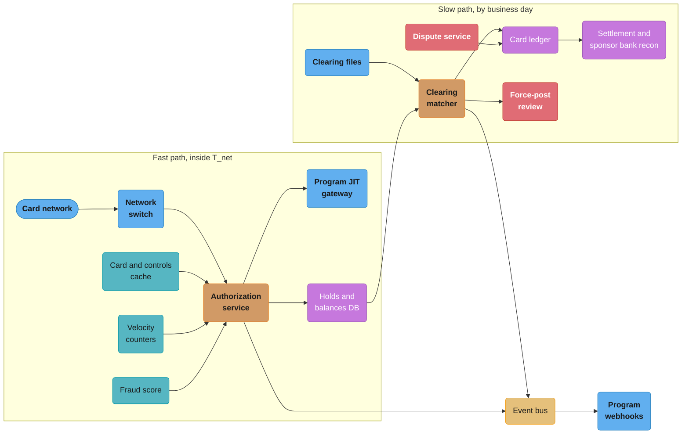
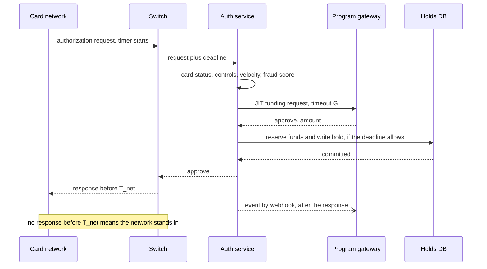
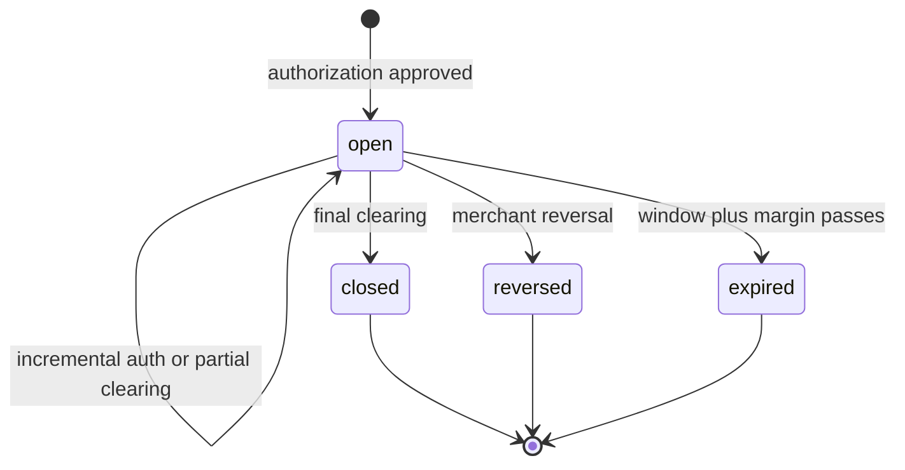

# Case Study: Design a Card Issuing Platform

> Rules and figures checked 2026-11-06. Every date, threshold and fee on this page comes from the fact pins in fintech/CLAUDE.md, or from the vendor documentation or regulation named beside it, read on 2026-11-06. Scale figures and targets are design assumptions and are labelled as such. Engineering view only, not legal advice. Rules cover the US and the EU where named.

## Intuition

> **Design intuition**: An acquirer asks "will this card pay?" and can wait for the answer. An issuer is the one who answers, and it does not get to wait. The network sends the authorization request and starts a timer. If the issuer has not answered when the timer ends, the network answers for it under stand-in rules, and the merchant acts on that answer. So every part of an issuing platform is shaped by a fixed time budget that someone else owns, and by the fact that a late decision is not merely slow but can contradict what already happened.

[Design a Digital Wallet](../../hld/case_studies/design_digital_wallet.md) lists card issuing as out of scope, because it re-enters card-network territory. [Design a Payment System](../../hld/case_studies/design_payment_system.md) and [Design a Payment Processor](../../backend/case_studies/design_payment_processor/design_payment_processor.md) sit on the merchant side of the card network: they send authorizations and receive settlements. This study sits on the other side. It receives the authorization, decides it, reserves the money, and later matches the merchant's clearing record to that reservation. Nothing here repeats the merchant-side saga, outbox or PSP retry logic of those studies.

The specific question: **what must an issuer processor look like to run 5 million cards for a fintech through a BIN sponsor bank, decide every authorization inside the network's time budget with spend controls and just-in-time funding, hold and release money correctly through incremental authorizations, partial and over-captures and expiry, match clearing to authorizations, run issuer-side disputes on the regulatory clock, and keep working when its own systems or a program's systems are down?**

**Key insight for this design**: the authorization path is a hard real-time system with a soft-money answer, and clearing is a batch system with a hard-money answer. An authorization moves no money. It places a hold that the issuer can later release. Clearing moves money, and the issuer must post it even when it disagrees with the hold, the controls or the card status. So the design splits cleanly: a fast path that decides and reserves within a deadline and never blocks on anything remote without a fallback, and a slow path that posts what the network says happened and reconciles it with what the fast path decided.

Everything here builds on: [PSPs, Acquirers, Issuers and Networks](../psps_acquirers_issuers_and_networks/psps_acquirers_issuers_and_networks.md), [Card Payments Lifecycle](../card_payments_lifecycle/card_payments_lifecycle.md), [Interchange and Payment Economics](../card_payments_lifecycle/interchange_and_payment_economics.md), [Double-Entry Ledger Design](../double_entry_ledger_design/double_entry_ledger_design.md), [Disputes, Chargebacks and Refunds](../disputes_chargebacks_and_refunds/disputes_chargebacks_and_refunds.md), and the two cross-cutting files [Money Movement Invariants](cross_cutting/money_movement_invariants.md) and [Business Days, Cut-offs and Value Dates](cross_cutting/business_days_cutoffs_and_value_dates.md).

---

## 1. Requirements Clarification

### Roles

| Role | Who | Owns |
|---|---|---|
| BIN sponsor | A bank with network membership | The BIN range, the legal issuer role, the settlement account at the network, regulatory exams |
| Program manager | The fintech customer | The card product, the cardholders, the funding source, the program's own rules |
| Issuer processor | This platform | Authorization decisions, holds, clearing, the card ledger, disputes, card lifecycle |
| Card network | Visa, Mastercard and others | Message switching, stand-in, clearing files, net settlement |

### Functional Requirements

- **Card lifecycle.** Issue virtual cards at once and physical cards through a card bureau. Activate, freeze, unfreeze, report lost or stolen, reissue with a new PAN, and close.
- **Authorization.** Decide every authorization request inside the network time budget. Approve in full, approve part of the amount where the merchant supports it, or decline with the right response code.
- **Spend controls.** Per card and per cardholder: allowed and blocked merchant categories, blocked merchants, a per-authorization maximum, per-interval limits (day, week, month, lifetime), country limits and single-use cards.
- **Funding.** Two program types. Prefunded: the cardholder has a balance on this platform. Just-in-time (JIT): the platform asks the program's gateway to approve and fund each authorization in real time.
- **Holds.** Place, increase (incremental authorization), partially release (partial capture or reversal), close on clearing, and expire.
- **Clearing.** Ingest the network's clearing records, match each one to its authorization, post it to the ledger, and handle force posts with no authorization.
- **Disputes.** Accept a cardholder dispute, run the Reg E or Reg Z clock for US consumer programs, give provisional credit, raise the chargeback through the network and post the outcome.
- **Stand-in.** Keep deciding when the program's gateway is down, and post what the network decided when this platform was down.
- **Events.** Send every authorization, clearing and dispute event to the program by webhook.

### Non-Functional Requirements

All figures here are design assumptions.

- 5 million cards issued, 2 million active in a month.
- 1,000 authorizations a second of headroom, against a 350 a second expected peak.
- p99 of 50 ms for a decision without a JIT call, measured from request in to response out at this platform's edge.
- Zero holds written for an authorization the network did not see as approved by this platform.
- Every clearing record posted by the end of the business day it arrives, matched or not.
- 99.99% availability for the authorization path. Stand-in covers the rest, but stand-in decisions are worse.
- PCI DSS v4.0.1 scope for PAN storage, kept to the card vault only.

### Out of Scope (and where it lives instead)

| Topic | Where it lives |
|---|---|
| Merchant-side authorization, capture and PSP retries | [Design a Payment Processor](../../backend/case_studies/design_payment_processor/design_payment_processor.md) |
| Wallet P2P transfers, top-ups and withdrawals | [Design a Digital Wallet](../../hld/case_studies/design_digital_wallet.md) |
| PAN vault, HSMs, tokenization and PCI scope | [PCI DSS Scope and Tokenization](../pci_dss_scope_and_tokenization/pci_dss_scope_and_tokenization.md) |
| Fraud model internals | [Design Fraud Detection](../../ml/case_studies/design_fraud_detection.md) |
| Cardholder KYC and sanctions screening | [KYC, AML and Sanctions Screening](../kyc_aml_and_sanctions_screening/kyc_aml_and_sanctions_screening.md) |
| Sponsor-bank versus own-license strategy | [Build vs Buy and Licensing Strategy](../build_vs_buy_and_licensing_strategy/build_vs_buy_and_licensing_strategy.md) |

---

## 2. Scale Estimation

### Authorizations and clearing

```
Cards issued                     5,000,000            assumption
Active in a month                2,000,000            40%, assumption
Authorizations per active card   30 a month           assumption
Authorizations per month         60,000,000
Authorizations per day           2,000,000            = 23/s on average
Peak factor                      15x                  = about 350/s (assumption), design for 1,000/s
Clearing records per day         about 1,900,000      95% of authorizations clear, plus force posts
Open holds at any time           2,000,000/day x 2 days mean hold life = 4,000,000
Disputes per day                 0.1% of clearings    = about 1,900 (assumption)
```

350 authorizations a second is a small write load for one PostgreSQL primary. The hard part is latency, not volume. Each decision must read the card, its controls, its counters and its balance, and write one hold, all inside a deadline. So the design keeps every read for the fast path local or in memory, and writes one row per decision in one short transaction.

### The time budget

The network sets how long it waits for the issuer before it stands in. Call that value `T_net`. It is a network and product setting, and this design treats it as an input, not a constant.

```
T_net                            network setting (input)
- t_transport                    network to this platform and back, measured per link
- t_local                        parse, dedupe, card, controls, counters, fraud: about 35 ms p99
- t_commit                       hold write and reply, about 10 ms p99
- margin                         kept back for jitter, a fixed share of T_net (assumption: 20%)
= G                              the most time a JIT call to the program's gateway may take
```

Issuer processors pass a part of their own budget on to their customers, and they publish it. Stripe Issuing gives its user 2 seconds to answer an `issuing_authorization.request` webhook, and after that approves or declines by the user's timeout settings or its Autopilot rules. Lithic declines an Auth Stream Access request that gets no answer within 6 seconds and recommends answering within 3 (Stripe and Lithic docs, read 2026-11-06). Those budgets are each vendor's contract with its customers. They show that `G` is a published number for each program, and that the vendor holds back a part of `T_net` for its own work.

### Storage

```
Hold rows                        4,000,000 open x 200 B         = 0.8 GB, all in buffer cache
Decision rows                    2,000,000/day x 120 B           = 240 MB/day, 13 months hot = 94 GB
Ledger postings                  1,900,000 clearings x 2 lines    = 3.8 M/day, 1.4 B/year
Posting row                      about 120 B                      = 170 GB/year
Raw clearing files               about 1 KB per record            = 1.9 GB/day, kept as received
Card rows                        5,000,000 x 1 KB                 = 5 GB, controls included
```

### Interchange, the revenue line

Interchange is the fee the acquirer pays to the issuer on each card transaction. For a covered US debit issuer, Reg II caps it at 21 cents plus 5 basis points of the amount (12 CFR 235.3(b)), plus up to 1 cent for the fraud-prevention adjustment. On a 54.00 purchase that is 21 + 2.7 + 1 = 24.7 cents at most. An issuer that, with its affiliates, had less than $10 billion in assets at the end of the previous calendar year is exempt from 235.3, 235.4 and 235.6 for transactions on accounts it holds (12 CFR 235.5(a)). The sponsor bank's asset size therefore changes the revenue of a debit program, which is one reason the sponsor choice in [Build vs Buy and Licensing Strategy](../build_vs_buy_and_licensing_strategy/build_vs_buy_and_licensing_strategy.md) is an economic decision as well as a legal one. A Federal Reserve proposal to lower the cap closed for comment on 2024-05-12. It is proposed and not finalized as of the fetch date.

---

## 3. High-Level Architecture



| Service | Store | Path | Notes |
|---|---|---|---|
| Network switch | none | fast | Holds the network connections, parses messages, adds a receive timestamp and the deadline |
| Authorization service | in-memory card cache, PostgreSQL | fast | Runs the decision pipeline in §4.1 |
| Velocity counters | Redis | fast | Soft limits, see §4.3 |
| Holds and balances | PostgreSQL, one primary, synchronous replica | fast | One row update and one insert per approval |
| Clearing matcher | PostgreSQL | slow | Runs as files arrive, posts to the ledger |
| Card ledger | PostgreSQL | slow | Double-entry postings, see §4.6 |
| Dispute service | PostgreSQL, workflow engine | slow | Regulatory clocks, network chargebacks |
| Event bus and webhooks | Kafka | async | Never in the fast path |

### The authorization sequence



---

## 4. Component Deep Dives

### 4.1 The authorization decision and its deadline

The switch stamps each request with a deadline: receive time plus `T_net`, minus the measured transport time. Every step in the pipeline reads the time left and spends from it. The JIT call gets what remains after the local steps and the commit margin, and no more.

The dangerous case is a decision that finishes after the deadline. By then the network has stood in, and the merchant has an answer. If this platform now writes a hold, the hold reserves money for a sale that may have been declined. If it writes nothing but the network approved in stand-in, a clearing record will arrive later with no hold.

#### BROKEN: commit the decision whatever the clock says

```java
// BROKEN: the hold is written even when the decision comes back after the network stood in
import java.util.ArrayList;
import java.util.List;

final class LateDecision {
    record Hold(String authId, long amountMinor) {}

    static final long BUDGET_MS = 1_000;                  // illustrative: T_net minus transport time
    static final List<Hold> holds = new ArrayList<>();

    static String decide(String authId, long amountMinor, long elapsedMs) {
        holds.add(new Hold(authId, amountMinor));         // written before anyone checks the clock
        return elapsedMs <= BUDGET_MS ? "APPROVED" : "TOO_LATE";
    }

    public static void main(String[] args) {
        // the program's gateway took 1,900 ms, and the network declined in stand-in at 1,000 ms
        String outcome = decide("auth-77", 6_400, 1_900);
        System.out.println(outcome + ", holds = " + holds);
        // TOO_LATE, holds = [Hold[authId=auth-77, amountMinor=6400]]: 64.00 frozen for a declined sale
    }
}
```

The cardholder sees 64.00 less to spend for the life of the hold, for a purchase the merchant declined. No clearing will ever arrive to close the hold, so it lives until it expires. At 1,000 such timeouts during a gateway brownout, support gets 1,000 "my money is missing" tickets.

#### FIX: one deadline, a fallback rule, and no commit after the deadline

```java
// FIX: every step spends from one deadline, a fallback rule replaces a slow gateway, nothing commits late
import java.util.ArrayList;
import java.util.List;

final class AuthDecision {
    enum Outcome { APPROVE, DECLINE }
    record Request(String authId, long amountMinor, String category, boolean cardActive) {}
    record Decision(Outcome outcome, String reason, boolean holdWritten) {}

    static final class Clock { long nowMs; }              // simulated time, so the run is deterministic

    static final long COMMIT_MARGIN_MS = 50;
    static final long COMMIT_COST_MS = 10;

    static Decision decide(Request r, long budgetMs, long gatewayMs, long fallbackLimitMinor,
                           Clock clock, List<String> holds) {
        long deadline = clock.nowMs + budgetMs;
        if (!r.cardActive()) return new Decision(Outcome.DECLINE, "card not active", false);
        clock.nowMs += 2;                                 // controls from the in-memory card cache
        if (r.category().equals("gambling")) return new Decision(Outcome.DECLINE, "category blocked", false);
        clock.nowMs += 15;                                // fraud score
        long gatewayTimeout = deadline - COMMIT_MARGIN_MS - clock.nowMs;
        boolean funded;
        String reason;
        if (gatewayMs <= gatewayTimeout) {
            clock.nowMs += gatewayMs;
            funded = true;
            reason = "funded by gateway";
        } else {
            clock.nowMs += gatewayTimeout;                // stop waiting and decide without the gateway
            funded = r.amountMinor() <= fallbackLimitMinor;
            reason = funded ? "fallback rule approved" : "fallback rule declined";
        }
        if (!funded) return new Decision(Outcome.DECLINE, reason, false);
        if (clock.nowMs + COMMIT_COST_MS > deadline) return new Decision(Outcome.DECLINE, "deadline", false);
        clock.nowMs += COMMIT_COST_MS;                    // one hold insert in one transaction
        holds.add(r.authId());
        return new Decision(Outcome.APPROVE, reason, true);
    }

    public static void main(String[] args) {
        long budget = 1_000;                              // illustrative: T_net minus transport time
        List<String> holds = new ArrayList<>();
        Decision fast = decide(new Request("a1", 6_400, "grocery", true), budget, 80, 5_000, new Clock(), holds);
        Decision slowSmall = decide(new Request("a2", 3_000, "grocery", true), budget, 1_900, 5_000, new Clock(), holds);
        Decision slowLarge = decide(new Request("a3", 64_000, "electronics", true), budget, 1_900, 5_000, new Clock(), holds);
        Decision blocked = decide(new Request("a4", 1_000, "gambling", true), budget, 80, 5_000, new Clock(), holds);
        assert fast.outcome() == Outcome.APPROVE && fast.holdWritten();
        assert slowSmall.outcome() == Outcome.APPROVE && slowSmall.reason().equals("fallback rule approved");
        assert slowLarge.outcome() == Outcome.DECLINE && !slowLarge.holdWritten();
        assert blocked.outcome() == Outcome.DECLINE && !blocked.holdWritten();
        assert holds.equals(List.of("a1", "a2"));
        System.out.println(fast + "\n" + slowSmall + "\n" + slowLarge + "\n" + blocked);
    }
}
```

Three rules come out of the code:

- **The gateway call has a timeout derived from the deadline**, not a fixed one. A request that spent 40 ms in a slow fraud call gives the gateway 40 ms less.
- **A slow gateway is replaced by a fallback rule**, set by the program: approve up to an amount, or decline all. Marqeta calls its version Commando Mode: when the program's gateway cannot answer a Gateway JIT Funding request, the platform decides with business rules it already has, and sets the transaction's `standin_approved_by` field to `COMMANDO_AUTO` or `COMMANDO_MANUAL` (Marqeta docs, read 2026-11-06). Stripe's Autopilot does the same for its users after a timeout (Stripe docs, read 2026-11-06).
- **The commit happens inside the deadline or not at all.** A decision that would commit late returns a decline and writes nothing. The gateway's late answer is logged and sent to the program as a webhook that says the platform decided without it.

### 4.2 Holds, incremental authorizations and available balance

Available balance is the ledger balance minus the money that open holds reserve. The authorization path reserves, and the clearing path releases and posts. Both must keep one invariant: the account's `held` equals the sum of `remaining` on its open holds.

The check "is there enough money?" and the write "reserve it" must be one atomic step. Two authorizations on the same card that each read the balance, each see enough, and each insert a hold will spend the same money twice. [Concurrency Control and Locking](../../database/concurrency_control_and_locking/concurrency_control_and_locking.md) covers the race. Here the fix is a conditional `UPDATE`: under READ COMMITTED, a second `UPDATE` on the same row waits for the first and then evaluates its `WHERE` clause again against the new row.

```sql
CREATE TABLE card_account (
    id               bigint  PRIMARY KEY,
    currency         char(3) NOT NULL,
    ledger_balance   bigint  NOT NULL,                 -- posted money, minor units
    held             bigint  NOT NULL DEFAULT 0 CHECK (held >= 0),
    overdraft_limit  bigint  NOT NULL DEFAULT 0 CHECK (overdraft_limit >= 0)
);
CREATE TABLE card_hold (
    auth_id     text   PRIMARY KEY,                    -- the network's id for the authorization
    account_id  bigint NOT NULL REFERENCES card_account (id),
    authorized  bigint NOT NULL CHECK (authorized > 0),
    remaining   bigint NOT NULL CHECK (remaining >= 0),
    status      text   NOT NULL CHECK (status IN ('open', 'closed', 'expired', 'reversed')),
    expires_at  timestamptz NOT NULL,
    CHECK (remaining <= authorized),
    CHECK (status = 'open' OR remaining = 0)
);
CREATE TABLE auth_decision (
    auth_id     text PRIMARY KEY,
    approved    boolean NOT NULL,
    decided_at  timestamptz NOT NULL DEFAULT now()
);
INSERT INTO card_account (id, currency, ledger_balance) VALUES (7, 'USD', 20000);
```

There is no `CHECK` that the available balance stays at or above zero. The authorization path enforces that, because the issuer controls authorizations. The clearing path cannot enforce it, because the network can clear an amount larger than the hold, or with no hold at all, and the issuer must post it (§4.5). A constraint there would reject a posting the issuer owes.

```sql
-- FIX: one conditional UPDATE checks and reserves, and a repeated request gets the first answer
CREATE FUNCTION authorize(p_auth text, p_account bigint, p_amount bigint, p_ttl interval)
RETURNS boolean LANGUAGE plpgsql AS $$
DECLARE
    ok boolean;
BEGIN
    SELECT approved INTO ok FROM auth_decision WHERE auth_id = p_auth;
    IF FOUND THEN
        RETURN ok;
    END IF;
    UPDATE card_account SET held = held + p_amount
     WHERE id = p_account AND ledger_balance - held - p_amount >= -overdraft_limit;
    ok := FOUND;
    IF ok THEN
        INSERT INTO card_hold (auth_id, account_id, authorized, remaining, status, expires_at)
        VALUES (p_auth, p_account, p_amount, p_amount, 'open', now() + p_ttl);
    END IF;
    INSERT INTO auth_decision (auth_id, approved) VALUES (p_auth, ok);
    RETURN ok;
END $$;

DO $$
BEGIN
    ASSERT authorize('A1', 7, 4500, interval '10 days'), 'A1: restaurant, 45.00';
    ASSERT authorize('A2', 7, 5400, interval '30 days'), 'A2: hotel, 54.00';
    ASSERT NOT authorize('A3', 7, 15000, interval '10 days'), 'A3: 150.00 against 101.00 available';
    ASSERT authorize('A1', 7, 4500, interval '10 days'), 'A1 repeated: same answer';
    ASSERT (SELECT held FROM card_account WHERE id = 7) = 9900, 'the repeat reserved nothing';
END $$;
```

The `auth_decision` table makes the decision idempotent per network authorization id. Networks and processors resend: Lithic retries a request at once after a network failure or a 5xx, so its customers can receive the same request twice (Lithic docs, read 2026-11-06). A repeat must return the first answer and reserve nothing. Two copies that race past the `SELECT` both try to insert the hold or the decision row under the same authorization id. The second fails on a primary key, its transaction rolls back with its reservation, and the caller reads the decision on retry.

#### BROKEN: clearing releases the cleared amount

A restaurant authorizes 45.00 and clears 54.00 after the tip. The over-capture is legitimate, and the issuer cannot block it. Stripe states the same for its issuing users: captures for approved authorizations always succeed, and spending controls do not apply to them (Stripe docs, read 2026-11-06).

```sql
-- BROKEN: the account releases the cleared 54.00 instead of the 45.00 the hold reserved
UPDATE card_hold SET remaining = 0, status = 'closed' WHERE auth_id = 'A1';
UPDATE card_account SET ledger_balance = ledger_balance - 5400, held = held - 5400 WHERE id = 7;
SELECT ledger_balance, held, ledger_balance - held AS available FROM card_account WHERE id = 7;
-- 14600, 4500, 10100: the hotel hold still reserves 54.00, but the account holds back only 45.00
```

Available shows 101.00. The true figure is 92.00. The 9.00 tip came off the hold total a second time, and the cardholder can now spend 9.00 that is already promised to the hotel.

#### FIX: release what the hold reserved, post what the merchant cleared

```sql
-- FIX: free the hold's remaining amount and post the cleared amount, in one transaction
CREATE FUNCTION clear_hold(p_auth text, p_amount bigint, p_final boolean) RETURNS void
LANGUAGE plpgsql AS $$
DECLARE
    h      card_hold%ROWTYPE;
    freed  bigint;
BEGIN
    SELECT * INTO h FROM card_hold WHERE auth_id = p_auth AND status = 'open' FOR UPDATE;
    IF NOT FOUND THEN
        RAISE EXCEPTION 'no open hold for %, send to force-post matching', p_auth;
    END IF;
    freed := CASE WHEN p_final THEN h.remaining ELSE least(h.remaining, p_amount) END;
    UPDATE card_hold
       SET remaining = remaining - freed,
           status    = CASE WHEN p_final THEN 'closed' ELSE 'open' END
     WHERE auth_id = p_auth;
    UPDATE card_account
       SET held = held - freed, ledger_balance = ledger_balance - p_amount
     WHERE id = h.account_id;
END $$;

SELECT clear_hold('A1', 5400, true);

DO $$
BEGIN
    ASSERT (SELECT ledger_balance - held FROM card_account WHERE id = 7) = 9200, 'available 92.00';
    ASSERT (SELECT held FROM card_account WHERE id = 7)
         = (SELECT sum(remaining) FROM card_hold WHERE account_id = 7 AND status = 'open'), 'held matches holds';
END $$;
```

A multi-capture merchant (an airline, a split shipment) clears several times against one authorization. Each partial clearing passes `p_final = false`, frees up to its own amount and leaves the hold open for the rest. The last one, or the hold's expiry, frees what is left.

An incremental authorization adds to an open hold through the same available-funds check. It does not move the expiry: Visa states that an incremental authorization does not extend the authorization's time window (Visa Core Rules, edition 24 October 2026), so the function leaves `expires_at` alone.

```sql
CREATE FUNCTION increment_hold(p_auth text, p_amount bigint) RETURNS boolean LANGUAGE plpgsql AS $$
DECLARE
    acct bigint;
BEGIN
    SELECT account_id INTO acct FROM card_hold WHERE auth_id = p_auth AND status = 'open' FOR UPDATE;
    IF NOT FOUND THEN RETURN false; END IF;
    UPDATE card_account SET held = held + p_amount
     WHERE id = acct AND ledger_balance - held - p_amount >= -overdraft_limit;
    IF NOT FOUND THEN RETURN false; END IF;
    UPDATE card_hold SET authorized = authorized + p_amount, remaining = remaining + p_amount
     WHERE auth_id = p_auth;
    RETURN true;
END $$;

DO $$
BEGIN
    ASSERT increment_hold('A2', 1000), 'hotel adds 10.00 of incidentals';
    ASSERT NOT increment_hold('A2', 100000), 'no funds for 1,000.00 more';
    ASSERT (SELECT held FROM card_account WHERE id = 7)
         = (SELECT sum(remaining) FROM card_hold WHERE account_id = 7 AND status = 'open'), 'held matches holds';
END $$;
```

### 4.3 Spend controls and velocity counters

Controls split into two kinds by what a wrong read costs.

| Control | Example | Source of truth | Read in the fast path from | Wrong read costs |
|---|---|---|---|---|
| Card status | frozen, lost, closed | PostgreSQL | in-memory cache, updated by change events | A lost card that approves |
| Static rules | blocked categories, countries, per-auth maximum | PostgreSQL | in-memory cache | A rule change that applies a few seconds late |
| Interval limits | 500.00 a day, 20 transactions a day | Redis counters | Redis | A limit that is off by one in-flight authorization |
| Money | available balance | PostgreSQL | the conditional `UPDATE` itself | Spending money twice |

Card status is the one cache that must never be stale in the dangerous direction. A "report stolen" call writes the status to PostgreSQL, then publishes the change, and the authorization service applies it to its cache. Until the cache confirms, the API answers "freezing" rather than "frozen". The authorization service also reads card status from PostgreSQL inside the hold transaction for any amount above a threshold, so a stale cache can approve only small amounts.

Interval limits are soft. A counter in Redis increments on approval and decrements on reversal or decline after a gateway answer. If Redis is down, the service applies a stricter fallback limit instead of failing open. A velocity count that is wrong by one in-flight authorization is a policy miss. A balance that is wrong by one is money lost, and that is why balance never lives in the cache.

Decline codes are part of the control design. Visa groups decline codes into 4 categories. A category 1 code (for example 04, 07, 14, 41, 43, 46, R0, R1, R3) tells the merchant the issuer will never approve, so the merchant must never retry that credential. Categories 2 to 4 allow up to 20 attempts in 30 days (Visa Core Rules, edition 24 October 2026). So the issuer's choice of code shapes merchant behavior: a closed or stolen card should get a category 1 code, and a temporary lack of funds should not, or a subscription merchant stops retrying a card that would have paid next week.

### 4.4 Just-in-time funding

In a JIT program the cardholder has no balance on this platform. Each authorization asks the program's gateway to approve and fund it. Marqeta defines JIT Funding as funding an account in real time during the transaction, and it offers two types: Managed, where the platform decides with the program's rules, and Gateway, where the platform forwards each funding request to the program's system (Marqeta docs, read 2026-11-06).

| Concern | Rule in this design |
|---|---|
| Timeout | `G` from the budget in §2, passed in the request so the gateway knows how long it has |
| Retries | None inside one authorization. A retry would spend the deadline twice |
| Idempotency | The request carries the network authorization id. The gateway must return the same answer for a repeat |
| Fallback | The program's rule from §4.1: approve up to an amount, or decline all |
| Funds movement | The gateway's approval is a promise to fund. The money moves when the program settles with the platform, daily, against the day's cleared amount |
| Late answer | Logged, never applied. The program gets a webhook with the platform's own decision |

The JIT model moves credit risk. A prefunded program cannot overspend its balance. A JIT program can approve 10 million in authorizations on a day when its own bank account holds 2 million. So the platform keeps a program-level exposure limit: the sum of open holds plus cleared and unsettled amounts for the program, checked in the same conditional `UPDATE` style as the cardholder balance, on a program row. That row is a hot account at peak, and [Hot Accounts and Ledger Scaling](../double_entry_ledger_design/hot_accounts_and_ledger_scaling.md) covers splitting it into sub-accounts.

### 4.5 Clearing-to-authorization matching

The network delivers clearing records in files, by business day. Each record says a merchant has cleared an amount on a card, and it usually refers to the authorization it settles. Matching is easy when the reference is there and correct, and the hard cases are what remain:

| Case | Example | Handling |
|---|---|---|
| Exact | Clearing equals the authorization | Match by network id, close the hold |
| Over-capture | Tip, ride fare | Match by network id, post the cleared amount, free the hold's remaining amount |
| Partial capture | Item out of stock | Post the cleared amount, free the rest, close |
| Multi-capture | Airline, split shipment | Post each clearing, keep the hold open until the last |
| Late capture | Hotel, car rental | Match after the hold expired. Stripe reports that these merchants can capture up to 31 days after authorization (Stripe docs, read 2026-11-06) |
| Force post | In-flight sale with no connection, or a capture after a decline | No authorization to match. Post it anyway |
| Refund | Merchant credit | Link to the original if possible. Stripe calls this linkage "an inexact science", and processes linked and unlinked refunds the same way (Stripe docs, read 2026-11-06) |

#### BROKEN: match by card and amount

```java
// BROKEN: clearing is matched to an authorization by card and amount
import java.util.List;

final class AmountMatch {
    record Auth(String authId, String card, long amountMinor) {}
    record Clearing(String networkTxId, String card, long amountMinor) {}

    public static void main(String[] args) {
        List<Auth> open = List.of(
            new Auth("A1", "card-9", 4_500),                     // restaurant, before the tip
            new Auth("A2", "card-9", 5_400));                    // an unrelated purchase of 54.00
        Clearing c = new Clearing("NT-1", "card-9", 5_400);      // the restaurant clears 54.00 with tip
        Auth matched = open.stream()
            .filter(a -> a.card().equals(c.card()) && a.amountMinor() == c.amountMinor())
            .findFirst().orElse(null);
        System.out.println("matched " + matched);
        // matched A2: the wrong hold is closed, and the restaurant's 45.00 hold stays until expiry
    }
}
```

Amount is the field most likely to change between authorization and clearing. Matching on it closes the wrong hold, which frees money the other merchant will still clear, and keeps a hold the cardholder already paid.

#### FIX: network id first, then merchant, time and tolerance, then force post

```java
// FIX: match on the network's id, fall back to merchant, time window and tolerance, else force-post
import java.util.List;
import java.util.Optional;

final class ClearingMatch {
    record Auth(String authId, String networkTxId, String card, String merchantId,
                long amountMinor, long authDay, int tolerancePct) {}
    record Clearing(String networkTxId, String card, String merchantId, long amountMinor, long day) {}
    enum Kind { BY_NETWORK_ID, BY_HEURISTIC, FORCE_POST }
    record Match(Kind kind, Optional<Auth> auth) {}

    static final long WINDOW_DAYS = 31;                          // program setting, see the expiry table

    static Match match(Clearing c, List<Auth> open) {
        Optional<Auth> exact = open.stream().filter(a -> a.networkTxId().equals(c.networkTxId())).findFirst();
        if (exact.isPresent()) return new Match(Kind.BY_NETWORK_ID, exact);
        List<Auth> near = open.stream()
            .filter(a -> a.card().equals(c.card()) && a.merchantId().equals(c.merchantId()))
            .filter(a -> c.day() - a.authDay() <= WINDOW_DAYS)
            .filter(a -> Math.abs(c.amountMinor() - a.amountMinor()) * 100 <= a.amountMinor() * a.tolerancePct())
            .toList();
        return near.size() == 1
            ? new Match(Kind.BY_HEURISTIC, Optional.of(near.get(0)))
            : new Match(Kind.FORCE_POST, Optional.empty());
    }

    public static void main(String[] args) {
        List<Auth> open = List.of(
            new Auth("A1", "NT-1", "card-9", "m-rest", 4_500, 10, 25),   // restaurants: 25% tolerance
            new Auth("A2", "NT-2", "card-9", "m-shop", 5_400, 10, 0));
        Match tip = match(new Clearing("NT-1", "card-9", "m-rest", 5_400, 11), open);
        assert tip.kind() == Kind.BY_NETWORK_ID && tip.auth().get().authId().equals("A1");
        Match noId = match(new Clearing("NT-?", "card-9", "m-rest", 5_400, 11), open);
        assert noId.kind() == Kind.BY_HEURISTIC && noId.auth().get().authId().equals("A1");
        Match inFlight = match(new Clearing("NT-9", "card-9", "m-air", 12_000, 12), open);
        assert inFlight.kind() == Kind.FORCE_POST && inFlight.auth().isEmpty();
        System.out.println(tip + "\n" + noId + "\n" + inFlight);
    }
}
```

The tolerance per merchant category is a program setting with a reason behind each value: restaurants and ride-hailing over-capture, and most other categories do not. A heuristic that finds two candidates does not guess. It sends the record to force-post review, and the money posts anyway.

A force post is the case that tests the ledger design. The network says the cardholder owes the money, so the issuer posts it even if the card is closed and the balance is zero. Stripe documents the same behavior: it deducts a force capture from the issuing balance and leaves the user to dispute it if it was not legitimate (Stripe docs, read 2026-11-06). So the invariant "no negative available balance without an overdraft product" from [Money Movement Invariants](cross_cutting/money_movement_invariants.md) needs a precise scope on an issuer: it holds for every authorization the issuer approved, and a force post that drives a balance negative creates a receivable from the cardholder or the program, posted to its own account and followed up by collections.

### 4.6 The card ledger

Every money event is a balanced journal entry. The holds of §4.2 are reservations, not postings. They change available balance and never touch the ledger.

| Event | Debit | Credit |
|---|---|---|
| Authorization approved | none, hold only | none |
| Clearing posted, 54.00 | Cardholder balance 54.00 | Settlement payable to network 54.00 |
| Interchange on that item (illustrative 0.25) | Settlement payable 0.25 | Interchange income 0.25 |
| Daily net settlement through the sponsor bank | Settlement payable | Sponsor bank settlement account |
| Refund cleared, 20.00 | Settlement payable 20.00 | Cardholder balance 20.00 |
| Dispute, provisional credit, 54.00 | Dispute receivable 54.00 | Cardholder balance 54.00 |
| Chargeback won, network credit | Settlement payable 54.00 | Dispute receivable 54.00 |
| Chargeback lost, provisional credit reversed | Cardholder balance 54.00 | Dispute receivable 54.00 |
| Force post past zero | Cardholder receivable for the negative part | Cardholder balance |

The settlement payable account takes a posting for almost every clearing record, so it is the hot account of this ledger. At 1.9 million clearings a day, posted in file batches, one net posting per file and currency per settlement account removes the contention, with the per-item detail kept in the clearing table that points at the batch posting. The ledger theory is in [Double-Entry Ledger Design](../double_entry_ledger_design/double_entry_ledger_design.md), and the full Postgres ledger schema is in [Design a Banking Ledger](../../database/case_studies/design_banking_ledger/design_banking_ledger.md).

The sponsor bank holds the cardholders' money, usually in an account held for their benefit. The platform's ledger says how much each cardholder owns. The bank statement says how much cash is in the account. Those two numbers must agree every business day, and [Reconciliation and Settlement Files](../reconciliation_and_settlement_files/reconciliation_and_settlement_files.md) covers the matching. §9 shows what happens when they do not.

### 4.7 Hold expiry

A hold that never clears must end, or the cardholder's available balance shrinks forever. A hold that ends too early lets the cardholder spend money that a merchant will still clear. The network's own windows give the right starting values. Visa sets a maximum time between a valid authorization and its processing, by transaction type (Visa Core Rules, edition 24 October 2026):

| Visa transaction type | Window | Hold expiry in this design |
|---|---|---|
| Card-absent, cardholder-initiated | 10 days | 10 days plus 1 business day |
| Card-absent CIT with the extended-authorization indicator | 30 days | 30 days plus 1 business day |
| Estimated authorization at cruise lines, lodging, vehicle rental | 30 days | 30 days plus 1 business day |
| Estimated authorization at other rental MCCs | 10 days | 10 days plus 1 business day |
| Other card-present | 5 days | 5 days plus 1 business day |
| Automated fuel dispenser preauth | completion or reversal within 2 hours | 2 hours plus a margin |

The extra business day covers a clearing file that arrives the morning after the window closes. Business-day arithmetic and holiday calendars are in [Business Days, Cut-offs and Value Dates](cross_cutting/business_days_cutoffs_and_value_dates.md). Country overrides exist in the same rules, for example 2 days for untokenized domestic card-absent transactions in India and 30 days for domestic transactions in Japan, so the window is a lookup by network, country and type, not a constant. The table above holds the Visa values only. Other networks set their own.

An expired hold changes status to `expired` and frees its remaining amount. A clearing that arrives later still posts, through the heuristic matcher or as a force post.



### 4.8 Issuer-side disputes

On the issuer side, a dispute starts with the cardholder and ends with a network chargeback to the merchant's acquirer. Two clocks run at once, and they do not match.

For a US consumer debit program, Reg E (12 CFR 1005.11) sets the issuer's clock. The consumer must give notice within 60 days after the statement is sent. The issuer investigates within 10 business days, or within up to 45 days if it gives provisional credit within 10 business days. For a new account in its first 30 days the limits are 20 business days and 90 days, and for POS debit transactions and transfers not initiated in a state the longer limit is 90 days. For a credit card program, Reg Z (12 CFR 1026.13) applies instead: notice within 60 days of the first statement, acknowledgment within 30 days, and resolution within 2 complete billing cycles and never more than 90 days.

The network sets the other clock. For a Visa card-absent fraud dispute (condition 10.4), the issuer has 120 calendar days from the processing date. Visa's rules also give the merchant a defense that issuers must expect: if the same credential was used in 2 earlier undisputed, non-fraud-reported transactions processed more than 120 and not more than 365 days before the dispute, with a matching device id or fingerprint, or IP address, plus one more element such as login id or shipping address, the merchant can use that history as evidence (Visa Core Rules, edition 24 October 2026).

```
Day 0      cardholder reports an unauthorized 54.00 card-absent charge
Day 0      platform opens the case, freezes the card, issues a new PAN
by BD 10   provisional credit of 54.00 posted, unless the investigation already closed
Day 2      chargeback raised under Visa 10.4, well inside 120 days of processing
Day 30     merchant responds with prior-transaction evidence, or does not
by day 45  investigation closes. Won: credit stands. Lost: credit reversed with notice
```

The workflow keeps both clocks as timers, counts Reg E deadlines in business days on the cardholder's calendar, and posts each money step through the ledger entries in §4.6. The full dispute lifecycle and the fight-or-accept decision live in [Disputes, Chargebacks and Refunds](../disputes_chargebacks_and_refunds/disputes_chargebacks_and_refunds.md).

### 4.9 Stand-in and outages

Two outages look alike and need opposite handling.

**The program's gateway is down.** This platform is up and decides with the fallback rule (§4.1). Every decision carries a flag, and the program receives the list by webhook when it returns.

**This platform is down, or the network cannot reach it.** The network decides with stand-in parameters agreed in advance: per-transaction and daily amount limits, blocked categories, and the card status file the issuer last sent. Marqeta marks such transactions with `standin_by` set to `NETWORK` (Marqeta docs, read 2026-11-06). When the platform returns, the network sends advices for every stand-in decision. The platform must post each one: create the hold for an approval, or record the decline, even when its own rules would have decided differently. Stripe documents the reverse case for its own platform: Stripe may decline an authorization, fail to reach the network, and the network approves. Stripe then holds no funds, but the merchant can still capture (Stripe docs, read 2026-11-06). The clearing matcher must therefore accept a clearing whose authorization this platform recorded as a decline.

The stand-in parameters are a risk decision, and they go stale. A card frozen after the last status file is sent can approve in stand-in. So the platform sends status changes to the network as they happen, and keeps the stand-in limits low enough that the loss from one outage hour is bounded: at the 350 a second peak, a one-hour outage is 1.26 million stand-in decisions, and the limits decide how much of that is exposure.

### 4.10 Card lifecycle, PANs and tokens

A card is a PAN, an expiry date, a security code and a status. The PAN is the BIN range the sponsor bank owns, then the account digits this platform assigns, then a check digit. The check digit is the Luhn digit, so a merchant can reject a mistyped number before it reaches the network.

```java
// FIX: build a PAN from the BIN and account digits, and append the Luhn check digit
final class PanBuilder {
    static int luhnDigit(String body) {
        int sum = 0;
        for (int i = 0; i < body.length(); i++) {
            int d = body.charAt(body.length() - 1 - i) - '0';
            if (i % 2 == 0) {                    // the digit next to the check digit is doubled
                d *= 2;
                if (d > 9) d -= 9;
            }
            sum += d;
        }
        return (10 - sum % 10) % 10;
    }

    static boolean valid(String pan) {
        return luhnDigit(pan.substring(0, pan.length() - 1)) == pan.charAt(pan.length() - 1) - '0';
    }

    static String truncated(String pan) {        // first 8 and last 4, inside the PCI storage maximum
        return pan.substring(0, 8) + "*".repeat(pan.length() - 12) + pan.substring(pan.length() - 4);
    }

    public static void main(String[] args) {
        assert luhnDigit("411111111111111") == 1;
        assert valid("4111111111111111") && !valid("4111111111111112");
        String pan = "45678901" + "0000042";      // illustrative 8-digit BIN and account digits
        pan = pan + luhnDigit(pan);
        assert pan.length() == 16 && valid(pan);
        assert truncated(pan).equals("45678901****0422");
        System.out.println(truncated(pan));
    }
}
```

The full PAN lives only in the card vault, an HSM-backed service that is the platform's PCI scope. Everything else holds a vault token and a truncated form. PCI SSC FAQ 1091 sets the truncation maximum for a 16-digit PAN at the first 8 and any other 4 digits, which is a storage limit, not a display rule. PCI DSS v4.0.1 is the only active version, and its future-dated requirements became mandatory on 2025-03-31. [PCI DSS Scope and Tokenization](../pci_dss_scope_and_tokenization/pci_dss_scope_and_tokenization.md) covers the scope boundary and the SAQ choices.

Three lifecycle events touch money and need care:

- **Reissue after loss or theft.** The new card gets a new PAN. Open holds on the old card stay open and clear normally, because merchants clear against the authorization they already have. The old card's status is `closed` for new authorizations only.
- **Reissue at expiry.** The PAN stays and the expiry date changes. Subscriptions on the old expiry keep working only if the merchant updates the card, through a network account-updater service or a network token.
- **Network tokens.** A wallet or a merchant asks the network for a token for the card, and the network asks the issuer to approve the provisioning. The issuer keeps a map from each token to its card, so an authorization on a token finds the right controls and balance. When the card is reissued, the issuer tells the network, and the token keeps working for the merchant without a new card number. Visa reported more than 10 billion tokens issued since 2014, so a program should expect many card-absent authorizations to arrive on a token rather than on the PAN.

Freezing a card blocks new authorizations. It does not stop clearing, refunds or force posts, which still post through §4.5. Closing a card with a positive balance starts a payout of that balance to the cardholder, and closing one with a negative balance moves the receivable to collections.

---

## 5. Design Decisions & Tradeoffs

### Decision 1: holds and balances in one PostgreSQL primary, not in a cache

The fast path writes one row update and one insert per approval at 350 a second. A primary with a synchronous replica commits that in a few milliseconds. A cache-first balance answers faster but can approve money twice after a failover. The issuer is liable for money it approves, so the balance lives in the database, and only soft controls live in the cache.

### Decision 2: prefund versus JIT, per program

| | Prefunded | JIT |
|---|---|---|
| Who holds the money before the purchase | This platform, in the sponsor bank account | The program, in its own account |
| Authorization dependency | Local balance only | The program's gateway, inside `G` |
| Credit risk to the platform | None beyond force posts | Program exposure up to its limit |
| Outage behavior | Unaffected by the program | Fallback rule decides |
| Good fit | Consumer debit, payroll cards | Expense cards, card-per-purchase flows |

The platform supports both because they are the same hold model with a different funding check.

### Decision 3: buy the processor or build it

Building an issuer processor means network certification, a switch, a card vault in PCI scope, clearing and settlement, and a stand-in arrangement. Buying from a processor gives a webhook with a published budget: 2 seconds at Stripe Issuing, 6 seconds with a recommended 3 at Lithic, a gateway with Commando Mode at Marqeta (vendor docs, read 2026-11-06). Most programs should buy. A program builds when it needs control of stand-in, its own BIN economics, or authorization logic that cannot fit inside a vendor's webhook budget. [Build vs Buy and Licensing Strategy](../build_vs_buy_and_licensing_strategy/build_vs_buy_and_licensing_strategy.md) holds the scorecard.

### Decision 4: post clearing in file batches, not per record

Per-record posting gives a live ledger but puts 1.9 million writes a day on the settlement payable account. Per-file posting writes one net entry per file and currency, and keeps per-record detail in the clearing table. Cardholder balances still post per record, because a cardholder reads their own balance.

### Decision 5: decline after the deadline instead of approving late

A late approve can be right in money terms, because the network might have approved in stand-in. But the platform does not know what the network decided until the advice arrives. A decline with no hold is the only answer that never reserves money for a sale that did not happen. The advice path corrects the rare case where stand-in approved.

---

## 6. Real-World Implementations

**Stripe Issuing.** A user approves or declines each `issuing_authorization.request` within 2 seconds, or Stripe decides by the user's timeout settings or Autopilot. An authorization for which the Issuing balance lacks funds is declined without a webhook. A user can set the held amount when `is_amount_controllable` is true. Captures normally happen within 24 hours, and hotels, airlines and car rental companies can capture up to 31 days after authorization. Captures for approved authorizations always succeed, and spending controls do not apply to them. Over-captures, multi-captures and force captures with no authorization all post, and the user disputes the illegitimate ones. For users with their own BIN, Stripe Autopilot can decide when the network cannot reach Stripe, and those decisions carry `network_fallback` (Stripe docs, read 2026-11-06).

**Marqeta.** JIT Funding funds an account in real time during the transaction. Managed JIT decides with the platform's rules, and Gateway JIT forwards each funding request to the program's system, which must answer every request. When the gateway cannot answer, Commando Mode decides with existing business rules and sets `standin_approved_by` to `COMMANDO_AUTO` or `COMMANDO_MANUAL`. When the network cannot reach the platform, the network stands in and the transaction carries `standin_by` set to `NETWORK` (Marqeta docs, read 2026-11-06).

**Lithic.** Auth Stream Access sends each authorization to the customer's endpoint. No answer within 6 seconds means a decline, and Lithic recommends answering within 3. Lithic retries at once after a network failure or a 5xx, so the endpoint can see one request twice, and it does not retry after a 4xx or a malformed 2xx (Lithic docs, read 2026-11-06).

**Visa.** The network sets the windows that drive hold expiry, the decline-code categories that drive merchant retries, and the 120-day limit for card-absent fraud disputes (Visa Core Rules, edition 24 October 2026). Visa reported more than 10 billion tokens issued since the 2014 launch of its token service (release of 2024-06-04), so an issuer platform must also run token provisioning and map each token's authorizations back to the card.

**Capital One and Discover.** Capital One completed its acquisition of Discover on 2025-05-18 and owns the Discover, PULSE and Diners Club International networks. An issuer that is also a network owner sees both sides of the stand-in and settlement contract, which a sponsor-bank program never does.

---

## 7. Technologies & Tools

| Layer | Choice | Why here |
|---|---|---|
| Network connectivity | The network's access points, through a certified switch | Message parsing and connection management stay out of the decision service |
| Authorization service | Java 25 on the JVM with a pre-warmed card cache | Low and stable latency at 1,000 decisions a second. See [Tail Latency and Fan-Out](../../backend/tail_latency_and_fan_out/tail_latency_and_fan_out.md) |
| Holds, ledger, disputes | PostgreSQL 18, synchronous replica | Conditional updates for reservations, constraints for invariants |
| Velocity counters | Redis | Expiring counters per card and interval, soft limits only |
| Events and webhooks | Apache Kafka plus a webhook sender | Never in the fast path. See [Webhooks and Event Delivery](../../backend/webhooks_and_event_delivery/webhooks_and_event_delivery.md) |
| Dispute workflows | Temporal | Business-day timers for Reg E, network deadlines |
| Card vault | An HSM-backed tokenization service | The only PCI scope for PANs |
| Buy instead of build | Stripe Issuing, Marqeta, Lithic | Published webhook budgets and stand-in features, see §6 |

---

## 8. Operational Playbook

### Invariants checked every hour

Each row maps to the checklist in [Money Movement Invariants](cross_cutting/money_movement_invariants.md).

| Invariant | Check | Alert |
|---|---|---|
| Holds match the account | `held` equals the sum of open holds' `remaining`, per account | any difference |
| Conservation | Ledger postings sum to 0 per currency per day | any difference |
| Idempotent effect | One `auth_decision` per network authorization id | duplicates |
| One internal record per external movement | Each clearing record maps to one posting | records unposted at end of business day |
| No late commits | Holds written after their request's deadline | any |
| Cash agrees with the ledger | Sponsor bank statement balance equals ledger cash plus known in-transit items | any unexplained difference |

### Metrics

| Metric | Healthy | Page |
|---|---|---|
| `auth_decision_p99_ms` without JIT | under 50 | over 150 |
| `jit_gateway_timeout_rate` per program | under 0.1% | over 2% |
| `fallback_decisions_per_minute` | 0 | any sustained for 5 minutes |
| `standin_advices_received` | 0 | any |
| `force_post_share` of clearings | under 1% | over 3% |
| `heuristic_match_share` of clearings | under 2% | over 10% |
| `reg_e_cases_near_deadline` (2 business days) | 0 | any |

### Runbook: a program's gateway is slow

1. Read `jit_gateway_timeout_rate` and `fallback_decisions_per_minute` for the program.
2. Confirm the fallback rule is the one the program agreed. A fallback that approves up to 50.00 is a credit decision the program signed.
3. Tell the program. Its gateway is the cause, and its webhooks will report every fallback decision.
4. If timeouts pass 20% for 10 minutes, switch the program to fallback-only mode. Calls that will time out waste the budget of every decision.

### Runbook: stand-in advices after an outage

1. Count advices by approve and decline. Each approve needs a hold. Each decline needs a decision row.
2. Post them in network order. Do not apply this platform's rules to them. The network's decision is the one the merchant acted on.
3. Run the hold-to-account invariant per affected account.
4. Report stand-in approvals that this platform would have declined. That number tells risk whether the stand-in limits are right.

### Runbook: clearing file did not arrive

1. Check the network's file delivery status before anything else. A missing file is often late, not lost.
2. Do not expire holds that the missing file would have closed. Extend expiry for holds that reach their window today by one business day.
3. When the file arrives, run it in normal order. The matcher is idempotent per clearing record id.

---

## 9. Common Pitfalls & War Stories

The first story below is sourced. The others are illustrative: they apply this design's numbers to known failure modes and are not reports from named companies.

**The ledger said customers had more money than the banks held.** The CFPB alleged that Synapse's partner banks held less than Synapse's records showed consumers were owed, a shortfall of between $60 million and $90 million, and that consumers had no access to their funds for weeks or months. The CFPB has allocated $55,214,058 from its Civil Penalty Fund to harmed consumers (CFPB, complaint filed 2025-08-21, and its spring 2026 semi-annual report). The design lesson for any program on a sponsor bank: the platform's per-customer ledger and the bank's account statement must agree every business day, and an unexplained difference is an incident on the day it appears, not a month-end task.

**A gateway brownout froze 1,400 cardholders' money.** A JIT program's gateway slowed to 1.9 seconds for 25 minutes. The platform wrote holds for decisions that finished after the network had stood in (the BROKEN fence in §4.1). 1,400 holds averaging 62.00 reserved 86,800.00 for sales that never happened, for up to 10 days each. The fix was the deadline check before commit and a cleanup job that released holds with no matching approved decision.

**Tips leaked into available balance.** The clearing path released the cleared amount from the account total (the BROKEN fence in §4.2). On restaurant-heavy cards, `held` drifted below the sum of open holds by about 2.40 per tipped meal. Over a month, 300,000 tipped meals let cardholders spend about 720,000.00 that was reserved for other open holds, and 4% of it went negative when those holds cleared. The fix released the hold's remaining amount and added the hourly hold-to-account check.

**Hotel holds expired before checkout.** The platform expired every hold after 7 days. Estimated lodging authorizations, which Visa allows 30 days, expired before checkout. Each hotel clearing became a force post, and 11% of them pushed the balance negative because the cardholder had spent the freed money. The fix was the per-type expiry table in §4.7.

**Insufficient funds returned a "never retry" code.** The platform sent a category 1 decline for insufficient funds. Subscription merchants stopped retrying, and cardholders who were paid two days later lost their subscriptions. Support tickets for "my streaming service cancelled me" rose 30% in a month. The fix mapped each decline reason to a code in the right category (§4.3).

---

## 10. Capacity Planning

### Fast path

```
Peak decisions                   350/s expected, 1,000/s design (assumption)
Authorization service            6 instances, each sized for 250/s at 40% CPU
Card cache                       5,000,000 cards x 1 KB = 5 GB per instance, kept fresh by events
PostgreSQL primary               1,000 approvals/s x 2 writes = 2,000 row writes/s, 3 ms commits
Connections                      6 instances x 20 = 120, behind a pooler
Redis velocity                   5 counters per decision = 5,000 ops/s at design peak
```

The card cache is the start-up cost. A new instance loads 5 GB before it takes traffic, which takes minutes from a snapshot. Keep one spare instance warm, and never scale the authorization tier from zero during an incident.

### Slow path

| Job | Volume per day | Window | Rate needed |
|---|---|---|---|
| Clearing file ingest and match | 1,900,000 records | 4 hours after the file lands | about 130 records/s |
| Cardholder postings | 3,800,000 lines | same window | about 260 rows/s |
| Hold expiry sweep | about 100,000 holds | hourly | trivial |
| Dispute timers | about 1,900 new cases | continuous | trivial |
| Sponsor bank reconciliation | 1 statement per account per day | morning | one job |

### Storage growth

```
Ledger postings                  170 GB/year, partitioned by month
Decision rows                    88 GB/year, 13 months hot then archive
Clearing records as received     700 GB/year in object storage
Hold rows                        under 1 GB live, closed holds archived after 13 months
```

### Growth

Cards grow faster than authorizations, because many issued cards are never used. At 50% more active cards a year, peak decisions reach 525 a second in a year, still inside the 1,000 a second design. The first limit is the program exposure row for the largest JIT program, a single hot row at that program's peak. Split it into sub-accounts before that program's peak passes about 200 decisions a second.

---

## 11. Interview Discussion Points

**Q: What is an issuer's time budget for an authorization, and what happens if it misses it?**
**Short:** The network waits a set time for the issuer's answer. If the issuer misses it, the network decides in stand-in with limits agreed in advance, and the merchant acts on that answer.

Treat the network's wait as an input, `T_net`, and subtract transport, local work, the commit and a safety margin to get the time left for any remote call. Processors pass a part of their own budget to their customers and publish it: 2 seconds at Stripe Issuing, 6 seconds at Lithic with 3 recommended. Every step in the decision reads the time left from one deadline. Measure transport per network link, because it changes the budget.

**Q: Why can a decision that arrives late be worse than a decline?**
**Short:** After the deadline the network has already answered. A late approval that writes a hold reserves the cardholder's money for a sale that may have been declined and will never clear.

The hold then lives until expiry, up to 30 days for some transaction types, and the cardholder sees money missing. If the network approved in stand-in, its advice will arrive and create the hold through the right path. So the safe rule is to commit only inside the deadline, decline otherwise, and let the stand-in advice correct the rare approval.

**Q: How does just-in-time funding work, and what happens when the program's gateway is down?**
**Short:** Each authorization asks the program's gateway to approve and fund it in real time. If the gateway does not answer in time, the platform decides with a fallback rule the program agreed in advance.

The gateway gets a timeout derived from the deadline and no retries inside one authorization. Marqeta calls its fallback Commando Mode and marks those transactions. Every fallback decision goes to the program by webhook when it returns. JIT moves credit risk to the platform, so keep a program-level exposure limit checked like a balance.

**Q: Why does clearing not always equal the authorized amount, and how should the hold be released?**
**Short:** Tips, ride fares and partial shipments change the amount. Free the amount the hold still reserves and post the amount the merchant cleared, in one transaction.

A restaurant authorizes 45.00 and clears 54.00. Releasing 54.00 from the account total takes 9.00 off other open holds and lets the cardholder spend money already promised. Keep the invariant that the account's held amount equals the sum of open holds' remaining amounts, and check it every hour. Multi-capture merchants clear several times, so a partial clearing frees only up to its own amount.

**Q: How do you match clearing records to authorizations?**
**Short:** By the network's transaction id first, then by card, merchant, time window and an amount tolerance per merchant category, and a record with no single match posts as a force post.

Amount is the field most likely to change, so matching on card and amount closes the wrong hold. The heuristic accepts only a single candidate. Two candidates go to review, and the money posts either way. Track the heuristic match share: a rise usually means a network field mapping changed, not that merchants changed.

**Q: What is a force post, and why can't the issuer block it?**
**Short:** A clearing with no matching authorization, such as an in-flight purchase or a capture after a decline. The network says the cardholder owes it, so the issuer must post it.

Some force posts are legitimate and some are fraud, and the issuer's remedy for a bad one is a dispute, not a refusal to post. A force post can push a balance below zero, so the no-negative-balance invariant holds for approved authorizations only. The negative part becomes a receivable on its own ledger account, followed up by collections.

**Q: When should an authorization hold expire?**
**Short:** At the network's window for that transaction type plus about one business day. Visa allows 10 days for card-absent customer-initiated sales, 5 for other card-present sales and 30 for estimated lodging auths.

Expire too early and the freed money gets spent before the merchant clears, which turns the clearing into a force post that can go negative. Expire too late and the cardholder loses access to money for no reason. The window is a lookup by network, country and transaction type, and an incremental authorization does not extend it.

**Q: A US debit cardholder reports an unauthorized charge. What clocks does the issuer run?**
**Short:** Reg E: investigate within 10 business days, or up to 45 days with provisional credit within 10 business days. The network clock runs too, 120 days from processing for a Visa 10.4 dispute.

New accounts in their first 30 days get 20 business days and 90 days, and POS debit transactions get the 90-day limit. A credit card program uses Reg Z instead: resolution within 2 complete billing cycles and never more than 90 days. Count Reg E deadlines in business days on a real calendar. Expect the merchant to answer with prior undisputed transactions on the same device as evidence.

**Q: Why keep the balance in the database but velocity counters in a cache?**
**Short:** A balance that is wrong by one authorization loses money, and a velocity count that is wrong by one is a policy miss. Only the first must be exact.

The balance check and reservation run as one conditional update in PostgreSQL, so two racing authorizations cannot both pass. Velocity counters in Redis increment on approval and decrement on reversal. If Redis fails, apply a stricter fallback limit instead of failing open. Card status sits in an in-memory cache, with a database read inside the transaction for larger amounts.

**Q: Which decline code should an issuer return for insufficient funds, and why does it matter?**
**Short:** A temporary code outside Visa's category 1, because a category 1 code tells the merchant never to retry the card, and a subscription would then cancel a card that pays next week.

Visa's category 1 codes, such as 04, 07, 14 and 41, mean the issuer will never approve. They fit a closed, lost or stolen card. Categories 2 to 4 allow up to 20 merchant attempts in 30 days. The issuer's code choice is a control that shapes merchant behavior, so map each internal decline reason to a code on purpose and review the mapping with the program.

**Q: How does the sponsor bank's asset size change a debit program's revenue?**
**Short:** Reg II caps covered debit interchange at 21 cents plus 5 basis points plus up to 1 cent for fraud prevention. An issuer with under $10 billion in assets, with affiliates, is exempt from that cap.

On a 54.00 debit purchase the covered cap is about 24.7 cents. For an exempt issuer, the network's interchange schedule applies instead. The exemption tests the issuer's assets with its affiliates at the end of the previous calendar year, so a sponsor that grows past the line changes the program's economics the next year. A 2023 Federal Reserve proposal to lower the cap is not finalized.

**Q: What does an issuer platform reconcile every business day, and what happens if it skips that?**
**Short:** Clearing records against postings, the network settlement against the settlement account, and the sum of cardholder balances against the sponsor bank's account statement.

The last one finds the failure that hurts customers most. The CFPB alleged a shortfall of $60 million to $90 million between Synapse's records and what its partner banks held, and consumers lost access to funds for weeks or months. A per-customer ledger that nobody ties to the bank's cash can drift for months. Treat any unexplained difference as an incident on the day it appears.
