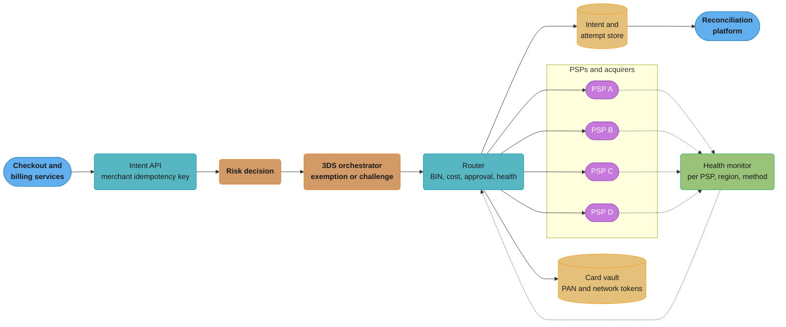
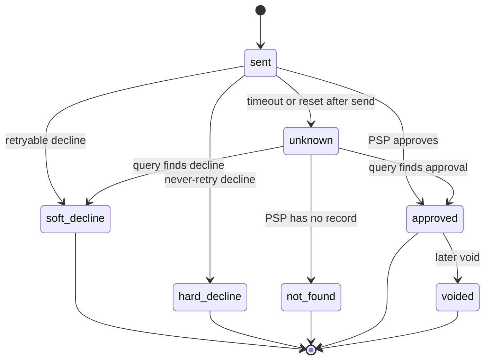
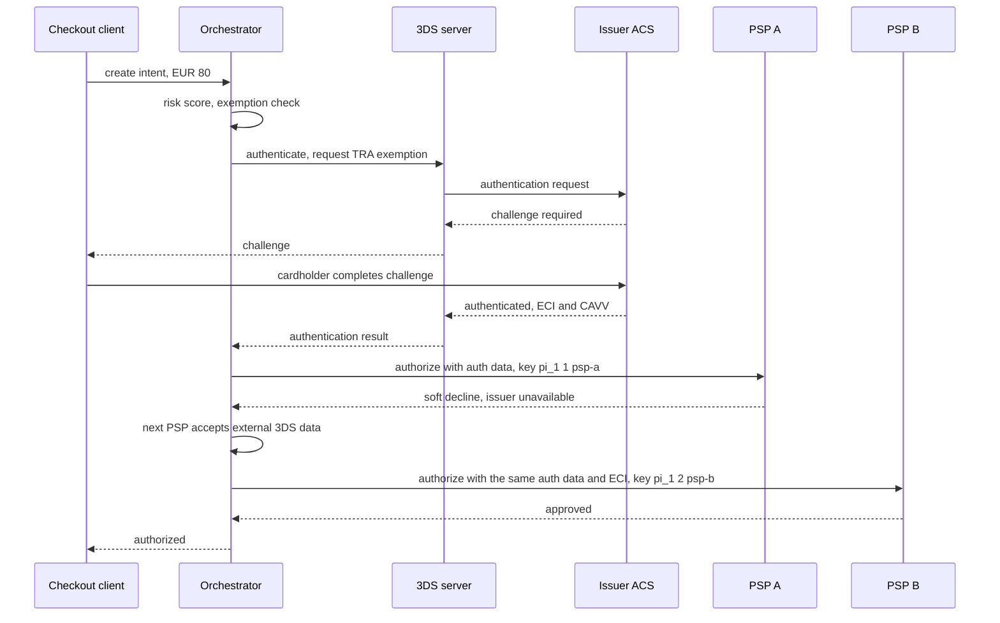

# Case Study: Design a Payment Orchestration Layer

> Rules and figures checked 2026-11-06. Every date, rule and company figure on this page comes from the fact pins in `fintech/CLAUDE.md` or from the primary source named beside it. Scale figures, targets and war-story numbers are design assumptions or illustrations, and the text labels them so.

## Intuition

> **Design intuition**: A payment orchestration layer sits between one merchant and several PSPs and acquirers, and each of those PSPs behaves as if it were the only one. The layer adds three things a single PSP cannot give: a card vault that works with every PSP, a router that picks the PSP per payment, and a second chance when the first PSP declines or fails. The second chance is also the danger. A cascade after a timeout is the one move in this design that can put two authorizations on one customer's card at two different PSPs, and no idempotency key can stop it, because each PSP sees only its own key.

The repo already has the single-PSP versions. [Design a Payment System](../../hld/case_studies/design_payment_system.md) designs a payment service in front of one PSP, with the idempotency key, the ledger, the saga and the outbox. [Design a Payment Processor](../../backend/case_studies/design_payment_processor/design_payment_processor.md) builds the saga and its PSP timeout handling, and its Runbook 3 says in one step that a failover key must be namespaced per PSP. [Design a Checkout and Payment Flow](../../react/case_studies/design_a_checkout_and_payment_flow.md) owns the client: the card-field iframe, the attempt id and the 3DS round trip in the browser. This study repeats none of that. It designs the layer that makes several PSPs act as one: the attempt chain across PSPs and the unknown-outcome rule, the vault and network tokens, routing on BIN, cost, approval rate and health, cascade policy under the networks' retry rules, 3DS when the challenge and the authorization can happen at different PSPs, failover, and the hand-off to reconciliation.

The specific question: **how does a merchant with $20 billion a year of card volume in 30 countries route every payment across 4 PSPs and acquirers to lift approvals and cut fees, recover soft declines and PSP outages by cascading, and never hold two authorizations for one purchase?** The volume, PSP count and country count are design assumptions.

**Key insight for this design**: a payment is one *intent* and many *attempts*. The merchant's idempotency key belongs to the intent. Each attempt gets its own key at its own PSP. An attempt whose outcome is unknown (a timeout, a connection reset after the request left) blocks every later attempt until the layer learns what happened, by querying that PSP with that attempt's key. The rule "no new attempt while one attempt might hold money" is what makes cascading safe. Put it in a database constraint, not in a code comment.

Everything here builds on: [Idempotency and Exactly-Once Money Movement](../idempotency_and_exactly_once_money_movement/idempotency_and_exactly_once_money_movement.md) (it owns the unknown-outcome decision model),
[Card Payments Lifecycle](../card_payments_lifecycle/card_payments_lifecycle.md), [Interchange and Payment Economics](../card_payments_lifecycle/interchange_and_payment_economics.md) (it owns least-cost vs approval-rate routing),
[PCI DSS Scope and Tokenization](../pci_dss_scope_and_tokenization/pci_dss_scope_and_tokenization.md), [Strong Customer Authentication and 3DS](../strong_customer_authentication_and_3ds/strong_customer_authentication_and_3ds.md), [Build vs Buy and Licensing Strategy](../build_vs_buy_and_licensing_strategy/build_vs_buy_and_licensing_strategy.md),
and the two cross-cutting files [Money Movement Invariants](cross_cutting/money_movement_invariants.md) and [Business Days, Cut-offs and Value Dates](cross_cutting/business_days_cutoffs_and_value_dates.md).

---

## 1. Requirements Clarification

### Functional Requirements

- **One API for the merchant's checkout and billing services**: create a payment intent, authorize, capture, void, refund, and store a card for later. The caller never names a PSP.
- **Vault**: store card credentials once, and use them at any of the 4 PSPs. Provision network tokens where the networks and PSPs support them.
- **Route** each attempt on card BIN (issuer country, network, debit or credit), currency, amount, payment type (customer-initiated or merchant-initiated), PSP cost, measured approval rate, and PSP health.
- **Cascade**: after a soft decline or a PSP failure, retry at another PSP when the decline class, the network rules, the 3DS state and the time budget allow it.
- **Never hold two authorizations** for one intent. An attempt with an unknown outcome is resolved before any other attempt starts.
- **3DS orchestration**: decide per attempt whether to request an exemption, run a challenge, or treat the payment as out of scope. Keep the authentication result usable for a cascade where the next PSP accepts it.
- **Failover**: move new traffic away from a PSP that is down or degraded, per region and per payment method.
- **Post-authorization lifecycle**: capture, void and refund always go to the PSP that holds the authorization.
- **Reconciliation hand-off**: every attempt, with its PSP reference and the merchant's ledger reference, goes to the reconciliation platform, so each PSP's settlement file can be matched.

### Non-Functional Requirements

All figures below are design assumptions.

- $20 billion a year of card volume, average ticket $80: about 250 million payments a year, or 685,000 a day.
- 30 countries, 22 currencies, card-not-present only (web, app and subscription billing).
- Server-side authorization budget: p99 under 6 seconds from intent to result, including 3DS frictionless flows and at most one cascade. A 3DS challenge is human time and sits outside this budget.
- Layer overhead (risk call, routing, vault, logging) under 60 ms at p99, outside PSP time.
- Availability of the layer: 99.99%. It is in the checkout path, so its own outage is a full payment outage.
- Zero double authorizations per intent, measured daily from PSP settlement data, not from the layer's own logs.

### Out of Scope (and where it lives instead)

| Topic | Where it lives |
|---|---|
| Card-field iframe, client attempt id, browser 3DS redirect and return | [Design a Checkout and Payment Flow](../../react/case_studies/design_a_checkout_and_payment_flow.md) §4.3, §4.5, §4.6 |
| The charge saga, outbox and ledger postings behind one PSP | [Design a Payment Processor](../../backend/case_studies/design_payment_processor/design_payment_processor.md) |
| Idempotency-key storage and its race | [Design an Idempotent Payment API](../../spring/case_studies/design_idempotent_payment_api.md), [Distributed Transactions](../../hld/distributed_transactions/distributed_transactions.md) |
| Fraud model internals | [Design Fraud Detection](../../ml/case_studies/design_fraud_detection.md) |
| Matching PSP settlement files to the ledger and the bank | [Design a Payment Reconciliation Platform](design_a_payment_reconciliation_platform.md) |
| Choosing PSPs, PayFac or direct acquiring | [Build vs Buy and Licensing Strategy](../build_vs_buy_and_licensing_strategy/build_vs_buy_and_licensing_strategy.md) |

---

## 2. Scale Estimation

All inputs in this section are design assumptions.

### Traffic

```
Payments per year          $20 B / $80               = 250 M
Payments per day           250 M / 365               = 685 k
Attempts per day           685 k x 1.12 (cascades, retries) = 767 k
Average attempt rate       767 k / 86,400 s          = 8.9 /s
Peak hour (sale day)       12x the average hour      = 107 /s
Design capacity            3x the sale-day peak      = 320 /s
```

Throughput is small. One modest service fleet handles it. The hard limits in this design are latency (two PSP calls must fit in one checkout), correctness (two PSPs, one intent), and money (each tenth of a percent of approval rate or fee is a large number).

### What one percentage point is worth

```
Approval rate +1 point      1% x $20 B           = $200 M more approved volume a year
Fee -1 basis point          0.01% x $20 B        = $2 M a year
Blended fee at 2.1%         2.1% x $20 B         = $420 M a year
```

The two levers are not the same size. One point of approval is worth 100 basis points of fee on volume, and the merchant keeps its margin on that volume, not the whole of it. §4.3 turns this into a routing score per payment.

### Soft declines and the cascade budget

```
First-attempt approval            88%
Soft declines and PSP errors       5% of first attempts   = 34 k a day
Cascade eligible                  60% of those            = 20.5 k a day
Cascade success                   35% of eligible         = 7.2 k a day
Recovered volume                  7.2 k x $80 x 365       = $210 M a year
```

### Unknown outcomes

```
Timeouts and resets after send    0.3% of attempts        = 2,300 a day
Of those, approved at the PSP     ~60% (illustrative)     = ~1,380 a day
```

If the layer cascades on a timeout, about 1,380 customers a day have two authorizations, and many of them get two charges if both are captured. §4.4 is about these 2,300 attempts a day.

### Vault

```
Stored credentials             40 M cards
Encrypted record with metadata  ~1 KB
Vault size                      ~40 GB, plus replicas
Detokenize calls                one per attempt: 8.9 /s average, 320 /s design
Network tokens                  one per card per network, plus a cryptogram per attempt
```

---

## 3. High-Level Architecture



The vault is the only component in full PCI DSS scope. The router never holds a PAN in memory. It passes a vault reference to a small forwarding service inside the vault's scope, which builds the PSP request with the PAN or the network token and its cryptogram. Every attempt is written to the attempt store before the PSP call and updated after it, so a crash between the two leaves an attempt in state `sent`, which the layer treats as unknown.

**The path of one payment:**

1. The caller creates an intent with its own idempotency key and its ledger transfer id as the merchant reference.
2. The risk service scores the payment. A block stops here.
3. The 3DS orchestrator picks exemption, challenge or out of scope (§4.5).
4. The router ranks the healthy PSPs that can take this card, currency and 3DS state (§4.3).
5. The layer writes attempt 1 as `sent` with key `<intent>:1:<psp>`, calls the PSP, and records the outcome.
6. On a soft decline that the cascade policy allows, it writes attempt 2 at the next PSP. On an unknown outcome it stops and resolves first (§4.4).
7. The result goes back to the caller. Capture, void and refund later go to the PSP that holds the approved attempt (§4.7).

---

## 4. Component Deep Dives

### 4.1 Intent, attempts and the store that enforces them

The data model has two levels. A **payment intent** is the purchase: one amount, one currency, one merchant reference, one caller idempotency key. An **attempt** is one authorization request to one PSP. An intent has one or more attempts. At most one attempt per intent may be in a state that could hold money: `sent` (in flight, or crashed in flight), `unknown` (timed out), or `approved`.

```sql
CREATE TABLE payment_intent (
    id            text    PRIMARY KEY,
    caller_key    text    NOT NULL UNIQUE,
    merchant_ref  text    NOT NULL UNIQUE,
    currency      char(3) NOT NULL,
    amount_minor  bigint  NOT NULL CHECK (amount_minor > 0),
    initiator     text    NOT NULL CHECK (initiator IN ('customer', 'merchant')),
    status        text    NOT NULL DEFAULT 'open'
                  CHECK (status IN ('open', 'authorized', 'failed', 'canceled')),
    created_at    timestamptz NOT NULL DEFAULT now()
);

CREATE TABLE attempt (
    intent_id     text    NOT NULL REFERENCES payment_intent (id),
    seq           int     NOT NULL CHECK (seq BETWEEN 1 AND 3),
    psp           text    NOT NULL,
    psp_key       text    NOT NULL,
    psp_ref       text,
    outcome       text    NOT NULL DEFAULT 'sent'
                  CHECK (outcome IN ('sent', 'unknown', 'approved', 'soft_decline',
                                     'hard_decline', 'voided', 'not_found')),
    decline_code  text,
    eci           text,
    created_at    timestamptz NOT NULL DEFAULT now(),
    PRIMARY KEY (intent_id, seq),
    UNIQUE (psp, psp_key),
    CHECK (psp_key = intent_id || ':' || seq || ':' || psp)
);

CREATE UNIQUE INDEX one_live_attempt
    ON attempt (intent_id)
    WHERE outcome IN ('sent', 'unknown', 'approved');
```

Three constraints carry the design:

- `UNIQUE (psp, psp_key)` and the `CHECK` on the key format: each attempt has its own key at its own PSP. Re-sending attempt 1 to PSP A after a crash reuses `pi_1:1:psp-a`, so PSP A's idempotency layer returns the first result. Attempt 2 at PSP B has a different key, because PSP B has never seen attempt 1.
- `one_live_attempt`: a second attempt cannot start while the first one is `sent`, `unknown` or `approved`. The bug in §4.4 becomes an insert that fails.
- `seq BETWEEN 1 AND 3`: a cascade chain has a hard length. Each attempt is another authorization request on the customer's card.

Two intents walk through the store. The first gets a timeout at PSP A. The second gets a soft decline at PSP A and an approval at PSP B.

```sql
INSERT INTO payment_intent (id, caller_key, merchant_ref, currency, amount_minor, initiator) VALUES
    ('pi_1', 'chk_7f3c9', 'tr_01JC9V3K', 'EUR', 8000, 'customer'),
    ('pi_2', 'chk_8a1d2', 'tr_01JC9V4M', 'EUR', 4599, 'customer');

INSERT INTO attempt (intent_id, seq, psp, psp_key, outcome)
VALUES ('pi_1', 1, 'psp-a', 'pi_1:1:psp-a', 'sent');
UPDATE attempt SET outcome = 'unknown' WHERE intent_id = 'pi_1' AND seq = 1;

INSERT INTO attempt (intent_id, seq, psp, psp_key, outcome, decline_code)
VALUES ('pi_2', 1, 'psp-a', 'pi_2:1:psp-a', 'soft_decline', 'issuer_unavailable');
INSERT INTO attempt (intent_id, seq, psp, psp_key, outcome, psp_ref)
VALUES ('pi_2', 2, 'psp-b', 'pi_2:2:psp-b', 'approved', 'B-88412');
UPDATE payment_intent SET status = 'authorized' WHERE id = 'pi_2';
```

A cascade on `pi_1` while attempt 1 is `unknown` fails in the database:

```sql
-- BROKEN: error
INSERT INTO attempt (intent_id, seq, psp, psp_key, outcome)
VALUES ('pi_1', 2, 'psp-b', 'pi_1:2:psp-b', 'sent');
```

The resolver queries PSP A with `pi_1:1:psp-a`, learns the attempt was approved, and records it. The intent is authorized at PSP A, and no second attempt ever existed.

```sql
UPDATE attempt SET outcome = 'approved', psp_ref = 'A-551902'
 WHERE intent_id = 'pi_1' AND seq = 1 AND outcome = 'unknown';
UPDATE payment_intent SET status = 'authorized' WHERE id = 'pi_1';

SELECT i.id, i.status, a.seq, a.psp, a.outcome, a.psp_ref
  FROM payment_intent i
  JOIN attempt a ON a.intent_id = i.id
 ORDER BY i.id, a.seq;
```

### 4.2 The vault, network tokens and PCI scope

The vault exists because a PSP's token works only at that PSP. A merchant that stores cards through PSP A's tokens cannot charge those cards through PSP B. Multi-PSP routing for stored cards therefore needs the merchant, or a vault vendor acting for it, to hold the credential.

That choice decides PCI scope. The vault and the forwarding service that builds PSP requests store, process and transmit account data, so they are in full PCI DSS scope under v4.0.1, the only active version (PCI SSC, announced 2024-06-11). The rest of the layer stays out of scope by never seeing a PAN. The browser side is a separate question. An embedded PSP or vault iframe does not by itself make the merchant SAQ A eligible: the January 2025 SAQ A, effective 2025-03-31, requires that all account-data functions are outsourced to PCI DSS compliant third parties, that the merchant stores, processes and transmits no account data electronically, and that the merchant confirms its site is not susceptible to attacks from scripts (PCI SSC blog, 2025-01-30). A merchant with its own vault does not meet those criteria. [PCI DSS Scope and Tokenization](../pci_dss_scope_and_tokenization/pci_dss_scope_and_tokenization.md) owns the scope decision model.

**What the router may see.** Routing needs the BIN and the last four digits for logs and support. PCI SSC FAQ 1091 sets the most a stored truncated PAN may keep: for a 16-digit PAN, at most "first 8, any other 4", and for a 15-digit Amex, at most "first 6, last 4" (FAQ dated June 2022). The vault writes exactly that into the card's metadata record for the router. It is a storage maximum, so the router stores no more than that.

**Network tokens.** A network token is a network-issued substitute for the PAN, usable only in a restricted domain. Adyen describes it as a "16-digit alternative for the Primary Account Number", protected per transaction by a "single-use cryptogram", and says the network token "remains the same" when the shopper gets a replacement card. Adyen also states that its network tokenization applies only to payments Adyen acquires, not to external acquirer connections (Adyen docs, accessed 2026-11-06). That last point is the design constraint: a token provisioned through one PSP may not travel to another. For tokens that work at every PSP, the merchant's vault (or its vault vendor) must be the party that provisions them. Spreedly, for example, asks the card network to provision a network token for a stored payment method, with Visa and Mastercard as its network partners (Spreedly developer docs, accessed 2026-11-06).

Two network facts set expectations. Visa reported more than 10 billion tokens issued since its 2014 launch (Visa release, 2024-06-04). Mastercard committed in June 2024 to 100% e-commerce tokenization in Europe by 2030. So the vault holds both forms for most cards: the network token for the networks that issued one, and the PAN as the fallback for PSPs and card types that cannot take the token.

### 4.3 The router

The router ranks candidate PSPs for one attempt in three stages.

```mermaid
flowchart LR
    classDef io      fill:#61afef,stroke:#2e86c1,color:#1a1a1a,font-weight:bold
    classDef frozen  fill:#c678dd,stroke:#9b59b6,color:#fff
    classDef train   fill:#98c379,stroke:#27ae60,color:#1a1a1a
    classDef mathOp  fill:#d19a66,stroke:#e67e22,color:#1a1a1a,font-weight:bold
    classDef lossN   fill:#e06c75,stroke:#c0392b,color:#fff,font-weight:bold
    classDef req     fill:#56b6c2,stroke:#0097a7,color:#1a1a1a
    classDef base    fill:#e5c07b,stroke:#f39c12,color:#1a1a1a

    inAtt(["Attempt<br/>BIN, currency, amount"])
    elig("Eligibility<br/>network, currency, 3DS,<br/>MIT support, contract")
    hlth("Health filter<br/>circuit state per<br/>PSP, region, method")
    score("Score<br/>approval x margin<br/>minus fee")
    explore("Exploration<br/>small share to<br/>runner-up")
    ranked(["Ranked PSPs<br/>first plus cascade order"])

    inAtt --> elig --> hlth --> score --> explore --> ranked

    class inAtt,ranked io
    class elig,hlth req
    class score mathOp
    class explore train
```



**Eligibility** is hard rules: the PSP supports the card network and the currency, it can take the 3DS result this attempt carries, it supports merchant-initiated transactions if this is one, and the contract allows this country. A BIN table, refreshed from each PSP's and network's BIN files, gives issuer country, network and funding type. The table needs owners: for example, Capital One completed its acquisition of Discover on 2025-05-18 and owns the Discover, PULSE and Diners Club International networks (SEC filing, 2025-05-18), and network ownership changes like that reach the BIN table only through a refresh.

**Health** removes PSPs whose circuit is open for this region and method (§4.6).

**Score** compares the expected value of sending this payment to each PSP:

```
value(PSP) = P(approve at PSP | BIN range, amount band, 3DS state) x (margin on sale - fee at PSP)
```

The approval estimate is per PSP and per BIN range, with a prior from the PSP's overall rate for small samples. The fee comes from the PSP's contract and, for IC++ pricing, the interchange estimate for the card type. For EU consumer cards, interchange is capped at 0.2% for debit and 0.3% for credit (IFR, Reg. 2015/751, Arts. 3 and 4). For covered US debit, Reg II caps interchange at 21 cents plus 5 basis points, plus up to 1 cent for fraud prevention (12 CFR 235.3(b)). [Interchange and Payment Economics](../card_payments_lifecycle/interchange_and_payment_economics.md) owns the least-cost versus approval-rate decision. The score below shows why the merchant's margin decides it.

```java
import java.math.BigDecimal;
import java.math.RoundingMode;
import java.util.Comparator;
import java.util.List;

public class RouterScore {
    record PspQuote(String psp, BigDecimal approvalRate, BigDecimal feeRate, long fixedFeeMinor) {}
    record Ranked(String psp, long expectedValueMinor) {}

    static List<Ranked> rank(long amountMinor, BigDecimal marginRate, List<PspQuote> quotes) {
        BigDecimal amount = BigDecimal.valueOf(amountMinor);
        BigDecimal margin = amount.multiply(marginRate);
        return quotes.stream()
                .map(q -> {
                    BigDecimal fee = amount.multiply(q.feeRate()).add(BigDecimal.valueOf(q.fixedFeeMinor()));
                    BigDecimal value = q.approvalRate().multiply(margin.subtract(fee));
                    return new Ranked(q.psp(), value.setScale(0, RoundingMode.HALF_EVEN).longValueExact());
                })
                .sorted(Comparator.comparingLong(Ranked::expectedValueMinor).reversed())
                .toList();
    }

    public static void main(String[] args) {
        List<PspQuote> quotes = List.of(
                new PspQuote("psp-a", new BigDecimal("0.910"), new BigDecimal("0.0190"), 10),
                new PspQuote("psp-b", new BigDecimal("0.895"), new BigDecimal("0.0170"), 0));

        List<Ranked> highMargin = rank(8_000, new BigDecimal("0.30"), quotes);
        List<Ranked> lowMargin = rank(8_000, new BigDecimal("0.05"), quotes);

        assert highMargin.getFirst().psp().equals("psp-a");
        assert lowMargin.getFirst().psp().equals("psp-b");
        System.out.println("30% margin: " + highMargin);
        System.out.println(" 5% margin: " + lowMargin);
    }
}
```

On an $80 payment, PSP A approves 1.5 points more and costs 26 cents more. With a 30% margin, the extra approvals are worth more than the fee, and PSP A wins (2,037 against 2,026 cents of expected value). With a 5% margin, the fee difference wins, and PSP B is first (236 against 217 cents). A router that minimizes fees for every merchant category, or maximizes approval for every one, is wrong for half of them. The margin input comes from the merchant's product data, per category, not from the payments team.

**Exploration.** An approval estimate is only as good as its data, and a PSP that gets no traffic for a BIN range gets no data. The router sends a small share (assumption: 3%) of eligible traffic to the runner-up when the two scores are within a threshold. That share is the price of knowing the runner-up's rate when the first PSP degrades. §10 prices it.

### 4.4 Cascades and the unknown outcome

A cascade is a second attempt at a different PSP after the first one failed. It is the largest approval lever in §2 and the largest risk.



Only three end states free the intent for another attempt: `soft_decline`, `not_found` and `voided`. `hard_decline` ends the intent. `unknown` blocks until a query resolves it.

**Which declines may cascade.** Visa groups decline codes into 4 categories. Category 1 means the issuer will never approve, with examples 04, 07, 14, 41, 43, 46, R0, R1 and R3, and Visa's rule is never to reattempt with the same credential. Categories 2, 3 and 4 allow up to 20 attempts in 30 days. A reattempt must not change data elements such as the MCC, the POS entry mode or the ECI (Visa Core Rules §7.3.6.3 and §1.7.2.1, edition 24 October 2026). From the issuer's side, a cascade is one more authorization request on the same card through a different acquirer. So the router:

- maps each PSP's decline codes into a normalized class (`never_retry`, `retry_later`, `cascade_ok`), with Visa's category 1 codes in `never_retry`;
- counts every attempt on a credential against the network's limit, across all PSPs, in a per-credential counter;
- sends the cascade with the same MCC, entry mode and ECI as the first attempt, which rules out a cascade that would drop the 3DS result (§4.5).

These rules are Visa's. Other networks set their own, and the decline map holds one entry per network.

**What may not cascade at all.** A PSP error before the request left the layer (connection refused, TLS failure, the circuit open) is safe: the PSP never saw the attempt. The layer marks it `not_found` at once and moves on. An error after the request left (read timeout, connection reset, HTTP 5xx from a gateway) is `unknown`, and the PSP may have sent the authorization to the issuer.

#### BROKEN: cascade on a timeout with the merchant's key

The first version treated a timeout as a soft decline and reused the merchant's idempotency key at every PSP.

```java
// BROKEN
import java.util.ArrayList;
import java.util.HashMap;
import java.util.List;
import java.util.Map;

public class CascadeBroken {
    enum Outcome { APPROVED, SOFT_DECLINE, HARD_DECLINE, TIMEOUT }

    static class Psp {
        final String name;
        final boolean slowAfterApprove;
        final Map<String, Outcome> seen = new HashMap<>();
        Psp(String name, boolean slowAfterApprove) { this.name = name; this.slowAfterApprove = slowAfterApprove; }

        Outcome authorize(String key) {
            seen.putIfAbsent(key, Outcome.APPROVED);
            return slowAfterApprove ? Outcome.TIMEOUT : seen.get(key);
        }
        long approvalsHeld() { return seen.values().stream().filter(o -> o == Outcome.APPROVED).count(); }
    }

    static List<String> pay(String callerKey, List<Psp> route) {
        List<String> log = new ArrayList<>();
        for (Psp psp : route) {
            Outcome o = psp.authorize(callerKey);
            log.add(psp.name + "=" + o);
            if (o == Outcome.APPROVED || o == Outcome.HARD_DECLINE) break;
        }
        return log;
    }

    public static void main(String[] args) {
        Psp a = new Psp("psp-a", true);
        Psp b = new Psp("psp-b", false);
        List<String> log = pay("chk_7f3c9", List.of(a, b));
        long held = a.approvalsHeld() + b.approvalsHeld();
        System.out.println(log + ", authorizations held for one purchase: " + held);
        // prints: [psp-a=TIMEOUT, psp-b=APPROVED], authorizations held for one purchase: 2
    }
}
```

PSP A approved the payment and the response was lost. The layer saw a timeout, moved on, and PSP B approved too. The customer now has two holds of $80. If both are captured, two charges. The merchant's key did nothing useful, because PSP B had never seen it and PSP A's copy of it was never asked again. The code compiles, the happy path tests pass, and the bug appears only under PSP latency.

#### FIX: one key per attempt, and an unknown outcome blocks the chain until a query resolves it

```java
import java.util.ArrayList;
import java.util.HashMap;
import java.util.List;
import java.util.Map;

public class Cascade {
    enum Outcome { APPROVED, SOFT_DECLINE, HARD_DECLINE, UNKNOWN, NOT_FOUND }
    enum DeclineClass { NEVER_RETRY, CASCADE_OK }

    record Attempt(int seq, String psp, String key, Outcome outcome) {}
    record Result(List<Attempt> attempts, Outcome finalOutcome) {}

    static class Psp {
        final String name;
        final boolean slowAfterApprove;
        final Map<String, Outcome> seen = new HashMap<>();
        Psp(String name, boolean slowAfterApprove) { this.name = name; this.slowAfterApprove = slowAfterApprove; }

        Outcome authorize(String key) {
            seen.putIfAbsent(key, Outcome.APPROVED);
            return slowAfterApprove ? Outcome.UNKNOWN : seen.get(key);
        }
        Outcome query(String key) { return seen.getOrDefault(key, Outcome.NOT_FOUND); }
        long approvalsHeld() { return seen.values().stream().filter(o -> o == Outcome.APPROVED).count(); }
    }

    static final int MAX_ATTEMPTS = 3;

    static Result pay(String intentId, List<Psp> route, Map<String, DeclineClass> declineMap) {
        List<Attempt> attempts = new ArrayList<>();
        for (Psp psp : route) {
            if (attempts.size() == MAX_ATTEMPTS) break;
            int seq = attempts.size() + 1;
            String key = intentId + ":" + seq + ":" + psp.name;
            Outcome o = psp.authorize(key);
            if (o == Outcome.UNKNOWN) {
                o = psp.query(key);
            }
            attempts.add(new Attempt(seq, psp.name, key, o));
            switch (o) {
                case APPROVED, HARD_DECLINE, UNKNOWN -> { return new Result(attempts, o); }
                case SOFT_DECLINE -> {
                    if (declineMap.getOrDefault(psp.name, DeclineClass.NEVER_RETRY) != DeclineClass.CASCADE_OK) {
                        return new Result(attempts, o);
                    }
                }
                case NOT_FOUND -> { }
            }
        }
        return new Result(attempts, attempts.isEmpty() ? Outcome.NOT_FOUND : attempts.getLast().outcome());
    }

    public static void main(String[] args) {
        Psp a = new Psp("psp-a", true);
        Psp b = new Psp("psp-b", false);
        Result r = pay("pi_1", List.of(a, b), Map.of("psp-a", DeclineClass.CASCADE_OK));

        long held = a.approvalsHeld() + b.approvalsHeld();
        assert r.finalOutcome() == Outcome.APPROVED;
        assert r.attempts().size() == 1 && r.attempts().getFirst().psp().equals("psp-a");
        assert held == 1;
        System.out.println(r.attempts() + ", authorizations held for one purchase: " + held);
    }
}
```

The timeout at PSP A becomes `UNKNOWN`. The layer queries PSP A with the attempt's own key, finds the approval, and stops. PSP B is never called. In production the query is not one call: the resolver retries the query with backoff for the PSP's documented lookup delay, and an attempt that stays `unknown` past the checkout budget returns "pending" to the caller, never "failed". The intent is completed later by the resolver, a PSP webhook, or the PSP's settlement file, and the caller learns the result by the intent id. [Idempotency and Exactly-Once Money Movement](../idempotency_and_exactly_once_money_movement/idempotency_and_exactly_once_money_movement.md) owns the full unknown-outcome decision (retry with the same key, query, wait for evidence, reverse), and the `one_live_attempt` index in §4.1 enforces the same rule in the store, so a code path that skips the resolver still cannot start attempt 2.

### 4.5 3DS when the challenge and the authorization are separate

3DS decides who authenticates the cardholder and, under PSD2 in the EU, whether strong customer authentication is applied. The orchestration questions are which party runs the 3DS server, and what happens to the result if the authorization then fails at that PSP.



**Who runs the 3DS server.** Each PSP can run 3DS for the payments it authorizes. That is the default in a single-PSP integration, and it ties the authentication result to that PSP. A standalone 3DS server, run by the merchant or its vault vendor, produces a result the orchestrator owns. The orchestrator can then send it to any PSP whose API accepts externally authenticated data. That capability is a per-PSP flag in the router's eligibility stage. EMVCo's latest final 3DS specification is v2.3.1.1, version 2.4.0.0 is a draft published for comment on 2026-11-04, and EMVCo recommends v2.2 or higher (EMVCo, accessed 2026-11-06). The 3DS server and every PSP it hands results to must agree on the protocol version.

**Why it matters for cascades.** Visa's reattempt rule forbids changing the ECI on a reattempt (§4.4). If the first attempt carried a 3DS result and the next PSP cannot accept that result, a cascade would either change the ECI or send the cardholder through a second challenge. Both are bad. The router drops PSPs that cannot take external 3DS data from the cascade list for authenticated attempts. Stripe's Orchestration product takes the same position from the other side: if 3DS is attempted on the main processor and the customer does not authenticate, or authenticates and the payment still fails, Stripe does not retry on the retry processor (Stripe docs, accessed 2026-11-06).

**Exemptions and who applies them.** Under the PSD2 SCA rules, the issuer can apply an exemption, and for some exemptions (contactless under Art. 11 and low-value remote under Art. 16, for cards) the acquirer can apply it. The issuer always makes the final decision and can step up to SCA. Merchant-initiated card payments are out of scope of SCA, so they need no exemption, but setting up the MIT mandate remotely requires SCA (EBA Q&As 2018_4031, 2018_4242, 2019_4480). The orchestrator's decision per attempt is therefore one of three: request an exemption, go straight to a challenge, or mark the payment out of scope. [Strong Customer Authentication and 3DS](../strong_customer_authentication_and_3ds/strong_customer_authentication_and_3ds.md) owns that decision model.

**Routing changes exemption eligibility.** The transaction risk analysis exemption for cards (Art. 18) allows EUR 100 when the PSP's fraud rate is 0.13% or less and EUR 250 when it is 0.06% or less, with a EUR 500 tier above that (EBA Q&A, Reg. 2018/389). For card payments the acquirer can apply TRA too. The fraud rate that qualifies a PSP is its own rate over all its card payments, never a rate for one merchant (EBA Opinion EBA-Op-2018-04, Table 2 and paragraph 47, 2018-06-13). With 4 PSPs, a EUR 180 payment may qualify for an acquirer TRA exemption at one PSP and not at another. The router reads each PSP's current TRA tier as an eligibility input, so the cheapest PSP on fees is not chosen when it forces a challenge that the second PSP would have avoided. A challenge has its own drop-off, which is in the approval estimate.

**Liability.** Visa states that 3DS can "shift liability for authenticated or attempted-authentication transactions" away from the merchant (Visa, 3D Secure guide, accessed 2026-11-06). The dispute-handling team needs the authentication result on the approved attempt, at the PSP that holds it, so the attempt record stores the ECI and the 3DS server's transaction id. [Disputes, Chargebacks and Refunds](../disputes_chargebacks_and_refunds/disputes_chargebacks_and_refunds.md) covers the dispute side.

### 4.6 Health and failover

A PSP rarely fails all at once. It fails for one region, one payment method, one network, or one issuer country. The health monitor keeps a circuit per `(psp, region, method)`, and it watches three signals:

| Signal | Window | Trips the circuit at | Why this signal |
|---|---|---|---|
| Error rate (5xx, connection errors, `unknown` outcomes) | 60 s, at least 50 attempts | 20% (assumption) | an outage |
| p99 latency | 60 s | over 4 s (assumption) | a brownout that will soon produce timeouts and unknown outcomes |
| Approval rate drop per BIN country against the 7-day baseline for the same hour | 10 min, at least 200 attempts | 15 points below baseline (assumption) | the PSP answers fast and declines everything, which error metrics cannot see |

The third signal catches the failure that hurts most: a PSP whose connection to one issuer or one network is broken, so it returns well-formed declines at normal latency. Error-rate dashboards stay green while approvals in that country fall. [Fault Tolerance Patterns](../../backend/fault_tolerance_patterns/fault_tolerance_patterns.md) covers circuit-breaker mechanics.

Four rules govern failover:

- **New attempts only.** Failover changes where the next attempt goes. Attempts already `sent` or `unknown` at the failing PSP stay there and go to the resolver.
- **Capacity is a contract term.** A backup PSP that has never seen 30% of the merchant's volume may throttle or block it for risk reasons. The backup gets a steady share of traffic every day (the exploration share in §4.3 plus a contracted minimum), so its risk models know the merchant and its approval estimate is fresh.
- **Half-open with real traffic.** A tripped circuit sends 1% of eligible traffic back after 2 minutes (assumption) and closes when all three signals recover.
- **No failover for MITs with a PSP-bound credential.** A subscription renewal that depends on PSP A's stored-credential reference cannot move to PSP B without the network token or PAN from the vault. The vault record says which form each card has.

### 4.7 After the authorization: sticky lifecycle and the reconciliation hand-off

**Capture, void and refund go to the PSP that holds the approved attempt.** The intent record points to that attempt, and the lifecycle API reads the PSP from it. The router never re-routes them. A capture sent to the PSP that is healthy now, not the PSP that authorized, fails at best and creates a charge with no matching authorization at worst.

**Authorizations expire.** Visa sets a maximum time between a valid authorization and processing: 10 days for a card-absent customer-initiated transaction, 30 days with the extended-authorization indicator, and an incremental authorization does not extend the window (Visa Core Rules §5.7.3.5, edition 24 October 2026). The layer runs a capture sweeper per PSP that captures, or voids, each authorized intent well inside its network window, on the business-day calendar of the PSP's batch cut-off (see [Business Days, Cut-offs and Value Dates](cross_cutting/business_days_cutoffs_and_value_dates.md)). A failover that lasts several days must not strand authorizations at the old PSP: the sweeper keeps running against it, because the captures belong there.

**The reconciliation hand-off.** Each PSP reconciles only its own payments. Stripe's Orchestration documentation says this directly: a third-party processor that receives routed payments "continues to act as the processor" under the terms agreed with it, including fees and liability for transaction losses, and Orchestration "doesn't support disputes or settlement-related activity", which stay in the third-party processor's dashboard (Stripe docs, accessed 2026-11-06). So the orchestration layer owns the cross-PSP picture:

- Every attempt sends the merchant reference (the ledger transfer id) and the attempt key to the PSP, in the fields that each PSP copies into its settlement file.
- The attempt store publishes every attempt and every outcome change to the reconciliation platform. An `approved` attempt is an `expected` item at its PSP.
- A voided or expired authorization is also published, so reconciliation does not wait for a capture that will never come.

[Design a Payment Reconciliation Platform](design_a_payment_reconciliation_platform.md) §4.1 explains why that reference decides the transaction-layer match rate. The daily check "zero double authorizations" in §1 comes from there too: reconciliation counts, per intent, the approved authorizations that appear in all 4 PSPs' data, which the layer's own logs cannot see when the bug is a lost response.

### 4.8 The cascade gate: decline class, network attempt count, 3DS and time

§4.4 decides whether an outcome frees the intent. A second check decides whether a cascade is allowed at all. It reads four inputs: the decline class, the credential's attempt history across every PSP, the 3DS state of the first attempt against the next PSP's capability, and the time left in the checkout budget. All four live in one gate, so no caller can skip one of them.

```java
import java.time.Duration;
import java.time.Instant;
import java.util.ArrayDeque;
import java.util.Deque;
import java.util.HashMap;
import java.util.HashSet;
import java.util.Map;
import java.util.Set;

public class CascadeGate {
    enum DeclineClass { NEVER_RETRY, RETRY_LATER, CASCADE_OK }
    record NextPsp(String name, boolean acceptsExternal3ds, Duration timeout) {}
    record Decision(boolean cascade, String reason) {}

    static final int VISA_MAX_ATTEMPTS = 20;
    static final Duration VISA_WINDOW = Duration.ofDays(30);

    private final Map<String, Deque<Instant>> attempts = new HashMap<>();
    private final Set<String> blocked = new HashSet<>();

    void recordAttempt(String credential, Instant at) {
        attempts.computeIfAbsent(credential, c -> new ArrayDeque<>()).addLast(at);
    }

    Decision check(String credential, DeclineClass cls, boolean authenticated,
                   NextPsp next, Instant now, Instant deadline) {
        if (cls == DeclineClass.NEVER_RETRY) {
            blocked.add(credential);
            return new Decision(false, "never_retry decline, credential blocked");
        }
        if (blocked.contains(credential)) return new Decision(false, "credential blocked earlier");
        if (cls == DeclineClass.RETRY_LATER) return new Decision(false, "retry later, not now");

        Deque<Instant> seen = attempts.getOrDefault(credential, new ArrayDeque<>());
        while (!seen.isEmpty() && seen.peekFirst().isBefore(now.minus(VISA_WINDOW))) seen.removeFirst();
        if (seen.size() >= VISA_MAX_ATTEMPTS) return new Decision(false, "network attempt limit");

        if (authenticated && !next.acceptsExternal3ds()) {
            return new Decision(false, next.name() + " cannot take the 3DS result");
        }
        if (Duration.between(now, deadline).compareTo(next.timeout()) < 0) {
            return new Decision(false, "not enough time left for " + next.name());
        }
        return new Decision(true, "cascade to " + next.name());
    }

    public static void main(String[] args) {
        Instant t0 = Instant.parse("2026-11-06T10:00:00Z");
        Instant deadline = t0.plusSeconds(6);
        NextPsp b = new NextPsp("psp-b", true, Duration.ofSeconds(2));
        NextPsp c = new NextPsp("psp-c", false, Duration.ofSeconds(2));
        CascadeGate gate = new CascadeGate();

        assert gate.check("card-1", DeclineClass.CASCADE_OK, true, b, t0.plusMillis(900), deadline).cascade();
        assert !gate.check("card-1", DeclineClass.CASCADE_OK, true, c, t0.plusMillis(900), deadline).cascade();
        assert !gate.check("card-1", DeclineClass.CASCADE_OK, false, b, t0.plusMillis(4500), deadline).cascade();

        assert !gate.check("card-2", DeclineClass.NEVER_RETRY, false, b, t0, deadline).cascade();
        assert !gate.check("card-2", DeclineClass.CASCADE_OK, false, b, t0.plusSeconds(60), deadline.plusSeconds(60)).cascade();

        for (int i = 19; i >= 0; i--) gate.recordAttempt("card-3", t0.minus(Duration.ofDays(i)));
        assert !gate.check("card-3", DeclineClass.CASCADE_OK, false, b, t0, deadline).cascade();
        assert gate.check("card-3", DeclineClass.CASCADE_OK, false, b, t0.plus(Duration.ofDays(12)),
                deadline.plus(Duration.ofDays(12))).cascade();

        System.out.println(gate.check("card-1", DeclineClass.CASCADE_OK, true, c, t0.plusMillis(900), deadline));
    }
}
```

Each line in `main` is one rule. An authenticated attempt may cascade to PSP B, which accepts external 3DS data, and not to PSP C. A soft decline that arrives 4.5 seconds into a 6-second budget cannot start a 2-second attempt. A never-retry decline blocks the credential for every later intent too, because Visa's category 1 rule is about the credential, not the purchase. A card with 20 attempts in the last 30 days is refused until the oldest ones age out of the window. In production the attempt history is a shared store keyed by a hash of the PAN or the network token, written by every PSP path and by the subscription billing service, since renewals count too.

### 4.9 Stored credentials and merchant-initiated payments

About a third of this merchant's volume (assumption) is subscription renewals and other merchant-initiated transactions (MITs). They change three things in the layer.

- **SCA.** A MIT is out of scope of SCA, so it needs no exemption. The first payment that sets up the mandate is customer-initiated, and if it is set up remotely it requires SCA (EBA Q&As). The vault stores, with the card, the evidence that the mandate was set up and the PSP and attempt that set it up.
- **Credential freshness.** A renewal months later finds an expired or replaced card more often than a checkout does. A network token "remains the same" when the shopper gets a replacement card (Adyen docs), so the vault prefers it for renewals. For PAN-only cards, an account-updater service refreshes the stored card before the renewal date.
- **Time budget.** No customer waits for a renewal, so the 6-second checkout budget does not apply. A soft decline goes to the billing service's retry schedule instead of an immediate cascade. The cascade gate in §4.8 still applies, with the same attempt counter: a renewal retry on day 3 and day 5 counts against the same Visa limit as a checkout cascade. [Subscriptions, Billing and Invoicing](../subscriptions_billing_and_invoicing/subscriptions_billing_and_invoicing.md) owns the dunning schedule.

Routing a MIT is the same scoring as §4.3 with one extra eligibility rule: the PSP must be able to submit the payment with the credential form the vault holds for that card, and with the MIT indicators its network requires.

---

## 5. Design Decisions & Tradeoffs

### Decision 1: build the layer, or buy an orchestration product

| Factor | Build | Buy (orchestration vendor or a PSP's own multi-processor product) |
|---|---|---|
| Vault and PCI scope | merchant runs a full-scope CDE | vendor holds the vault, merchant scope shrinks |
| Routing logic | any input, including the merchant's margin data | the vendor's rule language and inputs |
| Cascade control | the merchant writes the unknown-outcome rule | the vendor's retry rules and their 3DS limits |
| Time to first PSP | months | weeks |
| Fees | engineering and audit cost | per-transaction fee on all volume |

At $20 billion a year, a per-transaction vendor fee of even a basis point is $2 million a year (assumption on the fee level). The vault is the expensive part to build and audit. A common split is to buy the vault (and network token provisioning) from a vendor and build the router, the attempt store and the cascade policy in house. [Build vs Buy and Licensing Strategy](../build_vs_buy_and_licensing_strategy/build_vs_buy_and_licensing_strategy.md) owns the general decision.

### Decision 2: one key per attempt, not one key per intent

One key per intent cannot work across PSPs, because each PSP has its own idempotency store. One key per attempt, with the key format `<intent>:<seq>:<psp>`, lets a crash-retry of the same attempt reuse its key at the same PSP, and it makes a second PSP's attempt a visibly different request. The caller's key protects the intent API. The attempt keys protect each PSP call.

### Decision 3: an unknown outcome blocks, even though it costs approvals

Blocking means some payments return "pending" when a cascade might have approved them in seconds. At 2,300 unknown outcomes a day, if the resolver finds 40% of them were declines (illustrative), a blind cascade would have recovered some of those 920 payments. The cost of the blind cascade is about 1,380 double authorizations a day (§2). Blocking wins. The way to recover the approvals is a faster resolver, not a blind cascade.

### Decision 4: a standalone 3DS server

A standalone server makes the authentication result portable across PSPs, which is what lets an authenticated payment cascade. It costs a separate contract, a certification per protocol version, and the work of passing results into each PSP's API. With 30 countries and a large EU share, the cascade value pays for it. A merchant with little EU volume and one dominant PSP can keep 3DS at the PSP and not cascade authenticated payments.

### Decision 5: score on expected margin, not on fee or approval alone

§4.3 shows the two pure strategies picking opposite PSPs for the same card at different margins. The expected-value score needs a margin input per product category and a calibrated approval estimate. Both have owners outside payments, which is an organizational cost, and the reason the decision model lives in the interchange sub-file and not only here.

---

## 6. Real-World Implementations

**Stripe Orchestration.** Stripe documents Orchestration as a way to "route payments to multiple processors and monitor your payments performance", with rules that "retry failed payment transactions with alternative processors". It is in private preview. A third-party processor that receives routed payments continues to act as the processor, and fees and liability for transaction losses stay under the merchant's terms with that processor. Orchestration does not support non-card payments, disputes, or settlement-related activity. Its cross-processor retry does not run after a 3DS attempt on the main processor fails or authenticates and then declines. When Stripe is the main processor and its Radar product blocks a payment, Orchestration treats that as a decline and retries on the retry processor (Stripe docs, accessed 2026-11-06). Each of those limits maps to a section here: §4.7 for settlement and disputes, §4.5 for 3DS, §4.4 for which failures may cascade.

**Adyen network tokens.** Adyen describes a network token as a "16-digit alternative for the Primary Account Number (PAN)", each transaction "protected with a single-use cryptogram", and states "higher authorization rates compared to payments made without network tokens". When a shopper gets a replacement card, "the network token remains the same". Adyen names Visa, Mastercard and American Express as networks that create network tokens, and states that its network tokenization applies only to payments Adyen acquires, not to external acquirer connections (Adyen docs, accessed 2026-11-06). The last point is the reason §4.2 puts token provisioning in the merchant's own vault.

**Spreedly.** Spreedly stores payment methods in its vault and asks the card network to provision a network token for a stored card, either with a `provision_network_token` flag on the request that stores the card or through a separate provision call. It offers network tokenization with Visa and Mastercard (Spreedly developer docs, accessed 2026-11-06). It is an example of the "buy the vault, build the router" split in Decision 1.

**Visa and Mastercard tokenization.** Visa reported more than 10 billion tokens issued since its token service launched in 2014 (Visa press release, 2024-06-04). Mastercard committed in June 2024 to 100% e-commerce tokenization in Europe by 2030 (Mastercard press release, June 2024).

**Visa retry and authorization rules.** Visa's Core Rules group decline codes into 4 categories, ban reattempts on category 1, allow up to 20 attempts in 30 days for categories 2 to 4, and forbid changing the MCC, POS entry mode or ECI on a reattempt (§7.3.6.3, Table 7-2, §1.7.2.1). They also set the authorization windows the capture sweeper uses (§5.7.3.5, Tables 5-11 and 5-12). All from the edition of 24 October 2026. These rules apply to the merchant, not to one PSP, so they bind the cascade policy across every PSP the merchant uses.

---

## 7. Technologies & Tools

| Tool | Role here |
|---|---|
| PostgreSQL 18 | intent and attempt store, with the `one_live_attempt` index and key-format check |
| A cloud HSM or KMS | vault key encryption keys, envelope encryption of card records |
| HashiCorp Vault | service credentials for PSP APIs and the forwarding service ([HashiCorp Vault](../../technologies/hashicorp_vault/hashicorp_vault.md)) |
| Apache Kafka | attempt events to reconciliation, risk and analytics |
| Resilience4j | per-PSP circuit breakers and bulkheads in the Java services |
| Temporal | the unknown-outcome resolver and the capture sweeper as durable workflows |
| EMV 3DS server (v2.2 or higher) | standalone authentication with results passed to any eligible PSP |
| Java 25 | router, attempt service and resolver, records for attempts, `long` minor units |

---

## 8. Operational Playbook

### Invariant checklist

Every check below comes from [Money Movement Invariants](cross_cutting/money_movement_invariants.md), mapped to the place this layer enforces it.

| Invariant | Enforced by | Alert when |
|---|---|---|
| Conservation per currency | captures and refunds never exceed the approved amount per intent (`CHECK` in the lifecycle tables) | a refund total above the captured total for any intent |
| No negative available balance without an overdraft product | not applicable at the layer, the PSPs and the ledger hold balances | - |
| Idempotent effect | caller key unique per intent, attempt key unique per PSP, `one_live_attempt` index | more than one approved attempt per intent in PSP settlement data |
| Append-only with reversals | attempts are never deleted. A void is a new state, a refund is a new record | any `DELETE` on the attempt table in the audit log |
| Every external movement matches exactly one internal transfer | merchant reference on every attempt, attempt events to reconciliation | an approved attempt with no reconciliation match after its expected settlement date |
| End-to-end trace id | intent id, attempt key and merchant reference on every PSP call and log line | a PSP response with no attempt key echoed back |

### Metrics

| Metric | Healthy | Page someone at |
|---|---|---|
| Approved attempts per intent (from reconciliation) | 1 | any intent with 2 |
| Open `unknown` attempts older than 15 minutes | under 50 | over 500 |
| First-attempt approval rate per PSP and BIN country | within 2 points of the 7-day baseline | 15 points below |
| Cascade rate and cascade success | 5% and about 35% (§2) | cascade rate doubles in an hour |
| Attempts per credential in 30 days, Visa | far below 20 | any credential near the limit |
| Layer overhead p99 | under 60 ms | over 150 ms |
| Uncaptured authorizations near their network window | 0 within 2 days of expiry | any |

### Runbook: a PSP brownout

1. Read the three health signals for the PSP per region and method. An approval-rate drop with normal errors and latency points at one issuer country or one network, not the PSP as a whole.
2. Confirm the circuit tripped for the right scope. If it did not, trip it by hand for that region and method.
3. Watch the backup PSP's approval rate on the moved traffic. A backup with no recent volume may decline for risk reasons. Its contracted share (§4.6) is the guard against that.
4. Leave `sent` and `unknown` attempts at the degraded PSP for the resolver. Do not move them.
5. Keep the capture sweeper running against the degraded PSP for its existing authorizations.

### Runbook: unknown outcomes are piling up

1. Find the PSP. A rise in unknown outcomes almost always means one PSP's latency crossed the client timeout.
2. Check the resolver's query results. If queries return `not_found` for attempts that the PSP later settles, the PSP's lookup lags its authorization, so increase the resolver's query delay for that PSP.
3. Do not raise the cascade timeout to "fix" it. A longer timeout reduces unknowns but takes time from the cascade budget.
4. After the event, compare the resolver's final outcomes with the PSP's settlement file for the window. Any `not_found` that settled is a bug in the query, and a refund review starts for the intent.

### Runbook: BIN table refresh

1. Load the new BIN files from each PSP and network into a staging table.
2. Diff against the live table: changed issuer country, changed network, changed funding type, removed ranges.
3. Replay the last 24 hours of attempts through the router with the new table, and compare the chosen PSPs. A large move of debit to a credit-only route, or of a country to a PSP without local acquiring, needs review.
4. Swap the table. Keep the old version for a one-step rollback.

### Failover drill, monthly

1. Pick one PSP and one region. Trip its circuit by hand during a low-traffic hour.
2. Measure approval rate on the moved traffic, unknown outcomes created by the switch, and the time for the circuit to close after release.
3. File any gap as a fix with an owner before the next sale event.

---

## 9. Common Pitfalls & War Stories

The incidents below are illustrative. They apply this design's numbers to failure modes common in multi-PSP payments, and none of them is a report from a named company.

**Two holds for one sneaker drop.** The §4.4 BROKEN cascade ran for three weeks before anyone looked at PSP-level data. During a product launch, PSP A's latency rose past the 2-second client timeout for 40 minutes. 6,100 attempts timed out, about 3,700 of them were approved at PSP A, and the layer cascaded all of them to PSP B, which approved 3,400. The checkout service captured only the attempt it knew about, so PSP A's 3,700 approvals sat as holds on customers' cards until they expired. Support took 2,100 contacts in two days. Impact: about $296,000 of customer funds held until the issuers released the holds, and the cost of 2,100 support contacts (illustrative). Fix: per-attempt keys, the resolver, and the `one_live_attempt` index.

**Cascading a lost-card decline.** A decline map was copied from a single-PSP integration that marked every decline as retryable. The layer cascaded Visa category 1 declines, including 41 and 43, to a second and third PSP. Visa's rules forbid any reattempt on those codes. A month of data showed 48,000 such reattempts (illustrative), each one a rules breach on the merchant's account. Fix: a decline map per PSP and network with `never_retry` as the default for any unknown code, and a weekly report of reattempts by Visa category.

**The cascade that lost the authentication.** An EU payment was challenged and authenticated through PSP A's 3DS, then soft-declined. The layer cascaded to PSP B without the 3DS data, because PSP B's integration had no field for it. The ECI changed between attempts, and the issuers declined most of the cascaded attempts for missing SCA. The cascade success rate for EU authenticated payments was 4%, against 35% elsewhere, and the extra declines added issuer friction to the customers' next purchase. Fix: the standalone 3DS server, and the router's eligibility rule that removes PSPs without external 3DS support from the cascade list for authenticated attempts.

**Green dashboards, falling approvals.** PSP C's link to one large issuer in Brazil broke. PSP C answered every request in 300 ms with a decline. The error-rate and latency circuits stayed closed for 5 hours while approval for Brazilian cards fell from 82% to 31%. Impact: about 26,000 lost approvals, $2.1 million of sales (illustrative). Fix: the approval-rate signal per BIN country in §4.6.

**Captures sent to the healthy PSP.** During a two-day failover from PSP A to PSP B, a refactor routed captures through the router instead of reading the PSP from the approved attempt. 18,000 captures for PSP A authorizations went to PSP B and failed. By the time the bug was found, 1,100 of those authorizations had passed Visa's 10-day card-absent window, and the merchant had shipped the goods. Impact: about $88,000 of goods shipped with no valid authorization to capture (illustrative). Fix: the lifecycle API reads the PSP from the attempt, and a test that fails if capture ever calls the router.

**The vault's metadata kept too many digits.** A support tool showed "first 6 and last 4" for every card, built from a metadata field that stored the first 8 and the last 4 for Visa and Mastercard and, through the same code path, the first 8 and the last 4 for 15-digit Amex cards. PCI SSC FAQ 1091 allows at most "first 6, last 4" for 15-digit Amex. The fix was a format per PAN length in the vault, and a scan of the metadata store for any value longer than the maximum.

---

## 10. Capacity Planning

### Service sizing

| Component | Size | Note |
|---|---|---|
| Intent API and router | 6 instances, 4 vCPU each, 2 regions | 320 attempts per second design, mostly waiting on PSP I/O |
| PSP connection pools | per PSP, 200 connections per region | Little's law: 107 attempts per second x 1.5 s p95 = 160 in flight at the sale-day peak |
| Attempt store | PostgreSQL 18 primary, 8 vCPU, 64 GB, plus a synchronous standby | 767 k attempts a day, about 2 KB each with history: 1.5 GB a day, 560 GB a year |
| Vault | 3 nodes inside the CDE, HSM-backed keys | 40 GB of records, 320 detokenize calls per second design |
| Resolver | 2 workers per region | 2,300 unknown outcomes a day, bursts of several thousand in a PSP brownout |

[Latency Budgets and SLO Math](../../backend/latency_budgets_and_slo_math/latency_budgets_and_slo_math.md) covers the budget arithmetic below.

### Latency budget for one checkout

| Step | p99 budget |
|---|---|
| Intent API, risk call, router | 60 ms |
| 3DS frictionless authentication | 800 ms |
| First PSP attempt | 2,000 ms timeout |
| Resolver query on an unknown outcome | 1,000 ms, then return "pending" |
| Second PSP attempt (cascade) | 2,000 ms timeout |
| Total | under 6 s |

The cascade runs only if the remaining budget covers its full timeout. A first attempt that takes 3.5 seconds to soft-decline leaves too little, and the layer returns the decline.

### The cost of exploration

```
Exploration share                       3% of eligible traffic
Approval gap, runner-up vs best          1 point (illustrative)
Overall approval cost                    3% x 1 point = 0.03 points
Annual volume not approved               0.03% x $20 B = $6 M
```

That $6 million buys a fresh approval estimate for every backup route. In the Brazil incident in §9, a router with fresh data on PSP D would have moved traffic within the first 10 minutes. Set the share per BIN country, higher where only two PSPs are eligible.

### Growth model

At 25% volume growth a year (assumption), attempts reach about 1.2 million a day in two years. Compute and the attempt store grow linearly and have room. The limits that move first are contractual: PSP rate limits per merchant account, and the backup PSP's volume commitments. Review both every quarter with the PSPs, and before every sale event.

---

## 11. Interview Discussion Points

**Q: A PSP call times out. Why not just retry the payment at a second PSP?**
**Short:** The first PSP may have approved it and only the response was lost. A second approval elsewhere puts two holds on the card, and no idempotency key spans two PSPs.

A timeout after the request left means the outcome is unknown, not failed. PSP B has never seen PSP A's key, so its idempotency layer cannot help. The layer marks the attempt `unknown`, queries PSP A with that attempt's own key, and starts a second attempt only if PSP A has no approval. A unique index on the intent where an attempt is `sent`, `unknown` or `approved` makes the bad cascade an insert that fails.

**Q: How do idempotency keys work when one payment can go to several PSPs?**
**Short:** The caller's key belongs to the intent. Each attempt gets its own key at its own PSP, in a fixed format like intent id, sequence number and PSP name.

A crash-retry of the same attempt reuses its key at the same PSP, so the PSP returns the first result. A cascade is a new attempt with a new key at a different PSP. The caller's key stops duplicate intents from the checkout client. The attempt keys stop duplicate authorizations at each PSP. Store the key format as a `CHECK` constraint so no code path invents its own.

**Q: Which declines should the orchestrator cascade to another PSP?**
**Short:** Only declines the issuer might approve later, under each network's rules. Visa's category 1 codes, such as 04, 07, 14, 41 and 43, are never reattempted with the same credential.

Visa groups declines into 4 categories. Category 1 bans reattempts with the same credential. Categories 2 to 4 allow up to 20 attempts in 30 days, and a reattempt must not change the MCC, POS entry mode or ECI. A cascade is one more authorization on the same card, so it counts. Keep a decline map per PSP and network with `never_retry` as the default for unknown codes, and count attempts per credential across all PSPs.

**Q: Should the router pick the cheapest PSP or the one with the best approval rate?**
**Short:** Neither by rule. Compare approval rate times the merchant's margin minus the fee. High-margin goods favor approval, low-margin goods favor the lower fee.

On an $80 payment, a PSP that approves 1.5 points more and costs 26 cents more wins at a 30% margin and loses at a 5% margin. The score needs a calibrated approval estimate per PSP and BIN range and a margin per product category. One point of approval on $20 billion is $200 million of volume a year, while one basis point of fee is $2 million.

**Q: Why does a multi-PSP merchant need its own vault?**
**Short:** A PSP's card token works only at that PSP. To charge a stored card at any PSP, the merchant or its vault vendor must hold the PAN or a network token it provisioned.

The vault and the service that builds PSP requests store and transmit account data, so they are in full PCI DSS scope. The router stays out of scope by handling only a vault reference, the BIN and the last digits. Network tokens are bound to the party that provisioned them. Adyen, for example, says its network tokenization applies only to payments Adyen acquires, so portable tokens must come from the merchant's own vault.

**Q: Does an embedded vault iframe keep the merchant at SAQ A?**
**Short:** Not by itself. SAQ A requires all account-data functions outsourced, no electronic account data on merchant systems, and a site not susceptible to script attacks.

The January 2025 SAQ A, effective 2025-03-31, removed Requirements 6.4.3, 11.6.1 and 12.3.1 from the questionnaire and added the script-attack criterion for pages that embed a third-party form. A merchant that runs its own vault stores account data, so it cannot use SAQ A at all. A merchant that buys the vault can, if it meets every criterion on the page that hosts the iframe.

**Q: How does 3DS change the cascade logic?**
**Short:** An authenticated attempt can cascade only to a PSP that accepts the same 3DS result, because Visa forbids changing the ECI on a reattempt and a second challenge loses customers.

A standalone 3DS server gives the orchestrator a result it can pass to any PSP that accepts external authentication data. The router keeps that as an eligibility flag per PSP. Without it, the choice is to change the ECI, which breaks the reattempt rule, or to challenge again. Stripe's Orchestration avoids the problem by not cascading after a 3DS attempt at all.

**Q: Who decides whether an SCA exemption applies, and why does the router care?**
**Short:** The issuer decides and can always step up. The acquirer can apply some exemptions, and TRA limits depend on the acquiring PSP's own fraud rate, so routing changes eligibility.

Under PSD2, the issuer can apply an exemption, and for contactless, low-value remote and TRA card payments the acquirer can too. TRA allows EUR 100 at a fraud rate of 0.13% or less and EUR 250 at 0.06% or less, measured over all the applying PSP's card payments. With 4 PSPs, a EUR 180 payment may be exempt at one and need a challenge at another. Merchant-initiated payments are out of scope, but the mandate setup needs SCA.

**Q: A PSP returns fast, well-formed declines for one country. How do you detect it?**
**Short:** Watch approval rate per BIN country against a baseline for the same hour. Error-rate and latency circuits stay green when a PSP answers quickly with declines.

The health monitor keeps a circuit per PSP, region and method, with three signals: errors, latency, and approval drop per issuer country. The third one catches a broken link between a PSP and one issuer or network. Require a minimum sample before tripping, compare to the same hour of a 7-day baseline, and move only new attempts.

**Q: After a failover, where do captures and refunds go?**
**Short:** To the PSP that holds the approved attempt, always. Only that PSP has the authorization, so routing a capture to the healthy PSP fails and can strand the authorization.

The intent points to its approved attempt, and the lifecycle API reads the PSP from that record. The capture sweeper keeps running against the old PSP during a failover, because Visa's window for a card-absent customer-initiated authorization is 10 days, or 30 with the extended-authorization indicator, and an incremental authorization does not extend it.

**Q: How does the orchestration layer prove there are no double authorizations?**
**Short:** It cannot prove it from its own logs, because the bug is a lost response. Reconciliation counts approved authorizations per intent across all PSPs' settlement data.

Every attempt carries the merchant reference and its attempt key to the PSP, and every attempt event goes to the reconciliation platform. Reconciliation matches each PSP's settlement lines back to attempts, and any intent with two approved authorizations is a page. This is also why the merchant reference field is part of the PSP integration contract.

**Q: When should a merchant buy orchestration instead of building it?**
**Short:** When the vault and PCI scope cost more than the vendor's per-transaction fee, or when it needs several PSPs in weeks. At large volume many buy the vault and build the router.

A vendor brings a vault, network token provisioning and PSP connectors, and it limits routing inputs and cascade rules to its own model. Building gives the merchant its margin data in the routing score and its own unknown-outcome rule, at the cost of a full-scope cardholder data environment. At $20 billion a year, one basis point of vendor fee is $2 million a year, which pays for a lot of engineering but not for a PCI audit failure.
