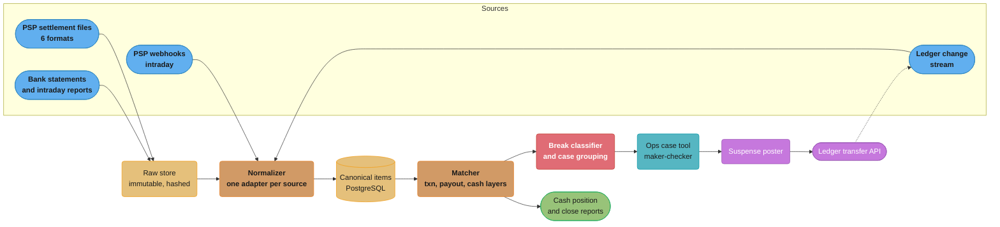
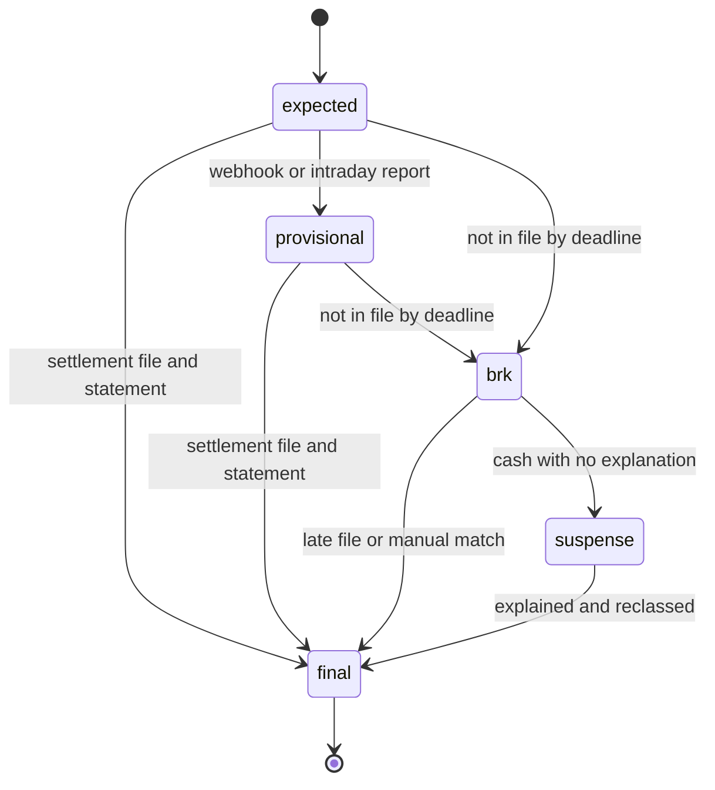

# Case Study: Design a Payment Reconciliation Platform

> Rules and figures checked 2026-11-06. Every date, rule and company figure on this page comes from the fact pins in `fintech/CLAUDE.md` or from the primary source named beside it. Scale figures, targets and war-story numbers are design assumptions or illustrations, and the text labels them so.

## Intuition

> **Design intuition**: Reconciliation is a matching problem between three records that each prove a different thing. The PSP or network record proves the card event. The ledger proves the obligation. The bank statement proves the cash. No one of them is the final arbiter. A reconciliation platform turns all three into one vocabulary, matches them at the grain where each one is honest, and puts every amount it cannot explain into a named suspense account with an owner and an age.

The repo already has three reconciliation components. [Design a Payment System](../../hld/case_studies/design_payment_system.md) §4.5 has a nightly job that compares one PSP report to a `payments` table and flags four mismatch types. [Design a Payment Processor](../../backend/case_studies/design_payment_processor/design_payment_processor.md) §4.6 and Runbooks 1 and 4 add a three-way match with a `BreakType` enum and the rule "never fix one side to match the other". [Design a Banking Ledger](../../database/case_studies/design_banking_ledger/design_banking_ledger.md) §8 checks per-transaction, per-period and external balances. Each of those is one job that matches one file against one table. This study does not repeat them. It designs the platform that sits under many such jobs: many sources and formats, matching at three grains, fee netting, a break taxonomy with aging, suspense postings, provisional and final status, and the case tool that operations staff work in all day.

The specific question: **how do you reconcile 40 million ledger transfers a day against 6 PSPs and acquirers and 14 bank accounts in 5 currencies, auto-match 99.95% of external lines by 10:00 on the next business day, and keep every cent it cannot match visible, owned and aging?** All of those figures are design assumptions.

**Key insight for this design**: a bank credit of EUR 1,283,073.63 from a PSP does not match any single ledger transfer. It is the net of thousands of captures, refunds, chargebacks, fees and a reserve hold. So the platform matches in layers. The transaction layer matches each ledger transfer to its PSP line by reference. The payout layer proves that the PSP's payout equals the sum of its own lines. The cash layer matches the payout to the bank statement line. The PSP payout is the bridge between card events and cash. A design that tries to match bank lines directly to ledger transfers has no bridge, and it fails on the first netted payout.

Everything here builds on: [Reconciliation and Settlement Files](../reconciliation_and_settlement_files/reconciliation_and_settlement_files.md) (it owns the matching-strategy decision model),
[Double-Entry Ledger Design](../double_entry_ledger_design/double_entry_ledger_design.md), [Idempotency and Exactly-Once Money Movement](../idempotency_and_exactly_once_money_movement/idempotency_and_exactly_once_money_movement.md),
[Interchange and Payment Economics](../card_payments_lifecycle/interchange_and_payment_economics.md), and the two cross-cutting files [Money Movement Invariants](cross_cutting/money_movement_invariants.md) and [Business Days, Cut-offs and Value Dates](cross_cutting/business_days_cutoffs_and_value_dates.md).

---

## 1. Requirements Clarification

### Functional Requirements

- **Ingest** settlement files from 6 PSPs and acquirers (CSV, fixed-width and API pulls, each with its own columns), PSP webhooks for intraday status, bank statements and intraday reports for 14 accounts, and ledger transfers from the ledger's change stream.
- **Normalize** every external line into one canonical record: source, reference, kind, currency, signed amount in minor units, value date, payout reference, and a pointer back to the raw line.
- **Match** at three layers: ledger transfer to PSP line (transaction layer), PSP lines to PSP payout (payout layer), PSP payout to bank line (cash layer). Support one-to-one, one-to-many and many-to-many groups.
- **Net fees**. Take the fee each PSP reports, book it, and audit it against the contract in a separate check.
- **Classify breaks** into a fixed taxonomy, give each an owner and an age, and group related breaks into one case.
- **Post to suspense**. Unexplained cash goes to a suspense account through the ledger's normal transfer API, so the balance sheet shows it.
- **Track status**. Each item is `expected`, `provisional` (T+0, from webhooks and intraday bank reports) or `final` (T+1, from settlement files and the end-of-day statement).
- **Case tool** for operations staff: evidence from every source side by side, manual match with maker-checker, adjustments and write-offs with approval limits, and a full audit trail.
- **Close support**: month-end sign-off that every suspense balance is explained or approved.

### Non-Functional Requirements

All figures below are design assumptions.

- 40 million ledger transfers a day. About 25.8 million of them have an external counterpart. The rest are internal (fee allocation, wallet moves, reserve movements).
- About 26.1 million external lines a day: 25.5 million PSP lines and 0.6 million bank lines.
- Auto-match 99.95% of external lines, by count, by 10:00 local time on T+1 for each account's home time zone.
- Provisional cash position per bank account and currency within 15 minutes of an intraday bank report.
- Deterministic re-runs. The same inputs and the same rule version give the same matches.
- Idempotent ingest. A file delivered twice, or a corrected file, never creates a second record.
- Retain raw files and match decisions for 7 years (assumption: set by the company's own record-keeping policy and its regulators).
- Every manual action is attributable to a person and needs a second approver above a configured amount.

### Authority is scoped

The platform never treats one source as the truth for everything. Each source is authoritative for one question only.

| Question | Authoritative source | What reconciliation does with a disagreement |
|---|---|---|
| Did the card event happen, at what amount and fee? | PSP or network record | Book the PSP's fee. Raise a break if the ledger has no transfer for the event |
| What do we owe or are we owed? | Ledger | Raise a break if the PSP has no line for a ledger capture. Never delete the transfer |
| Did the cash arrive or leave? | Bank statement | Match the payout. Put unexplained cash into suspense |

### Out of Scope (and where it lives instead)

| Topic | Where it lives |
|---|---|
| A single nightly PSP-vs-ledger job and its four flags | [Design a Payment System](../../hld/case_studies/design_payment_system.md) §4.5 |
| The saga, PSP timeouts and the `BreakType` triage runbook | [Design a Payment Processor](../../backend/case_studies/design_payment_processor/design_payment_processor.md) §4.6, Runbooks 1 and 4 |
| Ledger schema, SERIALIZABLE isolation, CQRS balances | [Design a Banking Ledger](../../database/case_studies/design_banking_ledger/design_banking_ledger.md) |
| Settlement file formats, matching strategies and their decision model | [Reconciliation and Settlement Files](../reconciliation_and_settlement_files/reconciliation_and_settlement_files.md) |
| Webhook signing, retries and dedupe | [Webhooks and Event Delivery](../../backend/webhooks_and_event_delivery/webhooks_and_event_delivery.md) |
| Chargeback rules and dispute evidence | [Disputes, Chargebacks and Refunds](../disputes_chargebacks_and_refunds/disputes_chargebacks_and_refunds.md) |
| Cash positioning, prefunding and FX | [Treasury, Liquidity and FX Operations](../treasury_liquidity_and_fx_operations/treasury_liquidity_and_fx_operations.md) |

---

## 2. Scale Estimation

All inputs in this section are design assumptions.

### Daily volume by source

```
Ledger transfers                         40.0 M/day
  card captures                          24.0 M
  refunds                                 1.2 M
  disputes (chargebacks and reversals)    0.04 M
  outbound payouts to sellers             0.6 M
  internal only (no external line)       14.16 M

External lines                           26.1 M/day
  PSP transaction lines                  25.24 M  (captures, refunds, disputes)
  PSP fee and adjustment lines            0.26 M
  bank statement lines                    0.6 M   (payouts, PSP credits, returns, bank fees)
```

Card volume is uneven across the 6 PSPs. The largest acquirer carries 45%, which is about 11 million lines in one daily file.

### The break budget

The 99.95% target sounds strict. Turn it into work:

```
Unmatched lines per day     = 26.1 M x 0.05%       = 13,050
Analyst time at 3 min each  = 13,050 x 3 min        = 652 hours/day
Analysts at 6.5 focused h   = 652 / 6.5             = 100 people
```

A team of 100 people to look at single lines is not a plan. The platform must group breaks by cause before a person sees them. In practice most open lines share a few causes on a given day: one PSP file late, one fee rule changed, one bank account's statement delayed. A case groups breaks with the same signature (source, break type, rule that failed, value date). If 13,050 lines fall into about 400 cases (illustrative), about 26 analysts can work them (§10 sizes the team). The design in §4.6 exists to make that grouping possible.

### Storage

```
Canonical record             ~350 B (fields, refs, raw pointer)
Per day                      26.1 M x 350 B   = 9.1 GB
Per year                     9.1 GB x 365     = 3.3 TB
7-year retention             23 TB canonical, plus ~5 TB compressed raw files
Hot window in PostgreSQL     45 days          = ~410 GB plus indexes
```

Older partitions move to Parquet in object storage. The hot window covers the longest normal settlement lag plus month-end close plus the dispute window for most items that matter to operations. Long-tail dispute lookups go to the archive.

### Matching working set

An item stays open from the moment the ledger expects it until its final match. Most PSPs in this design settle on T+1 or T+2 (assumption), and a few local methods take longer.

```
Open items at the daily peak   ~3 days x 26 M      = 78 M
Index entry (ref hash, amount, currency, date, id) = 64 B
Index memory                   78 M x 64 B         = 5 GB
```

That fits in memory on one machine, but the matcher partitions by currency and source anyway, for failure isolation and parallel re-runs.

### Throughput and deadlines

```
Largest PSP file          11 M lines, ~3.5 GB CSV
Parse rate                150 k lines/s per core
Parse time, 8 partitions  11 M / (8 x 150 k)      = ~9 s
Hash join, txn layer      26 M probes at ~5 M/s    = ~5 s per pass
```

Compute is not the constraint. Arrival time is. PSP files land between 03:00 and 07:00 local, and bank end-of-day statements land around 06:00. The real deadline problem is a file that is late, partial, or reissued. The design must match what has arrived, mark the rest as `expected`, and re-run cheaply when the missing piece lands.

### Peak

Black Friday volume is about 3x a normal day (assumption): 78 million external lines and, at the same rate, 39,000 open lines. The case grouping matters more on that day than on any other.

---

## 3. High-Level Architecture



Every source goes through the same path: raw store, adapter, canonical item. The matcher reads only canonical items. Every correction leaves through the ledger's own transfer API and comes back in through the ledger change stream, so a correction is reconciled like any other transfer.

**The flow on one business day** (times are local to the account, and are assumptions):

1. **T+0, all day.** Ledger transfers stream in as `expected` items. PSP webhooks mark card events `provisional`. Intraday bank reports (ISO 20022 `camt.052`) give a provisional cash view per account.
2. **T+1, 03:00 to 07:00.** PSP settlement files land. Each is fingerprinted, parsed and normalized. The transaction and payout layers run per file as it arrives.
3. **T+1, about 06:00.** End-of-day bank statements (`camt.053`, or MT940 for banks that still send it) land. The cash layer runs.
4. **T+1, 07:30.** Break classification and case grouping. Cases go to the queue with owners.
5. **T+1, 10:00.** The auto-match target is measured. Cash position reports go to treasury.
6. **Any time later.** A late or corrected file triggers a re-run of only the affected partitions.

---

## 4. Component Deep Dives

### 4.1 Ingest and the canonical item

The raw store keeps every file byte for byte, keyed by a SHA-256 of its content. Ingest is idempotent at two levels.

- **File level.** The same bytes delivered twice hash to the same key, so the second delivery is a no-op.
- **Line level.** Each canonical item has a natural key `(source, source_ref, kind)`. A re-parse of the same line upserts the same row.

A **corrected file** is the hard case. PSPs reissue a file when they find an error, and the reissue has different bytes. The adapter records `file_version` and `supersedes`. Items from the old version that are absent from the new one are not deleted. They are marked `withdrawn`, and any active match that uses them is reversed and re-run. Deletion would destroy the evidence that the platform once matched against a line that the PSP later withdrew.

One canonical item looks like this:

```json
{
  "source": "psp:acq-eu",
  "source_ref": "8816047712341234",
  "kind": "capture",
  "currency": "EUR",
  "amount_minor": 2550,
  "value_date": "2026-11-06",
  "payout_ref": "po_2026-11-06_EUR_77",
  "merchant_ref": "tr_01JC9V3K",
  "fee_minor": -36,
  "raw": { "file_sha256": "9f2c...e1", "line": 41877, "file_version": 1 }
}
```

Three rules in the adapters prevent most later breaks:

- **Minor units by ISO 4217 exponent**, not by a fixed 100. JPY has exponent 0, and BHD, IQD, JOD, KWD, LYD, OMR and TND have 3 (ISO 4217 list one, published 2026-09-17). A PSP file that writes `1500` for a JPY amount and `15.00` for a USD amount needs per-currency parsing. [Money Representation and Currency](../money_representation_and_currency/money_representation_and_currency.md) owns the rule.
- **One sign convention.** Every amount is signed from the company's cash view: a capture is positive, a refund, fee or chargeback is negative. PSPs disagree on signs, and the adapter fixes that once.
- **The merchant reference is the join key.** The orchestration layer and the PSP integration put the ledger transfer id into the PSP's merchant reference field on every call. Without it, the transaction layer falls back to amount and date, and its auto-match rate drops sharply. [Design a Payment Orchestration Layer](design_a_payment_orchestration_layer.md) §4.7 describes how each attempt carries that reference.

### 4.2 Three layers, three kinds of match


Each layer answers one question with the source that is authoritative for it:

| Layer | Question | Shape | Match key | Typical auto-match |
|---|---|---|---|---|
| Transaction | Did every ledger card event happen at the PSP, and the other way round? | 1:1 | merchant reference, kind, amount, currency | 99.97% (assumption) |
| Payout | Does the PSP's payout equal the sum of its own lines? | N:1 | payout reference | 100% on clean files. A gap is a PSP-side break |
| Cash | Did the payout reach the bank? | 1:1, sometimes 1:N | payout reference in narrative, else amount, currency and date window | 99.5% (assumption), the rest go to cases |

The payout layer is internal to the PSP's file. It catches a file that is incomplete, double-counted, or carries an adjustment line that the adapter does not understand. If the payout layer fails, every cash-layer result for that payout is suspect, so the matcher runs the payout layer first and blocks the cash match until it passes.

A bank sometimes books several payouts as one entry ("batch booking") and sends the detail separately. The Swiss Payment Standards implementation guide for `camt` messages (SPS 2023, version 2.0.2) describes exactly this: a `camt.053` statement with "external batch booking resolution in `camt.054`". The cash layer then becomes 1:N: one bank entry against several payouts, with the `camt.054` detail as evidence.

### 4.3 The matching ladder

Rules run in order of confidence. Each rule only sees items the earlier rules did not match.

| Rung | Rule | Example | Confidence |
|---|---|---|---|
| 1 | Exact reference, kind, amount, currency | ledger `tr_01JC9V3K` and PSP merchant ref `tr_01JC9V3K` | auto |
| 2 | Exact reference, amount within a currency-specific tolerance | FX-converted capture off by 1 minor unit | auto, tolerance logged |
| 3 | Reference found in a free-text field | bank narrative contains `po_2026-11-06_EUR_77` | auto |
| 4 | Amount, currency and value date window, unique candidate | payout of 1,283,073.63 EUR, bank credit of the same amount within 2 business days | auto only if exactly one candidate |
| 5 | Amount and window, several candidates | two payouts of the same amount from two PSPs | human |
| 6 | Many-to-many subset sum | 3 bank credits against 5 expected payouts | human, with suggested groups |

Rung 4 has the rule that matters most: **an ambiguous match is not a match.** When two expected items have the same amount, currency and window, picking the first one is a coin flip that books cash against the wrong PSP. The matcher returns `Ambiguous` with both candidates, and a person decides. The date window counts business days on the receiving account's calendar, not calendar days (see [Business Days, Cut-offs and Value Dates](cross_cutting/business_days_cutoffs_and_value_dates.md)). A Friday payout that arrives on Monday is one business day late, not three.

The cash-layer matcher, with rungs 3 to 5:

```java
import java.time.DayOfWeek;
import java.time.LocalDate;
import java.util.List;

public class CashMatcher {
    record BankLine(String id, String currency, long amountMinor, LocalDate valueDate, String narrative) {}
    record ExpectedPayout(String payoutRef, String currency, long amountMinor, LocalDate expectedDate) {}

    sealed interface Outcome permits Matched, Ambiguous, NoMatch {}
    record Matched(String bankLineId, String payoutRef, String rule) implements Outcome {}
    record Ambiguous(String bankLineId, List<String> candidates) implements Outcome {}
    record NoMatch(String bankLineId) implements Outcome {}

    static Outcome match(BankLine b, List<ExpectedPayout> open, int windowBusinessDays) {
        for (ExpectedPayout e : open) {
            if (b.narrative().contains(e.payoutRef())
                    && e.currency().equals(b.currency()) && e.amountMinor() == b.amountMinor()) {
                return new Matched(b.id(), e.payoutRef(), "ref_in_narrative");
            }
        }
        List<ExpectedPayout> candidates = open.stream()
                .filter(e -> e.currency().equals(b.currency()))
                .filter(e -> e.amountMinor() == b.amountMinor())
                .filter(e -> businessDaysBetween(e.expectedDate(), b.valueDate()) <= windowBusinessDays)
                .toList();
        return switch (candidates.size()) {
            case 0 -> new NoMatch(b.id());
            case 1 -> new Matched(b.id(), candidates.getFirst().payoutRef(), "amount_date_unique");
            default -> new Ambiguous(b.id(), candidates.stream().map(ExpectedPayout::payoutRef).toList());
        };
    }

    // Weekends only. Production code reads the account's holiday calendar.
    static long businessDaysBetween(LocalDate from, LocalDate to) {
        if (to.isBefore(from)) return Long.MAX_VALUE;
        long days = 0;
        for (LocalDate d = from; d.isBefore(to); d = d.plusDays(1)) {
            DayOfWeek w = d.plusDays(1).getDayOfWeek();
            if (w != DayOfWeek.SATURDAY && w != DayOfWeek.SUNDAY) days++;
        }
        return days;
    }

    public static void main(String[] args) {
        LocalDate fri = LocalDate.of(2026, 11, 6);
        LocalDate mon = LocalDate.of(2026, 11, 9);
        List<ExpectedPayout> open = List.of(
                new ExpectedPayout("po_A_77", "EUR", 128_307_363L, fri),
                new ExpectedPayout("po_B_12", "EUR", 4_100_000L, fri),
                new ExpectedPayout("po_C_31", "EUR", 4_100_000L, fri));

        Outcome byRef = match(new BankLine("b1", "EUR", 128_307_363L, mon, "SETT po_A_77"), open, 2);
        Outcome unique = match(new BankLine("b2", "EUR", 128_307_363L, mon, "ACQ EU SETTLEMENT"), open, 2);
        Outcome twoCandidates = match(new BankLine("b3", "EUR", 4_100_000L, mon, "SETTLEMENT"), open, 2);
        Outcome tooLate = match(new BankLine("b4", "EUR", 128_307_363L, mon.plusDays(7), "LATE"), open, 2);

        assert byRef instanceof Matched m && m.rule().equals("ref_in_narrative");
        assert unique instanceof Matched m2 && m2.rule().equals("amount_date_unique");
        assert twoCandidates instanceof Ambiguous a && a.candidates().size() == 2;
        assert tooLate instanceof NoMatch;
        System.out.println(byRef + "\n" + unique + "\n" + twoCandidates + "\n" + tooLate);
    }
}
```

The Friday payout arrives on Monday, which is one business day. The two EUR 41,000.00 payouts from different PSPs produce `Ambiguous`, not a guess. The line 7 days later is outside the window and becomes a break.

### 4.4 Fee netting and the payout equation

A PSP pays out a net amount. For one payout batch:

```
payout = sum(captures) + sum(refunds) + sum(disputes) + sum(fees) + reserve movement + adjustments
```

All terms are signed, so refunds, disputes and fees are negative. A worked example for one EUR batch (illustrative):

| Term | Amount (EUR) |
|---|---|
| Captures, 48,112 lines | 1,402,118.40 |
| Refunds, 2,031 lines | -61,220.00 |
| Chargebacks, 41 lines | -3,180.00 |
| Fees | -19,644.77 |
| Reserve hold | -35,000.00 |
| Payout | 1,283,073.63 |

Two PSP facts shape how the fee line arrives.

- Stripe's payout reconciliation report lists each balance transaction in an automatic payout with `gross`, `fee` and `net`, grouped by reporting category. Stripe also states that it cannot say which transactions an instant payout includes, so the merchant reconciles instant payouts against its own transaction history (Stripe docs, accessed 2026-11-06).
- Adyen's Settlement details report is per merchant account and per batch. When the acquirer gives interchange-level data, Adyen splits the commission into `Markup`, `Scheme Fees` and `Interchange` columns per transaction. Otherwise the total sits in `Commission` (Adyen docs, accessed 2026-11-06).

So some PSPs give a fee per line, some give a fee per batch, and one PSP can give both depending on the acquirer. The platform does not recompute fees to match payouts. It books the fee the PSP reports, because the PSP is authoritative for what it charged. Whether that fee is correct under the contract is a separate question with a separate check: the fee audit. [Interchange and Payment Economics](../card_payments_lifecycle/interchange_and_payment_economics.md) owns blended versus IC++ pricing, and that choice decides how much detail the fee audit can check.

#### BROKEN: recompute the fee per line and demand an exact payout match

The first version of the payout check recomputed the PSP's 1.4% fee for each line, rounded each fee, and expected the payout to equal gross minus the recomputed fees.

```java
// BROKEN
import java.math.BigDecimal;
import java.math.RoundingMode;
import java.util.Collections;
import java.util.List;

public class PayoutCheckBroken {
    record Line(String ref, long grossMinor) {}

    static final BigDecimal FEE_RATE = new BigDecimal("0.014");

    static long expectedNet(List<Line> lines) {
        long net = 0;
        for (Line l : lines) {
            long fee = BigDecimal.valueOf(l.grossMinor()).multiply(FEE_RATE)
                    .setScale(0, RoundingMode.HALF_UP).longValueExact();
            net += l.grossMinor() - fee;
        }
        return net;
    }

    public static void main(String[] args) {
        List<Line> lines = Collections.nCopies(1000, new Line("tr", 1037));
        long gross = lines.stream().mapToLong(Line::grossMinor).sum();
        long pspFee = BigDecimal.valueOf(gross).multiply(FEE_RATE)
                .setScale(0, RoundingMode.HALF_EVEN).longValueExact();
        long pspPayout = gross - pspFee;
        long expected = expectedNet(lines);
        System.out.println("expected " + expected + ", PSP paid " + pspPayout
                + ", break " + (pspPayout - expected));
        // prints: expected 1022000, PSP paid 1022482, break 482
    }
}
```

Each EUR 10.37 line has a fee of 14.518 cents, which rounds up to 15. A thousand lines give 15,000 cents of recomputed fees. The PSP rounds once on the batch total: 1,037,000 x 0.014 = 14,518 cents. The payout is EUR 4.82 more than the check expects, every batch, and every batch becomes an `AMOUNT_DIFF` break. Nothing is wrong with the money. The check modelled the wrong rounding grain, and it mixed two questions: "does the payout add up" and "is the fee right".

#### FIX: book the reported fee, audit it separately against the contract

```java
import java.math.BigDecimal;
import java.math.RoundingMode;
import java.util.Collections;
import java.util.List;

public class PayoutCheck {
    enum FeeGrain { PER_LINE, PER_BATCH }

    record Contract(String psp, BigDecimal rate, FeeGrain grain, RoundingMode mode, long toleranceMinor) {}
    record Line(String ref, long grossMinor, long reportedFeeMinor) {}
    record Batch(String payoutRef, List<Line> lines, long batchFeeMinor, long payoutMinor) {}
    record Result(long payoutDiff, long feeAuditDiff, boolean feeWithinTolerance) {
        boolean payoutMatched() { return payoutDiff == 0; }
    }

    static Result check(Batch b, Contract c) {
        long gross = b.lines().stream().mapToLong(Line::grossMinor).sum();
        long reportedFees = b.lines().stream().mapToLong(Line::reportedFeeMinor).sum() + b.batchFeeMinor();
        long payoutDiff = b.payoutMinor() - (gross - reportedFees);
        long feeDiff = reportedFees - contractFee(b, c);
        return new Result(payoutDiff, feeDiff, Math.abs(feeDiff) <= c.toleranceMinor());
    }

    static long contractFee(Batch b, Contract c) {
        return switch (c.grain()) {
            case PER_BATCH -> round(b.lines().stream().mapToLong(Line::grossMinor).sum(), c);
            case PER_LINE -> b.lines().stream().mapToLong(l -> round(l.grossMinor(), c)).sum();
        };
    }

    static long round(long grossMinor, Contract c) {
        return BigDecimal.valueOf(grossMinor).multiply(c.rate()).setScale(0, c.mode()).longValueExact();
    }

    public static void main(String[] args) {
        Contract acqEu = new Contract("acq-eu", new BigDecimal("0.014"), FeeGrain.PER_BATCH,
                RoundingMode.HALF_EVEN, 1);
        List<Line> lines = Collections.nCopies(1000, new Line("tr", 1037, 0));

        Batch clean = new Batch("po_77", lines, 14_518, 1_037_000 - 14_518);
        Result ok = check(clean, acqEu);
        assert ok.payoutMatched() && ok.feeAuditDiff() == 0 && ok.feeWithinTolerance();

        Batch overcharged = new Batch("po_78", lines, 15_555, 1_037_000 - 15_555);
        Result fee = check(overcharged, acqEu);
        assert fee.payoutMatched() && !fee.feeWithinTolerance() && fee.feeAuditDiff() == 1_037;

        System.out.println("po_77 " + ok + "\npo_78 " + fee);
    }
}
```

The payout equation now uses only the PSP's own numbers, so it balances whenever the file is complete. The fee audit compares the reported fee to the contract with the contract's grain and rounding mode. On `po_78` the payout still matches, because the cash really arrived, but the fee audit finds EUR 10.37 of overcharge. That goes to the finance team as a vendor claim, not to the reconciliation queue as a cash break. Two questions, two owners.

### 4.5 Provisional T+0 and final T+1

The platform gives two answers about the same item at different times, and it never mixes them.



- **Provisional** comes from PSP webhooks and the bank's intraday `camt.052` report. The SPS guide maps `camt.052` to the MT941 and MT942 intraday reports and `camt.053` to the MT940 statement. Treasury uses provisional status for the intraday cash position. Finance does not use it for close, because webhooks arrive out of order and can be lost (see [Webhooks and Event Delivery](../../backend/webhooks_and_event_delivery/webhooks_and_event_delivery.md)). A webhook is evidence, not truth.
- **Final** needs the PSP's settlement file for the transaction and payout layers, and the end-of-day statement for the cash layer.
- **Break** is a deadline, not a mismatch. An item becomes a break only when its expected settlement date plus the PSP's grace period has passed. Before that, a missing line is normal.

The expected settlement date is a per-PSP, per-currency function. A capture at 23:59:58 UTC can fall into the next batch if the PSP's batch cut-off is midnight in Amsterdam. A Friday batch pays on Monday. A bank holiday in one currency's country moves only that currency. [Business Days, Cut-offs and Value Dates](cross_cutting/business_days_cutoffs_and_value_dates.md) owns the calendar arithmetic. The platform stores the computed date on each `expected` item so the break rule is a simple comparison at run time.

TigerBeetle's transfer model is a useful mental model for this split. A `pending` transfer reserves an amount, and a later `post_pending_transfer` or `void_pending_transfer` settles or releases it (TigerBeetle docs, release 0.17.9). A provisional cash position works the same way: an intraday credit is a pending amount, and the end-of-day statement posts it.

### 4.6 Break taxonomy, aging and cases

A fixed taxonomy lets the platform route each break to an owner and pick an automatic action.

| Break type | Layer | Usual cause | Owner | Automatic action |
|---|---|---|---|---|
| `MISSING_EXTERNAL` | txn | capture booked, PSP has no line | payments engineering | wait for grace period, then query the PSP API by reference |
| `MISSING_INTERNAL` | txn | PSP line with no ledger transfer | payments engineering | page if amount is positive (charged with no record) |
| `AMOUNT_DIFF` | txn | FX conversion, partial capture, exponent bug | payments engineering | auto-accept within tolerance, else case |
| `DUPLICATE_EXTERNAL` | txn | two PSP lines for one transfer | payments engineering | page, start refund review |
| `PAYOUT_NOT_BALANCED` | payout | incomplete or misparsed PSP file | integration owner | block cash match, request reissue |
| `PAYOUT_MISSING` | cash | payout not on statement by window end | treasury | query bank and PSP |
| `PAYOUT_SHORT` | cash | bank credit less than payout | treasury | case with both amounts, check bank fees |
| `UNKNOWN_CREDIT` | cash | bank credit with no expected item | treasury | post to suspense |
| `PAYOUT_RETURNED` | cash | outbound seller payout returned by the bank | payouts team | reverse payout transfer, notify seller |
| `FEE_AUDIT` | payout | reported fee outside contract tolerance | finance | vendor claim, never a cash break |

The first four rows are the payment processor's `BreakType` values from [Design a Payment Processor](../../backend/case_studies/design_payment_processor/design_payment_processor.md) §4.6. The other six exist only because this platform matches the payout and cash layers.

**Aging** runs on business days, in buckets: 0 to 1, 2 to 3, 4 to 7, 8 to 30, over 30. The service level is on the oldest open break, as in that study, but per owner, so one team's backlog cannot hide behind another team's clean queue.

**Cases** group breaks by a signature: `(source, break type, failed rule, value date)`. A late file from one PSP produces one case with 11 million items, not 11 million cases. The case tool shows the cluster, its total amount per currency, and three sample items with the raw lines from every source. An analyst resolves the cluster with one action when the cause is shared ("file arrived, re-run") and splits it when it is not.

### 4.7 Suspense: visible, owned, aging

When cash arrives that no rule can explain, the platform still books it. It posts a transfer from the bank account's cash to a suspense account for that bank account and currency, through the same ledger API as any other transfer. Three rules:

- **Suspense is per bank account and per currency.** A single global suspense account hides which bank and which currency the problem is in, and it nets a USD overage against a EUR shortage in reports.
- **Every suspense entry links to its case.** A suspense balance without a case is an alert.
- **Clearing is a transfer, not an edit.** When the analyst finds the cause, a reclass transfer moves the amount from suspense to the right account. The original suspense posting stays in the ledger.

Write-offs need two people above a threshold (assumption: EUR 1,000 or the equivalent), and each write-off carries a reason code that finance reviews at month-end. [Double-Entry Ledger Design](../double_entry_ledger_design/double_entry_ledger_design.md) covers why corrections are new entries and never updates.

### 4.8 The match store, with the invariants in constraints

Matches live in PostgreSQL. One table holds every item from every source. A match group links items in one layer, and a constraint trigger proves that each group nets to zero in one currency. A partial unique index stops an item from sitting in two active groups in the same layer.

```sql
CREATE TABLE recon_item (
    id           bigint GENERATED ALWAYS AS IDENTITY PRIMARY KEY,
    origin       text    NOT NULL CHECK (origin IN ('ledger', 'psp', 'bank')),
    source       text    NOT NULL,
    source_ref   text    NOT NULL,
    kind         text    NOT NULL,
    currency     char(3) NOT NULL,
    amount_minor bigint  NOT NULL,
    value_date   date    NOT NULL,
    payout_ref   text,
    UNIQUE (source, source_ref, kind)
);

CREATE TABLE match_group (
    id           bigint GENERATED ALWAYS AS IDENTITY PRIMARY KEY,
    layer        text    NOT NULL CHECK (layer IN ('txn', 'payout', 'cash')),
    rule         text    NOT NULL,
    rule_version int     NOT NULL,
    matched_by   text    NOT NULL,
    created_at   timestamptz NOT NULL DEFAULT now(),
    UNIQUE (id, layer)
);

CREATE TABLE match_member (
    group_id bigint   NOT NULL,
    item_id  bigint   NOT NULL REFERENCES recon_item (id),
    layer    text     NOT NULL,
    side     smallint NOT NULL CHECK (side IN (-1, 1)),
    active   boolean  NOT NULL DEFAULT true,
    PRIMARY KEY (group_id, item_id),
    FOREIGN KEY (group_id, layer) REFERENCES match_group (id, layer)
);

CREATE UNIQUE INDEX one_active_match_per_layer
    ON match_member (item_id, layer) WHERE active;

CREATE TABLE required_layer (
    origin text NOT NULL,
    kind   text NOT NULL,
    layer  text NOT NULL,
    PRIMARY KEY (origin, kind, layer)
);

INSERT INTO required_layer VALUES
    ('ledger', 'capture', 'txn'), ('ledger', 'refund', 'txn'),
    ('psp', 'capture', 'txn'), ('psp', 'refund', 'txn'),
    ('psp', 'capture', 'payout'), ('psp', 'refund', 'payout'), ('psp', 'fee', 'payout'),
    ('psp', 'payout', 'payout'), ('psp', 'payout', 'cash'),
    ('bank', 'credit', 'cash');

CREATE FUNCTION check_group_nets_to_zero() RETURNS trigger LANGUAGE plpgsql AS $$
DECLARE
    net        bigint;
    currencies int;
BEGIN
    SELECT coalesce(sum(m.side * i.amount_minor), 0), count(DISTINCT i.currency)
      INTO net, currencies
      FROM match_member m
      JOIN recon_item i ON i.id = m.item_id
     WHERE m.group_id = NEW.group_id AND m.active;
    IF currencies > 1 THEN
        RAISE EXCEPTION 'match group % mixes currencies', NEW.group_id;
    END IF;
    IF net <> 0 THEN
        RAISE EXCEPTION 'match group % does not net to zero (%)', NEW.group_id, net;
    END IF;
    RETURN NULL;
END $$;

CREATE CONSTRAINT TRIGGER group_nets_to_zero
    AFTER INSERT OR UPDATE ON match_member
    DEFERRABLE INITIALLY DEFERRED
    FOR EACH ROW EXECUTE FUNCTION check_group_nets_to_zero();
```

The trigger is deferred because a group's members arrive in several inserts inside one transaction. The check runs at commit, when the group is complete. One business day for one PSP payout, matched across all three layers:

```sql
INSERT INTO recon_item (origin, source, source_ref, kind, currency, amount_minor, value_date, payout_ref) VALUES
    ('ledger', 'ledger',         'tr_1',        'capture', 'EUR',  1000, '2026-11-05', NULL),
    ('ledger', 'ledger',         'tr_2',        'capture', 'EUR',  2550, '2026-11-05', NULL),
    ('ledger', 'ledger',         'tr_3',        'refund',  'EUR',  -725, '2026-11-05', NULL),
    ('ledger', 'ledger',         'tr_4',        'capture', 'EUR',  4999, '2026-11-02', NULL),
    ('psp',    'psp:acq-eu',     'tr_1',        'capture', 'EUR',  1000, '2026-11-06', 'po_77'),
    ('psp',    'psp:acq-eu',     'tr_2',        'capture', 'EUR',  2550, '2026-11-06', 'po_77'),
    ('psp',    'psp:acq-eu',     'tr_3',        'refund',  'EUR',  -725, '2026-11-06', 'po_77'),
    ('psp',    'psp:acq-eu',     'po_77:fee',   'fee',     'EUR',   -61, '2026-11-06', 'po_77'),
    ('psp',    'psp:acq-eu',     'po_77',       'payout',  'EUR',  2764, '2026-11-06', 'po_77'),
    ('bank',   'bank:eur-ops-1', 'stmt-1106:4', 'credit',  'EUR',  2764, '2026-11-06', NULL);

DO $$
DECLARE
    r record;
    g bigint;
BEGIN
    -- Transaction layer: ledger transfer against PSP line, exact reference
    FOR r IN
        SELECT l.id AS ledger_id, p.id AS psp_id
          FROM recon_item l
          JOIN recon_item p
            ON p.origin = 'psp' AND p.source_ref = l.source_ref AND p.kind = l.kind
           AND p.currency = l.currency AND p.amount_minor = l.amount_minor
         WHERE l.origin = 'ledger'
    LOOP
        INSERT INTO match_group (layer, rule, rule_version, matched_by)
        VALUES ('txn', 'ref_exact', 3, 'auto') RETURNING id INTO g;
        INSERT INTO match_member (group_id, item_id, layer, side)
        VALUES (g, r.ledger_id, 'txn', 1), (g, r.psp_id, 'txn', -1);
    END LOOP;

    -- Payout layer: every PSP line in the batch against the payout line
    FOR r IN SELECT DISTINCT payout_ref FROM recon_item WHERE origin = 'psp' LOOP
        INSERT INTO match_group (layer, rule, rule_version, matched_by)
        VALUES ('payout', 'payout_sum', 2, 'auto') RETURNING id INTO g;
        INSERT INTO match_member (group_id, item_id, layer, side)
        SELECT g, id, 'payout', CASE WHEN kind = 'payout' THEN -1 ELSE 1 END
          FROM recon_item
         WHERE origin = 'psp' AND payout_ref = r.payout_ref;
    END LOOP;

    -- Cash layer: payout against bank credit, amount and currency, unique candidate
    FOR r IN
        SELECT p.id AS payout_id, b.id AS bank_id
          FROM recon_item p
          JOIN recon_item b
            ON b.origin = 'bank' AND b.currency = p.currency AND b.amount_minor = p.amount_minor
           AND b.value_date BETWEEN p.value_date AND p.value_date + 4
         WHERE p.kind = 'payout'
    LOOP
        INSERT INTO match_group (layer, rule, rule_version, matched_by)
        VALUES ('cash', 'amount_date_unique', 1, 'auto') RETURNING id INTO g;
        INSERT INTO match_member (group_id, item_id, layer, side)
        VALUES (g, r.payout_id, 'cash', 1), (g, r.bank_id, 'cash', -1);
    END LOOP;
END $$;
```

The constraints turn two common matcher bugs into errors. A second match of `tr_1` in the transaction layer violates the partial unique index:

```sql
-- BROKEN: error
WITH g AS (
    INSERT INTO match_group (layer, rule, rule_version, matched_by)
    VALUES ('txn', 'amount_date', 1, 'auto') RETURNING id
)
INSERT INTO match_member (group_id, item_id, layer, side)
SELECT g.id, i.id, 'txn', 1 FROM g, recon_item i WHERE i.source_ref = 'tr_1' AND i.origin = 'ledger';
```

A group that does not net to zero fails when the deferred check runs. `SET CONSTRAINTS ... IMMEDIATE` runs it at once instead of at commit:

```sql
-- BROKEN: error
WITH g AS (
    INSERT INTO match_group (layer, rule, rule_version, matched_by)
    VALUES ('txn', 'amount_tolerance', 1, 'auto') RETURNING id
)
INSERT INTO match_member (group_id, item_id, layer, side)
SELECT g.id, i.id, 'txn', CASE WHEN i.origin = 'ledger' THEN 1 ELSE -1 END
  FROM g, recon_item i
 WHERE i.source_ref = 'tr_4' OR (i.source_ref = 'po_77' AND i.kind = 'payout');
SET CONSTRAINTS group_nets_to_zero IMMEDIATE;
```

Open items are the required layers that have no active match. The aging query reads them directly, so no job maintains a separate "open" flag that can drift:

```sql
WITH open_item AS (
    SELECT i.id, i.source, i.kind, i.currency, i.amount_minor, i.value_date, r.layer
      FROM recon_item i
      JOIN required_layer r ON r.origin = i.origin AND r.kind = i.kind
     WHERE NOT EXISTS (
           SELECT 1 FROM match_member m
            WHERE m.item_id = i.id AND m.layer = r.layer AND m.active)
)
SELECT layer, source, currency,
       CASE WHEN DATE '2026-11-09' - value_date <= 1 THEN '0-1d'
            WHEN DATE '2026-11-09' - value_date <= 3 THEN '2-3d'
            WHEN DATE '2026-11-09' - value_date <= 7 THEN '4-7d'
            WHEN DATE '2026-11-09' - value_date <= 30 THEN '8-30d'
            ELSE '30d+' END AS age_bucket,
       count(*) AS items,
       sum(abs(amount_minor)) AS gross_minor
  FROM open_item
 GROUP BY 1, 2, 3, 4
 ORDER BY 4 DESC, 1;
```

On this sample, the only open item is `tr_4`: a EUR 49.99 capture from 2026-11-02 with no PSP line, in the `4-7d` bucket (calendar days in this query, business days in production). Every other item is matched in every layer it needs.

### 4.9 Re-runs, rule versions and shadow mode

Matching is a function of the canonical items and a rule set. Every match group stores `rule` and `rule_version`. Three consequences:

- **A late file re-runs only its partitions.** Matches are keyed by currency and source. When one PSP's EUR file lands at 09:40, the matcher reverses nothing outside EUR for that PSP.
- **A rule change runs in shadow first.** The new rule version runs against the last 30 days of items and writes to a shadow table. A diff report shows matches gained, lost and changed. A rule that changes an existing match needs a reviewer, because it can move cash between PSPs.
- **Manual matches survive re-runs.** A re-run never reverses a group with `matched_by` set to a person. It reports a conflict instead.

[Durable Execution and Workflows](../../backend/durable_execution_and_workflows/durable_execution_and_workflows.md) covers the workflow engine that runs ingest, match and classify as resumable steps per file.

### 4.10 Batch or streaming

The platform does both, for different answers. Streaming (webhooks and the ledger change stream through Kafka, see [Stream Processing](../../hld/stream_processing/stream_processing.md)) gives the provisional view and early warnings, such as a PSP whose webhook rate dropped to zero at 14:00. Batch, per file, gives the final match, because the authoritative inputs are files that arrive once a day. A fully streaming design waits for the same files and adds the cost of keeping open state in a stream processor for days. A fully batch design gives treasury no intraday cash view. [Reconciliation and Settlement Files](../reconciliation_and_settlement_files/reconciliation_and_settlement_files.md) owns this decision model.

---

## 5. Design Decisions & Tradeoffs

### Decision 1: one canonical model, not one pipeline per PSP

| Factor | Canonical items, one matcher | One pipeline per PSP |
|---|---|---|
| Adding a seventh PSP | one adapter, the rules apply | a new pipeline, new rules, new tests |
| Cross-PSP questions ("which PSP paid this bank credit?") | one query | joins across pipelines |
| Risk | one adapter bug can affect one source only, by partition | each pipeline has its own bugs and its own break taxonomy |
| Team load | one platform team, adapters owned by integration owners | each PSP integration team owns recon too |

Choose the canonical model. The cost is a strict adapter contract and a test suite of real files per PSP.

### Decision 2: three layers, not a direct bank-to-ledger match

A direct match needs the ledger to predict each payout's net. That means predicting fees, reserve movements and adjustments, which only the PSP knows. The layered design uses the PSP's own file to bridge, and it localizes each failure: a transaction-layer break is a card-event problem, a payout-layer break is a file problem, and a cash-layer break is a banking problem.

### Decision 3: book the PSP's fee, audit it separately

Recomputing fees in the payout equation turns every rounding difference into a cash break (§4.4). Booking the reported fee keeps the cash question clean. The fee audit catches overcharges as a finance question. The cost is that the ledger shows the PSP's fee even when it is wrong, until finance recovers it. That is correct accounting: the money was taken.

### Decision 4: tolerance per currency and per rule, never global

A tolerance of one minor unit means 0.01 USD, 1 JPY and 0.001 KWD. A global "within 1" rule accepts different real amounts in each currency. Tolerances live in the rule table by currency, and every match within tolerance writes the difference to a rounding account, so the total of all tolerated differences is visible.

### Decision 5: build the matcher, buy nothing in the money path

Vendor reconciliation tools exist and suit companies with one or two PSPs. At 6 PSPs with custom fee contracts and a ledger that already has a transfer API, the matcher is the smaller part of the work. The adapters and the case tool are the larger part, and both depend on internal data. [Build vs Buy and Licensing Strategy](../build_vs_buy_and_licensing_strategy/build_vs_buy_and_licensing_strategy.md) owns the general decision.

---

## 6. Real-World Implementations

**Stripe payout reconciliation report.** Stripe documents a report that matches "the payouts you receive in your bank account with the batches of payments and other transactions that they relate to". It is available for automatic payouts. Each payout's transactions are grouped by reporting category (charges, refunds, fees), and the itemized export lists `gross`, `fee` and `net` per balance transaction, with an `automatic_payout_id` on each row. Stripe states that instant payouts cannot be attributed to transactions by Stripe, so the merchant reconciles those itself. The report groups a payout by its estimated arrival date, not the date the bank posts it, and report data can be ready after the payout arrives (Stripe docs, accessed 2026-11-06). This is the payout layer of §4.2, delivered by the PSP, with the two timing gaps that §4.5 handles.

**Adyen Settlement details report.** Adyen's report "includes the details of payments that have been settled and paid out to you", per merchant account and per batch. Journal types include `Settled` (a credit for a payment sent for settlement), `Refunded`, `Fee`, `Chargeback` (a debit for a payment reversed by the bank, scheme or consumer) and `MerchantPayout` (the amount paid to the bank account for a settlement currency). With interchange-level data from the acquirer, the commission splits into `Markup`, `Scheme Fees` and `Interchange` (Adyen docs, accessed 2026-11-06). The adapter maps these journal types into the canonical `kind` field.

**Square Books.** Square describes Books as "an immutable double-entry accounting database service". Journal entries must balance to zero, entries are append-only, and debits are positive and credits negative. It runs on Google Cloud Spanner (Square Developer blog, 2019-10-16). The suspense and reclass rules in §4.7 follow the same append-only discipline.

**Uber LedgerStore.** Uber describes LedgerStore as immutable storage that indexes hundreds of billions of ledgers, with over 2 trillion unique indexes moved from DynamoDB to Docstore (Uber engineering blog, 2024-04-04). At that scale, the matching index is its own storage problem, which is why §2 sizes it separately.

**TigerBeetle.** TigerBeetle's transfer flags include `pending`, `post_pending_transfer` and `void_pending_transfer`, and its transfer amount is u128 (release 0.17.9). The two-phase model maps to provisional and final cash status (§4.5).

**ISO 20022 cash management messages.** The Swiss Payment Standards guide (SPS 2023, version 2.0.2) maps `camt.053` Bank-to-Customer Statement to MT940, `camt.052` Bank-to-Customer Account Report to MT941 and MT942, and describes `camt.054` Bank-to-Customer Debit/Credit Notification as the place for batch booking detail. The bank adapters parse these three plus MT940 for banks that still send it.

---

## 7. Technologies & Tools

| Tool | Role here |
|---|---|
| PostgreSQL 18 | canonical items, match groups, constraint triggers, 45-day hot window partitioned by value date |
| Apache Kafka | ledger change stream and PSP webhooks for the provisional view |
| Amazon S3 or another object store | raw files keyed by SHA-256, Parquet archive past 45 days |
| Temporal | per-file ingest, match and classify workflows, resumable after a crash |
| Apache Parquet with Trino | ad hoc queries over the 7-year archive for audits and disputes |
| ISO 20022 `camt.052`, `camt.053`, `camt.054` | intraday report, end-of-day statement and batch detail from banks |
| Java 25 | adapters and matcher, records for canonical items, `long` minor units |

---

## 8. Operational Playbook

### Invariant checklist

Every check below comes from [Money Movement Invariants](cross_cutting/money_movement_invariants.md), mapped to the place this platform enforces it.

| Invariant | Enforced by | Alert when |
|---|---|---|
| Conservation per currency | match groups net to zero in one currency (constraint trigger) | a rule writes a group that fails the trigger |
| No negative available balance without an overdraft product | suspense accounts may go negative only with an open case | a suspense account is negative and has no case |
| Idempotent effect | file hash and `(source, source_ref, kind)` unique key | the same raw line appears in two canonical items |
| Append-only with reversals | match groups are deactivated, never deleted. Suspense clears by transfer | any `DELETE` on match tables in the audit log |
| Every external movement matches exactly one internal transfer | partial unique index per layer, `MISSING_INTERNAL` and `DUPLICATE_EXTERNAL` breaks | any `MISSING_INTERNAL` with a positive amount |
| End-to-end trace id | the merchant reference carries the ledger transfer id through the PSP | the share of lines matched by reference drops below 99.9% for a PSP |

### Metrics

| Metric | Healthy | Page someone at |
|---|---|---|
| Auto-match rate by 10:00 T+1, per PSP | at or above 99.95% | below 99.5% |
| Oldest open break, per owner | under 3 business days | over 10 business days |
| Suspense balance per account and currency | every cent linked to a case | any amount with no case |
| PSP file arrival, per PSP | by 07:00 local | not by 09:00 local |
| Payout-layer failures | 0 | any |
| `MISSING_INTERNAL` positive amount | 0 | any |
| Fee-audit variance, per PSP and month | within contract tolerance | any month above tolerance |

### Runbook: a PSP file has not arrived by 09:00

1. Check the transport log (SFTP or API) for a partial or failed delivery.
2. Check the PSP's status page and its report-availability notice. Some PSPs publish report data later than the payout.
3. Leave the PSP's items as `expected`. Do not raise breaks for them before the grace period ends.
4. Tell treasury that the provisional cash view for that PSP stands without file confirmation.
5. When the file lands, the workflow re-runs only that PSP's partitions. Check that the auto-match rate recovers.

### Runbook: a bank credit is less than the PSP payout

1. Open the `PAYOUT_SHORT` case. It shows the payout, the bank line and the difference.
2. Check bank charges first. A receiving-bank fee on a cross-border credit is a common cause.
3. Check FX. A payout in one currency credited to an account in another currency produces a converted amount.
4. If neither explains it, post the difference to suspense with the case attached and raise an inquiry with the PSP and the bank, with the payout reference and the bank's entry reference.

### Runbook: break count jumps after a PSP format change

1. Group the new breaks by signature. A format change usually produces one large cluster in one source.
2. Compare a sample of raw lines from the last good file and the first bad file. Look for a new column, a changed sign, a changed date format or a new adjustment kind.
3. Fix the adapter. Replay the affected files from the raw store. The file hash stays the same, so the re-parse upserts the same canonical keys.
4. Add the bad file to the adapter's regression set.

### Month-end close

1. Every suspense account per bank and currency is either zero or explained by open cases with a named owner.
2. Every write-off above the threshold has two approvals.
3. The cash-layer total per bank account equals the statement closing balance minus items still in transit, and the in-transit list is attached.
4. Finance signs off in the case tool. The sign-off is an audit event with the snapshot of balances.

---

## 9. Common Pitfalls & War Stories

The first two incidents below are sourced. The rest are illustrative. They apply this design's numbers to failure modes common in payment operations, and none of them is a report from a named company.

**Synapse: the records said one thing, the banks held another.** The CFPB says Synapse's partner banks held less than Synapse's records showed consumers were owed, a shortfall of between $60 million and $90 million. Consumers had no access to funds for weeks or months, and many did not get their full balance. A stipulated final judgment on 2025-09-12 set a $1 civil money penalty, which opened the Civil Penalty Fund, and the CFPB has allocated $55,214,058 from that fund to harmed consumers (CFPB enforcement page, complaint filed 2025-08-21, and the spring 2026 semi-annual report). In this design's terms, the CFPB describes a gap between the obligation record and the cash, which is the cash layer's question. A cash layer per bank account, with suspense that cannot hide a shortfall, is the control that shows such a gap on the day it opens.

**Citibank and Revlon: intent and execution diverged.** Citibank meant to send Revlon's lenders about $7.8 million of interest. On 2020-08-11 it sent $894 million of principal plus the interest. About $385 million came back, and lenders holding about $500 million refused to return it. The Second Circuit decided on 2022-09-08 to vacate and remand (US Court of Appeals for the Second Circuit opinion). Reconciliation after the fact cannot recall a wire. What it can do is compare the intended amount to the executed amount on the same day, so the gap is found in hours, not in days. That comparison is a transaction-layer check on outbound payments.

**The fee rounding storm.** The §4.4 BROKEN check went live for one PSP. That PSP paid about 30 batches a day, each off by a few euros. Each batch produced a payout-level break, and the break fanned out to every line in the batch for the analyst view: 1.4 million lines a day on a single PSP, against a total budget of 13,050. Operations stopped working breaks for two days while the platform team fixed it. The fix was the separate fee audit, and the payout layer reached 100% the next day. Impact: two days of zero break processing, and 90 analyst-days of backlog (illustrative).

**A tolerance that hid a real loss.** A rule accepted transaction-layer differences up to 50 minor units to absorb FX rounding. A PSP bug then underpaid one cent of FX margin on every cross-currency capture: about 3 million lines a day. Every line was within tolerance, so nothing broke. The rounding account grew by EUR 30,000 a day, and nobody watched it for 5 weeks: about EUR 1 million (illustrative). Fix: tolerances per currency and rule, and an alert on the rounding account's daily change.

**The re-issued file that matched twice.** A PSP re-sent a corrected file with new bytes. The first adapter version keyed lines by file name and line number, so the corrected file created a second set of canonical items, and the matcher used the first set for some captures and the second set for others. The payout layer failed for 4 batches. Fix: the `(source, source_ref, kind)` natural key and the `supersedes` link (§4.1). Impact: 4 payouts held for a day, about EUR 5 million of cash unconfirmed for treasury (illustrative).

**Midnight in the wrong time zone.** The expected settlement date used the UTC calendar day. One acquirer's batch cut-off was midnight in Riyadh, three hours ahead of UTC. Every capture between 21:00 and 24:00 UTC, about 9% of that acquirer's daily volume, already belonged to the next day's batch. The platform expected it one day early, and it became a `MISSING_EXTERNAL` break for a day. Fix: the cut-off and time zone live in the PSP's calendar entry (see [Business Days, Cut-offs and Value Dates](cross_cutting/business_days_cutoffs_and_value_dates.md)), and each PSP gets a test at its cut-off, plus one at each DST transition where its zone has DST.

**A JPY exponent of 2.** A new adapter divided every amount by 100. JPY amounts were 100x too small in canonical items. The transaction layer missed every JPY line, which was the right outcome: an exponent bug must fail loudly. The fix was the ISO 4217 table in the adapter base class. A tolerance-based matcher would have hidden it.

---

## 10. Capacity Planning

### Compute and storage, normal day

| Item | Size | Note |
|---|---|---|
| Ingest workers | 8 cores per large PSP file | 11 M lines in about 9 s of parsing |
| Matcher | 32 cores, 64 GB RAM | open-item index of 5 GB, partitions by currency and source |
| PostgreSQL primary | 32 vCPU, 256 GB RAM, 2 TB NVMe | 45-day hot window of about 410 GB plus indexes |
| PostgreSQL replicas | 2 | case tool reads and reports |
| Object store | 28 TB over 7 years | canonical archive plus compressed raw files |
| Kafka | 3 brokers | ledger change stream and webhooks, 3-day retention |

### Peak day

Black Friday at 3x normal (assumption) puts 78 million external lines through the same pipeline. Parsing and matching scale with partitions. The PostgreSQL write load triples to about 78 million canonical upserts and about 80 million match members in the morning window. At 50,000 rows per second in batched `COPY`, that is about 53 minutes, inside the 03:00 to 10:00 window. Provision for 5x on write IOPS, because a late file compresses the window.

### People

The case queue is the real capacity limit.

```
Breaks per day, normal         13,050 lines
Cases after grouping           ~400 (illustrative)
Minutes per case               25 (illustrative)
Analyst hours per day          ~167
Analysts at 6.5 focused hours  ~26, plus month-end cover
```

Each 0.01 point of auto-match rate on 26.1 million lines is 2,610 lines a day. Rules that move the rate from 99.95% to 99.97% save about 5,200 lines a day, and every rule change goes through shadow mode first (§4.9).

### Growth model

At 30% volume growth a year (assumption), the canonical store grows by about 4.3 TB in the first year. The hot window grows with it, and the PostgreSQL primary reaches 1 TB of hot data in about 3 years. Partition by value date and source from day one, so moving to a larger instance or to a sharded store (see [Sharding and Partitioning](../../database/sharding_and_partitioning/sharding_and_partitioning.md)) moves whole partitions. A seventh PSP adds an adapter and about 15% to the file-arrival risk, not to compute.

---

## 11. Interview Discussion Points

**Q: Which record is the source of truth in payment reconciliation?**
**Short:** No single record is the truth for everything. The PSP proves the card event, the ledger proves the obligation, and the bank statement proves the cash. Recon resolves the disagreements.

Authority is scoped to the question. If the PSP has a capture the ledger lacks, the customer was charged, so the ledger needs a transfer. If the ledger has a capture the PSP lacks, the obligation is still on the books until the PSP proves it failed, and a reversing transfer records that. If the bank credit is short, the bank is right about the cash, and the gap goes to suspense. Design the break taxonomy so each break type names which source is authoritative for its question.

**Q: Why can't you match bank lines directly to ledger transfers?**
**Short:** A PSP payout is the net of thousands of captures, refunds, chargebacks, fees and reserves. No single ledger transfer equals it, so you need the PSP file as a bridge.

The bank credit of EUR 1,283,073.63 in §4.4 is gross captures minus refunds, chargebacks, fees and a reserve hold. To match it directly, the ledger would have to predict the PSP's fees and reserve movements, which only the PSP knows. The layered design matches ledger to PSP line by reference, proves the PSP payout equals its own lines, and then matches the payout to the bank. A break in each layer means a different kind of problem, which tells the analyst where to look.

**Q: A payout check flags every batch from one PSP by a few euros. What do you look at first?**
**Short:** The fee rounding grain. A PSP that rounds the fee once per batch disagrees with a check that rounds per line, by a small amount every batch.

At 1.4% on EUR 10.37 lines, per-line rounding gives 15 cents each and per-batch rounding gives 14,518 cents on 1,000 lines, a EUR 4.82 gap. The fix is to book the fee the PSP reports and balance the payout with the PSP's own numbers. A separate fee audit then compares the reported fee to the contract's grain and rounding mode, and an overcharge goes to finance as a vendor claim, not into the cash break queue.

**Q: What does a 99.95% auto-match rate mean in operations staff?**
**Short:** At 26 million lines a day it leaves about 13,000 lines for people, which is about 100 analysts unless breaks are grouped into cases by cause.

At 3 minutes a line, 13,050 lines is 652 hours a day. Most open lines on a given day share a few causes: a late file, a changed fee rule, a delayed statement. Grouping by source, break type, failed rule and value date turns thousands of lines into a few hundred cases. Measure the auto-match rate, but staff to the case count. At an illustrative 25 minutes a case, 400 cases need about 26 analysts.

**Q: When is a missing PSP line a break?**
**Short:** Only after its expected settlement date plus the PSP's grace period. Before that, a missing line is normal timing, not an error.

The expected date depends on the PSP's batch cut-off and time zone, its payout schedule, weekends and the currency's holidays. A capture at 23:59:58 UTC can fall into the next batch when the cut-off is midnight in another time zone. The platform stores the computed expected date on every `expected` item, so the break rule is a comparison. Raising breaks on calendar days or in UTC fills the queue with timing noise every morning.

**Q: Two PSP payouts have the same amount and arrive in the same window. How does the matcher choose?**
**Short:** The matcher never picks. With two equal candidates it returns Ambiguous and a person decides, because a guess can book the cash against the wrong PSP.

Rung 4 of the ladder auto-matches on amount, currency and date only when exactly one candidate exists. With two, it returns `Ambiguous` with both references, and the case tool shows both payouts and the bank narrative. A reference in the bank narrative (rung 3) resolves most of these before they reach a person, which is why the PSP payout reference in the bank transfer's remittance field is worth an integration effort.

**Q: Cash arrives that no rule can explain. What do you book?**
**Short:** A transfer from the bank's cash account to a suspense account for that bank and currency, linked to a case, through the normal ledger API.

The cash exists, so the ledger must show it. Suspense makes the unexplained amount visible on the balance sheet and gives it an owner and an age. Keep suspense per bank account and currency so a USD overage cannot net against a EUR shortage. When the cause is found, a reclass transfer moves the amount out of suspense. The original suspense posting stays, so the audit trail shows the item was unexplained for some days.

**Q: What is the difference between provisional and final reconciliation status?**
**Short:** Provisional comes from webhooks and intraday bank reports on T+0. Final needs the settlement file and the end-of-day statement on T+1. Treasury uses the first, close uses the second.

Webhooks arrive out of order and can be lost, and intraday `camt.052` reports can change before the end-of-day `camt.053` statement. They are good enough for an intraday cash position, and they give early warning, such as a PSP whose webhook rate drops to zero. They are not good enough for month-end close. The item lifecycle keeps the two states separate, so a report never sums provisional and final amounts as if they were the same thing.

**Q: A PSP resends a corrected settlement file. What goes wrong, and how does the design handle it?**
**Short:** A naive pipeline ingests both versions, so some lines exist twice. The design keys lines by source reference and records which version supersedes which.

The corrected file has different bytes, so the file hash does not catch it. Lines are keyed by `(source, source_ref, kind)`, so an unchanged line upserts the same row. A line that the new version removes is marked withdrawn, not deleted, and any match that used it is reversed and re-run. The evidence that the platform once matched a withdrawn line stays in the store for the auditors.

**Q: How do you stop the matcher from putting one item into two matches?**
**Short:** A partial unique index on item and layer where the membership is active, so a second active match fails in the database, not in code review.

Each item can belong to one active group per layer, because the same PSP line takes part in the transaction layer and the payout layer. The index `UNIQUE (item_id, layer) WHERE active` enforces exactly that. A deferred constraint trigger checks that each group nets to zero in one currency at commit. Together they turn the two worst matcher bugs, double use and unbalanced groups, into errors.

**Q: How do you change a matching rule without moving cash between PSPs by accident?**
**Short:** Run the new rule version in shadow over the last 30 days, review the diff of gained, lost and changed matches, and never let a re-run undo a manual match.

Every match group stores its rule and rule version, so a re-run is reproducible. Shadow mode writes to a separate table, and a changed match needs a reviewer because it can reassign a bank credit from one payout to another. Manual matches are never reversed by automation. A re-run that disagrees with one reports a conflict for a person to resolve.

**Q: Which failure does a reconciliation tolerance hide, and how do you keep it visible?**
**Short:** A small, systematic error on many lines. Each line passes, so nothing breaks. Book every tolerated difference to a rounding account and alert on its daily change.

A one-cent underpayment on 3 million lines a day is EUR 30,000 a day and never produces a break under a 50-unit tolerance. Tolerances must be per currency, because one minor unit is a different value in JPY, USD and KWD. The rounding account turns the sum of all accepted differences into one number that a person reads daily.

**Q: What does the Synapse case teach a reconciliation designer?**
**Short:** Internal records can agree with themselves while the banks hold less. The CFPB says the shortfall was between $60 million and $90 million.

Matching ledger to ledger, or ledger to a middleware's records, proves only consistency. The cash layer must match against bank statements, per bank account, and suspense must not be able to hide a shortfall. Run that check daily and alert on any cash gap with no case, because a gap that grows slowly looks like noise on any single day.
