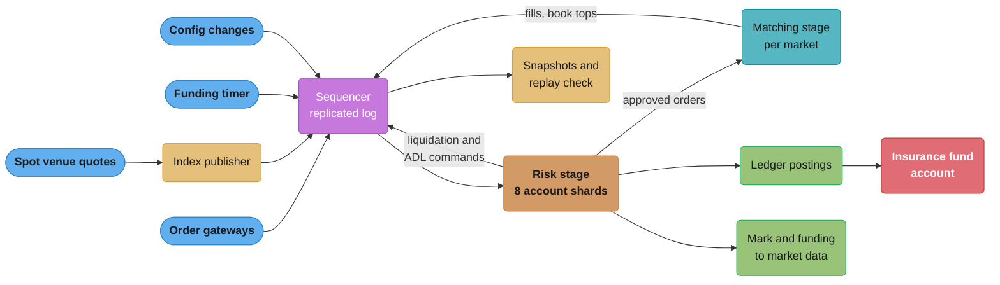
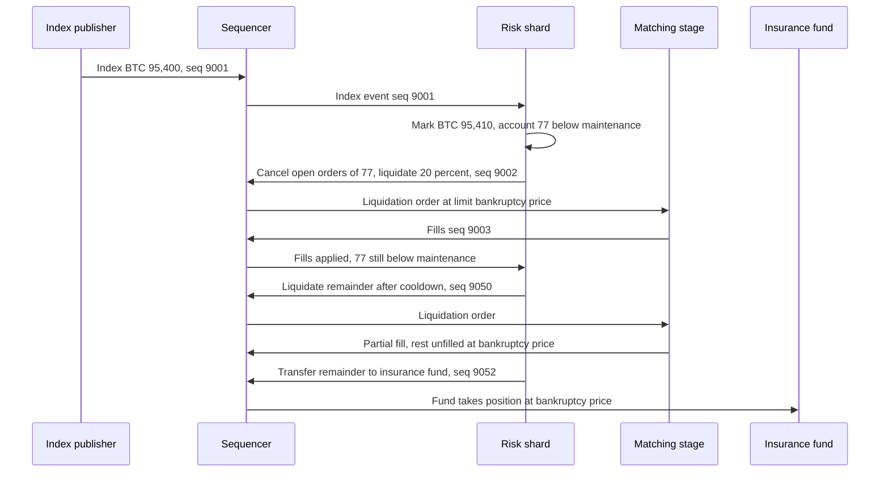
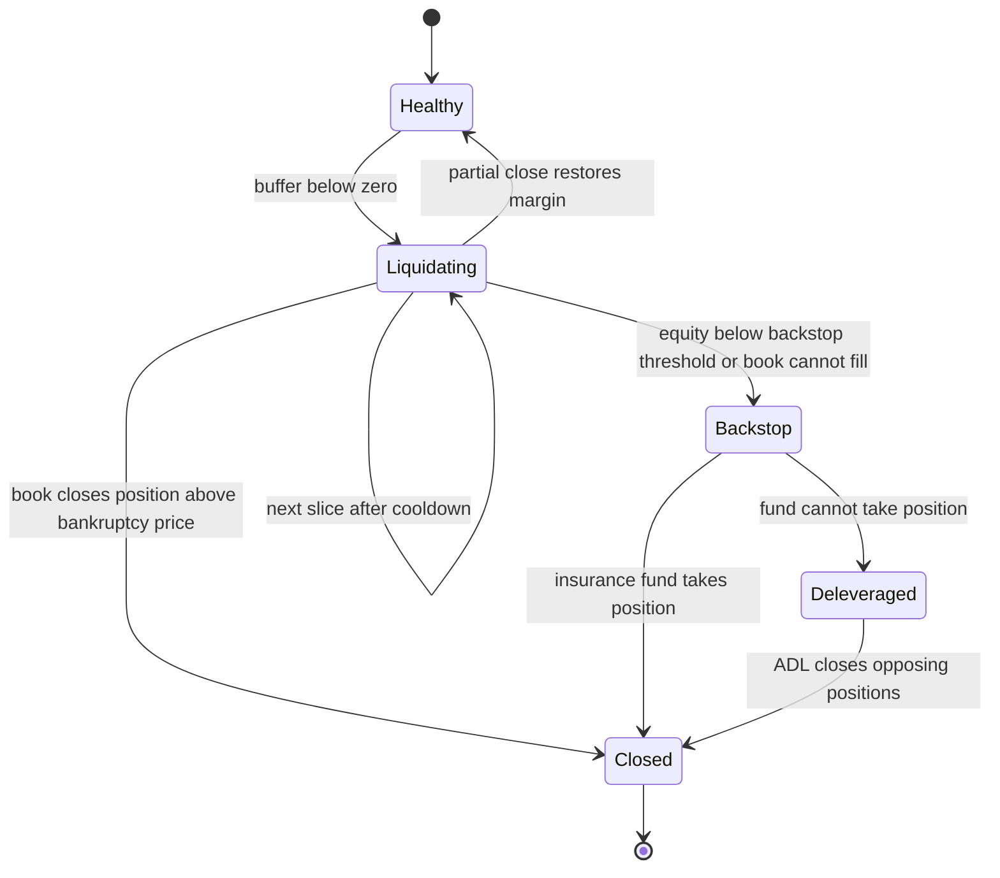
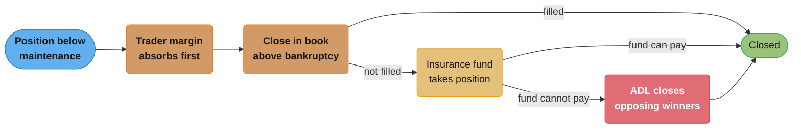

# Case Study: Design a Perpetual Futures Risk Engine

> Rules and figures checked 2026-11-06. Every date, threshold and fee on this page comes from the fact pins in fintech/CLAUDE.md or from the primary source named next to it. Mark price, the funding formula, the funding interval and ADL are venue and contract rules: this page teaches the general mechanism and cites Binance, Bybit and Hyperliquid as dated examples. Scale figures are design assumptions.

## Intuition

> **Design intuition**: A perpetual future never expires, so nothing forces its price back to the spot price. Two mechanisms do that job. Funding moves cash between longs and shorts at set times, so holding the side that is too expensive costs money. Liquidation closes any position whose margin can no longer cover a further move, so one trader's loss does not become another trader's unpaid gain. The risk engine runs both. It decides, many times a second, which accounts are still solvent, and it must reach the same decision on every replica and on every replay, because a liquidation is a trade that real people's money depends on.

The matching side of the venue is already in the repo. [Design a Stock Exchange](../../hld/case_studies/design_stock_exchange.md) owns the sequencer, single writer per symbol, snapshot plus delta and the venue's order gateway. [Order Books and Matching Engines](../order_books_and_matching_engines/order_books_and_matching_engines.md) owns the book structures and matching algorithms. [Margin, Liquidation and Derivatives Risk](../margin_liquidation_and_derivatives_risk/margin_liquidation_and_derivatives_risk.md) owns the general margin models (isolated, cross and portfolio) and the loss-waterfall decision. This study repeats none of that. It designs the component that sits beside the sequencer: how index and mark prices enter it, how it finds the few accounts near liquidation among 2 million positions, how funding settles with exact conservation, how the insurance fund and ADL take the losses that the book cannot, and how all of it replays to the same result.

The specific question: **what must the risk engine of a crypto derivatives venue look like to run 500 perpetual markets with 2 million open positions, settle funding at each interval to the last micro-unit, start a liquidation within 100 ms of a mark price crossing, and replay a full day of input to a bit-identical state?**

**Key insight for this design**: the risk engine is part of the replicated state machine, not a service that watches it. If it reads a price feed directly, or reads the wall clock to decide when funding is due, two replicas liquidate different accounts and a replay cannot explain a past liquidation. So every input enters as a sequenced event (index quotes, funding boundaries, configuration changes), and every action leaves as a sequenced command (liquidation orders, ADL fills, funding postings). The rest of the design is about making those deterministic steps fast enough.

Everything here builds on: [Exchange Architecture and Determinism](../exchange_architecture_and_determinism/exchange_architecture_and_determinism.md), [Margin, Liquidation and Derivatives Risk](../margin_liquidation_and_derivatives_risk/margin_liquidation_and_derivatives_risk.md), [Double-Entry Ledger Design](../double_entry_ledger_design/double_entry_ledger_design.md), [Money Representation and Currency](../money_representation_and_currency/money_representation_and_currency.md), [Crypto Custody and On-Chain Operations](../crypto_custody_and_onchain_operations/crypto_custody_and_onchain_operations.md), and the two cross-cutting files [Money Movement Invariants](cross_cutting/money_movement_invariants.md) and [Business Days, Cut-offs and Value Dates](cross_cutting/business_days_cutoffs_and_value_dates.md).

---

## 1. Requirements Clarification

### Functional Requirements

- **Contracts.** 500 linear perpetual markets, each quoted and margined in one stablecoin (USDT in this design). Position size is in the base asset with a per-market lot size. All markets trade 24 hours a day, 7 days a week.
- **Margin modes.** Each position is isolated (its own margin) or cross (shares the account's balance with the account's other cross positions). The margin models themselves are owned by the margin module. This engine runs them.
- **Risk limit tiers.** Maintenance margin rate and maximum leverage depend on position notional, in tiers per market.
- **Pre-trade check.** Every order that increases exposure reserves initial margin before it reaches the matching stage.
- **Index and mark price.** The engine computes an index price per market from several spot venues and a mark price from the index and the venue's own book. Margin, liquidation and unrealized PnL use the mark price, never the last trade price.
- **Funding.** At each funding boundary, the engine computes the rate per market and moves cash between longs and shorts. Intervals are per contract: 8 hours by default, shorter for some contracts.
- **Liquidation.** When an account's equity falls below maintenance margin, the engine cancels its open orders and closes the position through the book, in parts for large positions.
- **Insurance fund and ADL.** A position that the book cannot close above its bankruptcy price goes to the insurance fund. When the fund cannot take it, ADL closes opposing profitable positions at a defined price.
- **Ledger.** Every cash movement (funding, realized PnL, fees, liquidation results, ADL) posts as a balanced journal entry.
- **Replay.** The engine's state after any sequence number is a pure function of the snapshot before it and the events since.

### Non-Functional Requirements

All figures are design assumptions.

- 600,000 accounts with open positions, 2 million positions, 80% of them cross margin.
- 500 index updates per second (one per market per second).
- 40,000 trades per second at peak, 4,000 on average.
- Liquidation start within 100 ms of the mark event that crosses the threshold, p99.
- Funding settlement for all positions in a market inside one sequenced batch, with the sum of postings exactly zero.
- Recovery of a failed shard from snapshot plus log in under 60 seconds.
- Replay of a full day's log on one machine in under 30 minutes.

### Out of Scope (and where it lives instead)

| Topic | Where it lives |
|---|---|
| Sequencer replication, failover models, deterministic simulation in general | [Exchange Architecture and Determinism](../exchange_architecture_and_determinism/exchange_architecture_and_determinism.md), [Consensus Algorithms](../../hld/consensus_algorithms/consensus_algorithms.md) |
| Order book, matching algorithm, self-trade prevention | [Order Books and Matching Engines](../order_books_and_matching_engines/order_books_and_matching_engines.md) |
| Isolated vs cross vs portfolio margin as a decision, the loss waterfall as a decision | [Margin, Liquidation and Derivatives Risk](../margin_liquidation_and_derivatives_risk/margin_liquidation_and_derivatives_risk.md) |
| Market data fan-out of mark price and funding to clients | [Market Data Feeds and Multicast](../market_data_feeds_and_multicast/market_data_feeds_and_multicast.md) |
| Deposits, withdrawals, wallets and proof of reserves | [Crypto Custody and On-Chain Operations](../crypto_custody_and_onchain_operations/crypto_custody_and_onchain_operations.md) |
| Hot-path latency engineering (kernel bypass, core pinning) | [Low-Latency Trading Systems](../low_latency_trading_systems/low_latency_trading_systems.md) |

---

## 2. Scale Estimation

### Position and account state

```
Accounts with positions        600,000   (assumption)
Open positions               2,000,000   (given)
Markets                            500   (given)
Largest market share               15%   (assumption: BTC)
Positions in the largest market    300,000

Bytes per position                 128   (market, side, size, entry, margin, tier, flags)
Bytes per account                  256   (balance, cross aggregates, buffer, open-order margin)
Position state      2,000,000 x 128 = 256 MB
Account state         600,000 x 256 = 154 MB
Liquidation index   2,000,000 x 48  =  96 MB  (isolated by price, cross by buffer)
Total hot state                     about 0.5 GB
```

Half a gigabyte fits in memory on one machine with room for a second copy. The constraint is not memory. It is the amount of work each mark event creates.

### Work per mark event

A mark price change for market m changes the unrealized PnL of every position in m. For a cross account, that changes the account's equity and so its distance to liquidation.

```
Mark events                500/s (one per market per second)
Position touches per second   sum over markets of positions x 1/s = 2,000,000/s
Cost per touch                25 ns  (assumption: array of structs, no allocation)
CPU                           2,000,000 x 25 ns = 50 ms per second = 5% of one core
Largest market alone          300,000 x 25 ns = 7.5 ms per BTC mark event
```

7.5 ms per BTC mark event is inside the 100 ms liquidation budget, but it is not free. If the venue moves to 10 mark events per second for BTC, the BTC work alone is 75 ms per second. Section 4.2 shows how incremental aggregates and a sorted liquidation index cut the per-event work to the positions that matter.

### Funding

```
Positions settled per interval       2,000,000
Postings per interval                2,000,000 + 4,000 (one rounding line per market per shard)
8-hour interval                      3 intervals a day   = 6 M postings/day
Worst case, every market hourly      24 intervals a day  = 48 M postings/day
Bytes per posting                    96
Worst case per day                   48 M x 96 B = about 4.6 GB
```

### Log and replay

```
Input events per day        2,000,000,000   (assumption: orders, cancels, trades, index, admin)
Bytes per event             100
Log per day                 about 200 GB
Shards                      8 (by account id)
Events per shard per day    all market-wide events + its accounts' events, about 400 M
Replay rate per shard       5 M events/s (assumption, single thread)
Replay time per shard       400 M / 5 M = 80 s, plus log read
Snapshot interval           10 minutes
Recovery replay             at most 10 min of events, under 5 s at replay rate
```

---

## 3. High-Level Architecture



The sequencer gives every input one total order. The index publisher, the funding timer and the configuration service do not talk to the risk stage directly. They submit events to the sequencer, like order gateways do. The risk stage reads the log, keeps margin state for its shard of accounts, and approves or rejects each order before the matching stage sees it. The matching stage's fills and top-of-book snapshots go back into the log, so the risk stage sees each fill at a known sequence number and the mark price can use the book without a side channel.

The risk stage is sharded by account id, because cross margin ties all of an account's positions together. Market-wide events (index updates, book tops, funding boundaries) go to all 8 shards. An order or fill goes to the shard of each account it touches. A liquidation command that a shard emits goes back through the sequencer, so the matching stage processes it at a sequence number that every replica agrees on.

### A liquidation, end to end



---

## 4. Component Deep Dives

### 4.1 Index price and mark price

**Index price.** The index is the engine's view of the spot price. It is a median-based average of quotes from several spot venues. Each constituent quote is an input with a timestamp. The design rules are general:

- Drop a constituent whose quote is older than a limit (10 seconds here, an assumption).
- Drop a constituent that is too far from the median of the rest (1% here, an assumption), so one bad venue cannot move the index.
- Require a minimum number of constituents (3 here). Below that, the index is "degraded" and the mark price uses its fallback.
- Compute the result in integer micro-units. Two replicas that average `double` values in a different order can differ in the last bit, and a last-bit difference can decide whether a position is liquidated.

The index publisher collects the quotes outside the state machine, then submits one index event per market per second that carries all the quotes it used. The risk stage computes the index from that event. The calculation runs inside the replicated state machine, so every replica gets the same number, and a replay six months later shows why a price was what it was.

```java
import java.util.Arrays;
import java.util.List;
import java.util.OptionalLong;

public class IndexPrice {
    record Quote(String venue, long pxMicro, long tsMillis) {}

    static final long MAX_AGE_MILLIS = 10_000;
    static final long BAND_PPM = 10_000;
    static final int MIN_SOURCES = 3;

    static OptionalLong index(List<Quote> quotes, long eventMillis) {
        long[] fresh = quotes.stream()
                .filter(q -> eventMillis - q.tsMillis() <= MAX_AGE_MILLIS)
                .mapToLong(Quote::pxMicro).sorted().toArray();
        if (fresh.length < MIN_SOURCES) return OptionalLong.empty();
        long mid = median(fresh);
        long[] kept = Arrays.stream(fresh)
                .filter(p -> Math.abs(p - mid) * 1_000_000 <= mid * BAND_PPM)
                .toArray();
        return kept.length < MIN_SOURCES ? OptionalLong.empty() : OptionalLong.of(median(kept));
    }

    static long median(long[] sorted) {
        int n = sorted.length;
        return n % 2 == 1 ? sorted[n / 2] : Math.floorDiv(sorted[n / 2 - 1] + sorted[n / 2], 2);
    }

    public static void main(String[] args) {
        long t = 1_788_595_200_000L;
        var quotes = List.of(
                new Quote("A", 100_010_000_000L, t - 400),
                new Quote("B", 100_000_000_000L, t - 900),
                new Quote("C", 99_990_000_000L, t - 300),
                new Quote("D", 92_000_000_000L, t - 200),
                new Quote("E", 100_020_000_000L, t - 60_000));
        var idx = index(quotes, t);
        System.out.println("index " + idx.getAsLong());
        assert idx.getAsLong() == 100_000_000_000L;
        assert index(quotes.subList(3, 5), t).isEmpty();
    }
}
```

Venue E is 60 seconds old and drops out. Venue D is 8% below the others and drops out of the band. The index is the median of A, B and C. The age check uses `eventMillis`, the timestamp in the sequenced event, not `System.currentTimeMillis()`. Section 4.7 shows what goes wrong otherwise.

**Mark price.** The mark price is the price the engine uses for margin and liquidation. It starts from the index and adds a measure of where the venue's own contract trades, with limits so that a short spike on the venue's book cannot trigger liquidations. Each venue defines its own formula. Two dated examples:

| Venue | Mark price rule | Source |
|---|---|---|
| Bybit | Median of Price 1, Price 2 and the last traded price. Price 1 is the index times (1 + last funding rate x time to funding / 8). Price 2 uses a 2.5-minute moving average of the mid minus the index. If an index source is abnormal or data is too thin, the mark falls back to Bybit's last traded price | Bybit help center, updated 2026-09-04 |
| Hyperliquid | Liquidations use the mark price, which combines external CEX prices with Hyperliquid's book state | Hyperliquid docs, read 2026-11-06 |

The median in Bybit's rule is the defense: one component that spikes cannot move the median alone. The fallback rule is the other half of the design. When the index is degraded, the venue still needs a mark price, and the fallback must be a written rule that the risk stage applies from sequenced data, not an operator's choice in the middle of an incident.

In this design the mark is `median(index plus funding basis, index plus smoothed book basis, last trade)`, with the smoothed basis computed from the top-of-book snapshots that the matching stage writes into the log once a second per market (assumption). The mark is clamped to within 0.5% of the index (assumption) unless the index is degraded.

### 4.2 Margin, buffers and the liquidation index

For a linear contract, a position of size q (positive long, negative short) with entry price E has unrealized PnL `q x (mark - E)`. Its maintenance requirement is `|q| x mark x mmr`, where `mmr` is the maintenance margin rate for its tier.

For an **isolated** long with margin M and no fees, the liquidation price and the bankruptcy price have closed forms:

```
equity(P)         = M + q x (P - E)
maintenance(P)    = q x P x mmr
liquidation price = (q x E - M) / (q x (1 - mmr))     where equity = maintenance
bankruptcy price  = E - M / q                          where equity = 0
```

A worked example with illustrative numbers: entry 100,000, size 1, margin 5,000 (20x leverage), and `mmr` 0.5%.

```
price
100,000.00  |=== entry
            |
            |    the position is healthy in this range
            |
 95,477.39  |--- liquidation price: equity = maintenance = 477.39
            |    the liquidation must close the position in this 477.39 gap
 95,000.00  |--- bankruptcy price: equity = 0
            |    below this line every unit of price is a loss the trader cannot pay
            v
```

The gap between the two prices is what the liquidation has to work with. If the book closes the position anywhere above 95,000, the trader's remaining margin covers the loss, and what is left of the 477.39 goes back to the trader or to the insurance fund, by venue rule. If the book is thin and the fill comes in below 95,000, the shortfall is a loss that someone else pays. A higher `mmr` widens the gap and makes liquidations safer for the venue and more expensive for traders.

```java
import java.math.BigDecimal;
import java.math.MathContext;
import java.math.RoundingMode;
import java.util.Comparator;
import java.util.List;

public class RiskMath {
    record IsolatedLong(BigDecimal entry, BigDecimal qty, BigDecimal margin, BigDecimal mmRate) {
        BigDecimal bankruptcyPrice() {
            return entry.subtract(margin.divide(qty, MathContext.DECIMAL128)).setScale(2, RoundingMode.CEILING);
        }
        BigDecimal liquidationPrice() {
            BigDecimal num = qty.multiply(entry).subtract(margin);
            BigDecimal den = qty.multiply(BigDecimal.ONE.subtract(mmRate));
            return num.divide(den, 2, RoundingMode.CEILING);
        }
    }

    record AdlCandidate(long account, BigDecimal pnlPct, BigDecimal effLeverage) {
        BigDecimal rank() {
            return pnlPct.signum() >= 0
                    ? pnlPct.multiply(effLeverage)
                    : pnlPct.divide(effLeverage, 8, RoundingMode.HALF_EVEN);
        }
    }

    static List<AdlCandidate> adlQueue(List<AdlCandidate> opposite) {
        return opposite.stream()
                .sorted(Comparator.comparing(AdlCandidate::rank).reversed()
                        .thenComparingLong(AdlCandidate::account))
                .toList();
    }

    public static void main(String[] args) {
        var pos = new IsolatedLong(new BigDecimal("100000"), BigDecimal.ONE,
                new BigDecimal("5000"), new BigDecimal("0.005"));
        System.out.println("liquidation " + pos.liquidationPrice() + ", bankruptcy " + pos.bankruptcyPrice());
        assert pos.liquidationPrice().compareTo(new BigDecimal("95477.39")) == 0;
        assert pos.bankruptcyPrice().compareTo(new BigDecimal("95000.00")) == 0;

        var queue = adlQueue(List.of(
                new AdlCandidate(31, new BigDecimal("2.00"), new BigDecimal("2")),
                new AdlCandidate(30, new BigDecimal("0.50"), new BigDecimal("10")),
                new AdlCandidate(32, new BigDecimal("0.40"), new BigDecimal("10")),
                new AdlCandidate(33, new BigDecimal("-0.20"), new BigDecimal("4"))));
        queue.forEach(c -> System.out.println("account " + c.account() + " rank " + c.rank()));
        assert queue.getFirst().account() == 30;
        assert queue.getLast().account() == 33;
    }
}
```

The liquidation price rounds with `CEILING` for a long: rounding toward the entry price liquidates a fraction of a cent earlier, never later. The ADL part of this fence belongs to section 4.6.

**Finding the accounts near liquidation.** The naive loop checks every position on every mark event. Section 2 shows that this costs 7.5 ms per BTC event, and it grows with the mark rate. The design uses two structures:

| Position kind | Structure | Work per mark event |
|---|---|---|
| Isolated | Per market and side, a sorted map from liquidation price to position ids. The liquidation price changes only when the position or its margin changes, not when the mark moves | Walk the map from the extreme up to the new mark: O(log n + k), where k is the number of positions that crossed |
| Cross | Per account, a buffer = equity - maintenance, kept up to date incrementally. A mark change of d in market m changes the buffer by `q x d - abs(q) x d x mmr` for each position in m | O(positions of m held in cross accounts) with no allocation. Accounts whose buffer goes below 0 become candidates |

The cross update is linear in the price change, so the engine keeps, per account and market, the sum of `q` and the sum of `abs(q) x mmr`, and the buffer update per mark event is two multiplies per account that holds market m. A tier change (position notional crosses into a higher `mmr` tier) changes the coefficients, and the engine recomputes that account in full when it happens.

### 4.3 Funding: the mechanism, two venues, and exact settlement

Funding pulls the perpetual's price toward the index. If the contract trades above the index, the funding rate is positive and longs pay shorts. If it trades below, shorts pay longs. The venue is not a party to the payment: funding is paid between longs and shorts.

The general shape of the rate is a **premium** (how far the contract trades from the index, averaged over the interval), plus an **interest** term, with the difference clamped, and the result capped. Each venue sets the parameters per contract.

| Item | Binance USD-margined (updated 2026-03-06) | Hyperliquid (read 2026-11-06) |
|---|---|---|
| Interval | Every 8 h by default, at 00:00, 08:00 and 16:00 UTC. A contract that hits its cap or floor can switch to 1 h settlement (from 2025-05-02). An hourly contract reverts to 4 h after 16 cycles at an absolute rate of 0.025% or less (from 2026-01-02) | Paid every hour, at one eighth of the computed 8-hour rate |
| Formula | F = [P + clamp(I - P, -0.05%, +0.05%)] / (8/N), where P is the average premium index and N the interval in hours | F = P + clamp(interest rate - P, -0.0005, 0.0005). The premium is sampled every 5 seconds and averaged over the hour |
| Interest | 0.01% per 8 h by default | 0.01% every 8 hours |
| Cap | Plus or minus 0.75 x maintenance margin ratio for major contracts, plus or minus 2% for others | 0.5% per hour |
| Notional for the payment | Contract rule | Position size x oracle price, not the mark price |

A worked example of Binance's 8-hour formula with the default interest I = 0.01%:

| Average premium P | I - P | Clamped | Funding rate F |
|---|---|---|---|
| 0.003% | 0.007% | 0.007% | 0.010% |
| 0.100% | -0.090% | -0.050% | 0.050% |
| -0.040% | 0.050% | 0.050% | 0.010% |

In a quiet market the rate sits at the interest rate, because the clamp absorbs small premiums. A 1 BTC long at an illustrative price of 100,000 USDT pays 10 USDT per 8 hours at 0.01%.

**When a boundary is "now".** Funding is due at a timestamp, for example 08:00:00 UTC. In this design the funding timer submits a `FundingTick` event to the sequencer at that time. The tick carries the rate inputs, and the risk stage settles every open position at the tick's sequence number. A position opened at sequence number tick + 1 does not pay. A position closed at tick - 1 does not pay. The rule is "open at the tick's sequence number", which every replica can evaluate, not "open at 08:00:00.000", which depends on clocks. Perpetual markets run 24/7 with UTC boundaries and no holidays, so the business-day rules in [Business Days, Cut-offs and Value Dates](cross_cutting/business_days_cutoffs_and_value_dates.md) do not apply to funding. They do apply to the bank and stablecoin rails that fund the accounts.

**Exact settlement.** Funding is a transfer. The sum of everything longs pay must equal the sum of everything shorts receive, and each payment must round to the ledger's unit. Rounding each payment on its own breaks the sum.

#### BROKEN: round each payment in `double`

```java
// BROKEN
public class BrokenFunding {
    public static void main(String[] args) {
        double markPx = 97_531.17;
        double rate = 0.0001;
        double[] longs = {0.100, 0.900};
        double[] shorts = {0.107, 0.893};
        long paidCents = 0, receivedCents = 0;
        for (double q : longs) paidCents += Math.round(q * markPx * rate * 100);
        for (double q : shorts) receivedCents += Math.round(q * markPx * rate * 100);
        System.out.println("longs pay " + paidCents + " cents, shorts receive " + receivedCents + " cents");
    }
}
```

Open interest is 1.000 on each side, so the payments must match. The program prints `longs pay 976 cents, shorts receive 975 cents`. One cent leaves the longs and arrives nowhere. With the signs the other way round, a cent arrives from nowhere. Across 2 million positions, three or 24 times a day, the drift is a reconciliation break that grows without end, and in the second case it is money the venue does not have.

#### FIX: integer micro-units, round against the payer, and a rounding account

```java
import java.math.BigDecimal;
import java.math.RoundingMode;
import java.util.ArrayList;
import java.util.List;

public class Funding {
    record Position(long account, long qtyMilli) {}
    record Posting(long account, long micro) {}

    static final long INSURANCE_FUND = 0;
    static final BigDecimal MICRO_PER_UNIT = BigDecimal.valueOf(1_000_000);

    static List<Posting> settle(List<Position> positions, BigDecimal px, BigDecimal rate) {
        var out = new ArrayList<Posting>();
        long net = 0;
        for (var p : positions) {
            BigDecimal qty = BigDecimal.valueOf(p.qtyMilli(), 3);
            BigDecimal exact = qty.multiply(px).multiply(rate).multiply(MICRO_PER_UNIT).negate();
            boolean pays = exact.signum() < 0;
            long micro = exact.setScale(0, pays ? RoundingMode.UP : RoundingMode.DOWN).longValueExact();
            out.add(new Posting(p.account(), micro));
            net += micro;
        }
        out.add(new Posting(INSURANCE_FUND, -net));
        return out;
    }

    public static void main(String[] args) {
        var positions = List.of(new Position(11, 100), new Position(12, 900),
                new Position(21, -107), new Position(22, -893));
        var postings = settle(positions, new BigDecimal("97531.17"), new BigDecimal("0.0001"));
        postings.forEach(p -> System.out.println("account " + p.account() + " " + p.micro() + " micro-USDT"));
        assert postings.stream().mapToLong(Posting::micro).sum() == 0;
        assert postings.getLast().micro() >= 0;
    }
}
```

Each payment is exact in `BigDecimal`, then rounds to a micro-USDT with an explicit mode: away from zero for a payer (`UP`), toward zero for a receiver (`DOWN`). The payers always cover the receivers, and the difference is never negative. It posts to a rounding line, here the insurance fund, so the batch sums to exactly zero. In the run above, the longs pay 975,312 and 8,777,806 micro-USDT, the shorts receive 1,043,583 and 8,709,533, and the fund receives 2. The rounding rule is a venue policy: the point is that it is written down, it cannot create money, and the ledger can check it.

The ledger checks it with a constraint, not with a nightly job:

```sql
CREATE TABLE account (
    id    bigint PRIMARY KEY,
    kind  text NOT NULL CHECK (kind IN ('trader', 'insurance_fund', 'fee'))
);

CREATE TABLE posting (
    batch_id      text   NOT NULL,
    account_id    bigint NOT NULL REFERENCES account (id),
    market        text   NOT NULL,
    kind          text   NOT NULL CHECK (kind IN ('funding', 'liquidation', 'adl', 'fee')),
    amount_micro  bigint NOT NULL,
    PRIMARY KEY (batch_id, account_id)
);

CREATE FUNCTION check_batch_balanced() RETURNS trigger
LANGUAGE plpgsql AS $$
BEGIN
    IF (SELECT sum(amount_micro) FROM posting WHERE batch_id = NEW.batch_id) <> 0 THEN
        RAISE EXCEPTION 'batch % does not sum to zero', NEW.batch_id;
    END IF;
    RETURN NULL;
END $$;

CREATE CONSTRAINT TRIGGER batch_balanced
    AFTER INSERT ON posting
    DEFERRABLE INITIALLY DEFERRED
    FOR EACH ROW EXECUTE FUNCTION check_batch_balanced();

INSERT INTO account VALUES (0, 'insurance_fund'), (11, 'trader'), (12, 'trader'),
                           (21, 'trader'), (22, 'trader');
```

The trigger is deferred, so the check runs at commit, after every line of the batch is in. A batch written from the BROKEN program fails:

```sql
-- BROKEN: error
SET CONSTRAINTS ALL IMMEDIATE;
INSERT INTO posting VALUES
  ('funding:BTC:2026-09-05T08', 11, 'BTC', 'funding',   -980000),
  ('funding:BTC:2026-09-05T08', 12, 'BTC', 'funding',  -8780000),
  ('funding:BTC:2026-09-05T08', 21, 'BTC', 'funding',   1040000),
  ('funding:BTC:2026-09-05T08', 22, 'BTC', 'funding',   8710000);
```

The batch sums to -10,000 micro-USDT and the insert raises `batch funding:BTC:2026-09-05T08 does not sum to zero`. The batch from the FIX program commits:

```sql
INSERT INTO posting VALUES
  ('funding:BTC:2026-09-05T08', 11, 'BTC', 'funding',  -975312),
  ('funding:BTC:2026-09-05T08', 12, 'BTC', 'funding', -8777806),
  ('funding:BTC:2026-09-05T08', 21, 'BTC', 'funding',  1043583),
  ('funding:BTC:2026-09-05T08', 22, 'BTC', 'funding',  8709533),
  ('funding:BTC:2026-09-05T08',  0, 'BTC', 'funding',        2);

SELECT batch_id, count(*) AS lines, sum(amount_micro) AS total
  FROM posting GROUP BY batch_id;
```

The batch id names the market and the interval, so a second write of the same funding batch fails on the primary key. Funding settlement is idempotent by construction: a replay or a retried write cannot pay twice. [Double-Entry Ledger Design](../double_entry_ledger_design/double_entry_ledger_design.md) owns balanced entries in general. The insurance fund account takes the rounding line of every market batch, so it is a hot account at each boundary: 500 lines at once, one per market, and 4,000 once each shard writes its own batch (section 5). That is why the rounding line is one row per batch, not one per position.

### 4.4 The liquidation engine

When an account's buffer goes below zero, the account moves through a fixed set of states. Each transition happens at a sequence number, so every replica moves the same account at the same point.



The steps inside `Liquidating`:

1. **Cancel open orders.** The account's resting orders hold initial margin. Canceling them frees margin and can restore the buffer by itself. The cancel goes through the sequencer like any other cancel.
2. **Recompute.** If the buffer is still below zero after the cancels apply, the engine sends a liquidation order.
3. **Close in slices.** A large position sent to the book at once can sweep many price levels and push the mark down, which liquidates the next account. So a large position closes in parts with a pause between them. Hyperliquid's documentation, read 2026-11-06, gives one concrete rule: for positions larger than 100k USDC, only 20% goes to the book as a market liquidation order, and after a block in which any position of a user is partially liquidated, there is a 30-second cooldown.
4. **Limit the price.** Each liquidation order is an immediate-or-cancel order with a limit at the bankruptcy price. It never fills below the price at which the trader's equity is zero. Whatever the book cannot fill at that price goes to the backstop.
5. **Backstop.** The insurance fund, or a backstop liquidity provider, takes the remaining position at the bankruptcy price. Hyperliquid's rule: if equity falls below 2/3 of maintenance margin and the book liquidation fails, its liquidator vault can take over the position, and the maintenance margin is not returned to the user.

Maintenance margin rates come from risk limit tiers. Hyperliquid documents one simple form: maintenance margin is half of the initial margin at the asset's maximum leverage, which ranges from 3x to 40x, so maintenance margin is between 1.25% and 16.7% (Hyperliquid docs, read 2026-11-06). This design uses tiers per market, configured by sequenced admin events, so a tier change applies at a known sequence number.

**Liquidation orders are commands, not side effects.** The risk shard does not call the matching stage. It emits `Liquidate(account, market, qty, limit)` into the sequencer. The matching stage sees it at a sequence number between other orders, and every replica sees the same interleaving. The risk shard also does not assume the order filled. It waits for the fills to come back through the log, then recomputes the buffer.

### 4.5 The insurance fund and the loss waterfall

The waterfall is the order in which losses are absorbed. The [Margin, Liquidation and Derivatives Risk](../margin_liquidation_and_derivatives_risk/margin_liquidation_and_derivatives_risk.md) module owns it as a decision. This is how the risk engine runs it:



Binance describes its fund this way: the insurance fund absorbs the losses of bankrupt positions it takes over, and it keeps the profits from them (Binance insurance fund FAQ). So a liquidation that closes above the bankruptcy price adds to the fund, and one that closes below takes from it. Over a quiet month the fund grows. In a fast market it can fall quickly.

Design choices for the fund in this engine:

| Choice | This design | Why |
|---|---|---|
| One fund or one per market | One per market group (assumption: majors, mid caps, long tail) | A crash in a long-tail market must not drain the fund that backs BTC |
| Fund as a ledger account | Yes, an ordinary account with kind `insurance_fund` | Every inflow and outflow is a balanced posting, so reconciliation covers it |
| When the fund takes a position | At the bankruptcy price, as a sequenced transfer | The trader's equity is then exactly zero, and the fund owns the position and its later PnL |
| What the fund does with a position | Closes it through the book over time, with its own limits | The fund is a trader with no margin call. It still needs a slicing rule |
| Fund floor | ADL starts when the fund for the group is below its floor (assumption: 0) or cannot take the size | The rule must be computable from state, not an operator decision mid-incident |

### 4.6 ADL ranking

ADL is not liquidation. It is the venue-defined final step of the liquidation process, after the insurance fund. When the fund cannot take a bankrupt position, the engine closes positions on the other side, which are in profit, against it. Binance calls the forced close "ADL liquidation".

Two dated examples of the ranking and the price:

| Venue | When it runs | Rank | Price |
|---|---|---|---|
| Binance (ADL FAQ updated 2026-01-13) | Only if the insurance fund cannot take over a bankrupt position | `PnL% * effective_leverage` when PnL% is 0 or more, `PnL% / effective_leverage` when PnL% is negative. Highest rank first | The bankruptcy price of the bankrupt position, with no fee |
| Hyperliquid (docs read 2026-11-06) | When a user's account value, or an isolated position's value, becomes negative | Sorting index `(mark_price / entry_price) x (notional_position / account_value)`, which ranks by unrealized PnL and position size against account value | The previous mark price, against the underwater user |

Both put the opposing positions with the largest profit and the highest leverage first. The loss goes to the traders with the largest gains and the largest exposure to the move. The `RiskMath` fence in section 4.2 implements Binance's rank. Its output shows the two rules a production queue needs: account 30 (PnL 50%, `effective_leverage` 10, rank 5.00) goes before account 31 (PnL 200%, `effective_leverage` 2, rank 4.00), and account 31 goes before account 32 at the same rank 4.00 only because the tie-break orders by account id. Without an explicit tie-break, the order of equal ranks depends on the sort's input order, and two replicas that built the candidate list from different map iteration orders would deleverage different traders.

**Keeping the queue cheap.** ADL is rare, and the ranking depends on the mark price, so the engine does not maintain a fully sorted queue on every mark event. It keeps a bucketed index per market and side (5 buckets by rank quantile, assumption) that it refreshes once a second for display, and it computes the exact ranking for one market and side only when ADL starts. The exact ranking for the largest side of the largest market is 150,000 positions, which sorts in a few milliseconds.

**Telling traders.** Venues show an ADL indicator per position (for example the bucket) so that a trader near the front of the queue can reduce risk. In this design the indicator is the bucket from the once-a-second refresh, published with the mark price.

### 4.7 Determinism beside the sequencer

The [Exchange Architecture and Determinism](../exchange_architecture_and_determinism/exchange_architecture_and_determinism.md) module owns the general rules for a deterministic state machine. Four of them decide whether this engine works, and each one has a failure that shows up only on replay or failover:

| Rule | What breaks without it |
|---|---|
| Time comes from the event, never the clock | Funding settles at a different sequence number on replay, so balances differ |
| Iterate in a defined order (sorted maps, explicit tie-breaks) | ADL and liquidation order differ between replicas |
| No floating point in any value that feeds a decision | A last-bit difference flips a liquidation |
| External data enters only as sequenced events | A replica that read a feed directly sees a different index |

The clock rule is the one most often broken, because "is funding due?" reads so naturally as a clock check.

#### BROKEN: ask the clock whether funding is due

```java
// BROKEN
import java.time.Instant;
import java.util.List;

public class BrokenReplay {
    record Event(long seq, long tsMillis) {}

    static final long FUNDING_AT = Instant.parse("2026-09-05T08:00:00Z").toEpochMilli();

    static long fundingBeforeSeq(List<Event> log) {
        for (var e : log)
            if (System.currentTimeMillis() >= FUNDING_AT) return e.seq();
        return -1;
    }

    public static void main(String[] args) {
        var log = List.of(new Event(1, FUNDING_AT - 300), new Event(2, FUNDING_AT - 200),
                new Event(3, FUNDING_AT - 100), new Event(4, FUNDING_AT + 100));
        System.out.println("replay settles funding before seq " + fundingBeforeSeq(log));
    }
}
```

Live, on 2026-09-05, the clock crossed 08:00:00 between events 3 and 4, so funding settled before event 4. Any later replay prints `replay settles funding before seq 1`, because the clock is already past the boundary. Positions opened by events 1 to 3 paid funding on the primary and do not pay on the replay. Two replicas started a few milliseconds apart can also disagree on the live run.

#### FIX: the boundary is an event in the log

```java
import java.util.List;
import java.util.TreeMap;

public class Replay {
    sealed interface Event permits Trade, FundingTick {}
    record Trade(long seq, long buyer, long seller, long qtyMilli) implements Event {}
    record FundingTick(long seq, long rateE8, long pxMicro) implements Event {}

    static final class Engine {
        final TreeMap<Long, Long> qtyMilli = new TreeMap<>();
        final TreeMap<Long, Long> cashMicro = new TreeMap<>();
        long fundingSeq = -1;

        void on(Event e) {
            switch (e) {
                case Trade t -> {
                    qtyMilli.merge(t.buyer(), t.qtyMilli(), Long::sum);
                    qtyMilli.merge(t.seller(), -t.qtyMilli(), Long::sum);
                }
                case FundingTick f -> {
                    fundingSeq = f.seq();
                    qtyMilli.forEach((acct, q) -> cashMicro.merge(acct,
                            -Math.multiplyExact(q * f.pxMicro() / 1000, f.rateE8()) / 100_000_000L, Long::sum));
                }
            }
        }

        String state() { return "funding@" + fundingSeq + " qty=" + qtyMilli + " cash=" + cashMicro; }
    }

    static String run(List<Event> log) {
        var engine = new Engine();
        log.forEach(engine::on);
        return engine.state();
    }

    public static void main(String[] args) {
        List<Event> log = List.of(new Trade(1, 7, 9, 1_000), new Trade(2, 7, 9, 500),
                new FundingTick(3, 10_000, 100_000_000_000L), new Trade(4, 9, 7, 1_500));
        String live = run(log);
        String replayed = run(log);
        assert live.equals(replayed);
        System.out.println(live);
    }
}
```

The funding timer submits the `FundingTick` at 08:00:00, and the sequencer gives it a number. Every replica and every replay settles funding at that number. The state is two `TreeMap`s, so iteration order is the key order on every JVM. The amounts in this example divide exactly. The production settlement uses the rounding rule from section 4.3.

**Checking replicas.** Every shard computes a hash of its state at each funding tick (accounts, positions and the insurance fund balance in key order) and emits it as a sequenced event. A replica that computes a different hash at the same sequence number stops and alerts. The tick is a good checkpoint because it touches every position, so a divergence anywhere in the shard shows up within one interval. The same check runs in CI: replay a captured day through the old and the new build and compare the hashes at each tick.

---

## 5. Design Decisions & Tradeoffs

### Decision 1: the risk stage inside the sequenced pipeline, not a separate service

| Factor | Inside the pipeline (this design) | Separate service that watches fills |
|---|---|---|
| Pre-trade margin check | Same state, same thread, no race with fills | Reads a copy that lags the book |
| Liquidation trigger | At a sequence number every replica agrees on | At wall-clock time on one instance |
| Replay of an incident | Exact | Approximate: the service's view at the time is lost |
| Latency on the order path | Adds the risk check (microseconds) to every order | None on the order path |
| Failure blast radius | A risk bug stops trading | A risk bug misses liquidations while trading goes on |

A venue that lends margin cannot let trading continue while risk is wrong, so the coupling is the point. The LMAX architecture is the precedent for a single-threaded business logic stage on a sequenced input: Martin Fowler's description reports 6 million orders per second on one thread as a benchmark, not as production throughput.

### Decision 2: shard by account, broadcast market events

Cross margin makes the account the unit of consistency. Sharding by market would split one account's positions across shards and need a cross-shard read on every check. The cost of sharding by account is that every market-wide event goes to every shard: 500 index events and 500 book-top events per second, small and cheap. Funding ticks also go to every shard, and each shard settles its own accounts' positions.

A consequence: one funding batch per market becomes 8 shard batches per market. Each shard's batch must sum to zero by itself, so each shard has its own rounding line to the insurance fund, and the fund receives 8 small credits per market per interval.

### Decision 3: mark price construction

| Option | Manipulation resistance | Behavior when the index is degraded |
|---|---|---|
| Last traded price | Low: one large order moves it | Unaffected |
| Index only | High against the venue's own book, exposed to spot venues | Undefined |
| Index plus a damped basis, with a median and a clamp (this design) | High: needs several components to move together | Falls back to a written rule |

### Decision 4: liquidation through the book first, then the backstop

Sending liquidations to the book gives the trader the best price and keeps the venue out of the position. In a thin market it moves the price against the next account. The design slices large positions, limits each slice at the bankruptcy price, and hands the rest to the fund. A venue with a backstop liquidity provider adds one more step between book and fund.

### Decision 5: ADL over socialized loss

The alternative to ADL is to spread a loss across all profitable traders in a market as a percentage haircut. ADL touches fewer accounts, closes positions instead of shaving balances, and gives each trader a visible queue position. This engine uses ADL.

---

## 6. Real-World Implementations

**Binance USD-margined futures.** Funding every 8 hours by default at 00:00, 08:00 and 16:00 UTC, with a switch to 1-hour settlement for a contract that hits its cap or floor (from 2025-05-02) and a return to 4 hours after 16 quiet cycles (from 2026-01-02). The formula clamps the interest-minus-premium term at plus or minus 0.05%, the default interest is 0.01% per 8 hours, and the cap is 0.75 x the maintenance margin ratio for major contracts and 2% for others (funding FAQ updated 2026-03-06). ADL runs only when the insurance fund cannot take over a bankrupt position, ranks by PnL% and `effective_leverage`, and closes at the bankruptcy price with no fee (ADL FAQ updated 2026-01-13). The adaptive interval is the part an engine designer should note: the funding interval is per contract and changes at run time, so it must be state in the engine, changed by a sequenced event.

**Bybit.** Mark price is the median of three components with a fallback to the last traded price when an index source is abnormal or data is too thin (help center, updated 2026-09-04). The median is the reusable idea: no single input can move the mark.

**Hyperliquid.** The documentation, read 2026-11-06, describes a complete liquidation pipeline: mark price from external CEX prices and the venue's book, liquidation through the book first, partial liquidation of 20% for positions over 100k USDC with a 30-second cooldown, a liquidator vault as backstop below 2/3 of maintenance margin, and ADL when an account value turns negative, ranked by a sorting index and closed at the previous mark price. Funding is paid every hour at one eighth of the computed 8-hour rate, capped at 0.5% per hour, with the oracle price used to convert size to notional.

**CME.** CME lists no perpetual futures. Its Q2 2026 earnings script says it has specifications ready but has not heard client demand (2026-07-22). CME is therefore not an example of funding or perpetual mark prices. For dated futures, CME margins energy and equity products under SPAN 2, with other products still on SPAN. The contrast is useful: a dated future converges to spot at expiry, so it needs no funding mechanism, and a clearinghouse margin model such as SPAN 2 replaces the venue's own liquidation engine with a clearing member's obligations.

**LMAX.** LMAX's single-threaded business logic processor is the reference design for running risk and matching as sequenced, replayable logic. Decision 1 gives the benchmark figure, and [Design a Stock Exchange](../../hld/case_studies/design_stock_exchange.md) covers the architecture.

---

## 7. Technologies & Tools

| Tool | Role here |
|---|---|
| Aeron Cluster | Raft-replicated log and single-threaded service model for the sequencer and the risk shards, with snapshots |
| Aeron | Low-latency transport between gateways, sequencer and shards |
| Simple Binary Encoding | Fixed-layout encoding for sequenced events, so replay reads the same bytes on every version |
| Apache Kafka | Fan-out of postings, mark prices and liquidation events to the ledger, market data and notifications, off the hot path |
| PostgreSQL 18 | Ledger of record for postings and the insurance fund, with the balanced-batch constraint |
| jqwik | Property-based tests: funding conservation, liquidation monotonicity, replay equality |
| HdrHistogram | Latency distribution from mark event to liquidation command |

[Kafka Deep Dive](../../backend/kafka_deep_dive/kafka_deep_dive.md) covers partitioned logs and `acks=all`. [Consistency Models and Consensus](../../database/consistency_models_and_consensus/consistency_models_and_consensus.md) covers the replicated state machine theory.

---

## 8. Operational Playbook

### Metrics

| Metric | Healthy | Page someone at |
|---|---|---|
| `mark_to_liquidation_ms_p99` | under 50 ms | over 100 ms |
| `index_degraded_markets` | 0 | any market degraded for over 10 s |
| `mark_index_divergence_bps` (per market) | under 20 | over 50 for 30 s |
| `funding_batch_sum_micro` | 0 | any non-zero (the constraint should make this impossible) |
| `insurance_fund_balance` (per group) vs 30-day average | above 50% | under 25% |
| `accounts_in_liquidating` | under 100 | over 1,000 |
| `adl_events` | 0 | any (inform traders and risk) |
| `replica_state_hash_mismatch` | 0 | any |

### Money movement invariants for this system

The checklist comes from [Money Movement Invariants](cross_cutting/money_movement_invariants.md).

| Invariant | DB constraint | Runtime assertion | Property test |
|---|---|---|---|
| Conservation per currency | Deferred trigger: each posting batch sums to zero | `settle()` asserts the sum including the rounding line | Random positions and rates: funding always sums to zero, fund line never negative |
| No negative available balance without a product | Trader balance cannot go below zero, a loss past bankruptcy posts to the fund | Liquidation orders carry a limit at the bankruptcy price | Random price paths: no trader ends below zero |
| Idempotent effect | `PRIMARY KEY (batch_id, account_id)`, batch id = market and interval | A second tick for the same interval is rejected | Replaying a day twice from the same snapshot gives the same state hash |
| Append-only with reversals | Postings are never updated; a busted trade posts a reversal | No update path exists in the engine | Replay reproduces every balance from postings |
| One internal transfer per external movement | Each on-chain deposit or withdrawal maps to one posting | Custody events carry the chain transaction id | Generated deposit streams with duplicates reconcile to zero breaks |
| End-to-end trace id | Liquidation and ADL postings carry the sequence number that caused them | Every command names its causing event | Each posting walks back to one sequenced input |

### Runbook: index constituents go stale

1. The metric shows a market degraded. Check which constituents dropped: the index event carries all quotes, so the log shows it.
2. If two of five venues are down, the index still has three sources and is not degraded. Watch it.
3. If the index is degraded, the mark is on its fallback rule. Do not change the rule during the incident. Liquidations continue on the fallback mark.
4. If the fallback mark diverges from other venues' prices by more than the alert, the risk desk may put the market in reduce-only mode through a sequenced admin event. That event is the only manual lever, and it is recorded.

### Runbook: the insurance fund is falling fast

1. Find the markets and the positions driving the drawdown: fund postings carry their causing sequence numbers.
2. Check the liquidation slices. If slices fill well below the mark, the book is thin: raise the cooldown or lower the slice size for that market through a sequenced config event.
3. Raise maintenance margin tiers for new positions in the affected market group, again through config.
4. If the fund reaches its floor, ADL starts by rule. Publish a notice to traders with the market and side.

### Runbook: a replica's state hash differs

1. Stop the replica. Do not promote it.
2. Find the first funding tick where the hashes differ, then bisect the events between the last matching tick and that one with a debug replay that hashes after every event.
3. The cause is almost always one of the four rules in section 4.7. Fix, deploy to both, replay from the last good snapshot, and compare hashes again before the replica rejoins.

---

## 9. Common Pitfalls & War Stories

The incidents below are illustrative. They apply this design's numbers to known failure modes and are not reports from a named venue.

**Mark price on the last trade (illustrative).** An early design used the last trade price for liquidation in a long-tail market. One trader sent a market sell of 40 times the top-of-book size. The last price fell 9% for 200 ms, and 1,100 long positions crossed their liquidation prices. Their liquidation orders hit the same thin book and pushed the price down further. The insurance fund for the group lost 14% of its balance in two minutes, and the price was back where it started 30 seconds later. The fix was the median-and-clamp mark of section 4.1.

**Funding rounding drift (illustrative).** Per-position `HALF_UP` rounding in `double` left each funding batch off by a few cents in either direction. Over 18 months at 2 million positions, the venue's funding clearing account drifted by about $41,000, and it was positive in some months and negative in others, which made it look like noise. The fix was the payer-rounds-up rule with a rounding line and the deferred balance constraint. The constraint found two more code paths with the same bug in its first week.

**A clock check settled funding twice (illustrative).** A failover promoted a replica 400 ms after an 08:00 boundary. The replica's funding check read its own clock, saw that the boundary had passed and that its "last funding" field was the previous interval (the primary's settlement was still in its unapplied tail), and settled again. 190,000 positions paid funding twice. The fix was the `FundingTick` event and the batch-id primary key, which would have rejected the second batch at the ledger.

**ADL tie-break by hash order (illustrative).** The ADL candidate list was built from a `HashMap` keyed by a position object without `hashCode`, so iteration followed identity hash codes, which differ between JVMs. During an ADL event the primary and the standby picked different traders at the same rank. The state hash at the next funding tick did not match, and the standby refused to promote. The fix was a sorted list with the account id as an explicit tie-break, as in the `RiskMath` fence.

**One fund for every market (illustrative).** A single insurance fund backed both majors and newly listed markets. A newly listed token fell 70% in an hour, and liquidations there drew 30% of the shared fund. BTC traders were then nearer to ADL than the BTC market justified. The fix was the per-group fund in section 4.5.

**Liquidating the whole position at once (illustrative).** A 2,000 BTC-equivalent position in a mid-cap market went to the book in one order. It swept 60 levels and moved the mark 3%, which liquidated 300 further accounts in the next mark event. Slicing at 20% with a cooldown, the rule Hyperliquid documents for large positions, would have spread the impact over minutes.

---

## 10. Capacity Planning

### Per-shard budget

```
Shards                                8
Accounts per shard               75,000
Positions per shard             250,000
Mark events (all markets)           500/s, broadcast
Position touches per shard      250,000/s at 25 ns = 6.3 ms/s CPU
Order checks per shard (peak)    10,000/s at 2 us = 20 ms/s CPU (assumption)
Fills applied per shard (peak)   10,000/s at 1 us = 10 ms/s CPU (assumption)
Total busy time                  about 40 ms per second = 4% of one core
```

The headroom is large on purpose. In a crash, fills, liquidations and order cancels arrive at 10 times the normal rate at the same moment as fast mark changes. At 10x the busy time is 40%, and the 100 ms liquidation budget still holds because the work is spread over each second, not queued at the end of it.

### Memory per shard

| Item | Size |
|---|---|
| Positions | 250,000 x 128 B = 32 MB |
| Accounts | 75,000 x 256 B = 19 MB |
| Isolated liquidation index | 50,000 x 48 B = 2.4 MB |
| Cross buffer aggregates | 200,000 x 32 B = 6.4 MB |
| Snapshot buffer (second copy) | about 60 MB |
| Total | about 120 MB |

### Log, snapshots and recovery

| Item | Size or time |
|---|---|
| Log per day | about 200 GB, kept hot for 7 days, then archived |
| Snapshot per shard | about 60 MB every 10 minutes |
| Recovery | load snapshot (under 1 s) plus at most 10 min of events (under 5 s) |
| Full-day replay check in CI | 8 shards in parallel, about 80 s each plus log read |

### Ledger writes

At an 8-hour interval, a funding boundary writes 2 million postings in 500 market batches across 8 shards. At 50,000 postings per second into PostgreSQL (assumption, batched `COPY` into partitioned tables), the boundary takes 40 seconds to land in the ledger of record. The risk engine's own state is already settled at the tick, so traders see the result at once. The ledger lag is a reconciliation window, not a correctness gap. If every market moves to hourly funding, the ledger takes 40 seconds of every hour, and the right next step is per-shard ledger partitions.

---

## 11. Interview Discussion Points

**Q: Why does a perpetual future need funding when a dated future does not?**
**Short:** A dated future converges to spot at expiry. A perpetual never expires, so funding payments between longs and shorts are what pull its price toward the index.

At expiry a dated future settles against spot, so its price must approach spot as expiry nears. A perpetual has no such date. Funding makes the side that trades rich pay the other side at each interval, so holding that side costs money and the price is pulled back. The payment is between longs and shorts, and the venue is not a party to it. Teach the mechanism, then cite a venue's formula with its date, because each venue sets its own.

**Q: Why liquidate on the mark price and not the last traded price?**
**Short:** The last price can be moved by one large order on a thin book. The mark price combines the index and damped book data, so a short spike cannot trigger liquidations.

If a single market order can push the last price through many liquidation prices, those liquidations push it further and the cascade feeds itself. A mark built from a multi-venue index plus a smoothed basis, with a median and a clamp, needs several inputs to move together. Bybit's rule is a dated example: the median of two index-based prices and the last trade, with a fallback when the index is abnormal. Make the fallback a written rule the engine applies from sequenced data.

**Q: How do you find the accounts near liquidation among 2 million positions on every mark update?**
**Short:** Keep isolated positions in a map sorted by liquidation price and cross accounts with an incrementally updated buffer, so each mark event touches only what changed.

An isolated position's liquidation price changes only when its size or margin changes, so a sorted map per market and side gives the crossed positions in O(log n + k). A cross account's buffer (equity minus maintenance) changes linearly with each mark, so per-account sums of size and of size times rate update it with two multiplies per held market. Recompute an account in full only when it changes tier.

**Q: Funding payments are computed per position and rounded. How do you make sure longs pay exactly what shorts receive?**
**Short:** Compute exactly, round payers away from zero and receivers toward zero, post the remainder to a rounding account, and enforce a zero-sum batch in the ledger.

Rounding each payment on its own, even correctly, does not preserve the sum, and in `double` it can also create money. With payers rounded up and receivers rounded down, payers always cover receivers, and the small non-negative remainder goes to a named account such as the insurance fund. A deferred constraint trigger rejects any batch that does not sum to zero, and a batch id of market plus interval makes a second write fail.

**Q: Why must the funding boundary be an event in the log instead of a clock check?**
**Short:** A clock check gives a different answer on replay and on each replica, so positions opened near the boundary pay on one copy and not on another.

Replayed later, a clock is always past the boundary, so funding settles at the first event. Two replicas started milliseconds apart can also disagree live. A timer that submits a FundingTick to the sequencer gives the boundary a sequence number, and "open at the tick's sequence number" is a rule every copy evaluates the same way. Apply the same rule to every time-based action: tier changes, cooldowns and expiry of orders.

**Q: What are the liquidation price and the bankruptcy price, and why does the gap between them matter?**
**Short:** Liquidation is where equity meets maintenance margin, bankruptcy is where equity is zero. The gap is the room the liquidation has to close the position without a loss to others.

For an isolated long, the liquidation price is (qE - M) / (q(1 - mmr)) and the bankruptcy price is E - M/q, ignoring fees. With entry 100,000, size 1, margin 5,000 and mmr 0.5%, they are 95,477.39 and 95,000. A fill inside the gap is paid by the trader's margin. A fill below 95,000 is a loss for the insurance fund. Each liquidation order carries a limit at the bankruptcy price for that reason.

**Q: What is ADL, and how is it different from liquidation?**
**Short:** ADL is the venue-defined last step after the insurance fund cannot take a bankrupt position. It closes opposing profitable positions against it, ranked by profit and leverage.

Liquidation closes the losing trader's position in the market. ADL closes the positions of winning traders who did nothing wrong, so it runs only when the book and the fund have both failed. Binance ranks by `PnL% * effective_leverage` and closes at the bankruptcy price with no fee. Hyperliquid closes at the previous mark price. Use an explicit tie-break in the ranking, because equal ranks in a different order close different traders on different replicas.

**Q: Why put the risk engine inside the sequenced pipeline instead of making it a service that watches fills?**
**Short:** Inside the pipeline every margin check and liquidation happens at a sequence number all replicas agree on, so state is exact on failover and incidents replay exactly.

A watcher reads a copy that lags the book, so a pre-trade check can pass on stale margin, and it liquidates at its own wall-clock time, which no replay can reproduce. The price of putting risk in the pipeline is that a risk bug stops trading. For a venue that lends margin to traders, that is the correct failure mode. LMAX's single-threaded business logic processor is the reference design.

**Q: How should a large position be liquidated in a thin market?**
**Short:** In slices with a cooldown, each an IOC order limited at the bankruptcy price, with the unfilled rest going to the insurance fund or a backstop.

One large market order sweeps many levels, moves the mark and liquidates the next accounts. Hyperliquid documents a concrete rule: positions over 100k USDC send only 20% to the book, with a 30-second cooldown after a partial liquidation. The limit at the bankruptcy price stops a slice from creating a loss larger than the trader's margin. Whatever the book cannot take goes to the backstop at the bankruptcy price.

**Q: Should one insurance fund back every market?**
**Short:** No. Group markets by risk and give each group its own fund, so a crash in a new long-tail market cannot drain the fund that backs the majors.

A shared fund exposes every market's traders to the liquidations of the riskiest listed market. Once the shared fund is drawn down, ADL comes nearer for traders in markets that did nothing unusual. Keep the fund as an ordinary ledger account with balanced postings, give each group a floor, and let ADL start by rule from state.

**Q: Can CME's contracts serve as the model for perpetual funding or mark price?**
**Short:** No. CME lists no perpetual futures, so it has no funding rate or perpetual mark price. Use a crypto venue's dated rules as the example.

CME's Q2 2026 earnings script says it has specifications ready but has not heard client demand. Its dated futures converge to spot at expiry, and its clearinghouse margins energy and equity products under SPAN 2. That is a contrast worth making in an interview: a cleared dated future moves default risk to clearing members, while a perpetual venue runs its own liquidation engine, fund and ADL.

**Q: How do you check that two replicas of the risk engine agree?**
**Short:** Hash the full state at each funding tick, emit the hash as a sequenced event, and stop any replica whose hash differs at the same sequence number.

The funding tick touches every position, so a divergence anywhere shows up within one interval. Bisect between the last matching tick and the first mismatched one with a debug replay that hashes after every event. Run the same comparison in CI by replaying a captured day through the old and the new build. The usual causes are a clock read, an unordered iteration, a floating-point value in a decision, or an external read outside the log.

**Q: The insurance fund is falling fast during a crash. What do you change, and how?**
**Short:** Make the slices smaller, lengthen the cooldown and raise maintenance tiers for new positions, each through a sequenced config event, and let ADL start by rule at the floor.

Thin books make slices fill far below the mark, which is what drains the fund. Smaller slices and longer cooldowns reduce the impact per slice. Higher tiers lower the leverage traders can use on new positions. Each change must enter the log, so every replica applies it at the same sequence number and a later replay explains every liquidation. The one manual lever is reduce-only mode for a market, and it is recorded like any other event.
