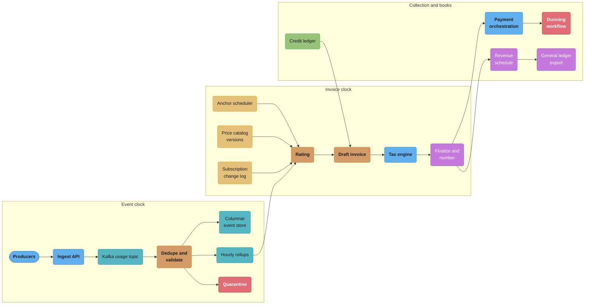
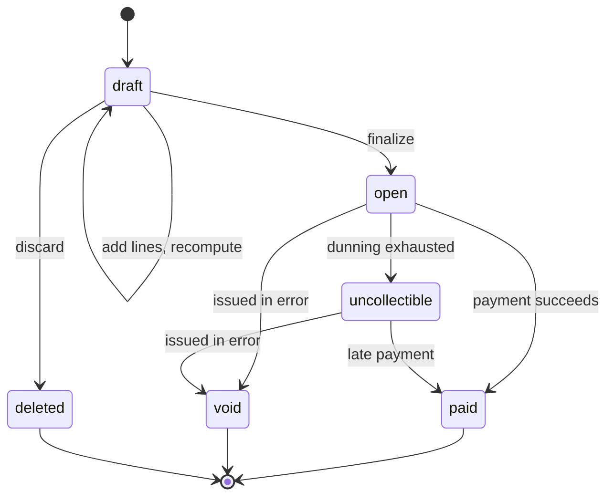

# Case Study: Design a Subscription Billing Engine

> Rules and figures checked 2026-11-06. Every date, threshold and fee on this page comes from the fact pins in fintech/CLAUDE.md, or from the vendor documentation named beside it, read on 2026-11-06. Scale figures and targets are design assumptions and are labelled as such.

## Intuition

> **Design intuition**: A billing engine runs on two clocks. The event clock says when a customer used something. The invoice clock says when a period closes and its total becomes a legal document that nobody may edit. Every hard bug in billing sits on the line between the two clocks: an event that arrives after its period closed, a plan change in the middle of a period, a retry that lands after finalization, a credit note that tries to undo a number that is already on a tax return.

The repo has no billing study. [Design a Payment System](../../hld/case_studies/design_payment_system.md) charges a card once and records the ledger entries, and [Design a Payment Processor](../../backend/case_studies/design_payment_processor/design_payment_processor.md) runs that charge as a saga. This study starts one step earlier and ends one step later. It decides what the amount is, why it is that amount, and how finance recognizes it as revenue. The collection step calls the charge flow those studies already design, and this page does not design it again.

The module [Subscriptions, Billing and Invoicing](../subscriptions_billing_and_invoicing/subscriptions_billing_and_invoicing.md) owns the proration policy and the rating-timing decision. This study applies those decisions at a stated scale and shows the code and the constraints that keep them correct.

The specific question: **what must a billing engine look like to hold 3 million subscriptions, accept 2 billion usage events a day, invoice each customer on its own anchor date with correct proration, tax and credits, collect through a card or bank rail with a dunning schedule, and export a revenue schedule that finance can close the books on?**

**Key insight for this design**: make the invoice the unit of immutability and make every number on it derivable. A finalized invoice is a frozen projection of three inputs that are themselves append-only: the deduplicated usage events, the versioned price catalog and the subscription change log. If the three inputs are append-only and the projection is deterministic, a dispute, an audit or a bug fix becomes a recomputation plus a credit note, never an edit.

Everything here builds on: [Money Representation and Currency](../money_representation_and_currency/money_representation_and_currency.md), [Double-Entry Ledger Design](../double_entry_ledger_design/double_entry_ledger_design.md), [Idempotency and Exactly-Once Money Movement](../idempotency_and_exactly_once_money_movement/idempotency_and_exactly_once_money_movement.md), [Card Payments Lifecycle](../card_payments_lifecycle/card_payments_lifecycle.md), [Tax for Payment Engineers](../tax_for_payment_engineers/tax_for_payment_engineers.md), and the two cross-cutting files [Money Movement Invariants](cross_cutting/money_movement_invariants.md) and [Business Days, Cut-offs and Value Dates](cross_cutting/business_days_cutoffs_and_value_dates.md).

---

## 1. Requirements Clarification

### Functional Requirements

- **Catalog.** Products and prices with versions. Price models: flat fee, per seat, metered per unit, graduated tiers, volume tiers and prepaid credit packs. A price version is immutable once a subscription uses it.
- **Subscriptions.** Create, upgrade, downgrade, change quantity, pause, cancel at period end or at once, and trials. Every change is an append-only event with an effective time.
- **Metering.** Accept usage events over HTTPS and Kafka. Each event carries a producer-assigned id, a customer, a meter name, a quantity and the time the usage happened. A duplicate delivery must never bill twice.
- **Rating.** Turn usage totals into money at period close with the price version that was active for that usage.
- **Invoicing.** Each subscription bills on its own anchor date. The engine builds a draft, calls the tax engine, applies credits, finalizes the invoice with a gap-free number and freezes it.
- **Corrections.** Credit notes against open or paid invoices. Void for an open invoice that was wrong from the start. No edits to a finalized invoice.
- **Collection.** Charge the default payment method through the payment orchestration layer. On failure, run a dunning schedule, then cancel, mark unpaid or pause, by plan setting.
- **Revenue export.** A daily revenue schedule per invoice line for the general ledger, by product, currency and recognition date.
- **Customer views.** An upcoming-invoice preview that matches the final invoice when nothing changes, and a usage page that lags real usage by minutes, not days.

### Non-Functional Requirements

All figures here are design assumptions.

- 3 million active subscriptions, 2 metered items each on average.
- 2 billion usage events a day, 70,000 a second at peak.
- Usage visible on the customer's usage page within 5 minutes at p99.
- Every invoice for an anchor date finalized within 6 hours of the period end, including the 1st of the month, when 40% of subscriptions renew.
- Zero double counting of usage and zero edits to finalized invoices. Both are hard invariants, not targets.
- The sum of an invoice's revenue schedule equals the invoice line, to the minor unit.
- 99.95% availability for the ingest API. Invoicing may pause during an incident but must not produce a wrong invoice.

### Out of Scope (and where it lives instead)

| Topic | Where it lives |
|---|---|
| Charging a card, PSP timeouts, the payment saga and its outbox | [Design a Payment Processor](../../backend/case_studies/design_payment_processor/design_payment_processor.md) |
| Routing a charge across PSPs, network tokens, soft-decline cascades | [Design a Payment Orchestration Layer](design_a_payment_orchestration_layer.md) |
| The proration policy and rating-timing decision table | [Subscriptions, Billing and Invoicing](../subscriptions_billing_and_invoicing/subscriptions_billing_and_invoicing.md) |
| Tax rules, nexus, place of supply, e-invoicing mandates | [Tax for Payment Engineers](../tax_for_payment_engineers/tax_for_payment_engineers.md) |
| Matching PSP payouts to invoices and bank lines | [Design a Payment Reconciliation Platform](design_a_payment_reconciliation_platform.md) |
| Revenue-recognition vocabulary | [Business and Finance Vocabulary](../../soft_skills/business_and_finance_vocabulary/business_and_finance_vocabulary.md) |

---

## 2. Scale Estimation

### Usage ingest

```
Subscriptions                    3,000,000           assumption
Metered items                    2 per subscription  = 6,000,000 meters
Usage events per day             2,000,000,000       assumption
Average rate                     2e9 / 86,400 s      = 23,148 events/s
Peak rate                        3x average          = about 70,000 events/s (assumption)
Event size, JSON on the wire     about 250 B
Raw bytes per day                2e9 x 250 B         = 500 GB
Columnar, compressed 5x          (assumption)        = about 100 GB/day, 36 TB/year
```

70,000 events a second is too much for one PostgreSQL primary to take as row inserts with a unique index. It is a normal load for a partitioned Kafka topic and a stream processor. So the event of record lands in Kafka and a columnar store, and PostgreSQL holds only rollups, invoices and the money tables.

### Deduplication state

```
Hot window (stream dedupe)       48 h
Ids in the hot window            2e9 x 2             = 4e9 ids
State per id                     16 B hash + 16 B overhead = 32 B
Total hot state                  4e9 x 32 B          = 128 GB
Kafka partitions                 64                  = 2 GB of state per partition
Late window (batch dedupe)       48 h to 35 days, checked against the columnar store
Late share of events             0.1% (assumption)   = 2,000,000 events/day on the slow path
```

The 35-day acceptance window is a design choice. Stripe's meter API uses the same bound: it accepts an event whose timestamp is within the past 35 calendar days and no more than 5 minutes in the future (Stripe docs, read 2026-11-06).

### Rollups and rating

```
Hourly rollup rows               6,000,000 meters x 24 h = 144 M/day if every meter is active
Active meters per hour           30% (assumption)    = about 43 M rollup rows/day
Rollup row size                  about 80 B          = 3.5 GB/day in PostgreSQL, partitioned by day
Rating reads at period close     one month of hourly rows per meter = up to 720 rows
```

Rating a month from 720 pre-summed rows takes milliseconds. Rating it from 10,000 raw events per meter on average (2e9 x 30 / 6e6) would mean a scan of 60 billion events on the 1st of the month.

### Invoice run on the 1st

```
Subscriptions anchored on the 1st   40% (assumption)  = 1,200,000 invoices
Finalization window                 6 h                = 56 invoices/s
Tax engine rate limit               200 calls/s (assumption) = 1.7 h for the tax step
PSP charge rate limit               300 charges/s (assumption) = 67 min for collection
First-attempt failure rate          5% (assumption)    = 60,000 invoices into dunning
Invoice lines                       20 per invoice     = 24 M lines, about 7 GB
```

The tax engine is the narrowest pipe on the 1st. The run must start tax calls in the first minutes and queue them with a rate limiter, or the 6-hour target fails before the first charge goes out.

---

## 3. High-Level Architecture



The left box runs on the event clock and never blocks on billing. The middle box runs on the invoice clock and reads only append-only inputs. The right box moves money and writes the books.

| Service | Store | Writes | Reads |
|---|---|---|---|
| Ingest API | Kafka (`acks=all`) | raw events | none |
| Dedupe and validate | Kafka Streams or Flink state (RocksDB), columnar store | events of record, hourly rollups, quarantine rows | hot dedupe state |
| Subscription service | PostgreSQL | change log, current state view | catalog |
| Rating and invoicing | PostgreSQL | drafts, invoices, lines, credit notes | rollups, catalog, change log, credit ledger |
| Tax adapter | PostgreSQL (tax call log) | tax quotes and committed tax transactions | invoice drafts |
| Collection and dunning | durable workflow engine | payment attempts, dunning state | invoices |
| Revenue export | PostgreSQL, then a file to the GL | schedule rows | finalized lines, credit notes |

### Request flow for one monthly invoice

1. The anchor scheduler wakes at the period end in the customer's billing time zone and starts one invoice job per subscription. The job id is `(subscription_id, period_start)`, so a second wake-up finds the job and stops.
2. The job waits for the late-event grace period (1 hour here, an assumption) so that events in flight reach the rollups.
3. Rating reads the rollups for the period, the change log for plan changes inside the period and the price versions, and writes a draft.
4. The draft applies prepaid credits from the credit ledger, then calls the tax engine for a quote.
5. Finalization assigns the next invoice number, commits the tax transaction, writes the revenue schedule and changes the status to `open` in one database transaction.
6. Collection starts. A success marks the invoice `paid`. A failure starts dunning.

---

## 4. Component Deep Dives

### 4.1 Metering: one event, one id, one effect

The producer assigns the event id. The producer is the only party that knows whether two deliveries are the same usage or two uses. A server-side id (a hash of the payload, or the arrival time) cannot tell a retry from a second API call that happens to have the same payload.

Stripe's meter events carry an `identifier` for the same reason, and Stripe asks callers to use it to stop one usage being reported twice (Stripe docs, read 2026-11-06). Lago's `transaction_id` plays the same role, and its behavior on a repeat depends on the store: on PostgreSQL the repeat is rejected with `422` and the first copy is billed. On ClickHouse the key also holds the timestamp, so a repeat with the same timestamp replaces the earlier copy and a repeat with a new timestamp bills again (Lago docs, read 2026-11-06). Both are defensible. They differ on one question that the design must answer on purpose: if the same id arrives with a different payload, which one is true?

This design keeps the first copy and quarantines a conflicting repeat. A same-id, different-payload event is a producer bug, and a human must look at it before it reaches an invoice.

#### BROKEN: a counter that adds on every delivery

```sql
CREATE TABLE usage_event (
    customer_id  bigint        NOT NULL,
    meter        text          NOT NULL,
    event_id     text          NOT NULL,
    occurred_at  timestamptz   NOT NULL,
    received_at  timestamptz   NOT NULL DEFAULT now(),
    quantity     numeric(20,6) NOT NULL CHECK (quantity >= 0),
    PRIMARY KEY (customer_id, meter, event_id)
);
```

```sql
-- BROKEN: the counter adds on every delivery, so a redelivered batch counts twice
CREATE TABLE usage_counter (
    customer_id bigint, meter text, period date, qty numeric(20,6),
    PRIMARY KEY (customer_id, meter, period)
);
INSERT INTO usage_counter VALUES (42, 'api_calls', '2026-11-01', 0);
-- the producer sends a batch of 10 calls, times out on the ack, and sends the batch again
UPDATE usage_counter SET qty = qty + 10 WHERE customer_id = 42 AND meter = 'api_calls';
UPDATE usage_counter SET qty = qty + 10 WHERE customer_id = 42 AND meter = 'api_calls';
SELECT qty FROM usage_counter;   -- 20.000000: the customer made 10 calls and is billed for 20
```

The counter is fast and has no memory. A Kafka consumer that restarts before it commits its offset, a load balancer that retries a POST, and a client SDK with retries all deliver the same batch twice. Each one adds again.

#### FIX: store each event once under its id and derive totals from the events

```sql
-- FIX: insert by id, keep the first copy, quarantine an id that comes back with a different payload
CREATE TABLE usage_staging (LIKE usage_event INCLUDING DEFAULTS, seq bigserial);
CREATE TABLE usage_quarantine (LIKE usage_event, reason text NOT NULL);

INSERT INTO usage_staging (customer_id, meter, event_id, occurred_at, quantity) VALUES
    (42, 'api_calls', 'evt-001', '2026-11-03 10:00Z', 4),
    (42, 'api_calls', 'evt-002', '2026-11-03 10:01Z', 6),
    (42, 'api_calls', 'evt-001', '2026-11-03 10:00Z', 4),   -- redelivery, same payload
    (42, 'api_calls', 'evt-002', '2026-11-03 10:01Z', 9);   -- same id, different payload

INSERT INTO usage_event (customer_id, meter, event_id, occurred_at, quantity)
SELECT DISTINCT ON (customer_id, meter, event_id) customer_id, meter, event_id, occurred_at, quantity
FROM usage_staging
ORDER BY customer_id, meter, event_id, seq
ON CONFLICT (customer_id, meter, event_id) DO NOTHING;

INSERT INTO usage_quarantine (customer_id, meter, event_id, occurred_at, received_at, quantity, reason)
SELECT s.customer_id, s.meter, s.event_id, s.occurred_at, s.received_at, s.quantity,
       'id reused with a different payload'
FROM usage_staging s
JOIN usage_event e USING (customer_id, meter, event_id)
WHERE (s.quantity, s.occurred_at) IS DISTINCT FROM (e.quantity, e.occurred_at);

-- the whole batch arrives a second time: nothing changes
INSERT INTO usage_event (customer_id, meter, event_id, occurred_at, quantity)
SELECT customer_id, meter, event_id, occurred_at, quantity FROM usage_staging
ON CONFLICT (customer_id, meter, event_id) DO NOTHING;

DO $$
BEGIN
    ASSERT (SELECT sum(quantity) FROM usage_event WHERE customer_id = 42) = 10, 'billed quantity';
    ASSERT (SELECT count(*) FROM usage_quarantine) = 1, 'conflicting repeat held for review';
END $$;
```

At 70,000 events a second the same rule runs in a stream processor, not in SQL. The processor keys the stream by `(customer_id, meter)`, so every copy of an event reaches the same partition. It keeps a 48-hour set of seen ids in local state and drops a repeat. An event older than 48 hours goes to the late path, which checks the columnar store by id before it accepts the event. The SQL above is the same contract at a scale where you can read it.

The hourly rollup is a pure function of the stored events: `sum(quantity)` grouped by meter and hour of `occurred_at`. A rollup can be rebuilt from the events at any time, so a rollup bug is a recompute, never a data loss.

### 4.2 Late events and the invoice clock

An event belongs to the period that contains its `occurred_at`, not the period in which it arrived. The rule is simple until the period is already invoiced.

| Event arrives | Period state | Action |
|---|---|---|
| Before period end | open | Rolled up as normal |
| Inside the grace period (1 hour, assumption) | invoice job waiting | Rolled up. The job reads rollups only after the grace period ends |
| After finalization, within 35 days | invoice frozen | Rolled up into the old period for reporting. Billed as a separate "late usage" line on the next invoice, with the original period in the description |
| Older than 35 days or more than 5 minutes in the future | outside the acceptance window | Rejected with an error the producer can see |

Stripe states the same boundary for its own engine: it may accept an event after an invoice finalizes and count it in meter summaries without updating the finalized invoice or adding it to the next one, and it tells callers to report usage before the invoice finalizes (Stripe docs, read 2026-11-06). Lago assigns a late event to its historical period and excludes it from a cycle that is already finalized (Lago docs, read 2026-11-06). This design chooses to bill late usage on the next invoice instead of dropping it, because the customer did use the service. The choice is a business rule. Write it in the contract, because a customer who sees "October usage" on a November invoice will ask.

The grace period is a trade between invoice timeliness and late-line volume. With a p99 ingest lag of 5 minutes, a 1-hour grace period moves late lines to the rare case of a producer outage.

### 4.3 Rating: aggregate first, price once, round once

Rating turns a quantity into money. The order of three steps decides whether the money is right: aggregate, price, round.

#### BROKEN: price and round each event

```java
// BROKEN: each event is priced and rounded to cents, so a sub-cent unit price rounds to zero
import java.math.BigDecimal;
import java.math.RoundingMode;

final class PerEventRating {
    public static void main(String[] args) {
        BigDecimal unitPrice = new BigDecimal("0.0004");          // USD per API call
        BigDecimal total = BigDecimal.ZERO;
        for (int i = 0; i < 1_000_000; i++) {
            total = total.add(unitPrice.setScale(2, RoundingMode.HALF_UP));
        }
        System.out.println("billed = " + total + " USD");        // billed = 0.00 USD, should be 400.00
    }
}
```

The code uses `BigDecimal` and an explicit rounding mode, and it is still wrong by 100%. Rounding is a step that loses information, so it must happen once, at the end, on the number that goes on the invoice line.

#### FIX: rate the period total with the tier model, round once per line

```java
// FIX: aggregate the quantity first, price it once with the tier model, round once per invoice line
import java.math.BigDecimal;
import java.math.RoundingMode;
import java.util.List;

final class Rating {
    record Tier(long upTo, BigDecimal unitPrice) {}   // upTo = Long.MAX_VALUE for the last tier

    static BigDecimal graduated(long qty, List<Tier> tiers) {
        BigDecimal amount = BigDecimal.ZERO;
        long floor = 0;
        for (Tier t : tiers) {
            if (qty <= floor) break;
            long inTier = Math.min(qty, t.upTo()) - floor;
            amount = amount.add(t.unitPrice().multiply(BigDecimal.valueOf(inTier)));
            floor = t.upTo();
        }
        return amount.setScale(2, RoundingMode.HALF_EVEN);
    }

    static BigDecimal volume(long qty, List<Tier> tiers) {
        for (Tier t : tiers) {
            if (qty <= t.upTo()) {
                return t.unitPrice().multiply(BigDecimal.valueOf(qty)).setScale(2, RoundingMode.HALF_EVEN);
            }
        }
        throw new IllegalArgumentException("no tier for " + qty);
    }

    public static void main(String[] args) {
        List<Tier> tiers = List.of(
            new Tier(1_000_000, new BigDecimal("0.0004")),
            new Tier(10_000_000, new BigDecimal("0.0003")),
            new Tier(Long.MAX_VALUE, new BigDecimal("0.0002")));
        assert graduated(0, tiers).equals(new BigDecimal("0.00"));
        assert graduated(1_000_000, tiers).equals(new BigDecimal("400.00"));
        assert graduated(12_000_000, tiers).equals(new BigDecimal("3500.00"));
        assert volume(12_000_000, tiers).equals(new BigDecimal("2400.00"));
        System.out.println("12M calls: graduated " + graduated(12_000_000, tiers)
            + ", volume " + volume(12_000_000, tiers));
    }
}
```

Graduated tiers price each slice at its own rate: 1M x 0.0004 + 9M x 0.0003 + 2M x 0.0002 = 3,500.00. Volume tiers price every unit at the rate of the tier the total lands in: 12M x 0.0002 = 2,400.00. The two models differ by 1,100.00 on the same usage, so the price version must store which model it uses. A volume model also has a cliff: at 10,000,000 calls the bill is 3,000.00, and one more call drops it to 2,000.00. Sales teams sometimes want that, and customers learn to game it. The price version decides, not the rating code.

Two more rules from [Money Representation and Currency](../money_representation_and_currency/money_representation_and_currency.md) apply here. Unit prices below the minor unit are stored as decimal strings with their own scale, never as `long` minor units. And the line amount converts to the invoice currency's minor units with that currency's ISO 4217 exponent, which is 0 for JPY and 3 for KWD.

### 4.4 Billing anchors and period arithmetic

A subscription's anchor is a date and a time zone. Each period boundary is the anchor plus n months, at local midnight in that zone.

#### BROKEN: compute each period from the end of the last one

```java
// BROKEN: each period end comes from the previous end, so a 31st anchor drifts to the 28th
import java.time.LocalDate;

final class ChainedPeriods {
    public static void main(String[] args) {
        LocalDate end = LocalDate.of(2026, 1, 31);
        for (int i = 0; i < 3; i++) {
            end = end.plusMonths(1);
            System.out.println(end);
        }
        // prints 2026-02-28, 2026-03-28, 2026-04-28: the customer bills on the 28th from now on
    }
}
```

`plusMonths` clamps January 31 plus one month to February 28. That clamp is correct for one step. Chained, it loses the 31st for good, and every customer anchored on the 29th, 30th or 31st drifts to the 28th after February.

#### FIX: compute every boundary from the anchor

```java
// FIX: boundary n is anchor plus n months, at local midnight in the billing time zone
import java.time.LocalDate;
import java.time.ZoneId;
import java.time.ZonedDateTime;

final class AnchoredPeriods {
    static LocalDate boundary(LocalDate anchor, int n) { return anchor.plusMonths(n); }

    public static void main(String[] args) {
        LocalDate anchor = LocalDate.of(2026, 1, 31);
        assert boundary(anchor, 1).equals(LocalDate.of(2026, 2, 28));
        assert boundary(anchor, 2).equals(LocalDate.of(2026, 3, 31));
        assert boundary(anchor, 3).equals(LocalDate.of(2026, 4, 30));
        assert boundary(anchor, 13).equals(LocalDate.of(2027, 2, 28));
        ZonedDateTime cut = boundary(anchor, 2).atStartOfDay(ZoneId.of("America/New_York"));
        assert cut.toInstant().toString().equals("2026-03-31T04:00:00Z");   // EDT, after the DST change
        System.out.println("March boundary " + cut.toInstant());
    }
}
```

The stored state is `(anchor_date, zone, n)`, and the boundary is a derived value. Store the computed instant as a cache if you need it for queries, but never compute boundary n+1 from it. The time-zone part matters twice a year. A US customer anchored at local midnight has a period that is one hour shorter in March and one hour longer in November, because one day in it has 23 or 25 hours, and a usage event at 00:30 local time on the boundary day belongs to the new period, not the old one. [Business Days, Cut-offs and Value Dates](cross_cutting/business_days_cutoffs_and_value_dates.md) covers time zones, DST and month-end rules for every money clock in this section.

### 4.5 Proration

A plan change in the middle of a period produces two lines: a credit for the unused time on the old price and a debit for the remaining time on the new price. The policy choices (prorate or not, at what granularity, invoice now or at the next renewal) belong to [Subscriptions, Billing and Invoicing](../subscriptions_billing_and_invoicing/subscriptions_billing_and_invoicing.md). The arithmetic belongs here.

Stripe computes prorations to the second by default, and lets a caller change the granularity to the day, hour, week or month (Stripe docs, read 2026-11-06). The granularity changes the money:

```
Period              2026-11-01T00:00Z to 2026-12-01T00:00Z = 30 days = 2,592,000 s
Change at           2026-11-11T06:00Z
Remaining           19 days 18 h = 1,706,400 s = 0.658333 of the period
Old price 30.00, new price 90.00 per month

By the second       credit -30.00 x 0.658333 = -19.75   debit 90.00 x 0.658333 = 59.25   net 39.50
By the day          remaining days 20 of 30 = 0.666667
                    credit -20.00                        debit 60.00                      net 40.00
```

The difference is 0.50 on one change. Neither answer is wrong. What is wrong is a preview that uses one rule and an invoice that uses the other, or a preview computed at 06:00 and an update applied at 06:03. Stripe handles the second case with a `proration_date` parameter: the caller passes the same timestamp to the preview and to the update, so both use the same instant (Stripe docs, read 2026-11-06). This design does the same. The plan-change API takes the proration instant from the preview token.

```java
// FIX: prorate by the second against the exact period length, one rounding per line
import java.math.BigDecimal;
import java.math.RoundingMode;
import java.time.Duration;
import java.time.Instant;

final class Proration {
    record Line(String text, long amountMinor) {}

    static long prorate(long priceMinor, Instant from, Instant to, Instant periodStart, Instant periodEnd) {
        long part = Duration.between(from, to).toSeconds();
        long whole = Duration.between(periodStart, periodEnd).toSeconds();
        return BigDecimal.valueOf(priceMinor)
            .multiply(BigDecimal.valueOf(part))
            .divide(BigDecimal.valueOf(whole), 0, RoundingMode.HALF_EVEN)
            .longValueExact();
    }

    public static void main(String[] args) {
        Instant start = Instant.parse("2026-11-01T00:00:00Z");
        Instant end = Instant.parse("2026-12-01T00:00:00Z");
        Instant change = Instant.parse("2026-11-11T06:00:00Z");
        Line credit = new Line("Unused time on Basic", -prorate(3_000, change, end, start, end));
        Line debit = new Line("Remaining time on Pro", prorate(9_000, change, end, start, end));
        assert credit.amountMinor() == -1_975 : credit;
        assert debit.amountMinor() == 5_925 : debit;
        assert credit.amountMinor() + debit.amountMinor() == 3_950;
        System.out.println(credit + "\n" + debit);
    }
}
```

Two edge cases decide whether proration is fair:

- **Which price does the credit use?** The credit should use the price the customer was last billed for that item, not the price that is active when the change happens. Stripe documents both behaviors: its `classic` billing mode credits at the current price, and its `flexible` mode credits at the last price billed, which avoids a credit for time the customer never paid for (Stripe docs, read 2026-11-06). Store the billed price on each period, and the credit reads it from there.
- **Unpaid invoices.** A customer with an unpaid invoice for the current period who downgrades gets a credit for time not yet paid. Stripe's documentation names this case and suggests turning proration off when the latest invoice is unpaid (Stripe docs, read 2026-11-06). This design keeps proration on and links the credit to the unpaid invoice, so the credit reduces what is owed instead of creating a balance the customer can spend.

### 4.6 The invoice state machine and immutability



`draft` is a working copy that anyone may change. `finalize` is the one-way door. It assigns the invoice number, commits the tax transaction and freezes every line. After that, only the status may move, and only along the arrows. A wrong amount on an `open` or `paid` invoice is fixed with a credit note, which is a new document with its own number that points at the invoice. A `void` is for an invoice that should never have existed, and it only applies before payment.

This design keeps invoice numbers gap-free per issuing entity, so a gap in the sequence always points at a defect. The number comes from a counter row locked inside the finalize transaction, not from a database sequence, because a sequence skips a value when a transaction rolls back.

#### BROKEN: a finalized invoice that support can edit

```sql
CREATE TABLE invoice (
    id            bigint  PRIMARY KEY,
    customer_id   bigint  NOT NULL,
    currency      char(3) NOT NULL,
    status        text    NOT NULL CHECK (status IN ('draft', 'open', 'paid', 'void', 'uncollectible')),
    number        text    UNIQUE,
    total_minor   bigint  NOT NULL DEFAULT 0,
    finalized_at  timestamptz,
    CHECK ((status = 'draft') = (number IS NULL)),
    CHECK ((status = 'draft') = (finalized_at IS NULL))
);
CREATE TABLE invoice_line (
    invoice_id    bigint NOT NULL REFERENCES invoice (id),
    line_no       int    NOT NULL,
    description   text   NOT NULL,
    amount_minor  bigint NOT NULL,
    PRIMARY KEY (invoice_id, line_no)
);
INSERT INTO invoice VALUES (1001, 42, 'USD', 'open', 'INV-2026-000123', 12000, '2026-11-01 05:00Z');
INSERT INTO invoice_line VALUES
    (1001, 1, 'Pro plan, November', 9000),
    (1001, 2, 'API calls, October usage', 3000);
```

```sql
-- BROKEN: nothing stops an admin tool from editing a finalized invoice in place
UPDATE invoice_line SET amount_minor = 2500 WHERE invoice_id = 1001 AND line_no = 2;
UPDATE invoice SET total_minor = 11500 WHERE id = 1001;
SELECT number, total_minor FROM invoice WHERE id = 1001;
-- INV-2026-000123, 11500: the PDF the customer holds says 120.00, the database says 115.00
```

The customer's PDF, the tax engine's committed transaction, the revenue schedule and the payment all still say 120.00. The edit fixed one number and broke four agreements.

#### FIX: freeze finalized invoices in the database, correct with credit notes

```sql
-- FIX: lines of a non-draft invoice are frozen, and status moves only along the state machine
CREATE FUNCTION freeze_invoice_lines() RETURNS trigger LANGUAGE plpgsql AS $$
DECLARE
    inv bigint;
    st  text;
BEGIN
    IF TG_OP = 'DELETE' THEN inv := OLD.invoice_id; ELSE inv := NEW.invoice_id; END IF;
    SELECT status INTO st FROM invoice WHERE id = inv;
    IF st <> 'draft' THEN
        RAISE EXCEPTION 'invoice % is %, its lines are frozen', inv, st;
    END IF;
    IF TG_OP = 'DELETE' THEN RETURN OLD; END IF;
    RETURN NEW;
END $$;

CREATE TRIGGER invoice_line_frozen BEFORE INSERT OR UPDATE OR DELETE ON invoice_line
    FOR EACH ROW EXECUTE FUNCTION freeze_invoice_lines();

CREATE FUNCTION guard_invoice_header() RETURNS trigger LANGUAGE plpgsql AS $$
BEGIN
    IF OLD.status = 'draft' THEN RETURN NEW; END IF;
    IF (NEW.customer_id, NEW.currency, NEW.number, NEW.total_minor, NEW.finalized_at)
       IS DISTINCT FROM (OLD.customer_id, OLD.currency, OLD.number, OLD.total_minor, OLD.finalized_at) THEN
        RAISE EXCEPTION 'invoice % is %, its amounts are frozen', OLD.id, OLD.status;
    END IF;
    IF NEW.status <> OLD.status AND NOT (
           (OLD.status = 'open' AND NEW.status IN ('paid', 'void', 'uncollectible'))
        OR (OLD.status = 'uncollectible' AND NEW.status IN ('paid', 'void'))) THEN
        RAISE EXCEPTION 'invoice % cannot move from % to %', OLD.id, OLD.status, NEW.status;
    END IF;
    RETURN NEW;
END $$;

CREATE TRIGGER invoice_header_guard BEFORE UPDATE ON invoice
    FOR EACH ROW EXECUTE FUNCTION guard_invoice_header();
```

```sql
-- BROKEN: error. The same edit now fails, because invoice 1001 is open
UPDATE invoice_line SET amount_minor = 2500 WHERE invoice_id = 1001 AND line_no = 2;
```

A credit note is the correction path. It has its own constraint: the credit notes on one invoice may not add up to more than the invoice total. Stripe enforces the same limit and allows a credit note only on an `open` or `paid` invoice (Stripe docs, read 2026-11-06).

```sql
CREATE TABLE credit_note (
    id            bigint PRIMARY KEY,
    invoice_id    bigint NOT NULL REFERENCES invoice (id),
    amount_minor  bigint NOT NULL CHECK (amount_minor > 0),
    reason        text   NOT NULL,
    created_at    timestamptz NOT NULL DEFAULT now()
);

CREATE FUNCTION cap_credit_notes() RETURNS trigger LANGUAGE plpgsql AS $$
DECLARE
    inv      invoice%ROWTYPE;
    credited bigint;
BEGIN
    SELECT * INTO inv FROM invoice WHERE id = NEW.invoice_id FOR UPDATE;
    IF inv.status NOT IN ('open', 'paid') THEN
        RAISE EXCEPTION 'credit notes need an open or paid invoice, % is %', inv.id, inv.status;
    END IF;
    SELECT COALESCE(sum(amount_minor), 0) INTO credited FROM credit_note WHERE invoice_id = inv.id;
    IF credited + NEW.amount_minor > inv.total_minor THEN
        RAISE EXCEPTION 'credits % plus % exceed invoice total %', credited, NEW.amount_minor, inv.total_minor;
    END IF;
    RETURN NEW;
END $$;

CREATE TRIGGER credit_note_cap BEFORE INSERT ON credit_note
    FOR EACH ROW EXECUTE FUNCTION cap_credit_notes();

INSERT INTO credit_note (id, invoice_id, amount_minor, reason)
VALUES (1, 1001, 500, 'API usage billed twice for 2026-10-14');
```

```sql
-- BROKEN: error. A second credit note would take the credits past the 120.00 total
INSERT INTO credit_note (id, invoice_id, amount_minor, reason) VALUES (2, 1001, 12000, 'goodwill');
```

The `FOR UPDATE` on the invoice row serializes two credit notes for the same invoice, so two agents who each issue a credit at the same moment cannot both pass the check. On a `paid` invoice the credit note must also say where the money goes: a refund through the payment rail, or a credit to the customer's balance for the next invoice.

### 4.7 The tax call

Tax is a remote call in the middle of a money transaction, so it gets the same treatment as a PSP call: an idempotency key, a timeout, and a state that survives a crash between the call and the commit.

| Step | Tax call | Key | On failure |
|---|---|---|---|
| Draft and preview | quote, no commit | none | Show the preview without tax and say so |
| Finalize | commit a tax transaction | `invoice_id` | Leave the invoice in `draft` and retry. Never finalize without tax |
| Credit note | commit a reversal for the credited lines | `credit_note_id` | Hold the credit note in a pending state and retry |
| Void | commit a full reversal | `invoice_id` plus `void` | Retry. The invoice is `void` in billing at once |

Three details belong to billing and not to the tax module:

- **Rounding level.** The tax engine and the invoice must agree on whether tax rounds per line or per invoice. Per-line rounding on 20 lines can differ from per-invoice rounding by up to 10 minor units in either direction. Pick one per jurisdiction and store it on the invoice.
- **Addresses change.** Tax depends on the customer's address at the time of supply. A customer who moves in the middle of a period gets taxed at finalization with the address that was valid at the period end, by the rule this design adopts. Store the address snapshot on the invoice.
- **Nexus is a variable.** In the US, *South Dakota v. Wayfair* (2018-06-21) removed the physical-presence rule. The South Dakota law it upheld applied to sellers with more than $100,000 of sales into the state a year or 200 or more separate transactions, and each state sets its own threshold. So the engine stores per-state sales and transaction counters and feeds them to the tax team, and never hard-codes a threshold.

In the EU, ViDA (Council Directive (EU) 2025/516) makes structured e-invoicing to EN 16931 and per-transaction digital reporting mandatory for intra-EU B2B supplies from 2030-07-01, with the invoice issued within 10 days of the chargeable event. The 6-hour finalization target here already meets the 10-day limit. The immutable invoice and the credit-note model are what an e-invoicing format expects, so the change is a new output format, not a new data model.

### 4.8 Dunning

Dunning is a schedule of payment retries and customer messages after a failed charge. It runs for days or weeks, it must survive deploys and restarts, and each step must happen once. That is a durable workflow, not a cron job that scans for `past_due` invoices. See [Durable Execution and Workflows](../../backend/durable_execution_and_workflows/durable_execution_and_workflows.md) and [Temporal](../../technologies/temporal_durable_execution/temporal_durable_execution.md) for the engine. This section covers the retry policy.

Two sources set the policy. The card network sets the outer limits. Visa groups decline codes into 4 categories. A category 1 code (for example 04, 07, 14, 41, 43, 46, R0, R1, R3) means the issuer will never approve, and the merchant must never reattempt with the same credential. For categories 2, 3 and 4, Visa allows up to 20 attempts in 30 days, and a reattempt must not change data elements such as MCC, POS entry mode or ECI (Visa Core Rules, edition 24 October 2026). Inside those limits, the merchant picks a schedule. Stripe's Smart Retries default for new accounts is up to 8 retries within 2 weeks, with a choice of windows from 1 week to 2 months, and Stripe does not retry after a hard decline until a new payment method arrives (Stripe docs, read 2026-11-06).

```java
// FIX: the next attempt reads the decline category first, then the network cap, then the plan
import java.util.ArrayList;
import java.util.List;

final class Dunning {
    enum Category { ONE, TWO, THREE, FOUR }
    record Attempt(int day, Category result) {}

    static final int NETWORK_CAP = 20;                       // Visa: attempts per credential in 30 days
    static final int[] PLAN_DAYS = {0, 1, 3, 5, 7, 10, 14};  // illustrative plan: 7 attempts in 14 days

    /** Day of the next attempt, or -1 to stop and ask the customer for a new payment method. */
    static int next(List<Attempt> history) {
        Attempt last = history.get(history.size() - 1);
        if (last.result() == Category.ONE) return -1;
        long inWindow = history.stream().filter(a -> last.day() - a.day() < 30).count();
        if (inWindow >= NETWORK_CAP) return -1;
        for (int d : PLAN_DAYS) if (d > last.day()) return d;
        return -1;
    }

    public static void main(String[] args) {
        List<Attempt> h = new ArrayList<>(List.of(new Attempt(0, Category.TWO)));
        assert next(h) == 1;
        h.add(new Attempt(1, Category.TWO));
        h.add(new Attempt(3, Category.ONE));
        assert next(h) == -1 : "category 1: never retry this credential";
        List<Attempt> many = new ArrayList<>();
        for (int day = 0; day < 20; day++) many.add(new Attempt(day, Category.FOUR));
        assert next(many) == -1 : "20 attempts in 30 days";
        assert next(List.of(new Attempt(14, Category.THREE))) == -1 : "plan exhausted";
        System.out.println("dunning policy checks pass");
    }
}
```

The network cap counts attempts per credential, not per invoice. A customer with three subscriptions on one card has three invoices failing on the same card. The workflow must count attempts across all of them, so the attempt counter lives on the payment method, not on the invoice.

A retry is a new charge with a new idempotency key derived from `(invoice_id, attempt_no)`. A retry that times out at the PSP is not a failed attempt. It is an unknown outcome, and the workflow must query the PSP before it schedules the next attempt, by the rules in [Idempotency and Exactly-Once Money Movement](../idempotency_and_exactly_once_money_movement/idempotency_and_exactly_once_money_movement.md).

Bank debits follow different rules. For ACH, an unauthorized consumer debit return (R10, R11) can arrive up to 60 days later with a written statement, so an invoice paid by ACH debit is `paid` provisionally until that window closes for revenue-at-risk reporting. Stripe's own automatic ACH retry is limited to insufficient-funds failures, 2 retries within 40 days (Stripe docs, read 2026-11-06).

When the schedule ends, the subscription moves to the end state its plan sets: cancel, mark unpaid and keep issuing draft invoices, stay `past_due`, or pause. Stripe offers the same four outcomes (Stripe docs, read 2026-11-06). The invoice itself moves to `uncollectible`, which keeps it in the books as a receivable that is unlikely to be paid, and a late payment can still move it to `paid`.

### 4.9 Prepaid credits

A credit grant is money or units the customer bought or received in advance. It is a liability on the seller's books until it is used or expires, so it lives in a small double-entry ledger, not in a `balance` column on the customer row.

| Event | Debit | Credit |
|---|---|---|
| Customer buys a 1,000.00 credit pack | Cash (via the payment) | Customer credit liability |
| Invoice applies 300.00 of credits | Customer credit liability | Revenue (through the invoice) |
| 200.00 of credits expire unused | Customer credit liability | Breakage income |

Burn-down order is a policy, so make it explicit and store it on the grant: earliest expiry first is the common default, because it uses the credit that would expire. Promotional credits often burn before paid credits for the same reason. The draft invoice applies credits as negative lines that point at the grant, so a credit note on that invoice can restore the exact grant it consumed.

### 4.10 The revenue schedule

Collection is cash. Revenue is something else. ASC 606 has five steps: identify the contract, identify the performance obligations, determine the transaction price, allocate the price to the performance obligations, and recognize revenue when or as each obligation is satisfied (FASB ASU 2014-09). A monthly or annual subscription is an obligation satisfied over time, so its revenue is spread over the service period. This design uses a daily ratable schedule, the configuration finance sets here. Metered usage is satisfied as the customer uses it, so its revenue belongs to the period of usage. See [Business and Finance Vocabulary](../../soft_skills/business_and_finance_vocabulary/business_and_finance_vocabulary.md) for the terms.

The engine does not make accounting judgments. It produces the schedule that finance configured, and it makes the schedule add up.

```java
// FIX: spread a fixed fee over its service days and give the leftover minor units to the first days
final class RevenueSchedule {
    static long[] daily(long totalMinor, int days) {
        long base = totalMinor / days;
        long rest = totalMinor % days;
        long[] out = new long[days];
        for (int i = 0; i < days; i++) out[i] = base + (i < rest ? 1 : 0);
        return out;
    }

    public static void main(String[] args) {
        long[] s = daily(120_000, 365);                  // 1,200.00 annual plan
        long sum = 0;
        for (long v : s) sum += v;
        assert sum == 120_000 : sum;
        assert s[0] == 329 && s[279] == 329 && s[280] == 328 && s[364] == 328;
        System.out.println("days at 3.29: 280, days at 3.28: 85, total " + sum);
    }
}
```

1,200.00 over 365 days is 3.2876 a day. A schedule that rounds each day to 3.29 recognizes 1,200.85, and one that truncates to 3.28 recognizes 1,197.20. The integer split puts 3.29 on the first 280 days and 3.28 on the other 85, and the total is exact. A credit note produces a negative schedule over the remaining days of the credited line, so revenue already recognized stays recognized and the correction lands in the period of the credit.

---

## 5. Design Decisions & Tradeoffs

### Decision 1: rate at period close from hourly rollups, not in real time per event

Real-time rating gives a live running bill, but it fixes the price when the usage happens, and a mid-period price change or a volume tier then needs a re-rate of everything already rated. Rating at period close from rollups reads at most 720 rows per meter and applies the price version that was active for each slice of the period. The live usage page shows quantities and an estimate from the same rating code run on the partial period. The estimate is labelled as one.

### Decision 2: freeze invoices in the database, not only in the application

An application check stops the application. A trigger stops the application, the admin tool, a migration script and an engineer with `psql`. The cost is one extra lookup per line insert during drafting, which is small next to the rating work.

### Decision 3: keep the first copy of a duplicate event, quarantine conflicting payloads

| Policy | Pro | Con |
|---|---|---|
| First copy wins (this design) | The billed amount never changes after the first delivery | A producer that sends a correction under the same id gets it quarantined |
| Last copy wins | Producers can correct by resending | The billed amount can change until the invoice freezes, and a replay of old data can overwrite newer values |
| Both copies count if timestamps differ | Simple to implement | A clock skew on retry creates double billing |

Corrections go through a separate correction event with its own id and a negative or positive quantity. That keeps the event store append-only.

### Decision 4: dunning in a durable workflow engine

A cron job that scans `past_due` invoices every hour is simple until it runs twice after a deploy, or skips a run during an outage and sends two reminder emails at once. A workflow per invoice holds its own timer and its own attempt history, and the engine replays it after a crash without repeating completed steps. The cost is one more system to run.

### Decision 5: bill late usage on the next invoice instead of reopening the old one

Reopening a finalized invoice breaks immutability and the tax transaction. Dropping the usage loses revenue the customer agreed to pay. A separate line on the next invoice keeps both documents correct, and the line carries the original period for the customer's own accounting.

---

## 6. Real-World Implementations

**Stripe Billing.** The behaviors cited in §4 come from Stripe's documentation, read on 2026-11-06. Prorations are computed to the second by default, with day, hour, week or month granularity available, and a `proration_date` parameter lets a preview and an update use the same instant. Meter events take an `identifier` for deduplication, accept timestamps up to 35 calendar days in the past and 5 minutes in the future, and have a live-mode limit of 1,000 calls per second per account with one concurrent call per customer per meter. Meter event streams in API v2 take up to 10,000 events per second. Smart Retries default to up to 8 retries within 2 weeks for new accounts. Credit notes apply to `open` or `paid` invoices, and their sum cannot exceed the invoice total.

**Lago.** Lago deduplicates usage events on a caller-generated `transaction_id`. On its PostgreSQL event store a repeat is rejected with `422` and the first copy is billed. On its ClickHouse store the key also holds the event timestamp: a repeat with the same timestamp replaces the earlier copy, and a retry with a new timestamp bills again. A late event is assigned to its historical period by `timestamp` and is excluded from a cycle whose invoice is already finalized. Its guidance on transport is REST single events below 1K events per second, REST batches of up to 100 events between 1K and 10K per second, and Kafka, Kinesis or S3 above 10K per second (Lago docs, read 2026-11-06). The 70,000 events per second here are well inside the Kafka range of that guidance.

**Visa.** The network's retry rules bound every merchant's dunning policy: never reattempt a category 1 decline with the same credential, and at most 20 attempts in 30 days for categories 2 to 4 (Visa Core Rules, edition 24 October 2026). A billing engine that ignores the categories retries cards that will never approve.

**Square Books.** Square described its accounting service as an immutable double-entry database in which journal entries must balance to 0 and entries are append-only (Square engineering blog, 2019-10-16). The credit ledger in §4.9 follows the same model at a much smaller scale.

---

## 7. Technologies & Tools

| Layer | Choice | Why here |
|---|---|---|
| Ingest transport | Apache Kafka | Partitioned log, replay for rollup rebuilds. See [Kafka Deep Dive](../../backend/kafka_deep_dive/kafka_deep_dive.md) |
| Stream dedupe and rollups | Apache Flink or Kafka Streams with RocksDB state | Keyed state for the 48-hour id set, event-time windows for hourly rollups. See [Apache Flink](../../technologies/apache_flink/apache_flink.md) |
| Event store | ClickHouse or Apache Pinot | Columnar scans for usage pages, late-event id checks and rollup rebuilds. See [Time Series Databases](../../database/time_series_databases/time_series_databases.md) |
| Money tables | PostgreSQL 18 | Constraints and triggers for immutability, `FOR UPDATE` for credit-note caps, one transaction for finalize |
| Workflows | Temporal | Dunning schedules, invoice jobs per anchor date |
| Tax | A tax engine with quote and commit calls | Address to jurisdiction, product tax codes, filing data |
| Collection | The payment orchestration layer | Cards, bank debits, network tokens, account updater |
| Buy instead of build | Stripe Billing, Lago (self-hosted) | For a team that does not need custom rating or its own invoice numbering |

---

## 8. Operational Playbook

### Invariants checked every hour

Each row maps to the checklist in [Money Movement Invariants](cross_cutting/money_movement_invariants.md).

| Invariant | Check | Alert |
|---|---|---|
| Idempotent effect | Count of events per `(customer, meter, event_id)` in the event store is 1 | any value above 1 |
| Append-only with reversals | No `UPDATE` or `DELETE` on finalized invoice lines in the audit log | any |
| Conservation | Sum of revenue schedule rows per invoice line equals the line amount | any difference |
| Conservation | Credit ledger postings sum to 0 per currency | any difference |
| One internal record per external movement | Each PSP charge id maps to one payment row and one invoice | a charge with no invoice after 1 hour |
| End-to-end trace | Each invoice line carries the rollup ids it was rated from | missing ids |

### Metrics

| Metric | Healthy | Page |
|---|---|---|
| `ingest_lag_p99_seconds` | under 60 | over 300 |
| `dedupe_state_bytes` per partition | under 3 GB | over 5 GB |
| `quarantine_events_per_hour` | under 100 | over 10,000 |
| `invoices_pending_finalize` after period end plus 6 h | 0 | any |
| `tax_call_error_rate` | under 0.1% | over 2% |
| `late_usage_lines_per_run` | under 0.1% of lines | over 1% |
| `dunning_recovery_rate` (30 days) | tracked weekly | a drop of 5 points week over week |

### Runbook: invoice run on the 1st is behind

1. Read `invoices_pending_finalize` by stage. Most of the time the queue is at the tax step.
2. If tax errors are high, do not finalize without tax. Pause finalization, keep drafts, and let the tax adapter retry with backoff.
3. If the tax engine is healthy but slow, raise the tax worker count up to the vendor's rate limit, not past it. A 429 storm makes the run slower.
4. If the run will miss the 6-hour target, tell support. Invoices finalized late still carry the correct period and the correct numbers, so lateness is a customer-communication problem, not a money problem.

### Runbook: a producer sent the same ids with new payloads

1. `quarantine_events_per_hour` spikes for one producer.
2. Do not release the quarantine in bulk. Read 20 samples and compare the two payloads.
3. If the producer reused ids for different usage, the producer must send the new usage under new ids. Release nothing.
4. If the producer meant to correct earlier values, ask for correction events with new ids. The quarantined rows stay as evidence.

### Runbook: a rating bug billed the wrong amount

1. Stop the next run for the affected price version.
2. Recompute the affected invoices from the stored inputs into a shadow table. The inputs are append-only, so the recompute is exact.
3. For each invoice where the shadow differs, issue a credit note for an overcharge, or a new invoice for an undercharge, with a reason that names the bug.
4. Never edit the finalized invoices. The trigger will refuse it anyway.

---

## 9. Common Pitfalls & War Stories

The incidents below are illustrative. They apply this design's numbers to known failure modes, and none of them is a report from a named company.

**A retrying SDK doubled one customer's bill.** A customer's client SDK retried usage POSTs on any 5xx, and a load balancer returned 502 during a deploy after the request had reached the ingest API. The counter-based meter (the BROKEN fence in §4.1) counted 18% of that day's events twice for the customer. The invoice was 40,946.00 instead of 34,700.00. The fix was the producer-id contract and the stored-event model. The refund was a credit note of 6,246.00, and the customer's finance team asked for a line-level explanation that took two engineers a day to build, because the counter kept no evidence.

**Per-event rounding gave away 400.00 a month per customer.** A team priced API calls at 0.0004 each and rounded each event to cents. For 6 months, every metered line billed 0.00. 2,000 customers averaged 1 million calls a month, so the loss was about 400.00 x 2,000 x 6 = 4.8 million. Nobody noticed because the usage page showed the right quantities. The fix was rating on aggregates (§4.3) and a reconciliation that compares `quantity x unit price` with the line amount for every line.

**Customers anchored on the 31st drifted to the 28th.** The period code added one month to the last period end. After February, about 6% of subscriptions (those anchored on the 29th to 31st) billed on the 28th. Each lost 1 to 3 days of service a month, and the support queue filled with "why was I charged early". The fix computed every boundary from the anchor (§4.4) and issued credit notes for the lost days.

**A support tool edited 1,200 finalized invoices.** An internal admin page let support agents "fix" invoice lines. A quarter later, the tax filing differed from the invoice totals by 0.3%, and the auditors could not tie the revenue schedule to the invoices. Rebuilding the trail took 3 weeks. The fix was the database trigger in §4.6, credit notes for every correction, and a read-only admin page.

**Dunning retried stolen cards 14 times.** A fixed retry schedule ignored decline codes. Cards reported stolen (a category 1 code) were retried on every scheduled day. The network's rules forbid any reattempt on a category 1 decline, and the acquirer flagged the merchant's excessive retries. The fix read the category before scheduling (§4.8) and moved those customers straight to a "please update your card" email.

---

## 10. Capacity Planning

### Ingest and dedupe

```
Peak events/s                      70,000 (assumption)
Kafka partitions                   64     = about 1,100 events/s per partition at peak
Brokers                            6, replication factor 3, about 18 MB/s of produce traffic at peak
Stream processor tasks             64     one per partition
Dedupe state per task              2 GB of RocksDB (48 h window), 8 GB local SSD
Columnar store ingest              100 GB/day compressed, 36 TB/year, 13 months hot
```

### PostgreSQL

| Table | Rows per month | Size per month | Partitioning |
|---|---|---|---|
| Hourly rollups | about 1.3 billion | about 105 GB | by day, dropped after 13 months |
| Invoices | 3 million | about 1.5 GB | by month |
| Invoice lines | 60 million | about 18 GB | by month |
| Revenue schedule rows | about 90 million (daily rows for monthly plans) | about 9 GB | by recognition month |
| Credit ledger postings | under 10 million | about 1 GB | none needed at this size |

One primary with 2 replicas holds this for several years. The rollup table dominates writes at about 500 rows a second on average, inserted in batches of 1,000 by the stream processor.

### The run on the 1st

```
Invoices                           1,200,000 in 6 h
Rating workers                     50, each rating 1 invoice in about 200 ms = 250 invoices/s
Tax step                           200 calls/s cap (assumption) = 1.7 h
Finalize transactions              56/s, each about 20 line inserts and one counter lock
Invoice number counter             one row per issuing entity, about 56 short locks/s
Collection                         300 charges/s cap at the PSP (assumption) = 67 min
```

The invoice-number counter is a hot row. At 56 finalizations a second it holds, because each lock lasts one short transaction. If a business adds many issuing entities, each gets its own counter row and the load spreads. If one entity ever needs thousands of finalizations a second, give each worker a block of numbers, but only where that entity's tax rules allow it, because a block that a crashed worker never uses leaves a gap. [Hot Accounts and Ledger Scaling](../double_entry_ledger_design/hot_accounts_and_ledger_scaling.md) covers the same contention for ledger accounts.

### Growth

At 30% more subscriptions a year, the run on the 1st reaches 1.56 million invoices in a year, and the tax cap becomes the limit at 2.2 hours. Spread new customers' anchors to their signup date unless they ask for calendar billing, because each customer anchored on the 1st adds load to the busiest hour of the month.

---

## 11. Interview Discussion Points

**Q: Why must every usage event carry an id assigned by the producer, and what should the store do with a repeat?**
**Short:** Only the producer knows whether two deliveries are one usage or two, so its id is the dedupe key. Keep the first copy and quarantine a repeat whose payload differs.

A server-side hash of the payload cannot tell a retry from two identical API calls. An arrival timestamp changes on every retry. The producer's id survives SDK retries, load-balancer retries and consumer restarts. Store each event under that id with a unique constraint and derive totals from the stored events. A repeat with the same payload is dropped. A repeat with a different payload is a producer bug, so hold it for a human. Corrections arrive as new events with new ids.

**Q: Support wants to fix a wrong line on a finalized invoice. Why not edit it, and what do you do instead?**
**Short:** The finalized invoice is already a legal document, a committed tax transaction and a revenue schedule. Issue a credit note that points at it, or void it if it is still unpaid and wrong from the start.

An edit changes one number and breaks four agreements: the PDF the customer holds, the tax engine's record, the revenue schedule and the payment. A credit note is a new numbered document, so the trail stays complete. Enforce it in the database with a trigger on the line table, because an application check does not stop an admin tool or a migration script. Cap the credit notes on one invoice at the invoice total.

**Q: Why must rating aggregate usage before it prices and rounds it?**
**Short:** Rounding loses information, so it must happen once on the line total. A 0.0004 unit price rounded per event bills 0.00 for a million calls instead of 400.00.

Aggregation also makes tier models correct, because a tier depends on the period total, not on one event. The order is aggregate the quantity, apply the price version's tier model with full decimal precision, then round once to the invoice currency's minor unit. Store unit prices below the minor unit as decimals with their own scale. Add a check that compares quantity times unit price with each line amount.

**Q: How do you compute period boundaries for a subscription anchored on January 31?**
**Short:** Boundary n is the anchor plus n months, computed from the anchor each time, so February clamps to the 28th and March returns to the 31st.

Adding one month to the previous period end drifts the anchor to the 28th for good after February. Store the anchor date and the billing time zone, and derive each boundary as local midnight in that zone. The time zone matters at DST changes: a boundary at local midnight in New York is 04:00Z in summer and 05:00Z in winter, and an event at 00:30 local time on the boundary day belongs to the new period.

**Q: Cash collected for an annual plan is 1,200.00. How much revenue is that on day one?**
**Short:** About 3.29 on a daily ratable schedule. A subscription is an obligation satisfied over time, so its revenue is spread across the 365-day service period, not booked when cash arrives.

The billing engine produces the schedule and makes it add up, and finance owns the judgments behind it. Split the total into integer minor units per day and give the remainder to the first days: 280 days at 3.29 and 85 at 3.28 sum to 1,200.00 exactly. Rounding every day to 3.29 recognizes 1,200.85. A credit note produces a negative schedule over the remaining days of the credited line.

**Q: A usage event arrives three days after its period's invoice was finalized. What happens to it?**
**Short:** It is stored and rolled up into its own period for reporting, and billed as a separate late-usage line on the next invoice, because the finalized invoice cannot change.

An event belongs to the period that contains its `occurred_at`. Before finalization, a grace period lets in-flight events reach the rollups. After finalization the choices are to drop the usage or bill it later, and reopening the invoice is not a choice. This design bills it later with the original period in the line text. Events older than the acceptance window, 35 days here, are rejected with an error the producer can see.

**Q: A customer upgrades from a 30.00 plan to a 90.00 plan 10.25 days into a 30-day period. What do you bill?**
**Short:** A credit for the unused 19.75 days at 30.00 and a debit for the same time at 90.00: minus 19.75 plus 59.25, net 39.50 when prorated by the second.

The remaining fraction is 1,706,400 of 2,592,000 seconds, or 0.658333. Prorated by the day it is 20 of 30 days and the net is 40.00, so the granularity changes the answer by 0.50. Neither is wrong, but the preview and the update must use the same rule and the same instant, so pass the proration timestamp from the preview into the update. Credit at the price the customer was last billed, not at the price active when the change happens.

**Q: What is the difference between graduated and volume tiers, and why does it matter to the rating code?**
**Short:** Graduated tiers price each slice at its own rate, and volume tiers price every unit at the rate of the tier the total reaches. The same usage can bill very differently.

With tiers at 0.0004 up to 1M, 0.0003 up to 10M and 0.0002 above, 12M calls bill 3,500.00 graduated and 2,400.00 volume. Volume pricing has a cliff: 10M calls bill 3,000.00 and one more call drops the bill to 2,000.00. The rating code must read the model from the price version and never assume one. Changing the model is a new price version, never an edit.

**Q: How should dunning use the card network's decline categories?**
**Short:** Never retry a category 1 decline on the same card, and keep retries for other categories inside the network cap, which Visa sets at 20 attempts in 30 days.

A category 1 code means the issuer will never approve, so the right next step is an email asking for a new payment method. For the other categories, a schedule such as Stripe's default of up to 8 retries in 2 weeks stays far inside the cap. Count attempts per credential, not per invoice, because one card can back several subscriptions. A retry must not change data elements such as MCC or POS entry mode.

**Q: Why run dunning as a durable workflow instead of an hourly cron job?**
**Short:** Dunning runs for weeks and each step must happen once, and a workflow engine keeps the timer and the attempt history through crashes, deploys and outages.

A cron scan of `past_due` invoices can run twice after a deploy, skip runs during an outage and then send two emails at once, and it must rebuild each invoice's history from tables on every run. A workflow per invoice sleeps until its next attempt and replays after a crash without repeating completed steps. A charge that times out at the PSP is an unknown outcome, so the workflow queries the PSP before it schedules the next attempt.

**Q: Where does the tax call sit in the invoice lifecycle, and what happens when the tax engine is down?**
**Short:** Quote at draft time and commit at finalization, keyed by the invoice id. If the engine is down, the invoice stays in draft and finalization waits, because an invoice must never finalize without tax.

Credit notes and voids commit their own reversals, each keyed by its own document id, so a retry cannot double them. Store the rounding level (per line or per invoice) and the address snapshot on the invoice, so a later address change does not change a finalized tax amount. A late invoice is a communication problem. A finalized invoice with missing tax is a filing problem.

**Q: 40% of subscriptions renew on the 1st. How do you finalize 1.2 million invoices within 6 hours?**
**Short:** Start rating and tax quotes right after the grace period, rate-limit the tax and PSP calls to their vendor caps, and spread new customers' anchors to their signup dates.

At 56 invoices a second the database is not the limit. The tax engine at an assumed 200 calls a second takes 1.7 hours, and the PSP at 300 charges a second takes 67 minutes, so both queues must start early and run in parallel with rating. The gap-free invoice-number counter is a hot row, but one short lock per finalization holds at this rate. A run that misses the target still produces correct invoices.

**Q: How do prepaid credits interact with invoices, and where does their balance live?**
**Short:** A credit grant is a liability in a small double-entry ledger. The draft invoice applies it as negative lines that point at the grant, and unused credit leaves as breakage at expiry.

A balance column cannot explain where credit went or restore it after a credit note. Ledger postings can: purchase credits the liability, use debits it against revenue, expiry debits it against breakage income. Store the burn-down order on the grant, usually earliest expiry first. A credit note on an invoice that used credits restores the same grant, with its original expiry.
