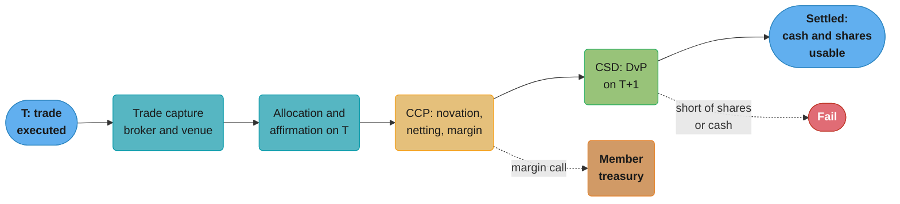
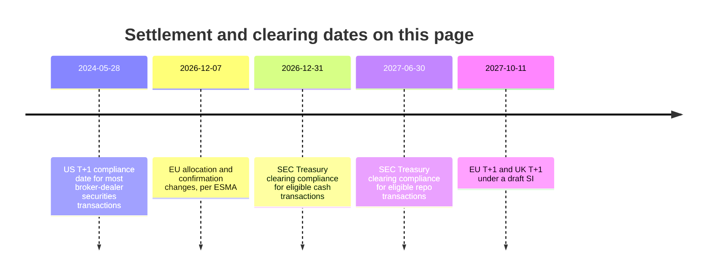
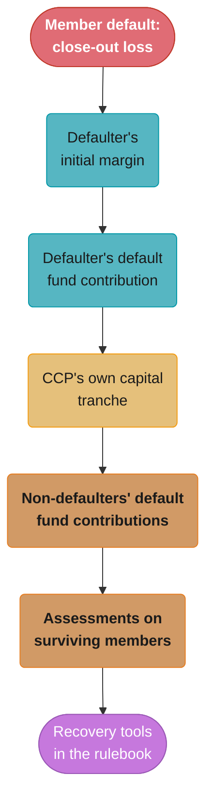

# CCP Clearing and Settlement

> Rules and figures checked 2026-11-06. Every date, threshold and fee on this page comes from the fact pins in fintech/CLAUDE.md, except the DTCC CNS figures (dtcc.com, "data as of Q3 2026", read 2026-11-06) and the PFMI cover-2 wording (CPMI-IOSCO, April 2012, read on bis.org 2026-11-06). This page is an engineering view as of 2026-11-06, not legal advice, and covers the US, the EU, the UK, India and Brazil only.

---

## 1. Concept Overview

A trade on an exchange is a promise: the buyer will pay and the seller will deliver. **Post-trade** is everything that turns that promise into a completed exchange of cash and securities. It has four stages:

1. **Trade capture.** The executed trade is recorded by both sides and by the venue.
2. **Allocation and affirmation.** An investment manager splits a block trade across its client accounts, and the parties confirm the details match.
3. **Clearing.** A central counterparty (CCP) steps between buyer and seller through novation, nets each member's obligations, and collects margin against default.
4. **Settlement.** Securities move at the central securities depository (CSD) and cash moves at the same time, delivery versus payment (DvP).

Clearing fixes what each party owes. Settlement moves it. The time between trade date (T) and settlement date is the **settlement cycle**. The SEC moved most US broker-dealer securities transactions from T+2 to T+1, with a compliance date of 2024-05-28. The EU and the UK move to T+1 on 2027-10-11, the UK under a draft statutory instrument.

The engineer's view of this page: the obligations a firm owes after a trade, the dates on which they fall due, the margin a CCP will call and when, and what happens to a firm's books when a counterparty defaults or a delivery fails.

[Design a Stock Exchange](../../hld/case_studies/design_stock_exchange.md) lists clearing, settlement and custody as out of scope and treats them as consumers of the trade log. This page starts where that study stops.

---

## 2. Intuition

**One-line analogy.** A CCP is a referee who takes the other side of every bet, holds a deposit from every player, and at the end of the day tells each player one number to pay or collect.

**Mental model.** Without a CCP, 1,000 trades between 50 firms are 1,000 bilateral promises, and each firm worries about the credit of every firm it traded with. With a CCP, each trade becomes two trades against the CCP. Each firm then has one counterparty and, per security, one net amount to deliver or receive.

```
Before novation and netting                   After netting through the CCP

  A --100 XYZ--> B                               A   nothing to settle
  B --100 XYZ--> C                               B   nothing to settle
  C --100 XYZ--> A                               C   delivers 100 --> CCP --> D receives 100
  C --100 XYZ--> D
  four deliveries                                one delivery in, one delivery out
```

On the left, A and B each deliver 100 and receive 100, so after netting they have nothing to settle. C delivers 200 and receives 100, so it owes a net 100, which the CCP passes to D. The fewer gross flows reach the CSD, the less cash and fewer securities have to move, and the fewer things can fail.

**Why it matters.** A firm's cash and securities are not its own until settlement. Buying power, withdrawals, margin and regulatory capital all depend on what has settled, what is pending, and what the CCP may call. Systems that treat "executed" as "settled" give customers money that does not exist yet.

**Key insight.** The CCP removes bilateral counterparty risk by concentrating it in one place. Its safety then rests on margin, a default waterfall and its own liquidity. That is why CCPs are tightly regulated and why their margin calls arrive on a strict timetable that member systems must meet.

---

## 3. Core Principles

**Clearing is not settlement.** Clearing computes obligations, and a CCP takes on the counterparty risk for them. Settlement discharges them. A trade can be cleared and still fail to settle.

**Novation replaces one contract with two.** After novation, the buyer owes the CCP and the CCP owes the seller. If the seller defaults, the buyer still receives its securities from the CCP.

**Multilateral netting collapses obligations.** For each member and each security, the CCP sums buys and sells into one net quantity and one net cash amount. Netting conserves quantity and cash: across all members, net quantities per security sum to zero, and net cash sums to zero.

**Margin pays for default.** Variation margin (VM) moves each day's mark-to-market gains and losses, so losses do not build up. Initial margin (IM) covers the further loss the CCP might take while it closes out a defaulter's positions.

**The waterfall sets the order of loss.** A defaulter's own margin and contributions are used first. Then the CCP's own capital tranche. Then the other members' contributions. Each CCP's rulebook fixes the layers and their sizes.

**DvP removes principal risk.** Securities move only if the cash moves, at the same moment, at the CSD. Without DvP one side can deliver and not be paid.

**Settlement date drives availability.** Cash and securities from a trade become usable on the settlement date, computed in business days on the right calendar.

---

## 4. Types / Architectures / Strategies

### Clearing models

| Model | Counterparty after the trade | Netting | Typical market |
|---|---|---|---|
| CCP clearing | The CCP | Multilateral, across all members | Listed equities, futures, cleared swaps, cleared Treasuries |
| Bilateral clearing | The original counterparty | Bilateral, with each counterparty separately | Uncleared OTC derivatives, some repo |
| Gross settlement, no CCP | The original counterparty | None | Large-value bond trades in some markets |

### Roles

| Role | What it does | US equities example |
|---|---|---|
| Executing broker | Executes the trade on a venue | Any broker-dealer |
| Clearing member | A member of the CCP that clears for itself and possibly for others | NSCC members |
| CCP | Novates, nets, stands behind each trade, calls margin | NSCC |
| CSD | Holds securities in book-entry form and settles transfers | DTC |
| Custodian | Holds securities for investors through accounts at the CSD | Custody banks |
| Settlement bank | Moves the cash side | Banks with accounts at the central bank |

DTCC describes NSCC as the central counterparty for virtually all broker-to-broker trades in US equities, corporate bonds, municipal bonds and unit investment trusts. NSCC issues the settlement instructions, and DTC, another DTCC subsidiary, transfers the securities and funds by book entry.

### Netting forms

| Form | What it nets | Example |
|---|---|---|
| Bilateral | Obligations between two parties | Two dealers net their trades with each other |
| Multilateral | Each party's obligations against all others, through the CCP | A CCP's daily net settlement |
| Continuous net settlement | Multilateral, rolled into one position per security and member per day | NSCC's CNS |

### Clearing access (decision model input)

| Access | Who holds the CCP membership | Who posts margin to the CCP |
|---|---|---|
| Self-clearing | The firm itself | The firm |
| Clearing broker (non-clearing member) | The clearing broker | The clearing broker, which collects margin from the firm |

---

## 5. Architecture Diagrams

### Trade to settlement in US equities on T+1



Under T+1, allocation and affirmation must finish on trade date so that the CCP and CSD can process overnight. The margin call path runs alongside, on the CCP's own timetable.

### Settlement cycle and clearing dates



The two Treasury clearing dates are the ones in an SEC statement of 2026-08-07, after a one-year extension in Release 34-102487.

### A typical CCP default waterfall



Each layer is used only when the one above is exhausted. The order shown is typical. Each CCP's rulebook sets its own layers, sizes and recovery tools.

---

## 6. How It Works - Detailed Mechanics

### 6.1 Allocation and affirmation

An investment manager often trades one block for many funds. After execution it sends allocations: how many shares go to each fund account. The broker and the manager, and often the custodian, must agree on every allocation's quantity, price, fees and settlement instructions before settlement can be instructed. This step is **affirmation**.

Under T+2 there was a full business day for this. Under T+1 it has to finish on trade date for the overnight cycle. ESMA set allocation and confirmation changes for the EU move by 2026-12-07, ten months before the EU switch on 2027-10-11. The engineering consequences:

1. Allocation becomes an event stream, not an end-of-day file.
2. Breaks (a mismatched quantity, a missing standing settlement instruction) need same-day alerts and owners.
3. Foreign investors who must buy dollars to pay have less time to fund, which moves FX into the trade-date timeline. That work is in [Treasury, Liquidity and FX Operations](../treasury_liquidity_and_fx_operations/treasury_liquidity_and_fx_operations.md).

### 6.2 Novation and multilateral netting

After novation every trade is two trades against the CCP. The CCP then sums, per member and security, the quantity to deliver or receive, and per member the cash to pay or collect. The program below nets six trades among four members in two securities, checks conservation, and counts deliveries before and after netting. Cash is in cents, prices in cents per share.

```java
import java.util.List;
import java.util.Map;
import java.util.TreeMap;

public class CcpNetting {
    record Trade(String buyer, String seller, String security, long qty, long priceCents) {}

    record Net(Map<String, Map<String, Long>> shares, Map<String, Long> cashCents) {}

    static Net net(List<Trade> trades) {
        Map<String, Map<String, Long>> shares = new TreeMap<>();
        Map<String, Long> cash = new TreeMap<>();
        for (Trade t : trades) {
            long value = Math.multiplyExact(t.qty(), t.priceCents());
            shares.computeIfAbsent(t.buyer(), k -> new TreeMap<>()).merge(t.security(), t.qty(), Long::sum);
            shares.computeIfAbsent(t.seller(), k -> new TreeMap<>()).merge(t.security(), -t.qty(), Long::sum);
            cash.merge(t.buyer(), -value, Long::sum);
            cash.merge(t.seller(), value, Long::sum);
        }
        return new Net(shares, cash);
    }

    public static void main(String[] args) {
        List<Trade> trades = List.of(
            new Trade("A", "B", "XYZ", 100, 5_000),
            new Trade("B", "C", "XYZ", 100, 5_010),
            new Trade("C", "A", "XYZ", 100, 5_005),
            new Trade("C", "D", "XYZ", 100, 5_002),
            new Trade("D", "A", "QRS", 300, 2_000),
            new Trade("B", "D", "QRS", 200, 2_001));
        Net n = net(trades);

        Map<String, Long> perSecurity = new TreeMap<>();
        n.shares().values().forEach(m -> m.forEach((sec, q) -> perSecurity.merge(sec, q, Long::sum)));
        assert perSecurity.values().stream().allMatch(q -> q == 0) : perSecurity;
        assert n.cashCents().values().stream().mapToLong(Long::longValue).sum() == 0;

        long netDeliveries = n.shares().values().stream()
            .flatMap(m -> m.values().stream()).filter(q -> q != 0).count();
        System.out.println("net shares " + n.shares());
        System.out.println("net cash cents " + n.cashCents());
        System.out.println("gross trades " + trades.size() + ", net settlement legs " + netDeliveries);
        assert n.shares().get("B").get("XYZ") == 0;
    }
}
```

Each gross trade is two settlement legs (a delivery and a receipt), so 6 trades are 12 legs. After netting there are 5 non-zero legs, and member B has nothing to settle in XYZ. DTCC reports a netting rate of 98.6% across CNS (data as of Q3 2026): almost all of the gross value is netted away before anything reaches DTC.

### 6.3 Variation margin

Each day the CCP marks every open position to a settlement price and moves the change in value as VM: members with losses pay, members with gains receive. Daily VM keeps losses from piling up across days. The SQL below stores positions and two days of settlement prices and computes each member's VM. Prices are integer cents, quantities are signed (long positive, short negative).

```sql
CREATE TABLE ccp_position (
    member   text   NOT NULL,
    contract text   NOT NULL,
    qty      bigint NOT NULL,
    PRIMARY KEY (member, contract)
);

CREATE TABLE settlement_price (
    contract    text   NOT NULL,
    business_dt date   NOT NULL,
    price_cents bigint NOT NULL CHECK (price_cents > 0),
    PRIMARY KEY (contract, business_dt)
);

INSERT INTO ccp_position VALUES ('A', 'ESZ6', 10), ('B', 'ESZ6', -4), ('C', 'ESZ6', -6),
                                ('A', 'NQZ6', -2), ('C', 'NQZ6', 2);
INSERT INTO settlement_price VALUES ('ESZ6', '2026-11-05', 600000), ('ESZ6', '2026-11-06', 598750),
                                    ('NQZ6', '2026-11-05', 2100000), ('NQZ6', '2026-11-06', 2103000);

-- Positive vm_cents: the member receives. Negative: the member pays.
CREATE VIEW variation_margin AS
SELECT p.member,
       sum(p.qty * (today.price_cents - prev.price_cents)) AS vm_cents
  FROM ccp_position p
  JOIN settlement_price today ON today.contract = p.contract AND today.business_dt = DATE '2026-11-06'
  JOIN settlement_price prev  ON prev.contract  = p.contract AND prev.business_dt  = DATE '2026-11-05'
 GROUP BY p.member;

DO $$
BEGIN
  IF (SELECT sum(vm_cents) FROM variation_margin) <> 0 THEN
    RAISE EXCEPTION 'variation margin does not net to zero';
  END IF;
END $$;

SELECT member, vm_cents FROM variation_margin ORDER BY member;
```

The contract codes and prices are illustrative, and the contracts are treated as having a multiplier of 1 to keep the arithmetic visible. A real CCP multiplies by each contract's multiplier and may call VM more than once a day in volatile markets. Because positions net to zero per contract across members, VM nets to zero too, which the `DO` block checks.

### 6.4 Initial margin

IM covers the loss the CCP might take while it closes out a defaulter's portfolio. A CCP's model estimates that loss over an assumed close-out period at a high confidence level, from historical or hypothetical scenarios, and nets offsetting positions in the same portfolio. CME's SPAN 2 is one such model: CME margins energy and equity products under SPAN 2, with the equity migration complete by January 2025, and keeps other products on SPAN with offsets across the two models.

For a member's systems, IM matters in three ways:

1. It changes daily with positions and volatility, and it jumps when volatility jumps. A firm must forecast it, not only read it.
2. It must be funded with eligible collateral by the CCP's deadline.
3. A position that reduces the firm's risk can reduce IM, so the order in which trades clear can change the call.

The margin models and liquidation mechanics for derivatives venues are in [Margin, Liquidation and Derivatives Risk](../margin_liquidation_and_derivatives_risk/margin_liquidation_and_derivatives_risk.md).

### 6.5 DvP at the CSD

At settlement the CSD moves securities from the delivering account to the receiving account, and the cash leg moves through the settlement bank, so that neither moves without the other. If the delivering member lacks the securities, or the receiving member lacks cash or credit, the leg does not settle and becomes a **fail**.

A fail has costs even when it is resolved the next day:

| Cost | Who pays |
|---|---|
| Funding for the extra day | The party that does not receive what it expected |
| Penalties, where the market's rules impose them | The failing party |
| A buy-in: the receiver buys the securities elsewhere and charges the price difference | The failing party |
| Operational work and customer complaints | Both |

For a broker the hard part is downstream. A customer who sold shares expects cash on the settlement date. If the delivery failed, the firm either funds the customer from its own money or holds the cash back, and its ledger must show which.

### 6.6 The default waterfall

When a member defaults, the CCP closes out or auctions its positions. If the close-out costs more than the defaulter's IM, the loss runs down the waterfall in §5. The PFMI (CPMI-IOSCO, April 2012) expect a CCP that has a more complex risk profile or is systemically important in multiple jurisdictions to hold resources that cover the default of the two participants and their affiliates that would cause the largest aggregate credit exposure in extreme but plausible conditions. Practitioners call this "cover 2".

The program below runs a close-out loss through an illustrative waterfall and reports what each layer pays. Amounts are in cents.

```java
import java.util.ArrayList;
import java.util.List;

public class DefaultWaterfall {
    record Layer(String name, long capacityCents) {}
    record Draw(String name, long usedCents) {}

    static List<Draw> allocate(long lossCents, List<Layer> layers) {
        List<Draw> draws = new ArrayList<>();
        long left = lossCents;
        for (Layer l : layers) {
            long used = Math.min(left, l.capacityCents());
            draws.add(new Draw(l.name(), used));
            left -= used;
        }
        draws.add(new Draw("uncovered, to recovery tools", left));
        return draws;
    }

    public static void main(String[] args) {
        List<Layer> layers = List.of(
            new Layer("defaulter initial margin", 40_000_000_00L),
            new Layer("defaulter default fund", 8_000_000_00L),
            new Layer("CCP capital tranche", 5_000_000_00L),
            new Layer("non-defaulter default fund", 120_000_000_00L),
            new Layer("assessments", 60_000_000_00L));
        long loss = 61_500_000_00L;
        List<Draw> d = allocate(loss, layers);
        d.forEach(x -> System.out.printf("%-30s %,d%n", x.name(), x.usedCents()));
        assert d.stream().mapToLong(Draw::usedCents).sum() == loss;
        assert d.get(3).usedCents() == 8_500_000_00L;
        assert d.get(5).usedCents() == 0;
    }
}
```

A $61.5 million close-out loss uses all of the defaulter's $48 million, all of the CCP's $5 million tranche, and $8.5 million of the other members' default fund. A surviving member's systems must book that $8.5 million share as a loss and replenish its contribution on the CCP's timetable.

### 6.7 Settlement dates on a calendar

Settlement date is trade date plus N **business days** on the market's calendar, not N calendar days. A Friday trade under T+1 settles on Monday, or Tuesday if Monday is a holiday. Systems that compute availability, margin due dates and payout dates need the market calendar as data, updated each year. The full treatment of calendars, cut-offs and value dates is in [Business Days, Cut-offs and Value Dates](../case_studies/cross_cutting/business_days_cutoffs_and_value_dates.md). §14 shows the bug that a calendar-day computation causes.

### 6.8 The Treasury clearing mandate

The SEC's Treasury clearing rule requires eligible secondary-market Treasury cash and repo transactions to be centrally cleared. After a one-year extension in Release 34-102487 (2025-02-25), the compliance dates are 2026-12-31 for eligible cash transactions and 2027-06-30 for eligible repo transactions. An SEC statement of 2026-08-07 still treats these dates as current. For a dealer, this turns bilateral trade flows into clearing-house flows, with novation, margin and a new set of daily deadlines.

---

## 7. Real-World Examples

**NSCC, CNS and DTC.** DTCC describes CNS as the central netting engine for US securities settlement. NSCC, through novation, becomes the counterparty to each broker-to-broker trade, and CNS nets each member's obligations into one daily position per security. DTC moves the securities and funds by book entry. DTCC's page reports a 98.6% netting rate across CNS and average margin requirements of $18.3 billion, data as of Q3 2026.

**US T+1.** The SEC moved most broker-dealer securities transactions to T+1 with a compliance date of 2024-05-28. For engineers the visible change was the lost second day: affirmation, funding and break resolution all moved into trade date.

**EU and UK T+1.** The EU moves on 2027-10-11 under Regulation (EU) 2025/2075, which amends CSDR Art. 5(2), and ESMA set allocation and confirmation changes by 2026-12-07. The UK moves on the same date under a draft SI, The Central Securities Depositories (Amendment) (Intended Settlement Date) Regulations 2026. A firm trading both markets can plan one cutover, but the UK's legal instrument was still a draft at the pin date.

**CME SPAN 2.** CME Clearing margins energy and equity products under SPAN 2, with the equity migration complete by January 2025, and other products under SPAN. Members running both models need margin forecasting that handles offsets across the two.

**Treasury clearing.** The SEC's compliance dates of 2026-12-31 for cash and 2027-06-30 for repo bring a large bilateral market into central clearing.

---

## 8. Tradeoffs

### Decision model: self-clear vs clearing broker

| Factor | Self-clear | Clearing broker |
|---|---|---|
| CCP membership | The firm meets the CCP's capital, operational and default-fund requirements | The clearing broker does |
| Default fund exposure | The firm contributes and can lose its contribution and assessments when another member defaults | Indirect, through the broker's pricing and terms |
| Margin | Posted directly to the CCP, at the CCP's rate | Posted to the broker, which may add its own buffer |
| Funding deadlines | The CCP's timetable, every day | The broker's timetable, usually earlier |
| Operations | Settlement, fails, buy-ins, corporate actions, CCP reconciliation in house | The broker does most of it |
| Per-trade cost | Lower at high volume | Broker fees on every trade |
| Concentration risk | None from a broker | The broker's failure or exit disrupts the firm |
| Choose when | High volume, strong balance sheet, an operations team that can meet daily CCP deadlines | Lower volume, a new market, or a firm that is not set up to carry default-fund risk |

Many firms self-clear in their main market and use clearing brokers elsewhere. The wider build-or-buy view, including licenses, is in [Build vs Buy and Licensing Strategy](../build_vs_buy_and_licensing_strategy/build_vs_buy_and_licensing_strategy.md).

### CCP clearing vs bilateral

| Factor | CCP | Bilateral |
|---|---|---|
| Counterparty risk | On the CCP, backed by margin and the waterfall | On each counterparty |
| Netting | Multilateral | Per counterparty |
| Margin | Standard, from the CCP's model, called daily or intraday | Negotiated per agreement |
| Product flexibility | Standardized products only | Any product the two parties agree |
| Tail risk | Concentrated in the CCP | Spread, but opaque |

### Netting frequency

| Approach | Effect |
|---|---|
| Net once a day | Fewest settlement movements, largest intraday exposure |
| Net continuously and settle gross for large items | Lower exposure, more movements |
| Settle gross, no netting | Fewest rules, most cash and securities movement |

---

## 9. When to Use / When NOT to Use

**Clear through a CCP when:**
- The product is standardized and a CCP clears it, or a rule requires it (US equities, listed futures, Treasuries from the compliance dates).
- You trade with many counterparties and want one credit relationship.

**Self-clear when:**
- Your volume makes broker fees larger than the cost of membership, capital and operations.
- You can meet the CCP's deadlines every day, including the worst day.

**Do not:**
- Treat a trade as settled at execution in any balance shown to a customer or used for withdrawals.
- Compute settlement dates in calendar days.
- Build your own netting of obligations that the CCP already nets. Reconcile to the CCP's statement instead.

---

## 10. Common Pitfalls

### Netting cash in floating point

A back office netted each member's cash in `double`. Across a day of trades the sum drifted by fractions of a cent, and the reconciliation to the CCP's net cash statement broke every day by a few cents. The ops team learned to ignore small breaks, and a real $4,000 break hid among them for a week. Figures are illustrative.

```java
public class NetCashBroken {
    public static void main(String[] args) {
        // BROKEN: double cannot hold most cent values, so the sum drifts.
        double net = 0;
        for (int i = 0; i < 1_000_000; i++) net += 0.10;  // a million 10-cent fee credits
        System.out.println(net);  // prints 100000.00000133288, not 100000.0
    }
}
```

The fix keeps cash in `long` cents and makes any non-zero break a real break.

```java
public class NetCashFixed {
    public static void main(String[] args) {
        long netCents = 0;
        for (int i = 0; i < 1_000_000; i++) netCents = Math.addExact(netCents, 10);
        assert netCents == 10_000_000L;
        System.out.println(netCents / 100 + "." + String.format("%02d", netCents % 100));
    }
}
```

Money types and rounding are in [Money Representation and Currency](../money_representation_and_currency/money_representation_and_currency.md).

### Proceeds available on trade date

A retail broker credited sale proceeds to the customer's withdrawable balance at execution. A customer sold, withdrew the proceeds the same day, and the delivery then failed because the shares were still in transfer from another broker. The firm had paid out cash it never received. Fix: separate trade-date and settlement-date balances in the ledger, and make only settled cash withdrawable. Unsettled proceeds can still count toward buying power under the firm's own risk rules, which is a separate decision.

### Reconciling to your own netting instead of the CCP's

A firm computed its expected net obligations itself and compared them with its own trade records. Both sides came from the same data, so they always matched, including on the day a trade was rejected by the CCP and never novated. Fix: reconcile your expected obligations against the CCP's and CSD's statements, which are the record of what was cleared and settled. Matching strategies and break handling are in [Reconciliation and Settlement Files](../reconciliation_and_settlement_files/reconciliation_and_settlement_files.md).

### Margin call against a funding cut-off

An illustrative case: on a volatile day the CCP called intraday VM. The firm's treasury system read margin calls in an end-of-day batch, so the call reached a person 40 minutes before the CCP's deadline, and the funding wire missed its bank's cut-off. Fix: consume margin calls as events, alert treasury at once, and keep pre-positioned collateral or a committed credit line sized for a stressed call.

---

## 11. Technologies & Tools

| Tool | What it does | Notes |
|---|---|---|
| NSCC | CCP for US broker-to-broker equity, corporate bond, municipal bond and UIT trades | A DTCC subsidiary, runs CNS |
| DTC | Central securities depository for US securities | A DTCC subsidiary, book-entry settlement |
| CME Clearing | CCP for CME Group futures and options | Uses SPAN and SPAN 2 margin models |
| SPAN 2 | CME's margin methodology | Energy and equity products |
| LCH | Clearing house group | Clears swaps, repo and other products |
| Eurex Clearing | CCP for Eurex derivatives and other products | Part of Deutsche Boerse Group |
| Euroclear | CSD and international CSD group | Settles European and international securities |
| Clearstream | CSD and international CSD group | Part of Deutsche Boerse Group |

---

## 12. Interview Questions with Answers

**Q: Is clearing the same thing as settlement?**
**Short:** No, clearing computes and nets what each party owes and puts the CCP behind it, while settlement moves the cash and securities to discharge those obligations.
A trade can clear and still fail to settle, for example when the seller does not have the shares at the CSD on settlement date. Systems must track the two states separately: cleared obligations drive margin and expected movements, settled movements drive balances that customers can use.

**Q: What does novation do, and what risk does it create?**
**Short:** It replaces the buyer-seller contract with two contracts against the CCP, which removes bilateral credit risk but concentrates all of it in the CCP.
After novation, a seller's default does not stop the buyer from receiving securities, because the CCP owes them. The CCP then has to survive any member's default, which is why it collects margin, keeps a default fund and has a waterfall. A CCP failure would hit every member at once.

**Q: How much does multilateral netting reduce settlement activity?**
**Short:** A lot: DTCC reports a 98.6% netting rate across CNS, data as of Q3 2026, so almost all gross value nets away before anything settles at DTC.
Netting works because the same members buy and sell the same securities many times a day. Each member ends with one net quantity per security and one net cash amount. Fewer movements mean less cash and fewer securities needed, and fewer chances to fail.

**Q: What did US T+1 change for engineering teams?**
**Short:** It removed a business day from post-trade, so allocation, affirmation, break fixing and funding moved onto trade date, for most broker-dealer trades from 2024-05-28.
Batch jobs that ran overnight on T and finished on T+1 had to become same-day or event-driven. Foreign investors had less time to buy dollars. Any process with a human step overnight had to be redesigned or automated.

**Q: When do the EU and the UK move to T+1?**
**Short:** Both move on 2027-10-11: the EU under Regulation (EU) 2025/2075 amending CSDR, the UK under a draft statutory instrument, with an EU allocation step by 2026-12-07.
ESMA set allocation and confirmation changes by 2026-12-07 to prepare. At the pin date the UK instrument was still a draft. Firms active in both markets plan one cutover weekend and test cross-border flows that settle on different cycles before and after it.

**Q: What does delivery versus payment protect against?**
**Short:** That securities move only if the matching cash moves at the same time, so neither side can deliver and then not be paid.
DvP removes principal risk, the risk of losing the full value of the trade. It does not remove replacement-cost risk: if the counterparty fails before settlement, you may have to trade again at a worse price. That remaining risk is what the CCP's margin covers.

**Q: What is in a CCP's default waterfall?**
**Short:** Typically the defaulter's margin, then its default fund contribution, then a CCP capital tranche, then other members' contributions, then assessments and recovery tools.
Each CCP's rulebook sets the layers, sizes and order. For a surviving member the important part is that its default fund contribution can be used to cover another member's loss, and that assessments can ask for more. Its systems must book these as losses and fund replenishment on the CCP's timetable.

**Q: What does cover 2 mean for a CCP?**
**Short:** It means resources sized for the default of the two participants, with affiliates, that would cause the largest credit exposure in extreme but plausible conditions.
The PFMI expect this from a CCP with a more complex risk profile or one that is systemically important in multiple jurisdictions. It shapes the size of the default fund and therefore each member's contribution, which grows when the largest members' exposures grow.

**Q: What is the difference between initial margin and variation margin at a CCP?**
**Short:** VM settles each day's mark-to-market gain or loss in cash, while IM is collateral against the further loss the CCP might take while closing out a defaulter.
VM nets to zero across members: losers pay, winners receive. IM is not paid to anyone. It sits at the CCP and comes back when positions close. IM jumps when volatility jumps, so members forecast it and keep funding capacity for stressed days.

**Q: What happens when a delivery fails to settle?**
**Short:** The obligation stays open past its date, and the failing party bears costs such as the counterparty's funding, penalties where the market imposes them, or a buy-in.
In a buy-in the receiver buys the securities elsewhere and charges the failing party the price difference. For a broker the harder problem is internal: a customer expecting cash on settlement date either gets funded from the firm's money or waits, and the ledger has to show which.

**Q: When should a firm self-clear instead of using a clearing broker?**
**Short:** When its volume makes broker fees exceed the cost of membership, capital and operations, and it can meet the CCP's deadlines and carry default-fund risk.
Self-clearing gives direct margin at the CCP's rate and no broker concentration risk. It also brings daily CCP funding deadlines, settlement operations, and exposure to other members' defaults through the default fund. Many firms self-clear in their main market and use brokers elsewhere.

**Q: What are the SEC Treasury clearing compliance dates?**
**Short:** 2026-12-31 for eligible secondary-market cash transactions and 2027-06-30 for eligible repo, after a one-year extension in Release 34-102487.
An SEC statement of 2026-08-07 still treated these dates as current. For dealers the change turns bilateral settlement into CCP clearing: novation, margin, default-fund exposure and a new daily timetable for each flow.

**Q: Why can a CCP margin call cause a liquidity problem for a solvent firm?**
**Short:** VM and IM calls rise sharply in a volatile market and must be paid in cash or eligible collateral by a fixed deadline, often intraday, whatever the firm's long-run solvency.
A firm can be profitable on paper and still miss a call if its cash is in the wrong place or behind a bank cut-off. Consume margin calls as events, forecast stressed calls, and keep committed funding or pre-positioned collateral sized for them.

**Q: Why use settlement-date balances instead of trade-date balances for withdrawals?**
**Short:** Cash from a sale is not received until settlement, and a delivery can fail, so paying it out on trade date can mean paying money the firm never receives.
Keep both balances in the ledger. Trade-date positions drive risk and buying power under the firm's own rules. Settlement-date cash drives withdrawals and payouts. Mixing them is a common source of losses at retail brokers.

**Q: How do the CCP, the CSD and a custodian differ?**
**Short:** The CCP novates and nets trades and stands behind them, the CSD holds securities in book-entry form and settles transfers, and a custodian holds securities for investors through CSD accounts.
In US equities NSCC is the CCP and DTC the CSD, both DTCC subsidiaries. Custodians are banks that hold assets for funds and other investors and instruct settlement on their behalf. Each keeps its own records, and a firm reconciles against all that apply to it.

**Q: What should a firm reconcile its clearing obligations against?**
**Short:** Against the CCP's and CSD's statements, which record what was actually novated, netted and settled, not against numbers derived from its own trade records.
Comparing your own expected obligations with your own trades proves only that one dataset agrees with itself. A trade the CCP rejected, or a fail the CSD reports, appears only in their statements. The break between your view and theirs is the signal.

**Q: What is the difference between a clearing member and a non-clearing member?**
**Short:** A clearing member holds the CCP membership, posts margin and default fund directly, while a non-clearing member clears through a clearing member that stands in for it.
The clearing member is liable to the CCP for its clients' trades, so it sets limits and collects margin from them, often above the CCP's own requirement. For the non-clearing firm, its clearing member's deadlines and limits are the ones that bind.

**Q: Why are allocation and affirmation now same-day work?**
**Short:** Under T+1 the CCP and CSD process overnight after trade date, so a block trade must be split across accounts and agreed by all parties on trade date to settle on time.
An allocation break found the next morning is already a likely fail. Firms moved allocation to event streams, alert on mismatches during the day, and keep standing settlement instructions current so affirmation is a match, not a negotiation.

**Q: What does CME's move to SPAN 2 mean for a clearing member's systems?**
**Short:** Energy and equity products are margined under SPAN 2 and others under SPAN, so margin forecasting must run both models and handle offsets between them.
The equity migration finished by January 2025. A member that replicates CME's margin to forecast calls or to margin its own clients has to track which products are on which model and how cross-model offsets apply.

**Q: Why does settlement date computation need a market calendar?**
**Short:** Settlement is trade date plus N business days on that market's calendar, so weekends and market holidays move the date and a calendar-day sum is wrong.
A Friday trade under T+1 settles on Monday, or Tuesday if Monday is a holiday. Calendars differ by market and change each year, so treat them as data with an owner, and test the days around every holiday.

---

## 13. Best Practices

- Keep trade-date and settlement-date balances separate in the ledger, and pay out only settled cash.
- Compute settlement dates from a market calendar held as data, never from calendar days.
- Run allocation and affirmation as same-day event streams with break alerts.
- Reconcile obligations, margin and settlements to the CCP's and CSD's statements every day.
- Consume margin calls as events and alert treasury at once.
- Forecast IM under stressed volatility and hold committed funding for it.
- Keep all money in integer minor units and treat any reconciliation break as real.
- Book default-fund usage and assessments as losses with a replenishment workflow.
- Track each dated change (T+1 moves, clearing mandates) as a project with a cutover test.

---

## 14. Case Study

**Scenario.** A broker in the EU builds a settlement service for T+1 on 2027-10-11. The service computes the intended settlement date, schedules cash funding, and moves customer sale proceeds from "pending" to "withdrawable" on that date. The first version adds the cycle length in days to the trade date, and the test suite uses trades from Monday to Thursday. Everything passes.

In a parallel run with live data, trades executed on a Friday show a settlement date on Saturday. The funding scheduler books a cash movement for a day with no settlement, and the payout service would have released proceeds over the weekend, before they arrived.

```java
import java.time.LocalDate;

public class SettlementDateBroken {
    // BROKEN: calendar days, no weekends, no holidays.
    static LocalDate settlementDate(LocalDate tradeDate, int cycleDays) {
        return tradeDate.plusDays(cycleDays);
    }

    public static void main(String[] args) {
        LocalDate friday = LocalDate.of(2027, 10, 15);
        System.out.println(settlementDate(friday, 1));  // prints 2027-10-16, a Saturday
    }
}
```

**Fix.** Settlement date is trade date plus N business days on the market's calendar. The calendar is data: a set of non-settlement dates loaded per market each year, with an owner. The holiday in the test below is an assumption for illustration, not a statement of any market's calendar.

```java
import java.time.DayOfWeek;
import java.time.LocalDate;
import java.util.Set;

public class SettlementDateFixed {
    record Calendar(String market, Set<LocalDate> holidays) {
        boolean isBusinessDay(LocalDate d) {
            DayOfWeek w = d.getDayOfWeek();
            return w != DayOfWeek.SATURDAY && w != DayOfWeek.SUNDAY && !holidays.contains(d);
        }
    }

    static LocalDate settlementDate(LocalDate tradeDate, int cycleDays, Calendar cal) {
        if (!cal.isBusinessDay(tradeDate)) throw new IllegalArgumentException("trade date is not a business day");
        LocalDate d = tradeDate;
        for (int n = 0; n < cycleDays; ) {
            d = d.plusDays(1);
            if (cal.isBusinessDay(d)) n++;
        }
        return d;
    }

    public static void main(String[] args) {
        Calendar cal = new Calendar("TEST", Set.of(LocalDate.of(2027, 10, 18)));
        LocalDate thursday = LocalDate.of(2027, 10, 14), friday = LocalDate.of(2027, 10, 15);
        assert settlementDate(thursday, 1, cal).equals(friday);
        assert settlementDate(friday, 1, cal).equals(LocalDate.of(2027, 10, 19));
        assert settlementDate(friday, 2, cal).equals(LocalDate.of(2027, 10, 20));
        System.out.println("Friday trade settles " + settlementDate(friday, 1, cal));
    }
}
```

**What else changed.**

| Item | Before | After |
|---|---|---|
| Settlement date | Trade date plus calendar days | Business days on a per-market calendar |
| Calendar | Hard-coded weekends | Data, loaded yearly, with an owner and an expiry alert |
| Test data | Monday to Thursday trades | Every weekday, the days around each holiday, and month end |
| Withdrawable cash | Released on the computed date | Released on the CSD's settlement confirmation |
| Cutover | One cycle constant | A dated switch from T+2 to T+1 at 2027-10-11, set by the transition terms |

The last row matters on the cutover itself. Trades already in flight at the switch settle on the old cycle while new trades use the new one, so for a few days both cycles run at once. Read the transition terms to set the exact switch rule, and test the days on both sides of it. The calendar, cut-off and value-date rules that sit under this service are in [Business Days, Cut-offs and Value Dates](../case_studies/cross_cutting/business_days_cutoffs_and_value_dates.md), and the conservation checks every settlement service needs are in [Money Movement Invariants](../case_studies/cross_cutting/money_movement_invariants.md).
