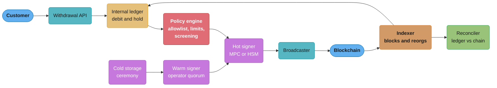
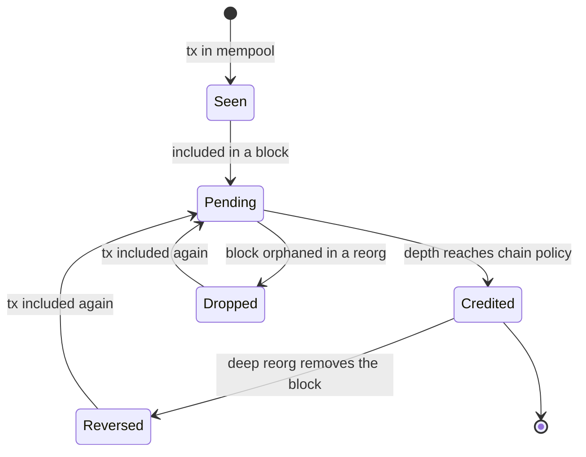
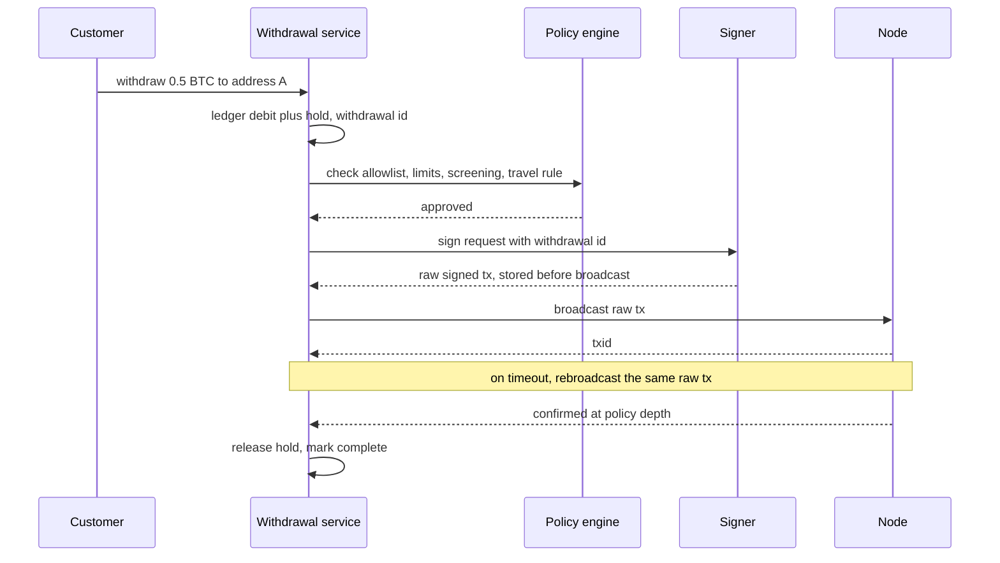

# Crypto Custody and On-Chain Operations

> Rules and figures checked 2026-11-06. Every date, threshold and fee on this page comes from the
> fact pins in fintech/CLAUDE.md. This page is an engineering view as of that date, not legal
> advice, and covers the US, the EU, the UK, India and Brazil only.

---

## 1. Concept Overview

A crypto custodian holds private keys on behalf of customers. Whoever can sign with a key can
move the coins at that address, and a confirmed transfer has no chargeback, no recall and no
reversal message. So custody engineering is mostly about two things: who can produce a
signature, and what must be true before anyone does.

A custodian or exchange runs two books at once:

- **The internal ledger.** One account per customer per asset. It records what the custodian
  owes. Most activity (trades, transfers between customers, fees) moves only here.
- **The chain.** Addresses the custodian controls, with balances any node can read. It records
  what the custodian holds.

The on-chain side has four flows: deposits (detect, wait for finality, credit), withdrawals
(check, sign, broadcast, confirm), sweeps (move deposit funds into the hot wallet) and
rebalancing between hot, warm and cold storage. Around them sit the controls: the signing
scheme (HSM, multisig or MPC), withdrawal policy, travel-rule data, proof of reserves, and the
licensing rules that decide who may offer custody at all (MiCA in the EU, the GENIUS Act for US
payment stablecoins).

This page owns the custody split and the signing-scheme decision. Integer width for satoshi and
wei amounts is taught in
[Money Representation and Currency](../money_representation_and_currency/money_representation_and_currency.md),
and the ledger model behind the omnibus book is in
[Double-Entry Ledger Design](../double_entry_ledger_design/double_entry_ledger_design.md).
Hashes, signatures and key derivation primitives are owned by
[Cryptography Fundamentals](../../cs_fundamentals/cryptography_fundamentals/cryptography_fundamentals.md),
and stablecoin payments by AI agents (x402) by
[Agentic Commerce and Payments](../../llm/multi_agent_systems/agentic_commerce_and_payments.md).

---

## 2. Intuition

> **One-line analogy:** a custodian is a bank vault where the vault door is a password, anyone
> who learns the password empties the vault, and nobody can call the police to bring the money
> back.

**Mental model.** Card and bank rails let you fix a mistake after the fact: a chargeback, a
reversal, a return. A chain gives you none of those. Every control that a bank runs after the
payment, a custodian must run before the signature. The signature is the point of no return,
so the architecture is a funnel that narrows to a signing step guarded by policy, quorum and
time.

**Why it matters.** Most custody losses are not cryptography breaks. They are a key in the wrong
place, a withdrawal signed twice, a deposit credited before a reorg, or a reserve report that
counted assets without counting what was owed. Each one is a design choice you make on a
whiteboard.

**Key insight.** The ledger says what you owe, the chain says what you hold, and solvency is the
claim that the second covers the first, asset by asset. Every component on this page either
moves one of those numbers or proves the relation between them.

---

## 3. Core Principles

1. **A key is the asset.** Possession of a signing key is control of the funds. Key storage,
   key use and key recovery are the custody product.
2. **Controls run before the signature.** A broadcast transfer cannot be recalled. Allowlists,
   velocity limits, sanctions screening and travel-rule checks all sit upstream of signing.
3. **Credit at your finality policy, not at first sight.** A transaction seen in the mempool or
   in one block can still disappear in a reorg. Each chain gets a written confirmation policy.
4. **One withdrawal, one signed transaction.** Retrying a withdrawal means rebroadcasting the
   same signed bytes or replacing them in a way that spends the same input or nonce. Signing a
   fresh transaction on timeout pays twice.
5. **Amounts are integers at the chain's native scale.** Satoshi balances fit in a 64-bit integer.
   Wei balances need 128 bits or more.
6. **The ledger and the chain reconcile per asset.** Liabilities in the ledger, holdings on
   chain, and a break report when they differ.
7. **Reserves mean nothing without liabilities.** A proof of reserves that shows assets but not
   the matching customer balances proves nothing about solvency.

---

## 4. Types / Architectures / Strategies

### 4.1 Hot, warm and cold storage

| Tier | Key location | Signing path | Holds (assumption) | Typical use |
|---|---|---|---|---|
| Hot | Online HSM or MPC nodes | Automated, policy engine approves | A few hours of expected net withdrawals | Customer withdrawals |
| Warm | HSM or MPC with human approval | Quorum of operators, minutes to hours | About a day or two of expected outflow | Refill the hot wallet |
| Cold | Offline HSM, air-gapped devices, or MPC shares held offline | Key ceremony, hours to days | The rest | Reserve, deep storage |

The sizes are design assumptions. The rule behind them: hot wallet size is the most you can
afford to lose in one incident, and the cold share is set by how fast you must be able to pay
customers who all ask at once.

### 4.2 Signing schemes

| Scheme | How a signature is made | Visible on chain | Change the signers | Chain support |
|---|---|---|---|---|
| Single key in an HSM | The HSM holds one key and signs inside the device | One normal signature | Move funds to a new address | Every chain |
| Native multisig | m of n keys each sign. The chain checks the quorum (Bitcoin script, or a smart-contract wallet on EVM chains) | Yes: the script or contract shows the policy | Move funds (Bitcoin) or call the contract (EVM) | Needs script or contract support |
| MPC or threshold signatures (TSS) | n parties hold key shares, t of them run a protocol that outputs one signature. The full key never exists in one place | No: one normal signature | Reshare the key off chain, address unchanged | Any chain whose signature scheme the MPC library supports |

### 4.3 Chain accounting models

| Model | State | What a transfer spends | Main custody concern |
|---|---|---|---|
| UTXO (Bitcoin) | A set of unspent outputs | Specific outputs, with change back to you | Coin selection, dust, change addresses |
| Account (Ethereum and EVM chains) | A balance and a nonce per address | Balance, ordered by the sender's nonce | Nonce management, gas funding for token deposits |

### 4.4 Deposit address strategies

| Strategy | How the custodian knows who paid | Cost | Failure mode |
|---|---|---|---|
| One address per customer (HD derivation) | The address itself | Sweeps cost fees, many addresses to watch | Missing an address in the watch list |
| Shared address plus memo or destination tag | A tag field in the transaction | No sweeps | Customer forgets the tag, funds land unattributed |
| Forwarder contract per customer (EVM) | Contract address | Deployment and sweep gas | Contract bugs |

### 4.5 Decision model: custody split and signing scheme

This table is the section's only copy of this decision.

| Question | Choose HSM single key | Choose native multisig | Choose MPC |
|---|---|---|---|
| Many chains, including ones without multisig scripts | Works, but one key per chain is a single point of failure | Not available on some chains | Yes |
| Auditors or customers want the quorum visible on chain | No | Yes | No, the policy lives off chain |
| Signers change often (staff turnover, vendors) | Move funds | Move funds or contract call | Reshare, no move |
| Hot wallet, automated signing at volume | Yes, with a policy engine in front | Slower, more fee per spend | Yes |
| Cold storage with a ceremony | Yes, offline HSM | Yes, keys in separate locations | Yes, shares offline |
| Fee per spend | Lowest | Higher on Bitcoin (larger witness), contract gas on EVM | Lowest |
| Library and protocol risk | Vendor firmware | Script or contract code | The MPC protocol implementation |

A common shape: MPC or HSM for hot and warm, multisig or offline MPC shares for cold, and a
policy engine in front of every tier.

---

## 5. Architecture Diagrams

### 5.1 Custody topology



Money leaves only through the policy engine and a signer. The indexer is the only writer of
deposit credits and withdrawal confirmations, and the reconciler compares both books.

### 5.2 Deposit lifecycle



A deposit is spendable only in `Credited`. `Reversed` is a new ledger entry, never a delete,
and it is rare once the policy depth is set for the chain.

### 5.3 Withdrawal sequence



The signed bytes are stored before the first broadcast. That record is what makes a retry safe.

### 5.4 Merkle sum tree for proof of liabilities

```
                        root: H(n12 | n34), sum 160
                       /                           \
          n12: H(L1|L2), sum 100              n34: H(L3|L4), sum 60
            /            \                      /             \
   L1: alice, 70    L2: bob, 30         L3: carol, 45    L4: dan, 15

   Proof for bob: [ L1 (hash, 70) on the left, n34 (hash, 60) on the right ]
   bob recomputes: n12 = H(L1|L2), sum 100 -> root = H(n12|n34), sum 160
```

Each node carries a hash and the sum of the balances below it. A customer who gets the sibling
path recomputes the root and sees that their balance is inside the published total. The
exchange then shows on-chain holdings of at least 160.

---

## 6. How It Works - Detailed Mechanics

### 6.1 HD wallets and deposit addresses

BIP32 defines hierarchical deterministic (HD) wallets: one seed produces a tree of key pairs.
BIP44 fixes the path layout `m / purpose' / coin_type' / account' / change / address_index`.
Both have status Deployed.

The useful property for custody: an extended public key (xpub) at the account level derives
every child public key below it without any private key. So the deposit service holds only the
xpub. It derives address `i` for customer `i` and watches it. The private keys stay in the
signer, which derives the same child key when a sweep needs it.

Rules that follow:

- The deposit service is watch-only. If it is breached, the attacker learns addresses, not keys.
- Store the derivation index per customer. Never reuse an index for a second customer.
- Watch a gap of unused addresses ahead of the highest issued index, so a deposit to a freshly
  issued address is not missed.

### 6.2 Confirmations, finality and reorgs

A block can be replaced by a competing block at the same height. Transactions in the losing
block return to the mempool, and some never confirm again (a double spend in the replacing
block, or a fee too low). So a custodian credits a deposit only at a depth its policy accepts.

Ethereum proof of stake uses 12-second slots and 32-slot epochs. A checkpoint is finalized when
a supermajority link (2/3 of staked ETH) joins two checkpoints. In the normal case that
is about two epochs, 64 slots x 12 s = 12.8 minutes, as arithmetic. Once a block is behind a
finalized checkpoint, reverting it needs a large share of stake to be slashed.

Proof-of-work chains have no finality, only depth. Each extra block makes a reorg less likely
and never impossible. The confirmation depth per chain is a risk-appetite choice, set from the
largest deposit you accept and the cost of renting enough hash power to rewrite that depth.

| Chain type | Policy (illustrative assumption) | Notes |
|---|---|---|
| Ethereum mainnet | Credit at the finalized checkpoint | About 12.8 min in the normal case |
| Bitcoin | Fixed depth, larger for large deposits | Depth scales with amount |
| Small proof-of-work chains | Much deeper, or no deposits above a cap | Cheap to attack with rented hash power |

The indexer keys every credit by `(chain, tx_hash, output_or_log_index)`, so replaying blocks
after a restart never credits twice. On a reorg it compares the stored block hash at each
height with the canonical one, and for any credited deposit whose block left the chain it
writes a reversing entry.

```java
import java.util.*;

public class DepositIndexer {
    record Deposit(String chain, String txHash, int index, String account, long amountMinor,
                   long height, String blockHash) {
        String key() { return chain + ":" + txHash + ":" + index; }
    }
    record Entry(String key, String account, long amountMinor, String reason) {}

    static final int REQUIRED_DEPTH = 6; // illustrative policy for this chain

    final Map<String, Deposit> credited = new HashMap<>();
    final List<Entry> journal = new ArrayList<>();

    void onTip(long tipHeight, List<Deposit> seen) {
        for (Deposit d : seen) {
            long depth = tipHeight - d.height() + 1;
            if (depth >= REQUIRED_DEPTH && !credited.containsKey(d.key())) {
                credited.put(d.key(), d);
                journal.add(new Entry(d.key(), d.account(), d.amountMinor(), "credit"));
            }
        }
    }

    void onReorg(Map<Long, String> canonicalHashByHeight) {
        for (Iterator<Deposit> it = credited.values().iterator(); it.hasNext(); ) {
            Deposit d = it.next();
            String canonical = canonicalHashByHeight.get(d.height());
            if (canonical != null && !canonical.equals(d.blockHash())) {
                journal.add(new Entry(d.key(), d.account(), -d.amountMinor(), "reorg reversal"));
                it.remove();
            }
        }
    }

    long balance(String account) {
        return journal.stream().filter(e -> e.account().equals(account))
                .mapToLong(Entry::amountMinor).sum();
    }

    public static void main(String[] args) {
        var ix = new DepositIndexer();
        var d = new Deposit("btc", "ab12", 0, "alice", 50_000_000L, 100, "h100");
        ix.onTip(104, List.of(d));          // depth 5: not yet
        assert ix.balance("alice") == 0;
        ix.onTip(105, List.of(d));          // depth 6: credit
        ix.onTip(106, List.of(d));          // replay: no second credit
        assert ix.balance("alice") == 50_000_000L;
        ix.onReorg(Map.of(100L, "h100b"));  // block 100 replaced
        assert ix.balance("alice") == 0;
        assert ix.journal.size() == 2;      // credit plus reversal, nothing deleted
        System.out.println("journal: " + ix.journal);
    }
}
```

### 6.3 UTXO coin selection and fee bumping on Bitcoin

A Bitcoin transaction spends whole outputs. To pay 0.3 BTC from outputs of 0.2 and 0.25 BTC,
the wallet spends both and sends 0.15 BTC minus the fee back to a change address it controls.
The fee is the inputs minus the outputs, so a bug that forgets the change output gives the
whole difference to the miner.

Coin selection trades fee now against fee later: spending many small outputs costs more bytes
today and consolidates for tomorrow. Custodians consolidate when fees are low and avoid it when
they are high.

A transaction stuck with a low fee has two fixes:

- **RBF (replace-by-fee).** Sign a replacement that spends the same inputs with a higher fee.
  Only one of the two can confirm because they conflict.
- **CPFP (child pays for parent).** Spend the stuck transaction's change output in a child
  with a high fee. Miners include both to collect the child's fee. This is how a receiver, or a
  sender with no RBF option, speeds a payment up.

Both work because they never create a second, independent payment. A fresh transaction that
spends different inputs would.

### 6.4 EVM nonces and EIP-1559 fees

Every transaction from an EVM address carries a nonce. The chain accepts nonce `n` only after
`n - 1`, and only one transaction per nonce can confirm. Three consequences for a hot wallet:

1. Allocate nonces from one place per sending address (a database row locked per address, or a
   single writer). Two workers reading the nonce from a node will collide.
2. A stuck nonce blocks every later transaction from that address. The fix is a replacement
   with the same nonce and a higher fee, or a zero-value self-transfer with that nonce to clear
   it.
3. A withdrawal retried with a new nonce is a second payment. Both can confirm.

EIP-1559 (status Final) splits the fee into a base fee per gas, which is burned, and a priority
fee, which the validator keeps. The base fee moves at most 12.5% per block, because
`BASE_FEE_MAX_CHANGE_DENOMINATOR` is 8, and the block gas target is half the limit
(`ELASTICITY_MULTIPLIER` = 2). That bound lets a wallet set `maxFeePerGas` high enough to stay
valid for `k` full blocks without guessing:

```java
import java.math.BigInteger;

public class FeeBound {
    static final BigInteger DENOM = BigInteger.valueOf(8); // BASE_FEE_MAX_CHANGE_DENOMINATOR

    // Base fee after k consecutive full blocks: each step adds base / 8 (at least 1 wei).
    static BigInteger worstBaseFee(BigInteger baseFeeWei, int blocks) {
        BigInteger b = baseFeeWei;
        for (int i = 0; i < blocks; i++) {
            BigInteger delta = b.divide(DENOM).max(BigInteger.ONE);
            b = b.add(delta);
        }
        return b;
    }

    public static void main(String[] args) {
        BigInteger gwei = BigInteger.TEN.pow(9);
        BigInteger base = BigInteger.valueOf(20).multiply(gwei);     // 20 gwei now
        BigInteger tip = BigInteger.valueOf(2).multiply(gwei);       // priority fee
        BigInteger worst6 = worstBaseFee(base, 6);
        BigInteger maxFee = worst6.add(tip);
        System.out.println("base after 6 full blocks (wei): " + worst6);
        System.out.println("maxFeePerGas (wei): " + maxFee);
        // 20 gwei * (9/8)^6 is about 40.5 gwei: the bound roughly doubles in 6 blocks
        assert worst6.compareTo(BigInteger.valueOf(40).multiply(gwei)) > 0;
        assert worst6.compareTo(BigInteger.valueOf(41).multiply(gwei)) < 0;
    }
}
```

The sender pays `min(maxFeePerGas, baseFee + priorityFee)` per gas, so a high cap costs nothing
extra when the base fee stays low. Fee amounts use `BigInteger`, because wei amounts overflow a
`long` above about 9.22 ETH.

### 6.5 Withdrawal controls

Each withdrawal passes the same gate before signing:

| Check | Rule (assumption unless pinned) | Why |
|---|---|---|
| Ledger debit and hold | Debit the customer and hold the amount before signing | The customer cannot spend it twice |
| Address allowlist | New addresses wait a cooling period (for example 24 to 48 hours) before first use | An attacker with a stolen session must wait while the customer gets an alert |
| Velocity limit | Per customer, per asset, per day | Bounds the loss from one compromised account |
| Sanctions and risk screening | Screen the destination address and the counterparty | See [KYC, AML and Sanctions Screening](../kyc_aml_and_sanctions_screening/kyc_aml_and_sanctions_screening.md) |
| Travel-rule data | Originator and beneficiary information, with the self-hosted address check where it applies | EU TFR |
| Hot-wallet cap | If the amount exceeds what hot holds, route to warm with a human quorum | Keeps the hot wallet small |

Batching many customer withdrawals into one transaction saves fees (one transaction, many
outputs on Bitcoin, or a batch contract call on EVM). It also couples them: one bad output
fails the whole batch, and a replacement must keep every output. Batch only checked
withdrawals, and record which withdrawal ids each signed transaction carries.

### 6.6 The omnibus ledger and sweeps

Customer balances live in the internal ledger. On chain, the custodian holds pooled
(omnibus) wallets. A trade between two customers moves no coins on chain. It is a ledger
transfer.

Deposits on per-customer addresses get swept into the hot wallet. On EVM chains a token deposit
(an ERC-20 transfer) leaves tokens at an address with no ETH to pay gas, so the sweeper first
sends gas money to that address, then sweeps. Both legs are ledger entries on the custodian's
own fee account, never on the customer's balance.

Reconciliation runs per asset:

```
holdings(asset) = sum of on-chain balances of every custodian address for that asset
liabilities(asset) = sum of customer ledger balances + pending withdrawals not yet broadcast
break(asset) = holdings - liabilities - fee float - known in-flight sweeps
```

A break that stays nonzero past one confirmation window is an incident, not a rounding issue.

### 6.7 Proof of reserves and proof of liabilities

A proof of reserves has two halves:

- **Liabilities.** A Merkle sum tree over customer net balances per asset. Each customer gets
  a path and can check that their balance is in the tree and the tree total is the published
  total.
- **Reserves.** Proof that the custodian controls on-chain addresses holding at least that
  total, for example by signing a message with each address key.

Two published designs:

| Exchange | Liabilities method | Extra check | Stated limits |
|---|---|---|---|
| Binance | Merkle tree of user net balances per asset | A zk-SNARK circuit proves the leaves sum to the stated total and each net balance is non-negative | (none pinned) |
| Kraken | An independent accountant builds a Merkle tree from an anonymized balance snapshot and checks on-chain holdings meet or exceed it | Clients check inclusion | Cannot prove exclusive key control, cannot see hidden encumbrances, snapshot only. Snapshot of 2026-06-30 |

The non-negative check matters. An exchange that inserts a fake account with a large negative
balance lowers the total it must back with reserves, and a plain sum tree cannot see that. The
code below builds a sum tree, rejects negative leaves, and checks a customer's path:

```java
import java.nio.ByteBuffer;
import java.security.MessageDigest;
import java.util.*;

public class MerkleSumTree {
    record Node(byte[] hash, long sum) {}
    record Step(Node sibling, boolean siblingOnLeft) {}

    static byte[] sha256(byte[]... parts) throws Exception {
        MessageDigest md = MessageDigest.getInstance("SHA-256");
        for (byte[] p : parts) md.update(p);
        return md.digest();
    }

    static byte[] longBytes(long v) { return ByteBuffer.allocate(8).putLong(v).array(); }

    static Node leaf(String userId, String nonce, long balance) throws Exception {
        if (balance < 0) throw new IllegalArgumentException("negative leaf: " + userId);
        return new Node(sha256((userId + ":" + nonce).getBytes(), longBytes(balance)), balance);
    }

    static Node parent(Node l, Node r) throws Exception {
        long s = Math.addExact(l.sum(), r.sum());
        return new Node(sha256(l.hash(), longBytes(l.sum()), r.hash(), longBytes(r.sum()),
                longBytes(s)), s);
    }

    static Node root(Node leafNode, List<Step> path) throws Exception {
        Node cur = leafNode;
        for (Step st : path) {
            cur = st.siblingOnLeft() ? parent(st.sibling(), cur) : parent(cur, st.sibling());
        }
        return cur;
    }

    public static void main(String[] args) throws Exception {
        Node alice = leaf("alice", "n1", 70), bob = leaf("bob", "n2", 30);
        Node carol = leaf("carol", "n3", 45), dan = leaf("dan", "n4", 15);
        Node n12 = parent(alice, bob), n34 = parent(carol, dan);
        Node published = parent(n12, n34);
        assert published.sum() == 160;

        List<Step> bobPath = List.of(new Step(alice, true), new Step(n34, false));
        Node recomputed = root(leaf("bob", "n2", 30), bobPath);
        assert Arrays.equals(recomputed.hash(), published.hash());
        assert recomputed.sum() == published.sum();

        boolean rejected = false;
        try { leaf("ghost", "n5", -100); } catch (IllegalArgumentException e) { rejected = true; }
        assert rejected;
        System.out.println("total liabilities " + published.sum() + ", bob included");
    }
}
```

The per-leaf nonce stops anyone from guessing a customer's balance from the leaf hash. The
proof is a snapshot. It says nothing about the hour after it, nor about liabilities the
exchange keeps outside the tree.

### 6.8 Amount width

Bitcoin Core's `CAmount` is a 64-bit integer. `COIN` is 100,000,000 satoshi and `MAX_MONEY` is
21,000,000 x `COIN` = 2.1e15 satoshi, far below the int64 maximum of about 9.22e18. So a
`long` holds any Bitcoin amount.

1 ETH is 1e18 wei, so a signed 64-bit integer holds at most about 9.22 ETH in wei. EVM words are
256-bit. Store wei and token base units as `NUMERIC(78,0)` in PostgreSQL (enough digits for
2^256) and `BigInteger` in Java. Tokens set their own `decimals`, so the scale is per token, not
per chain.

### 6.9 Rules that shape the design

| Rule | Status (pin) | Engineering effect |
|---|---|---|
| MiCA | Titles III and IV (ARTs, EMTs) apply from 2024-06-30, the rest from 2024-12-30. The Art. 143(3) CASP transitional period ended at the latest on 2026-07-01. ESMA said on 2026-06-23 that unauthorised CASPs must stop onboarding and wind down | An EU custody or exchange service needs CASP authorisation. A product built on the transitional period is no longer an option |
| EU Transfer of Funds Regulation (EU) 2023/1113 | Applies from 2024-12-30. Crypto-asset transfers carry originator and beneficiary information at any amount. Above EUR 1,000 to a self-hosted address, the originator's CASP assesses whether the originator owns or controls that address | Every withdrawal record carries travel-rule fields. The policy engine needs an ownership check path for self-hosted addresses |
| FATF Recommendation 16 revision | Published 2025-06-18, end-2030 implementation target that FATF can adjust. Covers payment-chain roles, originator and beneficiary information, and beneficiary information checks | Plan for beneficiary information checks in payment flows. No amount thresholds are pinned |
| GENIUS Act | Public Law 119-27, signed 2025-07-18. Takes effect on the earlier of 2027-01-18 or 120 days after the primary regulators issue final rules | Governs US payment stablecoin issuers |
| OCC GENIUS rule | Final rule, 12 CFR 15, issued 2026-10-21, effective 2027-01-18. BSA, AML and OFAC rules are a separate rulemaking | Issuers under OCC supervision plan to that date |
| Federal Reserve GENIUS proposals | Reserve, capital and custody standards plus an application process, proposed 2026-09-24, docket R-1899, comments due 2026-11-30 | Proposal only, no final text |

---

## 7. Real-World Examples

**Bitcoin Core amount type.** `CAmount` is `int64_t`, and `MAX_MONEY` is 2.1e15 satoshi.
The node rejects any output value above `MAX_MONEY`, so wallet code that also uses a 64-bit
integer can never be handed a value it cannot hold.

**Ethereum fee burn.** Since EIP-1559, the base fee per gas is burned and the validator keeps
only the priority fee. For a custodian this means fee estimation is mostly about the
base fee's bounded drift, and the tip is a small, separate decision.

**Binance proof of reserves.** A Merkle tree of user net balances per asset plus a zk-SNARK
circuit that proves the leaves sum to the stated total and that each net balance is
non-negative. Each user can check their own leaf.

**Kraken proof of reserves.** An independent accountant builds the tree from an anonymized
snapshot and checks that on-chain holdings meet or exceed it. Kraken lists what the proof cannot
show: exclusive key control, hidden encumbrances, and anything after the snapshot.

**Stablecoins as a payment rail.** The x402 protocol settles HTTP API payments in a stablecoin.
The custody side of that flow (who holds the paying wallet's key, and the limits on it) is this
page's material. The protocol itself is in
[Agentic Commerce and Payments](../../llm/multi_agent_systems/agentic_commerce_and_payments.md).

**MiCA authorisation deadline.** With the transitional period over, EU firms that relied
on it had to hold CASP authorisation or wind down. An EU custody design has to show the
authority the controls on this page.

---

## 8. Tradeoffs

### 8.1 Signing scheme

| Criterion | HSM single key | Native multisig | MPC / TSS |
|---|---|---|---|
| Single point of compromise | The HSM and its admin path | None if keys are in separate domains | None if shares are in separate domains |
| On-chain privacy of the policy | Private | Public | Private |
| Fee per spend | Low | Higher | Low |
| Key rotation | Move funds | Move funds or contract call | Reshare off chain |
| Chain coverage | All | Only chains with scripts or contracts | All chains the library supports |
| Main risk | Firmware, admin access | Script or contract bug | Protocol implementation bug |

### 8.2 Custody tiers

| Tier size | Gain | Cost |
|---|---|---|
| Large hot wallet | Fast withdrawals, fewer refills | Bigger loss in one breach |
| Small hot wallet | Smaller blast radius | More warm refills, slower large withdrawals |
| Large cold share | Most funds offline | A bank-run style surge needs ceremonies |

### 8.3 Deposit address strategy

| Option | Operations | Customer error risk | Fees |
|---|---|---|---|
| Address per customer | Sweeps, gas funding | Low | Sweep fees |
| Shared address and tag | No sweeps | High (missing tags) | Low |

### 8.4 Proof of reserves designs

| Design | Shows | Does not show |
|---|---|---|
| Reserve attestation alone | Assets on chain at a time | Liabilities, so not solvency |
| Merkle sum tree plus reserves | Inclusion of each customer, total liabilities, holdings at a time | Negative or fake accounts, unless checked, and anything after the snapshot |
| Sum tree plus zk proof of non-negative leaves | The above plus no negative leaf | Off-tree liabilities, encumbrances |

---

## 9. When to Use / When NOT to Use

**Run your own custody stack when:**

- You are an exchange or broker with high withdrawal volume and need automated hot signing.
- You hold the CASP authorisation (EU) or the licensing that covers custody, and the auditors
  will review your controls.
- You support chains your custody vendor does not.

**Use a qualified third-party custodian when:**

- Custody is not your product: you need to hold treasury or customer assets, not run signing
  infrastructure.
- You cannot staff a 24x7 signing and incident team.
- Your regulator or customers require a custodian with its own license and audit record.

**Do not:**

- Keep the whole balance in a hot wallet because withdrawals are "rare".
- Run a proof of reserves without liabilities and call it solvency.
- Accept deposits on a chain you cannot index with reorg handling.

For the wider build-or-buy framing see
[Build vs Buy and Licensing Strategy](../build_vs_buy_and_licensing_strategy/build_vs_buy_and_licensing_strategy.md).

---

## 10. Common Pitfalls

### 10.1 Re-signing a withdrawal on timeout

An illustrative incident: the broadcaster waited 60 seconds for a txid, timed out, and the
retry path asked the signer for a fresh transaction with the next nonce. Both transactions
confirmed. The customer was paid twice and the ledger showed one debit.

```java
// BROKEN
import java.util.*;

public class ResignOnTimeout {
    static long nextNonce = 7;
    static final List<String> mined = new ArrayList<>();

    static String sign(String withdrawalId, long nonce) {
        return withdrawalId + "@nonce" + nonce;
    }

    static void broadcast(String rawTx) { mined.add(rawTx); } // the node did accept it

    public static void main(String[] args) {
        String w = "wd-42";
        broadcast(sign(w, nextNonce++));   // response lost, caller sees a timeout
        broadcast(sign(w, nextNonce++));   // retry signs again with a new nonce
        long paid = mined.stream().filter(t -> t.startsWith(w)).count();
        System.out.println("payments for " + w + ": " + paid); // prints 2
    }
}
```

```java
// FIX
import java.util.*;

public class RebroadcastSameTx {
    static long nextNonce = 7;
    static final Map<String, String> signedByWithdrawal = new HashMap<>();
    static final Set<Long> usedNonces = new HashSet<>();
    static final List<String> mined = new ArrayList<>();

    static String signOnce(String withdrawalId) {
        return signedByWithdrawal.computeIfAbsent(withdrawalId,
                id -> id + "@nonce" + nextNonce++);
    }

    static void broadcast(String rawTx) {
        long nonce = Long.parseLong(rawTx.substring(rawTx.indexOf("@nonce") + 6));
        if (usedNonces.add(nonce)) mined.add(rawTx); // the chain accepts one tx per nonce
    }

    public static void main(String[] args) {
        String w = "wd-42";
        broadcast(signOnce(w));   // response lost
        broadcast(signOnce(w));   // retry sends the same stored bytes
        long paid = mined.stream().filter(t -> t.startsWith(w)).count();
        assert paid == 1;
        System.out.println("payments for " + w + ": " + paid);
    }
}
```

Store the signed transaction keyed by withdrawal id before the first broadcast. A retry sends
the stored bytes. A fee bump signs a replacement with the same nonce (EVM) or the same inputs
(Bitcoin RBF), so the chain can confirm only one.

### 10.2 Wei in a `long`

```java
// BROKEN
public class WeiOverflow {
    public static void main(String[] args) {
        long weiPerEth = 1_000_000_000_000_000_000L;
        long tenEth = 10L * weiPerEth;
        System.out.println("10 ETH in wei: " + tenEth); // prints -8446744073709551616
    }
}
```

```java
// FIX
import java.math.BigInteger;

public class WeiBigInteger {
    public static void main(String[] args) {
        BigInteger weiPerEth = BigInteger.TEN.pow(18);
        BigInteger tenEth = BigInteger.TEN.multiply(weiPerEth);
        assert tenEth.equals(new BigInteger("10000000000000000000"));
        System.out.println("10 ETH in wei: " + tenEth);
    }
}
```

The broken version compiles and prints a negative balance. Java wraps a `long` on overflow
without an error. Use `BigInteger` in code and `NUMERIC(78,0)` in the database for wei and
token base units, and use `Math.multiplyExact` wherever a `long` stays.

### 10.3 Crediting at one confirmation

An illustrative case: a small exchange credited deposits on a proof-of-work chain at one
block. An attacker deposited, traded the credit into another coin, withdrew it, and then
published a longer private chain without the deposit. The ledger showed a customer balance
backed by nothing. The fix is a per-chain depth set from the cost of a rewrite, a per-deposit
cap on thin chains, and reversal entries from the indexer when a reorg happens anyway.

### 10.4 A shared deposit address with no tag

Customers who send to a shared address and forget the memo create unattributed funds. Without a
claim process, they pile up in a suspense account and customer support turns into manual
forensics. Use per-customer addresses where the chain allows it. Where a tag is unavoidable,
reject withdrawals to known shared addresses without a tag on your own side, and run a claim
flow with proof of the sending address.

### 10.5 Nonce read from the node by two workers

Two withdrawal workers each called the node for the pending nonce, got the same value, and
signed different withdrawals with it. One replaced the other in the mempool. The ledger showed
both withdrawals as sent. Allocate nonces from one locked row per address, and let the indexer
mark a withdrawal complete only when its own txid confirms.

---

## 11. Technologies & Tools

| Tool | What it does in a custody stack |
|---|---|
| Fireblocks | Custody and transfer platform with MPC signing and a policy engine |
| BitGo | Custody and wallet platform, including multisig wallets |
| Anchorage Digital | Crypto custodian and platform |
| Coinbase Prime | Institutional custody and trading from Coinbase |
| AWS CloudHSM | Managed hardware security modules for key storage and signing |
| Thales Luna HSM | Network-attached hardware security modules |
| Bitcoin Core | Reference Bitcoin node and wallet, the source of `CAmount` |
| Geth | Go Ethereum execution client for indexing and broadcasting |
| Chainalysis | Blockchain analytics and address screening |
| TRM Labs | Blockchain risk and address screening |
| Notabene | Travel-rule data exchange between VASPs |

---

## 12. Interview Questions with Answers

**Q: Why is a withdrawal retried after a timeout one of the most dangerous operations in custody?**
**Short:** Signing a fresh transaction on retry creates a second valid payment, and both can confirm, so the customer is paid twice.

A timeout tells you nothing about whether the node accepted the first transaction. On an EVM
chain a new nonce makes the retry independent. On Bitcoin, new inputs do the same. Store the
signed bytes per withdrawal id before the first broadcast and resend those bytes. A fee bump
must spend the same nonce or the same inputs, so only one version can confirm.

**Q: What does a proof of reserves without a proof of liabilities prove?**
**Short:** Nothing about solvency, because it shows assets at a moment but not the customer balances those assets must cover.

An exchange can show 100,000 BTC on chain and owe 120,000 BTC. Solvency is holdings at least
equal to liabilities, per asset. A useful report pairs a Merkle sum tree of customer balances
with proof of control of the reserve addresses, taken at the same time. Even then it is a
snapshot, and Kraken lists that it cannot show exclusive key control or hidden encumbrances
.

**Q: How can a Merkle sum tree hide a shortfall, and how do you stop it?**
**Short:** A fake account with a negative balance lowers the tree total, so the fix is a proof that every leaf is non-negative.

The sum at the root is the liabilities figure that reserves must cover. A negative leaf
subtracts from it and every honest customer's path still checks out. Binance publishes a
zk-SNARK circuit that proves each net balance is non-negative and the leaves sum to the stated
total. Without such a proof, an auditor must check the leaf set directly.

**Q: When should a custodian credit a deposit?**
**Short:** At the depth or finality its written policy sets for that chain, never at mempool sight or one block.

A block can be reorganized out, and a deposit in it can be double spent. On Ethereum, a
finalized checkpoint takes about two epochs in the normal case (64 x 12 s = 12.8 min as
arithmetic). Proof-of-work chains have only depth, and the depth is a risk choice sized
to the deposit and the cost of rewriting blocks. Credit idempotently by transaction and output
index.

**Q: What breaks if two workers fetch the pending nonce from the node?**
**Short:** Both get the same nonce, so one withdrawal replaces the other in the mempool while the ledger records both as sent.

The node's pending nonce is a hint, not an allocator. Allocate from one row per sending
address under a lock, or from a single writer. Mark a withdrawal complete only when the
indexer sees its own txid confirm. A replaced transaction then shows up as a failed withdrawal
instead of a silent loss.

**Q: Why are wei amounts not stored in a Java `long`?**
**Short:** A signed 64-bit integer holds only about 9.22 ETH in wei, so larger balances wrap to wrong values without any error.

1 ETH is 1e18 wei and the long maximum is about 9.22e18. Java multiplication wraps
silently, so 10 ETH prints as a negative number. Use `BigInteger` in code and `NUMERIC(78,0)` in
PostgreSQL. Satoshi amounts are different: `MAX_MONEY` is 2.1e15, so a `long` holds any Bitcoin
amount.

**Q: MPC or multisig: what is the real difference for an operator?**
**Short:** Multisig puts the quorum on chain and needs chain support, while MPC computes one normal signature off chain from key shares.

Multisig is visible: auditors can read the m-of-n policy from the script or contract, and
changing signers means moving funds or a contract call. MPC works on any chain whose signature
scheme the library supports, rotates signers by resharing without moving funds, and costs the
same fee as a single-key spend. Its risk moves into the protocol implementation and the share
storage.

**Q: How do you size the hot wallet?**
**Short:** Hold enough for a few hours of expected net withdrawals, capped by the loss you accept from one breach.

The hot wallet is the blast radius of an online compromise. A warm tier with a human quorum
refills it, and cold storage holds the rest. Watch the refill rate: if warm refills run many
times a day, the hot cap is too small or the withdrawal pattern changed. The sizes are design
assumptions, set per asset.

**Q: What does an xpub let a deposit service do, and what does it not let it do?**
**Short:** It derives every child public key and address under that account, but it cannot derive any private key or sign.

BIP32 public derivation means the deposit service can issue address `i` to customer `i`
and watch it with no secret material. A breach of that service leaks addresses and the
customer mapping, not funds. One caveat: an xpub plus any one non-hardened child private key
reveals the parent private key, so never let child keys out of the signer.

**Q: How do RBF and CPFP differ?**
**Short:** RBF replaces a stuck transaction with a higher-fee version spending the same inputs, while CPFP adds a high-fee child that spends its output.

Both speed up a stuck Bitcoin payment without creating a second payment. RBF needs the sender
to sign a replacement that conflicts with the original, so only one confirms. CPFP works from the
receiving side or from the sender's change output, and miners take both transactions for the
combined fee. A fresh payment with different inputs is neither, and it pays twice.

**Q: Why does an ERC-20 deposit address need ETH before you can sweep it?**
**Short:** Moving tokens is a transaction from that address, and gas is paid in ETH, which the token deposit did not bring.

The sweeper first funds the address with enough ETH for one transfer, then sends the tokens to
the hot wallet. Both legs are custodian costs, booked to its own fee account. Batching sweeps
when the base fee is low, or using a forwarder contract per customer, cuts this cost.

**Q: What does the EU travel rule require on a crypto withdrawal?**
**Short:** Originator and beneficiary information travels with every crypto-asset transfer, and above EUR 1,000 to a self-hosted address the CASP assesses ownership.

The Transfer of Funds Regulation (EU) 2023/1113 applies from 2024-12-30. There is no
de minimis amount for carrying the data. For a transfer of more than EUR 1,000 to a self-hosted
address, the originator's CASP assesses whether the originator owns or controls it.
The policy engine needs fields for this data and a path to collect an ownership proof.

**Q: What changed for EU crypto firms on 2026-07-01?**
**Short:** The MiCA transitional period for existing CASPs ended at the latest on that date, so unauthorised CASPs must stop onboarding and wind down.

MiCA's titles on ARTs and EMTs applied from 2024-06-30 and the rest from 2024-12-30. Art.
143(3) let existing providers keep operating during a transitional period that ended at the
latest on 2026-07-01, earlier where a Member State chose. ESMA's statement of 2026-06-23
says unauthorised CASPs must stop onboarding and wind down.

**Q: When does the GENIUS Act take effect for US payment stablecoins?**
**Short:** On the earlier of 2027-01-18 or 120 days after the primary regulators issue final rules, and the OCC rule is effective 2027-01-18.

The Act is Public Law 119-27, signed 2025-07-18. The OCC issued its final rule (12 CFR 15)
on 2026-10-21, effective 2027-01-18, with BSA, AML and OFAC rules in a separate rulemaking
. The Federal Reserve proposals on reserves, capital, custody and applications take
comments until 2026-11-30, so they are not final.

**Q: How does a custodian reconcile its ledger against the chain?**
**Short:** Per asset, compare on-chain holdings across all custodian addresses with customer ledger balances plus unbroadcast withdrawals, and explain the difference.

The difference should equal the fee float and known in-flight sweeps. Anything else is a break:
a missed deposit, a double withdrawal, a sweep booked to the wrong account, or a loss. Run it
every block window for hot wallets and daily for cold. Break amounts trend to zero in a healthy
system, so a stable nonzero break is a defect, not noise.

**Q: Why is batching withdrawals both useful and risky?**
**Short:** One transaction with many outputs saves fees, but one bad output fails the batch and a fee bump must keep every output.

On Bitcoin a batch pays one set of input and overhead bytes for many payments. The risk is
coupling: a stuck batch delays every customer in it, and a replacement that drops an output
silently cancels that customer's payment. Record the withdrawal ids per signed transaction and
batch only fully checked withdrawals.

**Q: Why use per-customer deposit addresses instead of one address with a memo?**
**Short:** The address itself identifies the customer, so a forgotten memo cannot leave funds unattributed in a suspense account.

Shared addresses avoid sweep fees and are the norm on some chains. They move the attribution
risk to the customer, who will forget the tag at some rate. Per-customer HD addresses cost
sweeps and a larger watch list, and remove a whole support queue.

**Q: What is the omnibus model, and what does it cost the customer?**
**Short:** Customer coins sit pooled in custodian wallets and each customer owns a ledger balance, so the customer relies on the custodian's books and solvency.

Trades and internal transfers become cheap ledger entries with no on-chain fee or delay. The
customer gives up a direct on-chain claim to specific coins. That is why proof of liabilities,
segregation from the custodian's own assets, and regular reconciliation are the controls that
make omnibus custody acceptable.

**Q: Why does EIP-1559 make fee caps predictable?**
**Short:** The base fee changes by at most 12.5% per block, so a cap computed for k full blocks stays valid for that long.

`BASE_FEE_MAX_CHANGE_DENOMINATOR` is 8, so a full block raises the base fee by one eighth.
After 6 full blocks the worst case is about 2.03 times the start. A wallet sets
`maxFeePerGas` to that bound plus the tip and pays only `baseFee + tip` if fees stay low. The
base fee is burned, the tip goes to the validator.

**Q: What does a key ceremony protect against?**
**Short:** It stops any one person from creating, copying or using a cold key alone, by requiring a quorum, scripted steps and witnesses.

A ceremony generates keys or shares on offline hardware, records every step, splits material
across custodians and locations, and produces evidence an auditor can read. It also covers
recovery: a tested path to rebuild signing capacity when a share holder leaves or a device
fails. An untested recovery path is a loss waiting for a staff change.

**Q: Where do sanctions screening and travel rule checks sit in the withdrawal flow?**
**Short:** In the policy engine before signing, because after broadcast the transfer cannot be stopped or recalled.

On a card or bank rail a late hit can still block or return a payment. On chain it cannot. So
the destination address, the counterparty VASP and the travel-rule data are all checked before
the signer receives the request. Screening thresholds and hit handling are in
[KYC, AML and Sanctions Screening](../kyc_aml_and_sanctions_screening/kyc_aml_and_sanctions_screening.md).

**Q: How should a reorg change ledger entries already posted?**
**Short:** Post a reversing entry for each credited deposit whose block left the chain, and never delete or edit the original credit.

The ledger stays append-only, so the history shows the credit and its reversal. If the customer
already withdrew the funds, the account goes negative and enters a collections or loss
process. A deep enough confirmation policy makes this rare, and the indexer's reversal path is
what keeps the books right when it happens.

---

## 13. Best Practices

1. Write a confirmation policy per chain, sized to deposit amount, and review it when the
   chain's security changes.
2. Key every deposit credit by `(chain, tx_hash, output_or_log_index)` with a unique
   constraint.
3. Store the signed transaction per withdrawal id before the first broadcast. Retries resend
   it. Fee bumps reuse the nonce or inputs.
4. Allocate EVM nonces from one locked row per sending address.
5. Keep the deposit service watch-only, with xpubs and no private keys.
6. Cap the hot wallet per asset and refill it from warm through a human quorum.
7. Run the policy engine (allowlist with cooling period, velocity limits, screening, travel
   rule) before every signature, for every tier.
8. Use `BigInteger` and `NUMERIC(78,0)` for wei and token base units.
9. Reconcile ledger against chain per asset every block window for hot wallets.
10. Publish proof of liabilities with non-negative leaves together with reserves, and say what
    the proof does not cover.
11. Rehearse key recovery and share rotation on a schedule, with evidence.

---

## 14. Case Study

### An omnibus deposit ledger for an EU CASP

**Context.** An EU exchange with CASP authorisation under MiCA holds customer BTC and ETH
in omnibus wallets. Its indexer posts deposit credits into a PostgreSQL ledger. Design inputs
(assumptions): 200,000 deposits a day, indexer restarts during deploys, and a requirement that
the daily solvency check runs from the same tables.

**First attempt.** The indexer inserts a credit row for every deposit it sees in a block at
policy depth. After a deploy it restarted from a checkpoint 50 blocks back and replayed them:

```sql
-- BROKEN
CREATE TABLE deposit_credit_v0 (
    chain       text    NOT NULL,
    tx_hash     text    NOT NULL,
    out_index   int     NOT NULL,
    account_id  text    NOT NULL,
    asset       text    NOT NULL,
    amount      numeric(78,0) NOT NULL
);
INSERT INTO deposit_credit_v0 VALUES ('btc', 'ab12', 0, 'alice', 'BTC', 50000000);
-- indexer restarts from an older checkpoint and replays the same block
INSERT INTO deposit_credit_v0 VALUES ('btc', 'ab12', 0, 'alice', 'BTC', 50000000);
SELECT account_id, sum(amount) AS balance FROM deposit_credit_v0 GROUP BY account_id;
-- alice | 100000000   (one deposit, credited twice)
```

Nothing failed. Alice saw 1 BTC instead of 0.5 BTC and could withdraw it.

**Fix.** The deposit key is a primary key, credits and reversals are separate append-only
entries, and the solvency check reads holdings and liabilities from the same database:

```sql
CREATE TABLE deposit (
    chain       text    NOT NULL,
    tx_hash     text    NOT NULL,
    out_index   int     NOT NULL,
    account_id  text    NOT NULL,
    asset       text    NOT NULL,
    amount      numeric(78,0) NOT NULL CHECK (amount > 0),
    block_hash  text    NOT NULL,
    PRIMARY KEY (chain, tx_hash, out_index)
);

CREATE TABLE ledger_entry (
    id          bigint GENERATED ALWAYS AS IDENTITY PRIMARY KEY,
    account_id  text    NOT NULL,
    asset       text    NOT NULL,
    amount      numeric(78,0) NOT NULL,
    reason      text    NOT NULL CHECK (reason IN ('deposit', 'reorg_reversal', 'withdrawal')),
    ref         text    NOT NULL,
    UNIQUE (reason, ref)
);

CREATE TABLE onchain_holding (
    address     text    NOT NULL,
    asset       text    NOT NULL,
    amount      numeric(78,0) NOT NULL CHECK (amount >= 0),
    PRIMARY KEY (address, asset)
);

CREATE FUNCTION credit_deposit(p_chain text, p_tx text, p_idx int, p_acct text,
                               p_asset text, p_amt numeric, p_block text)
RETURNS void LANGUAGE plpgsql AS $$
BEGIN
    INSERT INTO deposit VALUES (p_chain, p_tx, p_idx, p_acct, p_asset, p_amt, p_block)
    ON CONFLICT DO NOTHING;
    IF FOUND THEN
        INSERT INTO ledger_entry (account_id, asset, amount, reason, ref)
        VALUES (p_acct, p_asset, p_amt, 'deposit', p_chain || ':' || p_tx || ':' || p_idx);
    END IF;
END $$;

SELECT credit_deposit('btc', 'ab12', 0, 'alice', 'BTC', 50000000, 'h100');
SELECT credit_deposit('btc', 'ab12', 0, 'alice', 'BTC', 50000000, 'h100'); -- replay: no-op
SELECT credit_deposit('btc', 'cd34', 1, 'bob',   'BTC', 20000000, 'h101');

-- block h100 is reorganized out: post a reversal, keep the credit
INSERT INTO ledger_entry (account_id, asset, amount, reason, ref)
SELECT account_id, asset, -amount, 'reorg_reversal', chain || ':' || tx_hash || ':' || out_index
FROM deposit WHERE block_hash = 'h100'
ON CONFLICT (reason, ref) DO NOTHING;

INSERT INTO onchain_holding VALUES ('bc1q-hot', 'BTC', 20000000);

-- solvency per asset: holdings must cover the sum of positive customer balances
WITH balances AS (
    SELECT account_id, asset, sum(amount) AS bal FROM ledger_entry GROUP BY account_id, asset
), liabilities AS (
    SELECT asset, sum(bal) FILTER (WHERE bal > 0) AS owed,
           count(*) FILTER (WHERE bal < 0) AS negative_accounts
    FROM balances GROUP BY asset
)
SELECT l.asset, coalesce(l.owed, 0) AS owed, h.held, l.negative_accounts,
       h.held >= coalesce(l.owed, 0) AS solvent
FROM liabilities l
JOIN (SELECT asset, sum(amount) AS held FROM onchain_holding GROUP BY asset) h USING (asset);
```

The second call to `credit_deposit` hits the primary key and writes nothing. The reversal is a
new entry with its own unique `(reason, ref)`, so a replayed reorg handler is also a no-op. The
solvency query sums only positive balances: a negative account (a customer who withdrew a
reversed deposit) is a receivable to collect, not a reduction in what the exchange owes
everyone else. That is the same reason the Merkle sum tree in §6.7 rejects negative leaves.

**Result.** Replays and reorg handlers became safe to rerun, and the daily solvency report
and the proof-of-liabilities snapshot draw on one set of tables. The remaining risk is
off-ledger liabilities, which no query over these tables can see. The control for that is the
review of every liability source in
[Reconciliation and Settlement Files](../reconciliation_and_settlement_files/reconciliation_and_settlement_files.md).
