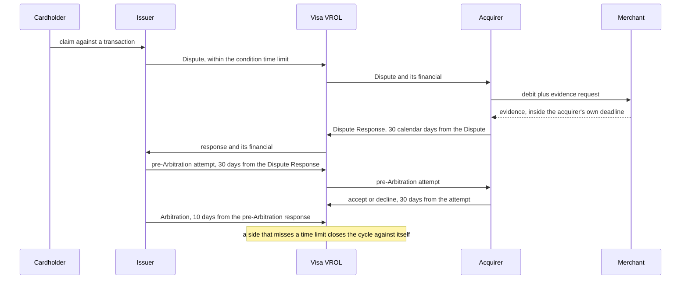
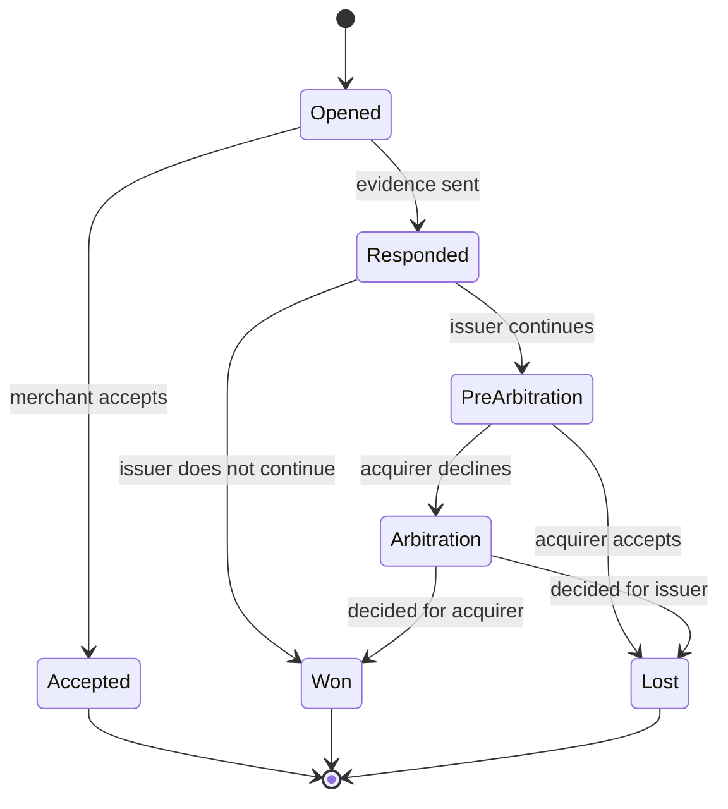
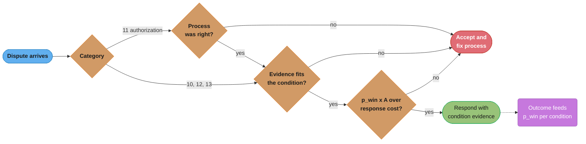

# Disputes, Chargebacks and Refunds

> Rules and figures checked 2026-11-06. Every date, threshold and fee on this page comes from
> the fact pins in fintech/CLAUDE.md or from the Visa Core Rules and Visa Product and Service
> Rules (edition of 24 October 2026) and the Visa Dispute Management Guide for Merchants
> (October 2026). Volumes and costs are labelled as assumptions. This page is an engineering view
> as of that date, not legal advice, and covers the US, the EU, the UK, India and Brazil only.
> Card rules shown are Visa rules. Mastercard rules are not stated.

---

## 1. Concept Overview

Money that moved can move back in three different ways, and each one has its own owner, its own
message and its own clock:

| Mechanism | Who starts it | What it is |
|---|---|---|
| Reversal | The merchant or acquirer, before or soon after settlement | Undoes an earlier authorization or entry through the same rail. An authorization reversal releases a hold, and no money moved |
| Refund | The merchant | A new merchant-initiated credit to the payer for an earlier payment |
| Chargeback (dispute) | The issuer, on the cardholder's claim | Takes funds back from the acquirer under network rules, and the acquirer passes the debit to the merchant |

A chargeback is a process with stages, deadlines and evidence, run between the issuer and the
acquirer through the network. Visa groups dispute reasons into four categories: Fraud (10),
Authorization (11), Processing Errors (12) and Consumer Disputes (13). Each category has numbered
conditions, such as 10.4 Other Fraud, Card-Absent Environment, or 13.2 Cancelled Recurring
Transaction. The condition decides which evidence counts and how long each side has to act.

Bank rails have their own versions: ACH returns for unauthorized debits, Regulation E error
resolution for consumer electronic transfers, Regulation Z billing errors for credit cards,
return requests on instant rails, and scam reimbursement schemes in the UK and Brazil.

For engineers the hard parts are not the rules. They are the ledger, which must record funds that
leave, come back and leave again without editing history, and the deadlines, which are counted in
calendar days by the network and in business days by Regulation E.

How a payment processor ingests chargeback webhooks is in the
[payment processor case study](../../backend/case_studies/design_payment_processor/design_payment_processor.md).

---

## 2. Intuition

**One-line analogy.** A refund is the shop handing money back over the counter. A chargeback is
the customer's bank taking the money out of the shop's till and then holding a small court case
about whether it may keep it.

**Mental model.** Every dispute is a short state machine with a clock on each edge. Each move by
one side starts the other side's clock. Missing a deadline is losing. Funds move on some of the
transitions, so the ledger follows the state machine one entry per money movement.

**Why it matters.** Disputes cost the amount, a fee and staff time, and they are also the fraud
labels that train the risk model. A dispute system that loses deadlines or books money wrongly
costs money twice: once in the dispute, and again in a reconciliation break that someone must
chase.

**Key insight.** Never refund a payment that is already in dispute, and never edit a ledger row
because a dispute changed state. Both mistakes come from treating a dispute as one event instead
of a sequence.

---

## 3. Core Principles

1. **Refund early, dispute rarely.** A refund before the dispute is cheaper than a lost dispute,
   and Visa requires the issuer to account for credits already processed before it disputes.
2. **Once a dispute is open, the dispute is the refund.** A refund issued after the chargeback
   gives the cardholder the money twice, and only some conditions let the acquirer cite that
   credit to get the dispute amount back. Accept the dispute instead.
3. **Every money movement is a new journal entry.** Funds taken, returned and taken again are
   three entries. A state change never edits an earlier posting.
4. **The condition decides the evidence.** Proof of delivery wins a "not received" dispute and
   is irrelevant to a "cancelled recurring" dispute. Volume of documents does not help.
5. **Deadlines belong to the acquirer, and the merchant's are shorter.** Visa's time limits apply
   to issuers and acquirers. The acquirer gives the merchant a shorter window so that it can file
   on time.
6. **Disputes are labels.** Fraud disputes feed the fraud model, and their timing sets when a
   payment counts as clean.
7. **Bank-rail disputes follow law, card disputes follow network rules.** Regulation E and
   Regulation Z set consumer rights in the US. Nacha rules set ACH returns. Visa rules set Visa
   disputes. Do not mix their clocks.

---

## 4. Types / Architectures / Strategies

### 4.1 Visa dispute categories

| Category | Example conditions | Typical root cause | What usually wins |
|---|---|---|---|
| 10 Fraud | 10.1 and 10.2 EMV Liability Shift, 10.3 Other Fraud Card-Present, 10.4 Other Fraud Card-Absent, 10.5 Visa Monitoring Programs | Stolen card, or the cardholder denies a purchase they made | For 10.4, Compelling Evidence 3.0 where eligible |
| 11 Authorization | 11.1 Card Recovery Bulletin, 11.2 Declined Authorization, 11.3 No Authorization or Late Presentment | Process errors: no valid authorization, expired authorization | Usually nothing: these are decided on process, so fix the process |
| 12 Processing Errors | 12.2 Incorrect Transaction Code, 12.5 Incorrect Amount, 12.6 Duplicate Processing or Paid by Other Means, 12.7 Invalid Data | Integration and settlement bugs | Records that the data was right, or a credit already issued |
| 13 Consumer Disputes | 13.2 Cancelled Recurring Transaction, 13.3 Not as Described or Defective, 13.6 Credit Not Processed, 13.7 Cancelled Merchandise or Services | Customer service and policy failures | Clear terms the cardholder accepted, delivery and usage proof |

Cardholder withdrawal (the cardholder writes that they no longer dispute) is not available for
every condition. The October 2026 merchant guide gives 10.5, all of Category 11 and 13.8 as
examples of exceptions.

### 4.2 Bank-rail and wallet analogs

| Rail or product | Mechanism | Clock |
|---|---|---|
| ACH consumer debit | Unauthorized return (R10, R11) | 60 days, with a Written Statement of Unauthorized Debit |
| ACH, originator error | Reversal of an erroneous entry (duplicate, wrong receiver, wrong amount, wrong date) | Must reach the RDFI within 5 banking days after the original settlement date |
| US consumer electronic transfers (debit cards, wallets, ACH) | Regulation E error resolution, 12 CFR 1005.11 | Notice within 60 days after the statement. Investigate in 10 business days, or up to 45 days with provisional credit within 10 business days |
| US credit cards | Regulation Z billing error, 12 CFR 1026.13 | Notice within 60 days of the first statement. Acknowledge within 30 days. Resolve within 2 complete billing cycles and never more than 90 days |
| FedNow and RTP | Request for return of funds, then a return as a new payment | The sender's payment is final. The receiver is not obliged to return the funds |
| UK Faster Payments and CHAPS | Mandatory APP scam reimbursement | From 2024-10-07, at most GBP 85,000 per claim |
| Brazil Pix | MED fraud refund, MED 2.0 traces past the first receiving account | MED 2.0 optional from 2025-11-26, mandatory from 2026-02-02 |

Regulation E has longer clocks for some cases. A transfer within 30 days after the first deposit
to the account gets 20 business days and 90 days. A point-of-sale debit card transaction or a
transfer not initiated in a state gets 90 days (12 CFR 1005.11(c)(3)).

### 4.3 The decision model: fight vs accept

| Situation | Decision | Why |
|---|---|---|
| Category 11 dispute and the authorization really was missing or expired | Accept | Decided on process. Evidence of the customer's intent does not change it |
| 10.4 with two qualifying prior transactions and matching device or IP data | Fight with CE3.0 | The rules give the issuer a specific evidence test to answer |
| 10.4 with no history, digital goods, no device data | Accept, and fix the risk rules | No evidence that addresses the condition |
| 13.1 Merchandise/Services Not Received or 13.3, with carrier proof of delivery to the billing address and usage logs | Fight | Evidence addresses the condition directly |
| 13.2 and the customer did cancel before the charge | Accept, and fix cancellation | The merchant is wrong |
| Amount below the cost of a response (assumption: $25 of analyst time) | Accept, or auto-accept through RDR rules | Expected value is negative even when you would win |
| Repeat disputer, same pattern | Fight if evidence exists, and block future sales | Stops first-party misuse |

As a formula: fight when `p_win x A > C_response + p_escalate x C_escalation`, where `A` is the
amount, `C_response` is the cost of assembling evidence, and `C_escalation` covers the later
stages (pre-arbitration work, and any arbitration review fee the acquirer passes on). Estimate
`p_win` per condition from your own history, not from a vendor's average.

---

## 5. Architecture Diagrams

### 5.1 Visa dispute stages for Categories 12 and 13



For Categories 10 and 11 the acquirer has no Dispute Response step. It answers the dispute with a
pre-Arbitration attempt within 30 calendar days, the issuer responds within 30 days, and the
acquirer may then file for Arbitration within 10 days. A merchant that accepted the dispute
through Rapid Dispute Resolution gets no response step at all.

### 5.2 The dispute state machine that drives the ledger



Funds leave at Opened, may come back with a Dispute Response, and leave again at Lost. Each of
those is its own journal entry (§6.2). The machine shows the Category 12 and 13 flow. In
Categories 10 and 11 the acquirer's pre-Arbitration attempt takes the place of the Dispute
Response, and funds come back only when the issuer accepts that attempt.

### 5.3 Fight or accept



The `p_win` per condition comes from your own outcomes, which is why the outcome loops back.

---

## 6. How It Works - Detailed Mechanics

### 6.1 Visa time limits, stage by stage

From the Visa Core Rules, Tables 11-2 and 11-3 (edition of 24 October 2026):

| Stage | Categories 10 and 11 | Categories 12 and 13 |
|---|---|---|
| Dispute (issuer) | Time limit per condition. For 10.4, 120 calendar days from the processing date | Time limit per condition |
| Dispute Response (acquirer) | Not used | 30 calendar days from the Dispute Processing Date |
| Pre-Arbitration attempt | Acquirer, 30 calendar days from the Dispute Processing Date | Issuer, 30 calendar days from the Dispute Response Processing Date |
| Pre-Arbitration response | Issuer, 30 calendar days | Acquirer, 30 calendar days |
| Arbitration | Acquirer files, 10 calendar days from the pre-Arbitration response | Issuer files, 10 calendar days from the pre-Arbitration response |

Regional exceptions exist (for example shorter domestic limits in some countries), so a
production system stores the limit per stage, per condition and per region, not as one constant.
A member that does not respond through Visa Resolve Online (VROL) within the time limit, or that
accepts responsibility, closes the cycle and is responsible for the last amount received by the
other member.

The merchant never sees these limits directly. The acquirer sets an earlier internal deadline for
the merchant's evidence. Treat that earlier date as the real one.

### 6.2 Ledger modelling

Dispute financials accompany a Dispute, a Dispute Response and a pre-Arbitration acceptance. In a
platform's books (the platform owes the merchant, and its acquirer settlement account is an
asset):

| Event | Debit | Credit |
|---|---|---|
| Dispute opened, amount A, fee F charged to the merchant | Merchant payable A + F | Acquirer settlement A, dispute fee income F |
| Dispute Response with financial (funds return) | Acquirer settlement A | Merchant payable A |
| Pre-Arbitration accepted (funds leave again) | Merchant payable A | Acquirer settlement A |
| Merchant balance cannot cover a loss | Chargeback loss | Merchant receivable |

The network debits the acquirer, not the merchant. Under the Visa rules an acquirer that
contracts with a payment facilitator is liable for the payment facilitator and its sponsored
merchants, so a loss that a merchant cannot pay stays with the platform or the acquirer above it.

```java
import java.util.ArrayList;
import java.util.EnumSet;
import java.util.HashMap;
import java.util.List;
import java.util.Map;
import java.util.Set;

public class DisputeLedger {
    enum State { OPENED, ACCEPTED, RESPONDED, WON, PRE_ARBITRATION, ARBITRATION, LOST }

    static final Map<State, Set<State>> NEXT = Map.of(
            State.OPENED, EnumSet.of(State.ACCEPTED, State.RESPONDED),
            State.RESPONDED, EnumSet.of(State.WON, State.PRE_ARBITRATION),
            State.PRE_ARBITRATION, EnumSet.of(State.LOST, State.ARBITRATION),
            State.ARBITRATION, EnumSet.of(State.WON, State.LOST),
            State.ACCEPTED, EnumSet.noneOf(State.class),
            State.WON, EnumSet.noneOf(State.class),
            State.LOST, EnumSet.noneOf(State.class));

    record Posting(String account, long debitMinor, long creditMinor) {}

    record Entry(String disputeId, String event, List<Posting> postings) {
        Entry {
            long d = postings.stream().mapToLong(Posting::debitMinor).sum();
            long c = postings.stream().mapToLong(Posting::creditMinor).sum();
            if (d != c) throw new IllegalStateException("unbalanced entry " + event);
        }
    }

    final List<Entry> journal = new ArrayList<>();
    State state = State.OPENED;

    DisputeLedger(String id, long amount, long fee) {
        journal.add(new Entry(id, "dispute opened", List.of(
                new Posting("merchant_payable", amount + fee, 0),
                new Posting("acquirer_settlement", 0, amount),
                new Posting("dispute_fee_income", 0, fee))));
    }

    void move(State to, String id, long amount) {
        if (!NEXT.get(state).contains(to)) throw new IllegalStateException(state + " -> " + to);
        if (state == State.OPENED && to == State.RESPONDED) {
            journal.add(new Entry(id, "dispute response, funds returned", List.of(
                    new Posting("acquirer_settlement", amount, 0),
                    new Posting("merchant_payable", 0, amount))));
        }
        if (to == State.LOST) {
            journal.add(new Entry(id, "lost, funds taken again", List.of(
                    new Posting("merchant_payable", amount, 0),
                    new Posting("acquirer_settlement", 0, amount))));
        }
        state = to;
    }

    Map<String, Long> balances() {
        Map<String, Long> b = new HashMap<>();
        for (Entry e : journal) {
            for (Posting p : e.postings()) b.merge(p.account(), p.debitMinor() - p.creditMinor(), Long::sum);
        }
        return b;
    }

    public static void main(String[] args) {
        DisputeLedger d = new DisputeLedger("dp_1", 10_000, 1_500);
        d.move(State.RESPONDED, "dp_1", 10_000);
        d.move(State.PRE_ARBITRATION, "dp_1", 10_000);
        d.move(State.LOST, "dp_1", 10_000);
        Map<String, Long> b = d.balances();
        assert d.journal.size() == 3 : "three money movements, three entries";
        assert b.get("merchant_payable") == 11_500 : "merchant bears amount plus fee";
        assert b.get("acquirer_settlement") == -10_000;
        assert b.get("dispute_fee_income") == -1_500;
        assert b.values().stream().mapToLong(Long::longValue).sum() == 0;
        boolean rejected = false;
        try { d.move(State.WON, "dp_1", 10_000); } catch (IllegalStateException e) { rejected = true; }
        assert rejected : "a closed dispute cannot change outcome";
        d.journal.forEach(e -> System.out.println(e.event() + " " + e.postings()));
    }
}
```

Three design points:

- The state machine rejects impossible moves, so a late webhook that says "won" after "lost"
  cannot rewrite history. It becomes an exception for operations to look at.
- The fee policy (whether the platform returns the fee on a win) is a business choice, recorded
  as its own entry when it happens. Here the fee stays charged.
- The amounts are `long` minor units. Cross-currency disputes add an FX difference entry, because
  the issuer may dispute in the cardholder's currency while the merchant settled in another.

The general ledger model is in [Double-Entry Ledger Design](../double_entry_ledger_design/double_entry_ledger_design.md),
and matching dispute financials to settlement files is in
[Reconciliation and Settlement Files](../reconciliation_and_settlement_files/reconciliation_and_settlement_files.md).

### 6.3 Refunds, credits and the dispute

The order of refund and dispute decides who pays:

- **Credit before the dispute.** For disputes processed through 2027-04-23, if a credit was
  processed before the dispute, the issuer must either apply it to the disputed transaction or
  say which transaction it applied it to and why it does not resolve the dispute. From
  2027-04-24, before disputing, the issuer must aggregate all related credits and debits from the
  same merchant from 120 calendar days before the disputed transaction's processing date, and
  dispute only the net amount.
- **Credit after the dispute.** The chargeback has already returned the money to the cardholder,
  so a refund now pays them twice. Some conditions let the acquirer answer with proof of the
  credit and recover the dispute amount, but only where the condition and the timing allow it.
  If the credit and the original differ because of the exchange rate, the issuer can continue to
  pre-Arbitration. Accept the dispute instead.
- **Rapid Dispute Resolution.** RDR lets a merchant, through its acquirer, set rules that resolve
  eligible disputes automatically. Accepting through RDR makes VROL create a dispute case that
  transfers financial liability, and the acquirer debits the merchant. Visa's guide warns against
  also issuing a refund for the same transaction.

The refund path therefore checks dispute state when the refund runs, inside the same
transaction that reserves the refundable amount (§10.1).

### 6.4 Compelling Evidence 3.0 for condition 10.4

Condition 10.4 (card-absent fraud) is where first-party misuse shows up: the cardholder made the
purchase and later says they did not. Visa's rules carry a specific evidence test, which Visa's
merchant guide calls Compelling Evidence 3.0. The acquirer shows that the same payment credential
was used in two earlier transactions that were not disputed and not reported as fraud, processed
more than 120 and not more than 365 calendar days before the dispute, with a matching device ID or
fingerprint or IP address, plus one more matching element such as the login ID or the shipping
address.

For disputes processed from 2026-10-24, the two prior transactions may be at one or more
merchants, but an acquirer may submit only transaction data that it accepted and processed.
Device ID and device fingerprint count as one element, so an acquirer cannot supply both.

```java
import java.time.LocalDate;
import java.time.temporal.ChronoUnit;
import java.util.List;

public class CompellingEvidence3 {
    record Txn(String id, String credential, LocalDate processedOn, String deviceId, String ip,
               String loginId, String shipTo, boolean disputed, boolean reportedFraud) {}

    static boolean matches(Txn prior, Txn disputed) {
        boolean deviceOrIp = prior.deviceId().equals(disputed.deviceId()) || prior.ip().equals(disputed.ip());
        int elements = 0;
        if (prior.deviceId().equals(disputed.deviceId())) elements++;
        if (prior.ip().equals(disputed.ip())) elements++;
        if (prior.loginId().equals(disputed.loginId())) elements++;
        if (prior.shipTo().equals(disputed.shipTo())) elements++;
        return deviceOrIp && elements >= 2;
    }

    static List<Txn> qualifyingPriors(Txn disputed, LocalDate disputeProcessedOn, List<Txn> history) {
        return history.stream()
                .filter(t -> !t.id().equals(disputed.id()))
                .filter(t -> t.credential().equals(disputed.credential()))
                .filter(t -> !t.disputed() && !t.reportedFraud())
                .filter(t -> {
                    long age = ChronoUnit.DAYS.between(t.processedOn(), disputeProcessedOn);
                    return age > 120 && age <= 365;
                })
                .filter(t -> matches(t, disputed))
                .toList();
    }

    public static void main(String[] args) {
        LocalDate disputeOn = LocalDate.of(2026, 11, 2);
        Txn disputed = new Txn("t9", "tok_A", LocalDate.of(2026, 10, 1), "dev-1", "203.0.113.7",
                "user-42", "1 Main St", true, false);
        List<Txn> history = List.of(
                new Txn("t1", "tok_A", LocalDate.of(2026, 2, 10), "dev-1", "198.51.100.9", "user-42", "1 Main St", false, false),
                new Txn("t2", "tok_A", LocalDate.of(2026, 5, 20), "dev-1", "203.0.113.7", "user-42", "1 Main St", false, false),
                new Txn("t3", "tok_A", LocalDate.of(2026, 8, 30), "dev-1", "203.0.113.7", "user-42", "1 Main St", false, false),
                new Txn("t4", "tok_A", LocalDate.of(2025, 9, 1), "dev-1", "203.0.113.7", "user-42", "1 Main St", false, false),
                new Txn("t5", "tok_A", LocalDate.of(2026, 3, 3), "dev-9", "192.0.2.1", "user-77", "9 Elm St", false, false),
                disputed);
        List<Txn> priors = qualifyingPriors(disputed, disputeOn, history);
        assert priors.stream().map(Txn::id).toList().equals(List.of("t1", "t2")) : priors;
        assert priors.size() >= 2 : "eligible for CE3.0";
        System.out.println("qualifying priors: " + priors.stream().map(Txn::id).toList());
    }
}
```

`t3` is too recent (64 days before the dispute), `t4` is too old (427 days), and `t5` matches
nothing. `t1` and `t2` qualify. The engineering lesson is upstream of the dispute: CE3.0 works
only if you stored the device ID, IP, login and shipping address with every transaction, for at
least a year, keyed by a stable credential reference such as the token or the keyed fingerprint.

### 6.5 Pre-dispute tools

- **Order Insight** (Verifi) lets a participating merchant share purchase details with a
  participating issuer when a cardholder questions a charge, which can stop the question before
  it becomes a dispute.
- **Rapid Dispute Resolution** auto-resolves eligible disputes by merchant rules (§6.3).
- **Clear descriptors.** The guide lists "customers not recognizing the business name on their
  statement" among the common causes. A descriptor that matches the brand the customer knows
  prevents those disputes at almost no cost.

### 6.6 Regulation E deadlines in business days

Regulation E counts in business days, and business days need a calendar. A wallet or debit-card
issuer computes, from the notice date, the date by which it must decide the claim or give
provisional credit, and the final deadline.

```sql
CREATE TABLE bank_holiday (day date PRIMARY KEY);
-- Illustrative calendar rows. A real system loads the full institution calendar.
INSERT INTO bank_holiday VALUES ('2026-11-26'), ('2026-12-25'), ('2027-01-01');

CREATE FUNCTION add_business_days(start_day date, n int) RETURNS date
LANGUAGE sql STABLE AS $$
    SELECT d::date
    FROM generate_series(start_day + 1, start_day + n * 2 + 30, interval '1 day') AS d
    WHERE extract(isodow FROM d) < 6
      AND d::date NOT IN (SELECT day FROM bank_holiday)
    ORDER BY d
    OFFSET n - 1
    LIMIT 1
$$;

CREATE TABLE reg_e_claim (
    id                bigint GENERATED ALWAYS AS IDENTITY PRIMARY KEY,
    first_deposit_on  date NOT NULL,
    transfer_on       date NOT NULL,
    notice_on         date NOT NULL,
    pos_or_foreign    boolean NOT NULL DEFAULT false,
    CHECK (notice_on >= transfer_on)
);

-- The longer clocks key on the transfer date against the first deposit, not on the notice date.
CREATE VIEW reg_e_deadline AS
SELECT id,
       notice_on,
       transfer_on - first_deposit_on <= 30 AS new_account,
       add_business_days(notice_on,
           CASE WHEN transfer_on - first_deposit_on <= 30 THEN 20 ELSE 10 END) AS decide_or_credit_by,
       notice_on + CASE
           WHEN transfer_on - first_deposit_on <= 30 OR pos_or_foreign THEN 90
           ELSE 45 END AS resolve_by
FROM reg_e_claim;

INSERT INTO reg_e_claim (first_deposit_on, transfer_on, notice_on, pos_or_foreign) VALUES
    ('2025-01-15', '2026-11-12', '2026-11-20', false),
    ('2026-11-10', '2026-11-12', '2026-11-20', false),
    ('2025-01-15', '2026-11-12', '2026-11-20', true);

DO $$
BEGIN
    ASSERT add_business_days('2026-11-20', 10) = '2026-12-07', 'Thanksgiving is skipped';
    ASSERT (SELECT resolve_by FROM reg_e_deadline WHERE id = 1) = '2027-01-04', '45 days';
    ASSERT (SELECT resolve_by FROM reg_e_deadline WHERE id = 2) = '2027-02-18', 'new account, 90 days';
    ASSERT (SELECT resolve_by FROM reg_e_deadline WHERE id = 3) = '2027-02-18', 'POS debit, 90 days';
END $$;

SELECT * FROM reg_e_deadline ORDER BY id;
```

The first claim must be decided, or provisionally credited, by 2026-12-07, because 2026-11-26 is
not a business day, and must be resolved by 2027-01-04. The second claim is for a transfer two
days after the account's first deposit, so it gets 20 business days and 90 days. The calendar
table is the dependency that matters, and it is shared with every other business-day
computation: see
[Business Days, Cut-offs and Value Dates](../case_studies/cross_cutting/business_days_cutoffs_and_value_dates.md).

### 6.7 Push payments: returns are new payments

On FedNow and RTP the payment is final for the sender. Each rail has a request-for-return
message, and an actual return is a new payment in the other direction (on FedNow, a request for
return is a non-value message and the return is a new value message). The receiver is not
obliged to return the funds. A dispute system for instant payments therefore tracks a request,
a response and a possible new inbound payment, and books the return as a new entry linked to the
original, never as a reversal of it. Scam reimbursement (UK) and MED (Pix) are regulatory
schemes on top of the rails, with their own claim workflows.

---

## 7. Real-World Examples

- **Visa Resolve Online (VROL).** Visa's dispute platform, where issuers and acquirers file each
  stage. A member that misses a VROL time limit closes the cycle against itself.
- **Mastercom.** Mastercard's dispute management platform for issuers and acquirers. Mastercard's
  rules and time limits are not stated on this page.
- **Order Insight and RDR.** Visa's pre-dispute tools: Verifi Order Insight shares purchase
  details before a dispute, and RDR accepts eligible disputes automatically by merchant rules.
- **Compelling Evidence 3.0.** Visa's evidence test for condition 10.4, built on prior undisputed
  transactions with matching device or IP data. It turns first-party misuse from an argument into
  a data query (§6.4).
- **Payment processors.** The chargeback webhook ingestion and saga handling are in the
  [payment processor case study](../../backend/case_studies/design_payment_processor/design_payment_processor.md).
- **Fraud labels.** Disputes under condition 10.4 are the main fraud label, and their 120-day
  time limit sets label maturity in
  [Fraud and Risk Scoring](../fraud_and_risk_scoring/fraud_and_risk_scoring.md).

---

## 8. Tradeoffs

### 8.1 Refund policy

| Policy | Dispute rate | Refund cost | Abuse risk |
|---|---|---|---|
| Generous, fast refunds | Low | Higher | Refund abuse, needs its own limits |
| Strict refunds | High | Lower | Customers go to their bank instead, which costs fees and counts as a dispute |
| Auto-accept small disputes through RDR | Lower handled volume | Amount only | Customers learn that disputes always win |

### 8.2 In-house vs outsourced dispute handling

| Option | Win rate control | Cost | Use when |
|---|---|---|---|
| Accept everything | None | Amount plus fees | Tiny volume, or every dispute is valid |
| In-house team with templates per condition | High | Staff | Steady volume and data you control |
| Dispute vendor (fee on wins) | Medium | Share of recovered amount | Volume spikes, no team |
| PSP's built-in dispute tools | Medium | Included | One PSP, simple products |

### 8.3 Card vs bank-rail disputes

| Aspect | Card chargeback | ACH unauthorized return | Instant rail |
|---|---|---|---|
| Rules from | Network | Nacha and Regulation E | Rail operating rules and regulation |
| Funds move back by | Network financial | Return entry | A new payment, if the receiver agrees |
| Merchant can contest | Yes, with evidence | Limited, outside the return itself | Not on the rail |
| Clock | Per condition and stage, calendar days | 60 days for R10 and R11 | Request and response messages |

---

## 9. When to Use / When NOT to Use

**Refund when** the customer contacts you first and the claim is plausible. It is cheaper than any
dispute and keeps the customer.

**Fight when** the evidence addresses the condition and the expected value is positive: delivery
proof for "not received", accepted terms and usage for "not as described", CE3.0 data for 10.4.

**Accept when** you were wrong, when the category is decided on process and the process failed,
or when the amount is below the cost of responding.

**Do NOT** refund a payment with an open dispute, fight Category 11 disputes with evidence about
the customer, or let the acquirer's deadline pass because the merchant's internal queue is slow.

**Do NOT** model a dispute as a single "chargeback" row with a status column that gets updated.
Model it as a state machine plus one journal entry per money movement.

---

## 10. Common Pitfalls

The incidents below are illustrative, not reported cases.

### 10.1 The refund that paid twice

A support agent refunded a customer who complained. The customer had already filed a chargeback.
The refund service checked only "captured minus refunded".

```java
// BROKEN: refundable amount ignores money already taken back by a dispute
public class RefundDuringDispute {
    record Payment(String id, long capturedMinor, long refundedMinor, long disputedMinor) {}

    static long refundable(Payment p) {
        return p.capturedMinor() - p.refundedMinor();
    }

    public static void main(String[] args) {
        Payment p = new Payment("pay_1", 10_000, 0, 10_000);
        long refund = refundable(p);
        long cardholderReceived = p.disputedMinor() + refund;
        System.out.println("refund allowed: " + refund + ", cardholder received " + cardholderReceived
                + " on a " + p.capturedMinor() + " payment");
    }
}
```

It prints `refund allowed: 10000, cardholder received 20000 on a 10000 payment`. The chargeback
already returned the money. Getting the second payment back now depends on whether the dispute
condition and its timing let the acquirer cite the credit.

```java
// FIX: refundable subtracts open and lost disputes, and the service tells the agent to accept
public class RefundWithDisputeCheck {
    record Payment(String id, long capturedMinor, long refundedMinor, long disputedMinor) {}

    sealed interface Outcome permits Refund, UseDispute {}
    record Refund(long amountMinor) implements Outcome {}
    record UseDispute(String reason) implements Outcome {}

    static Outcome refund(Payment p, long requestedMinor) {
        if (p.disputedMinor() > 0) return new UseDispute("payment has a dispute, accept it instead");
        long refundable = p.capturedMinor() - p.refundedMinor();
        if (requestedMinor > refundable) throw new IllegalArgumentException("over refundable " + refundable);
        return new Refund(requestedMinor);
    }

    public static void main(String[] args) {
        assert refund(new Payment("pay_1", 10_000, 0, 10_000), 10_000) instanceof UseDispute;
        assert refund(new Payment("pay_2", 10_000, 2_500, 0), 7_500) instanceof Refund r && r.amountMinor() == 7_500;
        boolean rejected = false;
        try { refund(new Payment("pay_3", 10_000, 2_500, 0), 8_000); } catch (IllegalArgumentException e) { rejected = true; }
        assert rejected;
        System.out.println(refund(new Payment("pay_1", 10_000, 0, 10_000), 10_000));
    }
}
```

In production the check and the refund reservation run in one database transaction with a lock
on the payment row, so a dispute webhook and a refund request cannot both pass the check.

### 10.2 Editing the chargeback row

A team stored one row per chargeback with `status` and `amount` and updated both as the dispute
moved. When a dispute was won and then lost at pre-arbitration, the row showed "lost, 100" and
the ledger had no record that the money came back in between. Reconciliation against the
acquirer's settlement file broke for every multi-stage dispute. One journal entry per money
movement (§6.2) fixes it.

### 10.3 Fighting what cannot be won

A merchant answered every 11.3 "No Authorization" dispute with delivery proof. Category 11 is
decided on whether the authorization was valid at the time, so the evidence did not address the
condition and every response lost, at the cost of analyst time and escalation fees. The fix was
upstream: capture within the authorization's validity window (for Visa card-absent
customer-initiated transactions, 10 days, or 30 days with the extended authorization indicator).

### 10.4 The deadline in the wrong place

The dispute tool counted 30 days from when the merchant saw the dispute in the acquirer portal.
Visa counts from the Dispute Processing Date, and the acquirer's internal deadline for the
merchant was 20 days (assumption). Responses arrived after the acquirer had closed the case. Store
the network date and the acquirer's deadline as separate fields and alert on the earlier one.

### 10.5 Missing evidence data

The merchant wanted to use CE3.0 but stored only the last 90 days of device and IP data.
Qualifying prior transactions must be more than 120 days before the dispute, so the evidence
never existed. Retain device ID, IP, login and shipping address per transaction for at least 365
days.

### 10.6 Recurring billing after cancellation

Customers cancelled by email, the cancellation reached the billing system a day later, and the
renewal ran in between. Each one became a 13.2 Cancelled Recurring Transaction dispute. §14 shows
the query and its fix.

---

## 11. Technologies & Tools

| Tool | What it does here |
|---|---|
| Visa Resolve Online | Visa's platform for filing and answering each dispute stage |
| Mastercom | Mastercard's dispute management platform for issuers and acquirers |
| Verifi Order Insight | Shares purchase details with issuers before a question becomes a dispute |
| Rapid Dispute Resolution | Visa tool that auto-resolves eligible disputes by merchant rules |
| Ethoca Alerts | Pre-dispute alerts that let a merchant refund before a chargeback is filed |
| Chargebacks911 | Outsourced dispute management and representment |
| Chargeflow | Automated evidence collection and dispute responses for online merchants |
| Stripe Disputes API | Programmatic access to disputes and evidence submission for Stripe merchants |

---

## 12. Interview Questions with Answers

**Q: What is the difference between a refund, a reversal and a chargeback?**
**Short:** A reversal undoes an entry or authorization on the same rail, a refund is a new merchant credit, and a chargeback is an issuer taking funds back under network rules.

An authorization reversal releases a hold and moves no money. A refund moves money from the
merchant to the payer as a new transaction. A chargeback is started by the issuer on the
cardholder's claim and runs through the network's dispute stages with deadlines and evidence.
Model all three separately in the ledger, linked to the original payment.

**Q: Should a merchant refund a payment that already has an open chargeback?**
**Short:** No, because the chargeback already returned the money, so a refund pays the cardholder twice and recovery depends on the dispute condition. Accept the dispute instead.

The refund service checks dispute state inside the same transaction that reserves the refundable
amount. Visa's merchant guide also warns that after accepting an RDR request the merchant should
not issue a separate refund. If the merchant agrees the customer is right, accepting the dispute
is the refund.

**Q: What are Visa's four dispute categories?**
**Short:** Fraud (10), Authorization (11), Processing Errors (12) and Consumer Disputes (13), each with numbered conditions that set the evidence and time limits.

Examples: 10.4 Other Fraud Card-Absent, 11.3 No Authorization or Late Presentment, 12.6
Duplicate Processing, 13.2 Cancelled Recurring Transaction. The category also sets the flow:
Categories 10 and 11 skip the Dispute Response and go straight to pre-Arbitration. Store the
condition code on every dispute, because win rates differ by condition.

**Q: How long does an acquirer have to answer a Visa dispute?**
**Short:** 30 calendar days from the Dispute Processing Date, as a Dispute Response for Categories 12 and 13 or a pre-Arbitration attempt for 10 and 11.

Each later stage has its own limit: 30 days for the pre-Arbitration attempt and response, then 10
days to file for Arbitration. The acquirer gives the merchant a shorter internal window. Some
regions have shorter domestic limits. Store limits per stage, condition and region.

**Q: What is Compelling Evidence 3.0?**
**Short:** Visa's evidence test for 10.4 disputes: two earlier undisputed, non-fraud transactions on the same credential with matching device or IP data plus one more element.

The prior transactions must be processed more than 120 and not more than 365 calendar days
before the dispute, and must not have been reported as fraud. Matching data is a device ID or
fingerprint or an IP address, plus another element such as the login ID or shipping address.
It only works if you retain that data per transaction for a year.

**Q: Why do Category 11 disputes rarely win with customer evidence?**
**Short:** They are decided on whether a valid authorization existed at the time, so proof of the customer's intent does not address the condition.

Visa's guide says these disputes turn on whether proper authorization was obtained at the time
of the transaction, not on the cardholder's intent. The fix is upstream: capture
inside the authorization window, never complete a declined transaction, and handle late
presentment. For Visa card-absent customer-initiated transactions the window is 10 days, or 30
with the extended authorization indicator.

**Q: How should a ledger record a dispute that is won and then lost?**
**Short:** As three journal entries: funds taken at the dispute, returned with the response, and taken again when pre-arbitration is accepted, never as edits to one row.

Dispute financials accompany a Dispute, a Dispute Response and a pre-Arbitration acceptance, so
each is a money movement with its own entry. A state machine rejects impossible transitions, such
as a "won" webhook after "lost". This is what lets the ledger reconcile with the acquirer's
settlement files.

**Q: What happens if a party misses a Visa dispute deadline?**
**Short:** The cycle closes against it, and it is responsible for the last amount received by the other member.

Visa's rules say a member that does not respond through VROL within the time limit, or accepts
responsibility, closes the dispute cycle. For a merchant this means a late response is a loss,
however strong the evidence. Alert on the acquirer's internal deadline, which comes first.

**Q: How does a credit processed before a dispute affect it?**
**Short:** The issuer must account for it: through 2027-04-23 it applies the credit or explains why not, and from 2027-04-24 it nets related credits from 120 days back and disputes only the remainder.

This is why refunding before the dispute is cheaper than refunding after. Link refunds to the
original transaction with the transaction identifier or acquirer reference number, so the issuer
can match them. An unlinked credit may not count.

**Q: What is Rapid Dispute Resolution, and what is its trap?**
**Short:** RDR auto-resolves eligible disputes by merchant rules, and accepting creates a VROL case that moves liability, so a separate refund would pay twice.

The merchant sets rules through its acquirer, for example "auto-accept disputes under a set amount
for digital goods". Accepted disputes debit the merchant like any other loss. Record RDR outcomes
in the ledger and in dispute reporting, and block manual refunds on those transactions.

**Q: How do Regulation E deadlines differ from card network deadlines?**
**Short:** Regulation E is law and counts business days: investigate in 10 business days, or up to 45 days with provisional credit within 10 business days.

The consumer gives notice within 60 days after the statement. A transfer within 30 days after
the account's first deposit gets 20 business days and 90 days. Point-of-sale debit and transfers not initiated in a state get 90 days. Business
days need a holiday calendar, shared with other business-day logic. Card network limits are
calendar days and come from the network, not from Regulation E.

**Q: What are the Regulation Z billing-error deadlines for credit cards?**
**Short:** Notice within 60 days of the first statement, acknowledgment within 30 days, and resolution within 2 complete billing cycles and never more than 90 days.

12 CFR 1026.13 sets them. A card issuer runs this process alongside the network dispute it may
file against the acquirer. The two clocks are separate, and the issuer must meet the legal one
even when the network process takes longer.

**Q: Is there an ACH equivalent of a chargeback?**
**Short:** Yes for consumer debits: unauthorized returns R10 and R11 within 60 days with a Written Statement of Unauthorized Debit.

The return moves the money back through ACH. Separately, an originator or ODFI may reverse an
erroneous entry (duplicate, wrong receiver, wrong amount, wrong date), and the reversal must
reach the RDFI within 5 banking days after the original settlement date. A reversal is the
originator's tool, a return is the receiver's.

**Q: How do disputes work on instant push payments such as FedNow and RTP?**
**Short:** The payment is final for the sender, a request for return is a message, and any return is a new payment that the receiver is not obliged to send.

Book the return as a new inbound payment linked to the original, not as a reversal. Fraud and
scam losses on push rails are handled by regulation where it exists: mandatory APP scam
reimbursement in the UK from 2024-10-07, at most GBP 85,000 per claim, and MED in Brazil's Pix.

**Q: How do you decide whether to fight or accept a dispute?**
**Short:** Fight when the evidence addresses the condition and p_win times the amount exceeds the response cost plus expected escalation cost, and accept otherwise.

Estimate `p_win` per condition from your own outcomes. Accept Category 11 disputes where the
process failed, 13.2 disputes where the customer did cancel, and small amounts where analyst time
costs more than the amount. Feed every outcome back into the estimate.

**Q: Why should dispute deadlines be stored as two dates?**
**Short:** The network counts from its processing date, while the acquirer sets an earlier deadline for the merchant, and the merchant must meet the earlier one.

A tool that counts from when the merchant noticed the dispute misses both. Store the network
processing date, the network limit and the acquirer's deadline, and alert on the earliest.

**Q: Which Visa conditions do not accept a cardholder withdrawal letter?**
**Short:** Visa's October 2026 merchant guide gives 10.5 Visa Monitoring Programs, all Category 11 authorization disputes, and 13.8 Original Credit Transaction Not Accepted as examples.

10.5 is based on fraud patterns and thresholds rather than an individual claim, and Category 11
is about the authorization, not the cardholder's intent. The guide calls these examples, so check
each condition's own rules. Where withdrawal is allowed, the letter must be dated after the
dispute started and must link to the transaction.

**Q: Why are disputes also an engineering data problem, not only an operations one?**
**Short:** Winning evidence (device, IP, login, delivery, terms accepted) must be captured at payment time and kept for over a year, or it does not exist when the dispute arrives.

CE3.0 needs prior transactions 121 to 365 days old with matching device or IP data. Delivery and
usage evidence needs the order linked to carrier and product logs. Design the payment record to
carry these fields, keyed by a stable credential reference.

**Q: How do recurring billing systems cause 13.2 disputes?**
**Short:** A renewal charged after the customer cancelled becomes a Cancelled Recurring Transaction dispute, often because cancellations reach billing late.

Check cancellation state at charge time from the source of truth, not from a snapshot. Make
cancellation as easy as sign-up, send renewal reminders, and use a descriptor the customer
recognizes. §14 shows the query that caused it and its fix.

---

## 13. Best Practices

1. Check dispute state in the refund path, inside the transaction that reserves the amount.
2. Write one journal entry per money movement, and drive entries from a dispute state machine.
3. Store the condition code, the network processing date, the network limit and the acquirer's
   deadline on every dispute.
4. Retain device ID, IP, login and shipping address per transaction for at least 365 days.
5. Link every refund to its original transaction identifier.
6. Estimate `p_win` per condition from your own outcomes, and auto-accept where expected value is
   negative.
7. Use Order Insight, RDR and clear descriptors to stop disputes before they start.
8. Keep a shared business-day calendar for Regulation E and every other business-day clock.
9. Book instant-rail returns as new payments linked to the original.
10. Feed fraud dispute outcomes to the fraud model, with maturity rules.

---

## 14. Case Study

### A subscription app with a 13.2 dispute spike

**Context (illustrative).** A subscription app bills 900,000 renewals a month. Disputes under
Visa condition 13.2 Cancelled Recurring Transaction tripled in one quarter. Almost every one was
valid: the customer had cancelled, and the renewal ran anyway.

**Investigation.** The billing job read a nightly snapshot of active subscriptions taken at
00:00 UTC and charged renewals at 06:00 UTC. Cancellations made by email or chat went to a
support queue, which wrote them to the cancellation table during the day. Anything cancelled
between the snapshot and the charge, or still waiting in the support queue, was charged.

```sql
CREATE TABLE subscription (
    id            bigint PRIMARY KEY,
    customer      text   NOT NULL,
    renews_on     date   NOT NULL,
    amount_minor  bigint NOT NULL CHECK (amount_minor > 0)
);

CREATE TABLE cancellation (
    subscription_id  bigint PRIMARY KEY REFERENCES subscription (id),
    requested_at     timestamptz NOT NULL,
    channel          text NOT NULL CHECK (channel IN ('app', 'web', 'email', 'chat'))
);

CREATE TABLE renewal_snapshot (
    subscription_id  bigint PRIMARY KEY REFERENCES subscription (id),
    active           boolean NOT NULL,
    taken_at         timestamptz NOT NULL
);

INSERT INTO subscription VALUES
    (1, 'ana',   '2026-11-06', 999),
    (2, 'ben',   '2026-11-06', 999),
    (3, 'chloe', '2026-11-06', 1999);

INSERT INTO renewal_snapshot VALUES
    (1, true, '2026-11-06 00:00+00'),
    (2, true, '2026-11-06 00:00+00'),
    (3, true, '2026-11-06 00:00+00');

-- Ben cancels by email at 02:10, after the snapshot and before the 06:00 charge run.
INSERT INTO cancellation VALUES (2, '2026-11-06 02:10+00', 'email');
```

```sql
-- BROKEN
-- The charge run trusts the midnight snapshot.
SELECT s.id, s.customer, s.amount_minor
FROM subscription s
JOIN renewal_snapshot r ON r.subscription_id = s.id
WHERE s.renews_on = DATE '2026-11-06'
  AND r.active;
```

It returns all three subscriptions, including Ben, who cancelled four hours earlier. Ben's charge
becomes a 13.2 dispute that the merchant cannot win, plus the dispute fee.

```sql
-- FIX: decide at charge time against the cancellation source of truth
SELECT s.id, s.customer, s.amount_minor
FROM subscription s
WHERE s.renews_on = DATE '2026-11-06'
  AND NOT EXISTS (
      SELECT 1
      FROM cancellation c
      WHERE c.subscription_id = s.id
        AND c.requested_at <= TIMESTAMPTZ '2026-11-06 06:00+00');
```

It returns Ana and Chloe only. The fix also needs the support queue to write the cancellation at
the moment the customer asks, with `requested_at` set to the customer's request time, not the
agent's processing time.

**Other changes.**

1. In-app cancellation with immediate effect, so most cancellations never touch the support
   queue.
2. Renewal reminders before each annual renewal, and a statement descriptor that matches the app
   name the customer knows.
3. RDR rules to auto-accept 13.2 disputes under a set amount (assumption: $20), since the merchant
   was wrong in nearly all of them, and a block on manual refunds for those transactions.
4. Order Insight, so issuers can show the cancellation and renewal history before a question
   becomes a dispute.

**Outcome (illustrative).** 13.2 disputes fell back below their earlier level within two months.
Analyst time per month dropped, because RDR handled the small valid ones and the team stopped
answering disputes it could not win.

**Lessons.**

- A dispute spike is usually a product or billing bug. Find it before you build better evidence.
- Decide money movements against the source of truth when the money moves.
- Accepting valid disputes fast, without a duplicate refund, is part of the design.
- Related pages: [Subscriptions, Billing and Invoicing](../subscriptions_billing_and_invoicing/subscriptions_billing_and_invoicing.md)
  covers renewal and dunning design, and
  [Card Payments Lifecycle](../card_payments_lifecycle/card_payments_lifecycle.md) covers
  authorization windows and capture.
