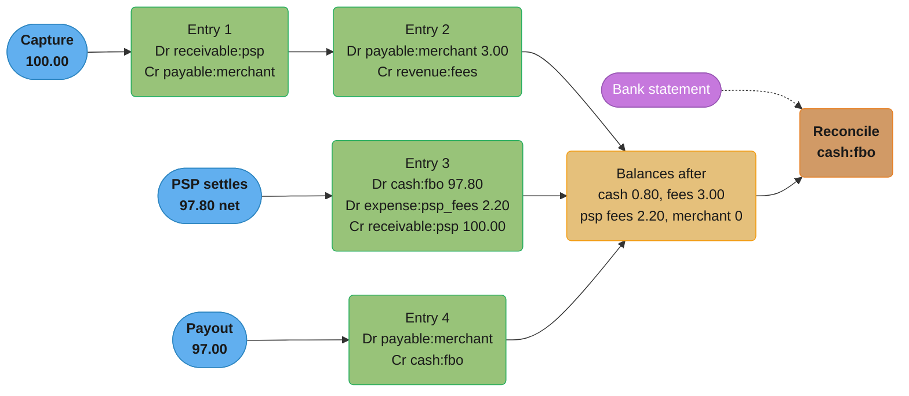
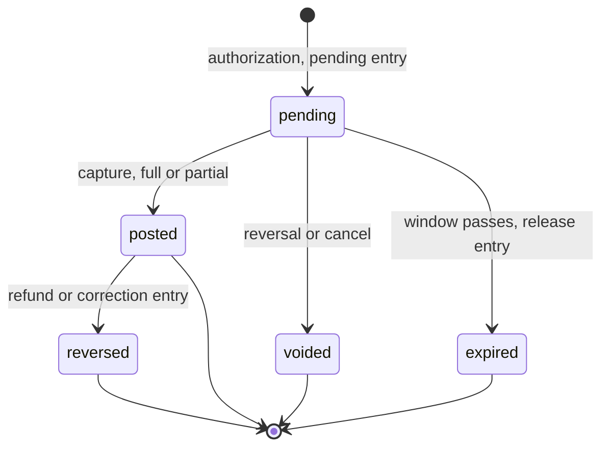

# Double-Entry Ledger Design

> Rules and figures checked 2026-11-06. Every date, threshold and fee on this page comes from the
> fact pins in fintech/CLAUDE.md. TigerBeetle details are from its 0.17.9 reference docs, read
> 2026-11-06. Fee amounts in the worked examples are illustrative. SQL runs on PostgreSQL 18.6.

---

## 1. Concept Overview

A double-entry ledger records every movement of money as a journal entry: a set of postings, each
a debit or a credit to one account, whose debits equal its credits in every currency. Money is
never created or destroyed inside the ledger. It moves between accounts, and the accounts include
the outside world: the bank account that holds customer funds, the PSP that owes you a settlement,
the card network that will collect a capture.

This page is the accounting model and its invariants, independent of the storage engine:

- Account types and normal balances, and a chart of accounts for a payments platform.
- Journal entries and postings, and the rule that each entry sums to zero per currency.
- Append-only history: corrections are reversing entries, never edits.
- Pending, posted and available balances, and holds as ledger entries.
- FX clearing accounts for cross-currency movements.
- Point-in-time balances with an effective date and a posting time.
- The TigerBeetle data model as a reference design.
- The balance-model decision: derived, materialized in the same transaction, or snapshot plus
  delta.

How one Postgres schema stores this at scale (partitioning, `SERIALIZABLE`, row-level security,
a CQRS balance read model, append-only triggers) is in
[Design a Banking Ledger](../../database/case_studies/design_banking_ledger/design_banking_ledger.md).
The deferred constraint trigger that checks each transfer at commit, and the PSP-fee entry in a
saga, are in [Design a Payment Processor](../../backend/case_studies/design_payment_processor/design_payment_processor.md)
§4.1. The ledger inside an end-to-end payment flow is in
[Design a Payment System](../../hld/case_studies/design_payment_system.md) §4.2. When a single
account receives so many postings that its row becomes the bottleneck, read
[Hot Accounts and Ledger Scaling](hot_accounts_and_ledger_scaling.md).

The integer amounts every posting carries are defined in
[Money Representation and Currency](../money_representation_and_currency/money_representation_and_currency.md).
How the ledger avoids posting the same event twice is in
[Idempotency and Exactly-Once Money Movement](../idempotency_and_exactly_once_money_movement/idempotency_and_exactly_once_money_movement.md).

Not here: the Postgres schema, isolation level and partitioning, which the banking ledger study
owns.

---

## 2. Intuition

> **One-line analogy:** a ledger is a set of jars and a rule that every move takes coins out of one
> jar and puts the same number of coins into another. You never add a coin from nowhere, and you
> never take one out to nowhere. The bank, the PSP and each customer all have a jar.

**Mental model.** Each account is a jar. A journal entry is a single movement that touches two or
more jars and leaves the total unchanged. With debits counted as positive and credits as negative,
the jars of one currency always sum to zero: asset jars such as bank cash hold a debit count, and
the jars the platform owes, such as customer wallets, hold a credit count. A balance is not a
stored number. It is the count of coins in one jar, which
you can always recompute from the movements.

**Why it matters.** A single balance column can be wrong and nobody can tell where the error came
from. A ledger makes every balance explainable: you can list the postings that produced it, find
the business event behind each one, and prove that no money left the system without a matching
entry on the other side. Auditors, regulators and your own reconciliation job rely on that
property.

**Key insight.** Double entry is a conservation law. Every invariant on this page (zero sum per
currency, append-only history, reversals instead of edits, one entry per business event) protects
that law. The storage engine is a detail. A spreadsheet, Postgres, Spanner and TigerBeetle can all
hold a correct ledger, and all of them can hold a broken one if the application posts entries that
break the law.

---

## 3. Core Principles

1. **Every entry balances per currency.** The debits of a journal entry equal its credits in each
   currency it touches. A cross-currency movement is two entries, joined through an FX clearing
   account.
2. **One business event, one journal entry.** A capture, a settlement, a payout and a refund are
   each one entry with a unique event key. Two entries for one event is a double posting.
3. **History is append-only.** A posted entry is never updated or deleted. A mistake is corrected
   by a reversing entry that references the original, then a new correct entry.
4. **Balances are derived from postings.** Any stored balance (a materialized column, a snapshot)
   is a cache of the postings and must be rebuildable from them.
5. **Normal balance decides the sign you show.** Assets and expenses grow with debits. Liabilities,
   equity and revenue grow with credits. Store one sign convention, convert at display.
6. **Pending is a separate layer, not a separate truth.** A hold is a pending posting. Posting it,
   voiding it or letting it expire is another entry. Available balance is computed from both
   layers.
7. **Every external movement has an internal mirror.** Money in a bank account is an asset account
   in the ledger. Reconciliation compares that account to the bank statement.
8. **Time has two axes.** The effective date says when the event counts. The posting time says when
   the ledger learned about it. A backdated entry changes a past balance as of its effective date,
   but not what the ledger knew at the time.

---

## 4. Types / Architectures / Strategies

### 4.1 Account types and normal balances

| Type | Normal balance | Grows with | Payments example |
|---|---|---|---|
| Asset | Debit | Debit | Cash in the FBO bank account, receivable from the PSP |
| Liability | Credit | Credit | Customer wallet balances, amounts payable to merchants, tax collected |
| Equity | Credit | Credit | Capital, retained earnings |
| Revenue | Credit | Credit | Platform fees, FX spread |
| Expense | Debit | Debit | PSP processing fees, FX rounding losses, chargeback losses |

A customer's wallet is a liability, not an asset, because it is money the platform owes the
customer. Engineers coming from application code often model it as the customer's asset and get
every sign backwards.

### 4.2 A chart of accounts for a payments platform

| Account (example id) | Type | What it represents |
|---|---|---|
| `cash:fbo:USD` | Asset | Customer funds at the partner bank, held for the benefit of customers |
| `cash:operating:USD` | Asset | The platform's own bank account |
| `receivable:psp:USD` | Asset | Settled card funds the PSP has not yet paid out |
| `wallet:{customer}:USD` | Liability | Stored value the platform owes one customer |
| `payable:merchant:{id}:USD` | Liability | Funds owed to one merchant, before payout |
| `payable:network:USD` | Liability | Card captures the network will collect |
| `revenue:fees:USD` | Revenue | Platform fees |
| `expense:psp_fees:USD` | Expense | Fees the PSP deducts at settlement |
| `clearing:fx:EUR`, `clearing:fx:USD` | Asset or liability by policy | One side of each currency conversion |
| `suspense:USD` | Asset or liability by policy | Money that arrived and is not yet matched to an event |

Accounts are per currency. `wallet:c1:USD` and `wallet:c1:EUR` are two accounts, so no posting can
add dollars to euros.

### 4.3 Sign conventions

| Convention | How a posting looks | Who uses it | Watch out for |
|---|---|---|---|
| Debit and credit columns | `debit = 100.00`, `credit = 0` | Accountants, most ERP systems | Two nullable columns, easy to fill both |
| Direction flag plus positive amount | `direction = 'D'`, `amount = 10000` | Many payment ledgers | Every sum needs a `CASE` |
| Signed amount, debit positive | `amount = +10000` or `-10000` | Square Books (debits positive, credits negative) | Credit-normal balances print negative unless you flip the sign |

All three hold the same information. This page uses signed amounts, because "the entry sums to
zero" becomes a plain `SUM(amount) = 0`.

### 4.4 Decision model: the balance model

This is the section's only copy of this decision. Other pages link here.

| Model | How a balance is read | Write cost | Read cost | Consistency | Fits |
|---|---|---|---|---|---|
| Derived on read | `SUM(amount)` over the account's postings | Insert postings only | O(postings on the account) | Always exact | Low-volume accounts, audits, internal accounts read rarely |
| Materialized in the same transaction | Read one balance row, updated in the transaction that inserts the postings | Insert postings plus an `UPDATE` with a row lock | O(1) | Exact, if every writer goes through the same code path | Wallets and accounts with a non-negative check on every debit |
| Snapshot plus delta | Last checkpoint plus `SUM` of postings since it | Insert postings; a job writes checkpoints | O(postings since the checkpoint) | Exact, checkpoint is a cache | High-volume accounts where a bounded read is enough |
| Asynchronous projection (CQRS) | Read a balance table a consumer keeps up to date | Insert postings and an event | O(1) | Lags the postings | Dashboards and statements, never the spend check |

A materialized balance turns the account row into a lock that every posting to that account
waits on. That is the hot-account problem, and its strategies (sharding the account, batching,
posting behind a reservation) are in
[Hot Accounts and Ledger Scaling](hot_accounts_and_ledger_scaling.md). The snapshot-plus-delta
implementation with daily checkpoints, and its read cost, is in the banking ledger study §4.3.

---

## 5. Architecture Diagrams

### 5.1 A card payment through the ledger



Four entries record four business events. The platform's cash of 0.80 equals its fee revenue of
3.00 minus the PSP fee expense of 2.20, which is the balance-sheet identity at work.

### 5.2 The same flow as T-accounts

```
 receivable:psp (asset)      payable:merchant (liability)    cash:fbo (asset)
   Dr        |   Cr            Dr        |   Cr                Dr        |   Cr
  100.00 (1) | 100.00 (3)     3.00 (2)   | 100.00 (1)         97.80 (3) | 97.00 (4)
             |               97.00 (4)   |                              |
 ------------+-----------    ------------+-----------        ------------+-----------
   balance 0                   balance 0                       balance 0.80 Dr

 revenue:fees (revenue)      expense:psp_fees (expense)
   Dr        |   Cr            Dr        |   Cr
             |   3.00 (2)     2.20 (3)   |
 ------------+-----------    ------------+-----------
   balance 3.00 Cr             balance 2.20 Dr

 total debits 300.00 = total credits 300.00
```

The numbers in brackets are the entry numbers from §5.1. Each column pair is one account. Every
entry appears on two or more accounts, and the total of all debits equals the total of all credits.

### 5.3 The life of a hold



Every transition is a new journal entry. The pending entry is never edited to "posted".

---

## 6. How It Works - Detailed Mechanics

### 6.1 Journal entries in code

A journal entry is a value: an event key, an effective time and a list of postings. Validation
happens once, in the constructor, so an unbalanced entry cannot exist in memory.

```java
import java.time.Instant;
import java.util.HashMap;
import java.util.List;
import java.util.Map;

public class Journal {
    enum Type { ASSET, LIABILITY, EQUITY, REVENUE, EXPENSE }

    record Account(String id, Type type, String currency) {
        boolean debitNormal() { return type == Type.ASSET || type == Type.EXPENSE; }
    }

    record Posting(Account account, long amountMinor) {
        Posting {
            if (amountMinor == 0) throw new IllegalArgumentException("zero posting");
        }
    }

    record Entry(String eventKey, Instant effectiveAt, List<Posting> postings) {
        Entry {
            if (postings.size() < 2) throw new IllegalArgumentException("needs two postings");
            Map<String, Long> perCurrency = new HashMap<>();
            for (Posting p : postings) {
                perCurrency.merge(p.account().currency(), p.amountMinor(), Math::addExact);
            }
            perCurrency.forEach((ccy, sum) -> {
                if (sum != 0) throw new IllegalArgumentException(ccy + " off by " + sum);
            });
            postings = List.copyOf(postings);
        }
    }

    static long balance(Account a, List<Entry> ledger) {
        long debitsMinusCredits = ledger.stream()
                .flatMap(e -> e.postings().stream())
                .filter(p -> p.account().equals(a))
                .mapToLong(Posting::amountMinor)
                .reduce(0, Math::addExact);
        return a.debitNormal() ? debitsMinusCredits : -debitsMinusCredits;
    }

    public static void main(String[] args) {
        Account receivable = new Account("receivable:psp:USD", Type.ASSET, "USD");
        Account merchant = new Account("payable:merchant:m1:USD", Type.LIABILITY, "USD");
        Account fees = new Account("revenue:fees:USD", Type.REVENUE, "USD");
        Account cash = new Account("cash:fbo:USD", Type.ASSET, "USD");
        Account pspFees = new Account("expense:psp_fees:USD", Type.EXPENSE, "USD");
        Instant t = Instant.parse("2026-11-06T10:00:00Z");

        List<Entry> ledger = List.of(
            new Entry("capture:pi_1", t, List.of(
                new Posting(receivable, 10_000), new Posting(merchant, -10_000))),
            new Entry("fee:pi_1", t, List.of(
                new Posting(merchant, 300), new Posting(fees, -300))),
            new Entry("settlement:batch_7", t, List.of(
                new Posting(cash, 9_780), new Posting(pspFees, 220), new Posting(receivable, -10_000))),
            new Entry("payout:po_3", t, List.of(
                new Posting(merchant, 9_700), new Posting(cash, -9_700))));

        assert balance(cash, ledger) == 80;
        assert balance(fees, ledger) == 300 : "revenue shows positive under its normal balance";
        assert balance(pspFees, ledger) == 220;
        assert balance(merchant, ledger) == 0;
        assert balance(receivable, ledger) == 0;

        boolean rejected = false;
        try {
            new Entry("bad", t, List.of(new Posting(cash, 100), new Posting(fees, -99)));
        } catch (IllegalArgumentException e) { rejected = true; }
        assert rejected : "unbalanced entry must not exist";

        System.out.println("cash " + balance(cash, ledger) + ", fees " + balance(fees, ledger));
    }
}
```

The fee of 3.00 and the PSP fee of 2.20 are illustrative. The arithmetic is the point: after four
entries, cash of 80 cents equals fees of 300 minus PSP fees of 220.

### 6.2 The schema: accounts, entries and postings

The SQL fences on this page run in order in one database. The schema stores signed amounts (debit
positive) and a `layer` that separates pending postings from posted ones. A composite foreign key
makes a posting's currency match its account's currency.

```sql
CREATE TABLE account (
    id              TEXT    PRIMARY KEY,
    type            TEXT    NOT NULL CHECK (type IN ('asset','liability','equity','revenue','expense')),
    currency        CHAR(3) NOT NULL,
    allow_negative  BOOLEAN NOT NULL DEFAULT true,
    UNIQUE (id, currency)
);

CREATE TABLE journal_entry (
    id            BIGINT      GENERATED ALWAYS AS IDENTITY PRIMARY KEY,
    event_key     TEXT        NOT NULL UNIQUE,
    effective_at  TIMESTAMPTZ NOT NULL,
    posted_at     TIMESTAMPTZ NOT NULL DEFAULT clock_timestamp(),
    reverses      BIGINT      REFERENCES journal_entry(id)
);
-- An entry can be reversed at most once.
CREATE UNIQUE INDEX one_reversal ON journal_entry (reverses) WHERE reverses IS NOT NULL;

CREATE TABLE posting (
    entry_id      BIGINT  NOT NULL REFERENCES journal_entry(id),
    line          SMALLINT NOT NULL,
    account_id    TEXT    NOT NULL,
    currency      CHAR(3) NOT NULL,
    amount_minor  BIGINT  NOT NULL CHECK (amount_minor <> 0),
    layer         TEXT    NOT NULL DEFAULT 'posted' CHECK (layer IN ('pending', 'posted')),
    PRIMARY KEY (entry_id, line),
    FOREIGN KEY (account_id, currency) REFERENCES account (id, currency)
);
CREATE INDEX posting_by_account ON posting (account_id, entry_id);

INSERT INTO account (id, type, currency, allow_negative) VALUES
    ('cash:fbo:USD',            'asset',     'USD', true),
    ('cash:fbo:EUR',            'asset',     'EUR', true),
    ('receivable:psp:USD',      'asset',     'USD', true),
    ('wallet:c1:USD',           'liability', 'USD', false),
    ('wallet:c1:EUR',           'liability', 'EUR', false),
    ('payable:merchant:m1:USD', 'liability', 'USD', true),
    ('payable:network:USD',     'liability', 'USD', true),
    ('revenue:fees:USD',        'revenue',   'USD', true),
    ('expense:psp_fees:USD',    'expense',   'USD', true),
    ('clearing:fx:USD',         'asset',     'USD', true),
    ('clearing:fx:EUR',         'asset',     'EUR', true);
```

### 6.3 Posting through one function

Every writer posts through `post_entry`, which locks the accounts it touches in id order, inserts
the entry, checks that each currency and layer sums to zero, and checks that no account with
`allow_negative = false` ends with a negative available balance. One code path means one place to
enforce the invariants. The alternative that checks at `COMMIT` with a deferred constraint
trigger is in the payment processor study §4.1.

```sql
CREATE VIEW balance AS
SELECT a.id, a.type, a.currency,
       COALESCE(SUM(p.amount_minor) FILTER (WHERE p.layer = 'posted'), 0)  AS posted_net,
       COALESCE(SUM(p.amount_minor) FILTER (WHERE p.layer = 'pending'), 0) AS pending_net
  FROM account a LEFT JOIN posting p ON p.account_id = a.id
 GROUP BY a.id, a.type, a.currency;

-- Normal-balance view: positive means "has money" for every account type.
CREATE VIEW balance_shown AS
SELECT id, type, currency,
       CASE WHEN type IN ('asset','expense') THEN posted_net ELSE -posted_net END AS ledger_balance,
       CASE WHEN type IN ('asset','expense') THEN posted_net - GREATEST(-pending_net, 0)
            ELSE -posted_net - GREATEST(pending_net, 0) END                       AS available
  FROM balance;

CREATE FUNCTION post_entry(p_event_key TEXT, p_effective TIMESTAMPTZ, p_lines JSONB,
                           p_reverses BIGINT DEFAULT NULL)
RETURNS BIGINT LANGUAGE plpgsql AS $$
DECLARE
    v_id  BIGINT;
    v_bad TEXT;
BEGIN
    SELECT id INTO v_id FROM journal_entry WHERE event_key = p_event_key;
    IF FOUND THEN
        RETURN v_id;   -- same event already posted: no second entry
    END IF;

    PERFORM 1 FROM account
      WHERE id IN (SELECT l->>'account' FROM jsonb_array_elements(p_lines) l)
      ORDER BY id FOR UPDATE;

    INSERT INTO journal_entry (event_key, effective_at, reverses)
    VALUES (p_event_key, p_effective, p_reverses) RETURNING id INTO v_id;

    INSERT INTO posting (entry_id, line, account_id, currency, amount_minor, layer)
    SELECT v_id, ord, l->>'account', a.currency, (l->>'amount')::bigint,
           COALESCE(l->>'layer', 'posted')
      FROM jsonb_array_elements(p_lines) WITH ORDINALITY AS t(l, ord)
      JOIN account a ON a.id = l->>'account';

    IF (SELECT count(*) FROM posting WHERE entry_id = v_id) < 2 THEN
        RAISE EXCEPTION 'entry % needs at least two postings', p_event_key;
    END IF;

    SELECT string_agg(currency || '/' || layer || ' off by ' || s, ', ') INTO v_bad
      FROM (SELECT currency, layer, SUM(amount_minor) s FROM posting
             WHERE entry_id = v_id GROUP BY currency, layer HAVING SUM(amount_minor) <> 0) x;
    IF v_bad IS NOT NULL THEN
        RAISE EXCEPTION 'entry % does not balance: %', p_event_key, v_bad;
    END IF;

    SELECT string_agg(b.id, ', ') INTO v_bad
      FROM balance_shown b JOIN account a ON a.id = b.id
     WHERE NOT a.allow_negative AND b.available < 0
       AND b.id IN (SELECT account_id FROM posting WHERE entry_id = v_id);
    IF v_bad IS NOT NULL THEN
        RAISE EXCEPTION 'entry % overdraws %', p_event_key, v_bad;
    END IF;
    RETURN v_id;
END $$;
```

The lock on the account rows is what makes the non-negative check safe. Without it, two
concurrent debits each read an available balance of 30.00, each pass the check, and together spend
60.00. That is write skew, explained in
[Concurrency Control and Locking](../../database/concurrency_control_and_locking/concurrency_control_and_locking.md).
Locking in id order means two entries that touch the same two accounts lock them in the same
order and cannot deadlock.

### 6.4 The card payment, posted

```sql
SELECT post_entry('capture:pi_1', '2026-11-06T10:00:00Z',
  '[{"account":"receivable:psp:USD","amount":10000},
    {"account":"payable:merchant:m1:USD","amount":-10000}]');
SELECT post_entry('fee:pi_1', '2026-11-06T10:00:00Z',
  '[{"account":"payable:merchant:m1:USD","amount":300},
    {"account":"revenue:fees:USD","amount":-300}]');
SELECT post_entry('settlement:batch_7', '2026-11-07T09:00:00Z',
  '[{"account":"cash:fbo:USD","amount":9780},
    {"account":"expense:psp_fees:USD","amount":220},
    {"account":"receivable:psp:USD","amount":-10000}]');
SELECT post_entry('payout:po_3', '2026-11-08T09:00:00Z',
  '[{"account":"payable:merchant:m1:USD","amount":9700},
    {"account":"cash:fbo:USD","amount":-9700}]');

-- Posting the same event again returns the first entry and adds nothing.
SELECT post_entry('payout:po_3', '2026-11-08T09:00:00Z',
  '[{"account":"payable:merchant:m1:USD","amount":9700},
    {"account":"cash:fbo:USD","amount":-9700}]');

DO $$
BEGIN
    ASSERT (SELECT ledger_balance FROM balance_shown WHERE id = 'cash:fbo:USD') = 80;
    ASSERT (SELECT ledger_balance FROM balance_shown WHERE id = 'revenue:fees:USD') = 300;
    ASSERT (SELECT ledger_balance FROM balance_shown WHERE id = 'payable:merchant:m1:USD') = 0;
    ASSERT (SELECT count(*) FROM journal_entry) = 4;
    -- Trial balance: every currency sums to zero across the whole ledger.
    ASSERT NOT EXISTS (SELECT 1 FROM posting GROUP BY currency HAVING SUM(amount_minor) <> 0);
END $$;
```

An entry that does not balance never commits:

```sql
-- BROKEN: error
SELECT post_entry('fee:pi_2', '2026-11-06T10:00:00Z',
  '[{"account":"payable:merchant:m1:USD","amount":300},
    {"account":"revenue:fees:USD","amount":-299}]');
-- ERROR: entry fee:pi_2 does not balance: USD/posted off by 1
```

### 6.5 Holds, pending postings and available balance

A hold is a pending entry: the same accounts and amounts as the eventual capture, in the
`pending` layer. Available balance subtracts outstanding pending debits. A capture is one entry
that posts the captured amount and releases the whole hold, so a partial capture returns the
difference to the customer in the same step.

```sql
-- The customer tops up 50.00.
SELECT post_entry('topup:t1', '2026-11-06T08:00:00Z',
  '[{"account":"cash:fbo:USD","amount":5000},
    {"account":"wallet:c1:USD","amount":-5000}]');

-- A card authorization holds 20.00.
SELECT post_entry('auth:a1', '2026-11-06T08:05:00Z',
  '[{"account":"wallet:c1:USD","amount":2000,"layer":"pending"},
    {"account":"payable:network:USD","amount":-2000,"layer":"pending"}]');

DO $$
BEGIN
    ASSERT (SELECT ledger_balance FROM balance_shown WHERE id = 'wallet:c1:USD') = 5000;
    ASSERT (SELECT available FROM balance_shown WHERE id = 'wallet:c1:USD') = 3000;
END $$;

-- The merchant captures 18.00: post 18.00, release the 20.00 hold.
SELECT post_entry('capture:a1', '2026-11-07T12:00:00Z',
  '[{"account":"wallet:c1:USD","amount":1800},
    {"account":"payable:network:USD","amount":-1800},
    {"account":"wallet:c1:USD","amount":-2000,"layer":"pending"},
    {"account":"payable:network:USD","amount":2000,"layer":"pending"}]');

DO $$
BEGIN
    ASSERT (SELECT ledger_balance FROM balance_shown WHERE id = 'wallet:c1:USD') = 3200;
    ASSERT (SELECT available FROM balance_shown WHERE id = 'wallet:c1:USD') = 3200;
END $$;
```

The ledger balance is what has posted. The available balance is what the customer can spend now.
They differ only while a hold is open. A spend check reads available, and a statement reads the
ledger balance.

### 6.6 FX clearing accounts

A currency conversion touches two currencies, and an entry must balance in each one. So the
conversion is two entries, each balanced in one currency, joined by FX clearing accounts. With an
illustrative customer rate of 1.0857 USD per EUR, converting 100.00 EUR:

```sql
SELECT post_entry('topup:t2', '2026-11-06T08:00:00Z',
  '[{"account":"cash:fbo:EUR","amount":10000},
    {"account":"wallet:c1:EUR","amount":-10000}]');

SELECT post_entry('fx:q9:EUR', '2026-11-06T09:00:00Z',
  '[{"account":"wallet:c1:EUR","amount":10000},
    {"account":"clearing:fx:EUR","amount":-10000}]');
SELECT post_entry('fx:q9:USD', '2026-11-06T09:00:00Z',
  '[{"account":"clearing:fx:USD","amount":10857},
    {"account":"wallet:c1:USD","amount":-10857}]');

DO $$
BEGIN
    ASSERT NOT EXISTS (SELECT 1 FROM posting GROUP BY currency HAVING SUM(amount_minor) <> 0);
    ASSERT (SELECT ledger_balance FROM balance_shown WHERE id = 'wallet:c1:USD') = 3200 + 10857;
    ASSERT (SELECT posted_net FROM balance WHERE id = 'clearing:fx:EUR') = -10000;
    ASSERT (SELECT posted_net FROM balance WHERE id = 'clearing:fx:USD') = 10857;
END $$;
```

After the conversion, `clearing:fx:EUR` holds a 100.00 EUR credit and `clearing:fx:USD` a
108.57 USD debit. Together they are the platform's open currency position: it holds 100.00 EUR in
`cash:fbo:EUR` and owes the customer 108.57 USD that it has not bought yet. When treasury sells
the euros for dollars, a pair of entries closes both clearing balances, and any difference between
the customer rate and the treasury rate lands in an FX revenue or FX gain and loss account. The
rounding of the
converted amount and the residual it leaves are in
[Money Representation and Currency](../money_representation_and_currency/money_representation_and_currency.md)
§6.5, and the treasury trade is in
[Treasury, Liquidity and FX Operations](../treasury_liquidity_and_fx_operations/treasury_liquidity_and_fx_operations.md).

### 6.7 Reversals instead of edits

A wrong entry stays in the ledger. A reversing entry negates each of its postings and points at it
with `reverses`, and a new entry posts the correct amounts. The unique index on `reverses` stops a
second reversal of the same entry.

```sql
CREATE FUNCTION reverse_entry(p_entry BIGINT, p_event_key TEXT) RETURNS BIGINT
LANGUAGE sql AS $$
    SELECT post_entry(
        p_event_key,
        clock_timestamp(),
        (SELECT jsonb_agg(jsonb_build_object('account', account_id,
                                             'amount', -amount_minor,
                                             'layer', layer) ORDER BY line)
           FROM posting WHERE entry_id = p_entry),
        p_entry)
$$;

-- The 3.00 fee should have been 2.50.
SELECT reverse_entry((SELECT id FROM journal_entry WHERE event_key = 'fee:pi_1'), 'reverse:fee:pi_1');
SELECT post_entry('fee:pi_1:corrected', '2026-11-06T10:00:00Z',
  '[{"account":"payable:merchant:m1:USD","amount":250},
    {"account":"revenue:fees:USD","amount":-250}]');

DO $$
BEGIN
    ASSERT (SELECT ledger_balance FROM balance_shown WHERE id = 'revenue:fees:USD') = 250;
    ASSERT (SELECT count(*) FROM journal_entry WHERE event_key LIKE 'fee:pi_1%') = 2;
END $$;
```

The history now shows the original fee, its reversal and the correction, with three posting
times. An auditor can see what the ledger said on any day. The database-level controls that stop
an `UPDATE` or `DELETE` (revoked privileges and a trigger) are in the banking ledger study §4.1.

### 6.8 Point-in-time balances

Each entry has an `effective_at` (when it counts) and a `posted_at` (when the ledger recorded it).
"What was the balance on 2026-11-06?" filters on `effective_at`. "What did the ledger report on
2026-11-06?" also filters on `posted_at`, so a backdated entry recorded later does not change a
report already sent.

```sql
DO $$
BEGIN
    -- Balance of cash as of the end of 2026-11-07, before the payout on the 8th.
    ASSERT (SELECT SUM(p.amount_minor) FROM posting p JOIN journal_entry e ON e.id = p.entry_id
             WHERE p.account_id = 'cash:fbo:USD' AND p.layer = 'posted'
               AND e.effective_at < '2026-11-08T00:00:00Z') = 9780 + 5000;
END $$;
```

```sql
-- fragment
SELECT SUM(p.amount_minor)
  FROM posting p JOIN journal_entry e ON e.id = p.entry_id
 WHERE p.account_id = :account
   AND e.effective_at < :as_of          -- when the money counts
   AND e.posted_at    < :known_at;      -- what the ledger knew then
```

Accounting periods add a third rule: once a month is closed, new entries cannot have an
`effective_at` inside it. A correction for a closed month posts in the open month with a reference
to the period it corrects.

### 6.9 The TigerBeetle data model

TigerBeetle (release 0.17.9, 2026-07-06) is a database built for this model, and its reference
docs make a useful checklist for any ledger design.

| Concept | TigerBeetle | What it teaches |
|---|---|---|
| Account balance | Four 128-bit counters per account: `debits_pending`, `debits_posted`, `credits_pending`, `credits_posted` | Store pending and posted separately. A balance is a difference of counters |
| Amount | `u128` | Width follows the largest notional times the scale |
| Currency | `ledger` field (`u32`) on accounts and transfers. A transfer debits and credits accounts on the same ledger | Accounts are per currency. A conversion is two transfers |
| Overdraft control | Account flag `debits_must_not_exceed_credits` (or `credits_must_not_exceed_debits`). A breach returns `exceeds_credits` | Non-negative balance is a property of the account, enforced at write |
| Two-phase transfer | `pending` reserves the amount in the `*_pending` counters. `post_pending_transfer` posts all or part and restores the rest. `void_pending_transfer` restores it all | A hold is a ledger object with a defined end |
| Hold expiry | `timeout` in seconds. On expiry the full amount returns to the original accounts | Expiry is a ledger event, not a forgotten row |
| Single resolution | A pending transfer can be posted or voided once. Later attempts return `pending_transfer_already_posted`, `pending_transfer_already_voided` or `pending_transfer_expired` | Terminal states do not move |
| Atomic groups | The `linked` flag makes a chain of transfers succeed or fail together | A multi-leg event (FX, fee split) is one unit |
| History | Account flag `history` keeps balances at each transfer for `get_account_balances` | Point-in-time reads are a storage feature you opt into |
| Migration | `imported` flag lets you load historical transfers with your own timestamps | A ledger migration replays history, it does not copy balances |
| Idempotency | A transfer `id` is unique in the cluster. Resubmitting the same transfer returns `exists`. The same `id` with a different amount returns `exists_with_different_amount` | The ledger's own id is the last idempotency check |

The other transfer flags are `balancing_debit`, `balancing_credit`, `closing_debit` and
`closing_credit`. The idempotency rules, including the case where TigerBeetle requires a new `id`
after a transient error, are in the idempotency module §6.6.

### 6.10 A ledger is an event log, and not every event store is a ledger

A ledger is append-only and its balances are derived by replay, which makes it an event log. The
general pattern is in [Event Sourcing and CQRS](../../hld/event_sourcing_cqrs/event_sourcing_cqrs.md).
The converse does not hold. An event store records any domain event, and nothing forces those
events to conserve money. A ledger adds three constraints an event store does not have: every
entry balances per currency, every account has a type that fixes its sign, and the entry's
accounts include the external world. An event-sourced wallet that stores `MoneyAdded(50)` and
`MoneySpent(20)` events is not a ledger until each event also names where the money came from and
where it went.

---

## 7. Real-World Examples

- **Square Books.** Square described Books (2019-10-16) as an immutable double-entry accounting
  database service. Journal entries must balance to zero, entries are append-only, books hold
  balances, and debits are positive while credits are negative. It runs on Google Cloud Spanner
  and GKE.
- **Uber LedgerStore.** Uber's engineering blog (2024-04-04) describes LedgerStore as immutable
  storage that indexes hundreds of billions of ledgers. Uber built over 2 trillion unique indexes
  and moved them from DynamoDB to Docstore. The post is about that index migration, and the
  hot-accounts page covers migration strategy.
- **TigerBeetle.** The data model in §6.9 puts the accounting rules (balanced transfers, pending
  and posted counters, overdraft flags, two-phase transfers with timeouts) into the database
  instead of the application.
- **Card issuing.** An issuer's ledger shows the hold model in practice: the authorization places
  a hold against the cardholder's available balance, and the posting arrives at clearing, often
  for a different amount. The issuing case study in this section builds that flow:
  [Design a Card Issuing Platform](../case_studies/design_a_card_issuing_platform.md).

---

## 8. Tradeoffs

### 8.1 Where the zero-sum check lives

| Location | Catches | Misses | Cost |
|---|---|---|---|
| Application value type (§6.1) | Unbalanced entries built in code | Writers that bypass the type (scripts, migrations) | None at runtime |
| A posting function in the database (§6.3) | Every writer that calls the function | A writer that inserts into `posting` directly, unless privileges stop it | One extra query per entry |
| Deferred constraint trigger | Every insert, checked at `COMMIT` | Nothing inside the database | One check per row, at commit |
| Purpose-built ledger (TigerBeetle) | Every transfer, by construction | Nothing; one transfer is one debit and one credit | Another system to run |
| Nightly trial balance | Anything that slipped through | Nothing, but a day late | A full scan |

Use at least two: one at write time and the nightly trial balance as the backstop.

### 8.2 One posting table or debit and credit tables

| Design | Benefit | Cost |
|---|---|---|
| One `posting` table with signed amounts | One `SUM` for balances and checks | Readers must know the sign convention |
| Separate debit and credit columns | Familiar to accountants and auditors | Two nullable columns, and a check that exactly one is set |
| Transfer rows (one debit account, one credit account, one amount) | An entry cannot be unbalanced by construction | A three-way split needs several linked transfers |

### 8.3 Granularity of accounts

| Choice | Benefit | Cost |
|---|---|---|
| One account per customer per currency | Exact per-customer balances and statements | Many accounts. Fine for most databases |
| One pooled account for all customers, with a sub-ledger elsewhere | Fewer rows in the ledger | The ledger cannot prove any one customer's balance |
| One account per merchant per settlement batch | Clean recon per batch | Account explosion. Use a batch id on the entry instead |

---

## 9. When to Use / When NOT to Use

**Use a double-entry ledger when:**

- You hold or move other people's money: wallets, marketplaces, payroll, lending, card issuing.
- You need to explain any balance to an auditor, a regulator or a customer.
- Money moves through external systems (banks, PSPs, networks) that you must reconcile against.

**Use a purpose-built ledger store when:**

- Posting volume on single accounts exceeds what a row lock can serve (see the hot-accounts page).
- You want two-phase transfers, overdraft flags and idempotent transfer ids as database features.

**Do not:**

- Keep a mutable `balance` column as the only record of money.
- Post one entry that mixes currencies.
- Fix a mistake with `UPDATE`.
- Treat an event store as a ledger without the balance and account-type rules.
- Build a full general ledger (period close, consolidation, financial statements) in the product
  database. Feed the product ledger's journal into the finance team's accounting system instead.

---

## 10. Common Pitfalls

### 10.1 Editing a posted entry

A support engineer decides the corrected 2.50 fee should have been 2.00 and runs an `UPDATE` on
both postings. The trial balance still sums to zero, so no alert fires.

```sql
-- BROKEN
UPDATE posting SET amount_minor = 200
 WHERE entry_id = (SELECT id FROM journal_entry WHERE event_key = 'fee:pi_1:corrected')
   AND amount_minor > 0;
UPDATE posting SET amount_minor = -200
 WHERE entry_id = (SELECT id FROM journal_entry WHERE event_key = 'fee:pi_1:corrected')
   AND amount_minor < 0;
-- Runs clean. The revenue report sent yesterday said 2.50, today the same entry says 2.00,
-- and nothing in the ledger records who changed it or why.
```

The merchant's statement from yesterday no longer matches the ledger, and nothing explains the
difference. The fix is `reverse_entry` plus a new entry (§6.7), and the database refuses the
`UPDATE` outright: revoke `UPDATE` and `DELETE` from the application role and add a trigger for
the table owner, as the banking ledger study §4.1 shows.

```sql
-- FIX
CREATE FUNCTION reject_posting_change() RETURNS trigger LANGUAGE plpgsql AS $$
BEGIN
    RAISE EXCEPTION 'posting is append-only (%)', TG_OP;
END $$;
CREATE TRIGGER posting_append_only BEFORE UPDATE OR DELETE ON posting
    FOR EACH ROW EXECUTE FUNCTION reject_posting_change();
```

```sql
-- BROKEN: error
UPDATE posting SET amount_minor = 200
 WHERE entry_id = (SELECT id FROM journal_entry WHERE event_key = 'fee:pi_1:corrected')
   AND amount_minor > 0;
-- ERROR: posting is append-only (UPDATE)
```

### 10.2 Available balance read from posted only

A wallet checks spend against the ledger balance. A customer with 50.00 and an open 20.00 hold can
spend 50.00 again, and when the hold captures, the wallet goes to -20.00.

```java
// BROKEN
public class SpendBroken {
    record Wallet(long postedMinor, long heldMinor) {}

    static boolean canSpend(Wallet w, long amount) {
        return w.postedMinor() >= amount;
    }

    public static void main(String[] args) {
        Wallet w = new Wallet(5_000, 2_000);
        boolean approved = canSpend(w, 5_000);
        long afterCapture = w.postedMinor() - 5_000 - w.heldMinor();
        System.out.println("approved=" + approved + ", balance after the hold captures=" + afterCapture);
        // approved=true, balance after the hold captures=-2000
    }
}
```

```java
// FIX
public class SpendFix {
    record Wallet(long postedMinor, long heldMinor) {
        long available() { return Math.subtractExact(postedMinor, heldMinor); }
    }

    static boolean canSpend(Wallet w, long amount) {
        return w.available() >= amount;
    }

    public static void main(String[] args) {
        Wallet w = new Wallet(5_000, 2_000);
        assert !canSpend(w, 5_000);
        assert canSpend(w, 3_000);
        System.out.println("available=" + w.available());
    }
}
```

The spend check reads available balance, and the check runs under the same lock as the debit, so
two concurrent spends cannot both pass (§6.3).

### 10.3 One account for two currencies

A wallet table keyed only by customer holds USD and EUR postings on one account. The balance query
sums both and reports 150.00 for a customer who has 50.00 USD and 100.00 EUR. The fix is one
account per currency, enforced by the composite foreign key `(account_id, currency)` in §6.2.

### 10.4 Netting fees into one posting

A team books a PSP settlement as `Dr cash 97.80 / Cr receivable 97.80`, leaving 2.20 on the
receivable forever, then "fixes" the stuck receivable by booking the capture at 97.80 instead of
100.00. Gross volume and fee expense now come out wrong in every report, and the PSP's settlement
file, which lists gross and fee separately, never matches line by line. Post gross and fee as
separate postings (§6.4 entry `settlement:batch_7`).

### 10.5 A balance column updated outside the entry's transaction

A service inserts postings in one transaction and updates the materialized balance in another. A
crash between the two leaves the balance off by one entry until someone notices. Update a
materialized balance in the same transaction as its postings, or do not materialize it.

---

## 11. Technologies & Tools

| Tool | What it does for a ledger |
|---|---|
| TigerBeetle | Ledger database with balanced transfers, pending and posted counters, overdraft flags, two-phase transfers and idempotent transfer ids |
| PostgreSQL | General-purpose store for accounts, entries and postings, with constraints, triggers and row locks |
| Cloud Spanner | Distributed relational store that Square Books runs on |
| Formance Ledger | Open-source ledger service with a transaction scripting language for multi-posting movements |
| Modern Treasury Ledgers | Hosted ledger API whose transactions must balance per currency |

---

## 12. Interview Questions with Answers

**Q: Why is a customer's wallet balance a liability and not an asset on the platform's ledger?**
**Short:** The platform owes that money to the customer, so the wallet is a credit-normal liability, and the matching asset is the cash at the bank.

When a customer tops up 50.00, the platform's bank cash (an asset) rises by 50.00 and its debt to
the customer (a liability) rises by 50.00. Modeling the wallet as an asset gets every sign
backwards: a top-up that debits the wallet must credit cash, so the cash account falls while the
bank balance rises, and the ledger no longer matches the bank. Ask "who owns this money?" for each
account and the type follows.

**Q: Why not just keep a `balance` column and update it on every transaction?**
**Short:** A lone balance column cannot explain itself, and any missed or doubled update is permanent and invisible, while postings let you rebuild and audit every balance.

With only a column, a bug that adds 10.00 twice leaves no trace of where the 10.00 came from. With
postings, the balance is a sum you can recompute, and every posting points to a business event. A
materialized balance is fine as a cache updated in the same transaction as the postings. The
postings stay the record.

**Q: How do you correct a wrong posting in a ledger?**
**Short:** Post a reversing entry that negates the original and references it, then post a new correct entry, and never update or delete the original.

The original stays because reports and statements already used it. The reversal shows what
changed and when, and the correction shows the right amounts. A unique index on the `reverses`
column stops a second reversal of the same entry. The database refuses `UPDATE` and `DELETE` on
postings through revoked privileges and a trigger.

**Q: Why does each journal entry have to balance per currency, not just in total?**
**Short:** Adding dollars to euros is meaningless, so an entry that nets to zero across currencies can still create money in one currency and destroy it in another.

An entry with +100.00 USD and -100.00 EUR sums to zero as numbers and is wrong as accounting. Group
the check by currency. A conversion is two entries, each balanced in one currency, joined by FX
clearing accounts that hold the platform's open position until treasury closes it.

**Q: What is the difference between ledger balance and available balance?**
**Short:** Ledger balance is the sum of posted entries, while available balance also subtracts open holds and pending debits, and the spend check uses available.

A wallet with 50.00 posted and a 20.00 card hold has a ledger balance of 50.00 and an available
balance of 30.00. Approving spend against the ledger balance lets the customer spend the held
money twice. Statements and interest use the ledger balance, and authorization uses available.

**Q: How do you model a card authorization hold in a ledger?**
**Short:** As a pending entry in a separate layer with the same accounts as the capture, which a later entry posts, voids or expires, so the hold is never edited in place.

The pending layer reduces available balance without changing the ledger balance. The capture
entry posts the captured amount and releases the full hold in one step, so a partial capture
returns the rest at once. TigerBeetle implements the same model with `pending`,
`post_pending_transfer` and `void_pending_transfer` transfers and a timeout in seconds.

**Q: When do you materialize a balance and when do you derive it on read?**
**Short:** Derive it for low-volume or rarely read accounts, materialize it in the same transaction when every debit needs a fast non-negative check, and use snapshot plus delta for high-volume reads.

Derived balances are always exact but cost a scan of the account's postings. A materialized
balance is one row read, but every posting to that account takes its row lock, which caps
throughput. Snapshot plus delta bounds the scan without a lock on every write. Asynchronous
projections are for dashboards, never for the spend check.

**Q: Why lock the accounts in id order before posting an entry?**
**Short:** The lock stops two concurrent debits from both passing a balance check, and a fixed order means two entries touching the same accounts cannot deadlock.

Without the lock, two transactions each read 30.00 available and each approve a 30.00 debit, which
is write skew. `SELECT ... FOR UPDATE` on the account rows serializes them. If one entry locks A
then B and another locks B then A, they can wait on each other forever. Sorting by account id gives
every entry the same order.

**Q: How should a platform post a PSP settlement that arrives net of fees?**
**Short:** As one entry with separate postings for cash received, the PSP fee expense and the full receivable cleared, so gross volume and fees stay visible.

A 100.00 capture settled at 97.80 posts debit cash 97.80, debit PSP fees 2.20 and credit the PSP
receivable 100.00. Netting the fee into one posting leaves the receivable wrong or hides the fee,
and the PSP's settlement file, which lists gross and fee separately, cannot match line by line.

**Q: What is an FX clearing account for?**
**Short:** It holds each currency's side of a conversion, so every entry balances in one currency and the platform's open currency position is visible as a balance.

Converting a customer's 100.00 EUR to 108.57 USD posts one EUR entry into the EUR clearing account
and one USD entry out of the USD clearing account. The two clearing balances show what treasury
must buy and sell. When treasury trades, the difference between its rate and the customer's rate
lands in FX revenue or FX gain and loss.

**Q: Why does a ledger need both an effective date and a posting time?**
**Short:** The effective date says when money counts, and the posting time says when the ledger learned of it, so backdated corrections never rewrite a report already sent.

A bank return dated yesterday but received today changes yesterday's balance as of its effective
date. The report sent last night must still be reproducible, so it filters on posting time as
well. Closed accounting periods refuse new effective dates, and corrections post in the open period
with a reference.

**Q: How is TigerBeetle's account model different from a postings table?**
**Short:** Each TigerBeetle account keeps four 128-bit counters, pending and posted debits and credits, and each transfer moves one amount between two accounts on the same ledger.

A transfer cannot be unbalanced by construction, because it names one debit account, one credit
account and one amount. Multi-leg events use the `linked` flag to commit several transfers
together. Overdraft control is an account flag that rejects a transfer with `exceeds_credits`, and
holds are pending transfers with a timeout.

**Q: Is an event-sourced wallet a ledger?**
**Short:** Not by itself, because an event store does not force each event to balance or to name where money came from and went, which are the ledger's defining rules.

Both are append-only and derive state by replay. A ledger adds per-currency balance on every entry,
typed accounts with normal balances, and accounts for the external world. Store ledger entries as
the events, or derive balanced entries from the domain events in the same transaction.

**Q: What goes in a suspense account?**
**Short:** Money that has moved in the real world but cannot yet be matched to a business event, such as a bank credit with no reference, held there until someone resolves it.

Posting money with no matched event to suspense keeps the cash account equal to the bank statement
while the investigation runs. The suspense balance and its age are operational metrics: a growing or aging
suspense balance is unresolved money. Clearing it is a normal entry from suspense to the right
account.

**Q: Why should every business event carry a unique event key on its journal entry?**
**Short:** The key makes posting idempotent, because a retried capture or a replayed webhook finds the existing entry instead of posting the money a second time.

`post_entry` returns the existing entry id when the key exists. The key comes from the event, such
as `capture:{payment_intent}`, not from a random value generated at posting time. How the key
connects to the PSP's idempotency key and the rail's own reference is in the idempotency module.

**Q: How do you prove the whole ledger is consistent?**
**Short:** Run a trial balance: the sum of every posting per currency must be zero, and each account's derived balance must match any materialized or snapshot balance.

The zero-sum check catches unbalanced entries that slipped past write-time checks. The cache check
catches a materialized balance that drifted from its postings. Both run nightly, alert on any
nonzero result, and do not auto-correct, because the right fix is a reviewed entry.

**Q: Where does the ledger end and reconciliation begin?**
**Short:** The ledger proves what the platform owes and is owed, while the bank statement proves cash and the PSP record proves card events, and reconciliation resolves where they disagree.

The ledger's `cash:fbo` account should equal the bank's balance. When it does not, the cause can be
on either side: a missing bank credit, a posting with the wrong amount, a return not yet booked.
Reconciliation finds the break and a person or rule books the fix through the ledger. The process
is in [Reconciliation and Settlement Files](../reconciliation_and_settlement_files/reconciliation_and_settlement_files.md).

**Q: How do you handle a capture that arrives after the hold has expired?**
**Short:** Post the capture directly as a posted entry with no pending release, because the hold is already gone, and let the available-balance check or an overdraft rule decide what happens.

Visa's rules let a card-absent cardholder-initiated transaction be processed up to 10 days after a
valid authorization, and up to 30 days with the extended-authorization indicator. An issuer that
releases holds earlier will see captures with no open hold. The ledger must accept the capture,
because the network will collect it, and the customer's account can go negative, which the product
then treats as a debt.

**Q: Should the product ledger also be the company's general ledger?**
**Short:** Usually not: the product ledger records customer-level money movement in real time, and it feeds summarized journals into the finance team's general ledger for period close and statements.

The product ledger has millions of accounts and posts per transaction. The general ledger has a
chart of accounts for financial statements, period close and consolidation. Mapping product
accounts to general-ledger accounts in a daily summary journal keeps both systems in their lanes
and gives finance one reconciled number per account per day.

---

## 13. Best Practices

- Assign every account a type, and show balances under the type's normal sign.
- Make accounts per currency, and enforce the currency match with a foreign key.
- Post every entry through one function or one service that checks balance per currency and
  layer.
- Give each entry a unique event key derived from the business event.
- Never update or delete a posting. Reverse and repost, and enforce that with privileges and a
  trigger.
- Model holds as pending entries, and compute available balance from both layers.
- Lock accounts in a fixed order when a balance check depends on them.
- Store effective date and posting time on every entry.
- Run a nightly trial balance and a materialized-versus-derived balance check, and alert on any
  difference.
- Write the invariants as property tests, using the checklist in
  [money movement invariants](../case_studies/cross_cutting/money_movement_invariants.md).

---

## 14. Case Study

### Wallet holds that never ended

**Context.** A wallet app issues debit cards against customer balances. Card authorizations place
holds, and captures arrive later from the network's clearing file. After six months, support sees a
pattern: customers whose available balance is lower than their ledger balance with no open
purchase. The total gap across all wallets is growing week on week.

**First version.** The hold is a row in a `holds` table that the capture deletes. A hold whose
capture never arrives (a canceled hotel booking, a fuel pump pre-authorization) stays forever.

```java
// BROKEN
import java.util.HashMap;
import java.util.Map;

public class HoldsBroken {
    static final Map<String, Long> holds = new HashMap<>();
    static long posted = 10_000;

    static long available() {
        return posted - holds.values().stream().mapToLong(Long::longValue).sum();
    }

    public static void main(String[] args) {
        holds.put("auth:fuel", 7_500L);     // pump pre-authorization, final sale is 4,000
        holds.put("auth:hotel", 2_000L);    // booking canceled, no capture ever arrives
        posted -= 4_000;                     // fuel clearing posts 4,000
        holds.remove("auth:fuel");
        System.out.println("posted=" + posted + ", available=" + available());
        // posted=6000, available=4000: 20.00 stuck behind a hold no one will capture
    }
}
```

Nothing in the ledger records the holds, so the gap between the two balances cannot be explained
from postings, and no process ever ends a hold that the network forgot.

**Fix.** Holds become pending entries with an expiry. A sweeper posts a release entry for every
expired hold. A capture that arrives after expiry posts directly, because the network will collect
it anyway. The expiry is a product decision. This case uses 10 days, which matches the Visa window
for a card-absent cardholder-initiated transaction. A real issuer sets it per merchant category.

```java
// FIX
import java.time.Duration;
import java.time.Instant;
import java.util.ArrayList;
import java.util.LinkedHashMap;
import java.util.List;
import java.util.Map;

public class HoldsFix {
    record Hold(String authId, long amountMinor, Instant expiresAt) {}
    record Entry(String eventKey, long postedDelta, long pendingDelta) {}

    final List<Entry> ledger = new ArrayList<>();
    final Map<String, Hold> open = new LinkedHashMap<>();

    long posted()  { return ledger.stream().mapToLong(Entry::postedDelta).sum(); }
    long pending() { return ledger.stream().mapToLong(Entry::pendingDelta).sum(); }
    long available() { return posted() - pending(); }

    void authorize(String authId, long amount, Instant now, Duration window) {
        ledger.add(new Entry("auth:" + authId, 0, amount));
        open.put(authId, new Hold(authId, amount, now.plus(window)));
    }

    void capture(String authId, long amount) {
        Hold h = open.remove(authId);
        long release = h == null ? 0 : -h.amountMinor();
        ledger.add(new Entry("capture:" + authId, -amount, release));
    }

    void expire(Instant now) {
        open.values().removeIf(h -> {
            if (now.isBefore(h.expiresAt())) return false;
            ledger.add(new Entry("expire:" + h.authId(), 0, -h.amountMinor()));
            return true;
        });
    }

    public static void main(String[] args) {
        HoldsFix w = new HoldsFix();
        Instant t0 = Instant.parse("2026-11-01T08:00:00Z");
        Duration window = Duration.ofDays(10);
        w.ledger.add(new Entry("topup:t1", 10_000, 0));

        w.authorize("fuel", 7_500, t0, window);
        w.authorize("hotel", 2_000, t0, window);
        assert w.available() == 500;

        w.capture("fuel", 4_000);
        assert w.posted() == 6_000 && w.available() == 4_000;

        w.expire(t0.plus(Duration.ofDays(11)));
        assert w.available() == 6_000 : "expired hold must release";

        w.capture("hotel", 2_000);       // a late capture still posts
        assert w.posted() == 4_000 && w.available() == 4_000;

        System.out.println(w.ledger.size() + " entries, available " + w.available());
    }
}
```

Every change to available balance is now an entry with an event key. The gap between ledger and
available balance equals the sum of open pending entries, which support can list. The sweeper's
releases are themselves entries, so a customer asking "why did 20.00 come back?" gets a dated
answer. The same model, with the expiry as a database timeout, is TigerBeetle's two-phase
transfer.

**Takeaway.** A hold is money movement and belongs in the ledger with a defined end. Anything that
changes what a customer can spend, and is not a posting, will drift.
