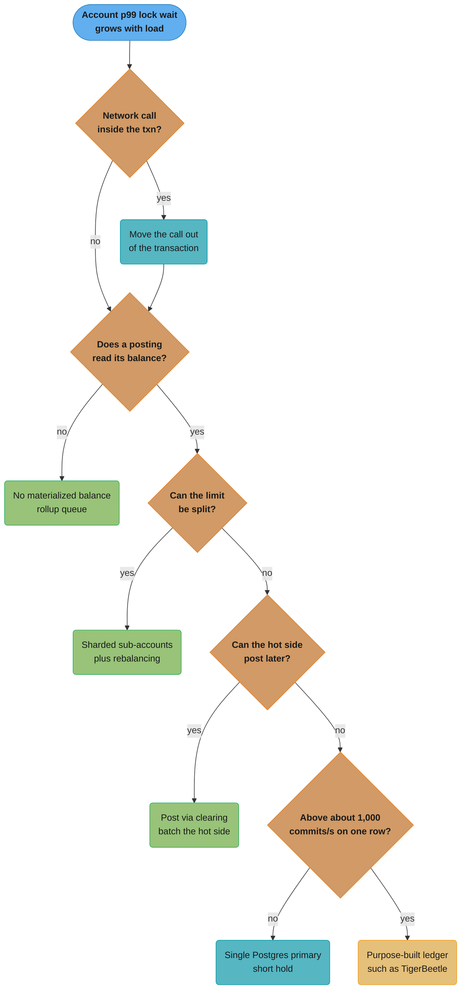
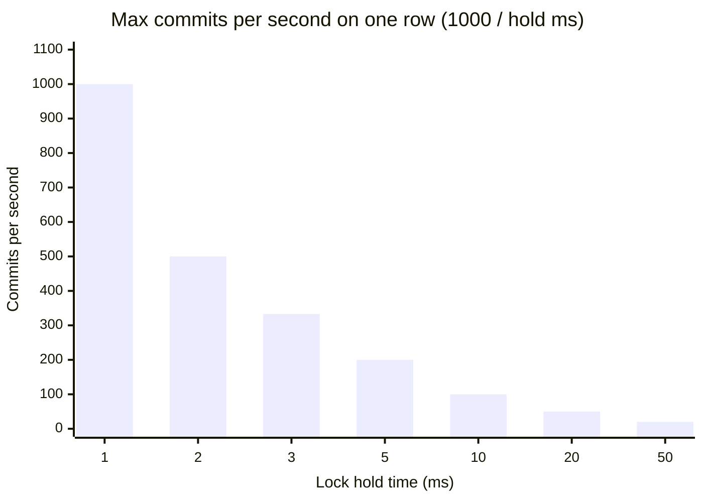
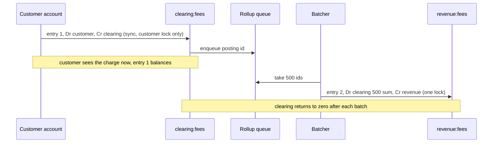

# Hot Accounts and Ledger Scaling

> Rules and figures checked 2026-11-06. Every date, threshold and fee on this page comes from the
> fact pins in fintech/CLAUDE.md. Throughput figures are arithmetic on stated lock-hold
> assumptions, labelled illustrative, not benchmarks. SQL runs on PostgreSQL 18.6.

---

## 1. Concept Overview

A hot account is one ledger account that takes part in a large share of all entries. On a payments
platform the usual suspects are the platform fee revenue account, the FBO cash account at the
partner bank, the card network payable, a PSP receivable, and the sender account of a promotion
that credits every new customer. Each of them sits on one side of thousands of entries per second
while each customer account sees a few entries a day.

If the ledger keeps a materialized balance, or checks a balance under a row lock, every entry that
touches the hot account waits for that one row. The account then caps the throughput of the whole
platform at one divided by the lock hold time. This page covers the strategies that lift that cap
and the larger choices that follow from them:

- Shorter lock hold time, and why no network call belongs inside the transaction.
- No materialized balance on accounts that need no balance check.
- Sharded sub-accounts, with rebalancing for accounts that must not go negative.
- Batching and netting, and the rollup queue that makes batching exact.
- Asynchronous posting behind a reservation, through a clearing account.
- Balance reads at scale, ledger sharding keys and cross-shard entries.
- Ledger stores: a single Postgres primary, Postgres sharded by account, Spanner-class
  distributed SQL, and TigerBeetle.
- Ledger migration.

The accounting model this page assumes (entries, postings, layers, the balance-model choice) is in
[Double-Entry Ledger Design](double_entry_ledger_design.md). How row locks, `SELECT ... FOR
UPDATE` and lock ordering work in Postgres is in
[Concurrency Control and Locking](../../database/concurrency_control_and_locking/concurrency_control_and_locking.md).
General sharding mechanics are in [Database Sharding](../../hld/database_sharding/database_sharding.md).

---

## 2. Intuition

> **One-line analogy:** a hot account is a shop with one till. Every customer, whatever they buy,
> must pay at that till, so the queue length depends only on how long each payment takes at the
> till, not on how many shop assistants you hire.

**Mental model.** Throughput through one row is the reciprocal of the time each transaction holds
that row's lock. Adding application servers adds people to the queue. The ways out are the ways a
shop gets out: make each payment at the till faster, open more tills (shard the account), take
payments in bundles (batch), or let customers pay later at a quieter time (post asynchronously
behind a reservation).

**Why it matters.** Hot-account contention looks like a database that "cannot scale": CPU is low,
disk is idle, and p99 latency climbs with load because transactions wait on one lock. Teams
misdiagnose it as a need for a bigger instance or a new database, when the fix is a change to which
postings need that lock at all.

**Key insight.** Ask what invariant the hot account's lock protects. A fee revenue account only
grows, so no posting to it needs to read its balance: drop the lock. A promotion budget must not go
below zero: that invariant can be split across shards. An FBO cash account must match the bank:
that is a reconciliation property, not a per-posting check. Most hot accounts carry a lock that
protects nothing.

---

## 3. Core Principles

1. **Max commits per second on one row is about 1 / lock hold time.** A 1 ms hold allows at most
   about 1,000 commits per second on that row, whatever the hardware.
2. **Never hold a ledger lock across a network call.** A PSP call, a fraud call or a queue publish
   inside the transaction multiplies the hold time by orders of magnitude.
3. **Lock only what an invariant needs.** A credit-only account, or an account that may go
   negative, needs no balance read on posting and no row lock.
4. **Split a limit to split a lock.** A non-negative rule on one account can become a
   non-negative rule on each of N sub-accounts, at the cost of false declines when one shard runs
   dry first.
5. **Batch the hot side, not the customer side.** The customer's own account needs a synchronous
   answer. The fee account can absorb a hundred postings in one balance update.
6. **Every intermediate state still balances.** Asynchronous posting goes through a clearing
   account, so each entry balances when it commits, even if the final account posts later.
7. **The spend check reads the primary under the lock.** Replicas, caches and projections serve
   statements and dashboards.
8. **Shard by account, and treat a cross-shard entry as two entries joined by clearing accounts.**
   An outbox or a two-phase protocol completes the pair, and reconciliation checks it.

---

## 4. Types / Architectures / Strategies

### 4.1 Hot-account strategies

| Strategy | What changes | Invariant kept | Cost |
|---|---|---|---|
| Shorten the hold | All statements run in the database, no network call inside the transaction | All | Code discipline |
| No materialized balance | Postings are inserted, the hot account's balance is derived or rolled up later | Sum of postings | Balance reads cost a scan or a rollup |
| Sharded sub-accounts | One logical account becomes N physical accounts, each posting picks one | Per-shard limits | False declines, a rebalancing job, N-way balance reads |
| Batching with a rollup queue | Postings append to the hot account. A job folds them into the balance in bulk | Sum of postings, delayed | The balance lags by one batch interval |
| Netting | Many movements between the same two accounts become one posting per period | Net amount per period | Gross detail must live elsewhere (the source entries) |
| Async posting behind a reservation | The customer side posts now to a clearing account. The hot side posts later in bulk | Each entry balances, via clearing | Clearing balance to monitor, delayed hot balance |
| Purpose-built ledger | A ledger database built for many transfers per request | Engine-enforced | Another system to run and migrate to |

### 4.2 Typical hot accounts and what their lock protects

| Account | Direction | Needs a balance check per posting? | Usual strategy |
|---|---|---|---|
| `revenue:fees` | Credits only | No | No materialized balance, rollup |
| `payable:network` | Credits at capture, debits at settlement | No | Rollup, net at settlement |
| `receivable:psp` | Debits at capture, credits at settlement | No | Rollup per settlement batch |
| `cash:fbo` | Both | Not per posting. Reconciliation proves it | Postings per rail batch, rollup |
| `promo:sender` | Debits only, against a budget | Yes, must not exceed the budget | Sharded sub-accounts with rebalancing |
| A large merchant's payable | Credits all day, one debit per payout | Only at payout | Rollup, lock only for the payout |

### 4.3 Ledger stores

| Store | How it scales | Hot-account behavior | Cross-account entries | Fits |
|---|---|---|---|---|
| Single PostgreSQL primary | Vertically, plus read replicas | Row lock per hot row | Local transactions | Most platforms, for longer than teams expect |
| PostgreSQL sharded by account | Horizontally, by account id | Same per shard | Cross-shard needs clearing accounts or 2PC | Very large account counts with mostly same-shard entries |
| Spanner-class distributed SQL | Horizontally, with distributed transactions | A hot row is still one row with one lock | Distributed transactions, higher latency | Multi-region writes, large teams already on the platform (Square Books runs on Cloud Spanner) |
| TigerBeetle | A single cluster built for transfers, which clients submit in batches | Built for contended accounts | Transfers between accounts on the same ledger, linked groups for multi-leg events | Very high transfer rates on few accounts |

### 4.4 Decision model: hot-account strategy and ledger store

This is the section's only copy of this decision. Other pages link here.



Most accounts leave the chart at the second or third question. The store question comes last
because a new database does not remove a lock that protects nothing.

| Strategy | Illustrative max postings/s on the hot account | Balance freshness | Assumption behind the number |
|---|---|---|---|
| Lock held across a 300 ms PSP call | about 3 | Exact | One commit per 300 ms hold |
| Lock held 3 ms (statements plus one app round trip) | about 330 | Exact | 3 ms hold |
| Lock held 1 ms (statements in one database call) | about 1,000 | Exact | 1 ms hold, synchronous commit |
| 16 sharded sub-accounts at 1 ms | about 16,000 | Exact per shard | Even spread, no rebalancing contention |
| No materialized balance, rollup every second | Bounded by insert throughput, not by a row lock | Up to 1 s behind | Inserts do not contend on the hot row |
| Purpose-built ledger | Bounded by the engine and batch size | Exact | Measure on your own workload |

---

## 5. Architecture Diagrams

### 5.1 Throughput against lock hold time



The curve is `1000 / hold_ms`. Going from 1 ms to 3 ms (one extra application round trip inside the
transaction) cuts the ceiling by two thirds. A PSP call inside the transaction is off the chart.

### 5.2 Sharded sub-accounts

```
                       revenue:fees  (logical account, never written directly)
                                   |
        +-------------+------------+------------+-------------+
        |             |            |            |             |
   revenue:fees#0  #1           #2           ...          #15
        ^             ^            ^                          ^
        |             |            |                          |
   entry key hash % 16 picks the shard for each posting

   balance(revenue:fees) = SUM over #0..#15
   lock contention       = 1/16 of the single-account case (even hash)
```

Each posting locks only its shard, so 16 shards give 16 independent queues. A read of the logical
balance sums 16 rows, which is cheap. A non-negative limit is enforced per shard, which is
stricter than enforcing it on the total.

### 5.3 Asynchronous posting behind a reservation



The customer's transaction never touches `revenue:fees`. The batcher takes the hot account's lock
once per batch, not once per payment.

---

## 6. How It Works - Detailed Mechanics

### 6.1 Measuring the lock, not the database

The symptom is lock wait, not resource use. In Postgres, `pg_stat_activity` shows sessions with
`wait_event_type = 'Lock'` and `wait_event = 'transactionid'` or `'tuple'` while CPU and I/O stay
low, and `pg_locks` shows them queued behind the one session holding the hot row. Measure the time
between the `SELECT ... FOR UPDATE` on the hot row and `COMMIT` in the application. That number,
not the query time, sets the ceiling in §5.1.

Three things inflate it, in order of how often they appear:

1. A network call inside the transaction (PSP, fraud service, message broker, another service).
2. Several round trips between the application and the database, each adding network latency while
   the lock is held.
3. Synchronous commit latency, which the hot row waits through on every commit.

Moving all ledger statements into one database call (a function such as `post_entry` in the
ledger module) removes item 2. Item 1 is a design bug; §10.1 shows it.

### 6.2 No materialized balance, and a rollup that does not miss postings

A credit-only account needs no balance on the write path. Postings insert without touching any
shared row, and a rollup job folds them into a balance table later. The trap is the rollup's
watermark. Identity values are assigned at insert, not at commit, so a transaction holding id 101
can commit after one holding id 102. A rollup that reads `id > last_seen` can see 102, record 102
as the watermark, and skip 101 forever.

The fix is a queue table that the rollup drains with `DELETE ... RETURNING`. Each posting also
inserts its id into the queue in the same transaction. The rollup deletes what it reads, in its own
transaction, so a late-committing posting is still in the queue on the next run.

```sql
CREATE TABLE posting (
    id           BIGINT GENERATED ALWAYS AS IDENTITY PRIMARY KEY,
    entry_key    TEXT   NOT NULL,
    account_id   TEXT   NOT NULL,
    amount_minor BIGINT NOT NULL CHECK (amount_minor <> 0)
);

CREATE TABLE rollup_queue (
    posting_id   BIGINT PRIMARY KEY REFERENCES posting(id),
    account_id   TEXT   NOT NULL,
    amount_minor BIGINT NOT NULL
);

CREATE TABLE account_rollup (
    account_id    TEXT   PRIMARY KEY,
    balance_minor BIGINT NOT NULL,
    postings      BIGINT NOT NULL
);

-- Each posting to a hot account also enqueues itself, in the same transaction.
CREATE FUNCTION post_hot(p_key TEXT, p_account TEXT, p_amount BIGINT) RETURNS VOID
LANGUAGE sql AS $$
    WITH p AS (
        INSERT INTO posting (entry_key, account_id, amount_minor)
        VALUES (p_key, p_account, p_amount) RETURNING id, account_id, amount_minor
    )
    INSERT INTO rollup_queue SELECT id, account_id, amount_minor FROM p;
$$;

-- The rollup drains the queue. A posting that commits late is still queued next time.
CREATE FUNCTION run_rollup() RETURNS BIGINT LANGUAGE sql AS $$
    WITH drained AS (
        DELETE FROM rollup_queue RETURNING account_id, amount_minor
    ), agg AS (
        SELECT account_id, SUM(amount_minor)::bigint AS s, count(*) AS n
          FROM drained GROUP BY account_id
    ), up AS (
        INSERT INTO account_rollup AS r (account_id, balance_minor, postings)
        SELECT account_id, s, n FROM agg
        ON CONFLICT (account_id) DO UPDATE
           SET balance_minor = r.balance_minor + EXCLUDED.balance_minor,
               postings      = r.postings + EXCLUDED.postings
        RETURNING postings
    )
    SELECT COALESCE(SUM(n), 0)::bigint FROM agg;
$$;

SELECT post_hot('fee:' || g, 'revenue:fees', -300) FROM generate_series(1, 1000) g;
SELECT run_rollup();
SELECT post_hot('fee:' || g, 'revenue:fees', -250) FROM generate_series(1001, 1400) g;
SELECT run_rollup();

DO $$
BEGIN
    ASSERT (SELECT balance_minor FROM account_rollup WHERE account_id = 'revenue:fees')
         = (SELECT SUM(amount_minor) FROM posting WHERE account_id = 'revenue:fees');
    ASSERT (SELECT postings FROM account_rollup WHERE account_id = 'revenue:fees') = 1400;
    ASSERT NOT EXISTS (SELECT 1 FROM rollup_queue);
END $$;
```

The rollup's own `INSERT ... ON CONFLICT DO UPDATE` takes the hot row's lock once per run, not
once per posting. With one run per second, the hot account sees one lock per second.

### 6.3 Sharded sub-accounts

A logical account becomes N physical accounts. Each posting picks a shard from a hash of its entry
key, so a retry of the same entry lands on the same shard. The logical balance is the sum.

```sql
CREATE TABLE shard_balance (
    account_id    TEXT     NOT NULL,
    shard         SMALLINT NOT NULL,
    balance_minor BIGINT   NOT NULL DEFAULT 0,
    PRIMARY KEY (account_id, shard)
);

INSERT INTO shard_balance (account_id, shard)
SELECT 'payable:network', s FROM generate_series(0, 15) s;

CREATE FUNCTION shard_of(p_key TEXT, p_shards INT) RETURNS SMALLINT
LANGUAGE sql IMMUTABLE AS $$
    SELECT ((hashtextextended(p_key, 0) % p_shards + p_shards) % p_shards)::smallint
$$;

UPDATE shard_balance b SET balance_minor = b.balance_minor + x.s
  FROM (SELECT shard_of('capture:' || g, 16) AS shard, SUM(1999)::bigint AS s
          FROM generate_series(1, 5000) g GROUP BY 1) x
 WHERE b.account_id = 'payable:network' AND b.shard = x.shard;

DO $$
DECLARE busiest BIGINT; quietest BIGINT;
BEGIN
    ASSERT (SELECT SUM(balance_minor) FROM shard_balance WHERE account_id = 'payable:network')
         = 5000 * 1999;
    SELECT max(balance_minor), min(balance_minor) INTO busiest, quietest
      FROM shard_balance WHERE account_id = 'payable:network';
    ASSERT quietest > 0 AND busiest < 2 * quietest, 'hash spread is uneven';
END $$;
```

For an account that may go negative or only grows, shards need nothing else. For an account with a
limit, each shard holds a slice of the limit and a rebalancing job moves balance between shards
before one runs dry (§14).

### 6.4 Batching and netting

Batching keeps every source posting and applies them to the hot balance in bulk (§6.2). Netting
goes further: it replaces many movements between the same two accounts with one posting per
period. A marketplace that pays 40,000 merchants a day from `cash:fbo` can post one cash movement
per payout file instead of 40,000, as long as each merchant's own payable account still gets its
own posting. The rule is that netting may collapse the hot side, never the customer side, because
each customer's statement and each dispute needs its own line.

Netting also changes what reconciliation sees. The bank statement shows one debit per payout
file, so the ledger's cash posting must reference the file id, and the file's line items must map
back to the merchant postings. Reconciliation matches the net amount to the bank and the lines to
the payouts. The matching rules are in
[Reconciliation and Settlement Files](../reconciliation_and_settlement_files/reconciliation_and_settlement_files.md).

### 6.5 Asynchronous posting behind a reservation

When a customer pays a fee, the customer's account needs a synchronous answer, and the fee account
does not. Split the event into two entries joined by a clearing account:

1. Synchronously, under the customer's lock only: `Dr customer, Cr clearing:fees`.
2. Asynchronously, once per batch: `Dr clearing:fees (batch sum), Cr revenue:fees`.

Both entries balance when they commit. Between batches, `clearing:fees` holds the fees not yet
moved, and a monitor alerts if its balance or its oldest queued item exceeds a threshold. The same
pattern carries a reservation: the customer side can be a pending entry (a hold) that a later
entry posts or voids, while the hot side only ever sees posted batch entries.

### 6.6 Balance reads at scale

| Reader | Source | Freshness needed | Notes |
|---|---|---|---|
| Spend check, overdraft check | Primary, under the account lock | Exact | Never a replica or a cache |
| Customer app balance | Primary or a cache keyed by the last entry id | Seconds | A cache entry is valid while no entry newer than its id exists |
| Statement, export | Replica at a known log position, or a snapshot | As of a timestamp | Record the "as of" with the output |
| Finance dashboards | Projection or warehouse | Minutes to hours | Never used to approve money movement |

A cache keyed by `(account_id, last_entry_id)` cannot serve a stale balance as current, because a
new entry changes the key. Read-your-writes for the customer who just paid is solved by reading the
primary for that customer for a short time after their own write.

### 6.7 Sharding the ledger and cross-shard entries

Shard the ledger by account id. Most entries touch a customer account and a platform account, so
put platform accounts in every shard as sharded sub-accounts (§6.3), and the common entry stays on
one shard.

An entry between two customers on different shards cannot be one local transaction. Two options:

| Option | How | Cost |
|---|---|---|
| Two-phase commit across shards | One distributed transaction | Coordinator, in-doubt transactions, locks held across a network round trip |
| Two local entries via inter-shard clearing | Shard A: `Dr customer_a, Cr clearing:to_B`. Shard B: `Dr clearing:from_A, Cr customer_b`. An outbox on shard A drives the shard B entry, with retries until it posts | The pair is not atomic. `clearing:to_B` on A and `clearing:from_A` on B must net to zero, and reconciliation checks that they do |

The second option keeps every entry local and balanced. The idempotency module covers how the
second entry is posted exactly once from the outbox.

### 6.8 Migrating a ledger

A ledger migration moves the history, not the balances. A balance copied without its postings
cannot be explained, and the first dispute about an old transaction has no record to read.

1. Replay the full history of entries into the new store, with their original effective dates and
   posting times. TigerBeetle's `imported` flag exists for this: it accepts user-defined
   timestamps, which must be unique, strictly increasing and in the past.
2. Run both ledgers in parallel. New events post to both, and a parity job compares every account's
   balance per day.
3. Investigate every parity difference to its entry. Do not "fix" the new ledger with an adjusting
   entry until the cause is known.
4. Cut over readers first, then writers, in cohorts of accounts. Keep the old ledger read-only for
   the retention period.

Uber's LedgerStore post (2024-04-04) shows that the indexes can be a migration of their own. Uber
built over 2 trillion unique indexes for hundreds of billions of ledgers and moved them from
DynamoDB to Docstore.

---

## 7. Real-World Examples

- **Square Books.** Square's double-entry service runs on Google Cloud Spanner and GKE (Square
  engineering blog, 2019-10-16). Books hold balances and entries are append-only, which is the
  materialized-balance model on a distributed store.
- **Uber LedgerStore.** LedgerStore indexes hundreds of billions of ledgers. The 2024-04-04 post
  describes over 2 trillion unique indexes moved from DynamoDB to Docstore, which is a migration
  of the read path.
- **TigerBeetle.** Clients submit transfers to `create_transfers` as a batch, and accounts carry
  `debits_pending`, `debits_posted`, `credits_pending` and `credits_posted` counters, so a
  contended account is a set of counters updated inside the engine rather than a row lock held
  across application round trips. Release 0.17.9 is dated 2026-07-06.
- **Common platform pattern.** Fee revenue, network payables and PSP receivables carry no
  materialized balance on the write path, and finance reads them from a rollup or a warehouse. The
  fix needs a queue table and a rollup job, and no new database.

---

## 8. Tradeoffs

| Strategy | Exact balance at write time | Extra moving parts | Failure mode |
|---|---|---|---|
| Shorter hold | Yes | None | Regresses when someone adds a call inside the transaction |
| No materialized balance plus rollup | No, lags one run | Queue table, rollup job | Rollup stops and the balance freezes. Alert on queue age |
| Sharded sub-accounts | Per shard | Shard choice, rebalancer, N-way reads | False declines when one shard runs dry |
| Netting | Net only | Mapping from net postings back to lines | Reconciliation cannot match lines if the mapping is lost |
| Async via clearing | Customer side yes, hot side no | Clearing account, batcher, monitor | Clearing balance grows when the batcher stalls |
| Sharded ledger | Per shard | Router, inter-shard clearing, outbox | Unpaired inter-shard entries |
| Purpose-built ledger | Yes | A new database, a migration | Operational unfamiliarity |

---

## 9. When to Use / When NOT to Use

**Use these strategies when:**

- Lock waits on one account dominate p99 latency of posting, with low CPU and I/O.
- A single account takes part in a large share of all entries.
- Projected volume on one account approaches 1 / lock hold time.

**Do not:**

- Shard or batch a customer account that sees a few entries a day.
- Move to a new ledger store before removing network calls from the transaction and dropping
  locks that protect nothing.
- Serve the spend check from a replica, cache or projection.
- Net away the customer-side postings.
- Copy balances into a new ledger without the entries that produced them.

---

## 10. Common Pitfalls

### 10.1 A PSP call inside the ledger transaction

The charge handler opens a transaction, locks the merchant's payable account, calls the PSP, and
posts the entry before committing. Every charge for the same merchant now waits for the previous
charge's PSP round trip.

```java
// BROKEN
import java.util.concurrent.ExecutorService;
import java.util.concurrent.Executors;
import java.util.concurrent.TimeUnit;
import java.util.concurrent.locks.ReentrantLock;

public class HotLockBroken {
    static final ReentrantLock merchantRow = new ReentrantLock();
    static long payableMinor = 0;

    static void charge(long amount) throws InterruptedException {
        merchantRow.lock();                 // SELECT ... FOR UPDATE on the merchant payable
        try {
            Thread.sleep(5);                // PSP call inside the transaction
            payableMinor += amount;         // post the entry
        } finally {
            merchantRow.unlock();           // COMMIT
        }
    }

    public static void main(String[] args) throws Exception {
        ExecutorService pool = Executors.newFixedThreadPool(8);
        long start = System.nanoTime();
        for (int i = 0; i < 160; i++) pool.submit(() -> { charge(1_000); return null; });
        pool.shutdown();
        pool.awaitTermination(30, TimeUnit.SECONDS);
        long ms = (System.nanoTime() - start) / 1_000_000;
        System.out.println("160 charges in " + ms + " ms, payable=" + payableMinor);
        // about 800 ms or more: 160 x 5 ms, serialized behind one lock
    }
}
```

Eight threads finish in the time one thread would take, because the lock serializes the PSP calls.
In production the PSP call is hundreds of milliseconds, which caps a merchant at a few charges per
second.

```java
// FIX
import java.util.concurrent.ExecutorService;
import java.util.concurrent.Executors;
import java.util.concurrent.TimeUnit;
import java.util.concurrent.locks.ReentrantLock;

public class HotLockFix {
    static final ReentrantLock merchantRow = new ReentrantLock();
    static long payableMinor = 0;

    static void charge(long amount) throws InterruptedException {
        Thread.sleep(5);                    // PSP call first, with the idempotency key, no lock held
        merchantRow.lock();                 // short transaction: post the entry only
        try {
            payableMinor += amount;
        } finally {
            merchantRow.unlock();
        }
    }

    public static void main(String[] args) throws Exception {
        ExecutorService pool = Executors.newFixedThreadPool(8);
        long start = System.nanoTime();
        for (int i = 0; i < 160; i++) pool.submit(() -> { charge(1_000); return null; });
        pool.shutdown();
        assert pool.awaitTermination(30, TimeUnit.SECONDS);
        assert payableMinor == 160_000 : payableMinor;
        long ms = (System.nanoTime() - start) / 1_000_000;
        System.out.println("160 charges in " + ms + " ms, payable=" + payableMinor);
    }
}
```

The PSP call runs with no lock, and the transaction holds the row only for the posting. The
ordering this needs (record the attempt, call the PSP with an idempotency key, then post) and its
crash cases are in
[Idempotency and Exactly-Once Money Movement](../idempotency_and_exactly_once_money_movement/idempotency_and_exactly_once_money_movement.md).

### 10.2 A rollup that trusts `max(id)`

A team rolls up fee postings with `WHERE id > :watermark` and stores the largest id it saw. Under
load, a posting with a smaller id commits after a larger one, falls below the watermark, and is
never counted. The fee account drifts below the sum of its postings by a few postings a day. The
fix is the queue table drained with `DELETE ... RETURNING` (§6.2).

### 10.3 Sharding an account with a limit and no rebalancer

A promotion budget of 100,000.00 is split across 16 shards. Hash skew and bursty traffic empty one
shard while others hold most of the budget, and customers are declined "out of budget" with 60% of
the budget left. Shards with limits need a rebalancer, and a decline on one shard should retry on a
neighbor before it is final (§14).

### 10.4 Reading the spend check from a replica

A wallet service moves balance reads to a read replica to take load off the primary, including the
read before a debit. Replica lag of a few hundred milliseconds lets a customer spend the same
balance twice in quick succession. Spend checks read the primary under the account lock.

### 10.5 Migrating balances instead of history

A team moves to a new ledger by inserting one opening-balance entry per account. Months later a
customer disputes a charge from before the migration, and the new ledger has no posting for it.
Replay the history, run in parallel, and compare per account before cutover (§6.8).

---

## 11. Technologies & Tools

| Tool | What it does for hot accounts and ledger scale |
|---|---|
| TigerBeetle | Ledger database that takes transfers in batches and keeps pending and posted counters per account |
| PostgreSQL | Single-primary ledger store, with `pg_locks` and `pg_stat_activity` to find lock waits on a hot row |
| Cloud Spanner | Distributed SQL with distributed transactions, used by Square Books |
| Citus | PostgreSQL extension that shards tables by a distribution column such as the account id |
| Docstore | Uber's storage layer that LedgerStore's indexes moved to |

---

## 12. Interview Questions with Answers

**Q: Why does adding application servers not raise throughput on a hot ledger account?**
**Short:** Every posting to that account waits for one row lock, so throughput is about one divided by the lock hold time, whatever the number of callers.

With a 1 ms hold the ceiling is about 1,000 commits per second on that row. More servers make the
queue longer, raise p99 latency and leave CPU idle. The fixes change the lock: hold it for less
time, split the account, or stop taking it on every posting.

**Q: What is wrong with calling the PSP inside the ledger transaction?**
**Short:** The row lock is held for the whole PSP round trip, so a 300 ms call caps every account it locks at about three postings per second.

It also makes the transaction's outcome depend on an external system that may time out after
charging. Record the attempt, call the PSP outside any ledger lock with an idempotency key, then
post the entry in a short transaction. The crash windows of that ordering belong to the
idempotency design, not to the lock.

**Q: Does a fee revenue account need a materialized balance?**
**Short:** No, it only receives credits and no posting reads its balance, so postings can append without a lock and a rollup can compute the balance later.

The lock on a materialized fee balance protects no invariant. Remove the balance update from the
write path, append postings, and fold them into a rollup table once per second or per minute.
Finance reads the rollup, and the trial balance still covers every posting.

**Q: Why can a rollup job not use the largest posting id it has seen as its watermark?**
**Short:** Ids are assigned at insert, not at commit, so a smaller id can commit after a larger one and fall below the watermark, where the rollup never counts it.

Under concurrency, transaction A takes id 101 and transaction B takes id 102. B commits first, the
rollup reads up to 102, and A commits a moment later below the watermark. Drain a queue table with
`DELETE ... RETURNING` instead, so each posting is counted when its own transaction is visible.

**Q: How do sharded sub-accounts work?**
**Short:** One logical account becomes N physical accounts, each posting picks one by a hash of its entry key, and the logical balance is the sum of the N.

Each shard has its own lock, so contention falls to about 1/N with an even hash. Hashing the entry
key, not picking at random, sends a retry of the same entry to the same shard. Reads sum N rows,
which is cheap for N in the tens.

**Q: What goes wrong when you shard an account that must not go negative?**
**Short:** Each shard enforces the limit on its own slice, so a busy shard declines while the total still has budget, and you need a rebalancer and a retry on a neighbor shard.

The per-shard rule is stricter than the global rule. Bursts and hash skew drain one shard first.
Move balance from rich shards to poor ones with balanced entries, and on a shard decline try the
next shard before the final decline. Report false declines as a metric.

**Q: How can the customer side post now and the hot side post later without an unbalanced entry?**
**Short:** Post the customer side to a clearing account in one balanced entry, then move the clearing balance to the hot account in one balanced batch entry.

Each entry balances when it commits. The clearing account holds the in-flight amount between
batches. Monitor its balance and the age of its oldest item, because a stalled batcher shows up
there first. The customer's statement is complete after the first entry.

**Q: Why is netting allowed on the hot side but not on the customer side?**
**Short:** Each customer needs a line per transaction for statements and disputes, while the hot platform account can take one posting per period as long as the lines map back to it.

A payout file of 40,000 merchants can post one cash movement against the FBO account, while each
merchant's payable gets its own posting. If the mapping from the net posting to its lines is lost,
reconciliation can match the total to the bank but cannot explain a single merchant's payout.

**Q: Can a spend check read from a read replica or a cache?**
**Short:** No, a replica lags and a cache can be stale, so a debit check must read the primary under the account lock to stop the same balance being spent twice.

Replicas and caches serve app balance displays, statements and exports. A cache keyed by the last
entry id cannot present an old balance as current, which makes it safe for display. For a customer
who just paid, read the primary for a short window to give read-your-writes.

**Q: How do you shard a ledger, and what happens to an entry that spans two shards?**
**Short:** Shard by account id, and split a cross-shard entry into two local balanced entries through inter-shard clearing accounts, with an outbox that retries the second until it posts.

Most entries pair a customer with a platform account, so the platform accounts exist as sub-accounts
in every shard and those entries stay local. A customer-to-customer entry across shards becomes
`customer_a to clearing:to_B` and `clearing:from_A to customer_b`. The two clearing accounts must
net to zero, and reconciliation checks it.

**Q: When does a single Postgres primary stop being enough for a ledger?**
**Short:** When the hot accounts still exceed what a short lock allows after their locks are minimized, or the account count outgrows one machine, not when a dashboard shows high load.

Most ledgers run on one primary for a long time once no network call sits inside a transaction and
credit-only accounts carry no materialized balance. Shard by account when storage or total write
volume outgrows one machine. Move to a purpose-built ledger when a few accounts need more transfers
per second than any row lock can give.

**Q: What does a purpose-built ledger such as TigerBeetle change about hot accounts?**
**Short:** Transfers arrive in batches and update per-account pending and posted counters inside the engine, so there is no application round trip inside a lock.

The application builds a batch of transfers and submits it in one request. Overdraft limits are
account flags, holds are pending transfers with timeouts, and multi-leg events are linked
transfers. The cost is a new database, a migration, and a model where transfers move between
accounts on the same ledger.

**Q: How should you migrate a ledger to a new store?**
**Short:** Replay the full history of entries with their original dates, run both ledgers in parallel with a daily per-account parity check, and cut over in cohorts.

Copying balances leaves the new ledger unable to explain any past transaction. TigerBeetle's
`imported` flag accepts historical timestamps for this replay. Every parity difference is traced to
an entry before any adjustment. Readers move before writers, and the old ledger stays read-only for
the retention period.

**Q: Why do the indexes matter as much as the entries in a ledger migration?**
**Short:** Every read path, by account, by payment, by time, depends on an index, and at scale moving those indexes is a project of its own, as Uber's LedgerStore move showed.

Uber's 2024 post describes over 2 trillion unique indexes for hundreds of billions of ledgers, moved
from DynamoDB to Docstore. A migration plan that moves entries but rebuilds indexes later leaves
statements, disputes and reconciliation without their query paths. Plan index backfill and parity
checks alongside the entries.

**Q: How do you find a hot account in production?**
**Short:** Look for sessions waiting on locks behind one row while CPU and I/O are low, and measure the time from the row lock to commit in the application.

In Postgres, `pg_stat_activity` shows `wait_event_type = 'Lock'` and `pg_locks` shows the queue
behind one transaction. Group lock waits by the locked account id. The hold time measured in the
application, not the query time, predicts the ceiling.

**Q: Why should the shard for a posting come from a hash of the entry key rather than a random pick?**
**Short:** A retry or replay of the same entry must land on the same shard, so the idempotency check and the posting find each other and the entry is not posted on two shards.

A random shard turns a retried entry into two postings on two shards, each passing its own
uniqueness check. Hashing the entry key makes the shard a pure function of the event. Changing the
shard count changes the mapping, so add shards by moving balance, not by rehashing history.

---

## 13. Best Practices

- Measure lock hold time on hot rows, and alert when it grows.
- Keep every network call out of ledger transactions.
- Post through one database call per entry.
- Drop materialized balances from credit-only and unchecked accounts, and roll them up through a
  queue table.
- Shard accounts with limits only with a rebalancer and a neighbor retry.
- Pick shards by a hash of the entry key.
- Use clearing accounts for any posting split across time, and monitor their balances and ages.
- Read spend checks from the primary under the lock.
- Migrate history, not balances, with a parallel run and per-account parity.

---

## 14. Case Study

### A promotion budget that declined with money left

**Context.** A wallet app runs a launch promotion: every new customer gets 5.00 from a promotion
sender account with a budget of 100,000.00. Sign-ups peak at a few thousand per second, and the
single `promo:sender` row, checked under a lock on every credit, became the slowest path in the
app. The team split it into 16 sub-accounts of 6,250.00 each, assigned by a hash of the customer
id. Within an hour, sign-ups started failing with "promotion ended" while the dashboard still showed
budget left. The traffic figures in this case are illustrative.

**First version.** Each grant checks only its own shard and declines when that shard is empty.

```java
// BROKEN
public class PromoBroken {
    static final int SHARDS = 16;
    static final long[] shard = new long[SHARDS];

    static boolean grant(int customer, long amount) {
        int s = Math.floorMod(Integer.hashCode(customer * 31 + 7) * 0x9E3779B9, SHARDS);
        if (shard[s] < amount) return false;
        shard[s] -= amount;
        return true;
    }

    public static void main(String[] args) {
        java.util.Arrays.fill(shard, 625_000);
        int declined = 0;
        for (int c = 0; c < 20_000; c++) {
            int burstyCustomer = (c % 4 == 0) ? 3 * 16 * c : c;   // a partner sends ids in a pattern
            if (!grant(burstyCustomer, 500)) declined++;
        }
        long left = java.util.Arrays.stream(shard).sum();
        System.out.println("declined=" + declined + ", budget left=" + left);
        // declined=3750, budget left=1875000: 18,750.00 of budget left, 3,750 customers turned away
    }
}
```

A partner's patterned customer ids map a quarter of the traffic onto one shard. That shard empties
fast, and every customer who hashes to it is declined with the budget still available elsewhere.

**Fix.** On a shard decline, try the next shards in order before declining. A rebalancer moves
budget from the richest shard to any shard under a low-water mark, with a balanced entry, in whole
grants. A decline is final only when no shard can serve the grant. Because every shard holds a
multiple of the grant, that means the total budget is below one grant. With grants of different
sizes, fragments smaller than a grant can strand budget across shards, and the final fallback is a
grant that takes the global lock.

```java
// FIX
import java.util.Arrays;

public class PromoFix {
    static final int SHARDS = 16;
    static final long[] shard = new long[SHARDS];

    static int home(int customer) {
        return Math.floorMod(Integer.hashCode(customer * 31 + 7) * 0x9E3779B9, SHARDS);
    }

    static boolean grant(int customer, long amount) {
        int start = home(customer);
        for (int i = 0; i < SHARDS; i++) {
            int s = (start + i) % SHARDS;
            if (shard[s] >= amount) {
                shard[s] -= amount;
                return true;
            }
        }
        return false;
    }

    static void rebalance(long lowWater) {
        for (int s = 0; s < SHARDS; s++) {
            if (shard[s] >= lowWater) continue;
            int rich = 0;
            for (int r = 1; r < SHARDS; r++) if (shard[r] > shard[rich]) rich = r;
            long move = (shard[rich] - shard[s]) / 2 / 500 * 500;   // whole grants only
            shard[rich] -= move;                     // one balanced entry: Dr shard s, Cr shard rich
            shard[s] += move;
        }
    }

    public static void main(String[] args) {
        Arrays.fill(shard, 625_000);
        long budget = Arrays.stream(shard).sum();
        int declined = 0, granted = 0;
        for (int c = 0; c < 20_000; c++) {
            int burstyCustomer = (c % 4 == 0) ? 3 * 16 * c : c;
            if (grant(burstyCustomer, 500)) granted++; else declined++;
            if (c % 500 == 0) rebalance(50_000);
        }
        long left = Arrays.stream(shard).sum();
        assert granted * 500L + left == budget : "budget is conserved";
        assert declined == 0 || left < 500 : "decline only when the budget is gone";
        System.out.println("granted=" + granted + ", declined=" + declined + ", left=" + left);
    }
}
```

Grants per shard still take only that shard's lock, so throughput stays close to 16 times the
single-row ceiling. The neighbor walk removes false declines, and the rebalancer keeps the walk
short. The budget is conserved: every grant and every rebalance is a balanced movement between
accounts, which the assertion checks.

**Takeaway.** Splitting a limit splits the lock and also changes the rule. The rule you meant was
"the total budget covers the grant". Shards enforce "this slice covers the grant" unless you add the
walk and the rebalancer that restore the original meaning.
