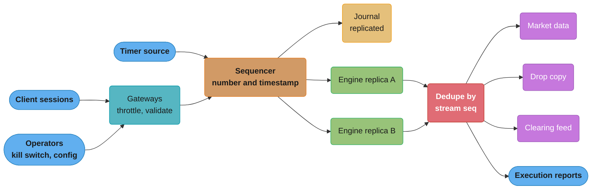
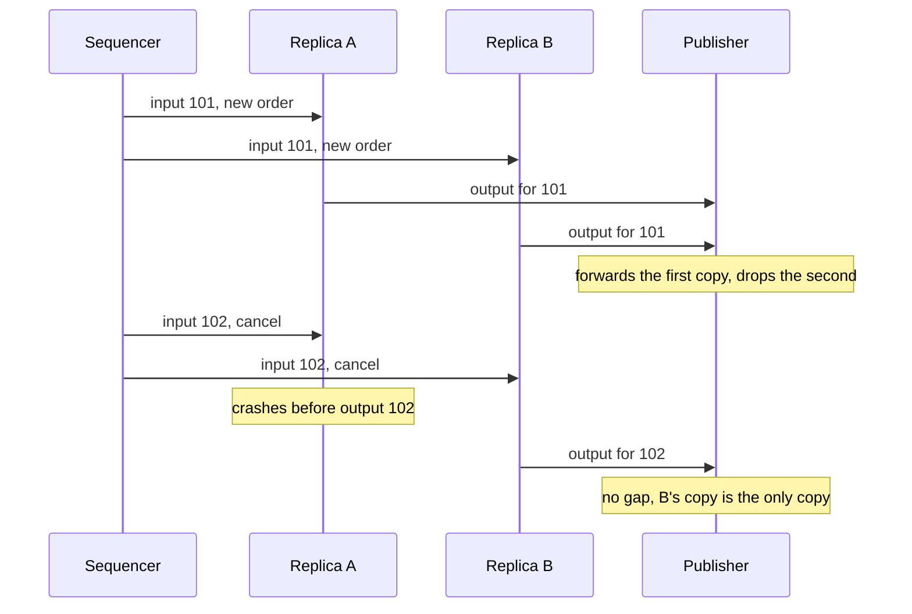
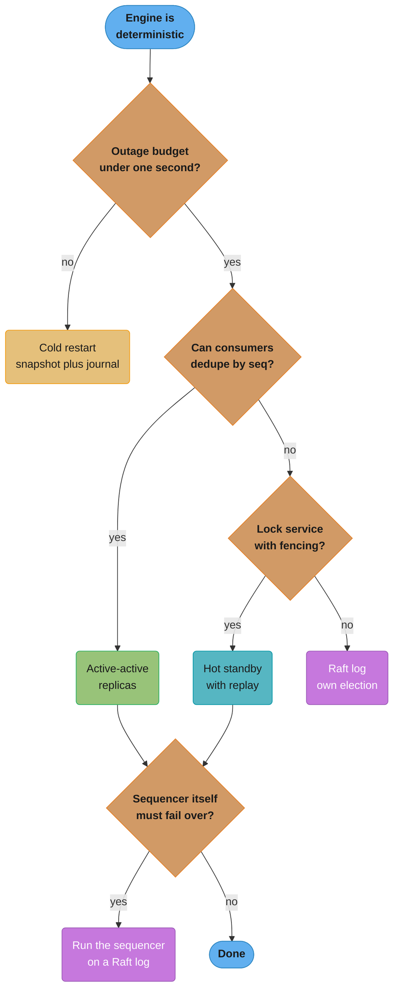

# Exchange Architecture and Determinism

> Rules and figures checked 2026-11-06. Every date, threshold and fee on this page comes from the
> fact pins in fintech/CLAUDE.md. The text of 17 CFR 240.15c3-5, SEC press release 2013-222,
> OpenJDK JEP 306, the `java.lang.Math` Javadoc for Java 25, the Aeron README and the Coinbase
> Exchange matching-engine page were read on 2026-11-06. Session counts, rates and failover times
> in the examples are illustrative.

---

## 1. Concept Overview

An exchange core is a replicated state machine. A sequencer puts every input (new order,
cancel, timer, kill switch, configuration change) into one total order and writes it to a
journal. One or more engine replicas apply the inputs in that order. If the engine is
deterministic, every replica reaches the same state and emits the same outputs, and a replay of
the journal rebuilds the state after a crash.

This page covers the parts of that design that the end-to-end exchange study does not:

- the gateway and session layer: throttles, order-id mapping, cancel-on-disconnect,
- kill switches at session, firm and venue level, and where broker risk controls sit,
- sequencer topologies and what the journal must hold,
- snapshots that a replay can trust, and code upgrades that do not break replay,
- the failover models (hot standby with replay, active-active deterministic replicas, a Raft
  log, cold restart) and a decision model to pick one,
- the coding rules that keep an engine deterministic, in Java terms,
- clock synchronization for timestamps, and testing by deterministic simulation.

[System Design: Stock Exchange](../../hld/case_studies/design_stock_exchange.md) designs one
exchange end to end: single writer per symbol, sequencing before matching, snapshot plus replay,
lease-based hot standby, in-memory pre-trade risk checks, halts, and the market data, drop copy
and tape outputs. This page generalizes those choices and does not retell them.

---

## 2. Intuition

**One-line analogy.** Several clerks keep identical ledgers by copying from one numbered list of
instructions. If every clerk follows the same rules and never looks at a wall clock or flips a
coin, their ledgers match line for line, and a new clerk can catch up by starting from a
photocopy of any page and reading on.

**Mental model.** Draw a line around the engine. Everything inside the line is a pure function:
`state(n) = apply(state(n - 1), input(n))`. Everything that is not a function of earlier inputs
(time, network events, disconnects, operator actions, configuration) must cross the line as a
numbered input. The gateway lives outside the line and can use clocks and threads freely. The
engine lives inside and can use neither.

**Why it matters.** Determinism buys three things at once: replicas that agree without talking
to each other, crash recovery by replay, and an audit trail that can reproduce any past state.
One call to the wall clock inside the line breaks all three, and the break shows only on the day
a replica takes over.

**Key insight.** Failover design is a choice of who keeps the order of inputs safe. A hot standby
trusts the journal. Active-active replicas trust the sequencer and deduplicate outputs. A Raft
log makes the order itself a consensus decision. The engine code is the same in all three, as
long as it is deterministic.

---

## 3. Core Principles

- **Total order first.** The sequencer gives each input a gap-free sequence number before any
  engine sees it. The sequence number, not a timestamp, decides order.
- **Inputs, not side effects.** A disconnect, a timer, a kill switch and a configuration change
  are inputs with sequence numbers. The engine never reacts to anything it did not read from the
  sequenced stream.
- **Outputs carry two numbers.** Each output stream (market data, drop copy, one session's
  execution reports) numbers its own messages without gaps, and each message also names the input
  that caused it. Consumers deduplicate and detect gaps by the stream number. Auditors link cause
  and effect by the input number. A deterministic engine assigns both, so every replica emits the
  same pair.
- **A snapshot is a state at a sequence boundary.** It records the last applied sequence number,
  the logic version and every counter that affects outputs. Replay starts at the next number.
- **Code version is part of the state.** The same journal replayed through different code can
  produce different outputs. The upgrade itself is a sequenced input.
- **Timestamps are for reporting.** Clocks drift and tie. MiFID II RTS 25 allows up to 100
  microseconds of divergence from UTC for HFT activity, which is far more than the time between
  two orders on a busy instrument.

---

## 4. Types / Architectures / Strategies

### 4.1 Gateway and session layer

| Job | What it does | Inside or outside the deterministic line |
|---|---|---|
| Logon and session state | Authenticates, tracks session sequence numbers (see [FIX Protocol and Order Entry](../fix_protocol_and_order_entry/fix_protocol_and_order_entry.md)) | Outside |
| Validation | Checks tick, lot, instrument state and message format | Outside, with rules loaded from sequenced configuration |
| Throttle | Limits messages per second per session, rejects or queues the excess | Outside |
| Order-id mapping | Maps the client order id to an exchange order id | Exchange id assigned inside, from a sequenced counter |
| Cancel-on-disconnect | When a session drops, asks the engine to cancel its resting orders | Detected outside, applied inside as a sequenced input |
| Kill switch | Blocks new orders and cancels resting orders for a session, firm or venue | Triggered outside, applied inside as a sequenced input |

The gateway may use threads, clocks and the network. Its only path into the engine is the
sequencer.

### 4.2 Where risk controls sit

| Layer | Who runs it | Typical controls |
|---|---|---|
| Broker with market access | The broker | SEC Rule 15c3-5: credit and capital thresholds, price and size checks against erroneous orders, duplicate checks, with a regular review and an annual CEO certification |
| Venue gateway | The exchange | Message throttles, max order size, price collars |
| Venue engine | The exchange | Price bands, volatility auctions, self-trade prevention, credit or margin checks on a crypto venue |
| Kill switch | Broker or venue | Stop new orders and cancel resting orders, by session, firm or venue |
| Drop copy and surveillance | Broker, venue, clearing firm | Post-trade position and loss checks that can fire a kill switch |

Rule 15c3-5 binds the broker-dealer with market access, not the venue. A venue on its own cannot
stop a client's runaway algorithm in time, because the client's broker is the last place that
knows the client's limits. Credit checks for a crypto venue that is also the custodian sit in the
engine, which is why margin is engine state there (see
[Margin, Liquidation and Derivatives Risk](../margin_liquidation_and_derivatives_risk/margin_liquidation_and_derivatives_risk.md)).

### 4.3 Sequencer topologies

| Topology | How order is assigned | Fit |
|---|---|---|
| One global sequencer | One process numbers every input for the venue | Small venues, venues with cross-instrument orders |
| Sequencer per partition | One sequencer per group of instruments | Large venues, one engine thread per partition |
| Sequencer inside the engine process | The engine's input stage journals and replicates, then the business logic runs (the LMAX design) | Lowest hop count |
| Consensus log | A Raft leader appends, followers acknowledge a quorum before apply | Automatic leader election without an external lock service |

A per-partition design cannot give a total order across partitions. An instruction that spans
partitions (a venue-wide kill switch, an implied order across two products) must be sent to each
partition as its own sequenced input, and the outputs carry a partition id beside the sequence
number.

### 4.4 Failover models

| Model | How a replica stays current | What takes over | What can go wrong |
|---|---|---|---|
| Hot standby with replay | Standby reads the replicated journal and applies it, but publishes nothing | Standby starts publishing from the next sequence number after it takes the lease | Two publishers if the lease is not fenced |
| Active-active deterministic replicas | Two or more replicas apply the same sequenced input and all publish | Nothing changes: consumers already take the first copy of each output | Replicas disagree if the code is not deterministic |
| Raft log | Inputs commit on a quorum before apply | A new leader is elected by the log's own protocol | Quorum round trip on every commit batch |
| Cold restart | No live replica | Load the last snapshot, replay the journal tail | Minutes of downtime |

The stock exchange study §4.2 covers the lease and fencing for a hot standby. Raft itself is in
[Consensus Algorithms](../../hld/consensus_algorithms/consensus_algorithms.md) and the consistency
models in [Consistency Models and Consensus](../../database/consistency_models_and_consensus/consistency_models_and_consensus.md).
In short: Raft makes the order of inputs a replicated decision, so a leader crash never loses an
input that a client saw acknowledged, at the cost of a quorum round trip per batch. The engine on
top of the log is the same deterministic engine as in the other models.

### 4.5 Determinism hazards in a Java engine

| Hazard | Why it breaks replay | Rule |
|---|---|---|
| Wall clock (`System.currentTimeMillis`, `Instant.now`) | Two replicas, or a replay, read different times | Use the timestamp the sequencer stamped on the input |
| Iteration over a `HashMap` keyed by objects without `hashCode` | Identity hash codes differ per object, so each replica builds a different bucket order | Iterate a `TreeMap` or a `LinkedHashMap`, or sort first |
| `java.lang.Math` functions | The Javadoc says `Math` implementations are not defined to return bit-for-bit the same results | Use `StrictMath`, or avoid floating point in the engine |
| Floating-point summation order | Strict IEEE arithmetic (always strict since JEP 306 in Java 17) still gives different results for a different order | Fixed order, or integers |
| Threads inside the engine | Scheduling order differs per run | One thread applies inputs |
| Random numbers | Different seeds | Seed from the journal, or no randomness |
| Configuration reloaded from a file | Replicas reload at different moments | Configuration change is a sequenced input |
| Calls to a database or service mid-apply | The answer can change between runs | Load everything into state before the input that needs it |
| Code upgrade | New logic gives new outputs for old inputs | Version switch as a sequenced input, replay with the recorded version |

---

## 5. Architecture Diagrams

### 5.1 Inputs in, outputs out, one numbered stream



Disconnects, kill switches, timers and configuration all enter through the sequencer. The
engines see one stream. The dedupe stage forwards the first copy of each output and drops the
second, which is what lets either replica die without a gap.

### 5.2 Active-active replicas through a failure



No election runs when replica A crashes. The publisher had two sources and now has one. A
hot standby would need a lease handover here, and a Raft cluster would need a leader election
only if the sequencer role itself failed.

### 5.3 Decision model: picking a failover model



The engine replicas and the sequencer are separate failure questions. Active-active removes the
engine election. Something still has to keep the sequencer's order safe, and a consensus log is
the usual answer there.

---

## 6. How It Works - Detailed Mechanics

### 6.1 A deterministic engine with journal, snapshot and replay

The engine below never reads a clock. Each input carries a sequence number and a timestamp from
the sequencer. Expiry of good-till-date orders runs against that timestamp. A mass cancel (the
kill switch) is a sequenced input. Two replicas fed the same journal produce the same outputs,
and a restart from a snapshot plus the journal tail rebuilds the same book.

```java
import java.util.ArrayList;
import java.util.List;
import java.util.TreeMap;

public class DeterministicEngine {
    sealed interface Cmd permits NewOrder, Cancel, MassCancel {}
    record NewOrder(long orderId, long firm, long qty, long expiresAt) implements Cmd {}
    record Cancel(long orderId) implements Cmd {}
    record MassCancel(long firm) implements Cmd {}

    // the sequencer assigns seq and ts; the engine reads no clock
    record Input(long seq, long ts, Cmd cmd) {}

    record Resting(long firm, long qty, long expiresAt) {}

    final TreeMap<Long, Resting> book = new TreeMap<>();   // sorted keys: fixed iteration order
    final List<String> out = new ArrayList<>();
    long lastSeq;

    void apply(Input in) {
        if (in.seq() != lastSeq + 1) throw new IllegalStateException("gap before " + in.seq());
        lastSeq = in.seq();
        expire(in.ts(), in.seq());
        switch (in.cmd()) {
            case NewOrder n -> {
                book.put(n.orderId(), new Resting(n.firm(), n.qty(), n.expiresAt()));
                out.add(in.seq() + " ack " + n.orderId());
            }
            case Cancel c -> out.add(in.seq() + (book.remove(c.orderId()) != null ? " canceled " : " unknown ")
                    + c.orderId());
            case MassCancel m -> {
                var it = book.entrySet().iterator();
                while (it.hasNext()) {
                    var e = it.next();
                    long id = e.getKey();                    // read before remove: TreeMap reuses the entry
                    if (e.getValue().firm() == m.firm()) { it.remove(); out.add(in.seq() + " killed " + id); }
                }
            }
        }
    }

    private void expire(long now, long seq) {
        var it = book.entrySet().iterator();
        while (it.hasNext()) {
            var e = it.next();
            long id = e.getKey();
            if (e.getValue().expiresAt() <= now) { it.remove(); out.add(seq + " expired " + id); }
        }
    }

    DeterministicEngine snapshot() {
        DeterministicEngine s = new DeterministicEngine();
        s.book.putAll(book);
        s.lastSeq = lastSeq;
        return s;
    }

    public static void main(String[] args) {
        long t = 1_000_000_000L;
        List<Input> journal = List.of(
                new Input(1, t, new NewOrder(10, 7, 100, Long.MAX_VALUE)),
                new Input(2, t + 5, new NewOrder(11, 8, 200, t + 50)),
                new Input(3, t + 9, new NewOrder(12, 7, 300, Long.MAX_VALUE)),
                new Input(4, t + 60, new Cancel(99)),          // its timestamp expires order 11
                new Input(5, t + 70, new MassCancel(7)));      // kill switch for firm 7

        DeterministicEngine a = new DeterministicEngine(), b = new DeterministicEngine();
        DeterministicEngine snap = null;
        for (Input in : journal) {
            a.apply(in);
            b.apply(in);
            if (in.seq() == 2) snap = a.snapshot();
        }
        assert a.out.equals(b.out) && a.book.equals(b.book);

        for (Input in : journal.subList(2, journal.size())) snap.apply(in);   // replay the tail
        assert snap.book.equals(a.book) && snap.lastSeq == 5;
        assert a.out.equals(List.of("1 ack 10", "2 ack 11", "3 ack 12", "4 expired 11",
                "4 unknown 99", "5 killed 10", "5 killed 12"));
        System.out.println(a.out);
    }
}
```

The expiry scan here walks the whole book on every input to keep the example short. A real
engine keeps a timer queue ordered by `(expiresAt, orderId)` and pops only what is due. The rule
is the same: expiry happens at the first input whose timestamp passes the deadline, so every
replica expires the order at the same sequence number. A venue that must expire orders while no
other input arrives has the sequencer emit timer inputs on a fixed interval.

### 6.2 Throttles at the gateway

A throttle protects the sequencer and the engine from one session's burst. It belongs in the
gateway, outside the deterministic line, because it depends on arrival time. A token bucket per
session is the common shape. The capacity and rate below are illustrative.

```java
public class SessionThrottle {
    static final long NANOS_PER_SEC = 1_000_000_000L;
    final long capacity, perSecond;
    long tokens, last;

    SessionThrottle(long capacity, long perSecond, long now) {
        this.capacity = capacity;
        this.perSecond = perSecond;
        this.tokens = capacity;
        this.last = now;
    }

    boolean tryAcquire(long now) {
        long elapsed = now - last;
        if (elapsed >= capacity * NANOS_PER_SEC / perSecond) {
            tokens = capacity;
            last = now;
        } else {
            long add = elapsed * perSecond / NANOS_PER_SEC;
            if (add > 0) {
                tokens = Math.min(capacity, tokens + add);
                last += add * NANOS_PER_SEC / perSecond;   // keep the unused fraction of time
            }
        }
        if (tokens == 0) return false;
        tokens--;
        return true;
    }

    public static void main(String[] args) {
        long t0 = 5_000_000_000L;
        SessionThrottle th = new SessionThrottle(5, 1_000, t0);    // burst 5, 1,000 per second
        for (int i = 0; i < 5; i++) assert th.tryAcquire(t0);
        assert !th.tryAcquire(t0);                                  // sixth message in the burst
        assert th.tryAcquire(t0 + 1_000_000) && !th.tryAcquire(t0 + 1_000_000); // one token per ms
        int ok = 0;
        for (int i = 0; i < 10; i++) if (th.tryAcquire(t0 + 100_000_000)) ok++;
        assert ok == 5;                                             // refill capped at the burst
        System.out.println("throttle accepted " + ok + " after a 99 ms pause");
    }
}
```

Reject the excess with a clear reason code rather than queue it. A queued order reaches the book
later than the client thinks, and the client cannot tell which of its orders were delayed.

### 6.3 Cancel-on-disconnect and kill switches as inputs

A session drop is detected by the gateway (a missed heartbeat, a TCP reset). The gateway sends a
"session lost" input to the sequencer. The engine cancels that session's resting orders when it
applies the input. Fills that the engine applied before the input stand, and the client learns
about them from the execution reports it replays after logon.

Two details decide whether this is safe:

1. The cancels must come out in a fixed order (by order id or by arrival), because each cancel
   becomes a market data message with its own sequence number. §10.1 shows the bug when the
   order depends on hash codes.
2. The kill switch must block new orders as well as cancel resting ones. A kill switch that only
   cancels lets the runaway algorithm refill the book in the next millisecond.

### 6.4 Snapshots that a replay can trust

A snapshot needs more than the book:

- the last applied sequence number, so replay starts at the right input,
- the logic version, so replay uses the same rules,
- every counter that shapes output: the next exchange order id, the next trade id, the market
  data sequence number,
- session state that the engine owns (which sessions are live, their cancel-on-disconnect flag),
- instrument state (trading, halted, in auction) and the active configuration.

Take the snapshot from a replica, not from the primary. The replica stops applying at a sequence
boundary, writes the snapshot, then catches up from the journal. The primary never pauses.
Check each snapshot by replaying a journal segment from the previous snapshot and comparing a
digest of the two states.

### 6.5 Upgrades without breaking replay

Replaying Monday's journal through Wednesday's code can produce different outputs if the rules
changed. Three rules keep replay meaningful:

1. Record the logic version in every snapshot and in the journal header.
2. Make a rule change a sequenced input ("from sequence N, use pro-rata version 3"), so that a
   replay switches at the same point the live engine did.
3. Keep old versions runnable for as long as the journal must be replayable. That period follows
   the record-retention rules in
   [Regulatory Reporting and Audit Trails](../regulatory_reporting_and_audit_trails/regulatory_reporting_and_audit_trails.md).

### 6.6 Clocks and timestamps

The sequence number orders events. Timestamps still matter for regulatory reports, latency
measurement and client reports. PTP (IEEE 1588) is the usual way to synchronize host clocks to
this accuracy. In the EU, RTS 25 (Delegated
Regulation (EU) 2017/574, applied from 2018-01-03) sets the accuracy:

| Activity | Max divergence from UTC | Timestamp granularity |
|---|---|---|
| HFT activity | 100 microseconds | 1 microsecond or finer |
| Voice trading | 1 second | 1 second |

For a venue, the 100-microsecond tier applies when its gateway-to-gateway latency is 1 ms or
less. The sequencer stamps each input once, and that stamp is the engine's only clock. Two orders
can carry the same timestamp and still have a strict order by sequence number.

### 6.7 Testing by deterministic simulation

A deterministic engine can run inside a simulator that controls every input: client sessions,
disconnects, timers, replica crashes and journal delays, all driven by one seeded random
generator. A failing seed reproduces the whole run. The method, and how FoundationDB and
TigerBeetle use it, is in
[Consensus Algorithms](../../hld/consensus_algorithms/consensus_algorithms.md). For an exchange the
assertions to add are: replicas agree on every output, outputs are gap-free per stream, a replay
from any snapshot gives the same state digest, and no order exists in the book after a kill
switch for its firm.

---

## 7. Real-World Examples

- **LMAX.** Martin Fowler's description of the LMAX architecture puts the business logic in one
  thread with in-memory state, fed by input stages that journal and replicate. LMAX reported 6
  million orders per second for the business logic processor as a benchmark on a dual-socket
  quad-core 3 GHz Nehalem with 32 GB. It did not publish production volumes, so treat the number
  as a benchmark of the single-writer design, not a production rate.
- **Coinbase Exchange.** Order states are `received`, `open` and `done`. A valid order that
  reaches the matching engine is confirmed at once as `received`. Any part not filled at once is
  `open`, and the order is `done` when it is filled or canceled. `received` keeps "the engine has
  the order" apart from "the order filled", the same split as a sequencer acknowledgement and a
  fill report.
- **Aeron.** Aeron provides UDP unicast, UDP multicast and IPC transport. Aeron Archive records
  streams for replay, and Aeron Cluster runs services as replicated state machines on Raft. The
  README says Adaptive Financial Consulting owns and operates Aeron. Cluster is one way to run the
  Raft-log model without writing the consensus layer.
- **Knight Capital, 2012-08-01.** In about 45 minutes Knight's SMARS router sent millions of child
  orders, giving over 4 million executions in 154 stocks for over 397 million shares. Knight took a
  net long position of about $3.5 billion in 80 stocks and lost more than $460 million. The SEC
  fined it $12 million, and its press release of 2013-10-16 says the charges were for violating the
  market access rule, Rule 15c3-5. Knight was a broker, not a venue. A firm-level kill switch fed
  by post-trade position checks is the control that stops that pattern.
- **MiFID II RTS 25.** The clock rules in §6.6 apply to EU venues and their members. A venue
  design that meets them stamps once at the sequencer from a PTP-disciplined clock and logs the
  stamp with each input.

---

## 8. Tradeoffs

### 8.1 Decision model: failover model

| Factor | Hot standby with replay | Active-active replicas | Raft log | Cold restart |
|---|---|---|---|---|
| Inputs lost on failover | None if the journal replicates before the ack | None | None once committed | None if the journal survives |
| Outage on engine failure (illustrative) | Lease expiry plus catch-up, hundreds of ms | Near zero: the other copy is live | Election timeout, hundreds of ms | Minutes |
| Extra compute | One idle-publishing replica | Every replica works and publishes | Followers apply too | None |
| Needs output dedupe | No | Yes, by stream sequence number | No | No |
| Needs an external lock service | Yes, with fencing | No for the engines | No | No |
| Hurt most by non-determinism | On takeover | Every second: replicas disagree | On leader change | On replay |
| Fit | Most venues | Venues with tight outage budgets and consumers that dedupe | Venues that want election built in | Development, low-tier instruments |

### 8.2 Sequencer topology

| Factor | Global sequencer | Per-partition | Inside the engine process | Consensus log |
|---|---|---|---|---|
| Cross-instrument order | Yes | No | Per engine | Per log |
| Throughput ceiling | One sequencer | Scales with partitions | One engine | One leader per log |
| Extra hops | One | One | None | One plus quorum |
| Venue-wide kill switch | One input | One input per partition | One input per engine | One input per log |

### 8.3 Snapshot method

| Method | Pause on the primary | Cost | Risk |
|---|---|---|---|
| Stop-the-world on the primary | Yes | Simple | Latency spike every snapshot |
| From a replica at a sequence boundary | No | One extra replica | Replica must stay current |
| Copy-on-write in process | Short | Memory for changed pages | Complex, platform dependent |

---

## 9. When to Use / When NOT to Use

**Use active-active replicas** when consumers can deduplicate by stream sequence number and the
outage budget is below what a lease handover can meet. Do not use it before the engine passes a
replica-agreement test under generated load: a hidden source of non-determinism shows up as two
different outputs for one input.

**Use a hot standby** when downstream consumers cannot deduplicate and an external lock service
with fencing tokens already exists. Do not let the standby publish anything before it holds the
lease.

**Use a Raft log** (Aeron Cluster, or your own) when you want the order of inputs itself to fail
over without an external coordinator. Do not put each order through its own consensus round:
batch inputs per commit, or the quorum round trip sets the latency.

**Use cancel-on-disconnect by default** for market makers. Do not apply it outside the sequencer:
a gateway that cancels directly against the book creates outputs that no replica can reproduce.

**Do not read any clock inside the engine.** Do not load configuration from a file inside the
engine. Do not call a database from inside `apply`.

---

## 10. Common Pitfalls

### 10.1 Cancel order from a hash map

A venue's engine kept each gateway's sessions in a `HashMap` keyed by a `Session` object with no
`hashCode`. When a gateway dropped, the engine cancelled the orders of each session in map order.
The primary and the replica emitted the same cancels in a different order, so the market data
sequence numbers disagreed, and subscribers that switched lines saw different books.

```java
// BROKEN
import java.util.ArrayList;
import java.util.HashMap;
import java.util.List;
import java.util.Map;

public class CancelOnDisconnectOrder {
    static final class Session {                    // no equals or hashCode: identity hash
        final long id;
        Session(long id) { this.id = id; }
    }

    // a gateway drops, so the engine cancels the orders of every session behind it
    static List<Long> cancels(int sessions) {
        Map<Session, List<Long>> ordersBySession = new HashMap<>();
        for (long id = 1; id <= sessions; id++) ordersBySession.put(new Session(id), List.of(id * 100, id * 100 + 1));
        List<Long> out = new ArrayList<>();
        for (List<Long> orders : ordersBySession.values()) out.addAll(orders);
        return out;
    }

    public static void main(String[] args) {
        List<Long> replicaA = cancels(6), replicaB = cancels(6);
        System.out.println("A " + replicaA);
        System.out.println("B " + replicaB);
        System.out.println("replicas agree? " + replicaA.equals(replicaB));
    }
}
// one run on JDK 25 printed:
// A [200, 201, 600, 601, 100, 101, 400, 401, 300, 301, 500, 501]
// B [200, 201, 100, 101, 300, 301, 400, 401, 500, 501, 600, 601]
// replicas agree? false
```

The identity hash codes of the two sets of `Session` objects differ, so the two maps put the same
sessions in different buckets. Even in one process the two "replicas" disagree. The fix keys the
map by the session id in a sorted map.

```java
// FIX
import java.util.ArrayList;
import java.util.List;
import java.util.TreeMap;

public class CancelOnDisconnectSorted {
    static List<Long> cancels(int sessions) {
        TreeMap<Long, List<Long>> ordersBySession = new TreeMap<>();
        for (long id = sessions; id >= 1; id--) ordersBySession.put(id, List.of(id * 100, id * 100 + 1));
        List<Long> out = new ArrayList<>();
        for (List<Long> orders : ordersBySession.values()) out.addAll(orders);
        return out;
    }

    public static void main(String[] args) {
        List<Long> a = cancels(6), b = cancels(6);
        assert a.equals(b);
        assert a.equals(List.of(100L, 101L, 200L, 201L, 300L, 301L, 400L, 401L, 500L, 501L, 600L, 601L));
        System.out.println("replicas agree: " + a);
    }
}
```

The fix inserts in reverse order on purpose: the output is the same because the order comes from
the keys, not from insertion.

### 10.2 A configuration reload outside the stream

An operator raised a price band by editing a file. Each replica's file watcher reloaded it at a
slightly different moment. One replica accepted an order that the other rejected, and from that
input on the replicas diverged. The fix: configuration changes go through the sequencer as inputs,
and the engine never reads files after startup.

### 10.3 The kill switch that only canceled

A broker's kill switch canceled every resting order for a strategy but did not block new ones. The
strategy, still running, sent new orders within milliseconds of the cancels. Knight Capital's
2012 loss (more than $460 million in about 45 minutes) is the public example of what a runaway
router does when nothing stops new orders. A kill switch must block new orders, cancel resting
ones, and stay on until a person turns it off.

### 10.4 A replay with the wrong code

After an engine release that changed rounding in pro-rata allocation, an operator replayed the
previous week's journal to answer a client dispute. The replay produced fills that differed from
the ones the client had received, and the venue could not show what it had done. Keep old logic
versions runnable, record the version in snapshots and journals, and switch versions only through
a sequenced input.

### 10.5 Two publishers after a slow lease handover

A hot standby took over after the primary's lease expired, but the primary had only paused for a
long garbage collection and resumed publishing. Both published outputs for the same inputs for a
few hundred milliseconds. Fence every output with the lease epoch, and have consumers drop outputs
from an older epoch.

### 10.6 Reading a `TreeMap` entry after `Iterator.remove`

An expiry loop removed an entry through the iterator and then logged `entry.getKey()`. When the
removed node had two children, `TreeMap` copied the successor's key and value into that node, so
the log named the wrong order (the next one in key order) while the right one was removed. Both
replicas logged the same wrong id, so a replica-agreement test passed. A test that checks each
expiry output against the orders left in the book catches it. Read the key and value into locals
before calling `remove`.

---

## 11. Technologies & Tools

| Tool | What it is | Where it fits |
|---|---|---|
| Aeron Cluster | Raft-based replicated state machines, part of Aeron | The Raft-log failover model without writing consensus |
| Aeron Archive | Records Aeron streams to storage for replay | The input journal and replay |
| LMAX Disruptor | Ring buffer that passes events between pipeline stages | Feeding the single business-logic thread |
| Chronicle Queue | Persisted, memory-mapped message queue for Java | A low-latency journal |
| linuxptp | Linux implementation of PTP | Host clock synchronization for RTS 25 accuracy |

---

## 12. Interview Questions with Answers

**Q: If every server has a PTP-synchronized clock, can the exchange order events by timestamp?**
**Short:** No. Synchronized clocks still differ by microseconds and can tie, so only a sequencer's gap-free number gives one order that every replica and every replay agrees on.

MiFID II RTS 25 allows up to 100 microseconds of divergence from UTC for HFT activity, and a busy
instrument sees orders far closer together than that. Two clocks can disagree about which order
came first, and two orders can carry the same timestamp. The sequencer stamps a time for reporting
and a number for order. The engine uses the number to decide and the stamp only as data.

**Q: What makes a single-threaded Java engine non-deterministic?**
**Short:** Anything it reads that is not in the input stream: the wall clock, identity-hash iteration order, `Math` functions, file reloads, random numbers and service calls.

One thread removes scheduling races, not other sources of difference. A `HashMap` keyed by
objects without `hashCode` iterates in an order set by identity hash codes, which differ between
processes. The `Math` Javadoc says its functions are not defined to return bit-for-bit the same
results everywhere. A file reload happens at a different input on each replica. Each of these
must become an input, a sorted structure, `StrictMath`, or go away.

**Q: Is floating-point arithmetic deterministic in Java?**
**Short:** Basic arithmetic is: since Java 17 (JEP 306) it is always strict IEEE. But `Math` functions and a different summation order can still change results.

JEP 306 restored always-strict floating-point semantics in Java 17, so `a * b + c` gives the same
bits on every JVM. The `java.lang.Math` methods may use faster platform code and are not defined
to match bit for bit, while `StrictMath` is. Summing in a different order gives a different
rounding. Prices and money in the engine stay integers anyway, so the question applies to
analytics such as a volatility band computed from returns.

**Q: How do active-active replicas avoid publishing every output twice?**
**Short:** Each output stream numbers its messages without gaps, every replica assigns the same numbers, and the publisher or the consumer keeps the first copy of each number and drops later ones.

Both replicas apply input 101 and both emit, for example, market data message 5,001 for it. A
dedupe stage, or each consumer, tracks the highest stream number seen and drops anything at or
below it. If one replica dies, the other's copies are the only copies and nothing is missing. The
scheme fails only if the replicas produce different outputs for the same input, which is why
determinism comes first.

**Q: When would you pick a hot standby over active-active replicas?**
**Short:** When consumers cannot deduplicate by sequence number and a lock service with fencing is available. The standby applies inputs but stays silent until it holds the lease.

A hot standby is simpler for downstream systems: one publisher at a time. The price is a handover
window (lease expiry plus catch-up) and the need to fence the old primary's outputs by lease
epoch. Active-active removes the handover but asks every consumer to dedupe and doubles the work
that publishes. A venue can also combine them: active-active inside a data center and a standby
in a second site.

**Q: What does a Raft log add to an exchange core?**
**Short:** It makes the order of inputs a replicated, quorum-committed decision with built-in leader election, so a sequencer crash never loses an acknowledged input.

Without consensus, the sequencer is a single process whose failover needs an external lock and
fencing. With Raft, followers hold the committed log and elect a new leader themselves. The cost
is a quorum round trip per commit, which venues amortize by batching inputs. Aeron Cluster runs
services as replicated state machines on Raft. The engine on top stays the same deterministic
code.

**Q: Why must timers be inputs instead of callbacks inside the engine?**
**Short:** A callback fires at a wall-clock moment that differs per replica and per replay. A timer input fires at one sequence number for everyone.

A good-till-date order expires when the first input with a timestamp past the deadline arrives,
or when the sequencer emits a timer input. Either way, every replica expires it between the same
two inputs. A callback inside the engine could expire it before an incoming fill on one replica
and after it on another, and the two books differ from that point.

**Q: Why is cancel-on-disconnect applied as a sequenced input?**
**Short:** The disconnect is detected outside the engine at a time no replica can reproduce. As an input it lands at one sequence number, after the same fills on every replica.

The gateway notices a missed heartbeat and sends "session lost" to the sequencer. Fills the
engine applied before that input stand, and the client learns of them when it logs back on. If
the gateway canceled directly, a replica or a replay could not tell which fills came first. The
cancels must also come out in a fixed order, because each one becomes a market data message.

**Q: What must a kill switch do to be effective?**
**Short:** Block new orders, cancel resting orders, and stay on until a person turns it off, for the chosen scope: session, firm or venue.

Canceling alone lets a runaway algorithm refill the book at once. Blocking alone leaves stale
orders exposed. The trigger can be manual or automatic, for example a position or loss limit
breached on the drop copy. Inside the engine it is a sequenced input like any other, so replicas
and replays apply it at the same point.

**Q: Where does SEC Rule 15c3-5 put risk controls, and why is a venue's check not enough?**
**Short:** Rule 15c3-5 puts them on the broker-dealer with market access: credit and capital thresholds, price and size checks, duplicate checks, regular review and a CEO certification.

The venue sees one client's orders but not the client's limits across venues. The broker sees the
client's total exposure and must block orders that exceed preset thresholds before they reach any
market. Knight Capital's $12 million SEC penalty in 2013 settled charges under this rule.
Venue throttles and price bands are a second line, not a replacement.

**Q: What belongs in an engine snapshot besides the order book?**
**Short:** The last applied sequence number, the logic version, every id and sequence counter, session and instrument state, and the active configuration.

Replay starts at the input after the snapshot's sequence number. If the next exchange order id or
the market data sequence number is missing, the replayed outputs carry different ids than the live
ones did. Instrument state (halted, auction) changes which rules apply. Check each snapshot by
replaying from the previous one and comparing state digests.

**Q: How do you change matching logic without breaking replay of old journals?**
**Short:** Record the logic version in snapshots and journals, switch versions through a sequenced input, and keep old versions runnable for as long as replay is needed.

A replay of last week's journal must use last week's rules, or it answers a dispute with fills the
client never received. The version switch at sequence N makes live and replay change at the same
point. Removing the old code shortens how far back the venue can prove what it did.

**Q: Why does every output carry the sequence number of its input?**
**Short:** It links each fill, report and market data message to the input that caused it, for audit and replay checks. Dedupe and gap detection use each stream's own sequence number.

One input can produce many outputs (an ack, several fills, book updates), and it can produce none
on a given stream. The input number gives a cause chain for every trade and lets a replay test
compare outputs input by input. Gap detection needs the stream number: a consumer that sees market
data message 104 after 102 knows it missed 103, while a jump in input numbers can mean only that
the skipped input changed nothing on that stream.

**Q: Where should a message throttle live, and should it queue or reject?**
**Short:** In the gateway, outside the deterministic engine, and it should reject the excess with a reason code rather than queue it.

A throttle depends on arrival time, which the engine must never read. In the gateway it protects
the sequencer and the engine from one session's burst. Queuing hides delay: the client thinks its
order is live when it is still waiting, and it cannot tell which orders were held. A clear reject
lets the client's own logic decide.

**Q: What does deterministic simulation testing check in an exchange?**
**Short:** It runs the real engine under seeded, simulated sessions, disconnects, timers and crashes, and checks replica agreement, gap-free outputs and replay digests.

Every source of non-determinism is behind an interface the simulator controls. A failing seed
reproduces the exact run, including the crash timing. The assertions are exchange specific: no
order for a killed firm stays in the book, replicas emit the same outputs, and a replay from any
snapshot matches. The method itself is described in the consensus algorithms module.

**Q: What does RTS 25 require of an EU trading venue's clocks?**
**Short:** For HFT activity, at most 100 microseconds of divergence from UTC and timestamps of 1 microsecond or finer. Voice trading needs 1 second for both.

RTS 25 (Delegated Regulation (EU) 2017/574) applied from 2018-01-03. For a venue, the
100-microsecond tier applies when its gateway-to-gateway latency is 1 ms or less. The engineering
answer is PTP to every host, a single stamp at the sequencer, and monitoring of the clock offset,
with an alert well before the limit.

**Q: Why should client book queries not run on the engine thread?**
**Short:** Every microsecond the engine spends serving a read delays the next order. Reads belong on a replica or on the market data stream.

The engine thread is the one resource that cannot scale out for an instrument. A snapshot request
for a large book can take far longer than an order. Serve reads from a replica's state, from a
market data snapshot service, or from the feed itself. The engine publishes changes and never
answers queries.

**Q: What happens to an order in flight when the engine fails over?**
**Short:** If the sequencer journaled it, the new engine applies it and its outputs follow. If not, it never existed, and the client must ask by its own order id.

The client sees a timeout and does not know which case applies. After reconnect it asks for
execution reports from its last seen sequence number, or queries by client order id. An order the
venue never sequenced gets no report, and the client can resend it with a new id. The FIX
mechanics for this are in the FIX module.

**Q: Why take engine snapshots from a replica rather than from the primary?**
**Short:** A snapshot from the primary pauses the thread that matches orders. A replica can stop at a sequence boundary, write the snapshot and catch up, and the primary never pauses.

Copying a large book takes far longer than matching an order, so a snapshot on the primary shows as
a latency spike every interval. A replica that applies the same journal holds the same state at the
same sequence number. It pauses, writes, and replays the journal to catch up. Compare its state
digest with a replay from the previous snapshot before trusting it for recovery.

**Q: How do consumers ignore a former primary that keeps publishing after a takeover?**
**Short:** Every output carries the lease epoch of its publisher, and consumers drop outputs from an epoch older than the newest they have seen.

A primary that paused for a long garbage collection can wake up after its lease expired and publish
again. Fencing at the lock service stops it from taking new actions there, but outputs already in
flight reach consumers anyway. The epoch number in each output lets consumers drop the stale ones.
The same idea protects the journal: it rejects appends from an old epoch.

---

## 13. Best Practices

- Draw the deterministic line in the design document. List every input type that crosses it.
- Give every input a sequence number and a timestamp from the sequencer. The engine reads no
  other clock.
- Use sorted or insertion-ordered maps for anything the engine iterates. Never iterate a map keyed
  by identity.
- Send disconnects, timers, kill switches and configuration changes through the sequencer.
- Give every output stream its own gap-free sequence number, tag every output with its input
  sequence number, and add the lease epoch on a hot standby.
- Snapshot from a replica at a sequence boundary, with the logic version and all counters.
- Make logic upgrades sequenced inputs and keep old versions runnable for the replay period.
- Run replica-agreement and replay-digest checks under seeded simulation before every release.

---

## 14. Case Study

### A failover that expired different orders

A crypto venue (assumption: one spot instrument, a primary engine and a hot standby replaying the
journal) supported good-till-date orders. The engine checked expiry against the wall clock when it
applied each input.

```java
// BROKEN
import java.util.ArrayList;
import java.util.List;
import java.util.TreeMap;

public class WallClockExpiry {
    record Input(long seq, long orderId, long expiresAtMillis) {}

    static List<Long> replay(List<Input> journal) {
        TreeMap<Long, Long> book = new TreeMap<>();
        for (Input in : journal) {
            long now = System.currentTimeMillis();          // reads the replica's own clock
            book.entrySet().removeIf(e -> e.getValue() <= now);
            book.put(in.orderId(), in.expiresAtMillis());
        }
        return new ArrayList<>(book.keySet());
    }

    public static void main(String[] args) throws InterruptedException {
        long start = System.currentTimeMillis();
        List<Input> journal = List.of(new Input(1, 10, start + 30), new Input(2, 11, Long.MAX_VALUE));
        List<Long> primary = replay(journal);               // live, right away
        Thread.sleep(50);                                   // standby catches up 50 ms later
        List<Long> standby = replay(journal);
        System.out.println("primary book " + primary + ", standby book " + standby);
    }
}
// prints: primary book [10, 11], standby book [11]
```

The primary applied input 2 before order 10's deadline and kept it. The standby replayed the same
journal 50 ms later, read a later clock, and expired order 10 at input 2. After failover the
standby's book had no order 10, while the client had an acknowledgement and no expiry report. The
client's next cancel for order 10 was rejected as unknown. Over a week (illustrative) a failover
drill found 37 such orders.

The fix stamps the time at the sequencer and expires against the input's timestamp.

```java
// FIX
import java.util.ArrayList;
import java.util.List;
import java.util.TreeMap;

public class SequencedExpiry {
    record Input(long seq, long ts, long orderId, long expiresAt) {}

    static List<Long> replay(List<Input> journal) {
        TreeMap<Long, Long> book = new TreeMap<>();
        for (Input in : journal) {
            book.entrySet().removeIf(e -> e.getValue() <= in.ts());   // the sequencer's time
            book.put(in.orderId(), in.expiresAt());
        }
        return new ArrayList<>(book.keySet());
    }

    public static void main(String[] args) throws InterruptedException {
        long t = 1_000_000L;
        List<Input> journal = List.of(new Input(1, t, 10, t + 30), new Input(2, t + 10, 11, Long.MAX_VALUE));
        List<Long> primary = replay(journal);
        Thread.sleep(50);
        List<Long> standby = replay(journal);
        assert primary.equals(standby) && primary.equals(List.of(10L, 11L));
        System.out.println("primary book " + primary + ", standby book " + standby);
    }
}
```

Order 10 now expires at the first input whose timestamp is past `t + 30`, on every replica and in
every replay. To expire it while no orders arrive, the sequencer emits a timer input every
millisecond (illustrative interval). The venue added a release check: a static scan rejects any
call to `System.currentTimeMillis`, `System.nanoTime`, `Instant.now` or `Math.random` in the
engine package. The market data that reports the expiry is covered in
[Market Data Feeds and Multicast](../market_data_feeds_and_multicast/market_data_feeds_and_multicast.md),
and the order and auction rules that the engine enforces are in
[Order Books and Matching Engines](../order_books_and_matching_engines/order_books_and_matching_engines.md).
