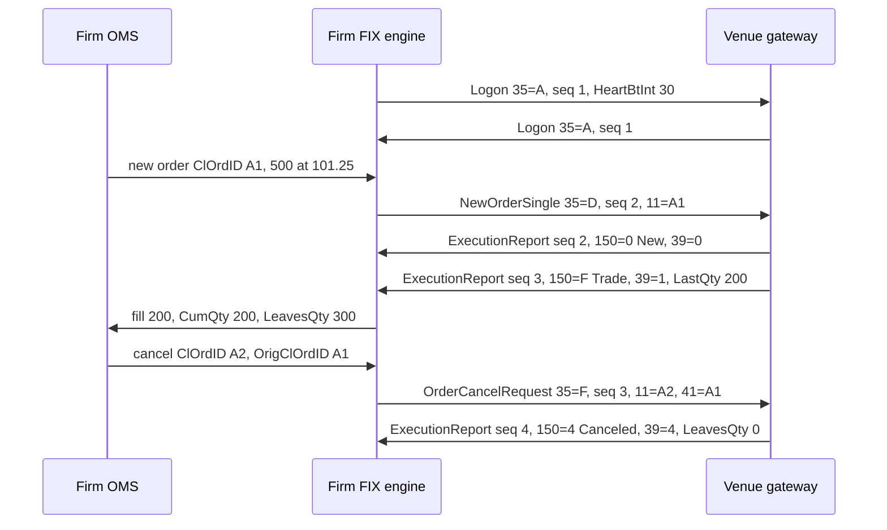
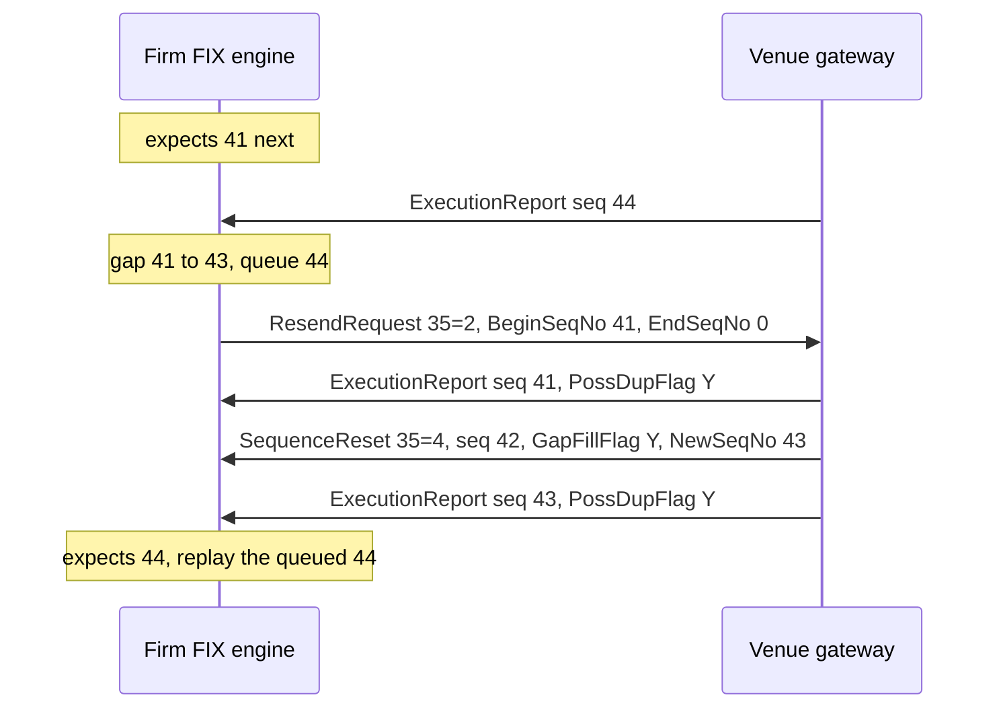
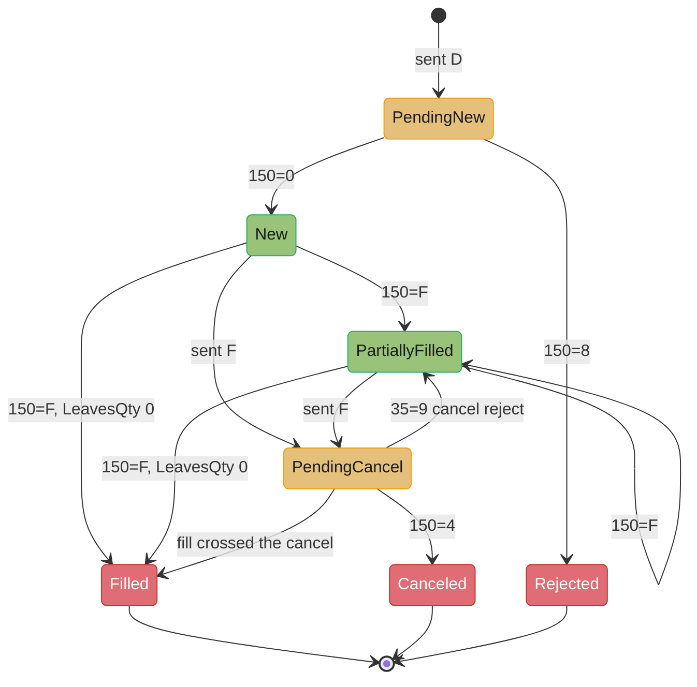

# FIX Protocol and Order Entry

> Rules and figures checked 2026-11-06. Every date, threshold and fee on this page comes from the fact pins in fintech/CLAUDE.md. FIX tag numbers and code values come from the FIX Latest dictionary that the FIX Trading Community publishes on orchimate.org, read on 2026-11-06.

---

## 1. Concept Overview

FIX (Financial Information eXchange) is the message protocol that brokers, buy-side firms and venues use to send orders and receive fills. A FIX connection has two layers:

- The **session layer** delivers messages in order, once, over a long-lived connection. It numbers every message in each direction, detects gaps, and asks the other side to send the missing range again.
- The **application layer** carries the business messages: `NewOrderSingle` (35=D), `OrderCancelRequest` (35=F), `OrderCancelReplaceRequest` (35=G), `ExecutionReport` (35=8) and `OrderCancelReject` (35=9).

Order entry is the path from a firm's order management system (OMS) to a venue's gateway and back. The firm sends a request with a client order id (`ClOrdID`, tag 11). The venue answers with execution reports. Each report says what happened (`ExecType`, tag 150) and what state the order is in after it (`OrdStatus`, tag 39).

The classic encoding is `tag=value` text, with fields split by the SOH byte (0x01). Venues that compete on latency also offer binary order entry: Nasdaq OUCH 5.0 and CME iLink 3, which is SBE over FIXP. The firm side of FIX is the same problem in both encodings: keep an exact, recoverable view of every order across disconnects, duplicates and races.

This page teaches the protocol between the firm and the venue. The venue side (gateway, sequencer, matching engine and halts) is designed end to end in [Design a Stock Exchange](../../hld/case_studies/design_stock_exchange.md), and this page does not retell it.

---

## 2. Intuition

**One-line analogy.** A FIX session is two numbered notebooks, one per direction. Each side writes page numbers in order, and if the reader sees page 12 after page 9, it asks for pages 10 and 11 before it reads further.

**Mental model.** Keep two clocks apart:

| Clock | Scope | Who owns it | What breaks if you get it wrong |
|---|---|---|---|
| `MsgSeqNum` (34) | One session, one direction | The FIX engine | Lost or doubled messages after a reconnect |
| `ClOrdID` (11) chain | One order, across its life | The OMS | Cancels that hit the wrong order, fills booked to the wrong order |

The session clock counts messages. The order chain names requests. A resent message keeps its old sequence number and carries `PossDupFlag=Y` (tag 43). A cancel is a new request with a new `ClOrdID`, and its `OrigClOrdID` (tag 41) points at the request it changes.

**Why it matters.** Order entry failures are expensive in a way that most network bugs are not. A dropped fill means your position is wrong. A doubled fill means your risk system hedges a trade that never happened. A reused id can cancel the wrong order. None of these show up as an error in the logs, because each message on its own is valid.

**Key insight.** FIX gives you ordered, gap-free delivery within a session. It does not give you exactly-once business effect. The OMS gets that by keying every fill on its execution id (`ExecID`, tag 17) and every request on its `ClOrdID`, the same idempotency rule that money movement uses in [Idempotency and Exactly-Once Money Movement](../idempotency_and_exactly_once_money_movement/idempotency_and_exactly_once_money_movement.md).

---

## 3. Core Principles

**The session layer and the application layer are separate.** FIXT 1.1 made this split formal: the session protocol has its own `BeginString` (`FIXT.1.1`), and the application version is named by `DefaultApplVerID` (tag 1137) at logon or by `ApplVerID` (tag 1128) per message. FIX Latest is the application layer: FIX 5.0 SP2 plus every later Extension Pack. EP260 added `ApplVerID=10` for FIX Latest.

**Sequence numbers are per session and per direction.** Each side keeps two counters: the next number it sends and the next number it expects. Both survive a disconnect. A session that loses its counters loses its ability to recover the messages it missed.

**Every request gets a new `ClOrdID`.** A new order, a cancel and a replace each carry a fresh id. The cancel and the replace also carry `OrigClOrdID`, the id of the last accepted request on that order. The venue's own id for the order is `OrderID` (tag 37), and it does not change.

**`ExecType` is the event, `OrdStatus` is the state.** A partial fill arrives as `ExecType=F` (Trade) with `OrdStatus=1` (PartiallyFilled). A cancel that completes arrives as `ExecType=4` (Canceled) with `OrdStatus=4`. Code that reads only one of the two fields misses either the event or the state.

**Quantities obey one invariant.** For a live order, `LeavesQty` (151) equals `OrderQty` (38) minus `CumQty` (14). The FIX dictionary allows `LeavesQty=0` once the order is Canceled, DoneForDay, Expired, Calculated or Rejected. Check the invariant on every report you receive.

**Resent is not new.** A message sent again in recovery keeps its original `MsgSeqNum` and carries `PossDupFlag=Y`. An application message sent again under a new sequence number carries `PossResend=Y` (tag 97). The receiver deduplicates by business key in both cases.

**Prices are decimal strings on the wire.** Parse them into integer ticks or a `BigDecimal` with a fixed scale. Never parse them into a `double`.

---

## 4. Types / Architectures / Strategies

### Encodings

| Encoding | Example | Framing | Field location | Typical user |
|---|---|---|---|---|
| FIX `tag=value` | FIX 4.2, FIX 4.4, FIX Latest over FIXT 1.1 | `8=`, `9=` body length, `10=` checksum, SOH between fields | Scan for the tag | Broker to broker, buy side to broker, most venue order entry |
| Venue binary, fixed length | Nasdaq OUCH 4.2 | Fixed record per message type | Fixed byte offset | Direct market access where latency counts |
| Venue binary, tag-based appendages | Nasdaq OUCH 5.0 | Fixed core plus variable-length optional appendages | Offset for the core, scan for appendages | Same, with room for optional fields |
| SBE over FIXP | CME iLink 3 | SBE message header plus fixed blocks, FIXP session | Fixed byte offset from a schema | CME order entry |

SBE (Simple Binary Encoding) 1.0 is a final FIX standard. SBE 2.0 is at Release Candidate 2 and is not a standard. FIXP (FIX Performance Session Layer) is a lightweight point-to-point session protocol that the FIX Trading Community derived from Nasdaq's SoupBinTCP and UFO.

### Session roles

| Role | Who | Behavior |
|---|---|---|
| Initiator | Usually the firm | Opens the TCP connection and sends `Logon` (35=A) first |
| Acceptor | Usually the venue or broker | Listens, validates `SenderCompID` (49) and `TargetCompID` (56), answers `Logon` |

### Session kinds at a venue

| Session | Direction of business messages | Purpose |
|---|---|---|
| Order entry | Both | Orders in, execution reports out |
| Drop copy | Venue to firm only | A copy of the firm's execution reports, for risk, compliance and clearing |
| Market data | Venue to firm | Covered in [Market Data Feeds and Multicast](../market_data_feeds_and_multicast/market_data_feeds_and_multicast.md) |

### Order message family

| Message | MsgType | Carries |
|---|---|---|
| `NewOrderSingle` | D | `ClOrdID`, `Symbol` (55), `Side` (54), `OrderQty` (38), `OrdType` (40), `Price` (44), `TimeInForce` (59), `TransactTime` (60) |
| `OrderCancelRequest` | F | New `ClOrdID`, `OrigClOrdID`, the order's key fields |
| `OrderCancelReplaceRequest` | G | New `ClOrdID`, `OrigClOrdID`, the changed fields |
| `OrderStatusRequest` | H | Asks the venue for the order's state now |
| `ExecutionReport` | 8 | `OrderID`, `ExecID`, `ExecType`, `OrdStatus`, `CumQty`, `LeavesQty`, `LastQty` (32), `LastPx` (31) |
| `OrderCancelReject` | 9 | The cancel or replace failed, with `CxlRejReason` (102) |
| `BusinessMessageReject` | j | The application could not process a message that passed session checks |

---

## 5. Architecture Diagrams

### Logon, an order, a partial fill, a cancel



Each direction counts on its own: the gateway's report with sequence 2 and the firm's order with sequence 2 are different messages. The cancel names the order by the last accepted id, `A1`, and gets its own id, `A2`.

### Gap detection and recovery



`EndSeqNo=0` means "everything after `BeginSeqNo`". The gateway resends application messages and replaces administrative ones (a heartbeat at 42 here) with a gap fill. The engine holds 44 until 41 to 43 are in.

### Order state from the firm's side



`PendingNew` and `PendingCancel` are states the OMS enters when it sends, before the venue answers. The cancel can lose a race to a fill, which is why `PendingCancel` has three exits.

### Bytes covered by BodyLength and CheckSum

```
8=FIXT.1.1|9=129|35=D|34=7|49=BRKR|56=VENUE| ... |60=20261106-14:30:00.000|10=nnn|
|<-- header --->|<------------ BodyLength = 129 bytes ------------------>|
|<-------------- CheckSum = (sum of these bytes) mod 256 --------------->|
```

`BodyLength` counts from the byte after the SOH that ends `9=` up to and including the SOH before `10=`. `CheckSum` sums every byte from `8=` up to that same SOH. `|` stands for SOH here and in every FIX example on this page.

---

## 6. How It Works - Detailed Mechanics

### 6.1 Framing a message

A receiver reads `8=` and `9=` first, then reads exactly `BodyLength` more bytes, then the 7-byte trailer `10=nnn` plus SOH. It does not need to scan for a delimiter to find the end of a message. The checksum is three decimal digits: the sum of the bytes modulo 256. TCP already checksums segments, so the FIX checksum mostly catches framing bugs in your own code, such as a body length counted in characters on a string that holds a multi-byte character.

A `NewOrderSingle` on the wire, with `|` for SOH:

```text
8=FIXT.1.1|9=129|35=D|34=7|49=BRKR|56=VENUE|52=20261106-14:30:00.000|11=ORD-1001|55=ACME|54=1|38=500|40=2|44=101.25|59=0|60=20261106-14:30:00.000|10=144|
```

The program below builds that message, checks its length and checksum on decode, rejects a corrupted copy, and parses the price into integer ticks with an explicit scale.

```java
import java.math.BigDecimal;
import java.math.RoundingMode;
import java.nio.charset.StandardCharsets;
import java.util.LinkedHashMap;
import java.util.List;
import java.util.Map;

public class FixFrame {
    static final char SOH = '\u0001';

    record Field(int tag, String value) {}

    static String encode(String beginString, List<Field> body) {
        StringBuilder b = new StringBuilder();
        for (Field f : body) b.append(f.tag()).append('=').append(f.value()).append(SOH);
        int bodyLength = b.toString().getBytes(StandardCharsets.US_ASCII).length;
        String upToTrailer = "8=" + beginString + SOH + "9=" + bodyLength + SOH + b;
        return upToTrailer + "10=" + checksum(upToTrailer) + SOH;
    }

    static String checksum(String s) {
        int sum = 0;
        for (byte x : s.getBytes(StandardCharsets.US_ASCII)) sum += x & 0xFF;
        return String.format("%03d", sum % 256);
    }

    static Map<Integer, String> decode(String msg) {
        int trailer = msg.lastIndexOf(SOH + "10=") + 1;
        String declaredSum = msg.substring(trailer + 3, msg.length() - 1);
        if (!checksum(msg.substring(0, trailer)).equals(declaredSum))
            throw new IllegalArgumentException("bad checksum");
        int afterBegin = msg.indexOf(SOH) + 1;
        int bodyStart = msg.indexOf(SOH, afterBegin) + 1;
        int declaredLen = Integer.parseInt(msg.substring(afterBegin + 2, bodyStart - 1));
        if (trailer - bodyStart != declaredLen) throw new IllegalArgumentException("bad body length");
        Map<Integer, String> fields = new LinkedHashMap<>();
        for (String kv : msg.substring(0, trailer).split(String.valueOf(SOH))) {
            int eq = kv.indexOf('=');
            fields.put(Integer.parseInt(kv.substring(0, eq)), kv.substring(eq + 1));
        }
        return fields;
    }

    // Price string to integer ticks of 0.0001. UNNECESSARY throws if the venue sends more digits.
    static long ticks(String price) {
        return new BigDecimal(price).setScale(4, RoundingMode.UNNECESSARY).unscaledValue().longValueExact();
    }

    public static void main(String[] args) {
        String ts = "20261106-14:30:00.000";
        String msg = encode("FIXT.1.1", List.of(
            new Field(35, "D"), new Field(34, "7"), new Field(49, "BRKR"), new Field(56, "VENUE"),
            new Field(52, ts), new Field(11, "ORD-1001"), new Field(55, "ACME"), new Field(54, "1"),
            new Field(38, "500"), new Field(40, "2"), new Field(44, "101.25"), new Field(59, "0"),
            new Field(60, ts)));
        System.out.println(msg.replace(SOH, '|'));

        Map<Integer, String> f = decode(msg);
        assert f.get(35).equals("D") && f.get(11).equals("ORD-1001");
        assert f.get(9).equals("129") : f.get(9);
        assert ticks(f.get(44)) == 1_012_500L;

        String corrupt = msg.replace("38=500", "38=900");
        try {
            decode(corrupt);
            throw new AssertionError("corrupt message accepted");
        } catch (IllegalArgumentException expected) {
            System.out.println("rejected: " + expected.getMessage());
        }
    }
}
```

The corrupted copy has the same length, so only the checksum catches it. Output: the message with `9=129` and `10=144`, then `rejected: bad checksum`.

### 6.2 Logon, heartbeats and liveness

The initiator sends `Logon` with `HeartBtInt` (tag 108), the heartbeat interval in seconds. When either side has sent nothing for that long, it sends a `Heartbeat` (35=0). When a side has received nothing for that long plus a margin, it sends a `TestRequest` (35=1) with a `TestReqID` (tag 112). The other side must answer with a `Heartbeat` that echoes the id. No answer within another interval means the link is dead, and the engine disconnects.

The margin is an engine setting. With `HeartBtInt=30` and an assumed 20% margin, a firm detects a silent dead link in about 36 seconds plus one more interval for the test request, so about 66 seconds. During that time the venue still holds the firm's orders. For that reason venues such as CME offer cancel-on-disconnect, which cancels a session's open orders when the link drops without a clean logout. Know whether each session has it on and which order types it covers.

### 6.3 Sequence recovery

On each inbound message the engine compares `MsgSeqNum` with the number it expects:

| Received vs expected | `PossDupFlag` | Action |
|---|---|---|
| Equal | any | Process it. Expect the next number |
| Higher | any | Queue it. Send `ResendRequest` (35=2) with `BeginSeqNo` (7) = expected and `EndSeqNo` (16) = 0 |
| Lower | Y | A copy of a message already received. Drop it |
| Lower | N | The other side reused numbers. Log out and alert a person |

The sender answers a resend request in order. It resends each application message with `PossDupFlag=Y` and the original `SendingTime` in `OrigSendingTime`. It replaces each administrative message (heartbeats, test requests, the resend request itself) with a `SequenceReset` (35=4) that has `GapFillFlag=Y` (tag 123) and `NewSeqNo` (tag 36). It may also gap-fill application messages it chooses not to resend, such as an order that is now stale.

`SequenceReset` without `GapFillFlag` is reset mode. It moves the expected number forward to `NewSeqNo` with no claim about the skipped messages. Use it only by agreement with the other side, because the skipped range is lost.

```java
import java.util.ArrayList;
import java.util.List;
import java.util.TreeMap;

public class SeqRecovery {
    record Msg(int seq, String type, boolean possDup, boolean gapFill, int newSeqNo) {
        static Msg app(int seq) { return new Msg(seq, "8", false, false, 0); }
        static Msg resent(int seq) { return new Msg(seq, "8", true, false, 0); }
        static Msg gapFill(int seq, int newSeqNo) { return new Msg(seq, "4", true, true, newSeqNo); }
    }

    static final class Inbound {
        int expected = 1;
        boolean recovering;
        final TreeMap<Integer, Msg> queued = new TreeMap<>();
        final List<Integer> delivered = new ArrayList<>();
        final List<String> sent = new ArrayList<>();

        void receive(Msg m) {
            if (m.seq() > expected) {
                queued.put(m.seq(), m);
                if (!recovering) {
                    sent.add("ResendRequest 7=" + expected + " 16=0");
                    recovering = true;
                }
                return;
            }
            if (m.seq() < expected) {
                if (!m.possDup()) throw new IllegalStateException("seq too low without PossDupFlag");
                return;
            }
            apply(m);
            while (queued.containsKey(expected)) apply(queued.remove(expected));
            if (queued.isEmpty()) recovering = false;
        }

        private void apply(Msg m) {
            if (m.gapFill()) {
                expected = m.newSeqNo();
                return;
            }
            delivered.add(m.seq());
            expected = m.seq() + 1;
        }
    }

    public static void main(String[] args) {
        Inbound in = new Inbound();
        for (int s = 1; s <= 40; s++) in.receive(Msg.app(s));
        in.receive(Msg.app(44));
        in.receive(Msg.app(45));
        assert in.sent.equals(List.of("ResendRequest 7=41 16=0")) : in.sent;
        in.receive(Msg.resent(41));
        in.receive(Msg.gapFill(42, 43));
        in.receive(Msg.resent(43));
        assert in.expected == 46 : in.expected;
        assert in.delivered.subList(40, in.delivered.size()).equals(List.of(41, 43, 44, 45));
        in.receive(Msg.resent(43));
        assert in.delivered.size() == 44;
        try {
            in.receive(Msg.app(30));
            throw new AssertionError("low seq accepted");
        } catch (IllegalStateException expected) {
            System.out.println("logout: " + expected.getMessage());
        }
        System.out.println("delivered " + in.delivered.size() + ", expecting " + in.expected);
    }
}
```

The engine sends one resend request for the whole gap, not one per queued message. The second copy of 43 is dropped by sequence. A business duplicate with a new sequence number (`PossResend=Y`) passes this layer, which is why the OMS also deduplicates (6.5).

### 6.4 The ClOrdID chain

Each request on an order gets a new `ClOrdID`. A cancel or replace names the last request the venue accepted in `OrigClOrdID`:

```text
35=D|11=A1|38=500|44=101.25|                    -> 35=8|150=0|39=0|11=A1|37=V77|
35=G|11=A2|41=A1|38=300|44=101.25|              -> 35=8|150=5|39=0|11=A2|41=A1|37=V77|
35=F|11=A3|41=A2|                               -> 35=8|150=4|39=4|11=A3|41=A2|37=V77|
```

The venue's `OrderID` (`V77`) stays the same through all three. The OMS keys its order record on its own root id (`A1`) and maps every later `ClOrdID` to that root. Two rules follow:

1. `OrigClOrdID` must name the last accepted request. If `A2` is still pending, a cancel with `41=A1` may be rejected or may cancel a version the trader already changed. Most OMSs block a second change while one is pending.
2. `ClOrdID` must be unique for the life of the session's trading day at least. Venues reject a duplicate, and an OMS that reuses ids after a restart can attach a fill to the wrong order.

Whether a replace keeps queue priority is a venue rule. On price-time venues a price change or a size increase commonly costs time priority, and a size decrease commonly keeps it. Read each venue's specification. Matching rules per product are in [Order Books and Matching Engines](../order_books_and_matching_engines/order_books_and_matching_engines.md).

### 6.5 Fills, duplicates and the quantity invariant

An `ExecutionReport` with `ExecType=F` carries one fill: `LastQty` and `LastPx` for this fill, `CumQty` for the total filled so far, `LeavesQty` for what stays open. The OMS:

1. Drops the report if it has seen this `ExecID` on this session before.
2. Checks `CumQty + LeavesQty == OrderQty` while the order is live.
3. Checks that its own running fill total plus `LastQty` equals the reported `CumQty`. A mismatch means a lost or doubled fill, and the order goes to a person.

The SQL below stores executions with a unique key on session and `ExecID`, so a resent report is a no-op at the database. Prices are integer ticks of 0.0001.

```sql
CREATE TABLE fix_order (
    root_cl_ord_id text PRIMARY KEY,
    venue_order_id text,
    symbol         text   NOT NULL,
    side           char(1) NOT NULL CHECK (side IN ('1', '2')),
    order_qty      bigint NOT NULL CHECK (order_qty > 0),
    cum_qty        bigint NOT NULL DEFAULT 0 CHECK (cum_qty >= 0),
    CHECK (cum_qty <= order_qty)
);

CREATE TABLE fix_execution (
    session_id     text   NOT NULL,
    exec_id        text   NOT NULL,
    root_cl_ord_id text   NOT NULL REFERENCES fix_order,
    exec_type      char(1) NOT NULL,
    last_qty       bigint NOT NULL DEFAULT 0 CHECK (last_qty >= 0),
    last_px_ticks  bigint,
    cum_qty        bigint NOT NULL,
    leaves_qty     bigint NOT NULL,
    PRIMARY KEY (session_id, exec_id)
);

INSERT INTO fix_order (root_cl_ord_id, symbol, side, order_qty) VALUES ('A1', 'ACME', '1', 500);

-- A fill, then the same fill resent with PossDupFlag=Y. The second insert does nothing.
INSERT INTO fix_execution VALUES ('BRKR-VENUE', 'E900', 'A1', 'F', 200, 1012500, 200, 300)
    ON CONFLICT (session_id, exec_id) DO NOTHING;
INSERT INTO fix_execution VALUES ('BRKR-VENUE', 'E900', 'A1', 'F', 200, 1012500, 200, 300)
    ON CONFLICT (session_id, exec_id) DO NOTHING;

UPDATE fix_order o
   SET cum_qty = (SELECT coalesce(sum(last_qty), 0) FROM fix_execution e
                   WHERE e.root_cl_ord_id = o.root_cl_ord_id AND e.exec_type = 'F')
 WHERE root_cl_ord_id = 'A1';

SELECT root_cl_ord_id, order_qty, cum_qty FROM fix_order;
```

The final query shows `cum_qty = 200`, not 400.

### 6.6 Cancel races

A cancel and a fill can cross on the wire. The firm sends `OrderCancelRequest` while the venue is matching the order. Three outcomes are possible:

| Venue sees | Firm receives | Firm's correct state |
|---|---|---|
| Cancel first | `ExecutionReport` 150=4 | Canceled, with whatever filled before |
| Fill first, order fully filled | Fill report, then `OrderCancelReject` (35=9) | Filled |
| Fill first, order partly filled | Fill report, then 150=4 for the rest | Canceled, with the partial fill |

An OMS that marks the order canceled when it sends the cancel will lose the fill in the second row. Stay in `PendingCancel` until the venue answers, and apply every fill that arrives meanwhile.

### 6.7 When state is unknown

After a disconnect, a resend can be incomplete because the venue gap-filled stale messages, or a pending request can time out. Send `OrderStatusRequest` (35=H) for each open order. The venue answers with an `ExecutionReport` with `ExecType=I` (OrderStatus), which states the order's state now and is not a new event. Do not count its quantities as a new fill.

### 6.8 Binary order entry

Binary protocols remove text parsing. A decoder reads a field at a fixed offset with one load instead of scanning for `=` and SOH and converting decimal text.

| Property | FIX `tag=value` | Nasdaq OUCH 5.0 | CME iLink 3 |
|---|---|---|---|
| Session layer | FIX session (FIXT 1.1 or FIX 4.x) | Venue session | FIXP |
| Order key from the firm | `ClOrdID`, a string | `UserRefNum`, unique and strictly increasing per day | Defined by the CME SBE schema |
| Field access | Scan and convert | Fixed core, tag-based appendages | Fixed offsets from the SBE schema |
| Schema changes | New tags, receivers ignore unknown ones | New appendages | New schema version |

OUCH 5.0 launched on 2022-11-14. Its strictly increasing `UserRefNum` changes how the firm makes ids: one counter per session per day, stored durably, instead of a free-form string. A firm that restarts and reuses a lower number gets rejects.

### 6.9 Drop copy

A drop copy session sends the firm a copy of its execution reports, usually to a separate system (risk, compliance or the clearing firm). The value is independence: the risk system sees fills even when the OMS is down or wrong. Reconcile the two streams by `ExecID` on a schedule. A fill in the drop copy that the OMS does not have is an urgent break.

```sql
CREATE TABLE drop_copy_execution (
    session_id     text   NOT NULL,
    exec_id        text   NOT NULL,
    root_cl_ord_id text   NOT NULL,
    last_qty       bigint NOT NULL,
    PRIMARY KEY (session_id, exec_id)
);

INSERT INTO drop_copy_execution VALUES ('BRKR-VENUE', 'E900', 'A1', 200),
                                       ('BRKR-VENUE', 'E901', 'A1', 100);

-- Fills the venue reported that the OMS never booked.
SELECT d.exec_id, d.root_cl_ord_id, d.last_qty
  FROM drop_copy_execution d
  LEFT JOIN fix_execution e USING (session_id, exec_id)
 WHERE e.exec_id IS NULL;
```

The query returns `E901`: 100 shares the OMS does not know it bought.

---

## 7. Real-World Examples

**FIX Latest.** The FIX Trading Community ended versioned releases with FIX Latest: FIX 5.0 SP2 plus all later Extension Packs, named by `ApplVerID=10` since EP260. It plans no further FIX version. In practice many venues and brokers still run FIX 4.2 or FIX 4.4 sessions, so an engine supports several `BeginString` values side by side.

**Nasdaq OUCH 5.0.** OUCH 5.0 is tag-based with variable-length appendages, where OUCH 4.2 is fixed-length. Orders are keyed by `UserRefNum`, unique and strictly increasing per day. It launched on 2022-11-14, and Nasdaq updated the specification PDF in October 2026.

**CME iLink 3.** CME order entry is iLink 3, which is SBE over FIXP. CME's market data, MDP 3.0, is also SBE, over UDP multicast. A firm that trades on CME writes one SBE codec family for both.

**Coinbase Exchange.** Coinbase's matching-engine documentation names three order states, `received`, `open` and `done`, and four self-trade prevention modes, `dc` (the default), `co`, `cn` and `cb`. Mapping a venue's own states onto FIX `OrdStatus` is part of every venue adapter, and the mapping is rarely one to one.

**Knight Capital, 2012-08-01.** In about 45 minutes Knight's SMARS router sent millions of child orders, which gave over 4 million executions in 154 stocks for over 397 million shares. Knight took a net long position of about $3.5B in 80 stocks and lost more than $460 million. The SEC fined it $12 million. The order-entry lesson: a router that keeps sending orders whose fills it does not expect needs an independent check, such as a drop-copy position monitor with a kill switch. The kill switch design is in [Exchange Architecture and Determinism](../exchange_architecture_and_determinism/exchange_architecture_and_determinism.md).

---

## 8. Tradeoffs

### Decision model: tag=value vs binary order entry

| Factor | FIX `tag=value` | Venue binary (OUCH, iLink 3 SBE) |
|---|---|---|
| Parse cost | Scan for delimiters, convert decimal text | Fixed-offset loads |
| Counterparty coverage | Brokers, most venues, buy-side clients | One venue per protocol |
| Debugging | Read the log with your eyes | Needs a decoder and the schema version |
| Schema change | Add a tag, old receivers ignore it | New schema version or appendage, coordinated release |
| Engine options | Many open-source and vendor engines | Venue samples, codec generators such as the SBE tool |
| Session recovery | FIX resend and gap fill | The venue's session protocol (FIXP for CME) |
| Choose when | Many counterparties, latency in milliseconds is fine, a broker sits in between | Direct venue access where your own parse time is a material part of tick-to-trade |

A common split: binary for the few venues where the firm trades directly and competes on latency, FIX for brokers, algos, drop copy and everything else. The latency budget that decides "material" is in [Low-Latency Trading Systems](../low_latency_trading_systems/low_latency_trading_systems.md).

### Sequence reset policy

| Policy | Recovery after a crash | Risk |
|---|---|---|
| Persist counters, never reset intraday | Full: the other side resends what you missed | Store must be durable and fast |
| Reset to 1 on every logon (`ResetSeqNumFlag=Y`, tag 141) | None: missed messages are gone | Lost fills, which you find only by reconciliation |
| Reset once a day at a scheduled time | Full during the day | The schedule must match on both sides |

### Stale order handling during resend

| Policy | Effect |
|---|---|
| Resend all application messages | A stale order from minutes ago reaches the venue and may trade at a price nobody wants |
| Gap-fill orders older than a threshold | The order never reaches the venue. The OMS must mark it rejected locally and tell the trader |

---

## 9. When to Use / When NOT to Use

**Use FIX `tag=value` when:**
- You connect to brokers, algorithm providers or buy-side clients. FIX is the shared language.
- You need a drop copy or post-trade allocation flow.
- Your own processing time is far larger than the parse cost.

**Use venue binary order entry when:**
- You have direct market access and measure your tick-to-trade in microseconds.
- The venue offers it for the products you trade.

**Do not:**
- Use FIX as an internal message bus between your own services. You inherit session state and recovery semantics that a log such as Kafka gives you more simply.
- Run a FIX session with sequence reset on every logon in production order entry.
- Let more than one process write to the same session's sequence store.

---

## 10. Common Pitfalls

### A resent fill booked twice

The venue resent execution reports after a reconnect, with `PossDupFlag=Y`. The OMS processed each report as a new fill because its dedupe key was the sequence number, and the resent copies came under the original numbers after the OMS had restarted and lost its in-memory set. The position doubled and the hedger traded against it. The numbers below are illustrative.

```java
import java.util.ArrayList;
import java.util.List;

public class FillBookBroken {
    record Exec(String execId, int seq, boolean possDup, long lastQty) {}

    // BROKEN: no dedupe by ExecID, so a resent report adds the fill again.
    static long position(List<Exec> reports) {
        long pos = 0;
        for (Exec e : reports) pos += e.lastQty();
        return pos;
    }

    public static void main(String[] args) {
        List<Exec> stream = new ArrayList<>(List.of(
            new Exec("E900", 3, false, 200),
            new Exec("E901", 4, false, 100)));
        // reconnect: the venue resends 3 and 4 with PossDupFlag=Y
        stream.add(new Exec("E900", 3, true, 200));
        stream.add(new Exec("E901", 4, true, 100));
        System.out.println("position = " + position(stream));  // prints 600, true position is 300
    }
}
```

The fix keys fills on `ExecID` and stores the seen ids durably with the fills, in the same transaction (the `fix_execution` table in 6.5 does this with its primary key).

```java
import java.util.HashSet;
import java.util.List;
import java.util.Set;

public class FillBookFixed {
    record Exec(String execId, int seq, boolean possDup, long lastQty) {}

    static long position(List<Exec> reports, Set<String> seen) {
        long pos = 0;
        for (Exec e : reports) {
            if (!seen.add(e.execId())) continue;
            pos += e.lastQty();
        }
        return pos;
    }

    public static void main(String[] args) {
        List<Exec> stream = List.of(
            new Exec("E900", 3, false, 200), new Exec("E901", 4, false, 100),
            new Exec("E900", 3, true, 200), new Exec("E901", 4, true, 100));
        long pos = position(stream, new HashSet<>());
        assert pos == 300 : pos;
        System.out.println("position = " + pos);
    }
}
```

### Parsing prices into a double

A venue adapter parsed `Price` with `Double.parseDouble` and converted to cents with a cast. For `4.35` it produced 434 cents, so a limit order went out one tick below the trader's price and missed fills all day.

```java
public class PriceParseBroken {
    public static void main(String[] args) {
        // BROKEN: binary floating point cannot hold 4.35, and the cast truncates.
        long cents = (long) (Double.parseDouble("4.35") * 100);
        System.out.println(cents);  // prints 434
    }
}
```

```java
import java.math.BigDecimal;
import java.math.RoundingMode;

public class PriceParseFixed {
    public static void main(String[] args) {
        long cents = new BigDecimal("4.35").setScale(2, RoundingMode.UNNECESSARY)
                                           .unscaledValue().longValueExact();
        assert cents == 435 : cents;
        System.out.println(cents);
    }
}
```

`RoundingMode.UNNECESSARY` throws if the price has more decimals than the tick scale, which is the behavior you want from a parser: a reject, not a silent rounding. Money types and rounding modes are in [Money Representation and Currency](../money_representation_and_currency/money_representation_and_currency.md).

### Cancel that names an old version

A trader replaced an order (`A1` to `A2`) and cancelled it at once. The OMS built the cancel from its cached order, which still held `A1` because the replace ack had not arrived. The venue rejected the cancel, and the order stayed live through a news spike. Fix: hold the cancel until the replace is acknowledged or rejected, or send it with `OrigClOrdID` of the pending request only where the venue allows that and says so in its spec.

### One sequence store, two processes

A blue-green deploy started the new gateway while the old one was still logged on. Both read the same sequence file and sent with the same numbers. The venue saw sequence numbers lower than expected without `PossDupFlag` and logged the session out. Fix: one writer per session, enforced by a lease or a lock, not by deploy discipline. The single-writer pattern is in [Exchange Architecture and Determinism](../exchange_architecture_and_determinism/exchange_architecture_and_determinism.md).

---

## 11. Technologies & Tools

| Tool | What it does | Notes |
|---|---|---|
| QuickFIX/J | Open-source FIX engine for Java | Session layer, message stores, data dictionary validation |
| QuickFIX/n | Open-source FIX engine for .NET | Same design as QuickFIX/J |
| QuickFIX | Open-source FIX engine for C++ | The original of the family |
| Artio | Open-source FIX and FIXP engine for Java | Created at Real Logic, built on Aeron, has CME iLink 3 modules |
| Simple Binary Encoding | Codec generator from SBE XML schemas | Generates Java, C++ and C# encoders and decoders |
| OnixS | Vendor FIX engines and venue SDKs | Includes CME iLink 3 SDKs |
| Wireshark | Packet analyzer with a FIX dissector | Reads `tag=value` traffic from a capture |
| Orchimate | FIX Trading Community's browser for the FIX Latest dictionary | Tags, messages and code sets |

---

## 12. Interview Questions with Answers

**Q: Why must every cancel or replace carry a new ClOrdID instead of reusing the original one?**
**Short:** ClOrdID names a request, not an order, so each cancel or replace is a new request and points back to the last accepted one through OrigClOrdID.
The venue answers each request separately, and the firm must match each answer to the request that caused it. If a replace and a later cancel shared an id, a reject for one could be read as a reject for the other. The order itself is tracked by the venue's `OrderID` (37), which stays fixed, and by the OMS's root id. Keep a map from every `ClOrdID` to its root order.

**Q: What is the difference between ExecType and OrdStatus in an ExecutionReport?**
**Short:** ExecType (150) says what this report is about, such as a trade or a cancel, and OrdStatus (39) says the state of the whole order after it.
A partial fill is `150=F` (Trade) with `39=1` (PartiallyFilled). A status reply to `OrderStatusRequest` is `150=I`, which carries the state but no new event. Code that books fills from `OrdStatus` alone double-counts status replies, and code that reads only `ExecType` cannot tell a full fill from a partial one without the quantities. Read both, plus `LastQty`, `CumQty` and `LeavesQty`.

**Q: A resent ExecutionReport arrives with PossDupFlag=Y. What should the OMS do with it?**
**Short:** Check whether its ExecID was already processed on this session, and drop it if so, because PossDupFlag means it may be a copy.
`PossDupFlag` (43) means "this may have been sent before under this sequence number". It does not say whether you got the first copy. If your process restarted and lost its in-memory state, the resent copy may be the first one you see. So the dedupe key is the business id, `ExecID` (17), stored durably with the fill, and not the flag or the sequence number.

**Q: What does a FIX engine do when an inbound MsgSeqNum is higher than the number it expects?**
**Short:** It queues the message and sends one ResendRequest from the expected number to 0, which means everything after it, then replays the queue once the gap fills.
The other side answers with the missing application messages flagged `PossDupFlag=Y` and gap fills (`SequenceReset` with `GapFillFlag=Y`) for administrative messages. The engine must not process message 44 before 41 to 43, because order events depend on order. It should also not send a second resend request for each queued message while the first is in progress.

**Q: What should happen when a message arrives with a sequence number lower than expected and PossDupFlag is not set?**
**Short:** That is a broken session, since the sender reused numbers, so the engine logs out and a person investigates before the session reconnects.
A lower number without the flag usually means the sender lost its sequence store, or two processes are sending on one session. Processing it risks applying a different message under a number you already used. Accepting it silently hides a fault that will cause lost or doubled fills later.

**Q: What is the difference between PossDupFlag and PossResend?**
**Short:** PossDupFlag marks a session-level resend under the original sequence number, while PossResend marks an application message sent again under a new number.
`PossDupFlag` (43) comes from the session layer's resend. `PossResend` (97) comes from an application that is not sure an earlier send got through, so it sends the same business message again as a new session message. The session layer accepts a `PossResend` message as new, so only the business key (`ClOrdID` for requests, `ExecID` for fills) can catch the duplicate.

**Q: When is it safe to reset sequence numbers to 1?**
**Short:** At an agreed point such as the start of a trading day, with both sides reset together by ResetSeqNumFlag on Logon, never as a reflex after a crash.
`ResetSeqNumFlag` (141) tells both sides to start again at 1. Every message the reset skips is lost to recovery. Firms that reset on every reconnect find their missed fills only through drop copy or end-of-day reconciliation. Persist both counters and recover with resend requests during the day.

**Q: How does a FIX session detect that the other side has gone silent?**
**Short:** Each side sends a Heartbeat after HeartBtInt seconds of silence, and a side that hears nothing sends a TestRequest that the other must answer before it disconnects.
`HeartBtInt` (108) is set at logon. The `TestRequest` (35=1) carries a `TestReqID` (112) that the answering `Heartbeat` echoes. If no answer comes, the engine drops the connection. The detection time is roughly two intervals plus the engine's margin, so a 30-second interval leaves open orders unwatched for about a minute. Check whether the venue cancels open orders on disconnect.

**Q: Why does FIX have a checksum when TCP already has one?**
**Short:** It catches errors in the endpoints' own framing and encoding, which TCP cannot see because TCP checks only what it was given to send.
TCP's checksum protects bytes in transit. A FIX engine that counts `BodyLength` in characters instead of bytes, or that splices two buffers wrongly, sends a valid TCP stream with a bad FIX message. The FIX checksum is the sum of the bytes up to the trailer modulo 256, as three digits. It is weak as an integrity check, but it reliably flags framing bugs.

**Q: Your cancel request crosses a fill that completes the order. What does the firm receive and what state is correct?**
**Short:** A fill report with LeavesQty 0, then an OrderCancelReject, and the order is Filled, so the OMS must not have marked it canceled on send.
The OMS should enter `PendingCancel` when it sends the cancel and apply every fill that arrives in that state. If the fill was partial, the venue cancels the rest and sends `150=4`, and the correct state is Canceled with the partial fill booked. The rule is to change state only on the venue's answer.

**Q: Does a cancel-replace keep the order's place in the queue?**
**Short:** The venue decides, and on price-time venues a price change or size increase commonly loses time priority while a size decrease commonly keeps it.
This is a venue rule, written in each venue's order-entry specification, and it differs between venues and products. A smart order router that replaces often to chase the touch can lose its queue position every time. Model priority loss per venue in the router's cost function.

**Q: What does FIXT 1.1 change compared with FIX 4.4?**
**Short:** FIXT 1.1 separates the session protocol from the application version, so one session can carry FIX 5.0 SP2 or FIX Latest messages named by ApplVerID.
In FIX 4.x the `BeginString` (`FIX.4.4`) named both layers. With FIXT 1.1 the `BeginString` is `FIXT.1.1`, the logon sets a default application version in `DefaultApplVerID` (1137), and a message can override it with `ApplVerID` (1128). FIX Latest uses `ApplVerID=10`. The split lets the application layer change through Extension Packs without touching session code.

**Q: When is binary order entry worth its cost over FIX tag=value?**
**Short:** When you trade directly on a venue and your own parse and encode time is a material part of tick-to-trade, which is a microsecond-level concern.
Binary protocols read fields at fixed offsets. FIX needs a scan for delimiters and decimal conversion. The cost of binary is one protocol per venue, schema-versioned releases, and logs a person cannot read without a decoder. Most firms keep FIX for brokers, drop copy and clients, and use binary only where they compete on latency.

**Q: What is a drop copy session and what does a firm reconcile with it?**
**Short:** A drop copy is a venue-to-firm stream of the firm's execution reports, sent to risk or clearing systems and reconciled against the OMS by ExecID.
It is independent of the order-entry session, so it still reports fills when the OMS is down or has a bug. A fill in the drop copy that the OMS lacks means the firm holds a position it does not know about. Run the comparison continuously during the day, not only at the close.

**Q: Why parse FIX prices into BigDecimal or integer ticks instead of double?**
**Short:** The price is a decimal string, and a double cannot hold most decimal fractions, so a cast to ticks can come out one tick off.
`(long)(Double.parseDouble("4.35") * 100)` gives 434. Parse with `BigDecimal`, set the venue's tick scale with `RoundingMode.UNNECESSARY` so extra digits raise an error, and store the result as a `long` count of ticks. Prices on venue binary feeds are already integers with implied decimals (Nasdaq ITCH uses 4).

**Q: What does LeavesQty mean and what invariant should the OMS check on every report?**
**Short:** LeavesQty is the quantity still open, and for a live order it must equal OrderQty minus CumQty, with 0 allowed once the order is done.
The FIX dictionary defines it that way and allows 0 for Canceled, DoneForDay, Expired, Calculated and Rejected orders. The OMS should also check that its own fill total plus `LastQty` equals the reported `CumQty`. A failure on either check means a lost or doubled report, and the order goes to a person before the router acts on it.

**Q: After a reconnect the firm does not know whether a pending order reached the venue. What should it do?**
**Short:** Send an OrderStatusRequest for the ClOrdID and act on the reply, rather than sending the order again with a new id and risking two live orders.
`OrderStatusRequest` (35=H) returns an `ExecutionReport` with `ExecType=I`. If the venue does not know the id, it rejects the request and the firm can resend the order with the same `ClOrdID`, which the venue will reject as a duplicate if it did arrive after all. The pattern is query first, then retry with the same key.

**Q: How does Nasdaq OUCH 5.0's UserRefNum differ from a FIX ClOrdID?**
**Short:** UserRefNum is a number that must be unique and strictly increasing per day, while ClOrdID is a free-form string that only needs to be unique.
The strictly increasing rule means the firm keeps a durable counter per session and day. After a restart it must resume above the last number it used, not at 1. It also means the venue can reject an out-of-order id at once, which catches a firm that is replaying stale requests.

**Q: What is iLink 3 built from?**
**Short:** CME iLink 3 is order entry encoded in SBE and carried over FIXP, the FIX Performance Session Layer, a lightweight binary session protocol.
SBE gives fixed-offset binary messages from an XML schema. FIXP is a lightweight point-to-point session protocol, which the FIX Trading Community derived from Nasdaq's SoupBinTCP and UFO. A CME adapter therefore needs an SBE codec for the schema version in use and a FIXP session that handles its own recovery.

**Q: Are messages ordered across two FIX sessions to the same venue?**
**Short:** No, each session orders only its own messages, so a firm that splits flow over two sessions cannot assume the venue sees them in send order.
Two orders sent on two sessions race through different gateways or queues at the venue. A cancel on session B can arrive before the order it cancels on session A. Keep all requests for one order on one session, and partition flow by symbol or account so related orders share a session.

---

## 13. Best Practices

- Persist both sequence counters and every sent message durably before you send, so a crash never loses recovery.
- Allow one writer per session, enforced by a lease or lock.
- Key fills on `(session, ExecID)` in the same transaction that updates the position.
- Generate `ClOrdID`s that are unique across restarts: a date, a process id and a durable counter.
- Change order state only on the venue's answer. Use pending states for everything in flight.
- Check `CumQty + LeavesQty == OrderQty` and your own fill sum on every report.
- Gap-fill stale orders during a resend instead of sending them late, and mark them rejected locally.
- Parse prices into integer ticks with an explicit scale and `RoundingMode.UNNECESSARY`.
- Run a drop copy into a separate risk process and reconcile it with the OMS during the day.
- Know, per session, whether the venue cancels orders on disconnect.

---

## 14. Case Study

**Scenario.** A broker runs a FIX gateway to a venue for 2,000 client orders per second at peak (assumption). One morning the gateway host crashes at 09:41 and a standby starts at 09:43. The standby has an empty sequence store, so it logs on with `ResetSeqNumFlag=Y`. The venue accepts. During the two minutes the venue filled 37 orders (illustrative). Those reports had sequence numbers in the old session, and the reset discarded them. The OMS shows the orders as live. Traders cancel some of them, get `OrderCancelReject` with "too late", and do not understand why. The clearing firm's drop copy shows the true position at 10:30.

The standby code made the reset look harmless:

```java
public class StandbyLogonBroken {
    record SessionStore(int nextOut, int nextIn) {}

    // BROKEN: an empty store on the standby leads to a reset, so the gap is never requested.
    static String logon(SessionStore store) {
        if (store == null) return "35=A|34=1|141=Y|108=30|";
        return "35=A|34=" + store.nextOut() + "|108=30|";
    }

    public static void main(String[] args) {
        SessionStore replicated = null;  // the standby never received the primary's store
        System.out.println(logon(replicated));  // prints 35=A|34=1|141=Y|108=30|, fills sent 09:41 to 09:43 are lost
    }
}
```

**Fix.** Replicate the sequence store and the outbound message log to the standby synchronously, and refuse to log on with a reset during the trading day. On logon with the stored counters, the venue's first message has a higher sequence number than the standby expects, the engine sends a resend request, and the missed fills come back with `PossDupFlag=Y`. The OMS books them through the `ExecID` dedupe.

```java
import java.util.ArrayList;
import java.util.List;

public class StandbyLogonFixed {
    record SessionStore(int nextOut, int nextIn) {}

    static List<String> logon(SessionStore store, boolean tradingHours, int venueFirstSeq) {
        if (store == null && tradingHours)
            throw new IllegalStateException("no sequence store: refuse to reset intraday, page a person");
        List<String> out = new ArrayList<>();
        out.add("35=A|34=" + store.nextOut() + "|108=30|");
        if (venueFirstSeq > store.nextIn())
            out.add("35=2|7=" + store.nextIn() + "|16=0|");
        return out;
    }

    public static void main(String[] args) {
        SessionStore replicated = new SessionStore(8812, 15230);
        List<String> sent = logon(replicated, true, 15267);
        assert sent.size() == 2 && sent.get(1).equals("35=2|7=15230|16=0|") : sent;
        System.out.println(sent);
        try {
            logon(null, true, 1);
            throw new AssertionError("reset allowed");
        } catch (IllegalStateException expected) {
            System.out.println(expected.getMessage());
        }
    }
}
```

**What changed.**

| Item | Before | After |
|---|---|---|
| Sequence store | Local file on the primary | Replicated before each send acknowledges |
| Logon after failover | `ResetSeqNumFlag=Y` | Stored counters, then a resend request for the gap |
| Missed fills | Found at 10:30 from drop copy | Recovered within seconds of logon |
| Dedupe | In memory | `(session, ExecID)` primary key with the fill |
| Monitoring | None | Drop copy vs OMS break count, alert above 0 |

The broker's end-to-end order flow, including smart order routing and clearing hand-off, is the subject of [Design a Broker Order Management System](../case_studies/design_a_broker_order_management_system.md).
