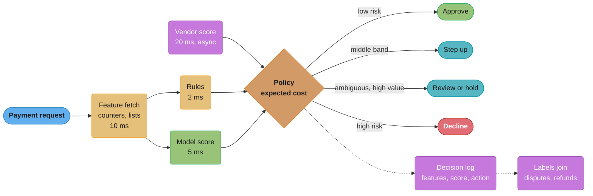
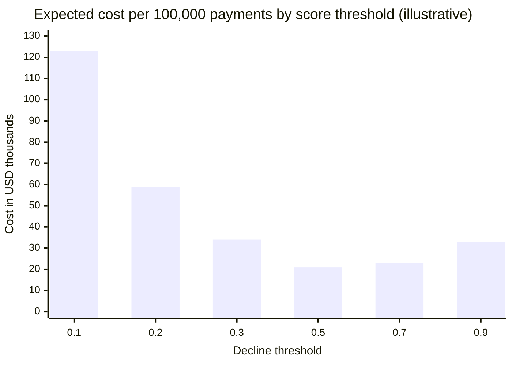
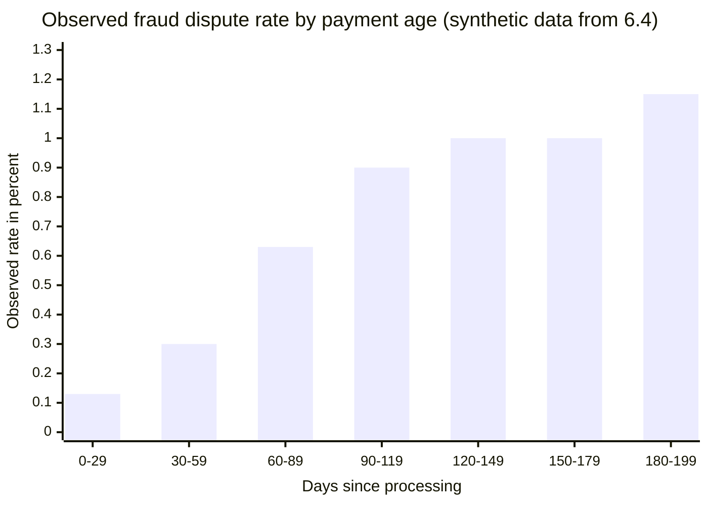

# Fraud and Risk Scoring

> Rules and figures checked 2026-11-06. Every date, threshold and fee on this page comes from
> the fact pins in fintech/CLAUDE.md. Latency budgets, costs and volumes are labelled as
> assumptions or illustrative. This page is an engineering view as of that date, not legal
> advice, and covers the US, the EU, the UK, India and Brazil only.

---

## 1. Concept Overview

A payment risk system decides, for each payment, what to do with it: approve, decline, send it
to manual review, step it up to stronger authentication, or approve it and hold the goods or the
payout. The decision runs inside the payment's latency budget, before the authorization request
leaves for the network or before an outbound transfer is released.

The system has five parts:

- **Lists.** Allow lists and block lists keyed on card fingerprint, email, device, IP, account
  and payout destination.
- **Velocity counters.** Counts and sums over sliding windows, for example distinct cards per
  device in 10 minutes.
- **Rules.** Readable conditions that combine lists, counters and attributes, written and changed
  by risk analysts.
- **Model score.** A probability of fraud from a supervised model trained on past outcomes.
- **Network and vendor signals.** Scores and data from card networks, issuers, consortium vendors
  and identity providers.

A policy layer turns these inputs into an action. The policy is where money enters: a score of
0.08 means approve on a $5 digital good and step up on a $900 laptop, because the cost of each
mistake differs.

The hardest engineering problem is the labels. Fraud labels arrive as
chargebacks weeks or months after the payment, declined payments never get a label at all, and
every decision the system makes changes the data it learns from next.

Model internals (gradient boosting, class imbalance, streaming feature pipelines, drift metrics)
are in the [fraud detection case study](../../ml/case_studies/design_fraud_detection.md),
cost-based thresholds and calibration in [Decision Models](../../mlops/decision_models/decision_models.md),
champion/challenger with delayed labels in the
[continuous training case study](../../mlops/case_studies/design_a_continuous_training_and_champion_challenger_system.md),
and model risk management in
[AI Governance and Model Risk Operations](../../mlops/ai_governance_and_model_risk_operations/ai_governance_and_model_risk_operations.md).

---

## 2. Intuition

**One-line analogy.** Airport security sends most travellers straight through, pulls a few
aside for a bag search, and stops very few at the gate. A payment risk system is the same set of
lanes, and the lane choice depends on what is in the bag.

**Mental model.** Every payment has two prices on it: the expected loss if you approve it and it
is fraud, and the expected loss if you decline it and it was good. The risk system picks the
action with the smaller expected loss. The model only supplies one input to that sum: the
probability.

**Why it matters.** Both errors cost real money, and the cheaper one is invisible. A fraud loss
shows up as a chargeback with a fee. A false decline shows up as nothing: the customer leaves,
and no report lists the sale you did not make.

**Key insight.** The output of a risk system is an action priced in money, not a score. Tune the
policy on dollars and the model on ranking, and keep them separate.

---

## 3. Core Principles

1. **Decide on expected cost, not on a fixed score cut-off.** The break-even probability depends
   on the amount, the margin, the chargeback fee and the customer's value.
2. **Separate the score from the policy.** The model ranks risk. The policy, owned by the risk
   team and versioned like code, maps score plus context to an action.
3. **Labels are late and partial.** A card-absent fraud dispute under Visa condition 10.4 can
   arrive up to 120 calendar days after the processing date. Recent payments look clean because
   their labels have not arrived yet.
4. **Declined payments have no outcome.** You never learn whether a declined payment was fraud.
   Without a deliberate exploration sample, each retrain learns only from what the last model let
   through.
5. **Every fraud type has a different payer.** Card-not-present fraud usually lands on the
   merchant as a chargeback. Authorized push payment (APP) scam losses in the UK can land on the
   PSPs through mandatory reimbursement. Who pays decides who invests in detection.
6. **Latency is a hard budget.** The decision runs inside the authorization path. A slow feature
   lookup is a timeout, and a timeout needs a defined fallback action.
7. **Friction is an action, not a failure.** Step-up authentication, a review hold and a delayed
   payout are cheaper than a decline for the middle of the score range.
8. **Rules need owners and expiry dates.** A rule added during an attack stays forever unless
   someone retires it, and old rules decline good customers long after the attack ends.

---

## 4. Types / Architectures / Strategies

### 4.1 Fraud types and who pays

| Type | What happens | Main signals | Who usually bears the loss |
|---|---|---|---|
| Card testing | Bots try many stolen card numbers with small amounts to find live ones | Distinct cards per device or IP, decline ratio, BIN clustering | Merchant: fees per attempt, network monitoring, later fraud |
| Stolen card, card-not-present | A real card number used by someone else | Device, IP vs billing country, email age, velocity | Merchant, through a chargeback |
| Account takeover (ATO) | An attacker logs into a real account and uses stored cards or balances | Login anomalies, new device, password reset then purchase | Merchant or platform |
| First-party misuse ("friendly fraud") | The real cardholder disputes a purchase they made | Prior undisputed history, delivery proof, usage logs | Merchant, unless evidence wins the dispute |
| APP scam | The victim is tricked into sending a push payment | Payee age, new payee, amount vs history, mule account patterns | In the UK, the sending and receiving PSPs, through mandatory reimbursement |
| Merchant or seller fraud | A seller on a platform takes payment and never delivers, or launders | Seller age, refund and dispute rates, payout velocity | The platform |
| Promotion abuse | Many accounts claim one-per-customer offers | Device and payment fingerprint reuse | The merchant's marketing budget |

### 4.2 Actions

| Action | When | Cost |
|---|---|---|
| Approve | Expected fraud loss is below the cost of any friction | Fraud losses on the misses |
| Step up (3DS challenge, OTP, passkey) | Middle band; authentication changes the risk or the liability | Some good customers abandon |
| Review | High value, ambiguous, and the goods can wait | Analyst time and delay |
| Approve and hold | Payment is fine to authorize, delivery or payout can wait | Customer delay |
| Decline | Expected fraud loss exceeds the value of the good sale | Lost sale and lost customer on the false positives |

### 4.3 The decision model: rules vs model vs vendor vs network

| Tool | Strength | Weakness | Use for |
|---|---|---|---|
| Lists and rules | Fast, readable, changed in minutes during an attack | Brittle, pile up, need owners | Known patterns, attack response, regulatory blocks |
| Velocity counters | Catch bursts no single payment shows | Need a well-chosen key and a fast store | Card testing, mule fan-out, ATO bursts |
| In-house model | Uses your own data and costs, fits your product | Needs labels, ML staff and model governance | Volume merchants and platforms with history |
| Vendor score (consortium) | Data across many merchants, works on day one | Black box, per-call fee, generic costs | New merchants, new markets, a second opinion feature |
| Loss-cover vendor | Vendor pays approved fraud losses | Fee per approved order, vendor sets the risk appetite | Merchants that want a fixed fraud cost |
| Network and issuer signals | See activity across all merchants on the card | You see only what the network shares | Inputs to your model, issuer-side decisions |

Most mature systems run all of them: rules for fast response, counters as features, a model for
ranking, vendor scores as features, and a policy layer that turns it all into an action.

### 4.4 Where the decision sits

| Position | Latency room | What it can see |
|---|---|---|
| Pre-authorization at the merchant or PSP | Tight: inside checkout | Everything the merchant knows |
| Issuer authorization decision | Tight: inside the network's time budget | Card history across merchants |
| Post-authorization, pre-capture or pre-fulfilment | Hours to days | Everything, plus time for review |
| Pre-payout (platforms, wallets) | Minutes to days | Seller and payout history |
| Outbound push payment at the payer's PSP | Seconds | Payer history, payee data, confirmation-of-payee result |

---

## 5. Architecture Diagrams

### 5.1 One decision inside the authorization path



The budget numbers are assumptions for a merchant with a 50 ms p99 target for the whole risk
call. The vendor score has a timeout and a fallback: if it misses, the policy runs without it.
The decision log is the training data of the future, so it records the features as they were
at decision time, not as they are when the label arrives.

### 5.2 Threshold economics



Illustrative inputs: 100,000 payments, 500 of them fraud, $100 cost per missed fraud (goods plus
fee), $30 cost per false decline (lost margin plus customer value). At 0.1 the system declines
4,000 good payments to catch 470 frauds and pays $123,000. At 0.9 it declines only 25 good
payments but misses 320 frauds and pays $32,750. The minimum here is near 0.5, and it moves when
the costs move.

### 5.3 Why recent fraud rates look low



Every cohort has the same true fraud rate, about 1.03%. The young cohorts look up to eight times
cleaner only because their disputes have not arrived. A model evaluated on the last 30 days, or
a dashboard that shows "fraud this month", reads this chart as good news.

---

## 6. How It Works - Detailed Mechanics

### 6.1 Latency budget

The risk call shares the checkout's time with the PSP and the network. A working budget
(assumption) for a 50 ms p99 risk call:

| Step | p99 budget | How to keep it |
|---|---|---|
| Feature fetch (counters, lists, profile) | 10 ms | One round trip to an in-memory store, keys known up front |
| Rules | 2 ms | Compiled rules in process, no I/O inside a rule |
| Model inference | 5 ms | Tree model in process or a co-located server |
| Vendor score | 20 ms, async with timeout | Start first, use it if it returns in time |
| Policy and logging | 3 ms | Log asynchronously, never on the critical path |

Every external input needs a timeout and a defined fallback. The fallback is a policy choice:
"approve below $50 and step up above" is a reasonable degraded mode. "Decline everything" is an
outage you caused yourself.

### 6.2 Velocity counters

A velocity counter answers "how many, how much, how distinct" over a sliding window, keyed on an
entity. The key is the design decision. Card testing is invisible per card, because each card is
tried once. It is obvious per device, per IP and per BIN.

```java
import java.util.ArrayDeque;
import java.util.Deque;
import java.util.HashMap;
import java.util.HashSet;
import java.util.Map;

public class VelocityCounters {
    record Attempt(long epochSec, String cardFingerprint, String deviceId, boolean approved) {}

    static final class Window {
        private final long spanSec;
        private final Deque<Attempt> attempts = new ArrayDeque<>();

        Window(long spanSec) { this.spanSec = spanSec; }

        void add(Attempt a) {
            attempts.addLast(a);
            while (attempts.peekFirst().epochSec() <= a.epochSec() - spanSec) attempts.pollFirst();
        }

        int size() { return attempts.size(); }

        long declines() { return attempts.stream().filter(a -> !a.approved()).count(); }

        long distinctCards() {
            var cards = new HashSet<String>();
            attempts.forEach(a -> cards.add(a.cardFingerprint()));
            return cards.size();
        }
    }

    private final Map<String, Window> byDevice = new HashMap<>();

    boolean cardTesting(Attempt a) {
        Window w = byDevice.computeIfAbsent(a.deviceId(), k -> new Window(600));
        w.add(a);
        return w.distinctCards() >= 5 && w.declines() * 2 >= w.size();
    }

    public static void main(String[] args) {
        VelocityCounters v = new VelocityCounters();
        int flagged = 0;
        for (int i = 0; i < 12; i++) {
            boolean approved = i % 4 == 0;
            if (v.cardTesting(new Attempt(1_000 + i * 20, "card-" + i, "device-bot", approved))) flagged++;
        }
        assert flagged >= 7 : "a burst of distinct cards from one device must trip";

        boolean shopper = false;
        for (int i = 0; i < 3; i++) {
            shopper |= v.cardTesting(new Attempt(1_000 + i * 60, "card-own", "device-home", i > 0));
        }
        assert !shopper : "one card retried on one device is not card testing";
        System.out.println("bot attempts flagged: " + flagged + " of 12");
    }
}
```

In production the windows live in an in-memory store with TTLs, keyed by device, IP, BIN, email
and the keyed card fingerprint from
[PCI DSS Scope and Tokenization](../pci_dss_scope_and_tokenization/pci_dss_scope_and_tokenization.md).
The card fingerprint is a keyed HMAC, so the risk system never holds a PAN.

A card-testing response also touches retry logic. Visa groups decline codes into categories, and
for Category 1 codes (the issuer will never approve, for example 04, 07, 14, 41, 43, 46) a
merchant must never reattempt with the same credential. Categories 2, 3 and 4 allow up to 20
attempts in 30 days. A bot that retries every decline breaks those rules for you. Retry policy is
in [Card Payments Lifecycle](../card_payments_lifecycle/card_payments_lifecycle.md).

### 6.3 The expected-cost policy

For one payment with fraud probability `p` and amount `A`:

- Cost of approving: `p x (g + f)`, where `g` is the cost of the goods or service handed over
  and `f` is the chargeback fee. The chargeback takes the sale amount back, so a fraud costs the
  merchant the goods and the fee. With margin rate `m`, `g = (1 - m) x A`.
- Cost of declining: `(1 - p) x V`, where `V = m x A + c` and `c` is the customer value lost by
  a false decline.
- Decline when `p > V / (V + g + f)`, which is `(m x A + c) / (A + c + f)`.

This is the same cost threshold as `C_FP / (C_FP + C_FN)` in
[Decision Models](../../mlops/decision_models/decision_models.md), with one difference that
matters in payments: both costs depend on the amount, the margin and the customer, so the
threshold is per payment, not one number for the model. When the fee and the customer value
are small next to the amount, the break-even is close to the margin rate: near 0.9 for a
digital-goods merchant with a 90% margin, and near 0.3 for a physical-goods merchant with a 30%
margin. On a small ticket the fee pulls it down: a $40 sale at 90% margin with a $15 fee and $5
of customer value breaks even at (36 + 5) / (40 + 5 + 15), about 0.68 (assumptions). The
acquirer contract and the network's fraud monitoring programs also cap the fraud rate a merchant
may run, which the per-payment formula does not show.

Step-up adds a third option. Its cost is the good customers who abandon the challenge plus the
fraud that still gets through it. The parameters below are assumptions, labelled in the code.

```java
import java.math.BigDecimal;
import java.math.RoundingMode;
import java.util.Comparator;
import java.util.List;

public class RiskPolicy {
    enum Action { APPROVE, STEP_UP, DECLINE }

    // All inputs are assumptions a risk team sets per merchant and per segment.
    record Costs(BigDecimal marginRate, BigDecimal customerValue, BigDecimal chargebackFee,
                 BigDecimal stepUpAbandonRate, BigDecimal stepUpFraudPassRate) {}

    record Priced(Action action, BigDecimal cost) {}

    static List<Priced> price(BigDecimal p, BigDecimal amount, Costs c) {
        BigDecimal q = BigDecimal.ONE.subtract(p);
        BigDecimal goodValue = amount.multiply(c.marginRate()).add(c.customerValue());
        BigDecimal fraudLoss = amount.multiply(BigDecimal.ONE.subtract(c.marginRate())).add(c.chargebackFee());
        BigDecimal approve = p.multiply(fraudLoss);
        BigDecimal decline = q.multiply(goodValue);
        BigDecimal stepUp = q.multiply(c.stepUpAbandonRate()).multiply(goodValue)
                .add(p.multiply(c.stepUpFraudPassRate()).multiply(fraudLoss));
        return List.of(
                new Priced(Action.APPROVE, approve.setScale(2, RoundingMode.HALF_EVEN)),
                new Priced(Action.STEP_UP, stepUp.setScale(2, RoundingMode.HALF_EVEN)),
                new Priced(Action.DECLINE, decline.setScale(2, RoundingMode.HALF_EVEN)));
    }

    static Action decide(BigDecimal p, BigDecimal amount, Costs c) {
        return price(p, amount, c).stream().min(Comparator.comparing(Priced::cost)).orElseThrow().action();
    }

    public static void main(String[] args) {
        Costs physical = new Costs(new BigDecimal("0.30"), new BigDecimal("5.00"),
                new BigDecimal("15.00"), new BigDecimal("0.10"), new BigDecimal("0.20"));
        Object[][] cases = {
                {"0.0050", "40.00", Action.APPROVE},
                {"0.1000", "500.00", Action.STEP_UP},
                {"0.7000", "500.00", Action.DECLINE},
        };
        for (Object[] row : cases) {
            BigDecimal p = new BigDecimal((String) row[0]);
            BigDecimal amount = new BigDecimal((String) row[1]);
            Action got = decide(p, amount, physical);
            System.out.println("p=" + p + " amount=" + amount + " -> " + got + " " + price(p, amount, physical));
            assert got == row[2] : "expected " + row[2] + " got " + got;
        }
    }
}
```

Read the second case: at p = 0.10 on $500, approving costs $36.50 in expected fraud (goods
worth $350 plus the $15 fee), declining costs $139.50 in expected lost good sales, and stepping
up costs $21.25. The step-up wins. At p = 0.70 the decline wins with the same cost model,
because only the amount and the probability changed.

### 6.4 Label maturity

A fraud label is "this payment was disputed as fraud". It arrives late. For Visa condition 10.4
(card-absent fraud) the time limit is 120 calendar days from the processing date. A payment
younger than that window is not "clean", it is "immature".

```sql
CREATE TABLE payment (
    id            bigint PRIMARY KEY,
    processed_on  date NOT NULL,
    amount_minor  bigint NOT NULL CHECK (amount_minor > 0),
    approved      boolean NOT NULL
);

CREATE TABLE fraud_dispute (
    payment_id    bigint PRIMARY KEY REFERENCES payment (id),
    received_on   date NOT NULL
);

-- Synthetic history: a true fraud rate near 1.03%, disputes arriving 10 to 119 days later.
INSERT INTO payment
SELECT g, current_date - (g % 200), 1000 + (g % 50) * 100, true
FROM generate_series(1, 20000) AS g;

INSERT INTO fraud_dispute
SELECT p.id, p.processed_on + (10 + (p.id * 7) % 110)::int
FROM payment p
WHERE p.id % 97 = 0
  AND p.processed_on + (10 + (p.id * 7) % 110)::int <= current_date;

CREATE VIEW payment_label AS
SELECT p.id,
       p.processed_on,
       CASE
           WHEN d.payment_id IS NOT NULL THEN 'fraud'
           WHEN p.processed_on <= current_date - 120 THEN 'clean'
           ELSE 'immature'
       END AS label
FROM payment p
LEFT JOIN fraud_dispute d ON d.payment_id = p.id
WHERE p.approved;

SELECT (current_date - p.processed_on) / 30 AS age_bucket,
       count(*)                                          AS payments,
       count(d.payment_id)                               AS disputes,
       round(100.0 * count(d.payment_id) / count(*), 2)  AS observed_pct
FROM payment p
LEFT JOIN fraud_dispute d ON d.payment_id = p.id
GROUP BY 1
ORDER BY 1;
```

The query gives the chart in §5.3: 0.13% for the newest 30 days, rising to about 1% once the
window has passed. Training, evaluation and dashboards use only cohorts older than the dispute
window, or they model the arrival curve explicitly. Other dispute reasons have other time limits,
so a production system stores the limit per reason and computes maturity per payment.

The first-day signals (issuer fraud reports, refund requests, a customer saying "not me" to
support) are earlier but noisier. Use them as features and alerts, not as the training label.

### 6.5 The feedback loop and exploration

Declined payments never get a label. If the model declines a segment, the next model never sees
whether that segment was fraud, and a mistake becomes permanent. Two ways out:

- **Random holdout.** Approve a small random share of payments the policy would decline, under a
  per-day loss cap. Weight those outcomes by the inverse of the approve probability when you
  estimate performance.
- **Score-band exploration.** Send a share of the decline band to step-up or review instead,
  which buys a label at a lower cost than a blind approval.

Both cost money. That cost is the price of knowing your false-decline rate, which nothing else
measures.

### 6.6 Review queues

Review is a capacity, not a free action. Size the review band from the team, not the other way
round (assumptions):

```text
analysts on shift          12
cases per analyst per hour 25
hours per shift            8
capacity per shift         12 x 25 x 8 = 2,400 cases
payments per shift         400,000
review band size           at most 0.6% of payments
```

The review SLA must also beat the authorization's validity. Visa allows 10 days between a
card-absent customer-initiated authorization and processing (30 days with the extended
authorization indicator). A review queue that grows past that window turns into expired
authorizations and re-authorizations, which issuers may decline. Review cases need a clock and an
escalation, not a FIFO list.

### 6.7 Push payments and APP scams

On an outbound push payment (Faster Payments, FedNow, RTP, Pix) the risk decision belongs to the
payer's PSP, and once sent the money is final for the sender. The scoring inputs change: the
victim authenticates correctly, so authentication signals are clean. The useful signals are the
payee (age of the receiving account, prior payments to it, mule patterns), the payment against
the payer's own history, and the confirmation-of-payee result.

Regulation moved the loss. UK APP scam reimbursement became mandatory on 2024-10-07, at most
GBP 85,000 per claim for Faster Payments, and the Bank of England set the same for CHAPS. Brazil's
Pix MED 2.0 extends fraud refunds past the first receiving account: optional from 2025-11-26 and
mandatory from 2026-02-02. In the UK the sending PSP reimburses the victim and the receiving PSP
pays half: the PSR splits the cost 50:50. Both therefore score payments, the sender on the way
out and the receiver on the way in for mule detection. Rails and their return messages are in
[Real-Time Payments and Open Banking](../real_time_payments_and_open_banking/real_time_payments_and_open_banking.md).

### 6.8 Fraud rate as a regulatory input

In the EU, the fraud rate is also an input to authentication rules. Under the PSD2 SCA RTS,
transaction risk analysis for cards lets a PSP skip SCA up to EUR 100 with a fraud rate of 0.13%
or less, and up to EUR 250 with 0.06% or less. A risk team that lowers fraud also widens the
share of payments that can skip the challenge. The exemption logic is in
[Strong Customer Authentication and 3DS](../strong_customer_authentication_and_3ds/strong_customer_authentication_and_3ds.md).

---

## 7. Real-World Examples

- **PSP-embedded scoring.** Stripe Radar and Adyen's risk management score every payment the PSP
  processes, using data across the PSP's merchants, and expose rules and per-merchant thresholds.
  A merchant on one PSP gets a consortium model with no integration work.
- **Chargeback cover.** Signifyd, Riskified and Forter sell decisions with chargeback cover: the
  vendor pays the chargeback on orders it approved. The merchant swaps a variable fraud loss for a
  fee and gives up control of the risk appetite.
- **Network-side scoring.** Visa Advanced Authorization and Mastercard Decision Intelligence score
  transactions inside the network and pass the score to issuers, which see card history across
  every merchant.
- **Dispute data as labels.** Fraud labels come from the Visa and Mastercard dispute processes.
  The test known as Compelling Evidence 3.0 lets a merchant defeat a Visa condition 10.4 dispute
  with earlier undisputed history on the same credential, which marks the dispute as likely
  first-party misuse rather than third-party fraud. The mechanics are in
  [Disputes, Chargebacks and Refunds](../disputes_chargebacks_and_refunds/disputes_chargebacks_and_refunds.md).
- **Model internals.** The XGBoost model, SHAP reason codes and streaming features of a full
  fraud system are in the [fraud detection case study](../../ml/case_studies/design_fraud_detection.md).

---

## 8. Tradeoffs

### 8.1 Build vs buy

| Option | Time to value | Fit to your costs | Data advantage | Running cost |
|---|---|---|---|---|
| PSP-embedded scoring | Immediate | Generic, some tuning | PSP consortium | Per-transaction fee |
| Consortium vendor | Weeks | Configurable | Vendor consortium | Per-call fee |
| Loss-cover vendor | Weeks | Vendor-owned | Vendor consortium | Fee per approved order |
| In-house rules plus model | Months | Exact | Your data only, unless you add vendor features | Team, infra, governance |

### 8.2 Threshold position

| Threshold | Fraud losses | False declines | Review load | Who complains |
|---|---|---|---|---|
| Low (decline a lot) | Low | High, invisible | Low | Growth and sales |
| Middle with step-up band | Medium | Medium | Medium | Nobody, if tuned |
| High (approve a lot) | High, visible as chargebacks | Low | Low | Finance and the acquirer |

### 8.3 Rules vs model during an attack

| Need | Rules | Model |
|---|---|---|
| Stop a new attack today | Minutes | Days to weeks (needs labels) |
| Generalize to variants | Weak | Strong |
| Explain a decline | Direct | Needs reason codes |
| Long-term cost | Grows as rules pile up | Grows with governance |

---

## 9. When to Use / When NOT to Use

**Use PSP-embedded scoring when** you run on one PSP, you have little labelled history, and your
fraud losses are small next to the cost of a team.

**Build in-house when** you have volume and history, you run several PSPs, your costs differ from
the vendor's defaults (very high or very low margin), or the risk decision is part of your
product, as it is for marketplaces, wallets and payout platforms.

**Use a loss-cover vendor when** finance wants a fixed fraud cost and you accept the vendor's
appetite on approvals.

**Use review when** the goods can wait (high-value physical goods, payouts). Do NOT use it for
digital goods delivered instantly, or when the review backlog can outlive the authorization.

**Do NOT** train or evaluate on immature labels, set one global score threshold for all amounts
and segments, or run without an exploration sample if you care about your false-decline rate.

---

## 10. Common Pitfalls

### 10.1 The counter on the wrong key

A merchant added a velocity rule: "more than 3 declines on one card in 10 minutes, block the
card". A card-testing bot tried 12 different cards, each once, from one device.

```java
// BROKEN: velocity keyed only on the card, so a bot trying many cards stays under every limit
import java.util.HashMap;
import java.util.Map;

public class CardOnlyVelocity {
    public static void main(String[] args) {
        Map<String, Integer> declinesByCard = new HashMap<>();
        int blocked = 0;
        for (int i = 0; i < 12; i++) {
            String card = "card-" + i;
            boolean declined = i % 4 != 0;
            if (declined && declinesByCard.merge(card, 1, Integer::sum) > 3) blocked++;
        }
        System.out.println("blocked: " + blocked + " of 12 bot attempts");
    }
}
```

It prints `blocked: 0 of 12 bot attempts`. Each card has at most one decline, so the rule never
fires. The attack is visible only on the device, the IP or the BIN.

```java
// FIX: count distinct cards and declines per device, and add IP and BIN keys the same way
import java.util.HashMap;
import java.util.HashSet;
import java.util.Map;
import java.util.Set;

public class DeviceVelocity {
    public static void main(String[] args) {
        Map<String, Set<String>> cardsByDevice = new HashMap<>();
        Map<String, Integer> declinesByDevice = new HashMap<>();
        int blocked = 0;
        for (int i = 0; i < 12; i++) {
            String device = "device-bot";
            boolean declined = i % 4 != 0;
            cardsByDevice.computeIfAbsent(device, k -> new HashSet<>()).add("card-" + i);
            if (declined) declinesByDevice.merge(device, 1, Integer::sum);
            if (cardsByDevice.get(device).size() >= 5 && declinesByDevice.getOrDefault(device, 0) >= 3) blocked++;
        }
        assert blocked == 8 : "attempts 5 to 12 are blocked, got " + blocked;
        System.out.println("blocked: " + blocked + " of 12 bot attempts");
    }
}
```

Device IDs can be reset, so production uses several keys at once (device, IP, BIN, email
domain) and a window per key.

### 10.2 The model that got better every month

(Illustrative.) A team retrained monthly and evaluated on the most recent month. Precision rose each time. The
recent month's frauds had not been disputed yet, so the "negatives" included hundreds of
undiscovered frauds and the metric measured label delay, not the model. §14 walks through the
fix.

### 10.3 Leakage from the future

A feature "refund count on this card" was computed when the training set was built, months after
the payments. Refunds that happened after the payment leaked into its features. Offline AUC was
excellent and production performance was poor. Features must be computed as of decision time,
which is why §5.1 logs features at decision time. Point-in-time correctness is covered in the
[feature store page](../../ml/case_studies/cross_cutting/feature_store_and_point_in_time_correctness.md).

### 10.4 The attack rule that never died

(Illustrative.) During a 2-day attack an analyst added "decline all payments from BIN range X above $200". The
attack stopped, the rule stayed, and a year later it declined a bank's whole premium card
product. Every rule gets an owner, a reason, a creation date and an expiry date, and a weekly
report shows each rule's hit count and the approval rate of payments it touched.

### 10.5 Fail-closed on a vendor timeout

The vendor score timed out during the vendor's incident, and the policy treated "no score" as
"high risk". The merchant declined every payment for 40 minutes (illustrative). A missing input
needs a degraded policy, decided in advance and tested.

---

## 11. Technologies & Tools

| Tool | What it does here |
|---|---|
| Stripe Radar | PSP-embedded fraud scoring with rules and per-merchant risk settings |
| Signifyd | Order decisions with chargeback cover on approved orders |
| Riskified | Order decisions with chargeback cover, focused on e-commerce |
| Forter | Real-time fraud decisions for online merchants, with a chargeback-cover option |
| Kount | Fraud and identity trust scoring for card-not-present payments |
| Feedzai | Risk platform for banks and processors, covering payments and AML |
| Visa Advanced Authorization | Network-side risk score that Visa passes to issuers |
| Mastercard Decision Intelligence | Network-side decision score that Mastercard passes to issuers |
| Apache Flink | Streaming computation of windowed velocity features |
| Redis | In-memory store for counters and lists inside the latency budget |

Vendors whose names are common words (for example Sift and Sardine) also sell consortium fraud
scores and device intelligence.

---

## 12. Interview Questions with Answers

**Q: Why is a fixed score threshold such as 0.5 wrong for payment fraud?**
**Short:** The break-even probability depends on amount, margin, fees and customer value, so the cut-off differs per payment and per merchant.

Declining costs the margin and the customer on good payments, and approving costs the goods
plus the fee on fraud, because the chargeback takes the sale amount back. The break-even is
`(m x A + c) / (A + c + f)` for margin rate `m`, amount `A`, customer value `c` and fee `f`.
With small fees it sits near the margin rate: about 0.9 for a 90% margin digital-goods merchant
and about 0.3 for a 30% margin retailer, on the same score. Keep the model's score calibrated and put the money in the policy layer.

**Q: Why does fraud look lower in the most recent weeks of data?**
**Short:** Fraud labels arrive as disputes up to 120 days after processing for Visa 10.4, so recent payments are immature, not clean.

In the synthetic data in §6.4 the newest 30 days show 0.13% against a true rate near 1.03%. A
dashboard or an evaluation set built from recent data reads label delay as improvement. Label a
payment clean only after the dispute window passes, or model the arrival curve. Store the time
limit per dispute reason.

**Q: How do you learn the fraud rate of payments you declined?**
**Short:** Not from the declines alone, so approve or step up a small random sample of would-be declines under a loss cap and weight their outcomes.

A declined payment never produces a chargeback, so it has no label. Without exploration, the
model's past decisions decide its future training data and errors become permanent. A random
holdout with inverse-propensity weights gives an unbiased estimate. Sending part of the decline
band to step-up is a cheaper way to buy labels.

**Q: Why does card testing pass a per-card velocity rule?**
**Short:** Each stolen card is tried once or twice, so no single card crosses a limit, and the burst is visible only per device, IP or BIN.

Card testers check many card numbers with small amounts to find live ones. Key counters on the
device, the IP, the BIN and the email domain, and count distinct cards and the decline ratio in
the window. Add bot defences at the checkout and stop retrying decline codes the network says
never to retry.

**Q: What does the payment risk system decide, beyond approve or decline?**
**Short:** It can also step the payment up to stronger authentication, send it to review, or approve it and hold delivery or the payout.

Step-up and holds are cheaper than a decline for the middle band of scores. Step-up costs some
abandonment, review costs analyst time, and a hold costs delay. Price each action with the same
expected-cost formula and pick the smallest. Size the review band from team capacity.

**Q: Why separate the model score from the decision policy?**
**Short:** The model ranks risk and changes with data, while the policy prices actions and changes with business costs, so each needs its own owner and version.

Merging them means every margin change needs a retrain and every retrain silently moves
approval rates. Version the policy like code, log the score, the policy version and the action
for every payment, and run the model's champion/challenger on ranking metrics. Policy changes are
then reviewed by the risk team without touching the model.

**Q: What should happen when the vendor score times out?**
**Short:** A degraded policy decided in advance runs without that input, such as approving small amounts and stepping up the rest, never a blanket decline.

Every external input in the authorization path needs a timeout and a fallback. Treating a
missing score as high risk turns a vendor incident into your outage. Test the degraded mode in
game days, and alert on its activation rate.

**Q: Who pays for an authorized push payment scam in the UK?**
**Short:** Since 2024-10-07, reimbursement is mandatory for Faster Payments, at most GBP 85,000 per claim, and the Bank of England set the same for CHAPS.

The victim authorized the payment, so the money is final on the rail, but the regulation moved
the loss to the PSPs: the sending PSP reimburses, and the PSR splits the cost 50:50 with the
receiving PSP. That changed who invests in scoring: payer PSPs now score outbound payments
on payee risk, and receiving PSPs score inbound payments for mule accounts. Authentication
signals do not help here, because the victim authenticates correctly.

**Q: Why must the review SLA be shorter than the authorization validity window?**
**Short:** A payment held in review past the authorization's window needs a fresh authorization, which the issuer may decline.

Visa allows 10 days between a card-absent customer-initiated authorization and processing, or
30 days with the extended authorization indicator. A queue that grows during an attack turns
review holds into expired authorizations. Give each case a deadline from its authorization date
and escalate before it, not after.

**Q: How do you estimate the cost of a false decline?**
**Short:** Lost margin on the sale plus the expected future value of the customer, measured with holdout experiments rather than assumed.

The direct loss is the margin. The larger loss is the customer who does not come back, which
shows up only in retention data. Measure it by comparing later purchases of customers who were
declined and then approved through exploration, against similar approved customers. Revisit
the number per segment, because new customers churn faster than loyal ones.

**Q: What is leakage in a fraud model, and how do you prevent it?**
**Short:** Leakage is a feature computed with information from after the decision time, and logging features at decision time with labels joined later prevents it.

Building features months later from current tables lets refunds, disputes and account closures
leak into "historical" features. Offline metrics look excellent and production fails. Log the
exact feature vector with each decision, or use a feature store with point-in-time joins.

**Q: Why do fraud rules need expiry dates?**
**Short:** Rules added during an attack outlive it and keep declining good customers, and nobody remembers why they exist.

Each rule needs an owner, a reason, a creation date and an expiry date. Report hit counts and
the approval and dispute rates of the payments each rule touched. Retire rules that no longer
change outcomes. A rules engine with hundreds of unowned rules is a second, undocumented model.

**Q: When should a merchant buy chargeback cover from a fraud vendor?**
**Short:** When finance prefers a fixed fee per approved order to a variable fraud loss, and the merchant accepts the vendor's risk appetite.

The vendor pays chargebacks on orders it approved, so it declines what it does not want to pay
for. Watch the approval rate, not just the fee: a vendor protecting its cover can decline
good customers you would have accepted. Run a holdout to measure that.

**Q: How does a lower fraud rate change SCA friction in the EU?**
**Short:** Transaction risk analysis lets a PSP skip SCA up to EUR 100 at a 0.13% fraud rate or less, and up to EUR 250 at 0.06% or less.

Fraud performance becomes an input to authentication policy. A PSP that keeps its card fraud
rate under the band can exempt more payments from challenges, which raises conversion. The
issuer still makes the final decision and can step up. Track the regulatory fraud rate as its
own metric.

**Q: What is first-party misuse, and why is it hard to score?**
**Short:** The real cardholder disputes a purchase they made, and their signals look like a good customer, so the fight happens in the dispute with evidence.

Device, IP and history all match the cardholder, because it is the cardholder. Scoring helps
little at authorization. The defences are clear descriptors, delivery and usage evidence, and
Compelling Evidence 3.0 for Visa 10.4: two earlier undisputed transactions on the same credential,
120 to 365 days before the dispute, with a matching device ID or IP address plus one more matching
element.

**Q: Where does the risk decision sit for a marketplace paying out to sellers?**
**Short:** At two points: the buyer's payment before authorization, and the seller's payout before release, where seller risk is scored.

Buyer fraud and seller fraud are different problems. A seller who takes payments and never ships
is caught at payout time with refund rates, dispute rates and payout velocity. Holding payouts
for new sellers is the cheap control, because the platform carries the loss once money leaves.

**Q: Why log the feature vector with every decision?**
**Short:** It is the only correct training row: features as seen at decision time, joined later with the label that arrives weeks after.

Reconstructing features later leaks future information and misses state that has since changed.
The log also answers disputes and regulator questions about why a payment was declined. Store
the score, the policy version and the action beside the features.

**Q: How do you test a new fraud model without risking losses?**
**Short:** Run it in shadow on live traffic, compare decisions on matured labels, then route a small share of traffic to it with a loss cap.

Shadow mode logs what the challenger would have done. Because labels are delayed, compare on
cohorts old enough to have matured, or use early proxies for a first read. The champion and
challenger mechanics are in the mlops continuous training case study. Keep the policy layer
fixed while you compare models.

**Q: What does the payer's PSP score on an instant push payment?**
**Short:** The payee and the payment's fit with the payer's history, because the payer authenticates correctly in a scam.

Useful signals are the age of the receiving account, whether the payer paid it before, the
amount against the payer's normal range, mule patterns at the payee, and the confirmation-of-payee
result. The money is final for the sender once it moves, so the decision must happen before
release. Add a short hold for first payments to new payees above a threshold.

**Q: How should a risk system behave during an active card-testing attack?**
**Short:** Add device, IP and BIN velocity rules within minutes, add bot friction at checkout, and stop retries on decline codes the network forbids retrying.

Rules are the fast response, and the model catches up later with labels. Card testing also costs
authorization fees and can trigger network monitoring of the merchant. Visa Category 1 decline
codes must never be retried with the same credential. Expire the attack rules after the attack.

---

## 13. Best Practices

1. Price every action in money and choose the cheapest. Keep the policy separate from the model.
2. Label a payment clean only after its dispute window passes. Store the window per reason.
3. Run an exploration sample with a loss cap, and use it to measure false declines.
4. Log the feature vector, score, policy version and action for every decision.
5. Key velocity counters on several entities: device, IP, BIN, email and the keyed card
   fingerprint.
6. Give every external input a timeout and a degraded policy decided in advance.
7. Give every rule an owner, a reason and an expiry date, and report its hit rate weekly.
8. Size the review band from analyst capacity, and give each case a deadline inside the
   authorization's validity.
9. Score outbound push payments on payee risk, not on authentication.
10. Track the regulatory fraud rate as its own metric where exemptions depend on it.

---

## 14. Case Study

### A digital-goods merchant retrains on the wrong labels

**Context (illustrative).** A games marketplace sells digital keys with a 90% margin. It runs an
in-house model and retrains monthly. Each retrain was evaluated on the latest full month, and
reported precision rose four months in a row. Chargebacks then rose 60% over the next quarter.

**Investigation.** The evaluation set used every payment from the latest month, with "no fraud
dispute yet" counted as a negative. Most frauds from that month were disputed 30 to 110 days
later. The model was rewarded for approving patterns whose frauds had not been reported yet.

```sql
-- BROKEN
-- "Fraud rate last 30 days" counts undisputed recent payments as clean.
SELECT round(100.0 * count(d.payment_id) / count(*), 2) AS fraud_pct_last_30_days
FROM payment p
LEFT JOIN fraud_dispute d ON d.payment_id = p.id
WHERE p.processed_on > current_date - 30;
```

On the synthetic data from §6.4 it returns 0.13%, eight times below the true rate. Any model
looks good against labels that have not arrived.

```sql
-- FIX: evaluate only cohorts older than the dispute window, using the label view.
SELECT round(100.0 * count(*) FILTER (WHERE label = 'fraud' AND processed_on <= current_date - 120)
             / count(*) FILTER (WHERE processed_on <= current_date - 120), 2) AS fraud_pct_matured,
       count(*) FILTER (WHERE processed_on > current_date - 120)            AS excluded_immature
FROM payment_label;
```

The fix query returns 1.04% for the matured cohorts and reports how many immature payments it
left out. The second number goes on the evaluation report, so a reader sees what the metric does
not cover.

**Changes made.**

1. Training and evaluation use matured cohorts only. The team accepts a model trained on data
   4 to 6 months old and offsets it with fast-moving features (velocity, device reputation).
2. A weekly "early read" uses issuer fraud reports and refund-to-dispute ratios as leading
   signals, labelled as such on the dashboard.
3. The policy layer uses the merchant's real costs. With a 90% margin, a $15 fee and $5 of
   customer value on a $40 average order (assumptions), the break-even is about 0.68, so the old
   threshold of 0.3 was declining good buyers. Raising it and adding a step-up
   band for new accounts above $60 (assumption) cut false declines.
4. A 1% exploration sample of the decline band now goes to step-up, which produces labels for
   the declines.

**Outcome (illustrative).** Chargebacks returned to their earlier level within two quarters.
Approval rate rose, because the cost-based threshold was higher than the old one. The evaluation
report now shows the matured window and the excluded count on its first line.

**Lessons.**

- A fraud metric without a maturity rule measures the dispute clock, not the model.
- The threshold belongs to the business costs, not to the model.
- The labels you lack (declines, immature payments) need their own design.
- Related pages: [Disputes, Chargebacks and Refunds](../disputes_chargebacks_and_refunds/disputes_chargebacks_and_refunds.md)
  explains where the labels come from, and
  [KYC, AML and Sanctions Screening](../kyc_aml_and_sanctions_screening/kyc_aml_and_sanctions_screening.md)
  covers the screening that runs beside fraud scoring on the same payments.
