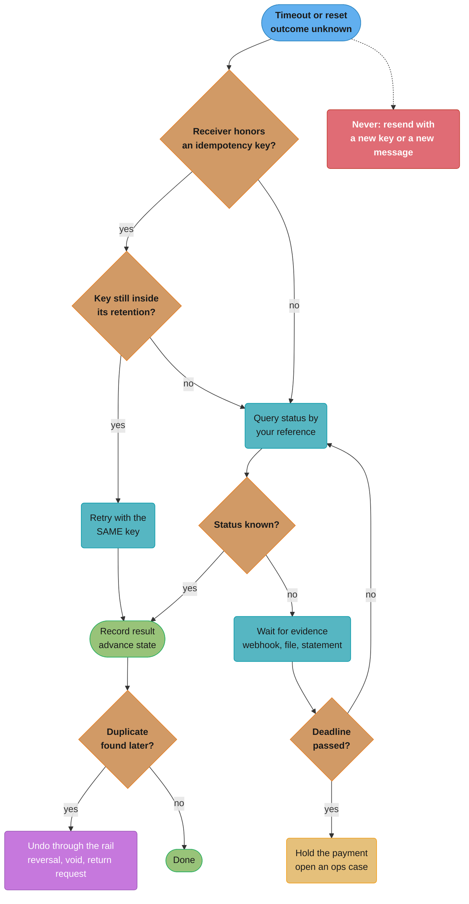
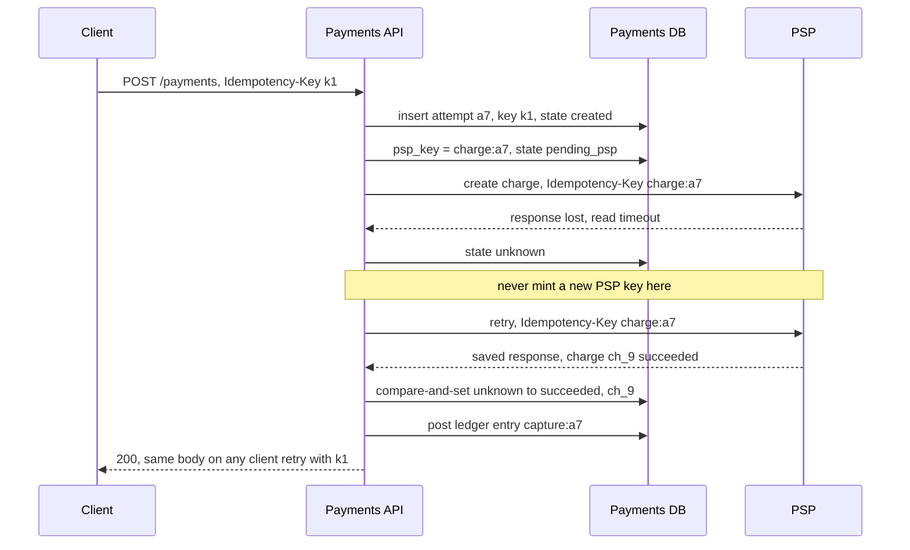
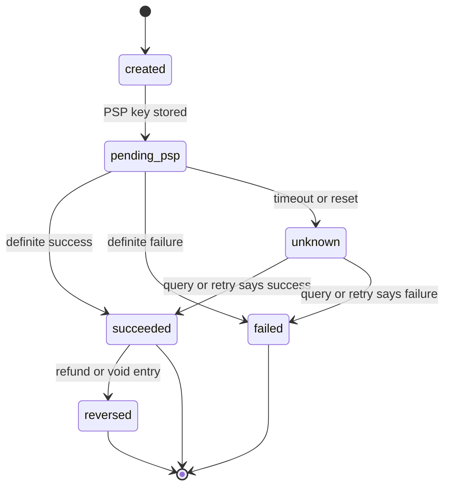

# Idempotency and Exactly-Once Money Movement

> Rules and figures checked 2026-11-06. Every date, threshold and fee on this page comes from the
> fact pins in fintech/CLAUDE.md. PSP idempotency contracts are from Stripe's and Adyen's API
> docs, TigerBeetle's from its 0.17.9 reference, and the IETF header from
> draft-ietf-httpapi-idempotency-key-header-08, all read 2026-11-06. SQL runs on PostgreSQL 18.6.

---

## 1. Concept Overview

"Exactly once" in money movement means exactly one effect: one charge on the card, one credit to
the payee, one ledger entry per event. It does not mean exactly one message. Messages are retried,
duplicated and lost, and the systems that move the money (a PSP, a card network, a bank, an instant
rail) belong to someone else. You cannot make their delivery exactly once. You can make sure that
repeated requests produce one effect, and that a request whose outcome you do not know is resolved
before anyone sends it again.

This page owns three things the generic idempotency pattern does not cover:

- **The key chain.** One logical payment carries a different identifier at every hop: the client's
  key, your API's idempotency key, the PSP's idempotency key, the ledger's transfer id, and the
  rail's own reference (an ISO 20022 `EndToEndId` or UETR, an ACH trace number, a card ARN). Each
  one must be derived from the one before and stored before the hop that uses it.
- **Unknown-outcome resolution.** A timeout is not a failure. The decision model in §4.4 says, per
  rail, whether to retry with the same key, query, wait for evidence, reverse, or never retry.
- **Per-rail retry rules.** A card authorization can be reversed. An ACH entry can be reversed
  within a window for defined errors. A Fedwire transfer and an instant payment are final, and
  getting money back is a new payment that the receiver must choose to send.

The generic pattern (store the key, return the saved response, detect a reused key with a
different body, handle the race between two first requests) is in
[Distributed Transactions](../../hld/distributed_transactions/distributed_transactions.md) §4.6,
[Distributed Transactions and Consistency](../../backend/distributed_transactions_and_consistency/distributed_transactions_and_consistency.md)
and [Distributed Transactions](../../database/distributed_transactions/distributed_transactions.md).
The transactional outbox is in [Messaging Patterns](../../backend/messaging_patterns/messaging_patterns.md).
A Spring implementation with advisory locks and an outbox poller is
[Design an Idempotent Payment API](../../spring/case_studies/design_idempotent_payment_api.md). The
saga that charges through a PSP with a key on the wire, and the double-charge it prevents, is in
[Design a Payment Processor](../../backend/case_studies/design_payment_processor/design_payment_processor.md)
§4.2 and §4.3. Webhook signing, retry ladders and receiver dedupe are in
[Webhooks and Event Delivery](../../backend/webhooks_and_event_delivery/webhooks_and_event_delivery.md).
Durable workflows that run these steps across restarts are in
[Durable Execution and Workflows](../../backend/durable_execution_and_workflows/durable_execution_and_workflows.md).

The ledger entries this page posts exactly once are defined in
[Double-Entry Ledger Design](../double_entry_ledger_design/double_entry_ledger_design.md). The rails
themselves are in [Bank Rails: ACH, SEPA and Wires](../bank_rails_ach_sepa_and_wires/bank_rails_ach_sepa_and_wires.md)
and [Real-Time Payments and Open Banking](../real_time_payments_and_open_banking/real_time_payments_and_open_banking.md).

Not here: the generic idempotency-key table, its race, 2PC, TCC, sagas and the outbox, which the
pages linked above own.

---

## 2. Intuition

> **One-line analogy:** you are on a phone call giving a bank a transfer instruction and the line
> drops just as you finish. You do not know whether they heard you. Repeating the instruction to a
> new person may send the money twice. The safe move is to call back and ask "did my transfer go
> through?", quoting the reference you gave the first time.

**Mental model.** Every money movement has three possible outcomes from the caller's side: it
happened, it did not happen, or you do not know. Retries are safe only when the receiver can
recognize the repeat, which requires a reference that you created before the first attempt and
reuse on every attempt. When the receiver cannot recognize repeats, or when it can but only for a
limited time, the "do not know" case must be resolved by asking, by waiting for evidence, or by
undoing a duplicate, never by sending again.

**Why it matters.** A blind retry after a timeout is a common way for a payment system to charge a
customer twice or pay a supplier twice. The duplicate is often invisible to the system that caused
it, because that system recorded only the second attempt's result. The customer sees it on their
statement days later.

**Key insight.** Idempotency is a property of the pair (request, receiver), and it has an expiry.
A Stripe key can be pruned after 24 hours. An Adyen key is valid for 7 to 14 days. An instant
payment gives the sender no same-key retry: once it settles, it is final.
Design each hop for the dedupe window that hop documents.

---

## 3. Core Principles

1. **Exactly once is an effect, not a delivery.** Assume every message can arrive zero, one or many
   times. Make the effect happen once.
2. **Mint the key before the side effect, and store it.** The PSP idempotency key, the ledger
   transfer id and the rail reference are written to your database before the call that uses them.
   A key that exists only in memory dies with the process.
3. **One logical operation, one key, every attempt.** A retry reuses the key. A new key means a new
   operation. Never mint a key per HTTP attempt.
4. **A timeout is "unknown", not "failed".** Resolve it by query, by evidence or by the receiver's
   idempotency, and only then decide what to do next.
5. **Retry only inside the receiver's retention window.** A key the receiver has pruned is a new
   request. Your retry horizon must be shorter than the shortest retention on the chain.
6. **Terminal states do not move.** A payment that has succeeded, failed or been reversed cannot be
   moved to another state by a late message. Every transition is a compare-and-set on the current
   state.
7. **A webhook is evidence, not truth.** Verify it, then read the object from the provider's API,
   then apply the result through the state machine.
8. **Authority is scoped.** The PSP or network record proves the card event. The ledger proves the
   obligation. The bank statement proves the cash. Reconciliation finds and resolves the
   disagreements between them.

---

## 4. Types / Architectures / Strategies

### 4.1 The key chain

| Hop | Identifier | Minted by | Scope | Stored before |
|---|---|---|---|---|
| Client to your API | Client idempotency key (often a UUID) | The client, once per checkout or payout intent | One logical request from that client | The client's submit, so a retry after a network error reuses it |
| Your API | Payment attempt id plus the client key, unique together per account | Your API, on first receipt | One payment attempt | The first database write |
| Your service to the PSP | PSP idempotency key, derived from the attempt id | Your service | One call type on one attempt (`charge:{attempt}`, `refund:{attempt}:{n}`) | The PSP call |
| Your ledger | Event key or transfer id, derived from the business event | Your service | One journal entry | The posting |
| Bank rail | ISO 20022 `EndToEndId` and UETR, ACH trace number | Your bank integration or your bank | One payment on the rail | The file or message leaves your system |
| Card network | ARN (acquirer reference number) | The acquirer | One clearing record | You receive it in the settlement file |

Derive downstream keys from upstream ones (`charge:{attempt_id}`), so a restart recomputes the same
key and no lookup is needed. Store each external reference as soon as you learn it, because
reconciliation matches on it.

### 4.2 Outcome classes

| Outcome | Examples | What to do |
|---|---|---|
| Definite success | `200` with a charge object, a `pacs.002` accepted status | Record the result, advance the state |
| Definite failure, safe to retry later | Validation error before execution, `409` for a concurrent request in progress, Adyen's `transient-error: true` | Retry with the same key after a delay |
| Definite failure, do not retry | Card decline in a "never reattempt" category, invalid account | Mark failed. Any new attempt is a new operation with a new key |
| Unknown | Read timeout, connection reset after the request was sent, a `5xx` from a gateway in front of the PSP | Resolve with §4.4 before anything else |

Visa sorts decline codes into four categories. Category 1 (the issuer will never approve, for
example codes 04, 07, 14, 41, 43, 46, R0, R1, R3) must never be reattempted with the same
credential. Categories 2, 3 and 4 allow up to 20 attempts in 30 days, and a reattempt must not
change data elements such as the MCC, the POS entry mode or the ECI (Visa Core Rules, edition 24
October 2026). The full retry policy for card declines is in
[Card Payments Lifecycle](../card_payments_lifecycle/card_payments_lifecycle.md).

### 4.3 Server-side idempotency contracts

| Contract | Key | Retention | Same key, different body | Concurrent request with the same key | What is saved |
|---|---|---|---|---|---|
| Stripe API v1 | `Idempotency-Key` header, up to 255 characters, all `POST` requests | Keys can be pruned once at least 24 hours old. A key reused after pruning is a new request | Error | Not saved, retry it | Status code and body of the first request once execution begins, including `500` errors |
| Adyen | `idempotency-key` header, up to 64 characters | Valid for 7 to 14 days after first submission | Not stated in the docs | `422` or `409` with error code `704`, "request already processed or in progress". A race returns a transient error with `transient-error: true`, retry with the same key | A transient error has no side effects and can be retried |
| IETF draft-08 | `Idempotency-Key` header, a Structured Field String | No period set. The server should publish its expiry policy | `422` | `409` | Not specified beyond the first response |
| TigerBeetle | Transfer `id`, unique in the cluster | Permanent | `exists_with_different_amount` and similar codes | Not applicable, a batch is applied in order | Created transfers, and transient failures recorded against the `id` |

The IETF `Idempotency-Key` header is an Internet-Draft, not an RFC: draft-08 (2026-10-22), active,
in the httpapi working group, intended for the Standards Track. Its error codes for a missing key
(`400`), a reused key with a different payload (`422`) and a concurrent request (`409`) are
"SHOULD" recommendations.

### 4.4 Decision model: unknown outcome per rail

This is the section's only copy of this decision. Other pages link here.



The dotted edge is the action this chart exists to prevent. Every path that moves money again goes
through a known outcome first.

| Rail | Retry with the same key? | Query | Evidence to wait for | Undo a duplicate | Never |
|---|---|---|---|---|---|
| Card authorization through a PSP | Yes, inside the PSP's key retention (Stripe at least 24 h, Adyen 7 to 14 days) | PSP lookup by idempotency key or by your merchant reference | PSP webhook, then the settlement report | Void or reverse the extra authorization before capture, refund after capture | Authorize again with a new key while the first is unknown |
| Card capture or refund through a PSP | Yes, with a key per capture or per refund | PSP lookup by your reference | Webhook, settlement report with the ARN | A refund is a new credit. An extra refund can only be recovered by charging again with the customer's consent | Send a second refund because the first timed out |
| ACH entry | Not per entry. A file is resubmitted only after its acknowledgment says it was not accepted | Your ODFI's file acknowledgment and status | Returns, the settlement report, the bank statement | Nacha reversal for an erroneous entry (duplicate, wrong receiver, wrong amount, wrong date, certain PPD credits), which must reach the RDFI within 5 banking days after the original settlement date | Resubmit a file without the acknowledgment |
| Fedwire Funds transfer | No | Your bank, by your reference | Bank confirmation, the statement | None on the rail. Transfers are immediate, final and irrevocable. Ask the receiver to send the money back as a new payment | Send again |
| FedNow or RTP instant payment | No | Status by `EndToEndId` through your participant | Status report from the rail | The rail has a request for return of funds. It is a request, not a reversal. FedNow's request is a non-value message, and a return is a new value message (`pacs.004`) | Send again |
| Your own ledger | Yes, the same event key or transfer id | Look up the entry by key | Not needed | Reversing entry | Post with a new key |

---

## 5. Architecture Diagrams

### 5.1 A timeout and its resolution



The PSP key is stored before the call, so the retry carries the same key and the PSP returns the
saved result of the first call. One charge exists and the ledger posts once.

### 5.2 Payment attempt state machine



`succeeded`, `failed` and `reversed` are terminal for the forward flow. A late "failed" webhook for
a payment already in `succeeded` does not move it. It opens an investigation instead.

### 5.3 Where each identifier lives

```
 client            your API             your DB                     PSP / rail               ledger
 ------            --------             -------                     ----------               ------
 k1 (UUID) ------> attempt a7 --------> idem_key   = k1
                                        psp_key    = charge:a7 ---> Idempotency-Key
                                        psp_ref    = ch_9     <---- charge id
                                        e2e_id     = a7-po-1  ---> EndToEndId (instant rail)
                                        event_key  = capture:a7 -------------------------> entry
                                        arn        = 7490...  <---- settlement file (cards)
```

Every arrow to the right is written to the payments database before it leaves. Every arrow to the
left is written as soon as it arrives, because reconciliation joins on it.

---

## 6. How It Works - Detailed Mechanics

### 6.1 The attempt table and the stored keys

The payments database holds one row per attempt, with every key in the chain and a hash of the
request so a reused client key with a different body is rejected. The SQL fences on this page run
in order in one database.

```sql
CREATE TABLE payment_attempt (
    id            BIGINT GENERATED ALWAYS AS IDENTITY PRIMARY KEY,
    account_id    TEXT   NOT NULL,
    client_key    TEXT   NOT NULL,
    request_hash  TEXT   NOT NULL,
    amount_minor  BIGINT NOT NULL CHECK (amount_minor > 0),
    currency      CHAR(3) NOT NULL,
    psp_key       TEXT   UNIQUE,
    psp_ref       TEXT   UNIQUE,
    state         TEXT   NOT NULL DEFAULT 'created'
                  CHECK (state IN ('created','pending_psp','unknown','succeeded','failed','reversed')),
    updated_at    TIMESTAMPTZ NOT NULL DEFAULT clock_timestamp(),
    UNIQUE (account_id, client_key)
);

CREATE FUNCTION begin_attempt(p_account TEXT, p_key TEXT, p_hash TEXT, p_amount BIGINT, p_ccy CHAR(3))
RETURNS BIGINT LANGUAGE plpgsql AS $$
DECLARE v_id BIGINT; v_hash TEXT;
BEGIN
    INSERT INTO payment_attempt (account_id, client_key, request_hash, amount_minor, currency)
    VALUES (p_account, p_key, p_hash, p_amount, p_ccy)
    ON CONFLICT (account_id, client_key) DO NOTHING
    RETURNING id INTO v_id;
    IF v_id IS NOT NULL THEN
        UPDATE payment_attempt SET psp_key = 'charge:' || v_id, state = 'pending_psp'
         WHERE id = v_id;
        RETURN v_id;
    END IF;
    SELECT id, request_hash INTO v_id, v_hash
      FROM payment_attempt WHERE account_id = p_account AND client_key = p_key;
    IF v_hash <> p_hash THEN
        RAISE EXCEPTION 'key % reused with a different request', p_key USING ERRCODE = '22023';
    END IF;
    RETURN v_id;
END $$;

DO $$
DECLARE a BIGINT; b BIGINT;
BEGIN
    a := begin_attempt('acct_1', 'k1', 'h-100-usd', 10000, 'USD');
    b := begin_attempt('acct_1', 'k1', 'h-100-usd', 10000, 'USD');
    ASSERT a = b, 'a retry with the same key returns the same attempt';
    ASSERT (SELECT psp_key FROM payment_attempt WHERE id = a) = 'charge:' || a;
    ASSERT (SELECT count(*) FROM payment_attempt) = 1;
END $$;
```

```sql
-- BROKEN: error
SELECT begin_attempt('acct_1', 'k1', 'h-250-usd', 25000, 'USD');
-- ERROR: key k1 reused with a different request
```

The PSP key `charge:{id}` is written in the same transaction that creates the attempt and before
any PSP call, so a process that crashes after the call recomputes nothing: it reads the stored key.
The race between two first requests with the same client key is handled by the unique constraint
and `ON CONFLICT`, which is the generic pattern the linked pages explain in detail.

### 6.2 Terminal-state guard

Every state change is a conditional `UPDATE` that names the states it may leave. A late or
duplicate message that would move a terminal state updates zero rows, and the caller treats zero
rows as "already decided".

```sql
CREATE FUNCTION advance(p_id BIGINT, p_to TEXT, p_ref TEXT DEFAULT NULL) RETURNS BOOLEAN
LANGUAGE sql AS $$
    WITH allowed(from_state, to_state) AS (VALUES
        ('pending_psp','succeeded'), ('pending_psp','failed'), ('pending_psp','unknown'),
        ('unknown','succeeded'),     ('unknown','failed'),
        ('succeeded','reversed'))
    UPDATE payment_attempt pa
       SET state = p_to, psp_ref = COALESCE(p_ref, pa.psp_ref), updated_at = clock_timestamp()
      FROM allowed
     WHERE pa.id = p_id AND allowed.from_state = pa.state AND allowed.to_state = p_to
    RETURNING true
$$;

DO $$
DECLARE a BIGINT := (SELECT id FROM payment_attempt WHERE client_key = 'k1');
BEGIN
    ASSERT advance(a, 'unknown');
    ASSERT advance(a, 'succeeded', 'ch_9');
    ASSERT advance(a, 'failed') IS NULL, 'a late failure must not move a success';
    ASSERT (SELECT state FROM payment_attempt WHERE id = a) = 'succeeded';
END $$;
```

The function returns `NULL` when no row matched, so the caller can tell "moved" from "already
decided" without a second read.

### 6.3 Resolving an unknown outcome against a PSP

The resolver's order is fixed: if the PSP honors idempotency keys and the key is inside its
retention, retry with the same key. Otherwise query by your reference. Only a definite answer moves
the state.

```java
import java.time.Duration;
import java.time.Instant;
import java.util.HashMap;
import java.util.Map;
import java.util.Optional;

public class Resolver {
    enum Outcome { SUCCEEDED, FAILED, UNKNOWN }
    record Charge(String id, long amountMinor) {}

    static class FakePsp {
        final Map<String, Charge> byKey = new HashMap<>();
        final Map<String, Instant> keyCreated = new HashMap<>();
        int charges = 0;
        boolean dropNextResponse = false;

        Charge create(String key, long amount, Instant now) throws java.net.SocketTimeoutException {
            Charge c = byKey.computeIfAbsent(key, k -> {
                charges++;
                keyCreated.put(k, now);
                return new Charge("ch_" + charges, amount);
            });
            if (dropNextResponse) {
                dropNextResponse = false;
                throw new java.net.SocketTimeoutException("read timed out");
            }
            return c;
        }

        Optional<Charge> lookup(String key) { return Optional.ofNullable(byKey.get(key)); }
    }

    static final Duration PSP_KEY_RETENTION = Duration.ofHours(24);

    static Outcome resolve(FakePsp psp, String pspKey, long amount, Instant firstSent, Instant now) {
        if (Duration.between(firstSent, now).compareTo(PSP_KEY_RETENTION) < 0) {
            try {
                psp.create(pspKey, amount, now);
                return Outcome.SUCCEEDED;
            } catch (java.net.SocketTimeoutException e) {
                return Outcome.UNKNOWN;
            }
        }
        return psp.lookup(pspKey).map(c -> Outcome.SUCCEEDED).orElse(Outcome.UNKNOWN);
    }

    public static void main(String[] args) {
        FakePsp psp = new FakePsp();
        String pspKey = "charge:7";
        Instant t0 = Instant.parse("2026-11-06T10:00:00Z");

        psp.dropNextResponse = true;
        boolean timedOut = false;
        try { psp.create(pspKey, 10_000, t0); } catch (java.net.SocketTimeoutException e) { timedOut = true; }
        assert timedOut && psp.charges == 1 : "the PSP charged although we saw a timeout";

        Outcome o = resolve(psp, pspKey, 10_000, t0, t0.plusSeconds(30));
        assert o == Outcome.SUCCEEDED;
        assert psp.charges == 1 : "same key, no second charge";

        Outcome late = resolve(psp, pspKey, 10_000, t0, t0.plus(Duration.ofHours(30)));
        assert late == Outcome.SUCCEEDED && psp.charges == 1 : "past retention: query, never create";

        System.out.println("charges at the PSP: " + psp.charges);
    }
}
```

The 24-hour retention in the code is Stripe's documented minimum before pruning. Past that point
the resolver only queries, because a retry with a pruned key would be a new charge.

### 6.4 Retention: the retry horizon must be shorter than every key's life

Every hop that dedupes on a key keeps it for a limited time. Your retry policy (including manual
"retry stuck payments" tools and queue redelivery after an outage) must finish inside the shortest
retention on the chain, with margin for clock differences.

| Hop | Retention | Implied retry horizon |
|---|---|---|
| Client key at your API | Your choice. Keep it at least as long as the client can retry, for example the life of the checkout session | Session length |
| Stripe | At least 24 hours, then prunable | Under 24 hours, then query only |
| Adyen | 7 to 14 days | Under 7 days, then query only |
| Your ledger event key | Permanent (unique constraint on the entry table) | Unlimited |
| TigerBeetle transfer `id` | Permanent | Unlimited, with the transient-error rule in §6.6 |

A queue that redelivers a 3-day-old message after a consumer outage will, with Stripe, send a key
that may be gone. The consumer must check the message age and switch from "retry" to "query".

### 6.5 Webhooks are evidence, not truth

A PSP webhook tells you something may have changed. It can arrive late, out of order, twice, or for
an object you have already moved past. The handler does four things:

1. Verify the signature, as the webhooks page describes.
2. Record the event id in an inbox table. A repeat event id is acknowledged and ignored.
3. Read the object from the PSP's API by its id, so you act on its current state, not on the
   payload's snapshot.
4. Apply the result through the state machine (§6.2), keyed by the business reference.

Deduping on the event id alone is not enough. A provider can emit two different events for one
business change, such as an `updated` and a `succeeded` event for the same charge. The state
machine's compare-and-set is what makes the business
effect happen once.

```sql
CREATE TABLE webhook_inbox (
    provider     TEXT NOT NULL,
    event_id     TEXT NOT NULL,
    psp_ref      TEXT NOT NULL,
    received_at  TIMESTAMPTZ NOT NULL DEFAULT clock_timestamp(),
    PRIMARY KEY (provider, event_id)
);

CREATE FUNCTION on_webhook(p_provider TEXT, p_event TEXT, p_ref TEXT, p_state_from_api TEXT)
RETURNS TEXT LANGUAGE plpgsql AS $$
DECLARE v_id BIGINT;
BEGIN
    INSERT INTO webhook_inbox (provider, event_id, psp_ref) VALUES (p_provider, p_event, p_ref)
    ON CONFLICT DO NOTHING;
    IF NOT FOUND THEN RETURN 'duplicate event'; END IF;
    SELECT id INTO v_id FROM payment_attempt WHERE psp_ref = p_ref;
    IF v_id IS NULL THEN RETURN 'unknown reference, park for reconciliation'; END IF;
    IF advance(v_id, p_state_from_api) THEN RETURN 'applied'; END IF;
    RETURN 'no transition from ' || (SELECT state FROM payment_attempt WHERE id = v_id);
END $$;

DO $$
BEGIN
    ASSERT on_webhook('psp', 'evt_1', 'ch_9', 'succeeded') = 'no transition from succeeded';
    ASSERT on_webhook('psp', 'evt_1', 'ch_9', 'succeeded') = 'duplicate event';
    ASSERT on_webhook('psp', 'evt_2', 'ch_404', 'succeeded') = 'unknown reference, park for reconciliation';
END $$;
```

A webhook for a reference you have never seen is not an error to drop. It can be a payment created
by a path you did not expect (a dashboard refund, a retry from another region), and reconciliation
needs it.

### 6.6 The ledger's own idempotency, and TigerBeetle's transient-error rule

The ledger is the last line: one business event, one entry, enforced by a unique event key (the
ledger module's `post_entry` returns the existing entry for a repeated key). TigerBeetle enforces
the same thing on the transfer `id`, with result codes that separate a true repeat from a conflict:

| Result | Meaning | Action |
|---|---|---|
| `created` | New transfer applied | Record it |
| `exists` | A transfer with this `id` exists and is identical | Treat as `created`. This is the repeat of a request whose response you lost |
| `exists_with_different_amount` (and other `exists_with_different_*`) | Same `id`, different fields | A bug: two different events got the same id. Stop and investigate |
| `exceeds_credits`, `exceeds_debits` | A balance limit rejected it | A transient error. Retrying the same `id` fails the same way |

The transient-error rule is the trap. TigerBeetle records a transient failure against the `id`, and
later attempts with that `id` return `id_already_failed` even if the balance has since changed. Its
docs say to retry an event only if you could not acknowledge the last response, and to generate a
new idempotency id to submit again after a transient error. So a ledger client keeps two notions
apart: the business event key (stable forever) and the TigerBeetle transfer id (new per
submission after a transient failure), with a table mapping one to the other.

### 6.7 Per-rail undo paths

When a duplicate is found after the fact, the undo path depends on the rail:

- **Card authorization.** A second authorization holds the customer's funds. Void or reverse it
  through the PSP before it is captured. Visa sets the maximum time between a valid authorization
  and processing by transaction type, for example 10 days for a card-absent cardholder-initiated
  transaction, so an orphaned authorization can sit on the customer's statement for days if nobody
  reverses it.
- **Card capture.** A captured duplicate is undone by a refund, which is a new credit, not a
  reversal of the original. It costs fees and shows as two lines on the statement.
- **ACH.** Nacha permits the Originator or ODFI to reverse an erroneous entry: a duplicate, a wrong
  receiver, a wrong amount, a wrong date (since 2021-06-30) or certain PPD credits after
  termination. The reversal must reach the RDFI within 5 banking days after the original settlement
  date. "ACH has no recall" is wrong. Past the window, recovery is a request to the receiver.
- **Fedwire.** Transfers are immediate, final and irrevocable once processed. There is no reversal
  on the rail. Recovery is a request to the receiving bank and its customer, who may refuse.
- **FedNow and RTP.** Payments are final for the sender. Each rail carries a request for return of
  funds. FedNow's request is a non-value message, and if the receiver agrees, the return is a new
  value message (`pacs.004`). The request asks. It does not move money.

The Citibank and Revlon case shows what "final" means. Citibank meant to send Revlon's lenders about
$7.8M of interest. On 2020-08-11 it sent $894M of principal plus the $7.8M. About $385M came back.
Lenders holding about $500M refused, and the dispute went to court. The Second Circuit ruled on
2022-09-08, two years later, to vacate and remand, holding that the discharge-for-value defense did
not apply. Nothing on the rail undid the payment. Recovery went through the courts.

### 6.8 Reconciliation has scoped authority

After every retry, query and undo, some disagreements remain: a charge the PSP shows that your
database marked failed, a ledger entry with no matching bank movement. Reconciliation finds them by
joining the PSP's settlement records, the ledger and the bank statement on the stored references
(§5.3). It does not pick a winner by rule. The PSP or network record proves the card event, the
ledger proves what you owe and are owed, and the bank statement proves the cash. Each break gets a
cause and a fix posted through the ledger. The process is in
[Reconciliation and Settlement Files](../reconciliation_and_settlement_files/reconciliation_and_settlement_files.md).

---

## 7. Real-World Examples

- **Stripe.** All API v1 `POST` requests accept an `Idempotency-Key` of up to 255 characters.
  Stripe saves the status code and body of the first request once endpoint execution begins,
  including `500` errors, compares the parameters of a retry with the original and errors if they
  differ, and can prune keys once they are at least 24 hours old. A request that fails validation
  or conflicts with one executing concurrently is not saved and can be retried (API docs, read
  2026-11-06).
- **Adyen.** The `idempotency-key` header takes up to 64 characters and is valid for 7 to 14 days
  after first submission. A duplicate that arrives while the first is in progress gets `422` or
  `409` with error code `704`, and a race between two requests returns a transient error with the
  `transient-error: true` header, which may be retried with the same key.
- **IETF.** The `Idempotency-Key` header is draft-ietf-httpapi-idempotency-key-header-08, an active
  Internet-Draft dated 2026-10-22, not an RFC.
- **TigerBeetle.** Transfer ids are unique in the cluster, `exists` means an identical repeat, and
  a transient error requires a new id for the next submission. Clients before release 0.16.4 did
  not check failed transfers against the id, so a retry could succeed.
- **Nacha.** The reversal rule for erroneous entries, with the 5-banking-day window, and the
  wrong-date reason added on 2021-06-30.
- **Citibank and Revlon.** A wire sent in error, final on the rail, partly recovered by request
  and the rest left to a court for two years.

---

## 8. Tradeoffs

### 8.1 Where to dedupe

| Layer | Catches | Misses | Cost |
|---|---|---|---|
| Client (key per intent, kept across retries) | Double-clicks, network retries from the same client | Two clients, a server-side retry | None |
| Your API (attempt table, unique client key) | Every client retry with the same key | Retries that mint a new client key | One write per request |
| PSP idempotency key | Your own retries to the PSP, inside its retention | Retries after pruning, retries with a new key | None, but limited time |
| Ledger event key | Any second posting of the same event | Two different event keys for one real event | A unique index |
| Reconciliation | Everything that slipped through | Nothing, but late | Ops time |

Use all of them. Each covers a window the others do not.

### 8.2 Synchronous resolution or asynchronous

| Choice | Benefit | Cost |
|---|---|---|
| Resolve inline (retry with the same key while the user waits) | User gets a definite answer | Long tail latency on timeouts |
| Return "pending" and resolve in the background | Fast response, durable workflow does the retries | Client must poll or wait for a push |
| Ops queue for long-unknown payments | Humans handle the cases no rule can | Staffing, an SLA on the queue |

A good default: one inline retry with the same key, then return "pending" and let a durable
workflow resolve, with an ops case after a deadline.

---

## 9. When to Use / When NOT to Use

**Apply this page's discipline when:**

- A request moves money, places a hold, or creates an obligation in a system you do not own.
- A step can time out after the receiver acted.
- A message can be redelivered by a queue, a webhook sender or a retry tool.

**Simplify when:**

- The operation is a read, or is naturally idempotent (setting a field to a fixed value).
- Both sides are in one database transaction. Then the transaction, not a key, gives the effect.

**Do not:**

- Mint a new idempotency key on a retry.
- Treat a timeout as a failure.
- Resend an instant payment or a wire because its status is unknown.
- Dedupe webhooks by event id and skip the state machine.
- Let a retry tool run past the shortest key retention on the chain.

---

## 10. Common Pitfalls

### 10.1 A new key on every retry

The retry wrapper builds the request, including a fresh idempotency key, inside the retried block.
The PSP sees two unrelated requests.

```java
// BROKEN
import java.util.HashMap;
import java.util.Map;
import java.util.UUID;

public class RetryBroken {
    static final Map<String, String> pspCharges = new HashMap<>();
    static int calls = 0;

    static String pspCharge(String key, long amount) throws java.io.IOException {
        String id = pspCharges.computeIfAbsent(key, k -> "ch_" + (pspCharges.size() + 1));
        if (++calls == 1) throw new java.io.IOException("read timed out");   // charged, reply lost
        return id;
    }

    static String chargeWithRetry(long amount) {
        for (int attempt = 1; attempt <= 3; attempt++) {
            String key = UUID.randomUUID().toString();   // a new key per attempt
            try { return pspCharge(key, amount); } catch (java.io.IOException e) { /* retry */ }
        }
        throw new IllegalStateException("gave up");
    }

    public static void main(String[] args) {
        String id = chargeWithRetry(10_000);
        System.out.println("recorded " + id + ", charges at PSP: " + pspCharges.size());
        // recorded ch_2, charges at PSP: 2
    }
}
```

The system records `ch_2` and never learns about `ch_1`, which the customer sees as a second charge.
The same bug in a browser is a checkout that mints its key in the submit handler, covered in the
checkout study §9.2:
[Design a Checkout and Payment Flow](../../react/case_studies/design_a_checkout_and_payment_flow.md).

```java
// FIX
import java.util.HashMap;
import java.util.Map;

public class RetryFix {
    static final Map<String, String> pspCharges = new HashMap<>();
    static int calls = 0;

    static String pspCharge(String key, long amount) throws java.io.IOException {
        String id = pspCharges.computeIfAbsent(key, k -> "ch_" + (pspCharges.size() + 1));
        if (++calls == 1) throw new java.io.IOException("read timed out");
        return id;
    }

    static String chargeWithRetry(long attemptId, long amount) {
        String key = "charge:" + attemptId;              // derived from the stored attempt, fixed
        for (int attempt = 1; attempt <= 3; attempt++) {
            try { return pspCharge(key, amount); } catch (java.io.IOException e) { /* retry */ }
        }
        throw new IllegalStateException("unknown outcome, resolve before retrying further");
    }

    public static void main(String[] args) {
        String id = chargeWithRetry(7, 10_000);
        assert pspCharges.size() == 1 : "one charge";
        assert id.equals("ch_1");
        System.out.println("recorded " + id + ", charges at PSP: " + pspCharges.size());
    }
}
```

### 10.2 An unguarded state update

A webhook handler sets the state from the payload without checking the current state. A late
`failed` event for a payment that later succeeded on retry moves it back to `failed`, and the
fulfillment job refunds a paid order.

```sql
-- BROKEN
UPDATE payment_attempt SET state = 'failed' WHERE psp_ref = 'ch_9';
SELECT state FROM payment_attempt WHERE psp_ref = 'ch_9';
-- failed: a paid order is now marked unpaid
```

```sql
-- FIX
DO $$
DECLARE a BIGINT := (SELECT id FROM payment_attempt WHERE psp_ref = 'ch_9');
BEGIN
    ASSERT advance(a, 'failed') IS NULL;
    ASSERT (SELECT state FROM payment_attempt WHERE id = a) = 'succeeded';
END $$;
```

Every state change goes through `advance`, which allows only the transitions in the state machine.

### 10.3 Treating "not found" as "did not happen"

A resolver queries the PSP right after a timeout, gets "not found", marks the payment failed and
lets the customer pay again. The first request was still in flight and succeeded a second later.
A "not found" shortly after sending is "unknown". Retry with the same key (which settles it at a PSP
that honors keys), or wait and query again until a deadline, then open an ops case.

### 10.4 Resending an instant payment after a timeout

A payout service sends an RTP credit, times out, and resends with a new `EndToEndId`. Both settle.
Settlement is final and irrevocable, and the only path back is a request for return, which the
receiver can decline. §14 is this case.

### 10.5 TigerBeetle retry with the same id after `exceeds_credits`

A ledger client gets `exceeds_credits`, waits for a top-up, and retries with the same transfer id.
It gets `id_already_failed` forever. Per TigerBeetle's docs, a resubmission after a transient error
needs a new id, mapped to the same business event key in your own table (§6.6).

### 10.6 A retry tool that outlives the key

After a PSP outage, an engineer runs "retry all stuck payments" against charges up to five days
old. Stripe may have pruned keys older than 24 hours, so each retry is a new charge. Retry tools
check the age of each attempt and query instead of retrying past the retention.

---

## 11. Technologies & Tools

| Tool | What it does for exactly-once money movement |
|---|---|
| Stripe | PSP API with `Idempotency-Key` on every `POST`, saved first responses and parameter comparison |
| Adyen | PSP API with an `idempotency-key` header valid for 7 to 14 days and explicit transient errors |
| TigerBeetle | Ledger database with cluster-unique transfer ids and `exists` results for repeats |
| Temporal | Durable workflow engine that runs retry, query and wait steps across process restarts |
| Debezium | Change data capture that publishes outbox rows, so a PSP call or event follows a committed write |

---

## 12. Interview Questions with Answers

**Q: Does exactly-once money movement mean each message is delivered exactly once?**
**Short:** No, it means each payment has exactly one effect, because messages to systems you do not own can always be lost or repeated.

Networks drop replies, queues redeliver and webhooks repeat. You cannot control delivery to a PSP
or a bank. You can control the effect: reuse one key per logical operation so receivers recognize
repeats, guard state changes so late messages do nothing, and make each ledger event post once
through a unique key.

**Q: A call to the PSP timed out. Should you mark the charge failed?**
**Short:** No, a timeout means the outcome is unknown, since the PSP may have charged the card and only the reply was lost.

Mark the attempt `unknown`, then resolve it: retry with the same idempotency key while it is inside
the PSP's retention, or query by your reference. Only a definite answer moves the state. Marking it
failed invites the customer to pay again, and the first charge surfaces later on their statement.

**Q: Why must the PSP idempotency key be stored before the PSP call?**
**Short:** A process that crashes after the call must retry with the same key, and a key held only in memory is gone, so the retry would create a second charge.

Derive the key from the attempt id (`charge:{attempt}`) and write it in the transaction that
creates the attempt. Any worker that picks up the attempt later reads the stored key. Minting the
key in the retry loop or in the HTTP client turns every retry into a new charge.

**Q: Can you retry a PSP request with the same idempotency key at any time?**
**Short:** Only inside the PSP's key retention, since Stripe can prune keys after 24 hours and Adyen keys last 7 to 14 days, and a pruned key makes the retry a new request.

Every hop that dedupes on a key keeps it for a limited time. Retry tools, queue redelivery after an
outage and manual reprocessing must check the attempt's age and switch to a status query past the
shortest retention on the chain.

**Q: What does Stripe do when the same idempotency key arrives with different parameters?**
**Short:** It returns an error, because Stripe compares a retry's parameters with the original request to catch accidental reuse of a key.

Stripe saves the first response once execution begins, including `500` errors, and replays it for
an identical retry. A request that fails validation, or conflicts with one still executing, is not
saved, so it can be retried. Your own API should behave the same way: hash the request and reject a
reused key with a different body.

**Q: Is the `Idempotency-Key` HTTP header an RFC?**
**Short:** No, it is an IETF Internet-Draft, draft-ietf-httpapi-idempotency-key-header-08 of 2026-10-22, intended for the Standards Track but not published as an RFC.

The draft recommends `400` for a missing key, `422` for a key reused with a different payload and
`409` for a concurrent request still being processed. It sets no retention period and asks servers
to publish their expiry policy. Treat it as a convention to follow, and document your own behavior
for each case.

**Q: What is the key chain in a payment, and why derive each key from the previous one?**
**Short:** It is the sequence of identifiers from client key to API attempt, PSP key, ledger event key and rail reference, and deriving each one lets any restart recompute the same key.

`charge:{attempt}` for the PSP and `capture:{attempt}` for the ledger come from the stored attempt
id, so no worker needs a lookup to reuse them. External references (the PSP charge id, the ARN, the
`EndToEndId`) are stored the moment they are known, because reconciliation joins the PSP, the ledger
and the bank on them.

**Q: Can you retry a FedNow or RTP payment whose status is unknown?**
**Short:** No, instant payments are final for the sender, so a resend is a second payment, and the only way back is a request for return that the receiver can decline.

Query the status by the `EndToEndId` through your participant, and wait for the rail's status report
if the query has no answer yet. FedNow's request for return is a non-value message, and a return,
if the receiver agrees, is a new value message. Never resend with a new end-to-end id.

**Q: How do you undo a duplicate ACH entry?**
**Short:** The Originator or ODFI sends a reversal, which Nacha permits for erroneous entries such as duplicates and must reach the RDFI within 5 banking days after the original settlement date.

Nacha's erroneous-entry reasons are a duplicate, a wrong receiver, a wrong amount, a wrong date
(since 2021-06-30) and certain PPD credits after termination. "ACH has no recall" is a common wrong
answer. Past the 5-banking-day window, recovery is a request to the receiver, so detect duplicates
before the window closes.

**Q: What does the Citibank and Revlon case teach about wire retries and errors?**
**Short:** A wire is final on the rail, so Citibank's mistaken $894M transfer could only be recovered by asking, and lenders holding about $500M refused, leaving it to the courts.

Citibank meant to send about $7.8M of interest on 2020-08-11 and sent $894M of principal as well.
About $385M came back. The Second Circuit vacated and remanded on 2022-09-08. For engineers the
lesson is to make wire sending idempotent and checked before release, because nothing on the rail
undoes it.

**Q: Why is a PSP webhook evidence and not truth?**
**Short:** It can be late, repeated, out of order or about a state you already moved past, so you verify it, read the object from the PSP's API and apply it through your state machine.

The payload is a snapshot from when the event was created. Reading the object gives its current
state. The state machine's compare-and-set decides whether that state is a legal next step, so a
late `failed` cannot override a `succeeded` that a retry already recorded.

**Q: Why dedupe webhooks on the business transition and not only on the event id?**
**Short:** One business change can arrive as several events with different ids, so only a guarded state transition keyed by the payment reference makes the effect happen once.

The inbox table stops a repeated delivery of the same event id. Two event types for one change
pass that check. The state machine catches them because the second
transition from the same state does not exist.

**Q: What is a terminal-state guard?**
**Short:** A conditional update that changes a payment's state only when its current state is one the transition may leave, so a terminal state such as succeeded never moves on a late message.

Write it as `UPDATE ... WHERE id = ? AND state IN (allowed from-states)` and check the row count.
Zero rows means the payment was already decided. Log it and investigate if the late message
disagrees with the stored outcome.

**Q: What does TigerBeetle return when you submit a transfer id that already exists?**
**Short:** `exists` if the stored transfer is identical, which you treat as created, or an `exists_with_different_*` code if a field differs, which signals a bug that gave two events one id.

The id is unique in the cluster, so a lost-response retry is safe. The trap is transient errors
such as `exceeds_credits`: TigerBeetle records the failure against the id, and retries with that id
return `id_already_failed`. A resubmission needs a new transfer id mapped to the same business key.

**Q: If the API layer already dedupes requests, why does the ledger need its own unique key?**
**Short:** Duplicates can enter below the API, from a webhook, a queue redelivery, a retry tool or a second region, and the ledger's unique event key is the last check before money is recorded twice.

Each dedupe layer covers a different window: the client covers double-clicks, the API covers client
retries, the PSP key covers your retries to the PSP, and the ledger key covers every path that
posts. Derive the event key from the business event (`capture:{attempt}`), never from the request.

**Q: Is reconciliation the final arbiter of what happened to a payment?**
**Short:** No, authority is scoped: the PSP record proves the card event, the ledger proves the obligation, the bank statement proves cash, and reconciliation finds and resolves where they disagree.

When the PSP shows a charge your database marked failed, the PSP is right about the card event, and
the fix is a ledger entry and a state change through the normal path. When the ledger shows a payout
the bank never sent, the bank is right about cash. Reconciliation produces the case, and a person or
rule produces the fix.

**Q: A status query right after a timeout returns "not found". What does that mean?**
**Short:** It is still unknown, because the original request may be in flight or not yet visible, so retry with the same key or query again until a deadline before treating it as failed.

Many systems write the record after the reply is built, or replicate it before it is searchable.
A PSP that honors keys settles the question with a same-key retry. Otherwise, poll with backoff up
to a deadline, then hold the payment and open an ops case rather than letting the customer pay
again.

**Q: Which card declines may a merchant retry under Visa's rules?**
**Short:** Category 1 declines, where the issuer will never approve, must never be retried with the same credential, while categories 2 to 4 allow up to 20 attempts in 30 days with unchanged data elements.

Category 1 includes codes such as 04, 07, 14, 41, 43, 46, R0, R1 and R3. A reattempt must not change
data elements such as the MCC, the POS entry mode or the ECI. A decline is a definite outcome, not
an unknown one, so it never goes through the unknown-outcome resolver. These are Visa rules only.

**Q: Why should a retry tool check the age of each stuck payment?**
**Short:** Past the shortest key retention on the chain, a retry is a brand new request, so the tool must switch from retrying to querying for old payments.

After an outage, a "retry everything stuck" job is a common source of duplicates, because it runs
on attempts that may be days old. Store the first-sent time on each attempt and refuse a
same-key retry past the PSP's documented retention. Query by reference instead.

**Q: How does an outbox fit into exactly-once money movement?**
**Short:** It makes a PSP call or an event follow a committed database write, so a crash between the write and the call leaves a row that a relay retries with the same stored key.

The attempt row and the outbox row commit together. The relay calls the PSP with the stored key,
and a crash before it marks the row done just repeats the call with the same key, which the PSP
recognizes. The outbox mechanics are on the messaging patterns page.

---

## 13. Best Practices

- Mint one key per logical operation, store it before the first side effect, and reuse it on every
  attempt.
- Derive downstream keys from the stored attempt id.
- Store every external reference (PSP id, ARN, `EndToEndId`, trace number) the moment it is known.
- Mark timeouts `unknown`, and resolve them with the §4.4 decision model.
- Keep each retry horizon inside the shortest key retention on the chain.
- Route every state change through a terminal-state guard.
- Handle webhooks as evidence: verify, record the event id, read the object, apply through the
  state machine.
- Keep the ledger's event key unique and permanent.
- For instant payments and wires, query and wait. Never resend.
- Write the invariants as property tests from the
  [money movement invariants](../case_studies/cross_cutting/money_movement_invariants.md)
  checklist.

---

## 14. Case Study

### A payout that was paid twice

**Context.** A gig-economy platform pays drivers through an instant rail via its bank's API. A
driver taps "cash out", the platform sends an instant credit, and the driver sees the money within
seconds. One evening the bank's API slows down. The payout service's 10-second client timeout fires
on hundreds of requests, and its retry wrapper sends each one again. The next morning, finance finds
that 212 drivers were paid twice (illustrative figure).

**First version.** The retry wrapper treats a timeout as a failure and builds a new payment message,
with a new `EndToEndId`, on each attempt.

```java
// BROKEN
import java.util.ArrayList;
import java.util.List;
import java.util.UUID;

public class PayoutBroken {
    record Credit(String endToEndId, String driver, long amountMinor) {}
    static final List<Credit> settled = new ArrayList<>();

    static void send(Credit c, boolean replyLost) throws java.net.SocketTimeoutException {
        settled.add(c);                                   // the rail settles: final for the sender
        if (replyLost) throw new java.net.SocketTimeoutException("read timed out");
    }

    public static void main(String[] args) {
        for (int attempt = 1; attempt <= 2; attempt++) {
            Credit c = new Credit(UUID.randomUUID().toString(), "driver_42", 8_450);
            try { send(c, attempt == 1); break; }
            catch (java.net.SocketTimeoutException e) { /* treat as failed and resend */ }
        }
        long paid = settled.stream().mapToLong(Credit::amountMinor).sum();
        System.out.println("credits settled: " + settled.size() + ", paid " + paid);
        // credits settled: 2, paid 16900
    }
}
```

Both credits settle, and the rail has no reversal. The platform can only send a request for return
to each driver's bank, and each driver can decline.

**Fix.** The payout row stores its `EndToEndId` before the first send. A timeout marks the payout
`unknown`. The resolver queries the status by that `EndToEndId` and waits for the rail's status
report. It never sends a second message for the same payout. After a deadline with no answer, the
payout goes to an ops queue.

```java
// FIX
import java.util.ArrayList;
import java.util.HashMap;
import java.util.List;
import java.util.Map;
import java.util.Optional;

public class PayoutFix {
    enum State { CREATED, SENT, UNKNOWN, SETTLED, REJECTED, OPS_REVIEW }
    record Credit(String endToEndId, String driver, long amountMinor) {}

    static final List<Credit> settled = new ArrayList<>();
    static final Map<String, State> payouts = new HashMap<>();

    static void send(Credit c, boolean replyLost) throws java.net.SocketTimeoutException {
        settled.add(c);
        if (replyLost) throw new java.net.SocketTimeoutException("read timed out");
    }

    static Optional<String> statusByEndToEndId(String e2e) {
        return settled.stream().anyMatch(c -> c.endToEndId().equals(e2e))
                ? Optional.of("ACSC") : Optional.empty();   // accepted, settlement completed
    }

    static void payout(String payoutId, String driver, long amount, boolean replyLost) {
        String e2e = "po-" + payoutId;                   // stored with the payout before sending
        payouts.put(payoutId, State.SENT);
        try {
            send(new Credit(e2e, driver, amount), replyLost);
            payouts.put(payoutId, State.SETTLED);
        } catch (java.net.SocketTimeoutException e) {
            payouts.put(payoutId, State.UNKNOWN);
        }
    }

    static void resolve(String payoutId, int queriesLeft) {
        String e2e = "po-" + payoutId;
        for (int i = 0; i < queriesLeft; i++) {
            if (statusByEndToEndId(e2e).isPresent()) {
                payouts.put(payoutId, State.SETTLED);
                return;
            }
        }
        payouts.put(payoutId, State.OPS_REVIEW);         // never resend
    }

    public static void main(String[] args) {
        payout("7781", "driver_42", 8_450, true);
        assert payouts.get("7781") == State.UNKNOWN;
        resolve("7781", 3);
        assert payouts.get("7781") == State.SETTLED;
        assert settled.size() == 1 : "one credit on the rail";
        System.out.println("credits settled: " + settled.size() + ", state " + payouts.get("7781"));
    }
}
```

The ledger entry for the payout posts once, keyed by `payout:{id}`, when the state reaches
`SETTLED`. Drivers already paid twice get a request for return through the rail, and the
platform books each duplicate as a receivable from the driver until it is returned or written off.
The bank's slowdown now produces a queue of `unknown` payouts that resolve within minutes as status
reports arrive, instead of duplicate credits.

**Takeaway.** On a rail that is final for the sender, the retry policy is "never". Every unknown
outcome is resolved by asking about the reference you stored before sending. The instant-rail rules
are in [Real-Time Payments and Open Banking](../real_time_payments_and_open_banking/real_time_payments_and_open_banking.md).
