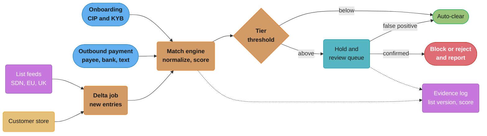
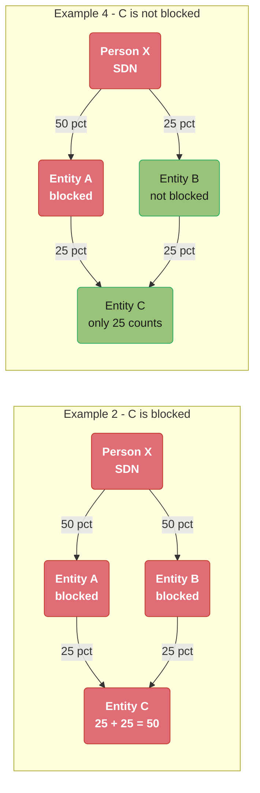
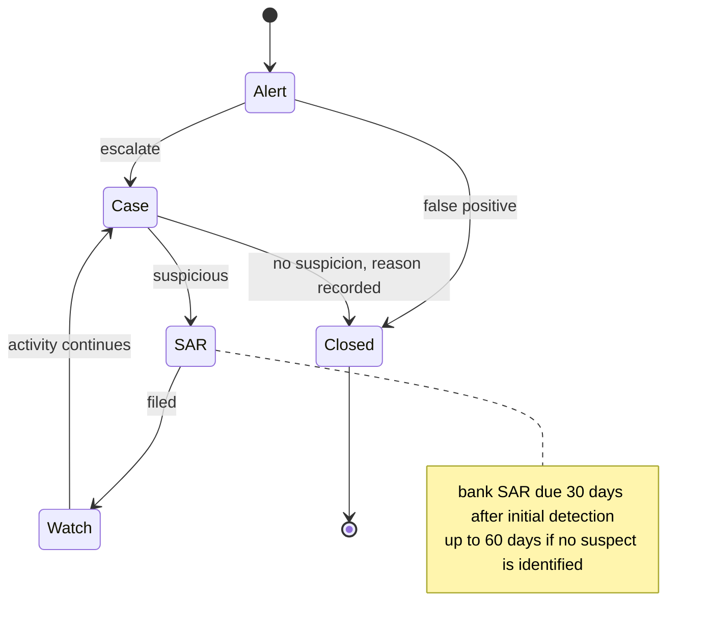

# KYC, AML and Sanctions Screening

> Rules and figures checked 2026-11-06. Every date, threshold and fee on this page comes from
> the fact pins in fintech/CLAUDE.md or from the eCFR section named beside it (eCFR as of
> 2026-11-04). Match thresholds, volumes and team sizes are labelled as assumptions. This page is
> an engineering view as of that date, not legal advice, and covers the US, the EU, the UK, India
> and Brazil only. Where it names a rule, the rule shown is US, EU or UK.

---

## 1. Concept Overview

Financial crime compliance asks four questions of every customer and every payment:

1. **Who is this?** Know your customer (KYC) for people and know your business (KYB) for
   companies, including the people who own and control the company.
2. **May we deal with them at all?** Sanctions screening against government lists, at onboarding,
   on every payment and every time a list changes.
3. **Does their activity make sense?** Transaction monitoring compares activity with the
   customer's profile and with known laundering patterns, and raises alerts.
4. **What must we report and keep?** Suspicious activity reports (SARs, called STRs in many
   regimes), currency transaction reports, travel-rule data on transfers, and records kept for a
   fixed period.

The legal duties sit with the regulated institution: the bank, the money transmitter, the
e-money institution, the crypto-asset service provider. A fintech that partners with a bank
builds the systems that let the bank meet those duties, and the bank audits them.

The engineering problem is a precision and capacity problem. Name matching against sanctions
lists is fuzzy, because names are transliterated, reordered and misspelled. A loose threshold
floods the review team with false positives. A tight one lets a designated person through, which
for sanctions is a legal breach, not a fraud loss. The threshold is a
risk-appetite decision, owned by compliance, documented and tested.

The wallet KYC tiers and their balance and transfer limits are in the
[digital wallet case study](../../hld/case_studies/design_digital_wallet.md) §4.7.

---

## 2. Intuition

**One-line analogy.** An airport checks your passport at the door, checks the no-fly list at the
door and again at every gate, and watches the cameras for anyone who behaves strangely in
between.

**Mental model.** Three loops run at different speeds. Onboarding runs once per customer and can
take minutes or days. Payment screening runs on every payment and must answer in milliseconds to
seconds. List and monitoring loops run in batch, hourly or daily, and re-check everyone you
already accepted against what changed.

**Why it matters.** The penalty asymmetry is extreme. A false positive costs an analyst a few
minutes. A missed sanctions match can cost a licence. That asymmetry pushes teams to loose
thresholds, and loose thresholds without capacity planning turn into alert backlogs, which are
their own compliance failure.

**Key insight.** Compliance quality is measured by what you can prove: which list version you
screened against, which score you got, who cleared the hit, and why. Design the evidence trail
first and the matching second.

---

## 3. Core Principles

1. **Risk-based approach.** Effort follows risk. A low-risk retail customer gets standard checks.
   A high-risk business in a high-risk corridor gets enhanced due diligence and tighter
   thresholds.
2. **Screening is continuous.** Screen at onboarding, on each payment, and again for every
   existing customer when a list adds an entry. A customer who was clean yesterday can be
   designated today.
3. **A confirmed US sanctions match is blocked, not just declined.** US persons must block the
   property of persons on OFAC's SDN List that is in the US or in their possession or control,
   and generally must not deal with them. Blocking means holding the funds, not returning them.
4. **Ownership aggregates.** OFAC's 50 Percent Rule blocks an entity owned 50 percent or more,
   directly or indirectly, in the aggregate, by one or more blocked persons. It covers ownership,
   not control. Stakes of persons blocked under different programs add together.
5. **The match threshold is a policy, not a constant.** Compliance owns the fuzzy-match
   number. Set it per risk tier, measure recall on seeded test names, and size the review team
   for the alert volume it produces.
6. **Never tip off.** A SAR, and any information that would reveal one, is confidential under
   31 CFR 1020.320(e). Customer-facing messages, support scripts and API errors must not reveal
   that a report exists.
7. **Fail closed for sanctions.** When the screening service is down, hold the payment. A fraud
   system may degrade to approval for small amounts. A sanctions check may not.
8. **Evidence is the product.** Store the list version, the input as screened, the score, the
   decision, the person who made it and the reason, for at least the retention period.

---

## 4. Types / Architectures / Strategies

### 4.1 Customer identification and due diligence

| Level | Applies to | What it adds |
|---|---|---|
| Customer identification program (CIP), US banks | Every customer opening an account | Name, date of birth for an individual, address, identification number, then risk-based identity checks |
| Customer due diligence (CDD) | Every customer | Purpose and expected activity, a risk rating, ongoing monitoring |
| Beneficial ownership (KYB) | Legal-entity customers | Each individual owning 25 percent or more of the equity, plus one individual with significant control |
| Enhanced due diligence (EDD) | High-risk customers, politically exposed persons, high-risk countries | Source of funds and wealth, senior approval, tighter monitoring |

Under 31 CFR 1020.220 a US bank's CIP obtains, before opening an account, at least the name, the
date of birth for an individual, an address and an identification number (a taxpayer
identification number for a US person, and for a non-US person one or more of a taxpayer
identification number, a passport number and country of issuance, an alien identification card
number, or another government document number). It then uses risk-based procedures to form a
reasonable belief that it knows the customer's true identity, through documents, non-documentary
methods or both. Within a reasonable time after the account opens, the CIP also checks the
customer against the federal lists of known or suspected terrorists that Treasury designates for
this purpose.

Under 31 CFR 1010.230(d) a beneficial owner of a legal-entity customer is each individual who
owns 25 percent or more of its equity, and a single individual with significant responsibility to
control, manage or direct it.

FinCEN's final rule of 2026-08-11 (effective 2026-08-14) removed beneficial ownership
information (BOI) reporting for US companies and US persons. Only foreign entities registered to
do business in a US state or tribal jurisdiction still report, and only for foreign individuals.
A platform cannot use that registry to source US owners,
so it collects ownership from the customer and checks it.

### 4.2 Screening types

| Screening | Against | Typical action on a confirmed match |
|---|---|---|
| Sanctions | OFAC SDN List, EU consolidated list, UK Sanctions List, others by jurisdiction | Block or reject per the regime, report |
| Politically exposed persons (PEP) | Commercial PEP databases | EDD, not refusal |
| Adverse media | News and court records | Input to the risk rating |
| Internal watchlist | Former customers exited for cause, known mule accounts | Refuse or review |

### 4.3 The sanctions lists

| List | Maintained by | Note |
|---|---|---|
| SDN List | US Treasury, OFAC | US persons block property of listed persons in their possession or control |
| EU consolidated financial sanctions list | European Commission, DG FISMA | Mirrors the legal acts. The Official Journal text is the authentic source |
| UK Sanctions List | FCDO | The single source for UK designations since 2026-01-28 at 09:00 UK time, when the OFSI Consolidated List closed |

### 4.4 The decision model: screening points and thresholds by risk tier

| Screening point | Low-risk tier | Standard tier | High-risk tier |
|---|---|---|---|
| Onboarding, sanctions | Fuzzy match, hold account opening on any hit above the threshold | Same, tighter threshold | Same, tightest threshold plus PEP and adverse media |
| Each outbound payment, sanctions | Screen payee, payee bank and free-text fields | Same | Same, plus country and corridor rules |
| List update | Rescreen every customer against new entries | Same | Same |
| Transaction monitoring | Standard scenarios | Standard scenarios | Extra scenarios, lower alert thresholds |
| Threshold (assumption, trigram similarity in §6.4) | 0.60 | 0.50 | 0.35 |

| Outcome | When | What the system does |
|---|---|---|
| Auto-clear | Score below the tier threshold, or a documented false-positive rule matches (different date of birth, different country) | Proceed, log the evidence |
| Hold | Score above the threshold, not yet reviewed | Payment or account held, an analyst decides within an SLA |
| Block | Confirmed match under a regime that requires blocking (US SDN) | Funds held in a blocked state, customer not told why beyond what the law allows. In the US, report to OFAC within 10 business days (31 CFR 501.603) |
| Reject | Confirmed match where the regime requires refusing the transaction | Payment refused. In the US, report to OFAC within 10 business days (31 CFR 501.604) |
| Alert only | Monitoring finding after the fact | Case opened, no payment affected |

### 4.5 Reports and records (US rules unless stated)

| Report | Trigger | Deadline or rule |
|---|---|---|
| SAR, bank | Suspicious activity involving or aggregating $5,000 or more | No later than 30 calendar days after initial detection. With no suspect identified, up to 30 more days, never more than 60. An ongoing violation also needs an immediate phone call to law enforcement |
| SAR, money services business | Suspicious activity of $2,000 or more | 30 calendar days |
| CTR | Each currency transaction of more than $10,000 (31 CFR 1010.311) | Per transaction |
| Travel rule | Funds transfers of $3,000 or more (31 CFR 1010.410(f)) | Originator and transmittal information passes in the transmittal order |
| Records | BSA records (31 CFR 1010.430(d)), SARs and supporting documents | Five years |
| EU crypto transfers | Every crypto-asset transfer, under Regulation (EU) 2023/1113 from 2024-12-30 | Originator and beneficiary information at any amount. Above EUR 1,000 to a self-hosted address, the CASP assesses whether the originator owns or controls it |

---

## 5. Architecture Diagrams

### 5.1 Three screening loops



All three loops share one match engine and one evidence log. The list-update loop is the one
teams forget: it is the only path that catches a customer designated after onboarding.

### 5.2 The 50 Percent Rule, two cases from OFAC FAQ 401



Ownership counts only when it runs through a blocked person or entity. In example 4, B is not
blocked, so its 25 percent in C does not count, and C stays at 25 percent. The fixpoint in §10.1
reproduces all five FAQ 401 examples.

### 5.3 Alert to report



Two clocks run. The SAR clock starts at initial detection. The analyst SLA is internal and must
be much shorter, because a case that waits three weeks in a queue has used most of the 30 days.

---

## 6. How It Works - Detailed Mechanics

### 6.1 Onboarding a person and a business

For a person, the flow is: collect the CIP fields, check the identity (document plus selfie, or
non-documentary checks against credit-bureau and government data), screen against sanctions and
PEP lists, assign a risk rating, and set limits by tier. For a business, add the entity's
registration data, its beneficial owners at 25 percent or more, one control person, and screen
every one of them plus the entity itself.

Store what you collected, the evidence of each check, the vendor's raw response, and the risk
rating with its inputs. A regulator asks "why was this customer rated low risk", and the answer
must come from stored data, not from today's code.

### 6.2 Name matching

Exact matching fails on the first real list. Names arrive with accents, in different orders,
with particles and hyphens, and transliterated from scripts with several valid Latin spellings.
A practical matcher normalizes first, then scores with an edit-distance measure such as
Jaro-Winkler, which rewards a shared prefix.

```java
import java.text.Normalizer;
import java.util.Arrays;
import java.util.Locale;

public class NameMatch {
    static String normalize(String s) {
        String n = Normalizer.normalize(s, Normalizer.Form.NFD).replaceAll("\\p{M}", "");
        n = n.toLowerCase(Locale.ROOT).replaceAll("[^a-z0-9]+", " ").trim();
        String[] tokens = n.split(" ");
        Arrays.sort(tokens);
        return String.join(" ", tokens);
    }

    static double jaroWinkler(String a, String b) {
        if (a.equals(b)) return 1.0;
        int window = Math.max(0, Math.max(a.length(), b.length()) / 2 - 1);
        boolean[] aHit = new boolean[a.length()];
        boolean[] bHit = new boolean[b.length()];
        int matches = 0;
        for (int i = 0; i < a.length(); i++) {
            int lo = Math.max(0, i - window);
            int hi = Math.min(b.length() - 1, i + window);
            for (int j = lo; j <= hi; j++) {
                if (!bHit[j] && a.charAt(i) == b.charAt(j)) {
                    aHit[i] = true;
                    bHit[j] = true;
                    matches++;
                    break;
                }
            }
        }
        if (matches == 0) return 0.0;
        int k = 0;
        int halfTranspositions = 0;
        for (int i = 0; i < a.length(); i++) {
            if (!aHit[i]) continue;
            while (!bHit[k]) k++;
            if (a.charAt(i) != b.charAt(k)) halfTranspositions++;
            k++;
        }
        double m = matches;
        double jaro = (m / a.length() + m / b.length() + (m - halfTranspositions / 2.0) / m) / 3.0;
        int prefix = 0;
        while (prefix < Math.min(4, Math.min(a.length(), b.length())) && a.charAt(prefix) == b.charAt(prefix)) {
            prefix++;
        }
        return jaro + prefix * 0.1 * (1 - jaro);
    }

    static double score(String query, String listed) {
        return jaroWinkler(normalize(query), normalize(listed));
    }

    public static void main(String[] args) {
        assert !"José María López".equals("LOPEZ, Jose Maria");
        assert score("José María López", "LOPEZ, Jose Maria") == 1.0;
        assert score("Mohammed Al-Rashid", "Muhammad Al Rashid") > 0.92;
        assert score("Ivan Petrov", "Petra Ivanova") > 0.90 : "token sort can create false positives";
        assert score("Oleg Sidorov", "Anna Kowalski") < 0.40;
        String[][] pairs = {
                {"José María López", "LOPEZ, Jose Maria"},
                {"Mohammed Al-Rashid", "Muhammad Al Rashid"},
                {"Mohammed Al-Rashid", "Mohamed Rashid"},
                {"Ivan Petrov", "Petra Ivanova"},
                {"Acme Trading LLC", "ACME TRADING L.L.C."},
                {"Oleg Sidorov", "Anna Kowalski"},
        };
        for (String[] p : pairs) System.out.printf("%-20s %-20s %.3f%n", p[0], p[1], score(p[0], p[1]));
    }
}
```

The scores from this code:

| Query | Listed name | Score |
|---|---|---|
| José María López | LOPEZ, Jose Maria | 1.000 |
| Mohammed Al-Rashid | Muhammad Al Rashid | 0.931 |
| Mohammed Al-Rashid | Mohamed Rashid | 0.807 |
| Ivan Petrov | Petra Ivanova | 0.906 |
| Acme Trading LLC | ACME TRADING L.L.C. | 0.953 |
| Oleg Sidorov | Anna Kowalski | 0.382 |

Two lessons are in the table. Normalization alone fixes the accents, the order and the comma.
Token sorting also creates false positives: "Ivan Petrov" and "Petra Ivanova" score 0.906 because
both sort to tokens that start "iva" and "pet". Production matchers add more inputs to cut false
positives without losing recall: date of birth, nationality and country as secondary
attributes, transliteration tables for common scripts, phonetic keys, and a stop list for legal
suffixes such as "llc" and "ltd". A secondary attribute that clearly differs (a different
year of birth) is a documented reason to auto-clear.

### 6.3 Ownership and the 50 Percent Rule

KYB gives you an ownership graph: people and entities as nodes, equity stakes as edges. The 50
Percent Rule turns sanctions screening of a company into a graph computation. Mark every
directly listed person or entity as blocked. Then repeat until nothing changes: an entity whose
stakes from blocked owners sum to 50 percent or more is blocked too. OFAC FAQ 401's five worked
examples all follow this fixpoint (§5.2 draws two of them). The code and the common mistake are
in §10.1.

The rule covers ownership, not control. A designated person who runs a company without owning
50 percent of it does not block the company under the rule, but it is a strong EDD signal and
often a reason to exit the relationship.

### 6.4 The screening store and list-delta rescreen

Lists change often. Each update is a version. When a new version arrives, two jobs run: screen
every existing customer against the new entries, and keep screening new customers and payments
against the full current list.

```sql
CREATE EXTENSION IF NOT EXISTS pg_trgm;

CREATE TABLE list_entry (
    list_name         text NOT NULL CHECK (list_name IN ('OFAC_SDN', 'EU_CONSOLIDATED', 'UK_SANCTIONS')),
    entry_id          text NOT NULL,
    name_norm         text NOT NULL,
    added_in_version  int  NOT NULL CHECK (added_in_version > 0),
    PRIMARY KEY (list_name, entry_id, name_norm)
);
CREATE INDEX list_entry_name_trgm ON list_entry USING gin (name_norm gin_trgm_ops);

CREATE TABLE tier_threshold (
    risk_tier       text PRIMARY KEY,
    min_similarity  real NOT NULL CHECK (min_similarity > 0 AND min_similarity <= 1)
);

CREATE TABLE customer (
    id                    bigint PRIMARY KEY,
    name_norm             text NOT NULL,
    risk_tier             text NOT NULL REFERENCES tier_threshold (risk_tier),
    onboarded_in_version  int  NOT NULL
);

CREATE TABLE screening_hit (
    customer_id   bigint NOT NULL REFERENCES customer (id),
    list_name     text   NOT NULL,
    entry_id      text   NOT NULL,
    similarity    real   NOT NULL,
    list_version  int    NOT NULL,
    status        text   NOT NULL DEFAULT 'open' CHECK (status IN ('open', 'cleared', 'confirmed')),
    decided_by    text,
    reason        text,
    PRIMARY KEY (customer_id, list_name, entry_id),
    CHECK (status = 'open' OR (decided_by IS NOT NULL AND reason IS NOT NULL))
);

-- Thresholds are an assumption that compliance owns. Trigram similarity, not Jaro-Winkler.
INSERT INTO tier_threshold VALUES ('low', 0.60), ('standard', 0.50), ('high', 0.35);

INSERT INTO list_entry VALUES
    ('OFAC_SDN',     'SDN-1001', 'ivan petrov',      6),
    ('OFAC_SDN',     'SDN-1002', 'acme trading llc', 6),
    ('UK_SANCTIONS', 'UK-2001',  'oleg sidorov',     7);

INSERT INTO customer VALUES
    (1, 'oleg sidorov',  'standard', 5),
    (2, 'olga sidorova', 'high',     3),
    (3, 'anna kowalski', 'standard', 7),
    (4, 'ivan petrova',  'low',      2);
```

The `CHECK` on `screening_hit` makes the evidence rule part of the schema: a hit cannot leave
`open` without a named decision maker and a reason. The trigram index serves the candidate
search. The tier threshold then decides which candidates become hits. §14 shows the delta job
written wrong and written right.

### 6.5 Payment screening

Screen every party and free-text field that can name a person: originator, beneficiary,
intermediary and beneficiary banks, addresses, and the remittance information. Sanctions
evasion often lives in the free text ("payment for invoice, goods to [port city]"). Country and
port lists catch what name lists miss.

Latency depends on the rail. A card authorization has no room for a human, so card programs
screen at onboarding and on list updates. A wire can wait
hours for a review. An instant payment cannot. The EU Instant Payments Regulation requires PSPs
to screen their customers against EU sanctions lists at least daily, which moves the work from
each payment to the customer base. The rail details are in
[Real-Time Payments and Open Banking](../real_time_payments_and_open_banking/real_time_payments_and_open_banking.md).

When the screening service is down, payments hold. Size the hold queue and its alerting for a
full-service outage, because "approve when screening is unavailable" is a sanctions breach
waiting for a designated payee.

### 6.6 Transaction monitoring, cases and SARs

Monitoring scenarios are rules over windows of activity, tuned per customer segment:

| Scenario (illustrative) | Pattern it looks for |
|---|---|
| Cash just under the CTR trigger | Repeated cash deposits that stay at or below $10,000, when a single transaction of more than $10,000 would need a CTR |
| Rapid in and out | Funds received and sent on within hours, with little balance kept |
| Fan-in and fan-out | Many senders to one account, or one account to many new payees (mule patterns) |
| Profile mismatch | Volume far above what the customer declared at onboarding |
| High-risk corridor | Transfers to or from high-risk jurisdictions above a segment threshold |

The CTR rule already treats multiple cash transactions as one when the institution knows they
are by or for the same person and they total more than $10,000 in one business day (31 CFR
1010.313(b)). So the structuring pattern to monitor is the one the CTR rule cannot see: cash
split across days, branches or people.

An alert goes to an analyst. The analyst closes it with a reason or escalates it to a case. A
case that finds suspicion leads to a SAR. The SAR deadline counts from initial detection, so the
system stores that date as its own field, set by the investigator, and computes the due date
from it.

```sql
CREATE TABLE aml_case (
    id                  bigint GENERATED ALWAYS AS IDENTITY PRIMARY KEY,
    customer_id         bigint  NOT NULL REFERENCES customer (id),
    detected_on         date    NOT NULL,
    suspect_identified  boolean NOT NULL,
    amount_minor        bigint  NOT NULL CHECK (amount_minor >= 0),
    sar_filed_on        date,
    sar_due_on          date GENERATED ALWAYS AS
                        (detected_on + CASE WHEN suspect_identified THEN 30 ELSE 60 END) STORED,
    CHECK (sar_filed_on IS NULL OR sar_filed_on >= detected_on)
);

INSERT INTO aml_case (customer_id, detected_on, suspect_identified, amount_minor)
VALUES (1, current_date - 25, true, 1200000),
       (2, current_date - 25, false, 700000);

-- Cases within 7 days of the SAR deadline and not yet filed.
SELECT id, detected_on, sar_due_on, sar_due_on - current_date AS days_left
FROM aml_case
WHERE sar_filed_on IS NULL
  AND sar_due_on - current_date <= 7
ORDER BY sar_due_on;
```

Case 1 has 5 days left and shows up. Case 2 has no identified suspect, so its deadline is 60
days after detection, and it does not show up yet. A bank's SAR threshold is $5,000 and a money
services business's is $2,000, so the amount column also drives which cases need a filing
decision at all. SARs and their supporting documents are kept for five years.

The SAR itself is confidential (31 CFR 1020.320(e)). The case system has its own access
control, separate from the support tools, and no customer-facing system reads case status.

### 6.7 EU, UK and international changes

- **EU AML Regulation (2024/1624)** applies from 2027-07-10 (from 2029-07-10 for football
  agents and professional football clubs). It also caps cash payments for goods and services at
  EUR 10,000, and Member States may set lower limits.
- **AMLA**, the EU Anti-Money Laundering Authority in Frankfurt, operates under Regulation
  2024/1620, which applies from 2025-07-01. It selects 40 obliged entities for direct
  supervision during 2027 and starts direct supervision during 2028.
- **UK Sanctions List** became the single source for UK designations on 2026-01-28. A screening
  feed still pointed at the OFSI Consolidated List stopped receiving UK updates that day.
- **FATF Recommendation 16** (payment transparency) was revised on 2025-06-18, with end-2030 as
  the implementation target. It changes originator and beneficiary information and adds
  beneficiary information checks.
- **Crypto transfers in the EU** carry originator and beneficiary information at any amount
  under Regulation 2023/1113 (from 2024-12-30). Custody details are in
  [Crypto Custody and On-Chain Operations](../crypto_custody_and_onchain_operations/crypto_custody_and_onchain_operations.md).

---

## 7. Real-World Examples

- **Bank partnerships.** Fintechs that offer accounts through a partner bank run KYC, screening
  and monitoring on their own systems, and the bank audits them and keeps the legal duty. The
  Synapse case, where the CFPB says partner banks held less than Synapse's records showed
  consumers were owed, is covered in
  [Build vs Buy and Licensing Strategy](../build_vs_buy_and_licensing_strategy/build_vs_buy_and_licensing_strategy.md).
  The compliance lesson matches: the partner bank must be able to rebuild every customer record
  and every screening decision from the fintech's evidence.
- **Screening vendors.** LexisNexis Bridger Insight XG, Dow Jones Risk and Compliance, LSEG
  World-Check and ComplyAdvantage sell list data with aliases, dates of birth and relationships,
  plus matching engines. Their alias coverage limits which name variants a screen can catch.
- **Open data.** OpenSanctions publishes consolidated sanctions and PEP data, and Moov Watchman
  is an open-source OFAC search service. Both are useful for testing and small programs.
- **Transaction monitoring platforms.** NICE Actimize, Hummingbird and Unit21 provide scenario
  engines, case management and SAR filing workflows.
- **Identity checks.** Onfido, Jumio and Socure provide document, selfie and data-based identity
  checks behind the CIP step.

---

## 8. Tradeoffs

### 8.1 Match threshold

| Threshold | Recall on true matches | Alerts per day (assumption) | Analysts needed (assumption) | Risk |
|---|---|---|---|---|
| Loose | High | 4,000 | 40 | Backlog, rushed clearing, alert fatigue |
| Middle, with secondary-attribute auto-clear | High | 600 | 6 | Auto-clear rules need testing and documentation |
| Tight | Lower | 80 | 1 | Missed designations, a legal breach |

### 8.2 Block vs hold vs alert

| Action | Speed | Customer impact | Use when |
|---|---|---|---|
| Block | After confirmation | Funds held, little explanation possible | Confirmed match under a blocking regime |
| Hold | Immediate | Delay | Above-threshold hit not yet reviewed, or screening unavailable |
| Reject | Immediate | Payment refused | Confirmed match where refusal is required |
| Alert only | After the fact | None | Monitoring patterns, low-confidence signals |

### 8.3 Build vs buy

| Component | Buy | Build | Typical choice |
|---|---|---|---|
| List data with aliases | Vendor or official feeds | Official feeds only | Buy for aliases, keep official feeds as the authority |
| Matching engine | Vendor | In-house over your data | Buy first, build when false positives cost more than the licence |
| Case management | Vendor | In-house | Buy unless you are a bank with a large team |
| Monitoring scenarios | Vendor library | In-house rules and models | Mix: vendor library plus your own product-specific scenarios |
| Evidence store | Rarely sold alone | In-house | Build, because it must hold your own decisions and context |

---

## 9. When to Use / When NOT to Use

**Use full CIP, KYB and screening when** you hold customer funds, move money for customers, or
issue accounts or cards, under your own licence or a partner bank's.

**Use enhanced due diligence when** the customer is a politically exposed person, operates in a
high-risk sector or country, or has a complex ownership chain.

**Use per-payment screening when** the rail allows a hold (wires, ACH, payouts). On rails that do
not, screen the customer base on list updates and at least as often as the rail's rules require.

**Do NOT** set the match threshold by gut feel, screen only at onboarding, auto-clear without a
recorded reason, or show customers anything that reveals a SAR. Do NOT treat a PEP match as a
refusal: it is an EDD trigger.

**Do NOT build** list data or case management from scratch unless compliance operations are your
product. Build the evidence store and the integration.

---

## 10. Common Pitfalls

The incidents below are illustrative, not reported cases.

### 10.1 Checking each owner on its own

A KYB service checked whether any single blocked owner held 50 percent or more of the customer.
It cleared a company owned 25 percent each by two entities that were themselves 50 percent owned
by a listed person.

```java
// BROKEN: checks each blocked owner's direct stake on its own, so two 25% stakes pass
import java.util.List;
import java.util.Set;

public class FiftyPercentPerOwner {
    record Stake(String owner, String owned, int pct) {}

    public static void main(String[] args) {
        Set<String> listed = Set.of("X");
        List<Stake> stakes = List.of(new Stake("X", "A", 50), new Stake("X", "B", 50),
                new Stake("A", "C", 25), new Stake("B", "C", 25));
        boolean cBlocked = stakes.stream()
                .anyMatch(s -> s.owned().equals("C") && listed.contains(s.owner()) && s.pct() >= 50);
        System.out.println("Entity C blocked: " + cBlocked);
    }
}
```

It prints `Entity C blocked: false`. OFAC FAQ 401 example 2 says C is blocked: A and B are
blocked because X owns 50 percent of each, and their stakes in C add to 50 percent. Two errors
combine: no aggregation, and no ownership through blocked entities.

```java
// FIX: fixpoint over the ownership graph, counting stakes held by any blocked owner
import java.util.HashMap;
import java.util.HashSet;
import java.util.List;
import java.util.Map;
import java.util.Set;

public class FiftyPercentRule {
    record Stake(String owner, String owned, int pct) {}

    static Set<String> blocked(Set<String> listed, List<Stake> stakes) {
        Set<String> blocked = new HashSet<>(listed);
        boolean changed = true;
        while (changed) {
            changed = false;
            Map<String, Integer> fromBlocked = new HashMap<>();
            for (Stake s : stakes) {
                if (blocked.contains(s.owner())) fromBlocked.merge(s.owned(), s.pct(), Integer::sum);
            }
            for (var e : fromBlocked.entrySet()) {
                if (e.getValue() >= 50 && blocked.add(e.getKey())) changed = true;
            }
        }
        return blocked;
    }

    static Stake st(String owner, String owned, int pct) { return new Stake(owner, owned, pct); }

    public static void main(String[] args) {
        Set<String> x = Set.of("X");
        // The five worked examples in OFAC FAQ 401.
        assert blocked(x, List.of(st("X", "A", 50), st("A", "B", 50))).contains("B");
        assert blocked(x, List.of(st("X", "A", 50), st("X", "B", 50),
                st("A", "C", 25), st("B", "C", 25))).contains("C");
        assert blocked(x, List.of(st("X", "A", 50), st("X", "B", 10), st("A", "B", 40))).contains("B");
        assert !blocked(x, List.of(st("X", "A", 50), st("X", "B", 25),
                st("A", "C", 25), st("B", "C", 25))).contains("C");
        assert !blocked(x, List.of(st("X", "A", 25), st("X", "B", 25),
                st("A", "C", 50), st("B", "C", 50))).contains("C");
        // Stakes of persons blocked under different programs add together.
        assert blocked(Set.of("Y", "Z"), List.of(st("Y", "D", 30), st("Z", "D", 20))).contains("D");
        System.out.println("all five FAQ 401 examples match");
    }
}
```

The fixpoint counts a stake only when its owner is blocked, which is why example 4 and example 5
stay unblocked. Run it on every KYB graph change and on every list update, because a new
designation can block entities several levels down.

### 10.2 Screening only at onboarding

A payouts platform screened sellers at sign-up and never again. A seller designated eight months
later kept receiving payouts until a partner bank's own screening caught it. Every list update
must trigger a rescreen of the whole customer base against the new entries. §14 shows the job.

### 10.3 The error message that tipped off

An API returned `403 ACCOUNT_UNDER_AML_REVIEW` and the support macro said "your account is
under a suspicious activity investigation". Both reveal information about a possible SAR. The
customer-facing state is a neutral "restricted" with a generic reason, the case status lives in
a separate system, and support scripts are reviewed by compliance.

### 10.4 The alert backlog

A team loosened the threshold after an audit finding and alert volume rose tenfold. Analysts
cleared alerts in seconds to keep up, so the review stopped being a review. Change the threshold
and the staffing plan together, measure recall on seeded test names before and after, and add
documented auto-clear rules on secondary attributes.

### 10.5 Screening only structured fields

The payee name was clean. The remittance text named a sanctioned vessel. Screen free text with
the same engine, plus country, city, port and vessel lists, and accept that free-text screening
has a higher false-positive rate that needs its own threshold.

### 10.6 A list feed that went quiet

The UK feed pointed at the OFSI Consolidated List, which closed when the UK Sanctions List became
the single source on 2026-01-28. The job kept running and reported success with zero new
entries. Alert on list freshness (time since the last change per list), not only on job
failures.

---

## 11. Technologies & Tools

| Tool | What it does here |
|---|---|
| LexisNexis Bridger Insight XG | Sanctions and PEP screening with list data and a matching engine |
| LSEG World-Check | Risk intelligence database of sanctioned persons, PEPs and adverse media |
| Dow Jones Risk and Compliance | Sanctions, PEP and adverse media data for screening programs |
| ComplyAdvantage | Screening data and an API for onboarding and payment screening |
| OpenSanctions | Open consolidated sanctions and PEP datasets, with entity relationships |
| Moov Watchman | Open-source search service over OFAC and other lists |
| NICE Actimize | Transaction monitoring, case management and SAR workflows for banks |
| Hummingbird RegTech | Case management and regulatory filing workflows for compliance teams |
| Unit21 | Rules-based transaction monitoring and case management for fintechs |
| Onfido | Document and biometric identity checks for onboarding |
| Jumio | Document, selfie and liveness checks for KYC |
| pg_trgm | PostgreSQL trigram similarity and GIN indexes for candidate name search |

---

## 12. Interview Questions with Answers

**Q: How should a team set the fuzzy-match threshold for sanctions screening?**
**Short:** As a documented risk-appetite choice per risk tier, tested for recall on seeded names and sized against the review team's capacity.

Teams set it per risk tier and per field (names, free text, addresses), measure recall with
seeded test names that include transliterations and reorderings, and record the decision and its
evidence. The threshold, the auto-clear rules and the staffing plan change together. An auditor
asks how you chose it, not what the number is.

**Q: Why is screening only at onboarding not enough?**
**Short:** Lists change, so a customer who was clean at sign-up can be designated later, and only a rescreen on each list update catches that.

Every list version adds and removes entries. Rescreen all customers against each new entry, and
screen each payment's counterparties against the full list. A rescreen job that only looks at
customers onboarded since the last run misses every existing customer who was just designated.

**Q: How does OFAC's 50 Percent Rule work with indirect ownership?**
**Short:** An entity owned 50 percent or more in aggregate by blocked persons is blocked, and stakes count when they run through entities that are themselves blocked.

FAQ 401's examples show it: X owns 50 percent of A and of B, A and B each own 25 percent of C,
so C is blocked. If B were only 25 percent owned by X, B would not be blocked and its stake in C
would not count. Compute a fixpoint over the ownership graph. The rule covers ownership, not
control, and stakes of persons blocked under different programs add together.

**Q: What is the difference between blocking and rejecting a payment?**
**Short:** Blocking holds the funds in place under sanctions law, while rejecting refuses the payment and leaves the funds with the sender.

US persons must block property of SDN-listed persons in their possession or control, so a
confirmed US sanctions match is not just declined and returned. Where a regime requires refusal
rather than blocking, the system rejects the payment. In the US both go to OFAC within 10 business
days: 31 CFR 501.603 for blocked property and 501.604 for rejected transactions. The ledger needs
a blocked-funds account and a reporting workflow for both.

**Q: What does tipping off mean for system design?**
**Short:** SARs and any information revealing them are confidential, so no customer-facing message, API error or support script may disclose one.

31 CFR 1020.320(e) bars a bank and its staff from disclosing a SAR or information that would
reveal its existence. Keep case status in a separate system with its own access control, use a
neutral "restricted" state in customer-facing systems, and have compliance review support macros
and error codes.

**Q: When is a bank's SAR due?**
**Short:** No later than 30 calendar days after initial detection, or up to 60 days if no suspect is identified, and ongoing violations also need an immediate call to law enforcement.

Store the detection date as its own field and compute the due date from it. The bank threshold
is $5,000, involving or aggregating, and a money services business's is $2,000. SARs and
supporting documents are kept for five years. Internal SLAs must be far shorter than 30 days,
because queues eat the window.

**Q: What triggers a CTR?**
**Short:** A currency transaction of more than $10,000 at a financial institution other than a casino, under 31 CFR 1010.311.

The trigger is "more than $10,000", not "$10,000 or more". Monitoring scenarios look for the
pattern around it: repeated cash transactions just at or below the trigger. Same-day cash
transactions by or for one person already count as one when the institution knows of them (31
CFR 1010.313(b)), so structuring scenarios look across days, branches and people. CTRs are about
cash, not wires or card payments.

**Q: What does the US travel rule require of a funds transfer?**
**Short:** For transfers of $3,000 or more, the transmitting or intermediary institution passes originator and transmittal information in the transmittal order.

The rule is 31 CFR 1010.410(f). Engineering consequences: the payment message must carry the
fields, intermediaries must pass them on unchanged, and missing data is a screening and
monitoring signal. The EU applies a similar rule to crypto-asset transfers at any amount.

**Q: Who is a beneficial owner under the US CDD rule?**
**Short:** Each individual owning 25 percent or more of a legal entity's equity, plus one individual with significant responsibility to control, manage or direct it.

31 CFR 1010.230(d) defines both prongs. A company can have zero to four owners under the equity
prong but always has one control person. Screen every owner, the control person and the entity
itself. FinCEN's BOI registry no longer covers US companies after the 2026-08-14 final rule, so
the institution collects this data from the customer.

**Q: What must a US bank's CIP collect before opening an account?**
**Short:** At least the name, date of birth for an individual, an address and an identification number, then risk-based checks on that identity.

31 CFR 1020.220 lists the fields and lets a non-US person give a passport number and country of
issuance or another government document number in place of a TIN. Identity checks may use
documents, non-documentary methods or both, and must give a reasonable belief that the bank
knows the customer's true identity. The CIP also compares customers with the federal terrorist
lists that Treasury designates for it.

**Q: Why should sanctions screening fail closed when fraud scoring can fail open?**
**Short:** A missed sanctions match is a legal breach whatever the amount, while a fraud miss is a priced loss that a degraded policy can cap.

A fraud system can approve small payments when its model is down because the loss is bounded.
Approving payments with no sanctions check could send funds to a designated person. Hold
payments when screening is unavailable, alert on the hold queue, and plan capacity for a
full-service outage.

**Q: How do you cut sanctions false positives without losing recall?**
**Short:** Normalize names, then use secondary attributes such as date of birth and nationality to auto-clear with a recorded reason, and measure recall on seeded names.

Raw name similarity matches many unrelated people. A hit whose list entry has a different year of
birth or a different nationality can be cleared by a documented rule. Stop words for legal
suffixes help on entity names. Every auto-clear rule needs testing against seeded true matches
before it goes live.

**Q: Why does token sorting create false positives in name matching?**
**Short:** Sorting tokens makes reordered names equal, but it also lines up unrelated names whose tokens share prefixes, such as Ivan Petrov and Petra Ivanova.

In §6.2 that pair scores 0.906 with Jaro-Winkler after token sorting. Sorting is still useful,
because lists and customers order names differently. Pair it with per-token comparison and
secondary attributes rather than trusting one whole-string score.

**Q: Is a PEP match a reason to refuse a customer?**
**Short:** No, a politically exposed person triggers enhanced due diligence, not automatic refusal.

EDD means source of funds and wealth, senior approval and tighter monitoring. Refusing all PEPs
is a business choice, not a requirement, and it also refuses their relatives and close
associates who show up in PEP data. Treat PEP status as a risk-rating input.

**Q: What changed for UK sanctions screening on 2026-01-28?**
**Short:** The OFSI Consolidated List closed and the FCDO's UK Sanctions List became the single source for UK designations at 09:00 UK time.

A feed that still pointed at the OFSI list stopped receiving updates while the job kept
succeeding. Monitor list freshness per source, and alert when a list has not changed for longer
than its normal update interval.

**Q: When does the EU AML Regulation apply, and what does AMLA do?**
**Short:** Regulation 2024/1624 applies from 2027-07-10, and AMLA in Frankfurt picks 40 entities for direct supervision during 2027 and starts supervising them during 2028.

The AMLR is a regulation, so its text applies directly in every Member State. It includes a
EUR 10,000 cap on cash payments for goods and services, which Member States may lower. AMLA's own
regulation applies from 2025-07-01. Build EU programs to the AMLR's text well before
2027-07-10, because compliance systems take quarters to change.

**Q: What should a sanctions screening record contain for an auditor?**
**Short:** The input as screened, the list and its version, the score, the decision, who made it, when and why.

Without the list version you cannot show that the screening used the list in force that day.
Without the reason, a cleared hit looks like a skipped hit. Make these fields required in the
schema, as the `CHECK` in §6.4 does, and keep them for at least the five-year retention period.

**Q: How do you screen instant payments when there is no time for review?**
**Short:** Screen the customer base continuously, so each instant payment relies on customers already screened, and block known matches before they can send.

The EU Instant Payments Regulation requires PSPs to screen their customers against EU sanctions
lists at least daily. The design moves work from the payment path to the list-update and batch
loops. The rule covers EU lists only, so screening against other regimes' lists, such as OFAC's,
needs its own design decision.

**Q: Why do transaction monitoring alerts need two clocks?**
**Short:** The SAR deadline runs from initial detection, so the internal review SLA must be far shorter or the queue uses up the legal window.

A case that waits three weeks in a queue has used most of a 30-day window. Track alert age,
case age and days to each SAR due date, and escalate by deadline, not by arrival order. Staff
for the peak alert volume, not the average.

**Q: What does the EU crypto travel rule add for self-hosted wallets?**
**Short:** Above EUR 1,000 to a self-hosted address, the originator's CASP assesses whether the originator owns or controls that address.

Regulation 2023/1113 applies from 2024-12-30 and requires originator and beneficiary
information on crypto-asset transfers at any amount. The self-hosted check is an extra step for
larger transfers. Custody and address ownership proofs are covered in the crypto custody module.

---

## 13. Best Practices

1. Write the evidence schema first: input, list version, score, decision, decision maker,
   reason, time.
2. Rescreen every customer on every list update, against the new entries.
3. Set thresholds per risk tier and per field, measure recall on seeded names, and change
   staffing with the threshold.
4. Use secondary attributes for documented auto-clear rules.
5. Compute the 50 Percent Rule as a fixpoint over the ownership graph, and rerun it on graph and
   list changes.
6. Fail closed for sanctions. Hold payments when screening is unavailable.
7. Store the SAR detection date explicitly and track every case against its due date.
8. Keep case status out of every customer-facing system, and review support macros for tipping
   off.
9. Monitor list freshness per source, not only job success.
10. Screen free text, addresses and bank fields, not only party names.

---

## 14. Case Study

### A payouts platform rescreens its sellers on list updates

**Context (illustrative).** A US marketplace, registered as a money services business, pays
400,000 sellers in 30 countries (assumption). It screens sellers at onboarding and screens each
payout's beneficiary bank. Sanctions lists update several times a week. The platform's partner
bank found a payout to a seller designated on the UK Sanctions List three weeks earlier.

**What the rescreen job did.** On each list update the job screened customers onboarded since
the previous update against the full list. That checks new customers well and never checks old
customers against new entries.

```sql
-- BROKEN
-- Rescreen on list version 7 screens only customers onboarded in version 7.
INSERT INTO screening_hit (customer_id, list_name, entry_id, similarity, list_version)
SELECT c.id, e.list_name, e.entry_id, similarity(c.name_norm, e.name_norm), 7
FROM customer c
JOIN tier_threshold t ON t.risk_tier = c.risk_tier
JOIN list_entry e ON similarity(c.name_norm, e.name_norm) >= t.min_similarity
WHERE c.onboarded_in_version = 7
ON CONFLICT DO NOTHING;

SELECT count(*) AS hits_from_v7_rescreen FROM screening_hit WHERE list_version = 7;
```

With the data from §6.4 it finds no hits. Anna Kowalski, the only new customer, matches nothing.
Oleg Sidorov, a customer since version 5, matches the UK entry added in version 7 exactly, and
the job never looks at him.

```sql
-- FIX: every customer against the entries added in this version, with the tier threshold
INSERT INTO screening_hit (customer_id, list_name, entry_id, similarity, list_version)
SELECT c.id, e.list_name, e.entry_id, similarity(c.name_norm, e.name_norm), 7
FROM customer c
JOIN tier_threshold t ON t.risk_tier = c.risk_tier
JOIN list_entry e ON similarity(c.name_norm, e.name_norm) >= t.min_similarity
WHERE e.added_in_version = 7
ON CONFLICT DO NOTHING;

SELECT c.name_norm, h.entry_id, round(h.similarity::numeric, 2) AS similarity, c.risk_tier
FROM screening_hit h
JOIN customer c ON c.id = h.customer_id
WHERE h.list_version = 7
ORDER BY h.similarity DESC;
```

The fix finds two hits: Oleg Sidorov at 1.00 (standard tier) and Olga Sidorova at 0.50 (high-risk
tier, threshold 0.35). The low-risk threshold of 0.60 would have missed her. Both go to review. New customers
are still screened against the full list by the onboarding path, so the two jobs together cover
both halves.

**Other changes.**

1. Payouts to a seller with an open hit are held until the hit is cleared or confirmed.
2. List freshness is monitored per source, after the team found its UK feed had pointed at the
   closed OFSI list for weeks.
3. Rescreens run within an hour of each list update (assumption), and the alert dashboard shows
   hits by list version.
4. The seller ownership graph is rescreened with the 50 Percent Rule fixpoint on every list
   update, because a new designation can block a seller's parent company.

**Outcome (illustrative).** The next audit sampled 50 list updates and found each one followed by
a full-base rescreen with stored evidence. Alert volume rose 8% from the existing-customer
rescreens, which the team absorbed with secondary-attribute auto-clear rules.

**Lessons.**

- Two populations need two jobs: new customers against the whole list, and the whole base
  against new entries.
- The evidence row (list version, score, decision maker, reason) is what the audit reads.
- Related pages: [Fraud and Risk Scoring](../fraud_and_risk_scoring/fraud_and_risk_scoring.md)
  runs beside screening on the same payouts, and
  [Wallets, Stored Value and Payouts](../wallets_stored_value_and_payouts/wallets_stored_value_and_payouts.md)
  covers the payout rails that the holds apply to.
