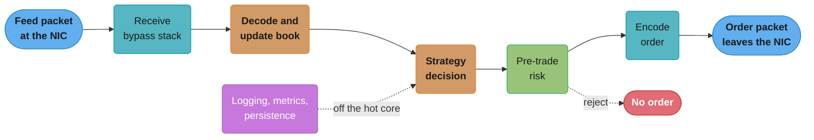
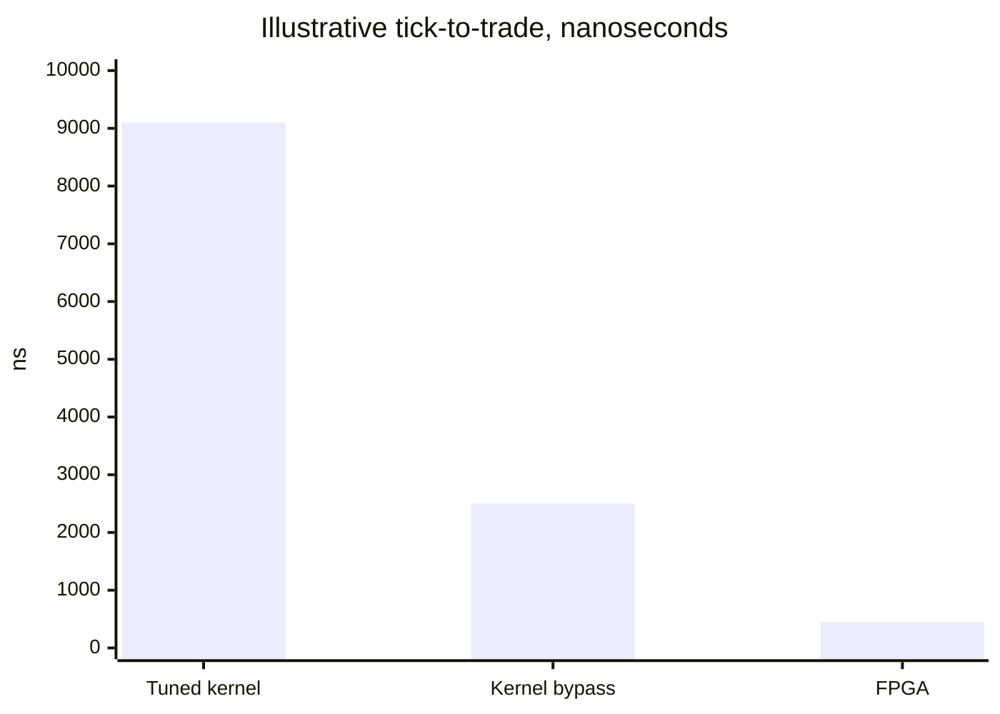

# Low-Latency Trading Systems

> Rules and figures checked 2026-11-06. Every date, threshold and fee on this page comes from the fact pins in fintech/CLAUDE.md. Every nanosecond budget on this page is an illustrative assumption, not a measured or vendor figure.

---

## 1. Concept Overview

A low-latency trading system turns a market data packet into an order packet as fast and as predictably as the hardware allows. The time between the two is **tick-to-trade**: from the moment the feed packet reaches the firm's network card to the moment the order packet leaves it.

The path has the same stages at every firm:

1. Receive the packet (network card, kernel or bypass stack).
2. Decode the feed message and update the order book.
3. Run the strategy and decide.
4. Run pre-trade risk checks.
5. Encode the order and send it.

Two numbers describe the path: the typical time (median) and the spread of times (jitter, read from p99, p99.9 and the maximum). Trading firms spend more effort on the spread than on the median, because a strategy that is fast on most ticks and slow on the busiest ones loses exactly when it matters.

This page owns the tick-to-trade budget, the choice between a tuned kernel, kernel bypass and FPGA, core isolation, and how to measure the result. Other pages own the parts it builds on: the off-heap ring buffer and GC-free feed handler in [Design a Low-Latency Market Data Handler](../../java/case_studies/design_low_latency_market_data_handler.md), cache lines, false sharing and NUMA in [Computer Architecture and Memory Hierarchy](../../cs_fundamentals/computer_architecture_and_memory_hierarchy/computer_architecture_and_memory_hierarchy.md), syscall and network-stack cost in [OS and I/O Performance](../../backend/os_and_io_performance/os_and_io_performance.md), and tail measurement in [Tail Latency and Fan-Out](../../backend/tail_latency_and_fan_out/tail_latency_and_fan_out.md).

---

## 2. Intuition

**One-line analogy.** Tick-to-trade is a relay race with five handoffs, and the race is lost at the one handoff where a runner stops to tie a shoelace.

**Mental model.** Every stage has a fast path and a set of rare stalls: a cache miss, an interrupt, a page fault, a garbage collection, a scheduler decision, a log write. The median shows the fast path. The tail shows the stalls. Most low-latency work is a hunt for stalls: you find each source of variance and either remove it or move it off the hot cores.

```
median view:  [rx 700][decode 300][strategy 500][risk 100][encode 200][tx 700]   = 2.5 us

one bad tick: [rx 700][decode 300][strategy 500 + timer interrupt 20,000][risk 100]...
                                               ^^^^^^^^^^^^^^^^^^^^^^^^
                                     one stall is 8x the whole median budget
```

The numbers are illustrative. The shape is real: a single scheduler tick or interrupt on the hot core costs more than all the code you tuned.

**Why it matters.** Market makers and arbitrage strategies compete for the same fills. When two firms see the same price change, the faster order reaches the queue first. The slow firm gets the fills nobody wanted, the ones where the price is about to move against it.

**Key insight.** Speed comes from removing work and variance, not from clever code. A well-built hot path does almost nothing on the hot path: no system calls, no allocation, no locks, no logging, no branches they can avoid, and no sharing of the core with anything else.

---

## 3. Core Principles

**Measure on the wire.** The only honest tick-to-trade number comes from timestamps taken outside the application: hardware timestamps on the network card, or a tap or switch that stamps packets in and out. Application timestamps miss the receive and send stacks, which are often the largest stages.

**Budget per stage.** Give each stage a nanosecond budget and measure it separately. A total that grows tells you nothing about which stage grew.

**Report the tail.** Record every sample into a histogram and report p50, p99, p99.9 and the maximum. A mean hides stalls (see the pitfall in §10).

**Own the core.** The hot thread runs on a core that the scheduler, interrupts, timers and other processes do not touch. It busy-spins instead of sleeping, because waking a sleeping thread costs microseconds.

**Allocate nothing on the hot path.** Preallocate every buffer and object at startup. In Java, allocation leads to garbage collection. In C++ and Rust, the allocator itself can take locks and touch cold memory.

**Keep the data close.** The book, the strategy state and the risk limits should fit in the core's L1 and L2 caches, on the NUMA node that holds the network card.

**Never skip risk.** Pre-trade checks (order size, price collar, position, a kill switch) stay on the hot path. They cost tens of nanoseconds when written for it. Without such limits a bug can trade without bound, as the Knight Capital loss in §7 shows.

**Physics sets the floor.** Light in standard single-mode fiber travels at about c divided by 1.47, so about 4.9 microseconds per kilometer. Through air it is about 3.34 microseconds per kilometer. No software change beats distance.

---

## 4. Types / Architectures / Strategies

### Network stack

| Approach | How a packet reaches the application | What it removes |
|---|---|---|
| Standard kernel sockets | Interrupt, softirq, kernel copy, wake the blocked thread | Nothing |
| Tuned kernel | Busy polling (`SO_BUSY_POLL`), interrupt moderation off, IRQs pinned to non-hot cores | Some of the wake-up cost and interrupt jitter |
| Kernel bypass, socket-compatible | A user-space stack such as OpenOnload intercepts socket calls, so the application code is unchanged | Kernel entry, kernel copy, kernel scheduling |
| Kernel bypass, raw | The application polls the card's receive ring directly (ef_vi, DPDK poll-mode drivers) | All of the above plus the socket abstraction |
| FPGA | Logic on the network card parses the feed and can send a precomputed order without the CPU | The CPU, the PCIe round trip and software scheduling |

### Thread wait strategy

| Strategy | Wake-up cost | CPU cost | Use for |
|---|---|---|---|
| Block (park, futex, `epoll_wait`) | Microseconds, plus scheduler jitter | Low | Anything off the hot path |
| Busy-spin with a pause hint (`Thread.onSpinWait`) | Tens of nanoseconds | One full core per thread | The hot path |
| Spin, then yield, then park | Low while busy, high after a quiet period | Moderate | Threads that must share cores |

### Language

| Language | Hot-path model | Main risk |
|---|---|---|
| C++ | Manual memory, templates, no runtime | Undefined behavior, memory bugs under pressure |
| Java | Allocation-free code over primitive arrays or off-heap memory, JIT-compiled | GC pauses if anything allocates, JIT warm-up, deoptimization |
| Rust | Ownership, no GC, no runtime | Smaller trading ecosystem, `unsafe` at the hardware edge |

### Physical placement

| Placement | What it buys |
|---|---|
| Co-location in the venue's data center | Meters of cable instead of kilometers |
| Cross-connect | A direct cable to the venue's switch |
| Microwave or millimeter-wave links between data centers | Air instead of glass, about a third less propagation delay, with weather risk |

---

## 5. Architecture Diagrams

### Tick-to-trade path



Five stages run on one or two pinned cores. Everything that is not needed to send the order (logging, metrics, persistence) reads from the hot path through a ring buffer on another core.

### Illustrative tick-to-trade totals by architecture



The bars are the sums of the illustrative budget in §6.1. Kernel bypass removes most of the receive and send cost. FPGA removes the CPU from the decision.

### Core and memory layout on a two-socket server

```
 socket 0 (NUMA node 0)                         socket 1 (NUMA node 1)
 +--------------------------------------+       +------------------------------+
 | core 0  core 1 | core 2  core 3  ... |       | core 8 ... core 15           |
 | OS, IRQs, ssh  | feed rx  strategy   |       | analytics, logging writer,   |
 | housekeeping   | (isolated, no tick) |       | risk reporting, GC threads   |
 +--------------------------------------+       +------------------------------+
 | local DRAM: book, strategy state,    |       | local DRAM: history, caches  |
 | huge-page buffers                    |       |                              |
 +------------------+-------------------+       +------------------------------+
                    |
               PCIe slot -> NIC (feed in, orders out)
```

The network card sits on socket 0's PCIe lanes, so the hot threads and their memory sit on node 0 too. A hot thread on socket 1 would cross the socket interconnect for every packet.

---

## 6. How It Works - Detailed Mechanics

### 6.1 The tick-to-trade budget

The table is an illustrative budget for one decision. Measure your own, stage by stage, before you trust any number like these.

| Stage | Tuned kernel (ns) | Kernel bypass (ns) | FPGA (ns) |
|---|---|---|---|
| Wire to application (receive) | 4,000 | 700 | 100 |
| Decode and book update | 300 | 300 | 100 |
| Strategy decision | 500 | 500 | 50 |
| Pre-trade risk | 100 | 100 | 50 |
| Encode order | 200 | 200 | 50 |
| Application to wire (send) | 4,000 | 700 | 100 |
| Total | 9,100 | 2,500 | 450 |

Two observations hold whatever the exact values are. First, in a kernel-socket design, the network stack dominates, so tuning strategy code from 500 to 400 ns changes the total by about 1%. Second, the FPGA column is low because the decision is precomputed: software decides in advance which price change triggers which order, and the hardware only matches and fires.

### 6.2 Distance

Propagation delay per kilometer comes from the speed of light, 299,792 km/s:

| Medium | Speed | Delay per km | 100 km route (assumption) |
|---|---|---|---|
| Vacuum or air | about c | about 3.34 us | about 334 us |
| Standard single-mode fiber (index about 1.47) | about c / 1.47 | about 4.9 us | about 490 us |

Fiber routes also follow roads and rights of way, so they are longer than the straight line. A microwave link that runs closer to the straight line saves both the index penalty and some route length. Its costs are rain fade, lower bandwidth and the need to fall back to fiber in bad weather. Inside one data center, cable length matters at the scale of nanoseconds: about 5 ns per meter of fiber.

### 6.3 What kernel bypass removes

With standard sockets a received packet goes through these steps:

1. The card writes the packet into a receive ring by DMA and raises an interrupt.
2. The kernel's interrupt handler and softirq process it through the IP and UDP layers.
3. The kernel copies the payload into the socket buffer and wakes the thread blocked in `recv`.
4. The scheduler runs the thread, which makes a system call to copy the data to user space.

Each step is a source of both cost and jitter. Busy polling (`SO_BUSY_POLL`) removes the wake-up by letting the receiving thread poll the device queue. Kernel bypass goes further: the card's rings are mapped into the process, and the application polls them directly. OpenOnload keeps the BSD socket API, so existing code runs unchanged under its preload library. ef_vi and DPDK expose the rings themselves, which removes the socket layer and gives the most control, at the cost of writing your own UDP and TCP handling or using the vendor's.

Kernel bypass also takes the packet path out of reach of the standard tools. `tcpdump` on the host does not see bypassed traffic, so capture with the vendor's tool or on a switch port.

### 6.4 Core isolation

The goal is a core on which only the hot thread runs. On Linux this takes several settings together. The kernel command line below is an example for a 16-core host where cores 2 to 7 are hot (assumption):

```text
isolcpus=2-7 nohz_full=2-7 rcu_nocbs=2-7 irqaffinity=0-1 transparent_hugepage=never hugepages=2048
```

| Setting | What it stops on the hot cores |
|---|---|
| `isolcpus` | The scheduler placing other threads there |
| `nohz_full` | The periodic scheduler tick while one task runs |
| `rcu_nocbs` | RCU callback processing |
| `irqaffinity` and per-IRQ affinity | Device interrupts, except the ones you route there on purpose |
| `transparent_hugepage=never` | Page compaction stalls from THP |
| `hugepages=N` | Nothing by itself: it reserves explicit huge pages that the application maps at startup to cut TLB misses |

Then the application pins each hot thread to its core (`taskset`, `sched_setaffinity`, or a thread-affinity library), allocates and touches all memory at startup, and locks it with `mlockall` so no page fault happens later. BIOS settings matter too: deep C-states and dynamic frequency scaling make the first instruction after an idle period slow, and SMT shares a core's execution units with a second thread. Firms usually disable deep C-states on hot hosts and test SMT both ways.

The cost is real: each isolated core does nothing else, even when the market is quiet.

### 6.5 Busy-spin handoff between two threads

A feed thread and a strategy thread usually share data through a single-producer single-consumer ring. The consumer spins on the producer's cursor. The program below hands off 100,000 ticks, one in flight at a time so that it measures handoff and not queueing, checks that every tick arrives in order, and prints the latency percentiles. It falls back to `Thread.yield()` after a long spin so that it still finishes on a machine with one CPU. A production version pads the two cursors onto separate cache lines, as [Design a Low-Latency Market Data Handler](../../java/case_studies/design_low_latency_market_data_handler.md) shows.

```java
import java.util.Arrays;
import java.util.concurrent.atomic.AtomicLong;

public class SpscHandoff {
    static final int SIZE = 1 << 12, MASK = SIZE - 1, N = 100_000;
    final long[] prices = new long[SIZE];
    final long[] stamps = new long[SIZE];
    final AtomicLong head = new AtomicLong();
    final AtomicLong tail = new AtomicLong();

    void publish(long price) {
        long h = head.get();
        int spins = 0;
        while (h - tail.get() == SIZE) spin(++spins);
        int i = (int) (h & MASK);
        prices[i] = price;
        stamps[i] = System.nanoTime();
        head.lazySet(h + 1);
    }

    static void spin(int spins) {
        if (spins < 10_000) Thread.onSpinWait();
        else Thread.yield();
    }

    public static void main(String[] args) throws InterruptedException {
        SpscHandoff ring = new SpscHandoff();
        long[] latency = new long[N];
        Thread consumer = new Thread(() -> {
            long t = 0;
            while (t < N) {
                int spins = 0;
                while (ring.head.get() == t) spin(++spins);
                int i = (int) (t & MASK);
                long price = ring.prices[i];
                latency[(int) t] = System.nanoTime() - ring.stamps[i];
                if (price != 1_000_000L + t) throw new IllegalStateException("out of order at " + t);
                ring.tail.lazySet(++t);
            }
        });
        consumer.start();
        for (long p = 0; p < N; p++) {
            int spins = 0;
            while (ring.tail.get() != ring.head.get()) spin(++spins);
            ring.publish(1_000_000L + p);
        }
        consumer.join();

        Arrays.sort(latency);
        assert latency[0] >= 0;
        System.out.printf("p50 %d ns, p99 %d ns, p99.9 %d ns, max %d ns%n",
            latency[N / 2], latency[N * 99 / 100], latency[N * 999 / 1000], latency[N - 1]);
    }
}
```

The output varies by machine. One run in a Docker container on a 10-core laptop printed p50 167 ns, p99 625 ns, p99.9 13,334 ns and max 3,060,876 ns. The median is a fraction of a microsecond, and the maximum is 18,000 times larger, because nothing here isolates the cores. That gap is the subject of §6.4.

### 6.6 Allocation-free code in Java

A Java hot path allocates nothing after warm-up. The common sources of hidden allocation:

| Source | Example | Replacement |
|---|---|---|
| Boxing | `Map<Long, Long>`, `List<Integer>` | Primitive arrays indexed by a dense id, or a primitive map from Agrona |
| Strings | `"px=" + price`, `String.format` | Write numbers as bytes into a preallocated buffer |
| Iterators and lambdas | `for (X x : list)` on a `List`, a capturing lambda | Indexed loops, non-capturing code |
| Varargs | `log.info("{} {}", a, b)` | A binary log record in a ring buffer |
| Exceptions | `new Exception()` for control flow | Return codes |

Prove the result instead of trusting it. `com.sun.management.ThreadMXBean.getCurrentThreadAllocatedBytes()` gives the bytes the current thread allocated. Read it before and after a hot loop in a test. JFR's allocation events show where allocation comes from in a running system. The pitfall in §10 runs both versions and prints the bytes.

### 6.7 Pre-trade risk on the hot path

The checks are a handful of integer comparisons on data the risk core already holds. Written for the hot path, they cost tens of nanoseconds. The program below checks size, a price collar around the last reference price, the resulting position, and a kill switch that another thread can set.

```java
public class HotRisk {
    record Limits(long maxOrderQty, long collarTicks, long maxPosition) {}

    static final int OK = 0, TOO_BIG = 1, OUTSIDE_COLLAR = 2, POSITION = 3, KILLED = 4;

    final Limits limits;
    long position;
    long refPriceTicks;
    volatile boolean killed;

    HotRisk(Limits limits, long refPriceTicks) {
        this.limits = limits;
        this.refPriceTicks = refPriceTicks;
    }

    int check(boolean buy, long qty, long priceTicks) {
        if (killed) return KILLED;
        if (qty <= 0 || qty > limits.maxOrderQty()) return TOO_BIG;
        if (Math.abs(priceTicks - refPriceTicks) > limits.collarTicks()) return OUTSIDE_COLLAR;
        long after = buy ? position + qty : position - qty;
        if (Math.abs(after) > limits.maxPosition()) return POSITION;
        return OK;
    }

    void onFill(boolean buy, long qty) { position += buy ? qty : -qty; }

    public static void main(String[] args) {
        HotRisk r = new HotRisk(new Limits(1_000, 50, 5_000), 1_012_500);
        assert r.check(true, 500, 1_012_510) == OK;
        assert r.check(true, 5_000, 1_012_510) == TOO_BIG;
        assert r.check(true, 500, 1_013_000) == OUTSIDE_COLLAR;
        for (int i = 0; i < 10; i++) r.onFill(true, 500);
        assert r.check(true, 500, 1_012_500) == POSITION;
        assert r.check(false, 500, 1_012_500) == OK;
        r.killed = true;
        assert r.check(false, 1, 1_012_500) == KILLED;
        System.out.println("risk checks ok, position " + r.position);
    }
}
```

Prices are `long` ticks, as everywhere in this section. The kill switch is a `volatile` read, which on x86 is an ordinary load.

### 6.8 Measuring

1. **Timestamp sources.** Hardware receive and transmit timestamps from the network card, or a capture appliance on a tap or mirror port, measure wire to wire. `System.nanoTime()` or `clock_gettime(CLOCK_MONOTONIC)` measure inside the application only.
2. **Clock sync.** Wire timestamps from two devices compare only if their clocks agree. PTP (IEEE 1588) syncs host and card clocks to a grandmaster. In the EU, MiFID II RTS 25 requires firms with high-frequency activity to keep business clocks within 100 microseconds of UTC with timestamps of 1 microsecond or finer, and has applied since 2018-01-03.
3. **Recording.** Record each sample into an HDR histogram, which is allocation-free and mergeable. HdrHistogram is covered in [Tail Latency and Fan-Out](../../backend/tail_latency_and_fan_out/tail_latency_and_fan_out.md).
4. **Load model.** Replay a captured busy session at its real rate, not a closed loop that waits for each reply. Closed loops hide queueing, which is the coordinated-omission problem explained in [Benchmarking Methodology](../../backend/benchmarking_methodology/benchmarking_methodology.md).
5. **Report.** p50, p99, p99.9 and max per stage, per session, during the open and the close.

### 6.9 FPGA tick-to-trade

An FPGA design moves the decision into hardware. Software running on the host computes, before the event, a small table: "if the best offer on symbol X drops to price P, send this pre-encoded buy order". The FPGA parses the feed as bytes arrive, compares fields against the table, and when a rule fires it sends the stored packet, sometimes before the whole feed message has arrived. Risk checks run in the same logic. The software updates the table between events.

The cost is development speed and flexibility. A change to the strategy logic is a hardware build, and only simple rules fit. Most firms use FPGA for feed handling and a few reflex strategies, and keep everything else in software.

---

## 7. Real-World Examples

**LMAX.** Martin Fowler's 2011 article describes LMAX's Business Logic Processor handling 6 million orders per second on a single thread, as a benchmark on a dual-socket quad-core 3 GHz Nehalem with 32 GB. LMAX did not disclose production volumes or an end-to-end latency figure. The lesson for this page is the design, not the number: one thread that owns all state in memory, fed by ring buffers, with no locks on the hot path. The ring buffer became the Disruptor, which [Design an Event Bus](../../java/case_studies/design_event_bus.md) and [Producer-Consumer](../../lld/concurrency_patterns/ProducerConsumer.md) cover.

**Knight Capital, 2012-08-01.** In about 45 minutes Knight's SMARS order router sent millions of child orders, which led to over 4 million executions in 154 stocks for over 397 million shares. Knight took a net long position of about $3.5B in 80 stocks and lost more than $460 million. The SEC fined it $12 million. For a low-latency team the lesson is that speed without position-aware limits and an automatic kill switch turns a deployment bug into a loss of hundreds of millions of dollars in under an hour. The order-entry side of the same incident is in [FIX Protocol and Order Entry](../fix_protocol_and_order_entry/fix_protocol_and_order_entry.md).

**Nasdaq TotalView-ITCH.** ITCH 5.0 is a binary feed with 6-byte nanosecond timestamps and prices with 4 implied decimals. Nasdaq delivers it over SoupBinTCP or MoldUDP64, and its FPGA-delivered feed uses MoldUDP64 only. Binary fixed-layout feeds exist so that the decode stage in §6.1 is a few loads, not a parse. Feed framing and gap recovery are in [Market Data Feeds and Multicast](../market_data_feeds_and_multicast/market_data_feeds_and_multicast.md).

**MiFID II RTS 25.** The 100 microsecond clock tolerance and 1 microsecond granularity for high-frequency activity mean an EU trading firm must run disciplined clock sync on every host that stamps business events, not only on the hot path.

---

## 8. Tradeoffs

### Decision model: tuned kernel vs kernel bypass vs FPGA

Budgets are the illustrative ones from §6.1.

| Factor | Tuned kernel | Kernel bypass | FPGA |
|---|---|---|---|
| Illustrative tick-to-trade | about 9,100 ns | about 2,500 ns | about 450 ns |
| Jitter source left | Kernel scheduling, softirq, interrupts | The application itself, cache misses | Very little; the clock domain of the logic |
| Code change | None | None (OpenOnload) to a rewrite of the I/O layer (ef_vi, DPDK) | Hardware design for the hot logic |
| Strategy flexibility | Full | Full | Simple rules only |
| Cost to change a strategy | A deploy | A deploy | A hardware build and test cycle |
| Debugging | Standard tools | Vendor tools, switch captures | Simulation, logic analyzers |
| Choose when | Latency in tens of microseconds is acceptable, for example most broker and algorithm flow | You compete on microseconds with software strategies | You compete on sub-microsecond reaction for a few simple triggers |

### Language choice

| Factor | C++ | Java | Rust |
|---|---|---|---|
| Hot-path discipline needed | Memory safety by review and tools | No allocation after warm-up, no GC on the hot path | `unsafe` only at hardware boundaries |
| Warm-up | None | JIT needs warm-up, and a deoptimization can return | None |
| Team and libraries in trading | Largest | Large (Aeron, Agrona, Chronicle Queue, Disruptor) | Smaller |
| Typical fit | Ultra-low-latency strategies, FPGA host code | Exchanges, matching engines, many market makers | New systems where safety matters and the team knows it |

### Busy-spin vs block

| Factor | Busy-spin | Block |
|---|---|---|
| Wake-up latency | Tens of nanoseconds | Microseconds |
| CPU | One core per spinning thread, always at 100% | Idle when idle |
| Power and heat | Higher | Lower |
| Use | Hot path on isolated cores | Everything else |

---

## 9. When to Use / When NOT to Use

**Use these techniques when:**
- Your strategy's profit depends on reaching the queue before other firms, as in market making and short-horizon arbitrage.
- You run a venue matching engine or gateway where latency and fairness are part of the product.
- The tail matters more than throughput: a slow reply at the open costs more than all the fast replies earn.

**Do not use them when:**
- Orders come from people or from algorithms with horizons of seconds or more. A tuned JVM service with ordinary sockets is enough.
- You have not measured. Kernel bypass on a system whose tail comes from a synchronous database call fixes nothing.
- The team cannot operate it. Isolated cores, bypass stacks and FPGAs need people who can debug them at 09:30 on a busy day.

---

## 10. Common Pitfalls

### Boxing on the hot path

A Java strategy kept the last price per symbol in a `HashMap<Long, Long>`. Each update boxed the price into a new `Long`, so the hot thread allocated tens of bytes per tick: the symbol key above 127 was boxed too. At a busy open that was enough garbage for a young-generation collection every few seconds, and each collection showed up as a spike in p99.9. The number of ticks below is illustrative.

```java
import java.lang.management.ManagementFactory;
import java.util.HashMap;
import java.util.Map;

public class BoxingBroken {
    public static void main(String[] args) {
        var mx = (com.sun.management.ThreadMXBean) ManagementFactory.getThreadMXBean();
        Map<Long, Long> lastPrice = new HashMap<>();
        for (long s = 0; s < 500; s++) lastPrice.put(s, 0L);
        // BROKEN: every put boxes a price above 127 into a new Long.
        long before = mx.getCurrentThreadAllocatedBytes();
        for (long i = 0; i < 1_000_000; i++) lastPrice.put(i % 500, 1_000_000L + i);
        long bytes = mx.getCurrentThreadAllocatedBytes() - before;
        System.out.println("allocated " + bytes + " bytes for 1M ticks");  // one run printed 41856072 bytes
    }
}
```

The fix stores prices in a `long[]` indexed by a dense symbol id that the feed handler assigns at startup.

```java
import java.lang.management.ManagementFactory;

public class BoxingFixed {
    public static void main(String[] args) {
        var mx = (com.sun.management.ThreadMXBean) ManagementFactory.getThreadMXBean();
        long[] lastPrice = new long[500];
        for (int warm = 0; warm < 3; warm++)
            for (long i = 0; i < 1_000_000; i++) lastPrice[(int) (i % 500)] = 1_000_000L + i;
        long before = mx.getCurrentThreadAllocatedBytes();
        for (long i = 0; i < 1_000_000; i++) lastPrice[(int) (i % 500)] = 1_000_000L + i;
        long bytes = mx.getCurrentThreadAllocatedBytes() - before;
        assert bytes < 64 * 1024 : bytes;
        System.out.println("allocated " + bytes + " bytes for 1M ticks");
    }
}
```

### Reporting the mean

A team reported "average tick-to-trade 3.8 us" to the desk. The desk saw missed fills at every data release. The samples below are illustrative: 99,800 ticks at 800 ns and 200 ticks stalled at 1.5 ms by a page-cache flush on a shared core.

```java
public class MeanBroken {
    public static void main(String[] args) {
        long[] ns = new long[100_000];
        for (int i = 0; i < ns.length; i++) ns[i] = i < 99_800 ? 800 : 1_500_000;
        // BROKEN: the mean blends 200 stalls into a number that matches no real tick.
        long sum = 0;
        for (long v : ns) sum += v;
        System.out.println("mean " + sum / ns.length + " ns");  // prints mean 3798 ns
    }
}
```

The fix reports percentiles and the maximum. Here p99 is still 800 ns, so even p99 hides the stall. Only p99.9 and the maximum show it.

```java
import java.util.Arrays;

public class MeanFixed {
    public static void main(String[] args) {
        long[] ns = new long[100_000];
        for (int i = 0; i < ns.length; i++) ns[i] = i < 99_800 ? 800 : 1_500_000;
        Arrays.sort(ns);
        long p50 = ns[ns.length / 2], p99 = ns[ns.length * 99 / 100];
        long p999 = ns[ns.length * 999 / 1000], max = ns[ns.length - 1];
        assert p99 == 800 && p999 == 1_500_000 && max == 1_500_000;
        System.out.printf("p50 %d, p99 %d, p99.9 %d, max %d ns%n", p50, p99, p999, max);
    }
}
```

### Logging on the hot thread

A strategy logged each decision with a formatted string through a synchronous appender. When the disk was busy, the `write` call blocked for milliseconds, and so did trading. Fix: the hot thread writes a fixed-size binary record into a ring buffer, and a logger thread on a non-isolated core formats and writes it. Chronicle Queue and Aeron archive are two ways to do this.

### Frequency scaling and deep idle states

A host passed every benchmark under constant load and was slow in production, where ticks arrive in bursts after quiet periods. The idle core had dropped into a deep C-state and lower frequency, and the first ticks after each quiet period paid the exit cost. Fix: disable deep C-states for hot cores in the BIOS or kernel, set the performance governor, and keep the hot thread spinning.

### A hot thread on the wrong socket

After a hardware swap the card moved to a PCIe slot on socket 1, and the startup script still pinned the hot threads to socket 0. Every packet crossed the socket interconnect, and every buffer lived in remote memory. Fix: derive the pinning from the card's NUMA node at startup (`/sys/class/net/<if>/device/numa_node`) instead of hard-coding core numbers.

---

## 11. Technologies & Tools

| Tool | What it does | Notes |
|---|---|---|
| OpenOnload | User-space network stack that keeps the socket API | AMD Solarflare cards, loaded through a preload library |
| ef_vi | Low-level user-space access to Solarflare card rings | No socket layer |
| DPDK | Poll-mode drivers and libraries for user-space packet processing | Many card vendors |
| linuxptp | PTP implementation for Linux (`ptp4l`, `phc2sys`) | Syncs card and system clocks |
| Aeron | Low-latency messaging over UDP, IPC and shared memory | Created at Real Logic, owned by Adaptive, with an archive for recording streams |
| Agrona | Primitive collections, ring buffers and off-heap buffers for Java | Allocation-free building blocks |
| Chronicle Queue | Persisted low-latency message queue for Java | Memory-mapped files |
| LMAX Disruptor | Ring-buffer inter-thread messaging for Java | See the event bus case study |
| HdrHistogram | High dynamic range latency histogram | Allocation-free recording |
| JMH | Java microbenchmark harness | Measures code in isolation, not tick-to-trade |
| async-profiler | Low-overhead sampling and allocation profiler for the JVM | Finds allocation sites |
| perf | Linux performance counters and sampling profiler | Cache misses, branch misses, context switches |

---

## 12. Interview Questions with Answers

**Q: Why is average latency the wrong number to report for a trading system?**
**Short:** The mean blends rare stalls into a value no real tick had, and the stalls cluster in busy markets, which is exactly when fills are won or lost.
Report p50, p99, p99.9 and the maximum, per stage and per session. A set of 99,800 ticks at 800 ns plus 200 at 1.5 ms has a mean of about 3.8 us and a p99 of 800 ns, so neither number shows the stall. Only p99.9 and max do. Record into an HDR histogram so the tail survives.

**Q: What is tick-to-trade and where must you measure it?**
**Short:** It is the time from a feed packet reaching the firm's network card to the resulting order packet leaving it, measured with wire timestamps outside the application.
Application timers miss the receive and send stacks, which in a kernel-socket design are often the biggest stages. Use hardware timestamps on the card or a capture device on a tap, with PTP-synced clocks. Then break the total into stage budgets so a regression points at one stage.

**Q: Why does a busy-spinning thread react faster than a blocking one, and what does it cost?**
**Short:** A spinning thread is already running when data arrives, while a blocked one needs a wake-up and a scheduler decision that cost microseconds, so spinning trades a whole core for speed.
The spinning core shows 100% use even when the market is quiet. That is acceptable on isolated cores dedicated to the hot path and wasteful anywhere else. Use `Thread.onSpinWait()` or the `pause` instruction inside the loop so the core spins politely, and use spin-then-park for threads that must share cores.

**Q: What does kernel bypass remove from the receive path?**
**Short:** It removes the interrupt, the kernel's protocol processing and copy, and the thread wake-up, because the application polls the card's receive ring in its own memory.
OpenOnload does this behind the normal socket API, so code does not change. ef_vi and DPDK expose the rings directly and remove the socket layer too. The cost is new tooling: host `tcpdump` no longer sees the traffic, and the vendor's stack becomes part of your system.

**Q: What do isolcpus, nohz_full and rcu_nocbs each do for a hot core?**
**Short:** isolcpus keeps the scheduler from placing other threads there, nohz_full stops the periodic tick while one task runs, and rcu_nocbs moves RCU callbacks to other cores.
Together with IRQ affinity, they leave the core to one thread. Each removes a different source of interruptions, so one alone does not give a quiet core. Check the result by counting context switches and interrupts on the core while the hot thread runs.

**Q: Why do trading hosts often disable deep C-states and frequency scaling?**
**Short:** An idle core drops to a lower power state and clock speed, and the first ticks after a quiet period pay the exit cost, which shows up as tail latency on bursts.
Benchmarks under constant load miss this, because the core never goes idle. Markets are bursty: quiet, then a data release. Set the performance governor, limit C-states on hot cores, and keep the hot thread spinning so the core never idles.

**Q: Why must a Java hot path allocate nothing after warm-up, and how do you prove it does not?**
**Short:** Every allocation feeds the garbage collector, and collections show up as tail spikes, so you read the thread's allocated-byte counter around the hot loop in a test.
`com.sun.management.ThreadMXBean.getCurrentThreadAllocatedBytes()` gives the count for the current thread. JFR allocation events and async-profiler in allocation mode show where allocation comes from in a running system. Common hidden sources are boxing, string building, iterators, capturing lambdas and varargs logging calls.

**Q: Why can a firm not drop pre-trade risk checks to save latency?**
**Short:** The checks cost tens of nanoseconds when written for the hot path, and without them a bug can trade without limit, as Knight's loss of over $460 million in about 45 minutes showed.
The minimum set is a maximum order size, a price collar around a reference price, a position or exposure limit, and a kill switch that another thread or an operator can set. Keep the risk state in the same cache-resident memory as the strategy state.

**Q: Why should hot threads and their memory sit on the network card's NUMA node?**
**Short:** The card writes packets into memory over its own socket's PCIe lanes, so a thread on the other socket pays a cross-socket trip for every packet and every buffer.
Read the card's node from `/sys/class/net/<if>/device/numa_node`, pin the hot threads to cores on that node, and allocate their memory there. Derive the pinning at startup, because a hardware swap can move the card to the other socket.

**Q: When is an FPGA worth its cost over a software kernel-bypass design?**
**Short:** When you compete on sub-microsecond reaction to a few simple triggers that can be precomputed, because the FPGA fires a stored order without the CPU in the loop.
Software computes the trigger table ahead of time and the hardware matches feed bytes against it as they arrive. Complex strategies do not fit, and each logic change is a hardware build. Most firms use FPGAs for feed handling and a few reflex strategies.

**Q: Why do some firms pay for microwave links between data centers?**
**Short:** Signals travel through air at close to the vacuum speed of light, about 3.34 us per km, against about 4.9 us per km in fiber, and towers can follow a straighter route.
On a 100 km route that is roughly 334 us against 490 us before any route-length difference. The costs are rain fade, low bandwidth and the need for a fiber fallback, so firms send only the most time-sensitive signals over microwave.

**Q: How do you choose between C++, Java and Rust for a low-latency system?**
**Short:** Pick by the team's discipline and the latency tier: C++ for the lowest tiers and FPGA host code, Java with allocation-free code for many venues and market makers, Rust where safety matters.
Java's risks are GC and JIT warm-up, both manageable with allocation-free code and a warm-up phase. C++ removes the runtime but brings memory-safety risk. Rust gives safety without a GC but has a smaller trading ecosystem. The language matters less than whether the hot path is free of allocation, locks and system calls.

**Q: What does LMAX's figure of 6 million orders per second show, and what does it not show?**
**Short:** It shows that one thread holding all state in memory can process a very high rate of business events, but it was a benchmark, not production throughput or latency.
Martin Fowler reported it on a dual-socket quad-core 3 GHz Nehalem with 32 GB, and LMAX disclosed neither production volume nor an end-to-end latency figure. The design lesson is the single-writer business logic fed by ring buffers, which avoids locks and keeps caches warm.

**Q: Why does a log statement on the hot thread cause tail spikes?**
**Short:** Formatting allocates and a synchronous write can block on the disk or a lock, so a rare slow write stalls the trading thread for milliseconds.
Write a fixed-size binary record into a ring buffer instead, and let a logger thread on a non-isolated core format and persist it. Log identifiers and numbers, not formatted text, and keep the record layout stable so tools can decode it later.

**Q: Should SMT (hyperthreading) be on for hot cores?**
**Short:** Often not, because the sibling thread shares the core's execution units and caches, so anything it runs adds jitter to the hot thread.
Test both ways on your workload. If SMT stays on, keep the sibling of each hot core idle, which gives most of the benefit of turning it off. Never schedule a second busy thread on the sibling of a spinning hot thread.

**Q: Why use explicit huge pages instead of transparent huge pages on a trading host?**
**Short:** Explicit huge pages are reserved at boot and mapped at startup, while transparent huge pages can trigger compaction stalls at fault time on the hot path.
Huge pages cut TLB misses for the book and buffers. With explicit pages you get that benefit with no surprise work later. Touch and lock all memory at startup with `mlockall` so no page fault happens during trading. The THP stall mechanism is in [OS and I/O Performance](../../backend/os_and_io_performance/os_and_io_performance.md).

**Q: What does MiFID II RTS 25 require of timestamps in high-frequency trading?**
**Short:** Business clocks must stay within 100 microseconds of UTC with timestamp granularity of 1 microsecond or finer, and the rule has applied since 2018-01-03.
For venues, the 100 microsecond tier applies when gateway-to-gateway latency is 1 ms or less. In practice this means PTP sync on every host that stamps orders, monitoring of clock offset, and an audit trail that shows the clocks stayed in tolerance.

**Q: Why does a JVM trading system need a warm-up phase before the open?**
**Short:** The JIT compiles hot methods only after they run many times, so the first real ticks would run interpreted or partly compiled code and be slow.
Run the decision path on synthetic or replayed ticks before trading, without sending orders, until the compiled code is in place. Watch for deoptimization later: a rare branch taken for the first time can send a method back to the interpreter. Keep rare paths out of hot methods.

**Q: What is the difference between latency and jitter, and how do you budget for each?**
**Short:** Latency is how long one pass takes, and jitter is how much that time varies, so you budget latency per stage and jitter by removing each source of variance.
Latency budgets are sums of stage medians. Jitter comes from events outside the code path: interrupts, scheduler ticks, cache misses after a cold period, garbage collection and page faults. Track both with per-stage histograms, and treat a growing gap between p50 and p99.9 as a defect.

**Q: Where does a kill switch sit and who can trigger it?**
**Short:** It sits inside the pre-trade risk check as a flag read on every order, and it can be set by an operator, by a separate monitor, or automatically when a limit is breached.
A separate process that reads drop copy and positions should be able to set it, so a bug in the strategy process cannot hide its own losses. After a trigger, the firm also cancels open orders, and a person must reset it.

---

## 13. Best Practices

- Measure wire to wire with hardware timestamps and PTP-synced clocks.
- Give every stage a budget and a histogram, and report p50, p99, p99.9 and max.
- Isolate hot cores with the kernel settings together, and route IRQs away from them.
- Pin hot threads and their memory to the network card's NUMA node, derived at startup.
- Preallocate and lock all memory at startup, with explicit huge pages.
- Prove zero allocation on the hot path with a test, not a code review.
- Move logging, metrics and persistence to other cores through ring buffers.
- Keep pre-trade risk and a kill switch on the hot path, with the kill switch settable from outside the strategy process.
- Warm the JIT and the caches with replayed ticks before the open.
- Replay real busy sessions at real rates for load tests.

---

## 14. Case Study

**Scenario.** A market maker quotes 400 symbols (assumption) on one venue from a Java process with kernel-bypass networking. Its quote-update p50 is 1.9 us and its p99.9 is 2.4 ms (illustrative). The spikes come every few seconds, and the desk sees stale quotes picked off during each spike.

**Investigation.**

1. Wire captures show the spikes are inside the application, not in the network.
2. A per-stage histogram shows them in the strategy stage.
3. `perf` shows involuntary context switches on the strategy core: the core was not isolated, and a metrics exporter thread shared it.
4. The allocation counter shows 3 MB per second from the strategy thread: each quote update built a log message string.

The quoting code looked like this:

```java
import java.util.ArrayList;
import java.util.List;

public class QuoteLogBroken {
    static final List<String> LOG = new ArrayList<>();

    static long quote(long midTicks, long halfSpreadTicks, int symbolId) {
        long bid = midTicks - halfSpreadTicks;
        // BROKEN: string building allocates on every quote, and LOG grows without bound.
        LOG.add("sym=" + symbolId + " bid=" + bid + " ask=" + (midTicks + halfSpreadTicks));
        return bid;
    }

    public static void main(String[] args) {
        for (int i = 0; i < 100_000; i++) quote(1_012_500 + i % 7, 50, i % 400);
        System.out.println("log entries held in memory: " + LOG.size());  // prints 100000
    }
}
```

**Fix.** The team isolated the strategy core and moved the exporter off it. The quoting thread now writes a fixed binary record (symbol, bid, ask, time) into a preallocated ring of `long` slots, and a logger thread on another core drains it. When the ring is full, the hot thread drops the record and counts the drop, so logging can never stall quoting.

```java
public class QuoteLogFixed {
    static final int SLOTS = 1 << 14, MASK = SLOTS - 1, WIDTH = 3;
    static final long[] RING = new long[SLOTS * WIDTH];
    static long head, tail, dropped;

    static long quote(long midTicks, long halfSpreadTicks, int symbolId) {
        long bid = midTicks - halfSpreadTicks;
        if (head - tail == SLOTS) {
            dropped++;
        } else {
            int base = (int) (head & MASK) * WIDTH;
            RING[base] = symbolId;
            RING[base + 1] = bid;
            RING[base + 2] = midTicks + halfSpreadTicks;
            head++;
        }
        return bid;
    }

    static void drain() { tail = head; }

    public static void main(String[] args) {
        for (int i = 0; i < 100_000; i++) {
            quote(1_012_500 + i % 7, 50, i % 400);
            if (i % 1_000 == 999) drain();
        }
        assert dropped == 0 : dropped;
        int last = (int) ((head - 1) & MASK) * WIDTH;
        assert RING[last] == 99_999 % 400 && RING[last + 2] - RING[last + 1] == 100;
        System.out.println("records " + head + ", dropped " + dropped);
    }
}
```

The single-threaded `drain()` stands in for the logger thread. A real version uses the padded release and acquire cursors from §6.5 and the market data handler study.

**Result (illustrative).**

| Metric | Before | After |
|---|---|---|
| p50 quote update | 1.9 us | 1.7 us |
| p99.9 quote update | 2.4 ms | 6 us |
| Hot-thread allocation | 3 MB/s | 0 |
| Context switches on the strategy core | Hundreds per second | 0 |
| Stale-quote fills during spikes | Several per hour | None seen in the following week |

The median barely moved. The tail moved by a factor of 400, and the tail was the problem the desk had. The same discipline applies on the venue side, where [Exchange Architecture and Determinism](../exchange_architecture_and_determinism/exchange_architecture_and_determinism.md) covers the gateway and sequencer budget.
