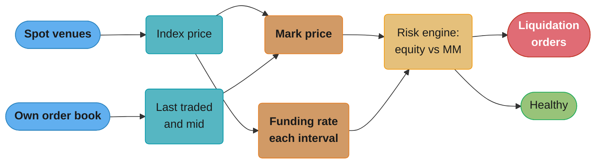
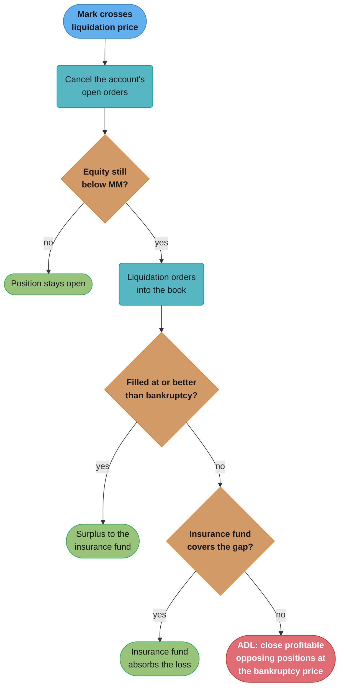
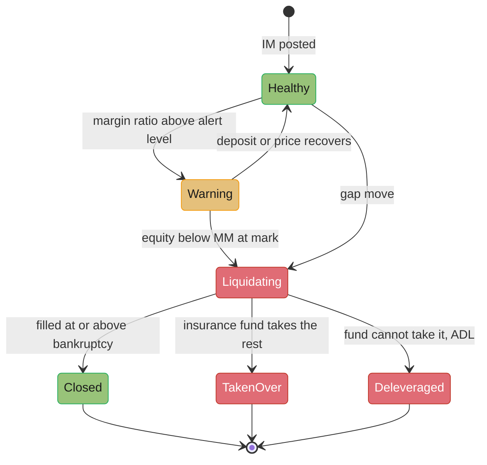

# Margin, Liquidation and Derivatives Risk

> Rules and figures checked 2026-11-06. Every date, threshold and fee on this page comes from the fact pins in fintech/CLAUDE.md, plus Binance's funding FAQ (updated 2026-03-06) and ADL FAQ (updated 2026-01-13), read again on 2026-11-06. Mark price, the funding formula, the funding interval and ADL are venue and contract rules: the Binance and Bybit figures here are dated examples, not general law. Maintenance-margin rates, leverage and prices in the examples are illustrative assumptions.

---

## 1. Concept Overview

A derivatives venue lets a trader hold a position worth far more than the collateral posted. The venue protects itself and the other traders with four mechanisms:

- **Margin.** Initial margin (IM) is the collateral needed to open a position. Maintenance margin (MM) is the minimum needed to keep it. Both are fractions of the position's notional value, set by the venue's model.
- **Marking.** The venue values every position at a **mark price**, a venue-defined fair price that resists manipulation of the last traded price.
- **Liquidation.** When an account's equity at the mark price falls below MM, the venue closes the position, usually by sending orders into the book.
- **The loss waterfall.** If the liquidation cannot close the position at or better than its bankruptcy price (where equity is zero), the loss goes first to an insurance fund, then, on venues that use it, to **auto-deleveraging (ADL)** of profitable opposing positions.

Two contract types matter to engineers. A **dated future** expires on a fixed date and converges to its final settlement price. A **perpetual future** never expires. A periodic **funding payment** between longs and shorts pulls its price toward an index of the underlying spot price.

This page teaches the arithmetic and the engine: margin and liquidation prices, index, mark and last prices, funding, the liquidation engine, the insurance fund, ADL ranking, and the pre-trade margin check. CME lists no perpetual futures, so the perpetual examples cite crypto venues with their dates.

Pre-trade buying-power checks on an exchange's hot path are covered in [Design a Stock Exchange](../../hld/case_studies/design_stock_exchange.md) §4.6, and this page does not repeat them.

---

## 2. Intuition

**One-line analogy.** Margin is a security deposit on a rented car that is worth ten times the deposit. The rental company checks the car's value every second, and when the damage reaches most of the deposit, it takes the car back before the damage exceeds it.

**Mental model.** Track one number per account: equity at mark, compared with MM.

```
 long 1 BTC from 60,000 at 10x, IM 6,000, MM rate 0.5% (illustrative)

 price     54,000     54,271.4                        60,000              66,000
 ----+--------+----------+-------------------------------+--------------------+---->
     |        |          |                               |
     |  bankruptcy   liquidation                       entry
     |  equity = 0   equity = MM = 0.5% of notional    equity = 6,000
     |
     |<-- the venue's problem -->|<----- the trader's buffer ----->|
```

Between entry and the liquidation price the loss is the trader's. Between the liquidation price and the bankruptcy price the venue must close the position, and any part it closes above bankruptcy leaves a surplus. Below bankruptcy, the loss belongs to someone else: the insurance fund first, then the waterfall.

**Why it matters.** A margin engine runs on every mark price update for every open position. Errors in it are not cosmetic. Liquidating on a bad price destroys traders' positions on a wick. Liquidating too late moves losses onto the insurance fund and onto other traders through ADL. A sign error in funding moves money the wrong way between every long and every short on the venue.

**Key insight.** The venue chooses two things the trader cannot: the price at which positions are judged (the mark), and who pays when collateral runs out (the waterfall). Both are published contract rules, and a risk engine must implement the venue's own rule exactly, with deterministic arithmetic.

---

## 3. Core Principles

**Margin is collateral, not a fee.** IM and MM are amounts the account must hold. They come back when the position closes. Fees, funding and realized PnL are separate ledger entries.

**IM gates opening, MM gates keeping.** An order is accepted only if the account can post IM for the resulting position, counting its open orders. A position is liquidated when equity falls below MM. IM is higher than MM, so a new position starts with a buffer.

**Judge positions at the mark price.** Liquidation uses the mark price, not the last traded price. A single trade in a thin book can print far from fair value, and liquidating on it hands the cheap fill to whoever printed it.

**Funding moves between traders.** On a perpetual, longs pay shorts when the funding rate is positive and shorts pay longs when it is negative. Binance states that it takes no fee on funding. The venue's books must show funding net to zero across all positions in each interval.

**Losses follow a fixed order.** The bankrupt account's collateral is used first. Then the insurance fund. Then ADL or another venue-defined step. The order is a published rule and the engine applies it the same way every time.

**Round toward the venue's safety.** When a price or amount must round to a tick or a minor unit, round in the direction that keeps the venue solvent: a long's liquidation price up, a short's down. Never use `double` for prices, margin or PnL.

**Be deterministic.** The same sequence of orders, trades and mark prices must produce the same liquidations on every replay. Mark prices are inputs on the sequenced log, not values read from a clock or a live service during replay.

---

## 4. Types / Architectures / Strategies

### Contract types

| Type | Expiry | What keeps it near spot | PnL currency |
|---|---|---|---|
| Dated future, linear | Fixed date | Convergence to final settlement at expiry | Quote currency, for example USD or a stablecoin |
| Perpetual, linear (USD-margined) | None | Funding payments each interval | Quote currency |
| Perpetual, inverse (coin-margined) | None | Funding payments | The base coin |

For a linear contract, PnL = quantity x (exit - entry). For an inverse contract with a fixed USD face value per contract, PnL in coin = contracts x face x (1/entry - 1/exit). The inverse form makes the margin asset fall in value as a long loses, which is why coin-margined positions liquidate faster in a crash.

### Margin modes

| Mode | Collateral shared across | Liquidation unit | Who uses it |
|---|---|---|---|
| Isolated | Nothing: each position has its own margin | The single position | Traders who want a hard cap on the loss of one position |
| Cross | All positions in the account | The account | Traders who want unused margin to support losing positions |
| Portfolio | All positions, with offsets between hedged ones | The account, by scenario loss | Professional traders with hedged books |

### Margin methodologies

| Method | How IM is set | Example |
|---|---|---|
| Fixed rate by tier | A percentage of notional that rises with position size | Crypto perpetual venues' risk-limit tiers |
| Scenario based | The worst portfolio loss across a grid of price and volatility moves | CME SPAN, and CME SPAN 2 for energy and equity products |
| Portfolio VaR | A loss quantile from historical or simulated scenarios over a close-out period | CCP and broker portfolio margin models |

### Prices

| Price | Source | Used for |
|---|---|---|
| Index | Spot prices from several external venues, combined by the venue's rule | Funding, mark price, final settlement of dated futures |
| Mark | A venue-defined function of index, basis and sometimes last price | Unrealized PnL, margin, liquidation |
| Last traded | The venue's own book | Realized PnL of fills, charts |
| Bankruptcy | Derived per position: where equity is zero | The price at which the insurance fund or ADL takes over |

---

## 5. Architecture Diagrams

### Price flow into the risk engine



The mark is the only price the margin check reads. The last traded price feeds the mark on some venues, but never drives liquidation alone.

### Decision model: the loss waterfall



Each step runs only if the one before it did not close the gap. On Binance, ADL is the last step and runs only when the insurance fund cannot take over the bankrupt position. Other venues define other final steps, so read the contract's rules.

### Position states in the engine



A gap move can skip the warning state. The engine must handle a position that is already below bankruptcy on the first mark it sees.

---

## 6. How It Works - Detailed Mechanics

### 6.1 Liquidation and bankruptcy prices for an isolated linear position

For one isolated linear position of quantity `q`, entry price `E`, leverage `L` (so margin is `qE/L`) and MM rate `m`, ignoring fees:

- Equity at mark price `P` is `qE/L + q(P - E)` for a long and `qE/L + q(E - P)` for a short.
- MM at `P` is `m q P`.
- Bankruptcy (equity zero): long `E(1 - 1/L)`, short `E(1 + 1/L)`.
- Liquidation (equity equals MM): long `E(1 - 1/L) / (1 - m)`, short `E(1 + 1/L) / (1 + m)`.

With `E` = 60,000, `L` = 10 and `m` = 0.5% (illustrative), the long's bankruptcy price is 54,000 and its liquidation price is 54,271.36, which rounds up to 54,271.4 on a 0.1 tick. Real venues add fees, use tiered MM rates that depend on position size, and subtract a maintenance amount per tier, so read the venue's own formula before you compute a number a trader will see.

```java
import java.math.BigDecimal;
import java.math.RoundingMode;

public class LiqPrice {
    record Position(boolean isLong, BigDecimal qty, BigDecimal entry, BigDecimal leverage) {}

    static final BigDecimal MMR = new BigDecimal("0.005");
    static final BigDecimal TICK = new BigDecimal("0.1");

    static BigDecimal bankruptcy(Position p) {
        BigDecimal inv = BigDecimal.ONE.divide(p.leverage(), 12, RoundingMode.HALF_EVEN);
        return p.entry().multiply(p.isLong() ? BigDecimal.ONE.subtract(inv) : BigDecimal.ONE.add(inv));
    }

    // Round toward the venue's safety: up for a long, down for a short.
    static BigDecimal liquidation(Position p) {
        BigDecimal denom = p.isLong() ? BigDecimal.ONE.subtract(MMR) : BigDecimal.ONE.add(MMR);
        BigDecimal raw = bankruptcy(p).divide(denom, 12, RoundingMode.HALF_EVEN);
        RoundingMode mode = p.isLong() ? RoundingMode.CEILING : RoundingMode.FLOOR;
        return raw.divide(TICK, 0, mode).multiply(TICK);
    }

    static BigDecimal equity(Position p, BigDecimal mark) {
        BigDecimal margin = p.qty().multiply(p.entry()).divide(p.leverage(), 12, RoundingMode.HALF_EVEN);
        BigDecimal move = p.isLong() ? mark.subtract(p.entry()) : p.entry().subtract(mark);
        return margin.add(p.qty().multiply(move));
    }

    static boolean belowMaintenance(Position p, BigDecimal mark) {
        return equity(p, mark).compareTo(MMR.multiply(p.qty()).multiply(mark)) < 0;
    }

    public static void main(String[] args) {
        Position lng = new Position(true, BigDecimal.ONE, new BigDecimal("60000"), BigDecimal.TEN);
        Position sht = new Position(false, BigDecimal.ONE, new BigDecimal("60000"), BigDecimal.TEN);
        BigDecimal lLiq = liquidation(lng), sLiq = liquidation(sht);
        assert bankruptcy(lng).compareTo(new BigDecimal("54000")) == 0;
        assert lLiq.compareTo(new BigDecimal("54271.4")) == 0 : lLiq;
        assert sLiq.compareTo(new BigDecimal("65671.6")) == 0 : sLiq;
        // At the published price the position is still at or above MM. One tick worse, it is below.
        assert !belowMaintenance(lng, lLiq) && belowMaintenance(lng, lLiq.subtract(TICK));
        assert !belowMaintenance(sht, sLiq) && belowMaintenance(sht, sLiq.add(TICK));
        System.out.println("long liq " + lLiq + ", short liq " + sLiq + ", long bankruptcy " + bankruptcy(lng));
    }
}
```

The last two assertions are the property worth testing on any venue's formula: at the published liquidation price the position still meets MM, and one tick past it the position is below MM. The trigger fires at the published price, so it never fires late.

### 6.2 Cross margin

In cross mode, all positions share the account's collateral. Equity is the wallet balance plus the unrealized PnL of every position at mark, and MM is the sum of each position's MM. A loss on one position uses margin that another position does not need, which delays liquidation, and when liquidation comes it can close more than the losing position. There is no single liquidation price per position, because it depends on every other mark.

The risk engine therefore evaluates accounts, not positions. The SQL below stores wallets, positions and marks, and lists accounts below MM with their margin ratio. Amounts use `numeric` with an explicit scale. The MM rates are illustrative.

```sql
CREATE TABLE contract (
    symbol   text PRIMARY KEY,
    mm_rate  numeric(10, 6) NOT NULL CHECK (mm_rate > 0 AND mm_rate < 1),
    mark_px  numeric(20, 2) NOT NULL CHECK (mark_px > 0)
);

CREATE TABLE wallet (
    account_id  bigint PRIMARY KEY,
    balance_usd numeric(20, 8) NOT NULL
);

CREATE TABLE perp_position (
    account_id bigint REFERENCES wallet,
    symbol     text REFERENCES contract,
    qty        numeric(20, 6) NOT NULL CHECK (qty <> 0),
    entry_px   numeric(20, 2) NOT NULL CHECK (entry_px > 0),
    PRIMARY KEY (account_id, symbol)
);

INSERT INTO contract VALUES ('BTCUSDT', 0.005, 57000.00), ('ETHUSDT', 0.010, 2400.00);
INSERT INTO wallet VALUES (1, 4000), (2, 9000);
INSERT INTO perp_position VALUES (1, 'BTCUSDT', 1.0, 60000.00), (1, 'ETHUSDT', -5.0, 2500.00),
                                 (2, 'BTCUSDT', 2.0, 59000.00);

CREATE VIEW account_margin AS
SELECT w.account_id,
       w.balance_usd + sum(p.qty * (c.mark_px - p.entry_px)) AS equity,
       sum(abs(p.qty) * c.mark_px * c.mm_rate)              AS maint_margin
  FROM wallet w
  JOIN perp_position p USING (account_id)
  JOIN contract c USING (symbol)
 GROUP BY w.account_id, w.balance_usd;

SELECT account_id, equity, maint_margin, round(maint_margin / equity, 4) AS margin_ratio
  FROM account_margin
 WHERE equity < maint_margin
 ORDER BY maint_margin / equity DESC;
```

Account 1 lost 3,000 on BTC but gained 500 on its ETH short, so its equity is 1,500 against MM of 405. Account 2 lost 4,000 on 2 BTC, so its equity is 5,000 against MM of 570. Neither is below MM, and the query returns no rows. Move the BTC mark to 56,000 and run it again: account 1 still has 500 of equity against MM of 400, so a small further drop liquidates it, and cross mode means its ETH short will be closed too.

### 6.3 Index, mark and last price

The **index** combines spot prices from several external venues under a rule that drops stale or outlying sources. The **mark** is built from the index plus a basis term, so it follows the contract's normal premium to spot but not a single trade.

Bybit's perpetual mark price, as published (updated 2026-09-04), is the median of three values:

- Price 1 = index x [1 + last funding rate x (time to next funding / 8)].
- Price 2 = index + a 2.5-minute moving average of (mid price - index).
- The last traded price.

If an index source is abnormal or data is too thin, Bybit falls back to its last traded price. The median means one bad input among three cannot set the mark. The program below shows a 450-point wick in the last price that does not move the mark. Inputs are illustrative.

```java
import java.math.BigDecimal;
import java.math.RoundingMode;
import java.util.Arrays;

public class MarkPrice {
    static BigDecimal price1(BigDecimal index, BigDecimal lastFunding, BigDecimal hoursToFunding) {
        BigDecimal f = lastFunding.multiply(hoursToFunding).divide(new BigDecimal("8"), 12, RoundingMode.HALF_EVEN);
        return index.multiply(BigDecimal.ONE.add(f));
    }

    static BigDecimal median3(BigDecimal a, BigDecimal b, BigDecimal c) {
        BigDecimal[] v = {a, b, c};
        Arrays.sort(v);
        return v[1];
    }

    public static void main(String[] args) {
        BigDecimal index = new BigDecimal("60000");
        BigDecimal p1 = price1(index, new BigDecimal("0.0001"), new BigDecimal("4"));
        BigDecimal p2 = index.add(new BigDecimal("12"));     // 2.5-minute average basis of +12
        BigDecimal last = new BigDecimal("60450");           // a wick in a thin book
        BigDecimal mark = median3(p1, p2, last);
        assert p1.compareTo(new BigDecimal("60003")) == 0 : p1;
        assert mark.compareTo(new BigDecimal("60012")) == 0 : mark;
        System.out.println("price1 " + p1.stripTrailingZeros().toPlainString()
            + ", price2 " + p2 + ", last " + last + ", mark " + mark);
    }
}
```

### 6.4 Funding

A perpetual has no expiry, so nothing forces its price to meet spot. Funding does: when the contract trades above the index, the rate is positive and longs pay shorts, which makes holding a long more expensive and pulls the price down. The reverse applies below the index.

Binance's USD-margined funding, as published (FAQ updated 2026-03-06), is a dated example of one venue's rule:

| Item | Binance rule |
|---|---|
| Default interval | Every 8 hours, at 00:00, 08:00 and 16:00 UTC |
| Rate | F = [P + clamp(I - P, -0.05%, +0.05%)] / (8 / N), where P is the average premium index, I the interest rate and N the interval in hours |
| Interest rate | 0.01% per 8 hours by default |
| Cap and floor | Plus or minus 0.75 x the maintenance margin ratio for major contracts, plus or minus 2% for others |
| Interval switch | A contract whose previous settlement hit the cap or floor moves to 1-hour settlement (from 2025-05-02) |
| Revert | An hourly contract reverts to 4 hours after 16 consecutive cycles at an absolute rate of 0.025% or less (from 2026-01-02) |
| Payment | Funding amount = nominal value x F, where nominal value = mark price x size. Binance takes no fee on funding |

When the premium is within 0.05% of the interest rate, the clamp makes F equal to the interest rate. The program computes three cases and checks that payments net to zero across longs and shorts.

```java
import java.math.BigDecimal;
import java.math.RoundingMode;
import java.util.List;

public class Funding {
    static final BigDecimal DAMPER = new BigDecimal("0.0005");
    static final BigDecimal INTEREST = new BigDecimal("0.0001");

    static BigDecimal clamp(BigDecimal x, BigDecimal lo, BigDecimal hi) {
        return x.max(lo).min(hi);
    }

    static BigDecimal rate(BigDecimal premium, int intervalHours, BigDecimal cap) {
        BigDecimal f = premium.add(clamp(INTEREST.subtract(premium), DAMPER.negate(), DAMPER));
        f = f.multiply(BigDecimal.valueOf(intervalHours)).divide(new BigDecimal("8"), 12, RoundingMode.HALF_EVEN);
        return clamp(f, cap.negate(), cap);
    }

    record Pos(String account, BigDecimal size) {}  // positive long, negative short

    // Positive result: the account pays. Negative: it receives.
    static BigDecimal payment(Pos p, BigDecimal mark, BigDecimal f) {
        return p.size().multiply(mark).multiply(f);
    }

    public static void main(String[] args) {
        BigDecimal cap = new BigDecimal("0.02");
        BigDecimal calm = rate(new BigDecimal("0.0003"), 8, cap);
        BigDecimal hot = rate(new BigDecimal("0.0020"), 8, cap);
        BigDecimal hotHourly = rate(new BigDecimal("0.0020"), 1, cap);
        assert calm.compareTo(new BigDecimal("0.0001")) == 0 : calm;
        assert hot.compareTo(new BigDecimal("0.0015")) == 0 : hot;
        assert hotHourly.compareTo(new BigDecimal("0.0001875")) == 0 : hotHourly;

        BigDecimal mark = new BigDecimal("60000");
        List<Pos> book = List.of(new Pos("A", new BigDecimal("2")), new Pos("B", new BigDecimal("1")),
                                 new Pos("C", new BigDecimal("-3")));
        BigDecimal net = BigDecimal.ZERO;
        for (Pos p : book) {
            BigDecimal pay = payment(p, mark, hot);
            net = net.add(pay);
            String verb = pay.signum() >= 0 ? " pays " : " receives ";
            System.out.println(p.account() + verb + pay.abs().stripTrailingZeros().toPlainString());
        }
        assert net.signum() == 0 : net;
    }
}
```

At a rate of 0.15%, A pays 180, B pays 90 and C receives 270. In production the per-position amounts round to the settlement asset's precision, and the sum of rounded amounts can miss zero by a unit. Decide in advance which account absorbs that residual, and post it explicitly, so the ledger still balances.

### 6.5 The liquidation engine

The engine re-evaluates every account on every mark update. A simple design:

1. Keep accounts in a structure ordered by distance to liquidation, for example by liquidation price per contract for isolated positions, or by margin ratio for cross accounts, so each mark update touches only the accounts that crossed.
2. For each account that crossed, cancel its open orders first. Open orders hold IM, and cancelling them can restore the account above MM without any trade.
3. If still below MM, reduce the position: some venues step down one risk-limit tier at a time, others close it in full.
4. Send liquidation orders into the book, priced no worse than the bankruptcy price.
5. Book the outcome against the insurance fund: a fill better than bankruptcy leaves a surplus, and a fill worse leaves a loss.

On Binance, the insurance fund absorbs losses and keeps profits of bankrupt positions it takes over. The program below books both cases for a long of 1 BTC with a bankruptcy price of 54,000, and checks that the trader's equity is zero in both: everything past bankruptcy belongs to the fund.

```java
import java.math.BigDecimal;

public class LiquidationOutcome {
    record Outcome(BigDecimal traderEquity, BigDecimal fundDelta) {}

    // Long position: at the bankruptcy price the trader's equity is exactly zero.
    static Outcome closeLong(BigDecimal qty, BigDecimal bankruptcy, BigDecimal fill) {
        return new Outcome(BigDecimal.ZERO, qty.multiply(fill.subtract(bankruptcy)));
    }

    public static void main(String[] args) {
        BigDecimal qty = BigDecimal.ONE, bk = new BigDecimal("54000");
        BigDecimal fund = new BigDecimal("150");

        Outcome good = closeLong(qty, bk, new BigDecimal("54150"));
        fund = fund.add(good.fundDelta());
        assert fund.compareTo(new BigDecimal("300")) == 0;

        Outcome bad = closeLong(qty, bk, new BigDecimal("53600"));
        BigDecimal covered = bad.fundDelta().negate().min(fund);
        BigDecimal shortfall = bad.fundDelta().negate().subtract(covered);
        fund = fund.subtract(covered);
        assert covered.compareTo(new BigDecimal("300")) == 0;
        assert shortfall.compareTo(new BigDecimal("100")) == 0 : shortfall;
        System.out.println("fund after " + fund + ", shortfall to the next step " + shortfall);
    }
}
```

The second fill leaves a 400 loss. The fund holds 300, so 100 goes to the next step of the waterfall. On Binance that step is ADL.

### 6.6 ADL ranking

When the insurance fund cannot take over a bankrupt position, Binance runs ADL: it closes opposing positions in the order of a published ranking, at the bankrupt position's bankruptcy price, and charges the closed traders no fee. The ranking (ADL FAQ updated 2026-01-13):

- PnL percentage = unrealized profit / |position notional|.
- Effective leverage = |position notional| / (account balance + unrealized profit).
- If PnL% is 0 or more, rank = PnL% x effective leverage. If PnL% is negative, rank = PnL% / effective leverage.

The most profitable and most leveraged opposing positions are closed first. The program ranks three shorts against a bankrupt long and fills 3 BTC from the top of the queue. Inputs are illustrative.

```java
import java.math.BigDecimal;
import java.math.RoundingMode;
import java.util.ArrayList;
import java.util.Comparator;
import java.util.List;

public class AdlQueue {
    record Short(String account, BigDecimal qty, BigDecimal notional, BigDecimal upnl, BigDecimal balance) {
        BigDecimal pnlPct() { return upnl.divide(notional.abs(), 12, RoundingMode.HALF_EVEN); }
        BigDecimal effLev() { return notional.abs().divide(balance.add(upnl), 12, RoundingMode.HALF_EVEN); }
        BigDecimal rank() {
            return pnlPct().signum() >= 0 ? pnlPct().multiply(effLev())
                                          : pnlPct().divide(effLev(), 12, RoundingMode.HALF_EVEN);
        }
    }

    public static void main(String[] args) {
        List<Short> shorts = new ArrayList<>(List.of(
            new Short("S1", new BigDecimal("2"), new BigDecimal("110000"), new BigDecimal("10000"), new BigDecimal("12000")),
            new Short("S2", new BigDecimal("4"), new BigDecimal("220000"), new BigDecimal("6000"), new BigDecimal("50000")),
            new Short("S3", new BigDecimal("1"), new BigDecimal("55000"), new BigDecimal("-500"), new BigDecimal("3000"))));
        shorts.sort(Comparator.comparing(Short::rank).reversed());
        assert shorts.get(0).account().equals("S1") && shorts.get(2).account().equals("S3");

        BigDecimal need = new BigDecimal("3");
        for (Short s : shorts) {
            if (need.signum() == 0) break;
            BigDecimal take = need.min(s.qty());
            need = need.subtract(take);
            System.out.println(s.account() + " rank " + s.rank().setScale(4, RoundingMode.HALF_EVEN)
                + ", deleveraged " + take);
        }
        assert need.signum() == 0;
    }
}
```

S1 has a 9.1% profit at 5x effective leverage and is closed first. S2 has a smaller profit at lower leverage. S3 is losing and sits at the back. A venue shows each trader an indicator of their queue position, and the engine must compute exactly the same rank that indicator shows.

### 6.7 Pre-trade margin check

An order is accepted only if the account can post IM for the position it could result in. Three details decide whether the check is safe:

1. **Count open orders.** Each resting order holds IM. Without that, a trader can place many orders that each pass alone and together exceed the account.
2. **Use the worse side.** For an account with both buy and sell orders resting, the IM requirement is usually computed for the side that would increase the position more.
3. **Price the order at the worse of its limit price and the mark.** A buy limit far above the mark fills at a worse price than the mark suggests.

The check runs on the order-entry hot path before sequencing, against in-memory account state. That placement and its latency budget are the subject of [Design a Stock Exchange](../../hld/case_studies/design_stock_exchange.md) §4.6 and [Exchange Architecture and Determinism](../exchange_architecture_and_determinism/exchange_architecture_and_determinism.md).

### 6.8 Real-time position and PnL

Each fill updates the position:

- Increasing a position: the new average entry is the quantity-weighted mean of the old entry and the fill price.
- Reducing a position: the entry does not change, and the reduced quantity realizes PnL at (fill - entry) for a long or (entry - fill) for a short.
- Crossing through zero: split the fill into a reduce to zero and a new open at the fill price.

Unrealized PnL changes with every mark update, realized PnL only with fills, and funding only at each interval. Keep the three as separate ledger entries so a trader's statement and the venue's books reconcile. The ledger model that holds them is in [Double-Entry Ledger Design](../double_entry_ledger_design/double_entry_ledger_design.md).

### 6.9 Portfolio margin

Portfolio margin sets IM from the worst loss of the whole portfolio across a scenario grid, so a hedged book needs less than the sum of its parts. The program below margins a long position in one contract and a short in a correlated one under five joint scenarios. Values are in cents and the scenarios are illustrative.

```java
public class PortfolioMargin {
    record Scenario(long moveACents, long moveBCents) {}

    public static void main(String[] args) {
        long qtyA = 10, qtyB = -8;
        Scenario[] grid = {
            new Scenario(-50_000, -45_000), new Scenario(-25_000, -20_000), new Scenario(0, 0),
            new Scenario(25_000, 22_000), new Scenario(50_000, 46_000)};

        long worstPortfolio = 0, worstA = 0, worstB = 0;
        for (Scenario s : grid) {
            long pnlA = qtyA * s.moveACents(), pnlB = qtyB * s.moveBCents();
            worstPortfolio = Math.min(worstPortfolio, pnlA + pnlB);
            worstA = Math.min(worstA, pnlA);
            worstB = Math.min(worstB, pnlB);
        }
        long standalone = -(worstA + worstB), portfolio = -worstPortfolio;
        assert portfolio == 140_000 && standalone == 868_000 : portfolio + " " + standalone;
        System.out.println("portfolio IM " + portfolio + " cents, sum of standalone IM " + standalone + " cents");
    }
}
```

The hedge cuts IM by more than 80% in this grid. The risk is in the grid: if the two contracts stop moving together, the portfolio loses far more than the grid allowed. Real models add scenarios where the correlation breaks. CME margins energy and equity products under SPAN 2, a scenario-based model of this family, and keeps other products on SPAN with offsets between the two models.

---

## 7. Real-World Examples

**Binance funding.** Binance's USD-margined perpetuals settle funding every 8 hours by default at 00:00, 08:00 and 16:00 UTC. Since 2025-05-02, a contract whose previous settlement hit the cap or floor moves to hourly settlement, and since 2026-01-02 an hourly contract reverts to 4 hours after 16 consecutive cycles at an absolute rate of 0.025% or less. A risk engine that hard-codes "every 8 hours" breaks the first time a contract switches.

**Bybit mark price.** Bybit's perpetual mark is the median of an index-plus-funding-basis price, an index-plus-moving-average-basis price, and the last traded price, with a fallback to the last traded price when index data is abnormal or thin (updated 2026-09-04). The median is the design point: one manipulated input cannot move the mark.

**Binance ADL.** Binance runs ADL only when its insurance funds cannot take over a bankrupt position, and notes that coin-margined contracts are more exposed because they share smaller insurance funds. Positions are ranked by PnL% and effective leverage and closed at the bankrupt position's bankruptcy price with no fee.

**CME SPAN 2.** CME margins energy and equity products under SPAN 2, with the equity migration complete by January 2025. CME lists no perpetual futures, so its margin examples apply to dated futures and options, not to funding.

---

## 8. Tradeoffs

### Decision model: isolated vs cross vs portfolio margin

| Factor | Isolated | Cross | Portfolio |
|---|---|---|---|
| Collateral | Per position | Shared by all positions | Shared, with offsets for hedges |
| Maximum loss of one position | Its own margin | The whole account | The whole account |
| Liquidation price | One per position, fixed until margin changes | Depends on every position's mark | Depends on the scenario grid |
| Capital use | Highest per unit of risk | Lower | Lowest for hedged books |
| Engine cost | Per-position trigger price, cheap index by price | Per-account evaluation on any mark change | Scenario evaluation per account, the heaviest |
| Model risk | Low | Low | High: correlation assumptions can fail |
| Choose when | A trader wants a hard cap per position, or the venue serves retail | A trader runs several directional positions and accepts account-level liquidation | Professional accounts with hedged books and a venue able to run and govern the model |

### Decision model: the loss waterfall

| Step | Pays | Trigger | Engine requirement |
|---|---|---|---|
| Cancel open orders | Nobody: frees the account's own IM | Equity below MM | Atomic with the margin re-check |
| Liquidation in the book | The trader, down to zero equity | Still below MM | Orders priced no worse than bankruptcy |
| Surplus | The insurance fund receives it | Fill better than bankruptcy | Book the difference to the fund |
| Insurance fund | The fund absorbs the gap | Fill worse than bankruptcy, or no fill | Fund balance per settlement asset, read on the hot path |
| ADL | Profitable opposing traders, closed at the bankruptcy price | The fund cannot take over | Ranked queue per contract and side, maintained continuously |

Venues differ in the last step. Some spread a loss across all profitable traders (socialized loss) instead of closing specific positions. The engineering rule is the same: implement the venue's published order and make every step deterministic and auditable.

### Mark price design

| Design | Resists a wick | Follows real moves | Risk |
|---|---|---|---|
| Last traded price | No | Yes | Liquidation cascades on thin books |
| Index only | Yes | Lags the contract's basis | Mismarks when the perpetual trades at a premium |
| Median of index-based and last-based prices | Yes, one bad input cannot set it | Yes | Depends on index quality and the fallback rule |

---

## 9. When to Use / When NOT to Use

**Use isolated margin when:**
- The trader wants the loss of one position capped at its margin.
- The venue serves retail traders who do not expect one position to close another.

**Use cross margin when:**
- The trader runs several positions and wants spare collateral to support any of them.

**Use portfolio margin when:**
- Books are hedged, the venue can govern a scenario model, and accounts are professional.

**Do not:**
- Liquidate on the last traded price.
- Hard-code a funding interval or a cap that the venue's rules can change per contract.
- Compute margin, PnL or funding in floating point.
- Let the liquidation engine read a live mark price service during replay.

---

## 10. Common Pitfalls

### Liquidation price rounded toward the trader

A venue computed liquidation prices correctly and then rounded them to the tick with `HALF_EVEN`. For a 20x long from 60,000 with a 0.5% MM rate (illustrative), the exact price is 57,286.43, which rounded down to 57,286.4. A mark of 57,286.42 left the position below MM, but above its published liquidation price, so the engine did not act. On a fast move these positions went past bankruptcy before the next trigger, and the insurance fund paid the difference.

```java
import java.math.BigDecimal;
import java.math.RoundingMode;

public class LiqRoundBroken {
    public static void main(String[] args) {
        BigDecimal entry = new BigDecimal("60000"), mmr = new BigDecimal("0.005");
        BigDecimal bankruptcy = entry.multiply(new BigDecimal("0.95"));  // 20x long
        BigDecimal raw = bankruptcy.divide(BigDecimal.ONE.subtract(mmr), 12, RoundingMode.HALF_EVEN);
        // BROKEN: nearest-tick rounding can move a long's trigger below the true MM crossing.
        BigDecimal liq = raw.setScale(1, RoundingMode.HALF_EVEN);
        BigDecimal mark = new BigDecimal("57286.42");
        BigDecimal equity = new BigDecimal("3000").add(mark.subtract(entry));
        BigDecimal mm = mmr.multiply(mark);
        System.out.println("liq " + liq + ", equity " + equity + ", mm " + mm
            + ", triggered " + (mark.compareTo(liq) <= 0));  // prints liq 57286.4, equity 286.42, mm 286.43210, triggered false
    }
}
```

The fix rounds a long's trigger up and a short's down, and tests that one tick past the published price is below MM.

```java
import java.math.BigDecimal;
import java.math.RoundingMode;

public class LiqRoundFixed {
    public static void main(String[] args) {
        BigDecimal entry = new BigDecimal("60000"), mmr = new BigDecimal("0.005");
        BigDecimal bankruptcy = entry.multiply(new BigDecimal("0.95"));
        BigDecimal raw = bankruptcy.divide(BigDecimal.ONE.subtract(mmr), 12, RoundingMode.HALF_EVEN);
        BigDecimal liq = raw.setScale(1, RoundingMode.CEILING);
        BigDecimal mark = new BigDecimal("57286.42");
        BigDecimal equity = new BigDecimal("3000").add(mark.subtract(entry));
        assert equity.compareTo(mmr.multiply(mark)) < 0;
        assert mark.compareTo(liq) <= 0 : liq;
        System.out.println("liq " + liq + ", triggered " + (mark.compareTo(liq) <= 0));
    }
}
```

### Funding with the sign reversed

A new venue booked funding as "the account receives size x mark x rate". With a positive rate, longs received and shorts paid, the opposite of the contract's rule, so funding pushed the price further from the index instead of toward it. The books still balanced, because every payment had a matching receipt, so no reconciliation caught it. Fix: a test per contract that a positive rate debits longs, plus a market-level monitor that the premium shrinks after each funding.

### Open orders not counted in the margin check

The pre-trade check compared each new order's IM with the account's free margin, without subtracting IM held by resting orders. A trader placed 20 orders that each passed. When they all filled in a fast market, the account opened far beyond its collateral and was bankrupt at the next mark. Fix: hold IM for every resting order and release it on cancel or fill.

### A floating mark on replay

The engine read the mark price from a live service when it evaluated each account. In the disaster-recovery replay, the service returned the marks of the replay time, not of the original events, and the replay liquidated a different set of accounts. Fix: publish each mark price as an event on the sequenced log, and have the engine read only the log.

---

## 11. Technologies & Tools

| Tool | What it does | Notes |
|---|---|---|
| SPAN 2 | CME's scenario-based margin methodology | Energy and equity products |
| CME CORE | CME's margin calculator for clearing firms and clients | Estimates SPAN and SPAN 2 requirements |
| LMAX Disruptor | Ring-buffer messaging for a single-threaded risk engine | One writer per partition of accounts |
| Aeron Cluster | Raft-replicated state machine on Aeron | For a deterministic, replicated risk engine |
| TigerBeetle | Double-entry accounting database | Holds balances, funding and liquidation transfers |
| PostgreSQL | Relational database | Reference data, end-of-day positions, audit |

---

## 12. Interview Questions with Answers

**Q: Why does a venue liquidate on the mark price and not on the last traded price?**
**Short:** One trade in a thin book can print far from fair value, and liquidating on it closes healthy positions and hands cheap fills to whoever printed the trade.
The mark is a venue-defined fair price built mostly from an index of external spot venues plus a basis term. Bybit, for example, takes the median of two index-based prices and the last price, so one bad input cannot set it. Unrealized PnL, margin and liquidation all read the mark. The last price is used only for fills.

**Q: Who receives the funding payment on a perpetual future?**
**Short:** The other side of the market: when the rate is positive longs pay shorts, and when it is negative shorts pay longs, so funding moves between traders, not to the venue.
Binance states that it takes no fee on funding and that payments move directly between opposing positions. Funding nets to zero across all positions in each interval, apart from rounding residuals that the venue must post explicitly. A ledger check that funding sums to zero catches booking errors but not a reversed sign.

**Q: Is auto-deleveraging the same as liquidation?**
**Short:** No, ADL is the venue-defined final step of the liquidation process, run only when the insurance fund cannot take over a bankrupt position, and it closes profitable opposing traders.
Liquidation closes the account that fell below maintenance margin. ADL closes other traders, who did nothing wrong, at the bankrupt position's bankruptcy price. Binance calls this forced close "ADL liquidation", charges no fee for it, and shows each trader a queue indicator so they know their exposure.

**Q: What is the difference between initial margin and maintenance margin?**
**Short:** Initial margin is the collateral needed to open or increase a position, and maintenance margin is the lower minimum needed to keep it open before liquidation starts.
The gap between them is the trader's buffer at entry. Both scale with notional, and on most venues the rates rise with position size through risk-limit tiers. Pre-trade checks use IM, including resting orders, and the liquidation engine uses MM at the mark price.

**Q: How do you compute the liquidation price of an isolated linear long?**
**Short:** Solve equity equals maintenance margin at the mark, which without fees gives entry x (1 - 1/leverage) / (1 - MM rate), rounded up to the tick.
Equity is margin plus quantity x (mark - entry), and MM is the MM rate x quantity x mark. With entry 60,000, 10x and 0.5%, that is 54,271.36, published as 54,271.4. Venues add fees, tiered rates and maintenance amounts, so implement the venue's own formula, and test that one tick past the published price is below MM.

**Q: What is the bankruptcy price and why is it different from the liquidation price?**
**Short:** The bankruptcy price is where the position's equity reaches zero, while the liquidation price is earlier, where equity reaches maintenance margin, leaving room to close the position.
For a 10x long from 60,000 the bankruptcy price is 54,000. Liquidation starts above it, at about 54,271. If the engine closes the position between the two, the surplus goes to the insurance fund. Below bankruptcy, the loss goes to the fund and then to the next step of the waterfall.

**Q: How do isolated and cross margin differ in what a trader can lose?**
**Short:** In isolated mode a position can lose only its own margin, while in cross mode every position draws on the whole account, so one losing position can liquidate the rest.
Cross mode uses capital better, because spare margin supports any position, and it delays liquidation. It also means there is no fixed liquidation price per position. The engine evaluates the account, and when it acts it may close positions that were not losing.

**Q: What does the insurance fund do in a liquidation?**
**Short:** It takes the surplus when a liquidation fills better than the bankruptcy price and pays the gap when a fill is worse, so traders do not have to.
On Binance it absorbs losses and keeps profits of bankrupt positions it takes over. The fund is held per settlement asset. When it cannot cover a gap, the next step runs, which on Binance is ADL. A shrinking fund is an early warning that liquidation is acting too late.

**Q: How is Binance's USD-margined funding rate computed, as of the pin date?**
**Short:** F = [average premium index + clamp(interest - premium, -0.05%, +0.05%)] / (8 / interval hours), with interest 0.01% per 8 hours and a cap per contract.
The cap and floor are plus or minus 0.75 x the maintenance margin ratio for major contracts and plus or minus 2% for others. Within 0.05% of the interest rate, the clamp makes the rate equal to the interest rate. The payment is mark price x size x rate. This is Binance's rule from its FAQ updated 2026-03-06, not a general formula.

**Q: Is the funding interval fixed at 8 hours?**
**Short:** No, it is a venue and contract rule: Binance defaults to 8 hours, moves a contract that hits its cap or floor to 1 hour, and reverts it to 4 hours after 16 calm cycles.
The 1-hour switch has applied since 2025-05-02 and the revert rule since 2026-01-02. A risk engine reads the interval per contract from reference data and recomputes the next funding time after each settlement, because it can change between intervals.

**Q: How does Binance rank positions for ADL?**
**Short:** By PnL percentage times effective leverage for profitable positions, and PnL percentage divided by effective leverage for losing ones, closing the highest rank first.
PnL% is unrealized profit over absolute notional. Effective leverage is absolute notional over account balance plus unrealized profit. The most profitable, most leveraged positions are closed first, at the bankrupt position's bankruptcy price. The engine must compute exactly the rank behind each trader's queue indicator.

**Q: Why does a perpetual future need funding when a dated future does not?**
**Short:** A dated future converges to its final settlement price at expiry, but a perpetual never expires, so a periodic payment is what pulls its price toward the index.
When the perpetual trades above the index, a positive rate makes longs pay shorts, which makes long positions more expensive to hold and pushes the price down. The size of the pull depends on the venue's formula, damper, cap and interval.

**Q: How is Bybit's perpetual mark price built?**
**Short:** It is the median of index-plus-funding-basis, index-plus-2.5-minute-average-basis, and the last traded price, falling back to the last price if index data is abnormal or thin.
Price 1 is index x [1 + last funding rate x (time to funding / 8)]. Price 2 adds a 2.5-minute moving average of mid minus index. The median means a spike in any one of the three does not move the mark, as of Bybit's article updated 2026-09-04.

**Q: How does portfolio margin differ from per-position margin, and what is its risk?**
**Short:** Portfolio margin sets IM from the worst whole-portfolio loss across scenarios, so hedges offset, but if the assumed correlations fail, the margin is too small.
In a scenario grid, a long and a correlated short lose little together, so IM can fall by most of the per-position total. CME uses scenario-based SPAN 2 for energy and equity products. Governance of the scenarios, including ones where correlations break, is the main cost.

**Q: Why must a pre-trade margin check count open orders?**
**Short:** Each resting order can fill, so without holding IM for it a trader can stack orders that each pass alone and together exceed the account's collateral.
Hold IM for every resting order at the worse of its limit price and the mark, release it on cancel or fill, and evaluate the side that would increase the position more. The check runs before sequencing, against in-memory state.

**Q: In which direction should a liquidation price be rounded to the tick?**
**Short:** Toward the venue's safety: up for a long and down for a short, so the published trigger is never past the true point where equity falls below maintenance margin.
Nearest-tick rounding can move a long's trigger below the real crossing, leaving a position under MM but not liquidated. On a fast move that position can pass bankruptcy before the next trigger, and the insurance fund pays. Test the property that one tick past the published price is below MM.

**Q: How does an inverse contract's PnL differ from a linear one?**
**Short:** A linear contract pays quantity x price change in the quote currency, while an inverse contract pays contracts x face x (1/entry - 1/exit) in the base coin.
In an inverse contract the collateral is the coin itself, so a long loses on the position and on the value of its margin at once, and liquidates sooner in a crash. Binance notes that coin-margined contracts are more exposed to ADL because they share smaller insurance funds.

**Q: Why does the liquidation engine cancel the account's open orders first?**
**Short:** Resting orders hold initial margin, and releasing it can bring the account back above maintenance margin without any trade, which avoids a needless liquidation.
Cancelling first also removes orders that could fill during the liquidation and change the position the engine is trying to close. The cancel and the margin re-check must be one atomic step in the engine's single-threaded state.

**Q: How do socialized loss and ADL differ?**
**Short:** ADL closes specific profitable opposing positions in ranked order, while socialized loss spreads a shortfall across all profitable traders as a reduction of their gains.
Both are final steps after the insurance fund, and each venue chooses its own. ADL hits a few traders fully. Socialized loss hits many traders partly. Either way, the engine's job is to apply the published rule deterministically and record each trader's share.

**Q: Can you use CME as an example of perpetual funding?**
**Short:** No, CME lists no perpetual futures, so funding and perpetual mark-price examples come from crypto venues such as Binance and Bybit, cited with their dates.
CME's Q2 2026 earnings script said it had specifications ready but had not heard client demand. CME is a good example for dated-futures margin, where it uses SPAN and SPAN 2.

**Q: Why does the ADL ranking use unrealized PnL in effective leverage?**
**Short:** Unrealized profit adds to the account's equity, so effective leverage measures exposure against what the trader would have if they closed now, not against deposits alone.
A trader with a large paper profit has more equity behind the position and lower effective leverage than the deposit suggests. Including it ranks traders by how much risk they carry against their current equity.

**Q: How do you make a liquidation engine replay deterministically?**
**Short:** Feed it only sequenced events, including each mark price and funding rate as an event, use exact decimal arithmetic, and never read a clock or live service in the decision path.
Replay of the same log must produce the same liquidations, ADL fills and insurance-fund entries. Marks read from a live service during replay give the replay-time values and a different outcome. The replicated state-machine pattern behind this is in [Exchange Architecture and Determinism](../exchange_architecture_and_determinism/exchange_architecture_and_determinism.md).

---

## 13. Best Practices

- Read mark prices, funding rates and intervals per contract from reference data, with the venue's effective dates.
- Liquidate on the mark price only, and publish each mark as an event on the sequenced log.
- Round every trigger toward the venue's safety, and test that one tick past it is below MM.
- Hold IM for resting orders, and price the check at the worse of the limit and the mark.
- Cancel open orders and re-check margin as one atomic step before any liquidation trade.
- Book realized PnL, unrealized PnL, funding, fees and insurance-fund movements as separate ledger entries.
- Check that funding nets to zero each interval and that a positive rate debits longs.
- Maintain the ADL queue continuously, and show each trader the same rank the engine uses.
- Use `BigDecimal` with explicit scales and rounding modes, or integers in minor units, everywhere.
- Alert on a falling insurance fund and on any ADL event.

---

## 14. Case Study

**Scenario.** A crypto derivatives venue lists a mid-cap perpetual with a thin book. Its engine liquidates on the last traded price. One afternoon a single 1,800-unit market sell walks the book down 8% for two seconds before market makers refill it. In those two seconds the engine liquidates 1,200 long positions (illustrative). Their liquidation sells push the last price down further, triggering the next band. The index on external spot venues barely moves. Traders post screenshots of a chart where the price never reached their liquidation level on any other venue.

The engine's trigger, reduced to its core:

```java
import java.math.BigDecimal;
import java.util.List;

public class WickBroken {
    record Pos(String account, BigDecimal liqPrice) {}

    // BROKEN: the trigger reads the last traded price, so a two-second wick liquidates healthy longs.
    static long liquidated(List<Pos> longs, BigDecimal lastTrade) {
        return longs.stream().filter(p -> lastTrade.compareTo(p.liqPrice()) <= 0).count();
    }

    public static void main(String[] args) {
        List<Pos> longs = List.of(new Pos("a", new BigDecimal("93.5")), new Pos("b", new BigDecimal("94.0")),
                                  new Pos("c", new BigDecimal("95.2")), new Pos("d", new BigDecimal("97.1")));
        BigDecimal wick = new BigDecimal("92.0");  // 8% below a fair price of 100
        System.out.println("liquidated " + liquidated(longs, wick) + " of " + longs.size());  // prints liquidated 4 of 4
    }
}
```

**Fix.** The venue moves the trigger to a mark price built as the median of an index-plus-funding-basis price, an index-plus-moving-average-basis price, and the last traded price, the same shape Bybit publishes. The moving average spans minutes, so a two-second wick barely moves it. The index comes from several external spot venues and drops stale sources.

```java
import java.math.BigDecimal;
import java.math.RoundingMode;
import java.util.Arrays;
import java.util.List;

public class WickFixed {
    record Pos(String account, BigDecimal liqPrice) {}

    static BigDecimal mark(BigDecimal index, BigDecimal lastFunding, BigDecimal hoursToFunding,
                           BigDecimal avgBasis, BigDecimal last) {
        BigDecimal p1 = index.multiply(BigDecimal.ONE.add(
            lastFunding.multiply(hoursToFunding).divide(new BigDecimal("8"), 12, RoundingMode.HALF_EVEN)));
        BigDecimal p2 = index.add(avgBasis);
        BigDecimal[] v = {p1, p2, last};
        Arrays.sort(v);
        return v[1];
    }

    static long liquidated(List<Pos> longs, BigDecimal markPrice) {
        return longs.stream().filter(p -> markPrice.compareTo(p.liqPrice()) <= 0).count();
    }

    public static void main(String[] args) {
        List<Pos> longs = List.of(new Pos("a", new BigDecimal("93.5")), new Pos("b", new BigDecimal("94.0")),
                                  new Pos("c", new BigDecimal("95.2")), new Pos("d", new BigDecimal("97.1")));
        BigDecimal m = mark(new BigDecimal("99.8"), new BigDecimal("0.0001"), new BigDecimal("3"),
                            new BigDecimal("0.15"), new BigDecimal("92.0"));
        assert m.compareTo(new BigDecimal("99.8")) > 0 && m.compareTo(new BigDecimal("100")) < 0 : m;
        assert liquidated(longs, m) == 0;
        System.out.println("mark " + m.setScale(4, RoundingMode.HALF_EVEN) + ", liquidated " + liquidated(longs, m));
    }
}
```

**Other changes the venue made.**

| Change | Why |
|---|---|
| Marks published as events on the sequenced log | Replays and audits see the same mark the engine used |
| Liquidation orders priced no worse than bankruptcy, in slices | A liquidation cannot walk a thin book in one order |
| Lower position limits (risk-limit tiers) on thin contracts | Fewer large positions to close in a thin book |
| An insurance-fund monitor per contract | A falling fund shows liquidation running too late |
| A queue indicator per trader for ADL | Traders see their exposure before an event |

**Result (illustrative).** The next wick of the same size printed in the book and liquidated no positions, because the mark stayed near 99.8, about 0.2% below the pre-wick price of 100. The full engine, with funding each interval, the insurance fund and ADL beside the sequencer, is the subject of [Design a Perpetual Futures Risk Engine](../case_studies/design_a_perpetual_futures_risk_engine.md), and the matching side is in [Order Books and Matching Engines](../order_books_and_matching_engines/order_books_and_matching_engines.md).
