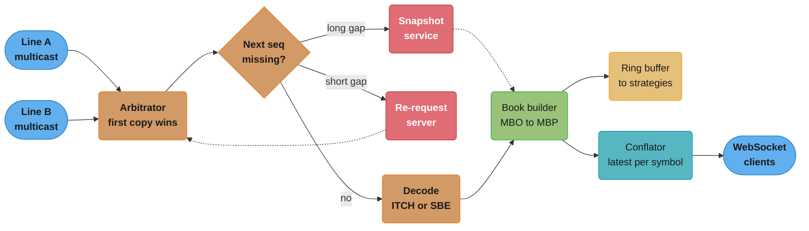
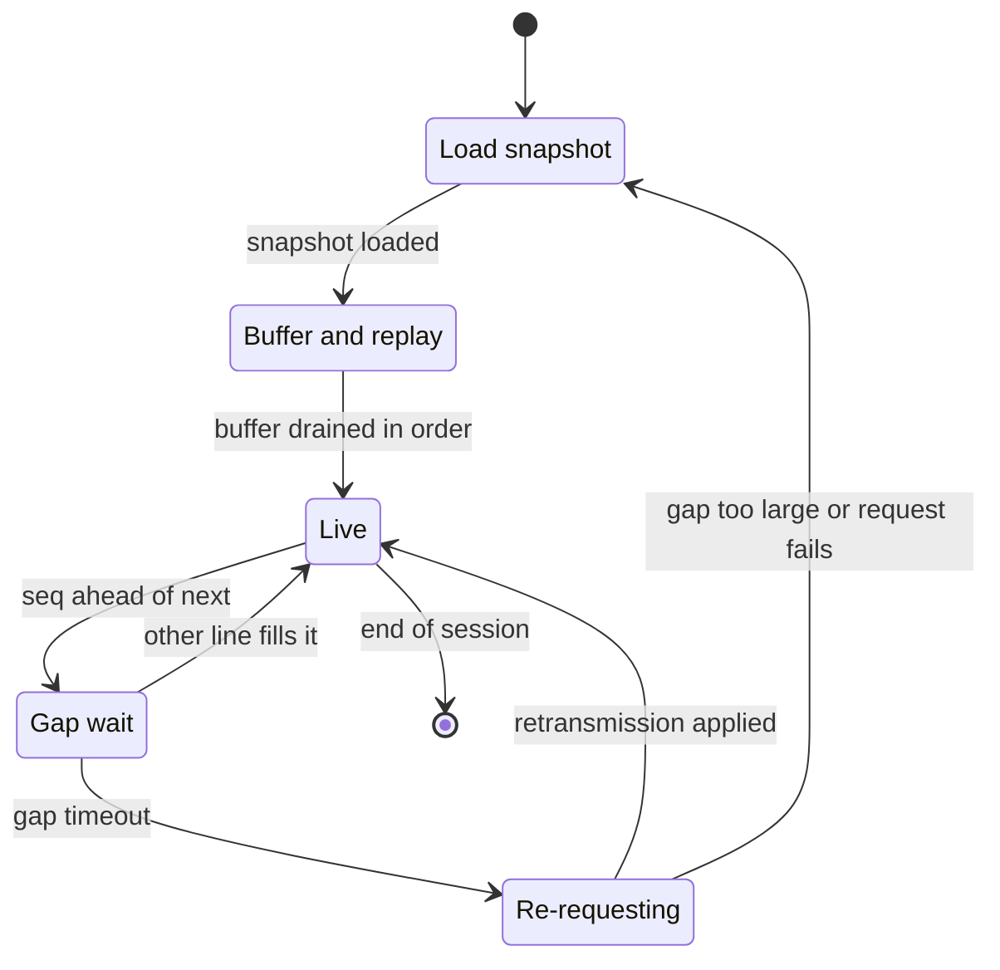

# Market Data Feeds and Multicast

> Rules and figures checked 2026-11-06. Every date, threshold and fee on this page comes from the
> fact pins in fintech/CLAUDE.md. Byte layouts come from the Nasdaq TotalView-ITCH 5.0
> specification (revision log 2023-04-28), the MoldUDP64 1.00 specification and the FIX SBE
> message structure, all read on 2026-11-06. Message rates, client counts and intervals in the
> examples are illustrative.

---

## 1. Concept Overview

A market data feed is a venue's outbound record of its book: every order added, executed,
canceled or replaced, every trade, and the state of each instrument. Consumers rebuild the book
from that record. The feed has to reach thousands of consumers with the lowest delay the venue
can give, over a network that drops packets.

This page covers the feed from the wire up:

- data levels (L1, L2, L3) and market-by-order vs market-by-price,
- framing: Nasdaq TotalView-ITCH 5.0 messages inside MoldUDP64 packets, byte by byte,
- A and B line arbitration, gap detection, retransmission requests and snapshot recovery,
- Simple Binary Encoding (SBE) and CME MDP 3.0,
- consolidated (SIP) and direct feeds, normalization across venues, and building a book in the
  handler,
- conflation, and WebSocket feeds for retail and crypto clients,
- a decision model that picks transport, depth and conflation per consumer class.

[System Design: Stock Exchange](../../hld/case_studies/design_stock_exchange.md) §4.4 covers the
publisher side: snapshot plus delta, sequence numbers for gap detection, and the multicast vs TCP
comparison. [Design a Low-Latency Market Data Feed Handler](../../java/case_studies/design_low_latency_market_data_handler.md)
covers the handoff after decoding: the off-heap ring buffer, padded cursors and a GC-free hot path.
It treats the network receive as out of scope, which is what this page owns.

---

## 2. Intuition

**One-line analogy.** A feed is a radio broadcast of numbered news bulletins, sent twice on two
stations. A listener who misses bulletin 42 on one station usually hears it on the other. If both
stations drop it, the listener phones the newsroom for a copy. A listener who tunes in at noon
asks for a summary of the morning, then listens from the summary's number on.

**Mental model.** A feed handler is three loops stacked on one counter, the next expected
sequence number:

1. **Arbitrate:** take the first copy of each sequence number from either line, drop the second.
2. **Recover:** when a number is missing on both lines for too long, request it, or rebuild from a
   snapshot if the hole is too big.
3. **Apply:** feed messages in sequence order into a book builder, then publish the result to
   internal consumers, conflated or not.

**Why it matters.** A handler that applies one message out of order, or twice, builds a book that
looks normal and is wrong. Every strategy, risk check and client screen downstream inherits the
error, and nothing crashes.

**Key insight.** Reliability on a multicast feed is an application protocol: sequence numbers,
two lines, a re-request server and a snapshot source. The handler implements that protocol, and
the network gives none of it.

---

## 3. Core Principles

- **Every message has a sequence number in its stream.** In MoldUDP64 the packet header carries
  the number of the first message, and later messages in the packet number on from it.
- **UDP loses packets. Two lines make loss rare, not impossible.** Venues send the same stream on
  two multicast groups over separate paths. The handler still needs a recovery path.
- **Heartbeats make silence visible.** A MoldUDP64 heartbeat is a packet with message count 0 that
  carries the next expected sequence number. Without heartbeats a handler cannot tell a quiet
  market from a dead line.
- **Recovery has two sizes.** A short gap is filled by retransmission. A long gap, or a late start,
  is filled by a snapshot plus the messages after it.
- **The publisher never waits for a consumer.** A slow consumer must fall behind, conflate, resync
  or disconnect. It must not slow the feed for the others.
- **Conflation trades completeness for freshness.** It sends the latest state instead of every
  change. That is right for a screen and wrong for anything that must see every trade.
- **Encodings are fixed-offset binary on the fast path.** Text and JSON appear only where the
  consumer is a browser or a script.

---

## 4. Types / Architectures / Strategies

### 4.1 Data levels

| Level | Content | Typical name | Who needs it |
|---|---|---|---|
| L1 | Best bid, best ask, sizes, last trade | Top of book | Retail screens, risk limits, simple routers |
| L2 | Aggregate quantity per price, top N levels or full depth | Market by price (MBP) | Execution algorithms, depth screens |
| L3 | Every order event with its id | Market by order (MBO) | Market makers, queue-position models, surveillance |

Nasdaq TotalView-ITCH is an MBO feed. CME MDP 3.0 publishes MBO at full depth and MBP at 10
levels. How a matching engine produces these events is in
[Order Books and Matching Engines](../order_books_and_matching_engines/order_books_and_matching_engines.md).

### 4.2 Transports

| Transport | Delivery | Loss handling | Typical consumer |
|---|---|---|---|
| UDP multicast | One packet, copied by switches to every subscriber | Sequence numbers, A/B lines, re-request, snapshot | Co-located firms |
| TCP (SoupBinTCP for ITCH) | Per-connection, ordered | TCP itself | Firms outside the co-location site, replay |
| WebSocket | Per-client over TCP, usually JSON | Snapshot plus sequence numbers per channel | Retail apps, crypto clients |
| Files and APIs | Batch | Not applicable | Research, tick stores |

Nasdaq delivers TotalView-ITCH 5.0 over SoupBinTCP or MoldUDP64, and its FPGA version over
MoldUDP64 only. Multicast needs IGMP snooping and multicast routing, which many cloud networks do
not offer. See [UDP and QUIC](../../backend/udp_and_quic/udp_and_quic.md).

### 4.3 Recovery mechanisms

| Mechanism | What it fixes | Cost |
|---|---|---|
| A/B arbitration | A packet lost on one line only | Twice the bandwidth, a dedupe step |
| Retransmission request | A short gap on both lines | One unicast request and reply. MoldUDP64 sends the reply as a normal downstream packet |
| Snapshot | A late start, or a gap too large to request | A snapshot service. Nasdaq names GLIMPSE as the service for the current state of the book |
| TCP replay | A full day from the start | Time: the handler replays everything |

The MoldUDP64 request packet has the same 20-byte shape as the downstream header: session, first
requested sequence number, and requested message count. If the requested messages do not fit in
one UDP packet, the server returns only the messages that fit, and the client asks again for the
rest.

### 4.4 Encodings

| Encoding | Shape | Where |
|---|---|---|
| ITCH 5.0 | Fixed layout per message type, big-endian integers, ASCII fields padded with spaces | Nasdaq equities |
| SBE | Fixed-offset fields from an XML schema, then repeating groups, then variable-length data | CME MDP 3.0, iLink 3 order entry, many venues |
| FIX tag=value | Text pairs | Rare on market data fast paths |
| JSON | Text objects | WebSocket feeds |

SBE 1.0 is the final standard (errata November 2020). SBE 2.0 is at Release Candidate 2, not a
standard. A schema update can append fields to a message's fixed block, and the `blockLength` in
the header tells an older decoder how far to skip (§6.4).

### 4.5 Consolidated and direct feeds

The SIP for US equities collects quotes and trades from every exchange, computes the NBBO and
publishes one consolidated feed. A direct feed comes from one venue. A consumer co-located with
the venue receives the direct feed before the SIP's version of the same event, because the SIP
adds a hop and a computation. A router that needs the NBBO quickly builds it from direct feeds
(see [Market Microstructure and Order Types](../market_microstructure_and_order_types/market_microstructure_and_order_types.md)).
In the EU, EuroCTP runs the consolidated tape for shares and ETFs. It launched on 2026-09-14.

Combining direct feeds means normalizing them: one instrument id across venues, one price scale,
one timestamp base, and one event model. ITCH timestamps are nanoseconds since midnight, so the
handler must attach the trade date. ITCH also identifies an instrument by a stock locate code that
Nasdaq assigns each day, starting at 1, and that can differ from one day to the next.

---

## 5. Architecture Diagrams

### 5.1 Feed handler pipeline



The arbitrator and the gap check share one counter, the next expected sequence number.
Retransmitted packets re-enter at the arbitrator like any other packet. A snapshot replaces the
book builder's state and moves the counter. The ring buffer stage is the subject of the Java
handler case study.

### 5.2 One MoldUDP64 packet with one ITCH Add Order

```text
MoldUDP64 downstream packet, integers big-endian
offset  len  field
     0   10  Session                 "000004571A"    ASCII, example value
    10    8  Sequence Number         1,000,001       number of the first message
    18    2  Message Count           1               0 = heartbeat, 0xFFFF = end of session
    20    2  Message Length          36              bytes of message data that follow
    22   36  Message Data            ITCH 5.0 Add Order (No MPID Attribution)

             offset  len  field
                  0    1  Message Type       'A'
                  1    2  Stock Locate       42           assigned daily, starts at 1
                  3    2  Tracking Number    0
                  5    6  Timestamp          ns since midnight
                 11    8  Order Reference    7,000,123    day-unique
                 19    1  Buy/Sell Indicator 'B'
                 20    4  Shares             300
                 24    8  Stock              "AAPL    "   right-padded with spaces
                 32    4  Price              1,000,100    Price(4) = 100.0100

packet size: 20 + 2 + 36 = 58 bytes
```

A packet can carry many message blocks, each with its own 2-byte length. The handler skips a
message type it does not parse by its length, so a new message type never breaks an old handler.

### 5.3 Handler states



Most gaps end in "Gap wait", because the other line delivers the missing packet within
microseconds. Only a gap on both lines reaches a request, and only a large one or a failed request
goes back to a snapshot.

---

## 6. How It Works - Detailed Mechanics

### 6.1 Parsing MoldUDP64 and ITCH

`ByteBuffer` is big-endian by default, which matches both specifications. ITCH integers are
unsigned, so 2-byte and 4-byte fields go through `Short.toUnsignedInt` and
`Integer.toUnsignedLong`. The 6-byte timestamp is a 2-byte high part and a 4-byte low part.

```java
import java.nio.ByteBuffer;
import java.nio.charset.StandardCharsets;
import java.util.ArrayList;
import java.util.List;

public class MoldItchParser {
    record AddOrder(long seq, int locate, long tsNanos, long ref, char side, long shares,
                    String stock, long price) {}

    static List<AddOrder> parse(ByteBuffer p) {
        p.position(p.position() + 10);                            // session
        long seq = p.getLong();
        int count = Short.toUnsignedInt(p.getShort());
        List<AddOrder> out = new ArrayList<>();
        if (count == 0 || count == 0xFFFF) return out;            // heartbeat or end of session
        for (int i = 0; i < count; i++, seq++) {
            int len = Short.toUnsignedInt(p.getShort());
            int start = p.position();
            if (p.get(start) == 'A') out.add(addOrder(p, start, seq));
            p.position(start + len);                              // skip by length, known type or not
        }
        return out;
    }

    static AddOrder addOrder(ByteBuffer p, int b, long seq) {
        int locate = Short.toUnsignedInt(p.getShort(b + 1));
        long ts = (Short.toUnsignedLong(p.getShort(b + 5)) << 32) | Integer.toUnsignedLong(p.getInt(b + 7));
        long ref = p.getLong(b + 11);
        char side = (char) p.get(b + 19);
        long shares = Integer.toUnsignedLong(p.getInt(b + 20));
        byte[] stock = new byte[8];
        p.get(b + 24, stock);
        long price = Integer.toUnsignedLong(p.getInt(b + 32));
        return new AddOrder(seq, locate, ts, ref, side, shares,
                new String(stock, StandardCharsets.US_ASCII).trim(), price);
    }

    public static void main(String[] args) {
        long ts = 34_200_000_000_000L;                            // 09:30:00 in ns since midnight
        ByteBuffer p = ByteBuffer.allocate(20 + 2 + 36 + 2 + 19);
        p.put("000004571A".getBytes(StandardCharsets.US_ASCII)).putLong(1_000_001).putShort((short) 2);
        p.putShort((short) 36).put((byte) 'A').putShort((short) 42).putShort((short) 0)
                .putShort((short) (ts >>> 32)).putInt((int) ts).putLong(7_000_123L).put((byte) 'B')
                .putInt(300).put("AAPL    ".getBytes(StandardCharsets.US_ASCII)).putInt(1_000_100);
        p.putShort((short) 19).put((byte) 'D').putShort((short) 42).putShort((short) 0)
                .putShort((short) (ts >>> 32)).putInt((int) ts + 1).putLong(7_000_099L);  // Order Delete
        p.flip();

        List<AddOrder> adds = parse(p);
        assert adds.size() == 1 && !p.hasRemaining();
        AddOrder a = adds.get(0);
        assert a.seq() == 1_000_001 && a.locate() == 42 && a.tsNanos() == ts;
        assert a.ref() == 7_000_123L && a.side() == 'B' && a.shares() == 300;
        assert a.stock().equals("AAPL") && a.price() == 1_000_100;   // 100.0100
        System.out.println(a);
    }
}
```

The second message is an Order Delete (19 bytes), which this parser does not decode. It skips the
message by its length, and the sequence counter still advances, so message 1,000,002 counts as
seen.

### 6.2 A/B arbitration and gap detection

The arbitrator keeps the next expected sequence number. A packet that is entirely below it is a
duplicate from the other line. A packet that starts above it opens a gap: hold the packet and start
a timer. If the other line fills the gap before the timer fires, nothing else happens. If not,
send a retransmission request for the missing range.

```java
import java.util.ArrayList;
import java.util.List;
import java.util.TreeMap;

public class LineArbiter {
    record Request(long from, long count) {}

    final long gapTimeoutNanos;
    final TreeMap<Long, Integer> held = new TreeMap<>();   // first seq -> message count
    final List<Long> delivered = new ArrayList<>();
    final List<Request> requests = new ArrayList<>();
    long next = 1;
    long gapSince = -1;

    LineArbiter(long gapTimeoutNanos) { this.gapTimeoutNanos = gapTimeoutNanos; }

    void onPacket(long seq, int count, long now) {
        if (seq + count <= next) return;                    // the other line already gave us this
        if (seq > next) {
            held.merge(seq, count, Math::max);
            if (gapSince < 0) gapSince = now;
            return;
        }
        deliver(seq, count);
        while (!held.isEmpty() && held.firstKey() <= next) {
            var e = held.pollFirstEntry();
            if (e.getKey() + e.getValue() > next) deliver(e.getKey(), e.getValue());
        }
        gapSince = held.isEmpty() ? -1 : now;
    }

    void onTimer(long now) {
        if (gapSince >= 0 && now - gapSince >= gapTimeoutNanos) {
            requests.add(new Request(next, held.firstKey() - next));
            gapSince = now;                                 // wait again before a second request
        }
    }

    private void deliver(long seq, int count) {
        for (long s = Math.max(seq, next); s < seq + count; s++) delivered.add(s);
        next = seq + count;
    }

    public static void main(String[] args) {
        LineArbiter arb = new LineArbiter(50_000);          // 50 microseconds, illustrative
        long t = 0;
        // line A loses 3, line B loses 5; each line fills the other's hole
        long[][] arrivals = {{1}, {1}, {2}, {2}, {4}, {3}, {4}, {5}, {6}, {6}};
        for (long[] a : arrivals) arb.onPacket(a[0], 1, t += 1_000);
        arb.onTimer(t + 100_000);
        assert arb.delivered.equals(List.of(1L, 2L, 3L, 4L, 5L, 6L)) && arb.requests.isEmpty();

        // both lines lose 7: after the timeout the arbiter asks for it
        arb.onPacket(8, 1, t += 1_000);
        arb.onPacket(8, 1, t += 1_000);
        arb.onTimer(t + 10_000);
        assert arb.requests.isEmpty();                      // still inside the timeout
        arb.onTimer(t + 60_000);
        assert arb.requests.equals(List.of(new Request(7, 1)));
        arb.onPacket(7, 1, t + 70_000);                     // the unicast retransmission
        assert arb.delivered.equals(List.of(1L, 2L, 3L, 4L, 5L, 6L, 7L, 8L)) && arb.gapSince == -1;
        System.out.println("delivered " + arb.delivered + ", requests " + arb.requests);
    }
}
```

The timeout must be longer than the usual skew between the two lines, or the handler sends
requests for gaps that the other line was about to fill. Pick the timeout from measured A/B skew,
not from a guess.

### 6.3 Building the book from ITCH order messages

An MBO handler keeps every live order by reference number and aggregates price levels from them.
The ITCH semantics decide the code:

- Order Executed and Order Cancel reduce an order's shares. Several of them on one reference
  number are cumulative.
- Order Delete removes what is left.
- Order Replace removes the old order and adds a new one under a new reference number. The message
  carries no side or stock, so the handler takes them from the original Add Order.

```java
import java.util.Comparator;
import java.util.HashMap;
import java.util.Map;
import java.util.TreeMap;

public class ItchBookBuilder {
    record Live(char side, long price, long shares) {}

    final Map<Long, Live> orders = new HashMap<>();
    final TreeMap<Long, Long> bids = new TreeMap<>(Comparator.reverseOrder());
    final TreeMap<Long, Long> asks = new TreeMap<>();

    void add(long ref, char side, long shares, long price) {          // 'A'
        orders.put(ref, new Live(side, price, shares));
        level(side, price, shares);
    }

    void executed(long ref, long shares) { reduce(ref, shares); }    // 'E'
    void cancel(long ref, long shares) { reduce(ref, shares); }      // 'X'

    void delete(long ref) {                                           // 'D'
        Live o = orders.remove(ref);
        level(o.side(), o.price(), -o.shares());
    }

    void replace(long oldRef, long newRef, long shares, long price) { // 'U'
        char side = orders.get(oldRef).side();                        // side comes from the original
        delete(oldRef);
        add(newRef, side, shares, price);
    }

    private void reduce(long ref, long q) {
        Live o = orders.get(ref);
        level(o.side(), o.price(), -q);
        long left = o.shares() - q;
        if (left == 0) orders.remove(ref); else orders.put(ref, new Live(o.side(), o.price(), left));
    }

    private void level(char side, long price, long delta) {
        TreeMap<Long, Long> m = side == 'B' ? bids : asks;
        long v = m.getOrDefault(price, 0L) + delta;
        if (v == 0) m.remove(price); else m.put(price, v);
    }

    public static void main(String[] args) {
        ItchBookBuilder b = new ItchBookBuilder();
        b.add(1, 'B', 300, 1_000_100);
        b.add(2, 'B', 200, 1_000_100);
        b.add(3, 'S', 500, 1_000_200);
        b.executed(1, 100);                                            // partial execution
        b.executed(1, 200);                                            // cumulative: order 1 done
        b.cancel(3, 100);                                              // partial cancel keeps ref 3
        b.replace(2, 9, 250, 1_000_000);                               // new ref, new price
        assert b.orders.keySet().equals(java.util.Set.of(3L, 9L));
        assert b.bids.firstKey() == 1_000_000 && b.bids.firstEntry().getValue() == 250;
        assert b.asks.firstKey() == 1_000_200 && b.asks.firstEntry().getValue() == 400;
        System.out.println("bids " + b.bids + " asks " + b.asks);
    }
}
```

Two more ITCH rules belong in a production builder. Order Executed With Price carries a Printable
flag, and Nasdaq says to ignore non-printable executions in time-and-sales and volume, because
those shares appear later in a bulk cross print. And the stock locate is the cheap instrument key:
index an array by it, and rebuild the array every day from the Stock Directory messages.

### 6.4 SBE and schema evolution

SBE puts fixed-length fields at fixed offsets, then repeating groups, then variable-length data,
in that order. A decoder reads a field with one load at a known offset, with no parsing. The
message header carries `blockLength` (the size of the fixed block), `templateId`, `schemaId` and
`version`. When a later schema version appends a field to the fixed block, `blockLength` grows, and
an older decoder uses it to find where the next part starts. The schema sets the byte order. The
example below uses little-endian and a header of four `uint16` fields.

```java
import java.nio.ByteBuffer;
import java.nio.ByteOrder;
import java.util.ArrayList;
import java.util.List;

public class SbeBlockLength {
    // template 1, version 1 body: price (int64), qty (int64). Version 2 appends orderId (int64).
    static void encode(ByteBuffer b, int version, long price, long qty, long orderId) {
        int blockLength = version == 1 ? 16 : 24;
        b.putShort((short) blockLength).putShort((short) 1).putShort((short) 7).putShort((short) version);
        b.putLong(price).putLong(qty);
        if (version >= 2) b.putLong(orderId);
    }

    record V1View(long price, long qty) {}

    // a decoder built for version 1 reads both versions correctly
    static List<V1View> decodeV1(ByteBuffer b) {
        List<V1View> out = new ArrayList<>();
        while (b.remaining() >= 8) {
            int blockLength = Short.toUnsignedInt(b.getShort());
            int templateId = Short.toUnsignedInt(b.getShort());
            b.getShort();                                          // schemaId
            b.getShort();                                          // version
            int body = b.position();
            if (templateId == 1) out.add(new V1View(b.getLong(body), b.getLong(body + 8)));
            b.position(body + blockLength);                         // skip what v1 does not know
        }
        return out;
    }

    public static void main(String[] args) {
        ByteBuffer b = ByteBuffer.allocate(64).order(ByteOrder.LITTLE_ENDIAN);
        encode(b, 2, 1_000_100, 300, 77);
        encode(b, 1, 1_000_200, 100, 0);
        b.flip();
        List<V1View> got = decodeV1(b);
        assert got.equals(List.of(new V1View(1_000_100, 300), new V1View(1_000_200, 100)));
        System.out.println(got);
    }
}
```

Without the `blockLength` skip, the version 1 decoder would read the version 2 message's `orderId`
as the next message header. Test every decoder against messages from a newer schema to catch this
bug.

### 6.5 Joining late: snapshot plus buffered messages

A handler that starts late, or falls too far behind, rebuilds from a snapshot:

1. Join the incremental stream and buffer every message, without applying it.
2. Request or receive a snapshot. It carries the sequence number of the last message it includes.
3. Load the snapshot into the book.
4. Drop every buffered message with a sequence number at or below the snapshot's.
5. Check that the first remaining message is the snapshot's number plus one. If it is higher, the
   buffer has a gap: request it or take a newer snapshot.
6. Apply the remaining messages in order, then go live.

Step 4 is where handlers go wrong. §10.1 shows the double-count when it is missing.

### 6.6 Conflation

A conflator keeps the latest state per key (instrument, or instrument and level) and a set of keys
that changed since the last send. On each send it publishes only the changed keys, with their
current values. Ten thousand updates to one instrument inside a send interval become one message.

Conflation fits consumers that need the current state: screens, risk limits on top of book, a
retail app. It does not fit consumers that need every event: a trade tape, an MBO book builder,
surveillance, a tick store. The decision model in §8.1 says which consumer gets which. §14 shows a
WebSocket gateway that did not conflate.

### 6.7 WebSocket feeds for retail and crypto clients

A WebSocket feed is a per-client TCP stream, usually JSON. It reuses the same ideas at a coarser
grain:

- The client subscribes to channels (ticker, top-N book, trades) per instrument.
- The server sends a snapshot with a sequence number, then updates with consecutive numbers per
  channel. A client that sees a jump asks for a new snapshot.
- Some venues add a checksum of the top levels to each update, so a client can detect a corrupt
  book without a sequence gap.
- Heartbeats keep idle connections alive through proxies.
- Book and ticker channels conflate per client. The trades channel does not.
- A client that falls too far behind gets a fresh snapshot or is disconnected. The server never
  buffers without limit.

The connection management side (fan-out, sticky routing, reconnect storms) is in
[WebSockets and SSE](../../backend/websockets_and_sse/websockets_and_sse.md) and
[Realtime Updates](../../hld/realtime_updates/realtime_updates.md).

---

## 7. Real-World Examples

- **Nasdaq TotalView-ITCH 5.0.** A binary MBO feed. Timestamps are 6-byte nanoseconds since
  midnight, prices have 4 implied decimals (maximum 200,000.0000), and integers are big-endian and
  unsigned. Delivery is over SoupBinTCP or MoldUDP64, and the FPGA version over MoldUDP64 only. The
  latest revision-log entry is dated 2023-04-28.
- **MoldUDP64 1.00.** A 20-byte header (session 10 bytes, sequence number 8, message count 2),
  then message blocks with a 2-byte length each. Count 0 is a heartbeat, typically once per second,
  and 0xFFFF is end of session. Re-request servers answer with a normal downstream packet by
  unicast to the source of the request. A client that sends its requests from its multicast socket
  reads the retransmissions on that same socket.
- **CME MDP 3.0.** SBE over UDP multicast, with MBO at full depth and MBP at 10 levels. CME's
  iLink 3 order entry also uses SBE, over FIXP.
- **FIX Trading Community SBE.** SBE 1.0 is the final standard, with errata from November 2020.
  SBE 2.0 is at Release Candidate 2.
- **EuroCTP.** The EU consolidated tape for shares and ETFs, launched on 2026-09-14. EU firms that
  built their own consolidated view from venue feeds can take the tape as one more input.

---

## 8. Tradeoffs

### 8.1 Decision model: transport and depth per consumer class

| Consumer class | Transport | Depth | Conflation | Recovery |
|---|---|---|---|---|
| Co-located market maker | Multicast direct feeds, both lines | MBO | None | Re-request, then snapshot |
| Broker smart order router | Direct feeds or SIP, multicast or TCP | L1 plus a few MBP levels | None on L1 | Snapshot on gap |
| Internal risk and limits | Internal bus from the feed handler | L1 | Per instrument, short interval (illustrative 10 ms) | Resync from the handler |
| Tick store and research | TCP replay or end-of-day files | MBO | None | Replay the day |
| Retail app | WebSocket | L1, top 10 MBP | Per client (illustrative 100 to 500 ms) | New snapshot on any gap |
| Crypto API client | WebSocket, or FIX for larger firms | Top N or full depth | Per channel | Snapshot plus sequence per channel |

### 8.2 MBO vs MBP

| Factor | MBO | MBP |
|---|---|---|
| Message rate | Highest: every order event | Lower: level changes only |
| Queue position | Rebuildable | Lost |
| Handler state | Every live order | Levels only |
| Gap impact | One lost message corrupts one order and its level | One lost message corrupts one level |
| Fit | Market makers, surveillance | Algorithms, screens |

### 8.3 Recovery choice for a gap

| Gap | Action | Why |
|---|---|---|
| One line only | Wait for the other line | Usually filled within the line skew |
| Both lines, small (illustrative under 1,000 messages) | Retransmission request | Cheap, fast |
| Both lines, large, or request failed | Snapshot plus buffered messages | Faster than asking for a long range |
| Start of day | TCP replay or snapshot | Depends on how late in the day |

---

## 9. When to Use / When NOT to Use

**Use multicast with A/B lines** for consumers inside the venue's data center or on a private
network that carries multicast. Do not plan on native multicast inside a public cloud VPC: many do
not route it, and the failure is silent.

**Use MBO** when queue position or every order event matters. Do not take MBO for a screen or a
risk check: the handler cost and the gap impact buy nothing for those consumers.

**Use conflation** for state consumers (screens, limits). Do not conflate a trade stream or any
input to a book builder.

**Use a snapshot** after a large gap or a late start. Do not request a long range of messages one
gap after another when a snapshot would rebuild faster.

**Do not decode with a general-purpose parser** (JSON, reflection) on a multicast hot path. Fixed
offsets and big-endian or schema-defined reads are the format's whole point.

---

## 10. Common Pitfalls

### 10.1 Applying buffered messages the snapshot already holds

A handler that joined late buffered incremental messages 101 to 103, loaded a snapshot that
included everything through 102, and then applied all three buffered messages.

```java
// BROKEN
import java.util.List;
import java.util.Map;
import java.util.TreeMap;

public class SnapshotJoinBroken {
    record Delta(long seq, long price, long qtyChange) {}

    public static void main(String[] args) {
        List<Delta> buffered = List.of(new Delta(101, 10_001, 200), new Delta(102, 10_001, -50),
                new Delta(103, 10_002, 300));
        long snapshotSeq = 102;                                    // snapshot includes 101 and 102
        Map<Long, Long> book = new TreeMap<>(Map.of(10_001L, 150L));
        for (Delta d : buffered) book.merge(d.price(), d.qtyChange(), Long::sum);
        System.out.println("book " + book + ", snapshot seq " + snapshotSeq);
    }
}
// prints: book {10001=300, 10002=300}, snapshot seq 102
```

Messages 101 and 102 were already in the snapshot's 150 shares, so the level shows 300 instead of
150. The book looks healthy and is wrong by 150 shares at the best price. The fix drops buffered
messages at or below the snapshot number and checks for a gap after it.

```java
// FIX
import java.util.List;
import java.util.Map;
import java.util.TreeMap;

public class SnapshotJoinFixed {
    record Delta(long seq, long price, long qtyChange) {}

    // returns false when the buffer does not continue from the snapshot
    static boolean join(Map<Long, Long> book, long snapshotSeq, List<Delta> buffered) {
        long expected = snapshotSeq + 1;
        for (Delta d : buffered) {
            if (d.seq() <= snapshotSeq) continue;
            if (d.seq() != expected) return false;
            book.merge(d.price(), d.qtyChange(), Long::sum);
            expected++;
        }
        return true;
    }

    public static void main(String[] args) {
        List<Delta> buffered = List.of(new Delta(101, 10_001, 200), new Delta(102, 10_001, -50),
                new Delta(103, 10_002, 300));
        Map<Long, Long> book = new TreeMap<>(Map.of(10_001L, 150L));
        assert join(book, 102, buffered);
        assert book.equals(Map.of(10_001L, 150L, 10_002L, 300L)) : book;

        Map<Long, Long> stale = new TreeMap<>(Map.of(10_001L, 150L));
        assert !join(stale, 100, List.of(new Delta(102, 10_001, -50)));   // 101 missing
        System.out.println("book " + book);
    }
}
```

### 10.2 Signed reads of unsigned fields

A handler read ITCH 4-byte share counts with `getInt()`. Any value above 2,147,483,647 became
negative, and the book builder subtracted shares on an add. The spec says integers are unsigned.
Read them with `Integer.toUnsignedLong` and `Short.toUnsignedInt`, as in §6.1, and test with values
above the signed maximum.

### 10.3 Locate codes cached across days

A firm cached the ITCH stock locate to symbol map in a file and reused it the next morning. Nasdaq
assigns locate codes each day, starting at 1, with no promise that a code maps to the same symbol
tomorrow. Orders for one stock landed in another stock's book until the first Stock Directory
messages were compared. Build the map from the day's Stock Directory messages only.

### 10.4 Re-requests faster than the line skew

A handler sent a retransmission request the moment it saw any gap. Line B usually filled line A's
gaps within a few microseconds (illustrative), so in a burst the handler sent thousands of requests
for messages it was about to receive. The re-request server throttled the firm, and real gaps then went unfilled.
Set the gap timeout from the measured A/B skew (§6.2).

### 10.5 Treating heartbeats as optional

A handler ignored packets with message count 0. In a quiet pre-open period line A failed, and the
handler could not tell a dead line from a quiet market for minutes. A heartbeat carries the next
expected sequence number. Track the time since the last packet on each line, heartbeats included,
and alarm per line.

---

## 11. Technologies & Tools

| Tool | What it is | Where it fits |
|---|---|---|
| Nasdaq TotalView-ITCH | Nasdaq's binary MBO feed, version 5.0 | The reference for fixed-layout MBO messages |
| MoldUDP64 | Nasdaq's sequenced UDP framing with re-request servers | Multicast transport and recovery |
| SoupBinTCP | Nasdaq's sequenced TCP framing | TCP delivery and replay of ITCH |
| CME MDP 3.0 | CME's SBE market data over UDP multicast | MBO and 10-level MBP for futures |
| Simple Binary Encoding | FIX Trading Community binary encoding, 1.0 final, 2.0 at RC2 | Fixed-offset messages with versioned schemas |
| Wireshark | Packet capture and protocol analyzer | Checking a handler against the wire |

---

## 12. Interview Questions with Answers

**Q: Why are exchange market data feeds sent over UDP multicast, and what replaces TCP's reliability?**
**Short:** Multicast sends each packet once to thousands of subscribers. Sequence numbers, two lines, re-request servers and snapshots replace what TCP would give.

With TCP the publisher sends one copy per subscriber and a slow subscriber holds a buffer. With
multicast the switches copy the packet, and the publisher's cost does not grow with subscribers.
UDP gives no delivery promise, so the protocol above it does: MoldUDP64 numbers every message, the
venue sends two lines, re-request servers answer short gaps, and a snapshot service answers long
ones.

**Q: Why do venues publish the same feed on two lines, A and B?**
**Short:** Packet loss on separate network paths is mostly independent, so a packet lost on one line almost always arrives on the other. The handler keeps the first copy.

Arbitration costs twice the bandwidth and a dedupe step, and it fills most gaps within microseconds
without a request. The handler holds packets that arrive ahead of a gap and waits a short time for
the other line. Only a loss on both lines needs a retransmission. Monitor each line's own loss rate
too, because when one line loses often, the other line becomes a single point of failure.

**Q: A gap appears on both lines. Should the handler request a retransmission or take a snapshot?**
**Short:** Request a retransmission for a short gap. Take a snapshot when the gap is large, the request fails, or the handler started late.

A request for a few messages returns in one unicast packet. A long range takes several requests, and
the book stays stale until the last one arrives. A snapshot plus the buffered messages after it
rebuilds the book in one step. Set the threshold from measured request latency and snapshot load
time, and fall back to a snapshot after a failed request.

**Q: What does the sequence number in a MoldUDP64 header mean?**
**Short:** It is the number of the first message in the packet. The other messages number on from it, and the header's count says how many there are.

A packet with sequence 1,000,001 and count 3 carries messages 1,000,001 to 1,000,003. A count of 0 is
a heartbeat that carries the next expected number, and 0xFFFF marks end of session. All header
integers are big-endian. A handler that assumes one message per packet miscounts on the first
packet with two.

**Q: How does a handler that joins late build a correct book?**
**Short:** Buffer the live stream, load a snapshot, drop buffered messages at or below the snapshot's sequence number, check for a gap, then apply the rest in order.

The snapshot already contains every message up to its number. Applying those again double-counts
them, and the book still looks normal. If the first buffered message after the snapshot is not the
snapshot number plus one, the buffer has a hole: request it or take a newer snapshot. Only then go
live.

**Q: Why does an ITCH Order Replace not carry the side or the stock?**
**Short:** A replace cannot change them. The handler takes the side and stock from the original Add Order and moves the order to the new reference number.

The replace removes the old order and creates one under a new reference number with new shares and
price. Nasdaq says firms should keep the side, stock and attribution from the original Add Order.
A handler that dropped the original order before reading its side cannot rebuild the replacement.
The new reference number also means the order lost its queue position.

**Q: Why does ITCH use a stock locate code, and what is the trap?**
**Short:** The locate is a small integer meant as an array index for fast lookup. Nasdaq assigns it each day, so a map cached from yesterday points at the wrong stocks.

Locate codes start at 1 each day and are announced in Stock Directory messages. They do not change
during the day, so an array indexed by locate gives O(1) instrument lookup without hashing a symbol.
The map must be rebuilt every day from that day's directory messages and never reused.

**Q: How should a handler count volume from ITCH executions?**
**Short:** Count printable executions and trade messages, and skip executions flagged non-printable, because those shares appear later in a bulk cross print.

Order Executed With Price carries a Printable flag. Nasdaq says that non-printable executions will
be included in a later bulk print, for example a cross, and recommends ignoring them for
time-and-sales and volume. A handler that counts both doubles the cross volume. The book builder
still applies the execution to reduce the order, because that part is real.

**Q: What makes SBE fast to decode, and how does a schema change stay compatible?**
**Short:** Fixed-length fields sit at fixed offsets, so a decoder reads each with one load. New fields are appended, and `blockLength` in the header tells old decoders how far to skip.

SBE orders a message as fixed fields, then repeating groups, then variable-length data. There is no
tag lookup or text parsing. When a schema version adds a field to the fixed block, the block grows
and `blockLength` grows with it. A decoder for the old version reads the fields it knows and jumps
by `blockLength`. A decoder that hard-codes the old block size reads the new field as the next
message.

**Q: What is the difference between the SIP and a direct feed?**
**Short:** The SIP consolidates every US exchange's quotes and trades and computes the NBBO. A direct feed comes from one venue and reaches a co-located consumer sooner.

The SIP adds a network hop and a computation, so its view of an event arrives after the direct
feed's. A router that needs a current NBBO builds it from direct feeds and keeps the SIP as a check.
Direct feeds also carry more detail, such as full depth or every order, where the SIP carries top of
book. Building from direct feeds means normalizing symbols, price scales and timestamps across
venues.

**Q: When is conflation the right choice, and when is it wrong?**
**Short:** Conflate for consumers that need the current state, such as screens and limits. Never conflate trades, MBO or anything that feeds a book builder.

A conflator keeps the latest value per key and sends only changed keys at each interval. A screen
loses nothing that a person could see. A trade tape loses trades, and an MBO book builder loses
order events and corrupts the book. Mark every internal stream as complete or conflated, and check
that each consumer gets the kind it needs.

**Q: How do you design a WebSocket market data feed for retail clients?**
**Short:** Snapshot plus numbered updates per channel, heartbeats, conflation for book and ticker channels, and a hard limit on how far a client may fall behind.

The client gets a snapshot with a sequence number and then updates that number on. A gap triggers a
new snapshot. Book and ticker channels send the latest state at an interval. Trade channels send
every trade. A client that falls behind past a limit gets a fresh snapshot or is disconnected,
because buffering without limit runs the gateway out of memory and serves stale data.

**Q: Why must a slow consumer never slow the publisher?**
**Short:** The publisher serves every consumer. If it waits for one, every other consumer gets stale data, including the ones that trade on it.

On multicast the publisher cannot wait, which is part of the design. On TCP or WebSocket it can, by
accident, if it blocks on a full send buffer. Each per-client path needs its own bounded buffer and
a policy for overflow: conflate, resync with a snapshot, or disconnect. The feed handler's internal
ring buffer has the same rule, covered in the Java handler case study.

**Q: Why are heartbeats needed on a market data feed?**
**Short:** Without heartbeats a handler cannot tell a quiet market from a dead line. A heartbeat also carries the next sequence number, which exposes a gap at the end of a burst.

MoldUDP64 sends a packet with message count 0 when there is nothing else to send, typically once per
second, carrying the next expected sequence number. If the last data packet of a burst was lost, the
heartbeat's number shows the gap. Track time since the last packet per line and alarm on each line
separately.

**Q: Can you run a multicast market data feed inside a public cloud?**
**Short:** Usually not natively. Multicast needs IGMP snooping and multicast routing that many cloud networks do not provide, so cloud feeds use unicast relays or TCP.

The failure is quiet: the publisher sends and nobody receives. Firms that consume venue multicast in
a cloud region usually receive it in a co-location site and relay it, or take a TCP or vendor feed.
Measure the added delay, because a relay hop changes which consumers see the data first.

**Q: Why should a feed handler read ITCH integers as unsigned?**
**Short:** The spec defines them as unsigned. A signed read turns large values negative, and the book builder then subtracts where it should add.

Java has no unsigned primitive types, so a 4-byte field read with `getInt()` turns any value above
2,147,483,647 into a negative number. Use `Integer.toUnsignedLong` for 4-byte fields and
`Short.toUnsignedInt` for 2-byte fields. Order reference numbers are 8 bytes, and a handler should
reject or alarm on a value it cannot represent rather than wrap it.

**Q: What does CME MDP 3.0 send, and how is it encoded?**
**Short:** MBO at full depth and MBP at 10 levels, encoded in SBE and sent over UDP multicast.

A consumer chooses the depth it needs: MBP for most algorithms, MBO for queue-position work. The SBE
schema defines every message, so a handler generates its decoder from the schema and tests it
against newer schema versions. CME also uses SBE for iLink 3 order entry, over FIXP, so a firm can
share decoding code between its market data and order entry paths.

**Q: Where does a MoldUDP64 retransmission arrive, and why does that matter?**
**Short:** The re-request server unicasts a normal downstream packet to the request's source, so a handler that sends requests from its multicast socket reads retransmissions there.

The MoldUDP64 spec says the response to a valid request is a standard downstream packet sent by
unicast to the source of the request. If the handler sends requests from the socket that joined the
multicast group, the reply arrives on that socket and goes through the same arbitration code. A
retransmitted packet is then just another copy of a sequence number, and the arbitrator keeps the
first copy as usual.

**Q: What must a handler normalize when it merges direct feeds from several venues?**
**Short:** One instrument id, one price scale, one timestamp base with the trade date, and one event model, so that a book or NBBO built from several venues compares like with like.

Each venue has its own symbol scheme, price precision, time format and message types. ITCH sends
prices with 4 implied decimals and timestamps as nanoseconds since midnight. Another venue may send
8 decimals and epoch microseconds. The normalizer converts once at the edge, keeps the venue's raw
values for audit, and stamps its own receive time so that feed delays are measurable.

**Q: How do you test a feed handler before it reaches production?**
**Short:** Replay recorded packet captures through it, inject loss and reordering on each line, and compare its book with the venue's snapshots at checkpoints.

Captures from production give real message mixes and bursts. A test harness drops packets on line A,
line B or both, reorders them, and delays retransmissions, then checks that the handler's book
matches a snapshot taken at the same sequence number. Run every handler build against the same
captures, and keep captures from the busiest days of the year.

---

## 13. Best Practices

- Keep one counter, the next expected sequence number, shared by arbitration, gap detection and
  recovery.
- Set the gap timeout from measured A/B skew. Fall back from request to snapshot by gap size and on
  a failed request.
- Skip unknown message types by length, and read every integer as the spec defines it: unsigned,
  big-endian for ITCH, schema byte order for SBE.
- Build the instrument map from the day's directory messages only.
- Drop buffered messages at or below the snapshot sequence number and check the next one before
  going live.
- Label every internal stream as complete or conflated. Never conflate trades or MBO.
- Bound every per-client buffer, and define the overflow action: conflate, resync or disconnect.
- Alarm on each line separately, and on heartbeats as well as data.
- Capture the wire in production and replay captures through every new handler build.

---

## 14. Case Study

### A retail WebSocket gateway that queued every update

A crypto exchange (assumption: 50 instruments, one WebSocket gateway process per 5,000 clients)
pushed every top-of-book change to every subscribed client through a per-client queue. A client on a
slow mobile link drained about 10 messages for every 100 the gateway produced (illustrative).

```java
// BROKEN
import java.util.ArrayDeque;

public class SlowClientQueue {
    record Update(int instrument, long seq, long price) {}

    public static void main(String[] args) {
        ArrayDeque<Update> queue = new ArrayDeque<>();
        for (long seq = 1; seq <= 100_000; seq++) {
            queue.add(new Update((int) (seq % 50), seq, 10_000 + seq % 7));
            if (seq % 100 == 0) {
                for (int i = 0; i < 10 && !queue.isEmpty(); i++) queue.poll();  // client sends 10 per 100
            }
        }
        System.out.println("queued " + queue.size() + ", oldest queued seq " + queue.peek().seq()
                + ", latest seq 100000");
    }
}
// prints: queued 90000, oldest queued seq 10001, latest seq 100000
```

After 100,000 updates the slow client's queue held 90,000 of them, and the next price it would see
was from update 10,001, about 90,000 updates old. With a few hundred slow clients (illustrative) in
a volatile hour, the gateway ran out of heap. Every client on that process was disconnected when
prices moved most, and their apps showed prices from minutes earlier until the reconnect
storm cleared.

The fix conflates per client: keep the latest update per instrument and a list of instruments that
changed since the last send. The queue can never hold more than one entry per instrument.

```java
// FIX
import java.util.LinkedHashMap;
import java.util.Map;

public class ConflatingClient {
    record Update(int instrument, long seq, long price) {}

    final Map<Integer, Update> pending = new LinkedHashMap<>();   // instrument -> latest, send order kept

    void offer(Update u) {
        pending.remove(u.instrument());                           // move to the back, keep only the latest
        pending.put(u.instrument(), u);
    }

    Update poll() {
        var it = pending.entrySet().iterator();
        if (!it.hasNext()) return null;
        Update u = it.next().getValue();
        it.remove();
        return u;
    }

    public static void main(String[] args) {
        ConflatingClient c = new ConflatingClient();
        Map<Integer, Update> lastSent = new LinkedHashMap<>();
        for (long seq = 1; seq <= 100_000; seq++) {
            c.offer(new Update((int) (seq % 50), seq, 10_000 + seq % 7));
            if (seq % 100 == 0) {
                for (int i = 0; i < 10; i++) {
                    Update u = c.poll();
                    if (u != null) lastSent.put(u.instrument(), u);
                }
            }
            assert c.pending.size() <= 50;
        }
        for (Update u; (u = c.poll()) != null; ) lastSent.put(u.instrument(), u);
        assert lastSent.get(0).seq() == 100_000 && lastSent.get(49).seq() == 99_999;
        System.out.println("max queue 50, client ends on seq " + lastSent.get(0).seq());
    }
}
```

The slow client now sees each instrument's latest price within a few send cycles, and memory per
client is bounded by the instrument count. Each update keeps its sequence number, so the client
knows how many it skipped. The trades channel stays unconflated, with a hard cap: a client that
exceeds it gets a snapshot of recent trades and a resync message instead of a growing queue. The
same rule, a bounded buffer with a stated overflow action, governs the multicast handler's ring
buffer in the Java handler case study and the arbitration timeout in §6.2.
