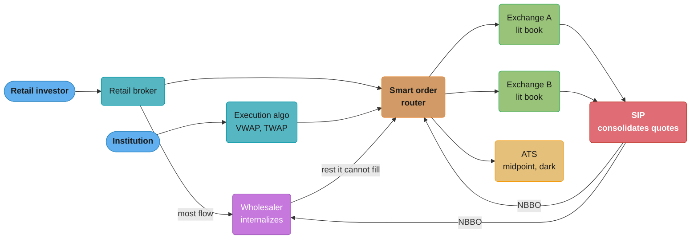
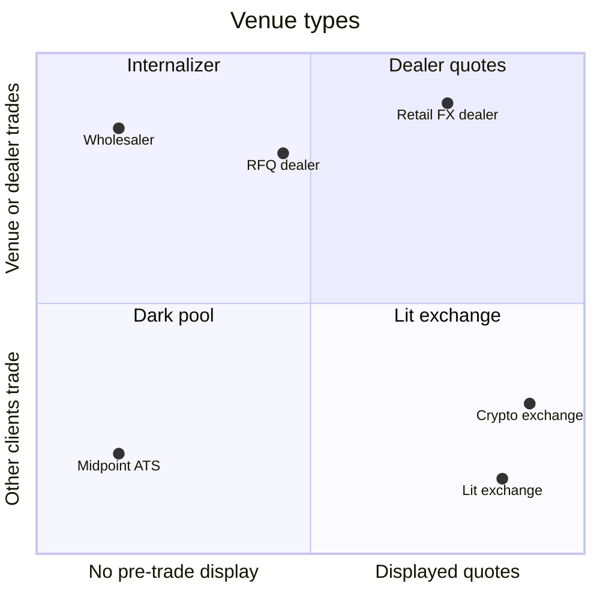

# Market Microstructure and Order Types

> Rules and figures checked 2026-11-06. Every date, threshold and fee on this page comes from the
> fact pins in fintech/CLAUDE.md. FINRA Rule 5310 was read on finra.org on 2026-11-06. Tick
> sizes, spreads, fees and order counts in the examples are illustrative, not venue rules.

---

## 1. Concept Overview

Market microstructure is the set of rules that turns orders into trades and prices: who may
trade, where, at what price increments, with which order conditions, in what priority, and at
what fee. An engineer meets microstructure as constraints. The tick size decides how a price is
stored. The order types decide the order state machine. The auction schedule decides the
engine's modes. The rules about other venues decide what a router must check before it sends an
order.

This page covers the market around one venue:

- the participants and venue types (exchanges, alternative trading systems, wholesalers and
  internalizers, dealers),
- the price and quantity grid (tick and lot), spread and depth,
- the order types and time-in-force values past the basic five, and what each one asks the
  engine to store,
- the market models (continuous book, call auction, volatility auction, request for quote),
- the cross-venue rules: the NBBO, Reg NMS order protection, best execution, maker-taker fees
  and payment for order flow,
- the EU consolidated tape, in one paragraph.

A matching engine for one venue is designed end to end in
[System Design: Stock Exchange](../../hld/case_studies/design_stock_exchange.md), which also
covers limit, market, stop, IOC and FOK orders (its §4.5), sessions and halts. The price-time
`TreeMap` book is in [Order Matching Engine](../../lld/system_design_problems/OrderMatchingEngine.md).
This page links to both and does not teach them again.

---

## 2. Intuition

**One-line analogy.** A market is a set of rival auction houses that sell the same goods. Each
house has its own floor rules, and a law tells every broker to check the best price across all
of the houses before it sells for a client.

**Mental model.** Every order is a contract with four clauses:

1. **Price clause:** the worst price I accept (limit), or any price (market), or a price tied to
   a reference (peg).
2. **Display clause:** show all of it, show part of it (iceberg), or show none of it (hidden).
3. **Liquidity clause:** I may take liquidity, or I may only add it (post-only).
4. **Time clause:** how long the order lives (DAY, GTC, GTD), or whether it trades only now
   (IOC, FOK) or only in an auction (MOO, MOC).

The matching engine enforces the clauses. Microstructure is the study of which clauses a venue
offers and what happens when many traders use them at the same time.

**Why it matters.** Most order-handling bugs are clause bugs, not data-structure bugs. A
post-only order that takes liquidity, an iceberg that keeps its queue position after a refresh,
or a midpoint peg that trades at the bid all pass unit tests that check only the book shape.

**Key insight.** A price is a point on an integer grid, and a fee or a rule is a function of
which side of the trade added liquidity. Get those two things right and most of the rest is
bookkeeping.

---

## 3. Core Principles

- **Liquidity is resting orders.** A maker posts an order that rests on the book. A taker sends
  an order that executes against it. The maker or taker role is decided by which order was
  resting when the trade happened, not by buy or sell.
- **Spread and depth describe cost.** The quoted spread is best ask minus best bid. Depth is
  the quantity at and near the best prices. A taker pays half the spread plus any price impact
  past the top level.
- **Tick size is the price grid. Lot size is the quantity grid.** Both are integers in the
  engine. A price that is not a multiple of the tick for its price band is rejected before it
  reaches the book.
- **Price discovery has two modes.** A continuous book matches each order on arrival. A call
  auction collects orders for a period and then executes them all at one price.
- **The market is fragmented.** One US stock trades on many exchanges and off-exchange venues
  at the same time. No venue sees the whole market, so the rules that join them (the NBBO, order
  protection, best execution) live in the routers and in regulation.
- **Rules change on a schedule.** The SEC adopted Reg NMS amendments in 2024 that set a $0.005
  tick for certain NMS stocks priced at or above $1.00 and a $0.001 access-fee cap for those
  stocks. SEC order 34-105656 extends exemptive relief from those amendments until the first
  business day of November 2027. On 2026-06-11 the SEC proposed to rescind Rule 611
  (trade-through) and Rule 610(e) (locked and crossed quotes). That is a proposal, not a rule.
  Keep these values in configuration with an effective date, never in code.

---

## 4. Types / Architectures / Strategies

### 4.1 Participants and venues

| Venue or participant | What it does | Who is the counterparty | Pre-trade transparency |
|---|---|---|---|
| Registered exchange | Runs a public limit order book and auctions | Other members' orders | Displayed quotes go to the consolidated feed |
| ATS or dark pool | Matches orders without a displayed quote, often at the midpoint of the NBBO | Other subscribers' orders | None before the trade |
| Wholesaler or internalizer | Fills retail orders from its own inventory, often at a better price than the NBBO | The wholesaler itself | None before the trade |
| Market maker | Posts two-sided quotes and earns the spread and rebates | Takers on the venues it quotes | Its quotes are displayed |
| Institutional algorithm | Splits a large parent order into child orders over time (VWAP, TWAP, implementation shortfall) | Any venue the router picks | Shows only small child orders |
| Dealer (RFQ market) | Answers a request for quote with a firm price | The dealer | Only the requester sees the quote |
| Crypto exchange | One entity runs the book, holds the client assets and clears the trades | Other clients | Full public book, no consolidated quote |

The last row matters for system design. In US equities the exchange, the broker, the clearing
house and the custodian are different firms. A crypto exchange is often all four, so it must
build self-trade prevention, custody and margin into one system. See
[Crypto Custody and On-Chain Operations](../crypto_custody_and_onchain_operations/crypto_custody_and_onchain_operations.md)
and [Margin, Liquidation and Derivatives Risk](../margin_liquidation_and_derivatives_risk/margin_liquidation_and_derivatives_risk.md).

### 4.2 Order types past the basic five

| Order type | Clause it changes | What the engine must store | Who usually implements it |
|---|---|---|---|
| Post-only (add liquidity only) | Liquidity | A flag, and a policy: reject or slide when the order would cross | Venue |
| Iceberg (reserve) | Display | Peak size, hidden remainder, refresh rule | Venue |
| Hidden (non-displayed) | Display | A flag. The order has lower priority than displayed orders at the same price on most books | Venue |
| Primary peg | Price | Peg reference (same-side best), offset, and a reprice trigger on every quote change | Venue |
| Midpoint peg | Price | Peg to the mid of the NBBO or the venue BBO. Needs a price finer than one tick | Venue or ATS |
| Market peg | Price | Peg to the opposite-side best, with offset | Venue |
| Stop and stop-limit | Price trigger | Trigger price, kept outside the book until it fires (see the stock exchange study §4.5) | Venue or broker |
| Trailing stop | Price trigger | Trigger that moves with the market | Usually the broker |
| Minimum quantity | Execution | Smallest acceptable fill size | Venue or ATS |
| All-or-none | Execution | Fill the whole size or nothing, and the order may rest | Venue |
| Market-on-open, market-on-close (MOO, MOC) | Time | Auction-only flag and auction phase | Venue |
| Limit-on-open, limit-on-close (LOO, LOC) | Time and price | Auction-only flag and a limit | Venue |

An order type that the broker implements (a trailing stop, for example) never reaches the venue
until it fires. The venue sees a plain limit or market order. That split decides where the
failure lives when the broker system restarts at the wrong moment.

### 4.3 Time in force

| TIF | Lifetime | Engine work |
|---|---|---|
| DAY | Until the end of the trading day | Purge at end of day |
| GTC | Until canceled | Persist across days. Adjust or cancel on a corporate action |
| GTD | Until a set date or time | A timer, fed by the sequenced clock (see [Exchange Architecture and Determinism](../exchange_architecture_and_determinism/exchange_architecture_and_determinism.md)) |
| IOC | Now, then cancel the rest | Never rests |
| FOK | Now and in full, or nothing | Dry run before any fill |
| At the open (OPG) | Opening auction only | Held for the opening auction |
| At the close (CLS) | Closing auction only | Held for the closing auction |
| Good-till-crossing (GTX) on some crypto venues, for example Binance futures | Rests only if it adds liquidity | The post-only check |

### 4.4 Market models

| Model | How a price forms | Typical use |
|---|---|---|
| Continuous limit order book | Each order matches on arrival in priority order | Main session of equities, futures and crypto |
| Call auction | Orders collect for a period, then execute at one price that maximizes volume | Open, close, reopen after a halt, IPOs |
| Volatility auction | A price move past a band stops continuous trading and starts a short call auction | Venues with dynamic price bands |
| Periodic auction | Short call auctions run again and again through the day | Some EU venues and proposals for fair access |
| Request for quote | A client asks dealers for a firm price | Bonds, large blocks, OTC derivatives |
| Quote-driven (dealer) | Dealers post quotes and take the other side of every trade | Retail FX, some bond markets |

The uncrossing algorithm for a call auction, and the pro-rata allocation that some futures use
in place of time priority, are in
[Order Books and Matching Engines](../order_books_and_matching_engines/order_books_and_matching_engines.md).

### 4.5 Fee models and order flow payments

| Model | Maker | Taker | Who it attracts |
|---|---|---|---|
| Maker-taker | Receives a rebate | Pays an access fee | Liquidity providers who want rebates |
| Taker-maker (inverted) | Pays | Receives a rebate | Takers, and makers who want queue position at a crowded price |
| Flat | Same fee both sides | Same fee both sides | Simple pricing |
| Payment for order flow (PFOF) | Not a venue fee | Not a venue fee | A wholesaler pays a retail broker for the right to fill the broker's orders |

PFOF is a payment between two firms. The retail customer does not pay it. The customer's cost
is the execution price, which the wholesaler often sets inside the NBBO. The open question for
a regulator is whether the broker's routing choice serves the customer or the payment, which is
what best execution addresses (§6.6).

---

## 5. Architecture Diagrams

### 5.1 Where a US equity order goes



The router and the wholesaler both read the NBBO from the SIP. The ATS and the wholesaler add
nothing to the NBBO, because they display no quote. The two exchanges feed it.

### 5.2 Spread, depth and the NBBO across three venues

```
 price     Venue X          Venue Y          Venue Z        Consolidated
          bid     ask      bid     ask      bid     ask
 100.04                                             400
 100.03           300                                       best ask = 100.02 (Y, 100 sh)
 100.02                            100                      best bid = 100.01 (Y, 200 sh)
 ------------------------------------------------------    NBBO spread = 0.01, mid = 100.015
 100.01                    200
 100.00   500
  99.99                                     600
```

No single venue shows the NBBO here: Venue X alone has a 0.03 spread. Venue Y happens to hold
both best prices, but a router that read only Venue X would see 100.00 by 100.03 and pay 0.01
too much on a buy. The midpoint 100.015 falls between two ticks, which is the problem §6.1 and
§14 solve.

### 5.3 Venue types by transparency and counterparty



The axes are the two questions a regulator and a router both ask: can I see the price before I
trade, and who takes the other side.

---

## 6. How It Works - Detailed Mechanics

### 6.1 The price grid in integers

A venue stores a price as a `long` count of the smallest unit it ever needs. Nasdaq
TotalView-ITCH 5.0 sends prices with 4 implied decimals, so 100.0150 is the integer 1,000,150.
The tick for a price can depend on the price band. The tick table below is an assumption for
the example, not a venue rule.

```java
import java.util.List;

public class TickGrid {
    static final long SCALE = 10_000; // 4 implied decimals, as in ITCH Price(4)

    record Band(long fromPrice, long tick) {}

    record Rules(List<Band> bands, long lot) {
        long tickAt(long price) {
            long tick = bands.get(0).tick();
            for (Band b : bands) if (price >= b.fromPrice()) tick = b.tick();
            return tick;
        }
        boolean validPrice(long price) { return price > 0 && price % tickAt(price) == 0; }
        boolean validQty(long qty) { return qty > 0 && qty % lot == 0; }
    }

    public static void main(String[] args) {
        // assumption: tick 0.0001 below 1.00, tick 0.01 from 1.00, lot 1
        Rules rules = new Rules(List.of(new Band(0, 1), new Band(SCALE, 100)), 1);
        assert rules.validPrice(5_000);        // 0.5000
        assert rules.validPrice(1_000_100);    // 100.0100
        assert !rules.validPrice(1_000_150);   // 100.0150 is between two ticks
        assert rules.validQty(37);

        long bid = 1_000_100, ask = 1_000_200;  // one tick wide: 100.01 x 100.02
        long mid = (bid + ask) / 2;
        assert (bid + ask) % 2 == 0 && mid == 1_000_150; // exact at 4 decimals
        assert !rules.validPrice(mid);                    // but off the 0.01 tick grid
        System.out.println("tick at 100.01 = " + rules.tickAt(bid) + ", mid = " + mid);
    }
}
```

Two rules follow. Validate the tick against the band of the order's own price, not the last
trade price. Hold any derived price (a mid, a pegged price, a VWAP) at a finer scale than the
tick, here 4 decimals against a 0.01 tick, until a rule says how to round it. The mid of a
one-tick spread is exact at that scale and is still not a valid order price.

### 6.2 Spread cost in basis points

The quoted spread is what the book shows. The effective spread is what a taker paid:
`2 x |trade price - mid| / mid`. The factor 2 makes it comparable with the quoted spread for a
round trip. Use `BigDecimal` with an explicit scale for the ratio.

```java
import java.math.BigDecimal;
import java.math.RoundingMode;

public class SpreadCost {
    static final BigDecimal BPS = BigDecimal.valueOf(10_000);

    // prices are longs with 4 implied decimals; result in basis points, 4 decimals
    static BigDecimal quotedBps(long bid, long ask) {
        BigDecimal mid = BigDecimal.valueOf(bid + ask).divide(BigDecimal.TWO);
        return BigDecimal.valueOf(ask - bid).multiply(BPS).divide(mid, 4, RoundingMode.HALF_EVEN);
    }

    static BigDecimal effectiveBps(long bid, long ask, long tradePrice) {
        BigDecimal mid = BigDecimal.valueOf(bid + ask).divide(BigDecimal.TWO);
        BigDecimal dist = BigDecimal.valueOf(tradePrice).subtract(mid).abs();
        return dist.multiply(BigDecimal.TWO).multiply(BPS).divide(mid, 4, RoundingMode.HALF_EVEN);
    }

    public static void main(String[] args) {
        long bid = 1_000_000, ask = 1_000_400;      // 100.0000 x 100.0400
        BigDecimal quoted = quotedBps(bid, ask);
        BigDecimal paid = effectiveBps(bid, ask, 1_000_300); // buy filled at 100.0300
        assert quoted.compareTo(new BigDecimal("3.9992")) == 0 : quoted;
        assert paid.compareTo(new BigDecimal("1.9996")) == 0 : paid;
        System.out.println("quoted " + quoted + " bps, effective " + paid + " bps");
    }
}
```

The buyer paid half the quoted spread because the fill was at 100.03, inside the 100.04 offer.
That gap between quoted and effective spread is the price improvement a wholesaler or a
midpoint ATS reports to win order flow.

### 6.3 Building the NBBO and checking for a trade-through

The NBBO is the highest displayed bid and the lowest displayed offer across the protected
quotes of all venues. A locked market has bid equal to ask across venues. A crossed market has
bid above ask. Rule 611 protects displayed quotes: a venue must not execute a buy above the
best protected offer on another venue (with exceptions such as an intermarket sweep). On
2026-06-11 the SEC proposed to rescind Rule 611, so build the check behind a rule switch with
an effective date.

```java
import java.util.List;

public class Nbbo {
    record Quote(String venue, long bid, long bidSize, long ask, long askSize) {}

    record Best(long bid, String bidVenue, long ask, String askVenue) {
        boolean locked() { return bid == ask; }
        boolean crossed() { return bid > ask; }
    }

    static Best compute(List<Quote> quotes) {
        long bid = Long.MIN_VALUE, ask = Long.MAX_VALUE;
        String bidVenue = null, askVenue = null;
        for (Quote q : quotes) {
            if (q.bidSize() > 0 && q.bid() > bid) { bid = q.bid(); bidVenue = q.venue(); }
            if (q.askSize() > 0 && q.ask() < ask) { ask = q.ask(); askVenue = q.venue(); }
        }
        return new Best(bid, bidVenue, ask, askVenue);
    }

    // a buy executed above a better protected offer on another venue trades through it
    static boolean buyTradesThrough(long execPrice, String execVenue, Best nbbo) {
        return execPrice > nbbo.ask() && !execVenue.equals(nbbo.askVenue());
    }

    public static void main(String[] args) {
        List<Quote> quotes = List.of(
                new Quote("X", 1_000_000, 500, 1_000_300, 300),
                new Quote("Y", 1_000_100, 200, 1_000_200, 100),
                new Quote("Z",   999_900, 600, 1_000_400, 400));
        Best nbbo = compute(quotes);
        assert nbbo.bid() == 1_000_100 && nbbo.ask() == 1_000_200;
        assert !nbbo.locked() && !nbbo.crossed();
        assert buyTradesThrough(1_000_300, "X", nbbo);   // 100.03 on X, 100.02 offered on Y
        assert !buyTradesThrough(1_000_200, "Y", nbbo);
        System.out.println("NBBO " + nbbo.bid() + " x " + nbbo.ask() + " from "
                + nbbo.bidVenue() + "/" + nbbo.askVenue());
    }
}
```

The NBBO a router computes is only as fresh as its slowest input. A router that reads the SIP
sees prices later than one that builds the NBBO from direct feeds. See
[Market Data Feeds and Multicast](../market_data_feeds_and_multicast/market_data_feeds_and_multicast.md).

### 6.4 Post-only and iceberg in the engine

A post-only buy that would cross the best ask must not take liquidity. The venue either
rejects it or slides it to one tick below the best ask. An iceberg shows a peak. When a fill
uses up the peak and hidden size remains, the engine refreshes the peak. On most designs the
refreshed peak goes to the back of the queue at its price, so an iceberg cannot hold its place
ahead of orders that arrived after it.

```java
public class OrderConditions {
    enum PostOnlyMode { REJECT, SLIDE }

    // returns the price to rest at in ticks, or -1 to reject
    static long postOnlyBuy(long limit, long bestAsk, PostOnlyMode mode) {
        if (limit < bestAsk) return limit;
        return mode == PostOnlyMode.REJECT ? -1 : bestAsk - 1;
    }

    record Iceberg(long peak, long shown, long hidden, long priority) {
        // priority is a sequence number: lower means earlier in the queue
        Iceberg fill(long qty, long nextPriority) {
            long shownLeft = shown - qty;
            if (shownLeft > 0 || hidden == 0) return new Iceberg(peak, shownLeft, hidden, priority);
            long refresh = Math.min(peak, hidden);
            return new Iceberg(peak, refresh, hidden - refresh, nextPriority);
        }
    }

    public static void main(String[] args) {
        long bestAsk = 10_002; // ticks of 0.01
        assert postOnlyBuy(10_001, bestAsk, PostOnlyMode.REJECT) == 10_001;
        assert postOnlyBuy(10_002, bestAsk, PostOnlyMode.REJECT) == -1;
        assert postOnlyBuy(10_005, bestAsk, PostOnlyMode.SLIDE) == 10_001;

        Iceberg ice = new Iceberg(100, 100, 250, 7);
        long rivalPriority = 8;                   // a plain order that arrived after the iceberg
        ice = ice.fill(100, 9);                   // peak used up, refresh from hidden
        assert ice.shown() == 100 && ice.hidden() == 150;
        assert ice.priority() > rivalPriority;    // the refresh queues behind the rival
        System.out.println("iceberg shown=" + ice.shown() + " hidden=" + ice.hidden()
                + " priority=" + ice.priority());
    }
}
```

The slide rule has its own trap. If the venue slides to one tick below the best ask and the
best ask then moves away, the order rests at a price the trader never chose. Some venues that
slide reprice the order again, up to its original limit, when the ask moves. That reprice is
an engine event and must be sequenced like any other.

### 6.5 Auctions in the session

A call auction runs at the open, at the close and after a halt. During the collection period
the venue publishes indicative data (the price that would clear now and the imbalance) so that
traders can add offsetting orders. MOO and MOC orders join only that auction. A volatility
auction starts when a trade would print outside a dynamic band around a reference price. The
engine then stops continuous matching for that instrument and runs a short call auction. The
uncrossing algorithm itself (maximize volume, then minimize imbalance, then stay closest to the
reference price) is in
[Order Books and Matching Engines](../order_books_and_matching_engines/order_books_and_matching_engines.md).
The state machine of sessions and halts is in the stock exchange study §4.7.

What this page adds is the order-type side: an auction-only order must be held outside the
continuous book. If the engine keeps it in the same book with a flag, every continuous match
must skip it, and a missed flag check trades an MOC order at noon.

### 6.6 Best execution and routing

FINRA Rule 5310(a)(1) requires a member to "use reasonable diligence to ascertain the best
market for the subject security" so that the customer's price is "as favorable as possible under
prevailing market conditions". The rule lists the factors: the character of the market (price,
volatility, liquidity), the size and type of the transaction, the number of markets checked,
the accessibility of the quotation, and the terms of the order. Supplementary Material .09 asks
firms that route automatically, or that internalize, and that do not review each order, for a
"regular and rigorous" review of execution quality at least quarterly, by security and order type.

For an engineer this means three things:

1. The router must log what it saw (the NBBO and the venue quotes at decision time) and what
   it did. Without the input the review cannot judge the decision.
2. The ranking must be net of fees and rebates, but the review compares execution quality
   (price improvement, fill rate, speed), so a router that ranks only by rebate fails the
   review even if every fill is inside the NBBO.
3. The review runs per security and order type, so store the order type with every child
   order.

A simple router ranks venues by price, then by fee-adjusted price, then by recent fill rate.
The order of those keys is a policy, and the review exists to test it.

---

## 7. Real-World Examples

- **Nasdaq TotalView-ITCH 5.0.** Prices carry 4 implied decimals and timestamps are 6-byte
  nanoseconds since midnight. A consumer that stores ITCH prices in a `long` at scale 10,000
  never converts to binary floating point.
- **CME Globex.** CME sets the matching algorithm per product. The codes include F (FIFO),
  A (Allocation), K (configurable split of FIFO and pro rata with a lead market maker) and Q
  (threshold pro rata with a lead market maker). Price-time priority is a default, not a law of
  nature.
- **Coinbase Exchange.** Coinbase documents a continuous book with price-time priority. Trades
  execute at the resting order's price. Self-trade prevention has four modes: `dc` (default),
  `co`, `cn` and `cb`. Order states are `received`, `open` and `done`. One firm runs the
  venue and holds the client assets, the crypto case in §4.1.
- **Reg NMS changes.** SEC order 34-105656 extends relief from the 2024 tick-size and
  access-fee amendments to the first business day of November 2027. On 2026-06-11 the SEC
  proposed to rescind Rule 611 and Rule 610(e) (Release 34-105655, File S7-2026-20). A router
  and a matching engine that hard-code either rule need a release when the rule changes.
- **EU consolidated tape.** ESMA selected EuroCTP as the consolidated tape provider for shares
  and ETFs on 2025-12-19. It was authorised (announced 2026-07-27) and launched on 2026-09-14.
  For bonds ESMA selected Ediphy (fairCT) on 2025-07-03, and for OTC derivatives Etrading
  Software (Netherlands) B.V. on 2026-07-06. Both of those authorisations were still in progress
  at the fetch date. Until a tape covers an asset class, an EU best-execution check must
  assemble the market view from venue feeds.

---

## 8. Tradeoffs

### 8.1 Market model

| Factor | Continuous book | Call auction | Periodic auction | RFQ |
|---|---|---|---|---|
| Price discovery | Every trade moves the price | One price from all orders | One price per short window | Dealer sets the price |
| Speed advantage | Large: first in queue wins | Small inside the window | Small | None for the requester |
| Liquidity concentration | Spread across time | High at one moment | Medium | Few dealers |
| Engine complexity | Matching loop | Uncross algorithm and indicative data | Uncross many times a day | Quote lifecycle, last look |
| Best for | Liquid instruments in the main session | Open, close, reopen, IPO | Fairness-driven designs | Illiquid bonds, blocks |

### 8.2 Where an order executes

| Factor | Lit exchange | Midpoint ATS | Wholesaler |
|---|---|---|---|
| Information leakage | Highest: the quote is public | Low | Low |
| Fill certainty | High at the displayed price | Uncertain | High for retail size |
| Price improvement | None against own quote | Half the spread | Often a fraction of the spread |
| Contribution to the NBBO | Yes | No | No |
| Fit | Small orders, price-setting | Institutional child orders | Retail flow |

### 8.3 Fee model

| Factor | Maker-taker | Taker-maker | Flat |
|---|---|---|---|
| Who pays | Takers | Makers | Both, equally |
| Queue at a crowded price | Long | Shorter: makers pay to join | Neutral |
| Router behaviour | Prefers to post on rebate venues | Prefers to take on inverted venues | Ranks by price only |
| Conflict risk | Broker routes for rebates | Same, in reverse | Low |

---

## 9. When to Use / When NOT to Use

**Add post-only** when market makers are the main liquidity source. Without it a maker who
races a fast price change takes liquidity by accident and pays the taker fee.

**Add icebergs** when large resting orders leak information. Do not add them unless the refresh
rule is written down and tested, because a refresh that keeps priority is a fairness bug.

**Add pegged orders** only if the engine reprices every peg on every quote change inside the
same sequenced event. A peg repriced by a background thread is not deterministic.

**Run a call auction** at the open and close of any instrument with a reference-price use (index
close, fund NAV). Do not run continuous trading at the open of an illiquid instrument: the first
trade sets a poor price.

**Do not build an internal dark pool** in a crypto venue to "reduce impact" unless the rules for
who sees what are written and audited. A venue that is also a broker and a custodian has the
same conflicts as PFOF, with no external review.

**Do not treat the venue BBO as the market** on a fragmented asset. A venue that is one of many
must read the consolidated or direct feeds of the others before it routes or prices a peg.

---

## 10. Common Pitfalls

The incidents below are composite patterns, not named events. Their numbers are illustrative.

### 10.1 Tick validation with `double`

A gateway checked `price % tick == 0` on `double` values. Valid prices failed and the gateway
rejected them. Binary floating point cannot hold 0.07 or 0.01 exactly, so the remainder is a
tiny number, not zero.

```java
// BROKEN
public class DoubleTickCheck {
    public static void main(String[] args) {
        double tick = 0.01;
        double[] prices = {0.07, 1.10, 100.29};
        for (double p : prices) {
            System.out.println(p + " on grid? " + (p % tick == 0) + "  remainder " + (p % tick));
        }
    }
}
// prints:
// 0.07 on grid? false  remainder 5.204170427930421E-18
// 1.1 on grid? false  remainder 6.591949208711867E-17
// 100.29 on grid? false  remainder 4.165071065820314E-15
```

The fix parses the decimal text once into a `long` at the venue scale and checks the remainder
in integers.

```java
// FIX
import java.math.BigDecimal;

public class LongTickCheck {
    static final int SCALE_DIGITS = 4;

    static long toUnits(String price) {
        return new BigDecimal(price).movePointRight(SCALE_DIGITS).longValueExact();
    }

    public static void main(String[] args) {
        long tick = toUnits("0.01");
        for (String p : new String[] {"0.07", "1.10", "100.29"}) {
            assert toUnits(p) % tick == 0 : p;
        }
        assert toUnits("100.295") % tick != 0;
        System.out.println("all on grid; 100.295 rejected");
    }
}
```

`longValueExact` throws if the text has more decimals than the scale, which is the correct
answer for a price finer than the venue allows.

### 10.2 The iceberg that kept its place

A venue refreshed iceberg peaks in place. A participant with a 100-share peak and a large hidden
reserve held the front of the queue all day, ahead of displayed orders that arrived later. The
displayed traders saw fills go to a size they could not see. Give the refresh a new sequence
number (§6.4), and test it with a rival order between the original and the refresh.

### 10.3 The router that read only the SIP

A broker router built its NBBO from the SIP, while competitors built theirs from direct feeds.
In fast markets the router sent marketable orders to prices that had already gone, and the fills
came back worse than the NBBO the router had logged. The log looked compliant and the fills were
not. Log both the SIP NBBO and the direct-feed view, with receive timestamps, and measure the
gap.

### 10.4 MOC orders in the continuous book

An engine stored MOC orders in the continuous book with a flag. One code path (a cancel-replace
that kept the flag on the old order only) dropped the flag, and the order traded in the
afternoon at the continuous price. Keep auction-only orders in a separate collection that the
continuous matcher cannot reach.

### 10.5 GTC orders across a split

A broker kept GTC buy limits through a 2-for-1 stock split without changing them. A limit at 200
on a stock that now traded near 100 filled at once, far above the client's intent. GTC orders
need a corporate-action step: adjust price and quantity by the ratio, or cancel and notify. The
step must run before the open.

---

## 11. Technologies & Tools

| Tool | What it is | Where it fits |
|---|---|---|
| Nasdaq TotalView-ITCH | Nasdaq's full-depth binary market data feed, prices with 4 implied decimals | The reference for a venue price scale and an MBO feed |
| CME Globex | CME's electronic trading platform, with a matching algorithm set per product | The reference for pro-rata and lead-market-maker allocation |
| Coinbase Exchange | A crypto spot venue with price-time priority and four self-trade prevention modes | The reference for a venue that is also the custodian |
| EuroCTP | The EU consolidated tape provider for shares and ETFs, launched 2026-09-14 | The EU market view for best-execution checks |
| fairCT | Ediphy's bond consolidated tape, selected by ESMA on 2025-07-03 | The EU bond market view once authorised |

---

## 12. Interview Questions with Answers

**Q: Is the NBBO the best price an order can get?**
**Short:** No. The NBBO holds only displayed quotes, so hidden orders, midpoint pegs and wholesaler fills can give a better price inside it.

The NBBO is built from the displayed, protected quotes of the venues. Non-displayed liquidity is
not in it: hidden orders on exchanges, midpoint orders in an ATS, and a wholesaler's inventory.
That is how a retail order gets price improvement. The NBBO is also only as fresh as the feed
it came from, so a consumer of the SIP sees it later than a consumer of direct feeds. Treat the
NBBO as the reference that a fair fill is measured against, not as the best possible price.

**Q: Does price-time priority hold across venues?**
**Short:** No. Time priority exists only inside one venue's book. Across venues the US rules protect price, not arrival time.

Each venue keeps its own queue. An order that arrived first on Venue A has no claim against an
order that arrived later on Venue B. Rule 611 adds price protection across venues: a venue must
not trade through a better protected quote elsewhere. The SEC proposed on 2026-06-11 to rescind
Rule 611, so even that link is under review. A design that assumes a global queue is wrong for
any fragmented market.

**Q: Who is the maker in a trade, the buyer or the seller?**
**Short:** The maker is whichever order rested on the book first. The taker is the order that arrived and executed against it, on either side.

Buy and sell say nothing about the role. A resting sell that a market buy hits is the maker. A
resting buy that an aggressive sell hits is the maker. Fees, rebates and some rules depend on the
role, so the engine records it on every fill. In a call auction neither side rested in the
continuous sense, and venues define the auction fee separately.

**Q: Why can a post-only order be rejected even though its limit price looks fine?**
**Short:** Post-only rests only if it would not trade on arrival. If its price reaches the opposite best price, the venue rejects or reprices it.

A post-only buy at 100.02 against a best ask of 100.02 would take liquidity, which the flag
forbids. The venue either rejects it or slides it to 100.01. The book can move between the
client's decision and the order's arrival, so a client that sees 100.03 as the ask can still be
rejected. Market makers use post-only to avoid paying a taker fee by accident in fast markets.

**Q: Does an iceberg keep its time priority when its displayed peak refreshes?**
**Short:** On most designs no. The refreshed peak gets a new sequence number and joins the back of the queue at its price.

If a refresh kept the original place, the iceberg would stay ahead of every displayed order that
arrived after it, while it showed only a small peak. That rewards hiding size over showing it.
So the common rule gives each refresh new time priority. The hidden part also usually ranks
behind displayed orders at the same price. Test the rule with a rival order placed between the
original and the refresh.

**Q: Is payment for order flow a fee that the retail customer pays?**
**Short:** No. A wholesaler pays the broker for the right to fill its orders. The customer's cost is the execution price.

The payment flows from the wholesaler to the broker. The wholesaler earns it back from the
spread it captures on the order flow. The customer often gets a fill inside the NBBO, so the
visible cost can look small. The question regulators ask is whether the broker routes for the
customer's price or for the payment, and best execution is the rule that tests it.

**Q: What does best execution require from a broker's router?**
**Short:** Reasonable diligence to find the best market, judged on price, size, liquidity and access, with a regular review of execution quality.

FINRA Rule 5310 asks members to "use reasonable diligence to ascertain the best market" so that
the customer's price is "as favorable as possible under prevailing market conditions". The
factors include the market's character, the size and type of order, the number of markets
checked and the accessibility of quotes. Firms that route automatically or internalize, and do
not review each order, must run a "regular and rigorous" review at least quarterly. For the system, that means logging the
market view at decision time and storing the order type with every child order.

**Q: Why does tick size matter to the software, not only to traders?**
**Short:** The tick is the integer grid for every price. It decides the price scale, the validation rule and how derived prices such as the mid are stored.

A price that is not on the grid must be rejected at the gateway. The grid can change with the
price band, so the check uses the band of the order's own price. A derived price, such as the
mid of a one-tick spread, falls between ticks, so the engine needs a finer internal scale or a
doubled value. Tick rules also change: the 2024 Reg NMS amendments set a $0.005 tick for certain
stocks, with relief to the first business day of November 2027. Keep tick tables as dated data.

**Q: What is the difference between the quoted spread and the effective spread?**
**Short:** The quoted spread is ask minus bid on the book. The effective spread is twice the distance from the trade price to the mid.

A buy that fills at 100.03 when the book is 100.00 by 100.04 pays an effective spread of
2 x 0.01 on a mid of 100.02, about 2 bps, against a quoted spread of about 4 bps. The difference
is price improvement. Wholesalers and midpoint venues publish effective-spread statistics to
show it. Compute it with `BigDecimal` and an explicit rounding mode, from prices held as longs.

**Q: How does a midpoint peg go wrong on a one-tick-wide market?**
**Short:** The mid falls between two ticks. If the engine rounds it to the tick grid, the "midpoint" order trades at the bid or the ask.

With 100.01 by 100.02, the mid is 100.015. An engine that stores prices as a count of cents and
divides by two gets 100.01, so a midpoint sell trades at the bid and gives away half a tick. The
fix is a finer internal scale or a doubled price for derived values, plus a written rule for
how a half-tick execution price is reported and how notional is rounded. §14 walks through the
bug and the fix.

**Q: What is a call auction and why do venues use one at the open and the close?**
**Short:** A call auction collects orders for a period and then trades them all at one price that clears the most volume. It concentrates liquidity at one moment.

At the open, overnight news has moved the fair price, and a continuous book would let the first
few orders set it. At the close, index funds and fund NAVs need one reference price with deep
liquidity. During collection the venue publishes the indicative price and the imbalance so that
others can add offsetting orders. MOO and MOC orders take part only in their auction.

**Q: How is a volatility auction different from a trading halt?**
**Short:** A volatility auction pauses continuous matching for a short call auction triggered by a price band. A halt stops trading for a regulatory or news reason.

A volatility auction starts automatically when a trade would print outside a dynamic band around
a reference price. It reopens through an uncross, often after minutes. A halt can come from the
listing market or a regulator and lasts until it is lifted, then also reopens through an
auction. Both usually keep accepting and sequencing orders during the pause. The engine treats both as
modes of the same instrument state machine.

**Q: What is the difference between an exchange, a dark pool and a wholesaler?**
**Short:** An exchange displays quotes and matches members. A dark pool matches without display. A wholesaler trades against retail orders as the counterparty.

An exchange feeds its quotes into the NBBO and is a registered market. An ATS or dark pool
matches its subscribers' orders, often at the NBBO midpoint, and shows nothing before the trade.
A wholesaler fills retail orders from its own inventory, usually with some price improvement. A
router uses each for a different job: exchanges for certainty, ATSs for low leakage, and
wholesalers for retail flow.

**Q: What are locked and crossed markets and why do they matter to a venue?**
**Short:** A locked market has the best bid equal to the best ask across venues. A crossed market has the bid above the ask. Both confuse routers and pegs.

They usually come from feed latency or from fee differences: a taker-maker venue can show a bid
equal to a maker-taker venue's ask. A pegged order that tracks a crossed NBBO can price itself
through the market. Rule 610(e) restricts displaying locking and crossing quotes, and the SEC
proposed on 2026-06-11 to rescind it. An engine must decide what a peg does when its reference is
locked or crossed, usually hold its last valid price.

**Q: What happens to a GTC order when the stock splits?**
**Short:** It must be adjusted by the split ratio or canceled before the next open. An unadjusted order trades at a price the client never meant.

A GTC buy at 200 on a stock that splits 2-for-1 is now far above the market and fills at once.
The broker or venue runs a corporate-action job: divide the price, multiply the quantity, round
to the tick and lot, and notify the client, or cancel the order. Rounding rules for the adjusted
price must be written down, because a buy rounded up can change the client's limit.

**Q: Why should auction-only orders not share the continuous book?**
**Short:** Every continuous match would have to skip them by flag, and one missed flag check trades a closing order in the middle of the day.

MOO, MOC, LOO and LOC orders join one auction. A separate collection per auction phase makes it
impossible for the continuous matcher to reach them. The uncross reads both the continuous book
and the auction collection. Cancel and replace on an auction-only order must keep it in that
collection, which is a common place for the bug.

**Q: Which order types belong in the venue, and which in the broker?**
**Short:** Types that change priority or need the live book belong in the venue. Types that only decide when to send an order can live in the broker.

Post-only, iceberg, pegs and auction-only orders depend on the book at match time, so the venue
must enforce them. A trailing stop or a time-sliced algorithm only decides when to send a plain
order, so the broker can run it. The cost of the broker version is latency and a gap during a
broker restart, when the order exists nowhere on the venue.

**Q: How is a crypto venue's market structure different from US equities?**
**Short:** A crypto venue often runs the book, holds client assets and clears trades in one firm, and there is no consolidated quote across venues.

There is no SIP and no order protection across venues, so each venue's book is its own market.
The same firm acting as venue, broker and custodian means self-trade prevention, custody
controls and margin all sit inside one system. Coinbase Exchange documents price-time priority,
trades at the resting price and four self-trade prevention modes. Design questions that a US
equity venue hands to other firms land on the crypto venue's own engineers.

**Q: What changed in the EU with the consolidated tape?**
**Short:** ESMA selected EuroCTP for shares and ETFs, and it launched on 2026-09-14. Bond and OTC derivative tapes were selected but not yet authorised at the fetch date.

Before a tape exists, every EU firm builds its own market view from venue feeds, and two firms can
see different best prices. EuroCTP was selected on 2025-12-19 and authorised as announced on
2026-07-27. Ediphy (fairCT) for bonds and Etrading Software for OTC derivatives were selected on
2025-07-03 and 2026-07-06. A best-execution system should take the tape as one input and keep its
own direct-feed view for latency.

**Q: Why does the maker-taker fee model affect routing, not only cost?**
**Short:** The fee decides which venue looks cheapest for a given action, so a router that ranks by net price sends posts to rebate venues and takes to inverted ones.

A maker-taker venue pays makers and charges takers, so posting there earns money. An inverted
venue pays takers, so taking there is cheaper, and makers pay to get a shorter queue. A router
that ranks only by net fee can harm execution quality, because the rebate venue may have the
longest queue and the lowest fill rate. Best-execution reviews look at fill rate and price
improvement, not at rebates.

---

## 13. Best Practices

- Store every price as a `long` at a fixed scale finer than the smallest tick. Parse decimal text
  once at the gateway.
- Keep tick tables, lot sizes, fee schedules and rule switches (Rule 611, Rule 610(e)) as dated
  configuration with an effective date.
- Hold derived prices (mid, peg, VWAP) at a finer scale or doubled until a written rule rounds
  them.
- Give every iceberg refresh and every peg reprice a new sequence number.
- Keep auction-only orders out of the continuous book.
- Log the market view (consolidated and direct) with every routing decision, and store the order
  type on every child order for the best-execution review.
- Run a corporate-action job over resting GTC orders before each open.
- Record the maker or taker role on every fill. Fees and reports depend on it.

---

## 14. Case Study

### Adding a midpoint peg to a crypto spot venue

A crypto venue (assumption: one instrument at a 0.01 tick, prices stored as a count of ticks)
added a midpoint peg order to attract institutional flow. A mid-peg order rests at the mid of
the venue's own best bid and best ask, and reprices on every change of either.

The first version computed the mid in ticks with integer division. On a one-tick market (100.01
by 100.02) the mid is 100.015, which is not a tick count.

```java
// BROKEN
public class MidPegTicks {
    // prices are counts of 0.01 ticks
    static long mid(long bid, long ask) { return (bid + ask) / 2; }

    public static void main(String[] args) {
        long bid = 10_001, ask = 10_002;
        long pegBuy = mid(bid, ask);
        long pegSell = mid(bid, ask);
        System.out.println("peg buy at " + pegBuy + ", peg sell at " + pegSell + ", bid " + bid);
        // two mid pegs match at 10001 (100.01), the bid, not 100.015
        long sellerLossPerShareMilliCents = (bid * 1000 + ask * 1000) / 2 - pegSell * 1000;
        System.out.println("seller gives up " + sellerLossPerShareMilliCents + " thousandths of a cent per share");
    }
}
// prints: peg buy at 10001, peg sell at 10001, bid 10001
//         seller gives up 500 thousandths of a cent per share
```

Integer division rounded both pegs down to the bid. A peg sell then matched a peg buy at 100.01,
and every mid-peg seller gave up half a tick. On the first day (illustrative) 40,000 shares of
mid-peg sells traded this way, a transfer of 40,000 x 0.005 = 200 in quote currency from mid-peg
sellers to mid-peg buyers. Both sides had asked for the same exact mid.

The fix keeps the mid at twice the tick scale, so it is exact, and matches two pegs at that
exact mid. The venue reports the execution price at 3 decimals and rounds notional with an
explicit rule.

```java
// FIX
import java.math.BigDecimal;
import java.math.RoundingMode;

public class MidPegHalfTicks {
    // prices are counts of 0.01 ticks; the mid is held in half-ticks (0.005)
    static long midHalfTicks(long bid, long ask) { return bid + ask; }

    static BigDecimal price(long halfTicks) {
        return BigDecimal.valueOf(halfTicks).multiply(new BigDecimal("0.005"));
    }

    // notional in cents, rounded half-even, for qty shares at a half-tick price
    static long notionalCents(long halfTicks, long qty) {
        return price(halfTicks).multiply(BigDecimal.valueOf(qty)).movePointRight(2)
                .setScale(0, RoundingMode.HALF_EVEN).longValueExact();
    }

    public static void main(String[] args) {
        long bid = 10_001, ask = 10_002;
        long mid = midHalfTicks(bid, ask);
        assert mid == 20_003;
        assert price(mid).compareTo(new BigDecimal("100.015")) == 0;
        assert notionalCents(mid, 3) == 30_004;   // 300.045 rounds half-even to 300.04
        assert notionalCents(mid, 2) == 20_003;   // 200.03 exact
        System.out.println("mid " + price(mid) + ", 3 shares = " + notionalCents(mid, 3) + " cents");
    }
}
```

Three follow-up rules came out of the review:

1. A mid-peg never matches a displayed order at the bid or ask. It matches only at the exact mid,
   or it rests.
2. When the venue's own book is locked or crossed, the peg holds its last valid price and does not
   reprice.
3. Every reprice is a sequenced event, so a replay of the day gives the same peg prices.

The odd-share notional (3 shares at 100.015 = 300.045) needs a rounding rule. Half-even rounding
over many fills keeps the total error near zero. The money rules are in
[Money Representation and Currency](../money_representation_and_currency/money_representation_and_currency.md).
