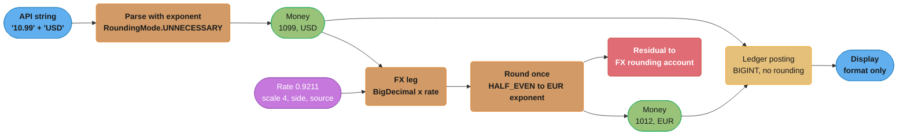

# Money Representation and Currency

> Rules and figures checked 2026-11-06. Every date, threshold and fee on this page comes from the
> fact pins in fintech/CLAUDE.md. Java behavior was run on OpenJDK 25.0.5 (`eclipse-temurin:25-jdk`)
> and SQL on PostgreSQL 18.6. Exchange rates and tax rates in the examples are illustrative.

---

## 1. Concept Overview

Software holds money as a count of the currency's smallest unit plus a currency code. A US dollar
amount of 10.99 is the integer 1099 with the code `USD`. A yen amount of 500 is the integer 500
with the code `JPY`, because the yen has no minor unit. Everything on this page follows from that
one choice: how many minor units a currency has, how wide the integer must be, where rounding
happens, who owns the rounding rule, and what happens to the fraction of a cent that a division
or a currency conversion leaves behind.

The page covers five things:

- Storage types: `long` minor units, fixed-scale decimals (`BigDecimal`, `NUMERIC(p,s)`), and
  128-bit or wider integers for crypto assets.
- ISO 4217 minor-unit exponents, which are 0, 2, 3 or 4 depending on the currency.
- Rounding modes and the context that picks one: FX, tax, interest and allocation.
- Allocation with the largest-remainder method, so that a split never creates or loses a cent.
- FX precision: mid, bid and ask rates, the spread, inverse-rate drift and per-leg rounding.

Why binary floating point cannot hold 0.1 exactly is owned by
[Number Systems and Bit Manipulation](../../cs_fundamentals/number_systems_and_bit_manipulation/number_systems_and_bit_manipulation.md)
§4.5. In short, a `double` stores the nearest binary fraction, so `0.1 + 0.2` prints
`0.30000000000000004` and ten additions of `0.10` give `0.9999999999999999`. This page starts at
the point where you have decided not to use `double` and must still choose a scale, a width and a
rounding rule. Why `BigDecimal.equals` treats `10.0` and `10.00` as different values is in
[Core Language](../../java/core_language/core_language.md). Why the browser never computes a total
is in [Design a Checkout and Payment Flow](../../react/case_studies/design_a_checkout_and_payment_flow.md)
§4.2.

The ledger that stores these amounts is in
[Double-Entry Ledger Design](../double_entry_ledger_design/double_entry_ledger_design.md). The
treasury side of FX (prefunding, hedging, quote-and-lock) is in
[Treasury, Liquidity and FX Operations](../treasury_liquidity_and_fx_operations/treasury_liquidity_and_fx_operations.md).

Not here: IEEE-754 internals and the `BigDecimal` equality trap, which the pages linked above own.

---

## 2. Intuition

> **One-line analogy:** money is a count of coins, not a measurement. You can say "1099 cents"
> exactly. You cannot say "10.99 dollars" exactly in binary, any more than you can write one third
> exactly in decimal.

**Mental model.** Think of each currency as a jar of identical smallest coins. An amount is how
many coins are in the jar. Adding and subtracting amounts in the same currency is exact, because
it is integer arithmetic. Two operations can produce a fraction of a coin: dividing (a split, a
percentage fee, a tax, interest) and converting to another currency's jar. At each of those
points somebody must decide which way the fraction goes and which account receives the leftover
coin. That decision is a business rule with an owner, not a detail of the number type.

**Why it matters.** Money bugs rarely crash. A ledger that loses half a cent per conversion still
posts every entry, prints sensible amounts and passes unit tests that check one transaction at a
time. The error shows up months later as a reconciliation break of a few dollars that no single
row explains. The [payment system study](../../hld/case_studies/design_payment_system.md) War
Story 4 is this failure.

**Key insight.** The amount is only half the value. The other half is the currency, and the
currency carries the exponent. An amount without its currency code is a number with no meaning,
and an exponent hard-coded as 2 is wrong for 17 zero-decimal currencies, 7 three-decimal
currencies and 2 four-decimal currencies on the ISO 4217 list.

---

## 3. Core Principles

1. **An amount is an integer count of minor units plus a currency code.** Store both, pass both,
   compare both. A bare number is not money.
2. **The exponent comes from ISO 4217 or from your PSP's spec, never from the literal 2.** JPY and
   KRW have 0, BHD and KWD have 3, CLF and UYW have 4. A PSP can use a different exponent from ISO
   for a currency, so the boundary to each PSP has its own mapping.
3. **Every division names its scale and its rounding mode.** A decimal type without both is still
   wrong. In Java, `BigDecimal.divide` with no scale throws on `1 / 3`.
4. **Round at defined points, once, and send the remainder somewhere.** A split must sum to the
   original. A conversion's rounding difference goes to a named account, not into the void.
5. **Integer width follows maximum notional times scale.** A `long` holds any fiat amount in cents
   and any bitcoin amount in satoshi. It holds only about 9.22 ether in wei.
6. **A rate is a number with its own precision and its own direction.** Store the rate you used,
   its scale, its source, its timestamp and its side (bid, ask or mid). The inverse of a stored
   rate is a new rate, not a free computation.
7. **Name the currency of every amount in a payment.** Presentment (what the customer saw),
   settlement (what the acquirer paid out) and ledger or functional (what the books are kept in)
   can be three different currencies on one payment.
8. **Never add across currencies.** The type system should refuse `EUR + USD`. A total in mixed
   currencies needs an explicit conversion with a recorded rate.

---

## 4. Types / Architectures / Strategies

### 4.1 Storage representations

| Representation | Exact? | Range | Speed | Use for |
|---|---|---|---|---|
| `long` / `BIGINT` minor units | Yes | about ±9.22e18 minor units | One machine word, one add instruction | Ledger amounts in fiat, satoshi balances |
| `BigDecimal` / `NUMERIC(p,s)` with fixed scale | Yes, at the stated scale | Arbitrary | Slower, heap allocation in Java | Rates, interest accrual, tax computation, intermediate FX math |
| 128-bit integer (`u128`, `NUMERIC(39,0)`) | Yes | about 3.4e38 | Two words | Ledgers built for any asset (TigerBeetle amounts are `u128`) |
| 256-bit integer (`NUMERIC(78,0)`, `BigInteger`) | Yes | about 1.16e77 | Slow | Raw EVM token amounts in wei-like units |
| `double` / `DOUBLE PRECISION` | No | Huge, with gaps | Fast | Never for an amount. Acceptable only for analytics where a cent of error does not matter |
| String at the API boundary | Yes, if parsed with the exponent | Any | Parse cost | JSON payloads, so no client parses an amount into a float |

### 4.2 ISO 4217 minor-unit exponents

The SIX list one, published 2026-09-17, gives these exceptions to the default of 2:

| Exponent | Codes | Example |
|---|---|---|
| 0 | BIF, CLP, DJF, GNF, ISK, JPY, KMF, KRW, PYG, RWF, UGX, UYI, VND, VUV, XAF, XOF, XPF | 500 JPY is stored as `500` |
| 3 | BHD, IQD, JOD, KWD, LYD, OMR, TND | 1.250 KWD is stored as `1250` |
| 4 | CLF, UYW | 1.0000 CLF is stored as `10000` |
| N.A. | Metal and fund codes such as XAU and XDR | No minor unit. Model as a quantity with its own unit |

### 4.3 Rounding modes

Each row shows what the mode does to a value exactly halfway, and to a value that is not halfway.
Rounding is to an integer here; the same rule applies at any scale.

| Mode (`java.math.RoundingMode`) | 2.5 | 3.5 | -2.5 | 2.4 | 2.6 | Typical owner of the rule |
|---|---|---|---|---|---|---|
| `HALF_EVEN` (banker's) | 2 | 4 | -2 | 2 | 3 | Accounting policy, FX desks, aggregates where bias matters |
| `HALF_UP` (away from zero at .5) | 3 | 4 | -3 | 2 | 3 | Tax authorities and invoices that print "round half up" |
| `HALF_DOWN` | 2 | 3 | -2 | 2 | 3 | Rare. Some contracts |
| `DOWN` (truncate toward zero) | 2 | 3 | -2 | 2 | 2 | Interest paid to a customer, fees you may not overcharge |
| `UP` (away from zero) | 3 | 4 | -3 | 3 | 3 | Minimum charges, fees you must not undercharge |
| `FLOOR` / `CEILING` | 2 / 3 | 3 / 4 | -3 / -2 | 2 / 3 | 2 / 3 | Sign-dependent rules, such as "never in the customer's disfavor" |
| `UNNECESSARY` | throws | throws | throws | throws | throws | Parsing input: reject an amount with more decimals than the currency has |

The mode is not a property of the number type. It is a property of the context: the same platform
can use `HALF_UP` on a tax line, `HALF_EVEN` on an FX conversion and `DOWN` on interest it pays.

### 4.4 The currencies of one payment

| Currency | Set by | Example |
|---|---|---|
| Presentment | The merchant, shown to the payer | A US shopper sees 89.00 EUR on a Paris store |
| Cardholder billing | The issuer | The shopper's statement shows the USD amount and any issuer FX fee |
| Settlement | The acquirer or PSP | The merchant's bank receives EUR, or USD if it settles in USD |
| Ledger (functional) | The company's books | A UK company keeps its books in GBP and revalues the EUR balance |

Stripe's currencies page (accessed 2026-11-06) uses the same split: the charge currency is the
presentment currency, and the currency of the destination bank account is the settlement
currency.

### 4.5 Decision model: money type and rounding per context

This is the section's only copy of this decision. Other pages link here.

| Context | Type at rest | Type during computation | Rounding mode | When to round | Where the remainder goes |
|---|---|---|---|---|---|
| Ledger posting (fiat) | `long` minor units, `BIGINT` | `long` with `Math.addExact` | None. Postings are already whole minor units | Never | Not applicable |
| Ledger posting (crypto) | 128-bit or wider integer of base units | `BigInteger` or `u128` | None | Never | Not applicable |
| FX conversion | `long` in each currency, plus the rate as `NUMERIC(18,10)` or similar | `BigDecimal`, scale at least the rate's scale plus the source exponent | `HALF_EVEN` unless the contract says otherwise | Once per leg, on the converted total | An FX rounding or FX gain/loss account |
| Tax | `long` minor units per line and per total | `BigDecimal` | What the tax authority prints, often `HALF_UP` | Per line or per invoice, as the jurisdiction rules. Never both | The tax line itself |
| Interest accrual | Accrued amount at high scale, for example `NUMERIC(24,10)` | `BigDecimal` | Policy, often `DOWN` on interest paid out | At posting time, not daily | Carry the sub-cent remainder into the next period |
| Percentage fee | `long` minor units | `BigDecimal` | As the pricing contract says, often `HALF_UP` or `UP` | Once per transaction or per statement, as priced | The fee itself |
| Split or allocation | `long` minor units per share | `long` | Largest remainder with a fixed tie-break | Once | Assigned one minor unit at a time to the largest fractions |
| Display | Whatever the ledger holds | Locale formatter | None. Format, never round again | Never | Not applicable |

Worked examples for each row are in §6.

---

## 5. Architecture Diagrams

### 5.1 Where an amount changes form



Rounding happens in exactly one node. The parse step rejects precision instead of rounding it,
and the display step formats without rounding again.

### 5.2 Rounding modes on a number line

```
 value:     -2.5      -1.5      -0.5       0.5       1.5       2.5
             |         |         |         |         |         |
 HALF_EVEN  -2        -2         0         0         2         2     ties go to the even neighbour
 HALF_UP    -3        -2        -1         1         2         3     ties go away from zero
 DOWN       -2        -1         0         0         1         2     always toward zero
 FLOOR      -3        -2        -1         0         1         2     always toward -infinity
 CEILING    -2        -1         0         1         2         3     always toward +infinity
```

Only `HALF_EVEN` sends half the ties up and half down. Over many ties its errors cancel, while
`HALF_UP` adds half a unit per tie in one direction. §6.6 measures the difference on 100 values.

### 5.3 Integer width against the largest amount you hold

```
                      digits that fit    largest amount at that scale
 int64  (BIGINT)      18 to 19           92,233,720,368,547,758.07 USD in cents
                                         92,233,720,368.54775807 BTC in satoshi
                                         (the supply cap is 21,000,000 BTC)
                                         9.223372036854775807 ETH in wei          <- too small
 u128                 38 to 39           about 3.4e20 ETH in wei
 uint256              77 to 78           any EVM token amount (NUMERIC(78,0) in Postgres)
```

The same 64 bits that hold 92 quadrillion dollars in cents hold less than ten ether at wei scale. Width
is a function of the largest notional times 10 to the power of the scale.

---

## 6. How It Works - Detailed Mechanics

### 6.1 A money value type

A `Money` record holds a `long` and a `Currency`. Parsing uses `RoundingMode.UNNECESSARY`, so an
input with more decimals than the currency allows is an error, not a silent rounding. Addition
uses `Math.addExact`, so overflow throws instead of wrapping.

```java
import java.math.BigDecimal;
import java.math.RoundingMode;
import java.util.Currency;

public class MoneyDemo {
    record Money(long minor, Currency currency) {
        static Money parse(String amount, String code) {
            Currency c = Currency.getInstance(code);
            int exp = c.getDefaultFractionDigits();
            if (exp < 0) throw new IllegalArgumentException(code + " has no minor unit");
            long minor = new BigDecimal(amount)
                    .setScale(exp, RoundingMode.UNNECESSARY)
                    .unscaledValue().longValueExact();
            return new Money(minor, c);
        }

        Money plus(Money o) {
            if (!currency.equals(o.currency)) {
                throw new IllegalArgumentException(currency + " + " + o.currency);
            }
            return new Money(Math.addExact(minor, o.minor), currency);
        }

        BigDecimal toMajor() {
            return BigDecimal.valueOf(minor, currency.getDefaultFractionDigits());
        }
    }

    public static void main(String[] args) {
        assert Money.parse("10.99", "USD").minor() == 1099;
        assert Money.parse("500", "JPY").minor() == 500;
        assert Money.parse("1.250", "KWD").minor() == 1250;
        assert Money.parse("1", "CLF").minor() == 10000;

        assert Money.parse("4.35", "USD").minor() == 435;   // a double path gives 434, see §10.1

        boolean rejected = false;
        try { Money.parse("10.999", "USD"); } catch (ArithmeticException e) { rejected = true; }
        assert rejected : "three decimals in USD must be rejected, not rounded";

        rejected = false;
        try { Money.parse("1.5", "JPY"); } catch (ArithmeticException e) { rejected = true; }
        assert rejected : "JPY has no minor unit";

        rejected = false;
        try { Money.parse("1", "USD").plus(Money.parse("1", "EUR")); }
        catch (IllegalArgumentException e) { rejected = true; }
        assert rejected : "no cross-currency addition";

        rejected = false;
        try { new Money(Long.MAX_VALUE, Currency.getInstance("USD")).plus(Money.parse("0.01", "USD")); }
        catch (ArithmeticException e) { rejected = true; }
        assert rejected : "overflow must throw";

        System.out.println(Money.parse("1.250", "KWD").toMajor() + " KWD");
    }
}
```

`Currency.getDefaultFractionDigits()` returns 0 for JPY, 3 for KWD, 4 for CLF and -1 for XAU on
JDK 25.0.5. The JDK's currency data is a copy, and it lags ISO: on the same build,
`Currency.getInstance("UYW")` throws `IllegalArgumentException`, although ISO 4217 lists UYW with
exponent 4. A payments system keeps its own currency table, loaded from the ISO list and from each
PSP's spec, and uses `java.util.Currency` only as a convenience.

### 6.2 A currency table in the database

The same rule in SQL: the exponent lives in a table, and an amount column is a `BIGINT` with a
foreign key to the currency. Later fences on this page use these tables.

```sql
CREATE TABLE currency (
    code      CHAR(3)  PRIMARY KEY CHECK (code ~ '^[A-Z]{3}$'),
    exponent  SMALLINT NOT NULL CHECK (exponent BETWEEN 0 AND 4)
);

INSERT INTO currency VALUES
    ('USD', 2), ('EUR', 2), ('GBP', 2), ('JPY', 0), ('KRW', 0),
    ('KWD', 3), ('BHD', 3), ('CLF', 4), ('UYW', 4);

CREATE TABLE price (
    sku          TEXT    PRIMARY KEY,
    amount_minor BIGINT  NOT NULL CHECK (amount_minor >= 0),
    currency     CHAR(3) NOT NULL REFERENCES currency(code)
);

INSERT INTO price VALUES ('mug', 1099, 'USD'), ('tea', 500, 'JPY'), ('dates', 1250, 'KWD');

-- Display: divide by 10^exponent at read time, never store the major amount.
DO $$
DECLARE shown TEXT;
BEGIN
    SELECT (p.amount_minor::numeric / 10 ^ c.exponent)::numeric(20, 4)::text
      INTO shown
      FROM price p JOIN currency c ON c.code = p.currency
     WHERE p.sku = 'dates';
    ASSERT shown = '1.2500', shown;
END $$;
```

### 6.3 Rounding in PostgreSQL depends on the type

`round()` on `numeric` breaks ties away from zero. `round()` on `double precision` uses the
platform's rule, which is ties-to-even on Linux. The same expression gives different cents
depending on how a column was declared.

```sql
DO $$
DECLARE total_type regtype;
BEGIN
    ASSERT round(2.5::numeric) = 3;
    ASSERT round(-2.5::numeric) = -3;
    ASSERT round(2.5::float8) = 2;
    ASSERT round(3.5::float8) = 4;
    ASSERT round(0.125::numeric, 2) = 0.13;
    -- SUM over BIGINT returns NUMERIC, so a database-side total cannot wrap.
    SELECT pg_typeof(sum(x)) INTO total_type
      FROM (VALUES (9223372036854775807::bigint), (1::bigint)) AS t(x);
    ASSERT total_type = 'numeric'::regtype;
END $$;

SELECT sum(x) AS total
  FROM (VALUES (9223372036854775807::bigint), (1::bigint)) AS t(x);
-- 9223372036854775808, one more than BIGINT can hold, returned as numeric
```

PostgreSQL's built-in `money` type is a poor fit for multi-currency systems. It has one fractional
precision for the whole database, taken from the `lc_monetary` setting (`$12.35` for `12.345` under
`en_US.utf8`), so it cannot hold JPY and KWD side by side, and it rounds on input.

### 6.4 Allocation with the largest-remainder method

Splitting 100.00 USD three ways gives 33.333... each. Rounding each share gives 33.33 three times,
which sums to 99.99: one cent disappears. Rounding each share up gives 100.02: two cents appear.
The largest-remainder method fixes the sum first:

1. Give each share the floor of its exact amount.
2. Count the minor units still unassigned: the total minus the sum of the floors.
3. Give one extra minor unit to each share with the largest fractional remainder, in order, with a
   fixed tie-break (lowest index first), until none are left.

```java
import java.util.Arrays;

public class Allocate {
    static long[] allocate(long totalMinor, long[] weights) {
        long weightSum = Arrays.stream(weights).sum();
        long[] shares = new long[weights.length];
        long[] remainders = new long[weights.length];
        long assigned = 0;
        for (int i = 0; i < weights.length; i++) {
            long numerator = Math.multiplyExact(totalMinor, weights[i]);
            shares[i] = numerator / weightSum;
            remainders[i] = numerator % weightSum;
            assigned += shares[i];
        }
        long left = totalMinor - assigned;
        Integer[] order = new Integer[weights.length];
        for (int i = 0; i < order.length; i++) order[i] = i;
        Arrays.sort(order, (a, b) -> remainders[a] != remainders[b]
                ? Long.compare(remainders[b], remainders[a])
                : Integer.compare(a, b));
        for (int k = 0; k < left; k++) shares[order[k]]++;
        return shares;
    }

    public static void main(String[] args) {
        long[] even = allocate(10_000, new long[] {1, 1, 1});
        assert Arrays.equals(even, new long[] {3334, 3333, 3333}) : Arrays.toString(even);

        long[] fee = allocate(5, new long[] {70, 20, 10});
        assert Arrays.stream(fee).sum() == 5;
        assert Arrays.equals(fee, new long[] {4, 1, 0}) : Arrays.toString(fee);

        long[] tiny = allocate(1, new long[] {1, 1, 1});
        assert Arrays.equals(tiny, new long[] {1, 0, 0});

        System.out.println(Arrays.toString(even) + " " + Arrays.toString(fee));
    }
}
```

The 5-cent fee split 70/20/10 has exact shares 3.5, 1.0 and 0.5. The floors are 3, 1 and 0, which
leaves one cent. The largest remainder is 0.5, a tie between the first and third shares, and the
tie-break gives it to the first: 4, 1, 0. The tie-break must be deterministic and stored with the
code, because a replay of the same split must produce the same cents.

### 6.5 FX conversion across exponents

A conversion multiplies the source amount in major units by the rate, then rounds once to the
target currency's exponent. With an illustrative rate of 151.237 JPY per USD, 10.00 USD is
1512.37 JPY before rounding and 1512 JPY after `HALF_EVEN`. With 0.30712 KWD per USD, 10.00 USD is
3.0712 KWD before rounding and 3.071 KWD (stored as `3071`) after.

Three rules keep conversions exact enough to reconcile:

- **Convert totals, not lines.** Converting three 1.05 USD items at 0.9211 EUR per USD line by line
  gives 0.97 x 3 = 2.91 EUR. Converting the 3.15 USD total gives 2.90 EUR. The two cents of
  difference are real money, and the customer's receipt and the ledger must use the same rule.
- **Store the rate with its scale, side, source and timestamp.** "0.9211" means nothing without
  "EUR per USD, ask, provider X, 2026-11-06T14:00:00Z".
- **Book the rounding residual.** The exact converted value minus the rounded value goes to an FX
  rounding account, so the books show where every fraction went. The ledger entry shape is in
  [Double-Entry Ledger Design](../double_entry_ledger_design/double_entry_ledger_design.md) §6.6.

```sql
CREATE TABLE fx_rate (
    base       CHAR(3)        NOT NULL REFERENCES currency(code),
    quote      CHAR(3)        NOT NULL REFERENCES currency(code),
    side       TEXT           NOT NULL CHECK (side IN ('bid', 'ask', 'mid')),
    rate       NUMERIC(18,10) NOT NULL CHECK (rate > 0),
    source     TEXT           NOT NULL,
    as_of      TIMESTAMPTZ    NOT NULL,
    PRIMARY KEY (base, quote, side, as_of)
);

INSERT INTO fx_rate VALUES
    ('USD', 'JPY', 'mid', 151.237,  'illustrative', '2026-11-06T14:00:00Z'),
    ('USD', 'KWD', 'mid', 0.30712,  'illustrative', '2026-11-06T14:00:00Z');

-- Convert minor units across exponents, then round once with ties-to-even.
CREATE FUNCTION convert_minor(amount BIGINT, src CHAR(3), dst CHAR(3), r NUMERIC)
RETURNS BIGINT LANGUAGE sql IMMUTABLE AS $$
    WITH e AS (
        SELECT (SELECT exponent FROM currency WHERE code = src) AS es,
               (SELECT exponent FROM currency WHERE code = dst) AS ed
    ), x AS (
        SELECT amount::numeric / 10 ^ es * r * 10 ^ ed AS v FROM e
    )
    SELECT CASE
             WHEN v - trunc(v) = 0.5  THEN (trunc(v) + (trunc(v)::bigint % 2))::bigint
             WHEN v - trunc(v) = -0.5 THEN (trunc(v) - (abs(trunc(v)::bigint) % 2))::bigint
             ELSE round(v)::bigint
           END
      FROM x
$$;

DO $$
BEGIN
    ASSERT convert_minor(1000, 'USD', 'JPY', 151.237) = 1512;
    ASSERT convert_minor(1000, 'USD', 'KWD', 0.30712) = 3071;
    ASSERT convert_minor(1, 'USD', 'JPY', 150) = 2;   -- 1.5 rounds to the even 2
    ASSERT convert_minor(1, 'USD', 'JPY', 250) = 2;   -- 2.5 rounds to the even 2
END $$;
```

PostgreSQL has no `HALF_EVEN` for `numeric`, so the function implements it. Leaving it as
`round(v)` would silently switch the FX rule to ties-away-from-zero.

### 6.6 Why `HALF_EVEN` for aggregates

Take the 100 values 0.005, 0.015, ..., 0.995. Every one is a tie at two decimals. Their exact sum
is 50.000.

| Rounding | Sum after rounding each value | Error |
|---|---|---|
| Exact | 50.000 | 0 |
| `HALF_UP` | 50.50 | +0.50 |
| `HALF_EVEN` | 50.00 | 0 |

`HALF_UP` pushes every tie the same way, so the bias grows with the count. `HALF_EVEN` sends half
of the ties down. Use it where many rounded values are summed and no external rule says otherwise.
A tax authority that prints "round half up" overrides it on tax lines.

### 6.7 Mid, bid, ask and inverse-rate drift

A dealer quotes two prices. The bid is what the dealer pays for the base currency, the ask is what
it charges, and the mid is halfway. A customer who buys EUR with USD gets the ask side; the spread
between that rate and the mid is the platform's FX revenue, and it belongs on its own ledger line
so finance can see it.

The inverse of a rounded rate is not the rounded inverse. With an illustrative mid of 1.0857 USD
per EUR:

| Step | Value |
|---|---|
| Exact inverse 1 / 1.0857 | 0.92106475085... EUR per USD |
| Inverse stored at scale 4 | 0.9211 |
| 1,000,000.00 USD x 0.9211 | 921,100.00 EUR |
| 1,000,000.00 USD / 1.0857, rounded once | 921,064.75 EUR |
| Difference | 35.25 EUR |

At scale 4 the inverse is off by about 0.4 basis points, which is 35.25 EUR on a million. The fix
is to store each direction as its own quoted rate, or to keep the rate at a scale where the drift
is below one minor unit at your largest notional.

### 6.8 Tax: per line or per invoice

With an illustrative tax rate of 8.25% and three lines of 0.99:

- Per line: 0.99 x 0.0825 = 0.081675, rounded `HALF_UP` to 0.08, times 3 lines = 0.24.
- Per invoice: 2.97 x 0.0825 = 0.245025, rounded `HALF_UP` to 0.25.

Both methods are legitimate. The jurisdiction or the tax engine decides which one applies, and
the invoice, the ledger and the tax report must all use the same one. Mixing them produces a
one-cent break per invoice that reconciliation will find thousands of times. The tax rules
themselves are in [Tax for Payment Engineers](../tax_for_payment_engineers/tax_for_payment_engineers.md).

### 6.9 Interest accrual

Interest accrues daily but posts monthly. Accrue at a high scale (for example 10 decimals) and
round only when the amount posts to the ledger. Carry the unposted fraction into the next period
so it is not lost. Rounding daily to cents and summing 30 roundings can differ from rounding the
monthly total by several cents per account, which across a million accounts is a material number.

### 6.10 Crypto amounts

Bitcoin Core stores amounts as `CAmount`, an `int64_t` of satoshi. One bitcoin is 100,000,000
satoshi and the consensus maximum is 21,000,000 x 100,000,000 = 2.1e15 satoshi, far below the
int64 maximum of about 9.22e18. Ether uses 1e18 wei per ether, so an int64 holds at most about
9.22 ether in wei, and the EVM itself works in 256-bit words. A ledger that holds both needs
128-bit amounts or more, or a per-asset scale that trades precision for range. The custody side is
in [Crypto Custody and On-Chain Operations](../crypto_custody_and_onchain_operations/crypto_custody_and_onchain_operations.md).

---

## 7. Real-World Examples

- **ISO 4217 maintenance.** SIX Financial Information publishes the ISO 4217 lists. List one,
  published 2026-09-17, carries the exponents in §4.2. Currencies change: the list is data that a
  payments platform reloads, not a constant compiled into code.
- **Stripe amounts.** Stripe's API expects every `amount` in the currency's minor unit: `1099`
  charges 10.99 USD and `10` charges 10 JPY. Stripe's currencies page (accessed 2026-11-06) lists
  special cases where its exponent differs from ISO. ISK and UGX are zero-decimal in ISO 4217, but
  Stripe requires them as two-decimal values whose last two digits are `00`, so 5 ISK is sent as
  `500`. HUF and TWD charge with two decimals, but Stripe treats them as zero-decimal for payouts,
  so a manual payout amount must be divisible by 100. This is why the exponent mapping lives at
  each PSP boundary.
- **Stripe digit limits.** The same page limits most card charges to 12 digits of minor units,
  999,999,999,999. A field width is a business limit as well as a storage one.
- **Bitcoin Core.** `CAmount` is `int64_t`, and `MAX_MONEY` is 21,000,000 x `COIN`, so every valid
  satoshi amount fits in a signed 64-bit integer with room to spare.
- **TigerBeetle.** Account balances and transfer amounts are 128-bit unsigned integers, and accounts
  carry a `ledger` field that groups them by asset. A transfer can move value only between two
  accounts on the same ledger, so a currency conversion is two transfers, one per ledger.
- **Square Books.** Square's immutable double-entry service stores debits as positive and credits
  as negative amounts, and every journal entry must sum to zero (Square engineering blog,
  2019-10-16). The sign convention only works when amounts are exact integers.

---

## 8. Tradeoffs

### 8.1 `long` minor units against fixed-scale decimal

| Concern | `long` minor units | `BigDecimal` / `NUMERIC` with fixed scale |
|---|---|---|
| Exactness | Exact for whole minor units | Exact at the declared scale |
| Speed | One CPU instruction per add | Object allocation and slower arithmetic |
| Overflow | Possible. Use `Math.addExact` | No overflow in practice |
| Sub-minor precision (rates, accruals) | Not possible without a second scale | Natural |
| Multi-currency in one column | Needs the currency's exponent at every read | Needs a scale large enough for the widest currency, which pads the others |
| Equality | `==` works | `compareTo`, not `equals` (scale-sensitive) |
| Typical use | Ledger amounts, balances | Rates, interest, tax math, intermediate FX |

### 8.2 Where to round

| Choice | Benefit | Cost |
|---|---|---|
| Round per line | Every line on the receipt adds up visibly | Sum of rounded lines differs from the rounded total |
| Round per total | Smallest total error | Lines no longer sum to the total without an adjustment line |
| Round per leg in a multi-leg FX route | Each leg settles in whole minor units | Errors compound across legs. Book each leg's residual |
| Round once at the end of a chain | Least error | Intermediate legs carry sub-minor amounts, which a ledger cannot post |

---

## 9. When to Use / When NOT to Use

**Use `long` minor units when:**

- The value is a fiat ledger amount, a balance, a price or a fee already computed.
- The asset's maximum notional times 10 to the power of its exponent fits in 63 bits.

**Use `BigDecimal` or `NUMERIC` with an explicit scale and rounding mode when:**

- You compute something that is not yet a postable amount: an FX conversion, a tax, a percentage
  fee, an interest accrual.
- You store a rate.

**Use 128-bit or wider integers when:**

- The ledger holds crypto assets with 18 decimals, or any asset whose notional times scale exceeds
  about 9.22e18.

**Do not:**

- Use `double` or `float` for any amount that reaches a ledger, an invoice or a payout.
- Use `new BigDecimal(double)`. It captures the binary error exactly:
  `new BigDecimal(0.1)` is `0.1000000000000000055511151231257827021181583404541015625`.
- Hard-code `/ 100` or `* 100` anywhere.
- Use PostgreSQL's `money` type in a multi-currency schema.
- Send amounts as JSON numbers that a JavaScript client parses into a float. Send a string or an
  integer of minor units, always with the currency code.

---

## 10. Common Pitfalls

### 10.1 Parsing an amount through `double`

An API receives `"4.35"`, parses it with `Double.parseDouble` and multiplies by 100. The product
is 434.99999999999994, and the cast to `long` truncates it.

```java
// BROKEN
public class ParseBroken {
    static long toCents(String amount) {
        return (long) (Double.parseDouble(amount) * 100);
    }

    public static void main(String[] args) {
        System.out.println(toCents("4.35"));   // 434
        System.out.println(toCents("1.15"));   // 114
        System.out.println(toCents("0.29"));   // 28
        double total = 0;
        for (int i = 0; i < 1000; i++) total += 19.99;
        System.out.println(total);             // 19990.000000000135
    }
}
```

Each of these loses a cent with no exception. The bug passes a test on `"10.00"` and fails on a
customer's `"4.35"`.

```java
// FIX
import java.math.BigDecimal;
import java.math.RoundingMode;

public class ParseFix {
    static long toMinor(String amount, int exponent) {
        return new BigDecimal(amount)
                .setScale(exponent, RoundingMode.UNNECESSARY)
                .unscaledValue().longValueExact();
    }

    public static void main(String[] args) {
        assert toMinor("4.35", 2) == 435;
        assert toMinor("1.15", 2) == 115;
        assert toMinor("0.29", 2) == 29;
        long total = 0;
        for (int i = 0; i < 1000; i++) total = Math.addExact(total, toMinor("19.99", 2));
        assert total == 1_999_000;
        System.out.println(total);
    }
}
```

The string goes straight to `BigDecimal`, which holds `4.35` exactly, and the sum stays in `long`.

### 10.2 Dividing without a scale

`BigDecimal.ONE.divide(new BigDecimal("3"))` throws `ArithmeticException: Non-terminating decimal
expansion`. A team that catches the exception and retries with `doubleValue()` division has
reintroduced the float. The fix is `divide(divisor, scale, RoundingMode.X)` with a scale and mode
picked from the §4.5 decision table.

### 10.3 Trusting `java.util.Currency` as the currency list

A platform validates incoming currency codes with `Currency.getInstance`. ISO adds or changes a
code, and the JDK's copy is older. On JDK 25.0.5, `UYW` throws although ISO 4217 lists it. The
reverse also happens: a code ISO withdrew can still be in the JDK. Keep a currency table loaded
from the ISO list and from each PSP's documentation, with the PSP's own exponent per currency.

### 10.4 Splitting by rounding each share

A marketplace splits a 100.00 USD order among three sellers with
`Math.round(10000 / 3.0)` per seller. Each gets 3333 cents and one cent stays in the platform's
clearing account with no ledger entry to explain it. After a million orders, the clearing account
holds 10,000 USD that no report attributes. §6.4 is the fix: allocate with the largest remainder so
the shares always sum to the total.

### 10.5 Rounding twice

A service converts at scale 4, rounds to cents for the API response, and a second service reads the
rounded amount and converts it again for the settlement currency. Each leg rounds, and the
residuals are never booked. Round once per postable leg, and pass the unrounded value plus the
rate between services when another conversion follows.

### 10.6 Silent wrap in a Java sum

`LongStream.sum()` and `+=` on `long` wrap on overflow without an error. A batch job that sums
balances in a crypto asset with 18 decimals wraps to a negative total. Use `Math.addExact` in the
loop, or sum in `BigInteger`. On the database side, PostgreSQL's `SUM(bigint)` returns `numeric`
and cannot wrap (§6.3).

---

## 11. Technologies & Tools

| Tool | What it does for money representation |
|---|---|
| Joda-Money | Java `Money` and `BigMoney` types with a currency and explicit rounding on every scale change |
| Moneta | Reference implementation of the Java money API (JSR 354), with currency units and rounding providers |
| ICU4J | Locale-aware currency formatting and parsing, including the symbol position and the number of decimals shown |
| PostgreSQL | `BIGINT` for minor units, `NUMERIC(p,s)` for rates and accruals; avoid its `money` type for multi-currency data |
| TigerBeetle | Ledger database with 128-bit unsigned amounts and a per-account `ledger` field for the asset |

Version notes: behavior on this page was run on OpenJDK 25.0.5 and PostgreSQL 18.6.
`java.util.Currency` data is tied to the JDK build, so a JDK upgrade can change which codes it
accepts.

---

## 12. Interview Questions with Answers

**Q: Why is `double` wrong for money even if you round the result before display?**
**Short:** A double holds the nearest binary fraction, so errors enter at parse time and accumulate in sums before any display rounding can hide them.

The decimal 4.35 has no exact binary form, and `4.35 * 100` is 434.99999999999994. A cast to
`long` gives 434 cents. Display rounding cannot fix a value that a ledger already posted, and it
cannot fix a sum: one thousand additions of 19.99 give 19990.000000000135. Each error is small and
none throws, which is why the failure shows up months later in reconciliation. Parse amounts
straight from a string into `BigDecimal` or `long` minor units.

**Q: Is switching from `double` to `BigDecimal` enough to make money code correct?**
**Short:** No, a BigDecimal still needs a fixed scale and a named rounding mode at every division, or it throws or produces amounts with too many decimals.

`BigDecimal.ONE.divide(new BigDecimal("3"))` throws because the result does not terminate. A
multiplication by a rate returns more decimals than the currency allows, and something must round
it. `new BigDecimal(0.1)` copies the binary error of the `double` exactly. `equals` treats 10.0 and
10.00 as different. The type removes one class of error and leaves the decisions: which scale,
which mode, at which point, and where the remainder goes.

**Q: Why is hard-coding a divide by 100 a bug?**
**Short:** ISO 4217 exponents are 0, 2, 3 or 4, so dividing by 100 is wrong for JPY, KRW and 15 other zero-decimal codes, the seven three-decimal codes and CLF and UYW.

A JPY amount of 500 is 500 yen, and dividing by 100 shows 5.00. A KWD amount of 1250 is 1.250
dinars, and dividing by 100 shows 12.50. The exponent belongs to the currency, so every conversion
between minor and major units reads it from a currency table. The bug usually ships when a
platform adds its first non-two-decimal market.

**Q: Can you rely on `java.util.Currency` as your list of valid currencies?**
**Short:** No, the JDK carries its own copy of the ISO data, and on JDK 25.0.5 `Currency.getInstance("UYW")` throws although ISO lists UYW.

The JDK's currency data changes only when the JDK changes. ISO 4217 changes on its own schedule,
and your PSPs have their own exponents. Keep a currency table loaded from the ISO list, add a
per-PSP mapping, and use `java.util.Currency` only for convenience such as symbols. Treat a code
the table rejects as a data problem, not as an exception path.

**Q: Can a PSP use a different number of decimals than ISO 4217 for the same currency?**
**Short:** Yes, Stripe takes ISK and UGX as two-decimal values ending in 00 although ISO gives them exponent 0, so each PSP boundary needs its own exponent map.

Stripe's currencies page (accessed 2026-11-06) says 5 ISK goes on the wire as `500`. It also
requires manual payouts in HUF and TWD to be divisible by 100 although it charges them with two
decimals. If
your internal amount is 5 ISK stored as `5`, the adapter multiplies by 100 on the way out and
divides on the way in. A single global exponent per currency charges the customer the wrong amount
at one of the two ends.

**Q: Why do accountants prefer `HALF_EVEN` to `HALF_UP`?**
**Short:** HALF_EVEN sends half of the exact ties down and half up, so rounding errors cancel in a sum instead of piling up in one direction.

Round the 100 values 0.005, 0.015, ..., 0.995 to cents. The exact sum is 50.000. `HALF_UP` gives
50.50 because every tie rounds up. `HALF_EVEN` gives 50.00. The bias of `HALF_UP` grows with the
number of ties, which matters in FX batches and interest runs. A tax authority or a contract that
says "half up" still wins on the lines it governs.

**Q: Does PostgreSQL's `round()` give the same result on `numeric` and `double precision`?**
**Short:** No, `round(2.5::numeric)` is 3 because numeric breaks ties away from zero, while `round(2.5::float8)` is 2 because it uses the platform's ties-to-even rule.

The behavior follows the argument type, so a column declared as `float8` and a column declared as
`numeric` round the same value to different cents. PostgreSQL has no ties-to-even mode for
`numeric`, so FX code that needs `HALF_EVEN` in SQL implements it, as `convert_minor` does in §6.5.
Keep money columns in `BIGINT` or `numeric` and never let a cast to `float8` creep in.

**Q: How do you split 100.00 USD among three parties without losing or creating a cent?**
**Short:** Give each party the floor of its exact share, then hand the leftover cents one at a time to the shares with the largest remainders, with a fixed tie-break.

The floors are 3333 cents each, 9999 in total, so one cent is left. All three remainders are equal,
so the tie-break (lowest index first) gives it to the first party: 3334, 3333, 3333. The method
works for weighted splits as well: 5 cents split 70/20/10 becomes 4, 1 and 0. The shares always sum
to the total, and a replay gives the same answer because the tie-break is part of the code.

**Q: Why must the allocation tie-break be deterministic?**
**Short:** A replay, a reconciliation or a refund must produce the same cents per party, and a random or hash-order tie-break gives a different split each time.

A refund of a split order reverses each party's share. If the split recomputes with a different
tie-break, the refund takes a cent from the wrong seller and that seller's balance never
reconciles. Sort by remainder, then by a stable key such as the party's position in the contract.
Store the computed shares with the transaction rather than recomputing them later.

**Q: When do you store money as `long` minor units and when as a fixed-scale `NUMERIC`?**
**Short:** Store postable amounts as BIGINT minor units, and use NUMERIC with an explicit scale for values that are not yet postable, such as rates, accruals and tax math.

`BIGINT` is exact for whole minor units, compares with `=`, and is fast. It cannot hold 0.3 of a
cent, which a rate or an accrual needs. `NUMERIC(24,10)` holds the accrual, and the posting rounds
it once to a `BIGINT`. A single `NUMERIC(19,4)` column for every currency works too, but it pads
JPY with four meaningless zeros and still needs the currency's exponent to validate input.

**Q: How many bits do you need to hold crypto amounts?**
**Short:** Satoshi fit in int64 because the 2.1e15 maximum is far below 9.22e18, but int64 holds only about 9.22 ether in wei, so ether needs 128 bits or more.

The width is the largest notional times 10 to the power of the scale. Bitcoin Core's `CAmount` is
`int64_t`. One ether is 1e18 wei, so a balance of ten ether already overflows a `long`. The EVM
uses 256-bit words. A multi-asset ledger uses 128-bit amounts (TigerBeetle's are `u128`) or
`NUMERIC(78,0)` in Postgres for raw 256-bit token amounts.

**Q: Where does the fraction of a cent go after a currency conversion?**
**Short:** Into a named FX rounding or FX gain and loss account, so the books show every fraction and both sides of the conversion still balance.

The converted amount is rounded to the target currency's exponent, and the difference between the
exact and the rounded value is booked. Without that entry, the source and target sides of the
conversion differ by a fraction that no account holds, and reconciliation reports a break it cannot
explain. The entry shape is in the ledger module's FX section.

**Q: Why can you not compute an inverse rate as one divided by the stored rate?**
**Short:** The stored rate is already rounded, so its inverse carries that error magnified by the notional, which is 35.25 EUR on 1,000,000 USD at scale 4.

With 1.0857 USD per EUR, the exact inverse is 0.921064750... and the scale-4 inverse is 0.9211.
Converting 1,000,000 USD with 0.9211 gives 921,100.00 EUR, while dividing by 1.0857 once gives
921,064.75 EUR. Quote each direction as its own rate, or store rates at a scale where the error is
below one minor unit at your largest notional.

**Q: Which rate do you book when a customer converts USD to EUR on your platform?**
**Short:** Book the customer's rate on the customer's leg and the mid or cost rate on the treasury leg, so the spread lands as FX revenue on its own line.

The customer buys EUR, so they get the ask side. If the ledger books only the customer rate, the
spread is invisible inside the converted amount. Recording both rates and the source and timestamp
of each lets finance report FX revenue and lets reconciliation match the treasury trade. How the
treasury side covers the position is in the treasury module.

**Q: What are presentment, settlement and ledger currency?**
**Short:** Presentment is what the payer saw, settlement is what the acquirer paid the merchant in, and ledger currency is what the books are kept in, and one payment can have all three.

A US cardholder pays a French store 89.00 EUR (presentment). The issuer bills the cardholder in
USD. The acquirer settles to the merchant in EUR or, by agreement, in another currency. A UK parent
company consolidates in GBP. Each conversion has a rate, a party that chose it and a rounding
residual, so each amount in the payment record carries its own currency code.

**Q: Should you round tax per line or per invoice?**
**Short:** Whichever the jurisdiction or the tax engine specifies, applied the same way on the invoice, the ledger and the tax report, since the two methods differ by a cent.

Three lines of 0.99 at 8.25% give 0.24 rounded per line and 0.25 rounded on the 2.97 total. Both
methods are in use. The failure is mixing them: the checkout shows one, the invoice service
computes the other, and each invoice opens a one-cent break. Store the method with the tax
calculation, not as a code default.

**Q: How should a JSON API carry an amount?**
**Short:** As an integer of minor units or a decimal string, always with an explicit currency code, never as a JSON number with decimals that a client parses into a float.

JavaScript parses every JSON number into a 64-bit float, so `"amount": 4.35` arrives as
4.3499999999999996447. An integer of minor units is exact up to 2^53 in JavaScript, which covers
most fiat amounts. A decimal string is exact at any size. Stripe uses integers of minor units.
Either way, the currency code travels in the same object.

**Q: What does `Math.addExact` protect against that `LongStream.sum` does not?**
**Short:** addExact throws ArithmeticException on overflow, while LongStream.sum and plain `+` wrap around to a negative number with no error.

A wrapped balance is a valid-looking `long`, so it posts and propagates. An exception stops the
batch at the bad row. In Java, use `Math.addExact` and `Math.multiplyExact` for money arithmetic,
or `BigInteger` for assets near the 64-bit limit. In SQL, `SUM(bigint)` returns `numeric` and
cannot wrap, but inserting that sum back into a `BIGINT` column can still fail.

**Q: When should interest round to the currency's minor unit?**
**Short:** At posting time, not at each daily accrual, carrying the unposted fraction into the next period so no fraction of a cent is lost.

Daily accrual at a high scale, rounded once per posting, matches the contract's annual rate most
closely. Rounding each day to cents compounds 30 roundings per month. The rounding mode for interest
paid to customers is a policy decision, often `DOWN` so the platform never pays more than the rate,
and it belongs in the product's terms.

**Q: Why is PostgreSQL's `money` type a poor fit for a payments schema?**
**Short:** It has one fractional precision for the whole database, set by lc_monetary, so it cannot hold JPY and KWD side by side and it rounds input to that precision.

Under `en_US.utf8`, `12.345::money` is stored as `$12.35`. A three-decimal KWD amount loses a digit
and a JPY amount gains two fake decimals. Its output also depends on a session setting, which makes
exports locale-dependent. Use `BIGINT` minor units with a currency column instead.

**Q: Why convert a cart total once instead of converting each line?**
**Short:** Each line rounds separately, so the sum of converted lines can differ from the converted total, and the customer's receipt and the ledger must agree.

Three items of 1.05 USD at 0.9211 EUR per USD convert to 0.97 EUR each, which is 2.91 EUR. The
3.15 USD total converts to 2.90 EUR. Convert the amount that settles, show line amounts as
informational, and add an explicit adjustment line if the receipt must show converted lines that
sum to the converted total.

---

## 13. Best Practices

- Model money as a value type that holds a `long` (or wider integer) and a currency, and refuses
  cross-currency arithmetic.
- Parse amounts from strings with `RoundingMode.UNNECESSARY`, so extra decimals are rejected.
- Keep a currency table from the ISO 4217 list, with a per-PSP exponent override.
- Name the scale and rounding mode at every division, and take them from the §4.5 table.
- Allocate with the largest remainder and a stored, deterministic tie-break.
- Store every FX rate with its direction, side, scale, source and timestamp, and store it on the
  transaction that used it.
- Book every rounding residual to a named account.
- Use `Math.addExact` in Java money loops, and keep database totals in `numeric`.
- Send amounts over JSON as integers of minor units or as strings, always with the currency code.
- Add a property test: for random splits and conversions, the parts sum to the whole and the books
  balance per currency. The invariants are collected in
  [money movement invariants](../case_studies/cross_cutting/money_movement_invariants.md).

---

## 14. Case Study

### Seller payouts in a second currency

**Context.** A marketplace charges buyers in EUR and pays sellers in USD. Each order can hold items
from several sellers, and the platform keeps a 10% commission. Finance reports that the USD payout
clearing account drifts by a few dollars a week, always in the same direction, and no single order
looks wrong.

**First version.** The payout service converts each seller's EUR share to USD with a `double`
rate, rounds each converted share to cents, and computes the commission per seller with
`Math.round`.

```java
// BROKEN
public class PayoutBroken {
    public static void main(String[] args) {
        double rateUsdPerEur = 1.0857;
        long[] sellerShareEurCents = {3334, 3333, 3333};  // a 100.00 EUR order, three sellers
        long paidUsdCents = 0;
        long commissionUsdCents = 0;
        for (long share : sellerShareEurCents) {
            double usd = share / 100.0 * rateUsdPerEur;
            long commission = Math.round(usd * 0.10 * 100);
            long payout = Math.round(usd * 100) - commission;
            paidUsdCents += payout;
            commissionUsdCents += commission;
        }
        long orderUsdCents = Math.round(100.00 * rateUsdPerEur * 100);
        System.out.println("order " + orderUsdCents + ", paid " + paidUsdCents
                + ", commission " + commissionUsdCents
                + ", unexplained " + (orderUsdCents - paidUsdCents - commissionUsdCents));
        // order 10857, paid 9772, commission 1086, unexplained -1
    }
}
```

Each seller's converted share rounds on its own and each commission rounds on its own, so the
parts sum to 10858 cents against an order worth 10857. The platform pays one cent more than it
received on this order. The direction depends on the rate and the shares, but with this
marketplace's typical order mix it is mostly one way, which is why the drift grows.

**Fix.** Convert the order total once with `BigDecimal` and `HALF_EVEN`, book the conversion
residual, then split the USD amount with the largest-remainder method. The commission is
computed once on the order and allocated the same way.

```java
// FIX
import java.math.BigDecimal;
import java.math.RoundingMode;
import java.util.Arrays;

public class PayoutFix {
    static long[] allocate(long total, long[] weights) {
        long sum = Arrays.stream(weights).sum();
        long[] out = new long[weights.length];
        long[] rem = new long[weights.length];
        long assigned = 0;
        for (int i = 0; i < weights.length; i++) {
            long n = Math.multiplyExact(total, weights[i]);
            out[i] = n / sum;
            rem[i] = n % sum;
            assigned += out[i];
        }
        Integer[] order = new Integer[weights.length];
        for (int i = 0; i < order.length; i++) order[i] = i;
        Arrays.sort(order, (a, b) -> rem[a] != rem[b] ? Long.compare(rem[b], rem[a]) : Integer.compare(a, b));
        for (long k = 0; k < total - assigned; k++) out[order[(int) k]]++;
        return out;
    }

    public static void main(String[] args) {
        BigDecimal rate = new BigDecimal("1.0857");
        long orderEurCents = 10_000;
        long[] sellerShareEurCents = {3334, 3333, 3333};

        BigDecimal exactUsd = BigDecimal.valueOf(orderEurCents, 2).multiply(rate);
        long orderUsdCents = exactUsd.setScale(2, RoundingMode.HALF_EVEN).unscaledValue().longValueExact();
        BigDecimal residual = exactUsd.subtract(BigDecimal.valueOf(orderUsdCents, 2));

        long commission = BigDecimal.valueOf(orderUsdCents).multiply(new BigDecimal("0.10"))
                .setScale(0, RoundingMode.HALF_EVEN).longValueExact();
        long[] payouts = allocate(orderUsdCents - commission, sellerShareEurCents);

        long paid = Arrays.stream(payouts).sum();
        assert orderUsdCents == 10_857;
        assert paid + commission == orderUsdCents : "parts must sum to the order";
        assert residual.compareTo(BigDecimal.ZERO) == 0;
        System.out.println("payouts " + Arrays.toString(payouts) + ", commission " + commission
                + ", FX residual " + residual.toPlainString() + " USD");
    }
}
```

The order converts once to 10857 cents. The commission is 1086 cents, and the remaining 9771 cents
split by the sellers' EUR weights into 3257 each. The parts sum to the order on every order, so
the clearing account drifts only by booked FX residuals, which finance can report. Here the
residual is zero because 100.00 x 1.0857 has no digits past the cent. The same rule applies to
refunds: a refund reverses the stored shares, not a recomputed split.

**Takeaway.** Convert once, round once, allocate with the largest remainder, and book whatever is
left. A split or a conversion that rounds each piece on its own will drift, and the drift has a
direction.
