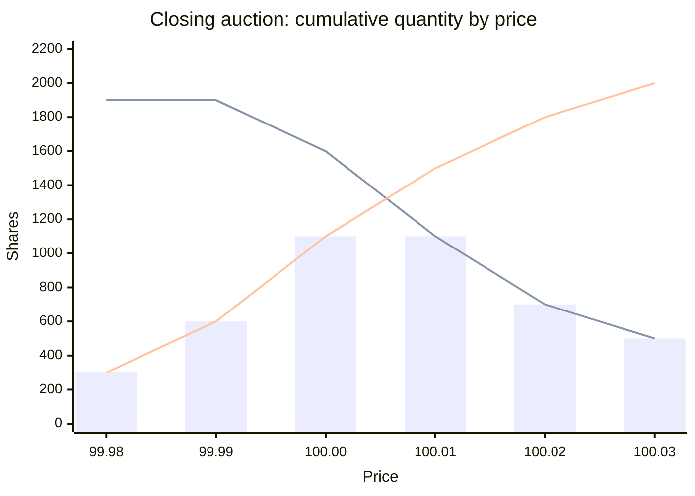
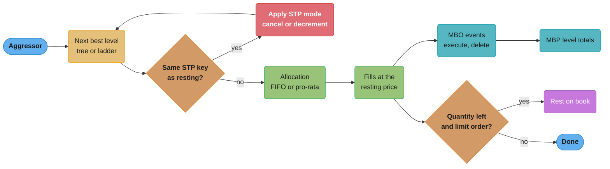

# Order Books and Matching Engines

> Rules and figures checked 2026-11-06. Every date, threshold and fee on this page comes from the
> fact pins in fintech/CLAUDE.md. The Coinbase self-trade prevention wording and the Nasdaq
> TotalView-ITCH 5.0 message semantics were read from the vendor documents on 2026-11-06, and the
> CME pro-rata minimum rule from the CME Globex matching-algorithm pages on the same day. Order
> sizes, prices and allocation parameters in the examples are illustrative.

---

## 1. Concept Overview

An order book is the set of resting orders for one instrument, kept in priority order. A
matching engine applies an incoming order to the book and produces fills, book changes and
reports. The baseline is price-time priority: best price first, then first in, first out at
that price.

This page covers what the baseline leaves out:

- book structures past the red-black tree: the array price ladder, the hybrid ladder, intrusive
  order lists and an order-id map that make cancel O(1),
- allocation algorithms past FIFO: pro-rata, minimum allocation, split FIFO and pro-rata,
  top-order and lead market maker priority,
- self-trade prevention modes and the key that decides "same owner",
- auction uncrossing (maximize volume, minimize imbalance, stay near the reference price),
- what the engine emits for market-by-order and market-by-price feeds, and implied orders,
- the invariants of a correct book and how to test a matcher with generated order streams.

The decision model on this page picks a matching algorithm per product and a book structure
per instrument.

The `TreeMap<Long, Deque<Order>>` book with price-time priority, the FOK dry run, prices as
`long` ticks and trades at the resting price are built in
[Order Matching Engine](../../lld/system_design_problems/OrderMatchingEngine.md). The
distributed exchange around the book (sequencer, single writer per symbol, the tree vs array
comparison table) is in [System Design: Stock Exchange](../../hld/case_studies/design_stock_exchange.md)
§4.1 and §5. This page links to both and builds on them.

---

## 2. Intuition

**One-line analogy.** A price level is a queue at a ticket counter. FIFO serves people in the
order they joined. Pro-rata splits the tickets among everyone in the queue by how many each one
asked for.

**Mental model.** Matching is two decisions made again and again:

1. **Which price level is next?** The book structure answers this. A tree finds it by walking
   nodes. An array ladder finds it by index and then scans past empty levels.
2. **Who at that level gets how much?** The allocation algorithm answers this. FIFO gives
   everything to the oldest order first. Pro-rata gives each order a share in proportion to its
   size.

Self-trade prevention, hidden orders and lead market makers are rules that change the second
answer for some orders.

**Why it matters.** The allocation rule changes trader behaviour. Under FIFO traders race for
queue position with small orders. Under pro-rata they post larger orders than they want, because
size buys allocation. A venue that changes the algorithm for a product changes how that market
quotes.

**Key insight.** A book is correct when a short list of invariants holds after every event: no
cross, quantity conserved, every order in exactly one place, and every fill inside both limits.
Write the invariants as code and run millions of generated events through them. That finds bugs
that hand-written cases never reach.

---

## 3. Core Principles

- **One writer per book.** All the structures below assume one thread mutates the book. That is
  why none of them uses locks. The reasons are in the stock exchange study §4.2.
- **Separate price lookup from order lookup.** Price lookup finds the next level. Order lookup
  finds one order by id for cancel and replace. A tree serves the first. Only a hash map from
  order id to a node serves the second in O(1).
- **Allocation is a product rule, not an engine constant.** CME Globex sets the matching
  algorithm per product, with codes such as F (FIFO), A (Allocation), K (configurable split of
  FIFO and pro rata with a lead market maker) and Q (threshold pro rata with a lead market
  maker).
- **FIFO wins when the aggressor clears the level.** CME applies FIFO in place of the product
  algorithm when the aggressor quantity is at or above the displayed quantity at the level. If
  every resting order fills in full, the split does not matter.
- **Every rounding in allocation needs a rule for the remainder.** Pro-rata shares are fractions.
  The floors never add up to the aggressor quantity, so the leftover lots need a written owner.
- **Self-trade prevention runs per resting order.** The check compares the aggressor with each
  resting order it would hit, not with the whole level.
- **The book's output is part of its contract.** Every add, fill, cancel and replace produces an
  event that a market-by-order feed publishes. A replace that changes priority must look like a
  delete and an add, so that subscribers can rebuild the same queue.

---

## 4. Types / Architectures / Strategies

### 4.1 Book structures

| Structure | Next best level | Insert at a new level | Cancel by id | Memory | Fit |
|---|---|---|---|---|---|
| Red-black tree of levels (`TreeMap`) | O(log L) walk | O(log L) | O(1) with an id map, else O(k) in the level | Proportional to live levels | Wide or unknown price range, long-tail instruments |
| Array ladder (index = price - base) | O(1), then a scan past empty levels | O(1) | O(1) with an id map | Fixed: levels x per-level header | Liquid instrument with a known band |
| Hybrid: array hot band plus tree overflow | O(1) inside the band | O(1) inside, O(log L) outside | O(1) with an id map | Band plus overflow | Liquid instrument that sometimes gaps |
| Sorted array of levels | Read the end of the array | O(L) shift | O(1) with an id map | Compact | Small books, a few dozen levels |
| Skip list | O(log L) expected | O(log L) expected | O(1) with an id map | Pointer heavy | Rarely better than a tree for one writer |

Inside a level, orders sit in an intrusive doubly linked list: each order holds `prev` and
`next` slot numbers. With an id map from order id to slot, cancel unlinks the order in O(1)
without searching the level. The ladder stores orders in parallel arrays (a pool) so that the
hot path allocates nothing.

An array ladder needs a rule for a price outside its band: reject it, keep it in a tree overflow,
or re-center the band. Re-centering moves every level, so it must happen as a sequenced event.

### 4.2 Allocation algorithms

| Algorithm | Rule at one price level | What it rewards | Common problem |
|---|---|---|---|
| FIFO (price-time) | Oldest order fills first | Speed to join the queue | Arms race for queue position |
| Pro-rata | Each order gets aggressor qty x its size / level size, rounded down | Size | Traders over-size orders, then cancel |
| Pro-rata with minimum allocation | Orders whose share is below a set minimum get none in the pro-rata pass, and FIFO places the rest. CME's threshold pro-rata (Q) uses this floor | Size, with no tiny fills | Small orders starve at busy levels |
| Split FIFO and pro-rata | A set share goes FIFO, the rest pro-rata | A mix of speed and size | Two parameters to tune per product |
| Top-order priority | The first order that improved the price gets a first allocation | Setting a new best price | Gaming by one-lot improvements |
| Lead market maker (LMM) allocation | A designated maker gets a set share before the others | Quoting obligations | Needs contracts and monitoring |

The pro-rata family exists for products where the price moves rarely compared with the tick, so
large size waits at the same best price for a long time. FIFO there would hand all fills to
whoever joined first in the morning.

### 4.3 Self-trade prevention modes

Coinbase Exchange documents four modes, with this wording:

| Mode | Coinbase wording |
|---|---|
| `dc` (default) | "Cancel smaller order and decrement larger order by the smaller size. If the same size, cancel both." |
| `co` | "Cancel older (resting) order in full. Continue to execute the newer taking order." |
| `cn` | "Cancel newer (taking) order in full. Let the old resting order remain on the order book." |
| `cb` | "Cancel both orders immediately." |

The other design choice is the key that defines "same owner". It can be the account, the firm,
or an STP group id that the client sets. A firm with two independent strategies often wants them
to trade with each other at arm's length, so the client-set group is the most flexible key.
Self-trade prevention removes quantity without a trade, so it emits cancel or decrement events,
not fills.

### 4.4 Auction uncrossing

A call auction collects orders and then trades at one price. The usual order of tie-breaks:

1. Pick the price that maximizes executable volume.
2. If several prices tie, pick the one with the smallest surplus (imbalance) on either side.
3. If they still tie, pick the price closest to a reference price (the last trade or the
   previous close).
4. If they still tie, the venue rule decides, for example the higher price when the surplus is on
   the buy side.

Then allocate. Market orders fill first. Limit orders fill in price priority, and the side with
the surplus is rationed by time priority (or pro-rata on some products) at the clearing price.
Venue rulebooks set the exact tie-breaks, so treat this list as the common shape and read the
rulebook for the venue you build.

### 4.5 What the engine emits: MBO, MBP and implied orders

| Output | What a subscriber sees | Engine cost |
|---|---|---|
| Market by order (MBO) | Every order event: add, execute, cancel, delete, replace, with order ids | One event per book change. Subscribers can rebuild queue position |
| Market by price (MBP) | Aggregate quantity and order count per price level, often top N levels | Maintain level totals on every change. Hides queue position |
| Top of book (L1) | Best bid, best ask, sizes, last trade | Derived from either |

Nasdaq TotalView-ITCH 5.0 is an MBO feed. Its Order Replace message removes the old order and
gives a new order reference number for the replacement, while Order Cancel removes part of an
order and keeps its reference number. The feed semantics follow the engine's priority rules: a
partial cancel keeps the order in place, and a replace makes a new order. CME MDP 3.0 publishes
MBO at full depth and MBP at 10 levels. Feed handling is in
[Market Data Feeds and Multicast](../market_data_feeds_and_multicast/market_data_feeds_and_multicast.md).

**Implied orders** exist on futures venues that list both outright months and spreads. A resting
order in the March outright and one in the March-June spread together imply an order in the June
outright. The engine publishes the implied price and, when an order hits it, executes the legs as
one atomic match across several books. That breaks the "one book, one thread" assumption, so
the simple design runs the related books in one matching thread.

---

## 5. Architecture Diagrams

### 5.1 Array ladder with intrusive lists and an id map

```
 order id map            order pool (parallel arrays, slot = index)
 id -> slot              slot | id | qty | level | prev | next
 +-----+------+          -----+----+-----+-------+------+-----
 | 1   |  0   |            0  |  1 | 100 |  102  |  -1  |  2
 | 6   |  2   |            1  |  - |  -  |   -   |  -   |  -     (free)
 | 3   |  3   |            2  |  6 | 150 |  102  |   0  | -1
 | 4   |  4   |            3  |  3 | 300 |  103  |  -1  | -1
 +-----+------+            4  |  4 |  50 |  110  |  -1  | -1

 ask side ladder (level = price - 99.00, tick 0.01)
 level :  101    102            103        104 ... 109   110
 price : 100.01  100.02         100.03     (empty)       100.10
 head  :  -1      0  -> 2        3                        4
 qty   :   0      250            300                      50
                  ^ best ask
```

Cancel of id 6 reads slot 2 from the map, links slot 0 to nothing, and frees slot 2. No search.
When level 102 empties, the best-ask pointer scans to 103. When 103 empties, the scan crosses
six empty levels to 110: that scan is the price of the array ladder in a thin book.

### 5.2 Auction supply and demand



The falling line is cumulative buy interest at or above each price. The rising line is
cumulative sell interest at or below it. The bars are executable volume, the smaller of the two.
Volume ties at 1,100 shares at 100.00 and 100.01. At 100.00 the buy surplus is 500. At 100.01 the
sell surplus is 400. The smaller surplus wins, so the auction clears at 100.01. §14 shows the bug
when an engine stops at the first price with the top volume.

### 5.3 One aggressor through the engine



Self-trade prevention runs before allocation, for each resting order the aggressor would hit.
Every path that changes quantity emits an MBO event, and the MBP totals are derived from those
events.

---

## 6. How It Works - Detailed Mechanics

### 6.1 An array ladder with O(1) cancel

The ladder below keeps both sides in arrays indexed by `price - basePrice`. Orders live in a pool
of parallel arrays with `prev` and `next` links. An id map gives the slot for cancel. When the
best level empties, the engine scans for the next non-empty level.

```java
import java.util.ArrayList;
import java.util.Arrays;
import java.util.HashMap;
import java.util.List;
import java.util.Map;

public class LadderBook {
    static final int BUY = 0, SELL = 1, NONE = -1;

    record Fill(long restingId, long price, long qty) {}

    final long basePrice;              // price of level 0, in ticks
    final int[][] head, tail;          // [side][level] -> first and last slot, or NONE
    final long[][] levelQty;           // [side][level] -> total resting quantity
    final long[] id, qty;              // order pool, indexed by slot
    final int[] lvl, sideOf, prev, next, free;
    int freeTop;
    final Map<Long, Integer> slotOf = new HashMap<>();
    final int[] best = {NONE, NONE};   // best level per side

    LadderBook(long basePrice, int levels, int capacity) {
        this.basePrice = basePrice;
        head = new int[2][levels];
        tail = new int[2][levels];
        levelQty = new long[2][levels];
        for (int s = 0; s < 2; s++) { Arrays.fill(head[s], NONE); Arrays.fill(tail[s], NONE); }
        id = new long[capacity];
        qty = new long[capacity];
        lvl = new int[capacity];
        sideOf = new int[capacity];
        prev = new int[capacity];
        next = new int[capacity];
        free = new int[capacity];
        for (int i = 0; i < capacity; i++) free[i] = capacity - 1 - i;
        freeTop = capacity;
    }

    void rest(long orderId, int s, long price, long q) {
        int l = Math.toIntExact(price - basePrice);
        if (l < 0 || l >= head[s].length) throw new IllegalArgumentException("outside band");
        int slot = free[--freeTop];
        id[slot] = orderId; qty[slot] = q; lvl[slot] = l; sideOf[slot] = s;
        prev[slot] = tail[s][l];
        next[slot] = NONE;
        if (tail[s][l] == NONE) head[s][l] = slot; else next[tail[s][l]] = slot;
        tail[s][l] = slot;
        levelQty[s][l] += q;
        slotOf.put(orderId, slot);
        if (best[s] == NONE || (s == BUY ? l > best[s] : l < best[s])) best[s] = l;
    }

    void cancel(long orderId) {
        Integer slot = slotOf.remove(orderId);
        if (slot != null) unlink(slot);
    }

    List<Fill> take(int aggressor, long limit, long q) {
        int s = 1 - aggressor;
        List<Fill> fills = new ArrayList<>();
        while (q > 0 && best[s] != NONE) {
            int l = best[s];
            long price = basePrice + l;
            if (aggressor == BUY ? price > limit : price < limit) break;
            int slot = head[s][l];
            long f = Math.min(q, qty[slot]);
            fills.add(new Fill(id[slot], price, f));
            q -= f;
            qty[slot] -= f;
            levelQty[s][l] -= f;
            if (qty[slot] == 0) { slotOf.remove(id[slot]); unlink(slot); }
        }
        return fills;
    }

    private void unlink(int slot) {
        int s = sideOf[slot], l = lvl[slot];
        if (prev[slot] == NONE) head[s][l] = next[slot]; else next[prev[slot]] = next[slot];
        if (next[slot] == NONE) tail[s][l] = prev[slot]; else prev[next[slot]] = prev[slot];
        levelQty[s][l] -= qty[slot];
        free[freeTop++] = slot;
        if (head[s][l] == NONE && l == best[s]) best[s] = scan(s, l);
    }

    private int scan(int s, int from) {
        int step = s == BUY ? -1 : 1;
        for (int l = from + step; l >= 0 && l < head[s].length; l += step) {
            if (head[s][l] != NONE) return l;
        }
        return NONE;
    }

    public static void main(String[] args) {
        LadderBook b = new LadderBook(9_900, 200, 1_000);   // 99.00 to 100.99, tick 0.01
        b.rest(1, SELL, 10_002, 100);
        b.rest(2, SELL, 10_002, 200);
        b.rest(6, SELL, 10_002, 150);
        b.rest(3, SELL, 10_003, 300);
        b.rest(4, SELL, 10_010, 50);
        b.rest(5, BUY, 10_000, 400);

        b.cancel(2);                                        // middle of the level, no search
        assert b.levelQty[SELL][102] == 250;

        List<Fill> fills = b.take(BUY, 10_003, 500);
        assert fills.equals(List.of(new Fill(1, 10_002, 100), new Fill(6, 10_002, 150),
                new Fill(3, 10_003, 250)));
        assert b.best[SELL] == 103 && b.levelQty[SELL][103] == 50;

        b.cancel(3);                                        // best level empties, scan to 110
        assert b.best[SELL] == 110;
        assert b.best[BUY] < b.best[SELL];                  // book not crossed
        System.out.println(fills + " best ask level " + b.best[SELL]);
    }
}
```

Production ladders replace the `HashMap<Long, Integer>` with an open-addressing map of
primitive longs, so that the hot path does not box, and replace the linear scan with a bitmap of
non-empty levels, so that a scan reads 64 levels per word. The structure and the invariants stay
the same.

### 6.2 Split FIFO and pro-rata allocation

The function below gives a set share of the aggressor quantity to the queue in time order, and
the rest pro-rata by remaining size with a minimum allocation. Leftover lots from rounding go
FIFO. The parameters are illustrative, not any venue's values.

```java
import java.util.Arrays;

public class SplitAllocation {
    // sizes are resting quantities in time order; returns the fill per order
    static long[] allocate(long[] sizes, long aggressor, int fifoPercent, long minAlloc) {
        long[] fill = new long[sizes.length];
        long[] left = sizes.clone();
        long total = Arrays.stream(sizes).sum();
        long toFill = Math.min(aggressor, total);

        fifo(left, fill, toFill * fifoPercent / 100);

        long proPart = toFill - Arrays.stream(fill).sum();
        long base = Arrays.stream(left).sum();
        for (int i = 0; i < left.length && base > 0; i++) {
            long share = proPart * left[i] / base;           // floor
            if (share < minAlloc) continue;
            fill[i] += share;
            left[i] -= share;
        }
        fifo(left, fill, toFill - Arrays.stream(fill).sum()); // rounding leftover goes FIFO
        return fill;
    }

    private static long fifo(long[] left, long[] fill, long amount) {
        long placed = 0;
        for (int i = 0; i < left.length && placed < amount; i++) {
            long f = Math.min(left[i], amount - placed);
            fill[i] += f;
            left[i] -= f;
            placed += f;
        }
        return placed;
    }

    public static void main(String[] args) {
        long[] sizes = {200, 1_000, 50, 750};               // A, B, C, D in time order
        long[] fill = allocate(sizes, 1_000, 40, 20);
        // FIFO 400: A 200, B 200. Pro-rata 600 over 1600: B 300, C 18 (below 20, skipped), D 281.
        // Leftover 19 goes FIFO to B.
        assert Arrays.equals(fill, new long[] {200, 519, 0, 281}) : Arrays.toString(fill);
        assert Arrays.stream(fill).sum() == 1_000;
        for (int i = 0; i < sizes.length; i++) assert fill[i] <= sizes[i];
        System.out.println(Arrays.toString(fill));
    }
}
```

Two checks belong in every allocation function: the fills add up to the smaller of the aggressor
quantity and the level total, and no order gets more than it has. §10.1 shows the bug when the
leftover step is missing.

### 6.3 Self-trade prevention modes in code

```java
public class SelfTradePrevention {
    enum Mode { DC, CO, CN, CB }

    // quantities left after the check, and whether the aggressor keeps matching
    record Outcome(long aggressorLeft, long restingLeft, boolean aggressorContinues) {}

    static Outcome apply(Mode mode, long aggressor, long resting) {
        return switch (mode) {
            case DC -> {
                long smaller = Math.min(aggressor, resting);
                long a = aggressor - smaller, r = resting - smaller;
                yield new Outcome(a, r, a > 0);
            }
            case CO -> new Outcome(aggressor, 0, true);
            case CN -> new Outcome(0, resting, false);
            case CB -> new Outcome(0, 0, false);
        };
    }

    public static void main(String[] args) {
        assert apply(Mode.DC, 300, 100).equals(new Outcome(200, 0, true));
        assert apply(Mode.DC, 100, 300).equals(new Outcome(0, 200, false));
        assert apply(Mode.DC, 100, 100).equals(new Outcome(0, 0, false));
        assert apply(Mode.CO, 300, 100).equals(new Outcome(300, 0, true));
        assert apply(Mode.CN, 300, 100).equals(new Outcome(0, 100, false));
        assert apply(Mode.CB, 300, 100).equals(new Outcome(0, 0, false));
        System.out.println("all four modes checked");
    }
}
```

None of these outcomes prints a trade. Each one emits cancel or decrement events for the
quantity it removed, and the client gets an execution report with a self-trade reason. Under
`co` the aggressor goes on to the next resting order, which may also share its key.

### 6.4 Auction uncrossing, worked

The orders behind the §5.2 chart (illustrative):

| Side | Market | 99.98 | 99.99 | 100.00 | 100.01 | 100.02 | 100.03 |
|---|---|---|---|---|---|---|---|
| Buy | 200 | | 300 | 500 | 400 | 200 | 300 |
| Sell | 100 | 200 | 300 | 500 | 400 | 300 | 200 |

| Price | Cumulative buy (at or above) | Cumulative sell (at or below) | Executable | Surplus |
|---|---|---|---|---|
| 99.98 | 1,900 | 300 | 300 | buy 1,600 |
| 99.99 | 1,900 | 600 | 600 | buy 1,300 |
| 100.00 | 1,600 | 1,100 | 1,100 | buy 500 |
| 100.01 | 1,100 | 1,500 | 1,100 | sell 400 |
| 100.02 | 700 | 1,800 | 700 | sell 1,100 |
| 100.03 | 500 | 2,000 | 500 | sell 1,500 |

Volume ties at 100.00 and 100.01. The smaller surplus picks 100.01. All 1,100 shares of buy
interest at or above 100.01 fill. On the sell side, 1,500 shares are eligible and 1,100 fill:
the market order and the limits at 99.98, 99.99 and 100.00 fill in full (1,100 shares), and the
400 shares at 100.01 get nothing. The surplus is published so that the next auction or the
continuous session can absorb it. The code for this choice, and the bug that skips the surplus
rule, are in §14.

### 6.5 Testing a matcher with generated order streams

A matcher has a short list of invariants. The harness below generates random orders and cancels
from a fixed seed, runs them through a small price-time matcher, and checks the invariants after
every event. The same harness runs against any engine with the same interface.

```java
import java.util.ArrayDeque;
import java.util.ArrayList;
import java.util.Comparator;
import java.util.Deque;
import java.util.HashMap;
import java.util.List;
import java.util.Map;
import java.util.Random;
import java.util.TreeMap;

public class MatcherProperties {
    static final class Order {
        final long id, limit, original; final boolean buy; long left, filled, canceled;
        Order(long id, boolean buy, long limit, long qty) {
            this.id = id; this.buy = buy; this.limit = limit; this.original = qty; this.left = qty;
        }
    }

    record Trade(long buyId, long sellId, long price, long qty) {}

    final TreeMap<Long, Deque<Order>> bids = new TreeMap<>(Comparator.reverseOrder());
    final TreeMap<Long, Deque<Order>> asks = new TreeMap<>();
    final Map<Long, Order> live = new HashMap<>();
    final List<Order> all = new ArrayList<>();
    final List<Trade> trades = new ArrayList<>();

    void submit(Order o) {
        all.add(o);
        TreeMap<Long, Deque<Order>> contra = o.buy ? asks : bids;
        while (o.left > 0 && !contra.isEmpty()) {
            var level = contra.firstEntry();
            if (o.buy ? level.getKey() > o.limit : level.getKey() < o.limit) break;
            Order r = level.getValue().peekFirst();
            long q = Math.min(o.left, r.left);
            trades.add(o.buy ? new Trade(o.id, r.id, r.limit, q) : new Trade(r.id, o.id, r.limit, q));
            o.left -= q; o.filled += q; r.left -= q; r.filled += q;
            if (r.left == 0) { level.getValue().pollFirst(); live.remove(r.id); }
            if (level.getValue().isEmpty()) contra.pollFirstEntry();
        }
        if (o.left > 0) {
            (o.buy ? bids : asks).computeIfAbsent(o.limit, p -> new ArrayDeque<>()).addLast(o);
            live.put(o.id, o);
        }
    }

    void cancel(long id) {
        Order o = live.remove(id);
        if (o == null) return;
        TreeMap<Long, Deque<Order>> side = o.buy ? bids : asks;
        Deque<Order> q = side.get(o.limit);
        q.remove(o);
        if (q.isEmpty()) side.remove(o.limit);
        o.canceled = o.left;
        o.left = 0;
    }

    void checkInvariants(Map<Long, Order> byId) {
        if (!bids.isEmpty() && !asks.isEmpty()) assert bids.firstKey() < asks.firstKey() : "crossed";
        for (Order o : all) assert o.original == o.filled + o.left + o.canceled : "lost quantity";
        for (Trade t : trades) {
            assert t.price() <= byId.get(t.buyId()).limit && t.price() >= byId.get(t.sellId()).limit;
        }
        long resting = bids.values().stream().mapToLong(Deque::size).sum()
                + asks.values().stream().mapToLong(Deque::size).sum();
        assert resting == live.size() : "order in two places or none";
    }

    static int run(long seed, int events) {
        MatcherProperties m = new MatcherProperties();
        Map<Long, Order> byId = new HashMap<>();
        Random rnd = new Random(seed);
        for (long id = 1; id <= events; id++) {
            if (rnd.nextInt(4) == 0 && !m.live.isEmpty()) {
                List<Long> ids = new ArrayList<>(m.live.keySet());
                ids.sort(null);                                // fixed order for a fixed seed
                m.cancel(ids.get(rnd.nextInt(ids.size())));
            } else {
                Order o = new Order(id, rnd.nextBoolean(), 9_990 + rnd.nextInt(21), 1 + rnd.nextInt(500));
                byId.put(id, o);
                m.submit(o);
            }
            m.checkInvariants(byId);
        }
        return m.trades.hashCode();
    }

    public static void main(String[] args) {
        for (long seed = 1; seed <= 20; seed++) {
            assert run(seed, 2_000) == run(seed, 2_000) : "not deterministic for seed " + seed;
        }
        System.out.println("20 seeds x 2,000 events: invariants held, replay identical");
    }
}
```

The last assertion is a determinism check: the same seed must give the same trade list. A failing
seed is a complete reproduction of the bug. Add a reference model (a slow, obviously correct
matcher) and compare the two trade lists to catch allocation bugs that the invariants allow.
Rust tooling for the same idea is in
[Testing, Fuzzing and Miri](../../rust/testing_fuzzing_and_miri/testing_fuzzing_and_miri.md).

---

## 7. Real-World Examples

- **CME Globex.** CME sets the matching algorithm per product. The documented codes include F
  (FIFO), A (Allocation), K (configurable split of FIFO and pro rata with a lead market maker)
  and Q (threshold pro rata with a lead market maker). FIFO replaces the product algorithm when
  the aggressor quantity is at or above the displayed quantity at the level. CME MDP 3.0 market
  data is SBE over UDP multicast, with MBO at full depth and MBP at 10 levels.
- **Coinbase Exchange.** A continuous book with price-time priority. Trades execute at the price
  of the order on the book. Self-trade prevention offers `dc` (default), `co`, `cn` and `cb`.
  Order states are `received`, `open` and `done`.
- **Nasdaq TotalView-ITCH 5.0.** An MBO feed whose message types follow the book: Add Order,
  Order Executed (cumulative partial executions on one reference number), Order Cancel (partial,
  same reference number), Order Delete and Order Replace (new reference number). A consumer can
  rebuild queue position because the engine's priority rules are visible in the feed.
- **LMAX.** LMAX described a business logic processor that handles 6 million orders per second on
  one thread, as a benchmark on a dual-socket quad-core 3 GHz Nehalem with 32 GB. That figure is a
  benchmark, not production volume. It shows how much a single writer with in-memory structures
  can do before any parallelism is needed.

---

## 8. Tradeoffs

### 8.1 Decision model: matching algorithm per product

| Product traits | Algorithm | Why | Watch for |
|---|---|---|---|
| Price moves often relative to the tick, many small participants (equities, crypto spot) | FIFO | Rewards early quoting, simple and familiar | Queue-position arms race |
| Price rarely moves, very large resting size at the best price | Pro-rata with minimum allocation | Rewards size so that size keeps coming | Over-sized orders, then cancels |
| Mixed: some speed, some size | Split FIFO and pro-rata | Both behaviours get some reward | Two parameters per product |
| Liquidity needs an obligated maker | LMM allocation on top of FIFO or pro-rata | Pays the maker for quoting obligations | Contract and monitoring cost |
| Aggressor clears the whole level | FIFO regardless of product | Every resting order fills in full anyway | None |
| Open, close, reopen | Call auction uncross | One price from all interest | Tie-break rules and surplus allocation |

### 8.2 Decision model: book structure per instrument

| Instrument traits | Structure | Why |
|---|---|---|
| Liquid, narrow and stable band, high message rate | Array ladder with id map and bitmap scan | O(1) level access, cache-friendly, no allocation |
| Liquid but can gap far (news, crypto) | Hybrid: array band plus tree overflow, re-center as a sequenced event | Ladder speed near the market, correctness far from it |
| Long tail, few orders, unknown range | `TreeMap` with an id map | No sizing, memory follows use |
| Very small books (a few levels) | Sorted array of levels | Fits in a few cache lines |

### 8.3 FIFO vs pro-rata, the behaviour cost

| Factor | FIFO | Pro-rata |
|---|---|---|
| What wins allocation | Arrival time | Order size |
| Typical gaming | Latency spend, queue holding | Over-sizing, then canceling the excess after a fill |
| Message load | Many small orders and cancels | Fewer, larger orders |
| Fairness complaint | "Speed decides everything" | "Size decides everything" |
| Engine cost per match | Walk the queue | Pass over the whole level, plus rounding |

---

## 9. When to Use / When NOT to Use

**Use an array ladder** for the busiest instruments when the price band is known and the engine
budget is in microseconds. Do not use it for thousands of long-tail instruments: each one pays for
the full array whether it has orders or not.

**Use pro-rata** only when the product's traits call for it (§8.1) and the venue can monitor
over-sizing. Do not switch a product from FIFO to pro-rata without telling the market well ahead:
participants change their quoting behaviour, and the change shows in the book.

**Use a client-set STP group** as the key when firms run independent strategies. Do not default to
the firm id, which blocks trades that the firm wants.

**Use generated order streams with invariants** for every matcher change. Do not rely on a fixed
list of example cases, which only checks the cases the author thought of.

**Do not add implied orders** to a venue whose engine runs one book per thread. Implieds need an
atomic match across several books, which needs those books on one thread or a protocol for an
atomic match across threads.

---

## 10. Common Pitfalls

The incidents below are composite patterns, not named events. Their numbers are illustrative.

### 10.1 Pro-rata floors that drop lots

A futures venue rounded every pro-rata share down and stopped. The floors added up to less than
the aggressor quantity. The leftover either rested as a new order on the other side or was
canceled, even though resting quantity at the price could have filled it.

```java
// BROKEN
import java.util.Arrays;

public class ProRataFloor {
    static long[] allocate(long[] sizes, long aggressor) {
        long total = Arrays.stream(sizes).sum();
        long[] fill = new long[sizes.length];
        for (int i = 0; i < sizes.length; i++) fill[i] = aggressor * sizes[i] / total;
        return fill;
    }

    public static void main(String[] args) {
        long[] sizes = {5, 3, 2};
        long[] small = allocate(sizes, 7);
        long[] large = allocate(sizes, 20);
        System.out.println(Arrays.toString(small) + " sum " + Arrays.stream(small).sum() + " of 7");
        System.out.println(Arrays.toString(large) + " against sizes " + Arrays.toString(sizes));
    }
}
// prints: [3, 2, 1] sum 6 of 7
//         [10, 6, 4] against sizes [5, 3, 2]
```

Orders of 5, 3 and 2 lots and an aggressor of 7: the shares are 3.5, 2.1 and 1.4, the floors are
3, 2 and 1, and one lot of the 7 is lost although 10 lots rest. The same function has a second bug:
with no cap at the level total, an aggressor of 20 gives each order twice its size. The fix caps
the match at the level total and assigns the leftover by a written rule. Largest remainder is
common. FIFO among the orders with spare quantity, as in §6.2, is another.

```java
// FIX
import java.util.Arrays;
import java.util.Comparator;
import java.util.stream.IntStream;

public class ProRataLargestRemainder {
    static long[] allocate(long[] sizes, long aggressor) {
        long total = Arrays.stream(sizes).sum();
        long toFill = Math.min(aggressor, total);
        long[] fill = new long[sizes.length];
        long[] remainder = new long[sizes.length];
        for (int i = 0; i < sizes.length; i++) {
            fill[i] = toFill * sizes[i] / total;
            remainder[i] = toFill * sizes[i] % total;
        }
        long leftover = toFill - Arrays.stream(fill).sum();
        int[] order = IntStream.range(0, sizes.length).boxed()
                .sorted(Comparator.comparingLong((Integer i) -> -remainder[i]).thenComparing(i -> i))
                .mapToInt(Integer::intValue).toArray();          // largest remainder, then time
        for (int k = 0; leftover > 0; k++) {
            int i = order[k % order.length];
            if (fill[i] < sizes[i]) { fill[i]++; leftover--; }
        }
        return fill;
    }

    public static void main(String[] args) {
        long[] fill = allocate(new long[] {5, 3, 2}, 20);
        assert Arrays.equals(fill, new long[] {5, 3, 2});       // capped at the level total
        long[] fill2 = allocate(new long[] {5, 3, 2}, 7);
        assert Arrays.stream(fill2).sum() == 7 : Arrays.toString(fill2);
        assert Arrays.equals(fill2, new long[] {4, 2, 1}) : Arrays.toString(fill2);
        System.out.println(Arrays.toString(fill) + " " + Arrays.toString(fill2));
    }
}
```

For the aggressor of 7 the floors give 3, 2 and 1 (sum 6). The largest remainder is order 0's
0.5, so it gets the last lot: 4, 2, 1. For the aggressor of 20 the cap fills all 10 resting lots,
and the other 10 lots follow the aggressor's own order type (rest or cancel).

### 10.2 The best pointer that did not move

A ladder engine updated the best-ask pointer on fills but not on cancels. When a client canceled
the last order at the best level, the pointer stayed on the empty level. The next aggressive buy
read an empty level, found no head order, and the engine treated the book as empty and rested
the buy above the real best ask, which crossed the book. Put the pointer update in the one
`unlink` function that both fills and cancels call (§6.1), and assert the no-cross invariant after
every event.

### 10.3 A replace that kept priority

A venue let a replace that increased size keep the order's place in the queue. Traders posted one
lot early, then replaced it to a large size when the price became interesting. The fix: a size
increase or a price change is a new order with new priority, and the feed must publish it that way
(ITCH Order Replace gives a new reference number). A size decrease keeps priority.

### 10.4 Self-trade prevention on the wrong key

A crypto venue used the user id as the STP key. A market-making firm that ran two strategies
under two user ids traded with itself all day. Another firm, with one user id for two independent
desks, could not trade between its desks at all. The fix was a client-set STP group, defaulting to
the account.

### 10.5 MBP totals that drifted from MBO

An engine maintained level totals for its MBP feed separately from the order list, and a partial
cancel path updated the order but not the total. The MBP feed showed 300 lots at a level that held
250. Derive MBP from the same events as MBO, and add the invariant "level total equals the sum of
its orders" to the test harness.

---

## 11. Technologies & Tools

| Tool | What it is | Where it fits |
|---|---|---|
| CME Globex | CME's electronic platform, with matching algorithm codes F, A, K and Q set per product | Reference for pro-rata and LMM allocation |
| Coinbase Exchange | Crypto spot venue with price-time priority and the `dc`, `co`, `cn` and `cb` STP modes | Reference for STP modes and order states |
| Nasdaq TotalView-ITCH | Nasdaq's MBO feed, with add, execute, cancel, delete and replace messages | Reference for how book events reach subscribers |
| jqwik | Property-based testing engine for the JUnit Platform | Generated order streams and shrinking for Java matchers |
| LMAX Disruptor | Ring-buffer library from LMAX for passing events between threads | Feeding the single matching thread |

---

## 12. Interview Questions with Answers

**Q: Is price-time priority universal across exchanges?**
**Short:** No. CME sets the matching algorithm per product, and some products use pro-rata or split FIFO and pro-rata instead of pure time priority.

Price-time is the default on equities and crypto spot venues. CME documents codes such as F
(FIFO), A (Allocation), K (split FIFO and pro rata with a lead market maker) and Q (threshold pro
rata with a lead market maker). The choice depends on the product: where the price rarely moves
and size piles up at one level, pro-rata rewards size instead of speed. Ask which algorithm a
product uses before you design its engine.

**Q: Why does a pro-rata allocator need a rule for leftover lots?**
**Short:** Pro-rata shares are fractions, and their floors add up to less than the aggressor quantity. Without a rule, lots that could fill are dropped.

Three orders of 3 lots against an aggressor of 7 give shares of 2.33 each, floors of 2, a sum of
6, and one lot left. The engine must give it to someone: largest remainder, time priority, or the
lead market maker. Whatever the rule, two checks belong in the code: fills add up to the smaller
of the aggressor and the level total, and no order gets more than it has.

**Q: What does CME's FIFO override for large aggressors mean?**
**Short:** When the aggressor quantity is at or above the displayed quantity at the level, CME matches FIFO instead of the product algorithm, because every order fills anyway.

If the aggressor clears the level, each resting order gets its full size under any algorithm.
Running pro-rata would cost a pass over the level and produce the same result, with rounding
risk. The design lesson: allocation only matters when the level is rationed.

**Q: Why does pro-rata make traders post larger orders than they want?**
**Short:** Under pro-rata, allocation grows with order size, so traders inflate size to win a bigger share, then cancel the excess after a fill.

A trader who wants 50 lots may post 500, expecting a tenth of it to fill. That makes the displayed
depth less real and raises the cancel rate. Venues answer with minimum allocation, lead market
maker shares, or a split with a FIFO part. A venue that moves a product to pro-rata should expect
displayed depth to overstate the real interest behind it.

**Q: How does a matching engine cancel an order in O(1)?**
**Short:** An id map gives the order's node directly, and an intrusive doubly linked list lets the engine unlink that node without searching its level.

The tree or ladder finds levels by price, which does not help with a cancel by id. Each order
holds `prev` and `next` pointers (or slot numbers in a pool), and a hash map from order id to node
finds it at once. Unlinking updates two neighbours and the level total. If the level empties and
it was the best, the engine moves the best pointer in the same function.

**Q: How does an array ladder find the next best price after the best level empties?**
**Short:** It scans from the empty level toward worse prices until it finds a non-empty one. A bitmap of non-empty levels makes the scan read 64 levels per word.

In a liquid book the next level is usually adjacent, so the scan is short. In a thin book after a
sweep the scan can cross hundreds of empty levels. A bitmap plus a count-trailing-zeros
instruction finds the next set bit quickly. Put the pointer update in the one unlink function that
fills and cancels both call, or a cancel will leave the pointer on an empty level.

**Q: What does an array ladder do with a price outside its band?**
**Short:** It rejects the order, stores it in a tree overflow, or re-centers the band. Re-centering moves every level and must be a sequenced event.

A fixed band covers the prices where most orders arrive. A gap on news, or a far-from-market limit
order, falls outside it. A hybrid book keeps a tree for those prices and moves orders into the
array as the market approaches. Re-centering rewrites indexes, so replicas must do it at the same
sequence number, or their books diverge.

**Q: What are the four Coinbase self-trade prevention modes?**
**Short:** `dc` cancels the smaller order and decrements the larger. `co` cancels the resting order. `cn` cancels the taking order. `cb` cancels both.

Under `dc`, the default, equal sizes cancel both. Under `co` the aggressor keeps matching against
the next resting order. Under `cn` the resting order stays on the book. None of the modes prints a
trade, so they emit cancel or decrement events. Pick the mode by who should lose priority: a market
maker that wants its resting quotes to keep their place picks `cn`.

**Q: Why should self-trade prevention use a client-set group instead of the account id?**
**Short:** A firm may want independent strategies to trade with each other, or one strategy across accounts not to. Only a client-set group fits both.

An account key blocks two desks that share an account from trading at arm's length. A firm key
blocks every internal cross, wanted or not. A client-set STP group, defaulting to the account,
lets each client draw the line. The engine compares the aggressor's group with each resting order
it would hit, not with the whole level.

**Q: How does a call auction choose its clearing price?**
**Short:** It picks the price with the most executable volume, then the smallest surplus, then the price closest to a reference such as the last trade.

For each candidate price the engine sums buy interest at or above it and sell interest at or below
it. Executable volume is the smaller sum. Ties on volume are common, so the surplus and reference
rules matter. An engine that scans prices upward and keeps the first price with the top volume
picks the lowest such price every time, which favours buyers in every tie.

**Q: Who fills on the surplus side of an auction?**
**Short:** Market orders first, then limits in price priority, and at the clearing price the surplus side is rationed by time priority or pro-rata.

At the clearing price, one side has more interest than the other. Orders priced better than the
clearing price fill in full. Orders exactly at it share what is left by the venue's rule. The
unfilled surplus is published, and it either moves into the continuous session or is canceled,
according to each order's time in force.

**Q: What is the difference between an MBO and an MBP feed from the engine's side?**
**Short:** MBO publishes every order event with its id. MBP publishes level totals. MBO lets subscribers rebuild queue position, MBP hides it.

An MBO feed is a direct record of the engine's events: add, execute, cancel, delete, replace. An
MBP feed needs level totals kept in step with every change. If both come from the same event
stream, they cannot disagree. CME MDP 3.0 publishes MBO at full depth and MBP at 10 levels, and
Nasdaq TotalView-ITCH is MBO.

**Q: Why does an ITCH Order Replace carry a new order reference number?**
**Short:** A replace is a new order in the engine's priority. A new reference number tells subscribers to drop the old queue position and start a new one.

Nasdaq's spec says the replace removes the old order and gives a new reference number for the
replacement. A partial Order Cancel keeps the reference number, because the order keeps its place.
The feed semantics mirror the priority rule: decreasing size keeps priority, and a price change or
a replace starts again at the back. A book builder that kept the old position would rank the order
ahead of orders that arrived before the replace.

**Q: What are implied orders and why are they hard for a matching engine?**
**Short:** An implied order is a price the engine derives from orders in related books, such as an outright from a spread plus another outright. Executing it touches several books atomically.

A March outright bid and a March-June spread together imply a June price. When an order hits the
implied price, the engine must execute both legs or neither. That needs the related books in one
matching thread, or a protocol for an atomic match across threads. One thread per product group
is the simpler of the two.

**Q: Which invariants should a matcher test check after every event?**
**Short:** No crossed book, quantity conserved for every order, each live order in exactly one level, trades inside both limits, and level totals equal to their orders.

Conservation means original quantity equals filled plus resting plus canceled. The location check
catches a cancel that left a node in a level or a fill that removed the wrong order. Trade prices
must be at or better than both limits, and at the resting price in a continuous book. Run these
checks after every generated event, not only at the end.

**Q: Why test a matcher with generated order streams instead of hand-written cases?**
**Short:** Generated streams reach states nobody wrote down, such as a cancel of the last order at the best level right after a partial fill. A fixed seed makes every failure reproducible.

A hand-written case checks what its author expected. A generator with a seed produces thousands
of sequences per second and checks the invariants after each event. When one fails, the seed is
the reproduction, and a shrinking tool such as jqwik cuts it to the shortest failing sequence.
Run the same stream twice and compare trade lists to check determinism too.

**Q: Why compare a fast matcher against a slow reference matcher?**
**Short:** Invariants catch impossible states, but not a wrong legal answer. A slow, obviously correct reference model catches allocation and priority bugs that leave the book valid.

A pro-rata engine that gives a lot to the wrong order still conserves quantity and never crosses.
Only a comparison with a model that computes the expected fills shows the bug. The reference can be
slow and simple, a list scan, because it runs only in tests. Feed both the same seeded stream and
compare trade by trade.

**Q: How should hidden orders rank against displayed orders at the same price?**
**Short:** On most designs displayed orders at a price fill before hidden orders at that price, so the engine needs a second queue or a two-pass walk per level.

Showing size takes risk, so venues reward it with priority. The level then holds a displayed queue
and a hidden queue. The matching loop drains displayed orders first. MBP totals must count only
displayed quantity. Nasdaq TotalView-ITCH sends no Add Order for a non-displayed order and reports
its fills as Trade messages, so a book builder sees executions against orders it never saw added.

**Q: Why do production ladders avoid `HashMap<Long, Integer>` for the order-id map?**
**Short:** Each lookup can box a `Long` key, and each insert also allocates an `Integer` and a map node, all garbage on the hot path. A primitive open-addressing map allocates nothing.

At hundreds of thousands of messages per second per instrument, a few objects per message become
steady GC pressure and, eventually, a pause in the matching thread. An open-addressing table of
`long` keys and `int` slots, sized at startup, does the same job with plain array reads. The
structure is the same O(1) map. Only the allocation goes away.

**Q: What is top-order priority, and how do traders game it?**
**Short:** Top-order priority gives a first allocation to the order that set a new best price. Traders game it by improving the price by one tick with a minimum-size order.

The rule rewards narrowing the spread, which helps the market. Without a minimum size, a one-lot
improvement wins the top-order fill and the rest of the level shares what remains. Venues that use
it can set a minimum quantity for top-order status and cap the top-order fill. The engine must track
which order improved the price and clear the status when that order fills or cancels.

**Q: Why do some products have a lead market maker allocation, and what does it cost?**
**Short:** The venue pays a designated maker a set share of incoming fills in return for quoting obligations. The cost is a contract, monitoring of the obligations, and less fill for everyone else.

A thin product may not attract quotes on its own. An LMM agrees to keep quotes within a spread for a
share of the time and gets a first allocation at its price in return. The engine applies the LMM
share before FIFO or pro-rata, but only when the LMM order is at the best price. The venue must
measure quoting performance, or the allocation becomes a subsidy with no obligation behind it.

---

## 13. Best Practices

- Keep one `unlink` function that every fill and cancel calls. Update the level total and the best
  pointer there.
- Use an id map plus intrusive lists for O(1) cancel, in both tree and ladder books.
- Write the allocation algorithm and its leftover rule as product configuration, with the two
  checks (sum and per-order cap) in the code.
- Run self-trade prevention per resting order, on a client-set group key, and emit cancel or
  decrement events, not trades.
- Derive MBP totals from the same events that feed MBO.
- Treat a band re-center and every implied-price update as sequenced events.
- Test every matcher change with seeded generated streams, invariants after each event, a reference
  model, and a determinism replay.

---

## 14. Case Study

### A closing auction that favoured buyers

A venue (assumption: one listed equity, closing auction at the end of the session) built its
uncross by scanning candidate prices from low to high and keeping the first price with the top
volume. On the order set from §6.4 that picked 100.00.

```java
// BROKEN
public class UncrossFirstMax {
    record Level(long price, long cumBuy, long cumSell) {
        long volume() { return Math.min(cumBuy, cumSell); }
    }

    static long clear(Level[] levels) {
        long bestPrice = -1, bestVolume = -1;
        for (Level l : levels) {
            if (l.volume() > bestVolume) { bestVolume = l.volume(); bestPrice = l.price(); }
        }
        return bestPrice;
    }

    public static void main(String[] args) {
        Level[] levels = {                               // prices in cents, from §6.4
            new Level(9_998, 1_900, 300), new Level(9_999, 1_900, 600),
            new Level(10_000, 1_600, 1_100), new Level(10_001, 1_100, 1_500),
            new Level(10_002, 700, 1_800), new Level(10_003, 500, 2_000)};
        System.out.println("clears at " + clear(levels));
    }
}
// prints: clears at 10000
```

The strict `>` keeps the first price with 1,100 shares, which is always the lowest price in a tie.
Every tie went to buyers. Over a quarter (illustrative) the closing price sat one tick below the
venue's own surplus-minimizing price on 60 days. On those days every share in the auction traded
one tick low: buyers paid less and sellers received less.

The fix applies the full tie-break chain: volume, then smallest surplus, then distance to the
reference price, then a fixed final rule.

```java
// FIX
import java.util.Arrays;
import java.util.Comparator;

public class UncrossTieBreaks {
    record Level(long price, long cumBuy, long cumSell) {
        long volume() { return Math.min(cumBuy, cumSell); }
        long surplus() { return Math.abs(cumBuy - cumSell); }
    }

    static long clear(Level[] levels, long reference) {
        Comparator<Level> rank = Comparator.comparingLong(Level::volume).reversed()
                .thenComparingLong(Level::surplus)
                .thenComparingLong(l -> Math.abs(l.price() - reference))
                .thenComparingLong(Level::price);            // final rule: lower price
        return Arrays.stream(levels).min(rank).orElseThrow().price();
    }

    public static void main(String[] args) {
        Level[] levels = {
            new Level(9_998, 1_900, 300), new Level(9_999, 1_900, 600),
            new Level(10_000, 1_600, 1_100), new Level(10_001, 1_100, 1_500),
            new Level(10_002, 700, 1_800), new Level(10_003, 500, 2_000)};
        assert clear(levels, 10_000) == 10_001;              // surplus 400 beats 500

        Level[] even = {new Level(10_000, 800, 500), new Level(10_001, 500, 800)};
        assert clear(even, 10_001) == 10_001;                 // same volume and surplus: reference
        assert clear(even, 10_000) == 10_000;
        System.out.println("clears at " + clear(levels, 10_000));
    }
}
```

The second test shows the reference rule. Both prices give 500 shares with a 300-share surplus,
so the price closer to the reference wins. The venue also added three checks to its auction test
suite: every candidate price is on the tick grid, the clearing price never trades through a limit
that fills, and a replay of the collected orders gives the same price. The state machine that
runs the auction inside the session is in the stock exchange study §4.7, and the reasons an
auction exists are in
[Market Microstructure and Order Types](../market_microstructure_and_order_types/market_microstructure_and_order_types.md).
