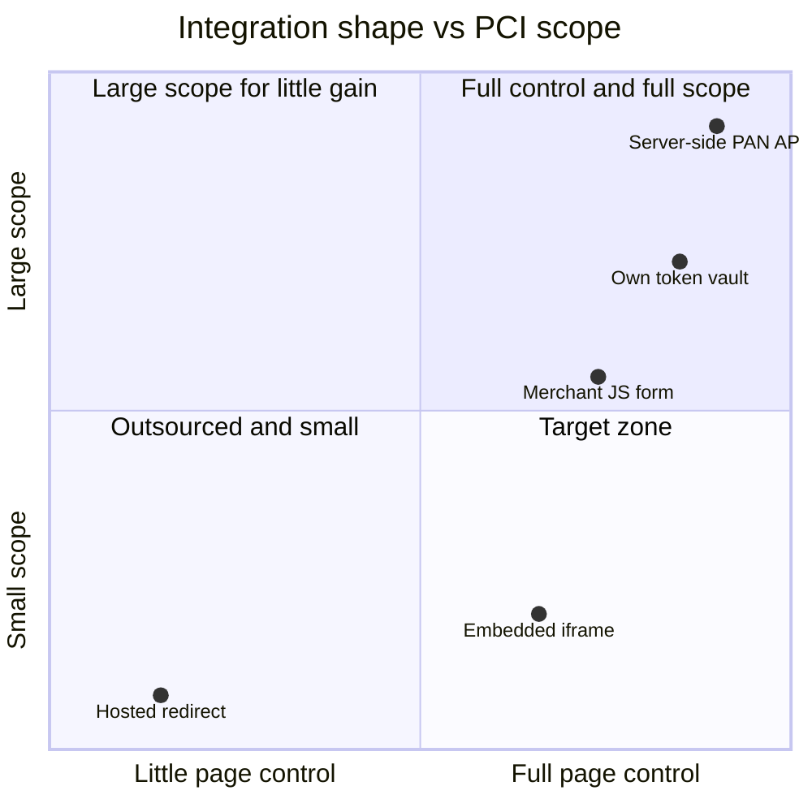
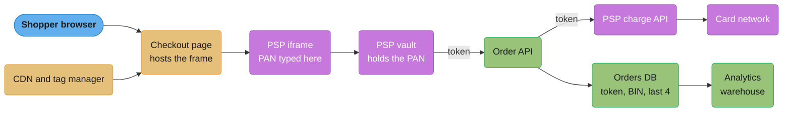
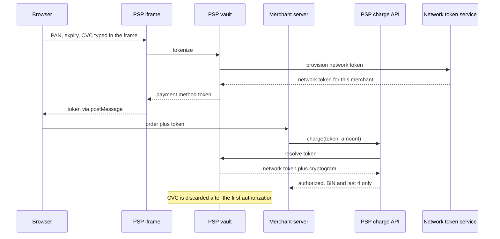

# PCI DSS Scope and Tokenization

> Rules and figures checked 2026-11-06. Every date, threshold and fee on this page comes from
> the fact pins in fintech/CLAUDE.md or from the PCI SSC page named beside it. This page is an
> engineering view as of that date, not legal advice, and covers the US, the EU, the UK, India
> and Brazil only.

---

## 1. Concept Overview

PCI DSS is the security standard that the card brands require from every entity that stores,
processes or transmits card account data. The PCI Security Standards Council (PCI SSC) publishes
it. Version 4.0.1 is the only active version. The council announced it on 2024-06-11, retired
v4.0 on 2024-12-31, and the future-dated requirements became mandatory on 2025-03-31. A request
for comments on v4.0.1 ran from 2026-06-03 to 2026-07-20. No outcome and no next version are
published.

Account data has two parts:

- Cardholder data, built around the primary account number (PAN).
- Sensitive authentication data (SAD): full track data, card verification codes and PIN blocks.

The standard applies to the cardholder data environment (CDE): the people, processes and
systems that store, process or transmit account data, plus the systems that connect to the CDE
or can affect its security. Everything in scope needs the controls and the evidence. Everything
out of scope does not.

So the engineering problem is scope, not controls. A team that keeps the PAN out of its own
systems answers a short self-assessment questionnaire (SAQ). A team that lets the PAN reach its
servers answers the full questionnaire or a Report on Compliance (ROC), and every system the PAN
touches carries that cost for as long as the design lasts.

Tokenization is the main tool. A token stands in for the PAN, has no mathematical relationship
to it, and is worthless outside the vault that issued it. The vault holds the PAN and is in
scope. The systems that hold only tokens can leave scope.

This page owns scope, the SAQ types, the integration shapes, tokenization, hardware security
modules (HSMs) and payment-data localization. Storage controls that make a PAN unreadable
(Requirement 3.5.1), TDE and pgAudit are in
[Database Security and Compliance](../../database/database_security_and_compliance/database_security_and_compliance.md),
payment-page script controls (6.4.3, 11.6.1), CSP and SRI are in
[Browser Security and the Client Threat Model](../../frontend_platform/browser_security_and_the_client_threat_model/browser_security_and_the_client_threat_model.md),
and the card-field iframe and the client 3DS round trip are in the
[checkout case study](../../react/case_studies/design_a_checkout_and_payment_flow.md) §4.5 and §4.6.

---

## 2. Intuition

**One-line analogy.** The PAN is like a dye: every system it touches turns the colour of the
audit, and tokenization keeps the dye inside one sealed tank.

**Mental model.** Draw the data flow of the PAN from the cardholder's fingers to the network.
Every box on that path is in the CDE. Every box with a network path to those boxes, or with
power over them (the CI system that deploys them, the identity provider that logs into them),
is in scope as connected or security-impacting. Scope is a graph search from the PAN outward.

**Why it matters.** Controls cost money once. Scope costs money every year, on every change. A
checkout bundle inside the CDE needs change control on every dependency bump. A support tool
inside the CDE needs access reviews for every agent. A design decision made on day one sets
that tax for the life of the product.

**Key insight.** You do not make your systems compliant. You make most of your systems
irrelevant to the standard, and then you make the small remainder compliant.

---

## 3. Core Principles

1. **Scope follows the data and the paths to it.** A system is in scope if account data flows
   through it, or if it connects to or can affect a system that holds account data. Network
   segmentation is how you cut the second kind of edge.
2. **SAD is never stored after authorization, even if encrypted.** Requirement 3.3.1 says so,
   and PCI SSC FAQ 1154 (July 2025) repeats it. PCI DSS sets no time limit on holding SAD before
   authorization. The card brands set their own rules on that, and the data must be protected
   while you hold it. Issuers have a narrow, separate allowance.
3. **Tokenization is not encryption.** An encrypted PAN is the PAN plus a key problem. A random
   token is not derived from the PAN, so no key turns it back. Only a detokenize call into the
   vault does that, and that call is the thing you lock down.
4. **A compliant PSP does not make the merchant compliant.** The PSP's attestation covers the
   PSP's environment. The merchant still validates its own environment, even when that
   environment is one checkout page that hosts the PSP's iframe.
5. **An iframe alone does not establish SAQ A eligibility.** Eligibility is a published list of
   criteria with a date (§6.5). The page that hosts the frame is part of the answer.
6. **Truncation has a storage maximum.** PCI SSC FAQ 1091 (June 2022) allows at most "first 8,
   any other 4" for a 16-digit PAN and "first 6, last 4" for a 15-digit Amex PAN. This is a
   storage maximum, not a display rule.
7. **A hash of a PAN must be keyed.** The PAN space is small once the BIN and last 4 are known.
   An unkeyed hash stored next to a truncated PAN gives the PAN back in milliseconds (§10.1).
8. **Validation is about an environment, not a product.** No software is "PCI compliant" on its
   own. A product can be listed under a PCI program (P2PE, PTS HSM), and that listing helps a
   merchant's assessment. The merchant's environment is still what gets assessed.

---

## 4. Types / Architectures / Strategies

### 4.1 Integration shapes

| Shape | Where the PAN goes | Merchant control of the page | Typical SAQ (card-not-present merchant) |
|---|---|---|---|
| Full redirect to a PSP-hosted payment page | Browser to PSP only | Low: the PSP page carries the brand at best | SAQ A, if every criterion in §6.5 holds |
| Embedded PSP iframe or hosted fields | Browser to PSP, inside a frame the merchant page hosts | High: the merchant owns the page around the frame | SAQ A, if every criterion holds, including the script criterion |
| Merchant page serves the form, JavaScript or direct post sends the PAN to the PSP | Browser to PSP, but the elements come from the merchant site | High | Not SAQ A. SAQ A-EP is the candidate (FAQ 1293) |
| Merchant server receives the PAN and calls the PSP | Merchant servers | Full | SAQ D for merchants, or a ROC |
| Card-present terminal with a listed P2PE solution | Encrypted in the terminal, decrypted at the solution provider | Not applicable | SAQ P2PE, a separate PCI SSC questionnaire |

### 4.2 Token types

| Token | Who issues it | Where it works | Portable across PSPs | What it buys |
|---|---|---|---|---|
| PSP vault token | The PSP | Only at that PSP, usually only for that merchant | No | Scope reduction with no vault to run |
| Merchant or third-party vault token | Your vault, or a vault vendor | Your systems, then forwarded to any PSP through the vault | Yes | Scope reduction plus multi-PSP routing |
| Network token | The card network's token service | A restricted domain, such as one merchant or one device, with a cryptogram per transaction | Only when the merchant or its vault vendor is the token requestor. A token the PSP requested stays with that PSP | Card updates when the card is reissued, and network incentives |
| Index token or keyed hash (fingerprint) | Your vault | Lookups and dedupe only, never authorization | Not applicable | "Have we seen this card" without detokenizing |
| P2PE ciphertext | The terminal, under a key from the solution provider | Only the decryption environment | No | Card-present scope reduction |

### 4.3 Validation approaches

PCI DSS v4 gives two ways to meet a requirement:

- **Defined approach.** Implement the requirement as written and test it with the published
  testing procedures.
- **Customized approach.** Meet the requirement's stated Customized Approach Objective another
  way. You perform a targeted risk analysis for each affected requirement (Requirement 12.3.2),
  and the assessor derives the testing procedures. Compensating controls are not an option
  inside the customized approach, and some requirements have no customized objective at all.

The SAQ templates state that an SAQ cannot document the customized approach. A team that needs
it validates with a ROC.

### 4.4 Roles

| Role | What it validates | Typical artefact |
|---|---|---|
| Merchant | Its own environment, including the page that hosts a PSP frame | An SAQ or a ROC, plus an Attestation of Compliance (AOC) |
| Service provider (PSP, vault vendor, hosting) | Its environment and the services it gives merchants | A ROC and AOC that the merchant collects and checks |
| Acquirer and card brands | Which validation each merchant must submit | Program rules, outside PCI DSS itself |

---

## 5. Architecture Diagrams

### 5.1 Integration shape vs PCI scope (the decision model)



The iframe sits in the target zone: high control of the page, small scope. Moving the form into
the merchant's own JavaScript buys almost no extra control and moves the merchant out of SAQ A.
The point "Own token vault" is the merchant that receives the PAN only inside an isolated vault
and keeps every other system on tokens: large scope for the vault, small scope for the rest.

### 5.2 Scope classification of one checkout



Purple boxes belong to the PSP and the network, and their scope is theirs. Gold boxes are the
merchant's remaining scope: the page that hosts the frame and everything that can change what
that page loads. Green boxes hold only tokens and truncated data, so they can stay out of scope,
provided no network path or credential reaches a gold or purple box from them.

### 5.3 Tokenize once, charge many times



The merchant server sees a token and the BIN and last 4 that the PSP returns. The CVC lives
only until the first authorization, as Requirement 3.3.1 demands.

---

## 6. How It Works - Detailed Mechanics

### 6.1 Scoping, step by step

1. Draw the data flow. Start at every place a PAN can enter: web checkout, mobile SDK, call
   centre, email, chat, file upload from a partner, a support agent's screen.
2. Inventory every system on each path. These are CDE systems.
3. For each CDE system, list what connects to it (network paths, shared credentials, shared
   hypervisors) and what can change it (CI/CD, configuration management, the identity provider,
   the bastion). These are connected or security-impacting systems, and they are in scope.
4. Cut edges. Segment the network so that the order API cannot open a connection into the
   vault's subnet. Move CI for the CDE to its own runners. Use separate credentials.
5. Prove the cuts. Segmentation that is never tested is a diagram, not a control.
6. Repeat on every architecture change. A new log pipeline that ingests the vault's logs pulls
   the log pipeline into scope.

The mistake that drags the most systems back in is an unplanned PAN entry point. A customer
pastes the card number into a support chat, the chat tool stores it, and the chat vendor, the
transcript export and the warehouse that ingests transcripts are all in scope.

### 6.2 A token vault

A vault does four things: it accepts a PAN, returns a random token, stores the PAN encrypted,
and gives the PAN back only to a short allowlist of callers (usually the forwarder that sends
it to a PSP). It also returns a keyed fingerprint, so other systems can dedupe cards without a
detokenize call.

```java
import java.nio.charset.StandardCharsets;
import java.security.SecureRandom;
import java.util.Base64;
import java.util.HashMap;
import java.util.HexFormat;
import java.util.Map;
import java.util.Set;
import javax.crypto.Cipher;
import javax.crypto.KeyGenerator;
import javax.crypto.Mac;
import javax.crypto.SecretKey;
import javax.crypto.spec.GCMParameterSpec;
import javax.crypto.spec.SecretKeySpec;

public class TokenVault {
    record Sealed(byte[] iv, byte[] ciphertext) {}
    record CardRef(String token, String fingerprint, String truncated) {}

    private static final Set<String> DETOKENIZE_CALLERS = Set.of("psp-forwarder");
    private final SecureRandom random = new SecureRandom();
    private final SecretKey dataKey;
    private final SecretKey fingerprintKey;
    private final Map<String, Sealed> byToken = new HashMap<>();
    private final Map<String, String> tokenByFingerprint = new HashMap<>();

    TokenVault() throws Exception {
        KeyGenerator aes = KeyGenerator.getInstance("AES");
        aes.init(256);
        dataKey = aes.generateKey();
        byte[] k = new byte[32];
        random.nextBytes(k);
        fingerprintKey = new SecretKeySpec(k, "HmacSHA256");
    }

    CardRef tokenize(String pan) throws Exception {
        if (!luhnValid(pan)) throw new IllegalArgumentException("not a valid PAN");
        String fp = fingerprint(pan);
        String token = tokenByFingerprint.get(fp);
        if (token == null) {
            token = newToken();
            byte[] iv = new byte[12];
            random.nextBytes(iv);
            Cipher c = Cipher.getInstance("AES/GCM/NoPadding");
            c.init(Cipher.ENCRYPT_MODE, dataKey, new GCMParameterSpec(128, iv));
            c.updateAAD(token.getBytes(StandardCharsets.US_ASCII));
            byToken.put(token, new Sealed(iv, c.doFinal(pan.getBytes(StandardCharsets.US_ASCII))));
            tokenByFingerprint.put(fp, token);
        }
        return new CardRef(token, fp, truncate(pan));
    }

    String detokenize(String token, String caller) throws Exception {
        if (!DETOKENIZE_CALLERS.contains(caller)) throw new SecurityException("denied: " + caller);
        Sealed s = byToken.get(token);
        Cipher c = Cipher.getInstance("AES/GCM/NoPadding");
        c.init(Cipher.DECRYPT_MODE, dataKey, new GCMParameterSpec(128, s.iv()));
        c.updateAAD(token.getBytes(StandardCharsets.US_ASCII));
        return new String(c.doFinal(s.ciphertext()), StandardCharsets.US_ASCII);
    }

    private String fingerprint(String pan) throws Exception {
        Mac mac = Mac.getInstance("HmacSHA256");
        mac.init(fingerprintKey);
        return HexFormat.of().formatHex(mac.doFinal(pan.getBytes(StandardCharsets.US_ASCII)));
    }

    private String newToken() {
        byte[] b = new byte[16];
        random.nextBytes(b);
        return "tok_" + Base64.getUrlEncoder().withoutPadding().encodeToString(b);
    }

    // PCI SSC FAQ 1091 storage maximum: 16 digits keep first 8 and last 4, 15 digits first 6 and last 4.
    static String truncate(String pan) {
        return switch (pan.length()) {
            case 16 -> pan.substring(0, 8) + "****" + pan.substring(12);
            case 15 -> pan.substring(0, 6) + "*****" + pan.substring(11);
            default -> "*".repeat(pan.length() - 4) + pan.substring(pan.length() - 4);
        };
    }

    static boolean luhnValid(String pan) {
        if (!pan.matches("[0-9]{12,19}")) return false;
        int sum = 0;
        for (int i = 0; i < pan.length(); i++) {
            int d = pan.charAt(pan.length() - 1 - i) - '0';
            if (i % 2 == 1) d = d * 2 > 9 ? d * 2 - 9 : d * 2;
            sum += d;
        }
        return sum % 10 == 0;
    }

    public static void main(String[] args) throws Exception {
        TokenVault vault = new TokenVault();
        CardRef a = vault.tokenize("4111111111111111");
        CardRef b = vault.tokenize("4111111111111111");
        CardRef amex = vault.tokenize("378282246310005");
        assert a.token().equals(b.token()) : "same card, same token";
        assert !a.token().equals(amex.token());
        assert a.truncated().equals("41111111****1111");
        assert amex.truncated().equals("378282*****0005");
        assert vault.detokenize(a.token(), "psp-forwarder").equals("4111111111111111");
        boolean denied = false;
        try { vault.detokenize(a.token(), "analytics-export"); } catch (SecurityException e) { denied = true; }
        assert denied : "analytics must never detokenize";
        assert !luhnValid("4111111111111112");
        System.out.println(a + "\n" + amex);
    }
}
```

Four design points carry the security, and none of them is the cipher:

- The token is random, so a stolen orders table gives the attacker nothing to decrypt.
- The detokenize allowlist is the real boundary. In production it is a network policy plus a
  workload identity, not a string comparison, and every call is logged.
- The AES-GCM ciphertext binds the token as associated data, so a ciphertext swapped onto another
  token row fails to decrypt.
- The data key in production is a data-encryption key wrapped by a key in an HSM or a cloud KMS.
  Envelope encryption and KMS mechanics are in
  [Security and Auth](../../hld/security_and_auth/security_and_auth.md) and
  [HashiCorp Vault](../../technologies/hashicorp_vault/hashicorp_vault.md).

### 6.3 What the out-of-scope database may hold

The order database keeps the token, the keyed fingerprint, the truncated PAN and the expiry. The
constraints make the shape of the data part of the schema, and a trip-wire check rejects
free-text fields that contain a run of 13 to 19 digits.

```sql
CREATE TABLE card_ref (
    token        text PRIMARY KEY CHECK (token ~ '^tok_[A-Za-z0-9_-]{22}$'),
    fingerprint  text NOT NULL UNIQUE CHECK (fingerprint ~ '^[0-9a-f]{64}$'),
    bin          text NOT NULL CHECK (bin ~ '^([0-9]{6}|[0-9]{8})$'),
    last4        text NOT NULL CHECK (last4 ~ '^[0-9]{4}$'),
    exp_month    smallint NOT NULL CHECK (exp_month BETWEEN 1 AND 12),
    exp_year     smallint NOT NULL CHECK (exp_year BETWEEN 2000 AND 2100)
);

CREATE TABLE order_note (
    id      bigint GENERATED ALWAYS AS IDENTITY PRIMARY KEY,
    token   text REFERENCES card_ref (token),
    body    text NOT NULL
            CHECK (regexp_replace(body, '[ .-]', '', 'g') !~ '[0-9]{13,19}')
);

INSERT INTO card_ref VALUES
    ('tok_AAAAAAAAAAAAAAAAAAAAAA', repeat('a', 64), '41111111', '1111', 12, 2030);
INSERT INTO order_note (token, body)
    VALUES ('tok_AAAAAAAAAAAAAAAAAAAAAA', 'Customer asked to split the delivery.');
```

The trip wire is not a control that makes a system compliant. It is a smoke alarm. It also
catches a long order reference now and then, which is the price of the alarm. When it fires,
fix the entry point that let a card number in.

```sql
-- BROKEN: error
INSERT INTO order_note (token, body)
    VALUES ('tok_AAAAAAAAAAAAAAAAAAAAAA', 'card is 4111 1111 1111 1111 exp 12/30');
```

The insert fails on `order_note_body_check`, which is the behaviour you want.

### 6.4 Network tokens and the lifecycle

A network token replaces the PAN inside the network itself. The merchant (through its PSP or
token requestor) asks the network's token service for a token bound to that merchant. Each
authorization then carries the token plus a one-time cryptogram. Three consequences matter for
engineers:

- When the issuer reissues the card, the network updates the token's mapping. The stored
  credential keeps working without a card-updater batch.
- A token stolen from one merchant does not authorize at another, because the domain does not
  match and the cryptogram is missing.
- Portability depends on the token requestor. Each network token is tied to the requestor that
  asked for it. A token the PSP requested stays with that PSP. A token the merchant, or a vault
  vendor acting for it, requested can be used through other PSPs that support network tokens,
  which makes multi-PSP routing practical without a PAN vault of your own.

Interchange and approval-rate effects of network tokens belong to
[Interchange and Payment Economics](../card_payments_lifecycle/interchange_and_payment_economics.md).

### 6.5 SAQ A eligibility, as published

The January 2025 SAQ A, effective 2025-03-31, changed the questionnaire in two ways. It removed
Requirements 6.4.3, 11.6.1 and 12.3.1, and it added an eligibility criterion: the merchant
confirms that its site is not susceptible to attacks from scripts that could affect the
merchant's e-commerce system. The core criteria are:

1. Card-not-present transactions only.
2. All account-data functions are outsourced to PCI DSS compliant third parties.
3. No electronic storage, processing or transmission of account data on merchant systems or
   premises.
4. Any account data the merchant keeps is on paper.
5. The new script criterion.

FAQ 1588 (February 2025) narrows the script criterion. It applies to a merchant page that embeds
a third-party payment form, such as an iframe. It does not apply to a full redirect, where the
merchant page never shows the payment form.

FAQ 1293 (June 2014) draws the line between SAQ A and SAQ A-EP. For SAQ A, every element of the
payment page must come from a PCI DSS compliant service provider. For SAQ A-EP, each element must
come from either the merchant's website or a compliant service provider. A form that the
merchant's own JavaScript builds is an element from the merchant's website, so it can never be
SAQ A. SAQ D for merchants covers every merchant that meets no other SAQ's criteria.

How a merchant meets the script criterion is a design task: CSP, SRI and a script inventory on
the hosting page. That design is in
[Browser Security and the Client Threat Model](../../frontend_platform/browser_security_and_the_client_threat_model/browser_security_and_the_client_threat_model.md).

### 6.6 HSMs, key hierarchies and DUKPT

A hardware security module is a tamper-resistant device that holds keys and does cryptographic
operations without letting the key leave in clear. Payment systems use two kinds:

- **General-purpose HSMs** (cloud HSM services, FIPS 140-3 validated modules) hold the key that
  wraps the vault's data keys.
- **Payment HSMs** (listed under PCI PTS HSM) also do card-specific operations: PIN block
  translation between zones, card verification value checks for issuers, and key derivation for
  terminals.

A key hierarchy keeps the blast radius small. A master key in the HSM wraps key-encryption keys.
Those wrap data-encryption keys. Data keys encrypt PANs. Rotating a data key re-encrypts one
slice of the vault. Rotating the master key re-wraps a few hundred keys, not a billion PANs.

DUKPT (derived unique key per transaction) is the terminal-side pattern. The terminal is loaded
with an initial key derived from a base derivation key and the terminal's identifier. Each
transaction derives a fresh key from it and advances a counter, then the terminal discards the
used key. The base derivation key never leaves the HSM at the processor. A stolen terminal
reveals nothing about past transactions or other terminals. The cipher details are in
[Cryptography Fundamentals](../../cs_fundamentals/cryptography_fundamentals/cryptography_fundamentals.md).

### 6.7 What you may log

| Field | Log it? | Why |
|---|---|---|
| Token, keyed fingerprint | Yes | Worthless outside the vault and the HMAC key |
| BIN (6 or 8 digits) and last 4 | Yes, within FAQ 1091's maximum | Needed for routing, support and reconciliation |
| Full PAN | No, outside the CDE | Pulls the log store and every reader into scope |
| CVC, track data, PIN block | Never, anywhere, after authorization | Requirement 3.3.1, encrypted or not |
| Expiry date | Yes, with the token | Low sensitivity alone, useful for retries and updater logic |
| Unkeyed hash of the PAN | No | Brute-forceable from the BIN and last 4 (§10.1) |

### 6.8 Payment-data localization

Some regulators restrict where payment data may live, separate from PCI DSS. The Reserve Bank
of India requires all payment-system data to be stored only in India. The duty falls on the
payment system providers, for the systems they operate. Circular RBI/2017-18/153
of 2018-04-06 gave six months to comply, reporting by 2018-10-15 and a CERT-In audit report by
2018-12-31. For architecture, that means an India-resident vault and India-resident copies of
the data that downstream systems need, with the global systems holding tokens. Residency
patterns in general are in
[Multi-Region and Data Residency](../../hld/multi_region_and_data_residency/multi_region_and_data_residency.md).

---

## 7. Real-World Examples

- **Hosted fields from PSPs.** Stripe Elements, Adyen's web components and Braintree Hosted
  Fields render card inputs in PSP-origin iframes and return a token to the merchant page. The
  merchant page around them is still the merchant's scope (§6.5).
- **Network tokenization at scale.** Visa reported more than 10 billion tokens issued since the
  2014 launch (2024-06-04). Mastercard committed in June 2024 to 100% e-commerce tokenization in
  Europe by 2030. For a merchant, plan on network tokens as the stored credential.
- **Vault-as-a-service.** Very Good Security and Basis Theory run PAN vaults and forwarding
  proxies. The merchant sends tokens through the vendor's proxy, the proxy swaps in the PAN, and
  the request reaches whichever PSP the merchant chooses. This is the build-vs-buy option between
  "PSP token only" and "own vault". The full decision is in
  [Build vs Buy and Licensing Strategy](../build_vs_buy_and_licensing_strategy/build_vs_buy_and_licensing_strategy.md).
- **Database controls.** The storage side, including why volume encryption alone does not
  protect a PAN on a running server, is in
  [Database Security and Compliance](../../database/database_security_and_compliance/database_security_and_compliance.md).
- **India.** RBI's 2018 circular tells each payment system provider to store the entire data of
  the payment systems it operates only in India. An operator that serves India from a global
  platform needs India-resident stores, on top of PCI DSS (§6.8).

---

## 8. Tradeoffs

### 8.1 Integration shape

| Shape | PCI effort | Checkout control | PSP portability | Failure mode |
|---|---|---|---|---|
| Full redirect | Lowest; the script criterion does not apply (FAQ 1588) | Lowest | Low; each PSP has its own page | Drop-off when the shopper leaves the domain |
| Embedded iframe | Low; SAQ A with the script criterion | High | Low with PSP tokens, higher with network tokens the merchant requests | A parent-page script overlays the frame |
| Merchant JavaScript or direct post | Medium; SAQ A-EP | High, with no real gain over the iframe | Medium | Merchant JavaScript compromise reads the PAN |
| Server-side PAN API | Highest; SAQ D or ROC | Full | High | Every server, log and backup holding the PAN |
| Own vault plus tokens everywhere else | High for the vault, low for the rest | Full | Highest | Vault outage stops all charges |

### 8.2 Token type

| Token | Ops cost | Lock-in | Card updates | Fraud value outside its domain |
|---|---|---|---|---|
| PSP vault token | None | High: migration needs a PAN export between PSPs | Through the PSP's updater | None |
| Own or vendor vault token | Vault, HSM, audits | None | Your job, or network tokens behind it | None |
| Network token | Low, through the PSP or vault | Low if you or your vault vendor request the token, high if the PSP does | Automatic on reissue | None without the cryptogram |

### 8.3 Defined vs customized approach

| Approach | Use when | Cost |
|---|---|---|
| Defined | The requirement fits your architecture | Predictable testing procedures |
| Customized | A modern control meets the objective better than the defined text | Targeted risk analysis per requirement, assessor-derived tests, a ROC rather than an SAQ |

---

## 9. When to Use / When NOT to Use

**Use an embedded PSP iframe when** you need control of the checkout page and you have one PSP or
a PSP that supports network tokens. It is the default for most card-not-present merchants.

**Use a full redirect when** you are small, you have no front-end security team, or the script
criterion is more work than the conversion you would lose by leaving the domain.

**Run your own vault, or buy one, when** you route across several PSPs, you need to migrate
between PSPs without a PAN export project, or you are a platform that charges on behalf of many
merchants.

**Accept the PAN on your servers only when** you are a PSP, a processor or an issuer, or a large
merchant that has measured the scope cost against a concrete benefit. "We want to control
retries" is not such a benefit, because tokens support retries.

**Do NOT use** an unkeyed hash, a reversible "token" built by encrypting the PAN with a key that
the application holds, or format-preserving tokens that pass the Luhn check. The first is
brute-forceable, the second is encryption with a new name, and the third gets mistaken for a PAN
by every scanner and every human.

---

## 10. Common Pitfalls

### 10.1 The unkeyed fingerprint

A team wants to detect "same card used on many accounts" without detokenizing. It stores
`sha256(pan)` beside the first 8 and last 4 digits that the support tool already shows.

```java
// BROKEN: an unkeyed SHA-256 of the PAN stored next to the first 8 and last 4 digits
import java.nio.charset.StandardCharsets;
import java.security.MessageDigest;
import java.util.HexFormat;

public class UnkeyedPanHash {
    static String sha256(String s) throws Exception {
        MessageDigest md = MessageDigest.getInstance("SHA-256");
        return HexFormat.of().formatHex(md.digest(s.getBytes(StandardCharsets.US_ASCII)));
    }

    public static void main(String[] args) throws Exception {
        String pan = "4111111111111111";
        String storedHash = sha256(pan);
        String bin8 = pan.substring(0, 8);
        String last4 = pan.substring(12);
        for (int mid = 0; mid < 10_000; mid++) {
            String guess = bin8 + String.format("%04d", mid) + last4;
            if (sha256(guess).equals(storedHash)) {
                System.out.println("recovered " + guess + " after " + (mid + 1) + " guesses");
                return;
            }
        }
    }
}
```

It prints `recovered 4111111111111111 after 1112 guesses`. A 16-digit PAN with 12 digits known
leaves 4 unknown digits, 10,000 candidates, and the Luhn check cuts that to about 1,000. The
truncation alone was within FAQ 1091's maximum. The hash alone looked safe. Together they hand
back the PAN.

```java
// FIX: a keyed HMAC whose key lives in the vault's HSM, never beside the data
import java.nio.charset.StandardCharsets;
import java.security.SecureRandom;
import java.util.HexFormat;
import javax.crypto.Mac;
import javax.crypto.spec.SecretKeySpec;

public class KeyedPanFingerprint {
    static String hmac(byte[] key, String s) throws Exception {
        Mac mac = Mac.getInstance("HmacSHA256");
        mac.init(new SecretKeySpec(key, "HmacSHA256"));
        return HexFormat.of().formatHex(mac.doFinal(s.getBytes(StandardCharsets.US_ASCII)));
    }

    public static void main(String[] args) throws Exception {
        SecureRandom rnd = new SecureRandom();
        byte[] vaultKey = new byte[32];
        rnd.nextBytes(vaultKey);
        String pan = "4111111111111111";
        String stored = hmac(vaultKey, pan);

        byte[] attackerGuessKey = new byte[32];
        rnd.nextBytes(attackerGuessKey);
        int hits = 0;
        for (int mid = 0; mid < 10_000; mid++) {
            String guess = "41111111" + String.format("%04d", mid) + "1111";
            if (hmac(attackerGuessKey, guess).equals(stored)) hits++;
        }
        assert hits == 0 : "without the key the candidate space is useless";
        assert hmac(vaultKey, pan).equals(stored) : "the vault can still dedupe";
        System.out.println("attacker hits: " + hits);
    }
}
```

The fingerprint still dedupes cards, and the brute force now needs the key, which never leaves
the HSM.

### 10.2 The CVC kept "for retries"

A team stores the CVC in the payment-attempt table so a soft decline can be retried later with
the full card data. Requirement 3.3.1 forbids storing SAD after authorization, even encrypted.
There is no retry argument that survives an assessment. Retries use the token, and a merchant-
initiated retry does not need the CVC. Retry policy itself is in
[Card Payments Lifecycle](../card_payments_lifecycle/card_payments_lifecycle.md).

### 10.3 "We use an iframe, so we are SAQ A"

The frame keeps the PAN out of the merchant's DOM. It does not stop a compromised tag manager on
the parent page from drawing a fake card form over the frame. That gap is why SAQ A gained the
script criterion in January 2025 (§6.5). Treat the hosting page as security-sensitive: a short,
reviewed script list, CSP and SRI, and no marketing tags on the checkout route.

### 10.4 The support channel that opened a new entry point

The checkout was clean. The support chat let customers paste anything, and some pasted card
numbers. The chat vendor stored transcripts, a nightly job copied them to the warehouse, and the
warehouse was suddenly a CDE system. The fix is at the entry point: mask digit runs in the chat
widget before send, run the same detector server-side, purge matches, and add the channel to the
data-flow diagram.

### 10.5 Encryption sold as tokenization

An "internal token" built as `base64(aes(pan, appKey))` with the key in the application's config
is encrypted PAN data. Anyone with the config file and the database has the PANs. The
application server, its config store and its secrets manager are all in scope. Random tokens and
a separate vault are the fix.

### 10.6 Logging the request body

A Java record's generated `toString` prints every field. A `ChargeRequest(String pan, ...)`
passed to a logger, an exception message or a dead-letter queue writes the PAN into systems that
were out of scope. §14 shows this exact failure and its fix.

---

## 11. Technologies & Tools

| Tool | What it does here |
|---|---|
| Stripe Elements | PSP-hosted card fields in iframes that return a payment method token to the merchant page |
| Braintree Hosted Fields | Per-field iframes for card inputs, tokenized at Braintree |
| Very Good Security | Vault and forwarding proxy that swaps tokens for PANs on the way to any PSP |
| Basis Theory | Vault and proxy service for card data, with token-based access policies |
| Visa Token Service | Visa's network tokenization service for token requestors and PSPs |
| Mastercard MDES | Mastercard's network token service for e-commerce and device credentials |
| Thales payShield | Payment HSM for PIN translation, card verification and terminal key derivation |
| AWS Payment Cryptography | Managed payment HSM functions as a cloud API |
| AWS CloudHSM | General-purpose single-tenant HSM, often the root of a vault's key hierarchy |
| HashiCorp Vault | Secrets and key management, used as the KMS that wraps a self-built vault's data keys |

---

## 12. Interview Questions with Answers

**Q: Does using a PCI DSS compliant PSP make the merchant compliant?**
**Short:** No. The PSP's attestation covers the PSP's environment, and the merchant still validates its own, even when that is one page hosting the PSP's frame.

A PSP's Report on Compliance and Attestation of Compliance describe the PSP's systems. The
merchant's systems, including the checkout page, the tag manager and anything that can change
that page, are a separate environment. The merchant validates that environment with the SAQ or
ROC its acquirer requires. The PSP's AOC is evidence the merchant collects, not a substitute for
its own. Ask any PSP vendor for its current AOC, and still plan for your own assessment.

**Q: Is an iframe from the PSP enough for SAQ A eligibility?**
**Short:** No. SAQ A has published criteria, and since the January 2025 SAQ A the merchant must also confirm its page is not susceptible to script attacks.

The iframe keeps the PAN out of the merchant's DOM. SAQ A eligibility still needs every
criterion: card-not-present only, all account-data processing outsourced to compliant third
parties, no electronic storage, processing or transmission of account data on merchant systems,
paper records only, and the script criterion added in January 2025 and effective 2025-03-31.
FAQ 1588 applies that script criterion to pages that embed a payment form and not to a full
redirect. Design the hosting page as a security-sensitive surface, not as marketing space.

**Q: Why is tokenization not the same thing as encryption?**
**Short:** A random token has no mathematical relationship to the PAN, so no key recovers it. Only a detokenize call to the vault does.

Encryption transforms the PAN with a key. Whoever holds the key and the ciphertext holds the
PAN, so the key's whole storage and access path is in scope. A random token is a lookup key into
the vault. Stealing the orders table gives the attacker only tokens. The control moves from "who
has the key" to "who may call detokenize", which is a much smaller set. Build tokens from a
CSPRNG, never from the PAN.

**Q: What decides which systems are in PCI scope?**
**Short:** Systems that store, process or transmit account data are the CDE, and systems that connect to them or can affect their security are in scope too.

Start from every PAN entry point and walk the data flow. Every system on the path is a CDE
system. Then walk outward: network paths into those systems, shared credentials, CI/CD that
deploys them and identity providers that log into them. Those are in scope as connected or
security-impacting systems. Segmentation cuts the outward edges. Redraw the graph on every
architecture change.

**Q: May a merchant store the CVC if it encrypts it with a strong key?**
**Short:** No. Requirement 3.3.1 forbids storing sensitive authentication data after authorization, even if encrypted.

PCI SSC FAQ 1154 (July 2025) repeats the rule and adds that PCI DSS has no specific limit on
holding SAD before authorization, though it must be protected while held, and the card brands
set their own rules on it. Track data and PIN
blocks fall under the same rule. Issuers have a narrow, separate allowance for issuing needs.
Design retries, recurring charges and account updates around tokens and network tokens.

**Q: What is the maximum PAN truncation a system may store?**
**Short:** For a 16-digit PAN, at most "first 8, any other 4", and for a 15-digit Amex PAN, at most "first 6, last 4", per PCI SSC FAQ 1091.

FAQ 1091 (June 2022) says a 16-digit PAN with a 6- or 8-digit BIN must lose at least 4 digits,
and a 15-digit Amex PAN at least 5. It is a storage maximum, not a display rule, and the
display can show less. Do not store a truncated value next to an unkeyed hash of the same PAN,
because together they give the PAN back.

**Q: Why is an unkeyed SHA-256 of the PAN unsafe even though SHA-256 is unbroken?**
**Short:** The PAN space is tiny once the BIN and last 4 are known, so an attacker hashes every candidate in milliseconds.

With 12 of 16 digits known, 10,000 candidates remain, and the Luhn check cuts that to about
1,000. The weakness is the input space, not the hash function. A keyed HMAC with the key held in
an HSM keeps the dedupe property and makes the brute force useless without the key. §10.1 shows
both versions running.

**Q: What separates SAQ A from SAQ A-EP?**
**Short:** SAQ A needs every payment-page element from a compliant service provider, while SAQ A-EP allows elements from the merchant's own site.

FAQ 1293 states the rule. If the merchant's JavaScript builds the card form and posts the PAN
directly to the PSP, the PAN never touches the merchant's servers, but the form is an element
from the merchant's site, so SAQ A is out. A-EP covers that case. SAQ D for merchants covers any
merchant that meets no other SAQ's criteria. Prefer the PSP iframe if you want SAQ A.

**Q: What does a network token add over a PSP vault token?**
**Short:** It is issued by the card network, is bound to one merchant or device, needs a per-transaction cryptogram and follows the card through reissue.

A PSP token works only at that PSP. A network token can work across PSPs, but only when the
merchant or its vault vendor is the token requestor. A token the PSP requested stays with that
PSP. When the issuer reissues the card, the
network updates the mapping, so stored credentials keep working. A stolen network token fails at
another merchant. Visa reported more than 10 billion tokens issued since 2014 (2024-06-04).

**Q: When does running your own token vault make sense?**
**Short:** When you route across several PSPs or must migrate between them without a PAN export, and you accept that the vault and its HSM are large scope.

The vault puts a small, isolated set of systems in full scope so that everything else can hold
tokens. It buys PSP independence and control of retries and routing. It costs an HSM, a
segmented network, a ROC and an on-call rotation for a component that stops all charges when it
is down. A vault vendor or network tokens behind the PSP are the cheaper alternatives.

**Q: What is the customized approach in PCI DSS v4, and can an SAQ use it?**
**Short:** It meets a requirement's stated objective another way, backed by a targeted risk analysis, and SAQ templates cannot document it, so it needs a ROC.

Each eligible requirement has a Customized Approach Objective. The entity designs a control that
meets it, performs a targeted risk analysis for each affected requirement (Requirement 12.3.2),
and the assessor derives the testing procedures. Compensating controls are not available inside
the customized approach, and some requirements have no customized objective. Use it for a
modern control that the defined text does not anticipate, not to avoid work.

**Q: What does an HSM do in a payment system that a KMS key does not?**
**Short:** A payment HSM performs card-specific operations, such as PIN block translation and terminal key derivation, without exposing keys in clear.

A cloud KMS or general-purpose HSM wraps and unwraps data keys, which is enough for a token
vault's key hierarchy. Processors and issuers also need PIN translation between key zones, card
verification value checks and DUKPT derivation, which payment HSMs listed under PCI PTS HSM
provide. Use a general-purpose HSM or KMS for the vault, and a payment HSM only when you touch
PINs or terminal keys.

**Q: How does DUKPT protect a fleet of card terminals?**
**Short:** Each transaction uses a key derived for that transaction and then discarded, so a stolen terminal exposes no past keys and no other terminal's keys.

The terminal holds an initial key derived from a base derivation key and its own identifier.
Every transaction derives a fresh key and advances a counter. The base derivation key stays in
the processor's HSM, which can derive any terminal's transaction key from the key serial number
in the message. Never load the base derivation key into a terminal.

**Q: Which fields may an out-of-scope system log about a card?**
**Short:** The token, a keyed fingerprint, the BIN, the last 4 and the expiry, but never the full PAN, and never SAD anywhere.

The BIN and last 4 stay within FAQ 1091's maximum and support routing, support and
reconciliation. A full PAN in a log pulls the log pipeline and every reader into scope. CVC,
track data and PIN blocks cannot be stored after authorization at all. Add a digit-run detector
to the log pipeline as a trip wire, and treat each hit as an entry-point bug.

**Q: Why do Java records leak PANs into logs?**
**Short:** A record's generated toString prints every component, so logging or throwing with a record that holds a PAN writes the PAN out.

`new ChargeRequest("4111111111111111", 5000)` prints as
`ChargeRequest[pan=4111111111111111, amountMinor=5000]`. That string reaches log lines,
exception messages and dead-letter queues. The structural fix is that out-of-scope code never
holds a PAN in any type, only a token. Inside the CDE, override `toString` on every type that
holds account data and test that it masks.

**Q: How does RBI's data localization rule change a global payment architecture?**
**Short:** RBI requires payment-system data to be stored only in India, so an India-resident vault and data store hold it and global systems hold tokens.

Circular RBI/2017-18/153 of 2018-04-06 puts the duty on payment system providers and gave six
months to comply. An operator that serves India keeps that data in India-resident stores and
holds only references elsewhere. The rule is separate from PCI DSS: a
PCI-compliant global vault can still break it. Design residency into the vault's sharding key,
and keep downstream analytics on tokens or India-resident copies.

**Q: What does "PCI compliant software" mean?**
**Short:** Nothing on its own, because PCI DSS validates an entity's environment, while products may be listed under separate programs such as P2PE or PTS HSM.

A vendor that says its product is "PCI compliant" usually means its hosted service has an AOC,
or the product is listed under a PCI program. Either helps your assessment. Neither replaces
it, because the assessor looks at how you deployed and operate the product. Ask for the AOC or
the listing, and map which requirements it covers.

**Q: How do you take an analytics warehouse out of PCI scope?**
**Short:** Feed it only tokens, fingerprints and truncated PANs, and remove any network path or credential that reaches CDE systems.

Data alone is not enough: a warehouse that holds only tokens but can open connections into the
vault subnet, or shares a service account with the payment service, is connected. Cut the
network path, use separate credentials, and test the segmentation. Then add a scanner that
alerts on 13- to 19-digit runs that pass the Luhn check in incoming tables.

**Q: What happens to PCI scope when a customer pastes a card number into support chat?**
**Short:** The chat tool, its transcript store and everything that ingests the transcripts become CDE systems until the data is purged.

This is the most common unplanned entry point. Mask digit runs in the chat widget before send,
detect and purge server-side, train agents to never ask for card numbers, and give agents a
secure payment link that uses the PSP's hosted page. Put every customer channel on the data-flow
diagram, not just the checkout.

**Q: Is PCI DSS v4.0 still a valid version to assess against?**
**Short:** No. v4.0 retired on 2024-12-31, and v4.0.1, announced 2024-06-11, is the only active version.

v4.0.1 made clarifications and corrections, not new requirements. The future-dated requirements
from v4 became mandatory on 2025-03-31. An RFC on v4.0.1 ran from 2026-06-03 to 2026-07-20 with
no published outcome. Build to v4.0.1 and watch the PCI SSC blog for the next version.

**Q: Why does a full redirect avoid the SAQ A script criterion while an iframe does not?**
**Short:** With a redirect the merchant page never shows the payment form, so no merchant script can tamper with it, and FAQ 1588 scopes the criterion accordingly.

An iframe sits inside a merchant page, and a script on that page can overlay or replace the
frame. A redirect sends the shopper to the PSP's own page, where the merchant has no code. FAQ
1588 (February 2025) applies the script criterion to pages that embed a third-party payment
form. Choose the redirect when you cannot staff the script controls.

---

## 13. Best Practices

1. Draw the PAN data flow first, including support, email, chat and partner files, and redraw it
   on every architecture change.
2. Keep the PAN out of every system you can. Choose an iframe or a redirect for checkout and
   tokens everywhere else.
3. Build tokens from a CSPRNG. Never derive them from the PAN, and never make them Luhn-valid.
4. Use a keyed HMAC for card fingerprints, with the key in an HSM or KMS.
5. Lock down detokenize with workload identity and network policy, and log every call.
6. Never store SAD after authorization. Design retries and recurring charges on tokens.
7. Treat the page that hosts a payment iframe as security-sensitive: reviewed scripts, CSP, SRI
   and no marketing tags.
8. Add digit-run plus Luhn detectors to logs, chat, tickets and warehouse ingestion as trip
   wires.
9. Prefer network tokens for stored credentials, so card reissues do not break subscriptions.
10. Collect every service provider's AOC each year, and map which requirements each one covers.
11. Put data residency into the vault's design from day one when you serve India.

---

## 14. Case Study

### A marketplace moves from server-side PAN handling to SAQ A

**Context (illustrative).** A marketplace takes card payments for sellers. Its first version
posted the card form to its own API, which called the PSP. The API, its logs, its retry queue
and its database were all in the CDE. The company validated with SAQ D for merchants. Every
deploy of the API went through CDE change control, and the platform team owned an annual
assessment that touched 40 services (assumption).

**Target.** SAQ A for the checkout, with a network-token-backed PSP vault for stored cards.

**Migration plan.**

1. Replace the card form with the PSP's iframe fields. The browser now posts only a token.
2. Ask the PSP to import the existing cards from the old database into its vault through the
   PSP's secure import process. The PSP returns a token map.
3. Rewrite stored-card rows to tokens, then drop the PAN column and destroy the old key.
4. Purge PANs from logs, the dead-letter queue and backups on their retention schedule, and
   record the purge evidence.
5. Lock the checkout page: script inventory, CSP and SRI, and remove the tag manager from the
   checkout route, to meet the script criterion.
6. Re-run scoping. The API is now out of scope if it has no path into a CDE system.

**The leak found during step 4.** The retry worker wrote failed charges to a dead-letter queue
with the request record serialized by `toString`.

```java
// BROKEN: a record that holds a PAN prints it through the generated toString
public class DeadLetterLeak {
    record ChargeRequest(String pan, String expiry, long amountMinor, String currency) {}

    public static void main(String[] args) {
        ChargeRequest failed = new ChargeRequest("4111111111111111", "12/30", 5000, "USD");
        String deadLetter = "charge failed, will retry: " + failed;
        System.out.println(deadLetter);
    }
}
```

It prints
`charge failed, will retry: ChargeRequest[pan=4111111111111111, expiry=12/30, amountMinor=5000, currency=USD]`.
The dead-letter topic, its consumers and its retention all held PANs. The fix is structural: the
charge path carries only a token, so there is nothing to leak, and the types that still exist
inside the vault mask by construction.

```java
// FIX: out-of-scope code carries a token; vault-side types mask their own toString
public class DeadLetterFixed {
    record ChargeRequest(String paymentToken, long amountMinor, String currency) {
        ChargeRequest {
            if (!paymentToken.startsWith("tok_")) throw new IllegalArgumentException("token required");
        }
    }

    record VaultCard(String pan, String expiry) {
        @Override public String toString() {
            return "VaultCard[pan=" + "*".repeat(pan.length() - 4) + pan.substring(pan.length() - 4) + "]";
        }
    }

    public static void main(String[] args) {
        ChargeRequest failed = new ChargeRequest("tok_9c1Qm2xZbT0aLw7yR3vK4d", 5000, "USD");
        String deadLetter = "charge failed, will retry: " + failed;
        assert !deadLetter.matches(".*[0-9]{13,19}.*");
        String vaultLog = String.valueOf(new VaultCard("4111111111111111", "12/30"));
        assert vaultLog.equals("VaultCard[pan=************1111]") : vaultLog;
        System.out.println(deadLetter + "\n" + vaultLog);
    }
}
```

**Outcome (illustrative).** The checkout validated with SAQ A. The CDE shrank to the PSP's
systems plus the checkout page and the pipeline that deploys it. The API team left CDE change
control. Stored cards moved to network tokens through the PSP, which also cut failures from
reissued cards. The one lasting cost is the script discipline on the checkout page, which the
front-end team now owns.

**Lessons.**

- Scope shrinks only when every path is cut: the form, the logs, the queues and the backups.
- Records, exceptions and dead-letter queues are the common leak paths in Java services.
- An SAQ A design still has work on the hosting page. Budget for it.
- Related pages: [Fraud and Risk Scoring](../fraud_and_risk_scoring/fraud_and_risk_scoring.md)
  uses the keyed fingerprint as a velocity key, and
  [Strong Customer Authentication and 3DS](../strong_customer_authentication_and_3ds/strong_customer_authentication_and_3ds.md)
  covers the authentication step that runs inside the same checkout.
