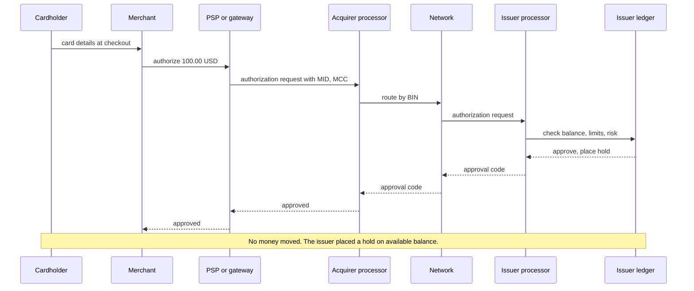
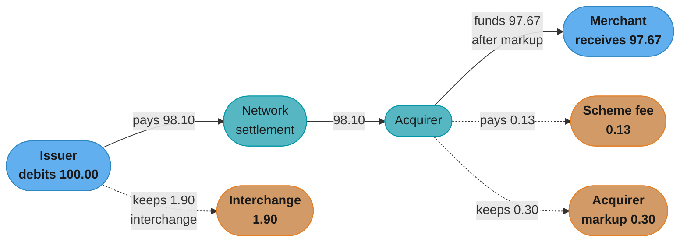
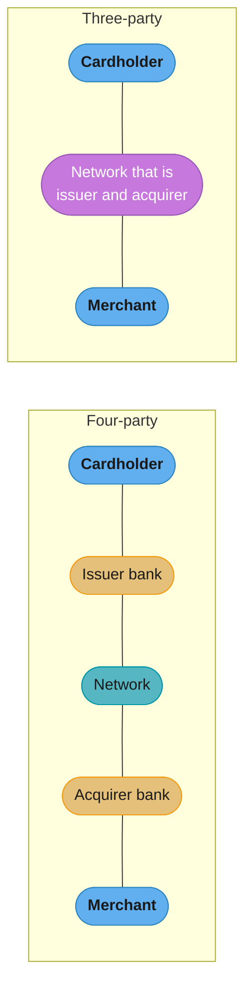

# PSPs, Acquirers, Issuers and Networks

> Rules and figures checked 2026-11-06. Dates, thresholds and fees on this page come from the
> fact pins in fintech/CLAUDE.md or from the Visa Core Rules and Visa Product and Service Rules,
> edition of 24 October 2026. Fee rates in worked examples are illustrative assumptions, not
> published rates.

---

## 1. Concept Overview

A card payment has more parties than the two people who see it. The cardholder and the merchant
see one charge. Behind it, at least five organizations each hold a different contract, a
different ledger and a different liability:

| Party | What it does | Who it has a contract with |
|---|---|---|
| Cardholder | Holds the card and owes the issuer | Issuer |
| Issuer | Bank that issues the card, approves or declines, and bills the cardholder | Cardholder, network |
| Network (scheme) | Sets the rules, routes messages, runs clearing and settlement between members | Issuer, acquirer |
| Acquirer | Bank that holds the merchant relationship and receives settlement for the merchant | Merchant (or PayFac), network |
| Merchant | Sells the goods and carries the first loss on the disputes the network rules assign to it | Acquirer, or a PayFac |

Around these five sit technical and commercial intermediaries: the gateway, the PSP, the
processor, the payment facilitator (PayFac), the ISO or agent, the issuer processor, the BIN
sponsor and the program manager. Each takes one slice of the work. None of them changes who
owes whom at the end.

The core lesson of this module is that two flows run through the same parties and they do not
have the same shape:

- The **message flow** carries the authorization request and response in about the time a
  checkout page waits. It moves no money.
- The **money flow** runs later, in batches, after clearing fixes what each party owes. The
  issuer pays the network, the network pays the acquirer, and the acquirer pays the merchant,
  each net of fees.

An engineer who mixes the two writes a ledger that books cash on an approval, or a payout job
that pays a merchant before the acquirer has funded the platform.

The detailed lifecycle of one card payment (holds, capture, clearing, decline codes) is in
[Card payments lifecycle](../card_payments_lifecycle/card_payments_lifecycle.md). Fees and
routing economics are in
[Interchange and payment economics](../card_payments_lifecycle/interchange_and_payment_economics.md).
The end-to-end payment service with its idempotency keys, saga and outbox is designed in the
[HLD payment system study](../../hld/case_studies/design_payment_system.md), and the agentic
payment protocols that sit on top of these roles are in
[Agentic commerce and payments](../../llm/multi_agent_systems/agentic_commerce_and_payments.md).

---

## 2. Intuition

**One-line analogy.** A card network is a club with a rulebook. Only banks are members. Every
company you integrate with is either a member bank or someone a member bank vouches for and
answers for.

**Mental model.** Draw every party as a box with its own ledger. Draw the message flow as a fast
arrow that crosses all the boxes and leaves every ledger balance unchanged except a hold on the
cardholder's available balance. Draw the money flow as a slow arrow that moves the other way,
shrinking at each box by that box's fee.

**Why it matters.** Every production question in payments maps to a party. "Why did the payout
not arrive?" is about the acquirer's funding schedule. "Why was the card declined?" is about the
issuer. "Who pays for this chargeback?" walks back up the chain of contracts until a party has
money to take.

**Key insight.** Liability flows along contracts, not along messages. The gateway that carried
the message has no liability for the fraud. The acquirer that signed the merchant does, and it
passes that liability down to the merchant under the merchant agreement.

---

## 3. Core Principles

1. **Only members touch the network.** Issuers and acquirers are network members. A PSP,
   gateway or PayFac reaches the network through a member acquirer. Visa and Mastercard do not
   issue cards and do not sign merchants.
2. **Interchange flows from the acquirer to the issuer.** The network sets the rate. The network
   does not keep interchange. It charges its own scheme fees on top.
3. **Authorization is not settlement.** Approval reserves funds on the cardholder's account and
   moves no money. Money moves after clearing.
4. **The acquirer answers for its merchants.** The Visa rules let an acquirer pay a merchant
   "less any Credit Transactions or Original Credit Transactions, applicable discounts, Disputes,
   other agreed fees or Merchant reserve funds" (Visa Core Rules §1.5.6.2). Reserves exist
   because the acquirer carries the merchant's obligations if the merchant cannot pay.
5. **Every layer adds an identifier.** The merchant gets a MID from its acquirer. Each terminal
   gets a TID. The merchant's line of business gets an MCC. The card's leading digits (the BIN)
   identify the issuer and product. None of these is unique outside its issuing party.
6. **A merchant of record (MoR) is a legal role, not a technical one.** The MoR is the seller on
   the transaction. It owns refunds, disputes and often sales tax, whatever the API diagram says.

---

## 4. Types / Architectures / Strategies

### 4.1 Four-party and three-party schemes

| Model | Who issues | Who acquires | Network's role | Example |
|---|---|---|---|---|
| Four-party (open loop) | Member banks | Member banks | Rules, routing, clearing and settlement between members | Visa, Mastercard |
| Three-party (closed loop) | The network company itself | The network company itself | Network, issuer and acquirer in one company | American Express is the common example |
| Network owned by an issuer | The owning bank and partner banks | Partner acquirers | Network rules plus an issuing business in the same group | Capital One completed its acquisition of Discover on 2025-05-18 and owns the Discover, PULSE and Diners Club International networks |

In a three-party scheme there is no interchange between two banks, because one company sits on
both sides. The merchant discount still exists. It is set in one contract instead of being
assembled from three fees.

### 4.2 Intermediaries

| Role | Moves messages | Holds merchant funds | Contract with network | Carries merchant credit risk |
|---|---|---|---|---|
| Gateway | Yes | No | No | No |
| Processor (front end, back end) | Yes | No, unless it is also the acquirer | Registered as a processor | No |
| PSP | Yes | Often, through its acquiring entity or a partner acquirer | Through the acquirer | Yes, when it is the acquirer or PayFac |
| ISO or agent | No, it sells | No | Registered by its acquirer | Shared under its contract with the acquirer |
| PayFac | Yes | Yes, for its sponsored merchants | Through its acquirer | Yes, for every sponsored merchant |
| Marketplace | Yes | Yes, for the retailers it sells for | Through its acquirer | Yes |
| Issuer processor | Yes, issuer side | No | Registered as a processor | No |
| BIN sponsor | No | Holds program funds | Member, owns the BIN range | Yes, for the card program |

The Visa rules define the two platform roles precisely:

- A **Payment Facilitator** is "an entity that contracts with an Acquirer to deposit
  Transactions, receive settlement from, or contract with an Acquirer on behalf of a Sponsored
  Merchant". A **Sponsored Merchant** "contracts with a Payment Facilitator" to accept cards.
- A **Marketplace** "brings together Cardholders and retailers on an electronic commerce website
  or mobile application and processes Transactions and receives Settlement on behalf of those
  retailers".

The difference is who the customer thinks the seller is. Sponsored merchants sell in their own
name through the PayFac. A marketplace sells on its own site on behalf of retailers.

### 4.3 Integration shapes for a business

| Shape | Contracts the business signs | Onboarding time | Control over pricing and routing |
|---|---|---|---|
| Hosted PSP account | One, with the PSP | Minutes to days | Low |
| PSP with own MID at a partner acquirer | PSP and acquirer | Weeks | Medium |
| Registered PayFac | Acquirer, plus one with each sponsored merchant | Months | High, and the risk comes with it |
| Direct acquiring, multiple acquirers | Several acquirers and a gateway or orchestration layer | Months | Highest |

Which shape to choose, and when a partner bank beats a license, is the decision model in
[Build vs buy and licensing strategy](../build_vs_buy_and_licensing_strategy/build_vs_buy_and_licensing_strategy.md).

### 4.4 Issuing side

On the issuing side the same split appears:

- The **issuer** of record is a regulated bank that owns the BIN range and holds the cardholder
  contract.
- A **program manager** (a fintech brand) designs the card product and runs the customer
  experience.
- A **BIN sponsor** is the bank that lends its membership and BIN range to that program.
- An **issuer processor** answers authorization requests on the bank's behalf within the
  network's response time, often calling the program manager's own decision endpoint.

The issuer-side decision path is designed in the card issuing case study at
[design_a_card_issuing_platform](../case_studies/design_a_card_issuing_platform.md).

---

## 5. Architecture Diagrams

### 5.1 The message flow: one authorization



The authorization crosses every party in one round trip. The only balance that changes is the
cardholder's available balance at the issuer, which drops by the hold.

### 5.2 The money flow: settlement of the same sale



Illustrative numbers for a 100.00 USD sale: interchange 1.90, scheme fee 0.13, acquirer markup
0.30. The merchant receives 97.67 and pays a merchant discount of 2.33. The scheme fee is shown
from the acquirer for clarity. How a network bills its fees is set in its own fee schedule.

### 5.3 Four-party and three-party models



In the four-party model, interchange is a payment between two different banks. In the
three-party model, the network company prices the merchant directly.

### 5.4 A PayFac under one acquirer

```
Acquirer (network member)
 └─ PayFac master account            one contract with the acquirer
     ├─ Sponsored merchant: bakery   MCC for bakeries, own sub-merchant id
     ├─ Sponsored merchant: tutor    MCC for education services
     ├─ Sponsored merchant: pharmacy MCC for drug stores
     └─ Sponsored merchant: X        annual volume over USD 1 million
                                     -> needs a direct merchant agreement with the acquirer
```

The PayFac boards sub-merchants under its own acquirer contract, but each sub-merchant keeps its
own MCC. A sponsored merchant above USD 1 million in annual volume needs its own agreement with
the acquirer (Visa §5.3.1.4, with exceptions).

---

## 6. How It Works - Detailed Mechanics

### 6.1 The settlement waterfall in code

The waterfall below splits one settled sale into the four amounts each party keeps. The rates
are illustrative assumptions. The rounding mode is a contract term between merchant and
acquirer, so it is a parameter here. The invariant that matters is conservation: the four parts
sum to the gross amount in minor units, with no cent lost to rounding.

```java
import java.math.BigDecimal;
import java.math.RoundingMode;

public class SettlementWaterfall {

    record Rate(BigDecimal percent, long fixedMinor) {
        long feeOn(long grossMinor, RoundingMode mode) {
            BigDecimal pct = percent.multiply(BigDecimal.valueOf(grossMinor))
                    .divide(BigDecimal.valueOf(100), 0, mode);
            return pct.longValueExact() + fixedMinor;
        }
    }

    record Split(long grossMinor, long interchange, long schemeFee, long markup, long merchantNet) {
        Split {
            if (interchange + schemeFee + markup + merchantNet != grossMinor) {
                throw new IllegalStateException("split does not conserve the gross amount");
            }
        }
        long merchantDiscount() { return interchange + schemeFee + markup; }
    }

    static Split split(long grossMinor, Rate ic, Rate scheme, Rate markup, RoundingMode mode) {
        long i = ic.feeOn(grossMinor, mode);
        long s = scheme.feeOn(grossMinor, mode);
        long m = markup.feeOn(grossMinor, mode);
        return new Split(grossMinor, i, s, m, grossMinor - i - s - m);
    }

    public static void main(String[] args) {
        Rate interchange = new Rate(new BigDecimal("1.80"), 10); // illustrative
        Rate schemeFee = new Rate(new BigDecimal("0.13"), 0);    // illustrative
        Rate markup = new Rate(new BigDecimal("0.30"), 0);       // illustrative

        Split s = split(10_000, interchange, schemeFee, markup, RoundingMode.HALF_UP);
        System.out.println(s);
        assert s.interchange() == 190 : s;
        assert s.merchantNet() == 9_767 : s;
        assert s.merchantDiscount() == 233 : s;

        Split odd = split(1_999, interchange, schemeFee, markup, RoundingMode.HALF_UP);
        System.out.println(odd);
        assert odd.interchange() + odd.schemeFee() + odd.markup() + odd.merchantNet() == 1_999;
    }
}
```

Output:

```text
Split[grossMinor=10000, interchange=190, schemeFee=13, markup=30, merchantNet=9767]
Split[grossMinor=1999, interchange=46, schemeFee=3, markup=6, merchantNet=1944]
```

The merchant net is computed as the remainder, not as its own rounded percentage. Rounding each
of four parts separately can lose or invent a cent, and the compact constructor would catch it.

### 6.2 Who carries what liability

| Event | First loss | If that party cannot pay | Contract that moves the loss |
|---|---|---|---|
| Fraud chargeback on a card-absent sale with no 3DS liability shift | Merchant | Acquirer (or PayFac, then acquirer) | Merchant agreement, PayFac agreement |
| Merchant goes bankrupt before delivering goods | Merchant | Acquirer, through chargebacks it cannot pass down | Merchant agreement and acquirer reserve |
| Sponsored merchant fraud on a PayFac | PayFac | Acquirer | PayFac agreement |
| Issuer approves in stand-in while its systems are down | Issuer | Not applicable | Network rules |
| Cardholder disputes a billing error | Issuer to the cardholder, then a chargeback to the acquirer | Down the chain as above | Consumer law and network rules |

The issuer's duties to the consumer come from law (Reg E and Reg Z in the US). The chargeback
mechanics that move the loss to the acquirer are in
[Disputes, chargebacks and refunds](../disputes_chargebacks_and_refunds/disputes_chargebacks_and_refunds.md).

### 6.3 Identifiers and their scope

| Identifier | Issued by | Unique within | Used for |
|---|---|---|---|
| MID | Acquirer | That acquirer | Merchant account, settlement, pricing |
| TID | Acquirer or processor | That MID | Terminal-level batches and reporting |
| MCC | Assigned by the acquirer from the network list | A merchant's line of business | Interchange category, risk rules, restricted categories |
| BIN | Network to the issuer | The network's numbering | Routing to the issuer, product type |
| Sub-merchant id | PayFac | That PayFac | Identifies the sponsored merchant in transaction data |

The Visa rules define an MCC as "a code designating the principal trade, profession, or line of
business in which a Merchant is engaged". An acquirer must make sure its PayFac "uses the
appropriate MCC for each Sponsored Merchant" (Visa §5.3.1.3). A platform that sends its own MCC
for every seller sends wrong data on every transaction.

### 6.4 Push payments reverse the arrows

Card networks also carry credits to a card. Visa Direct and Mastercard Move are the networks'
names for their push-payment and money-movement products. Visa states 18B+ eligible endpoints in
195+ countries and territories. On a push payment the originating party funds the credit
and the recipient's issuer posts it, so the money flow runs from the sender's side toward the
card. Payouts on these rails are covered in
[Wallets, stored value and payouts](../wallets_stored_value_and_payouts/wallets_stored_value_and_payouts.md).

### 6.5 Ledger accounts a platform needs

A platform that receives settlement for others holds money that is not its own. It needs at
least these accounts per currency:

| Account | Normal balance | Moves on |
|---|---|---|
| Acquirer receivable | Debit | Capture (booked), acquirer funding (cleared) |
| Merchant payable per seller | Credit | Capture, refund, chargeback, payout |
| Fee revenue | Credit | Capture |
| Processing fee expense | Debit | Acquirer funding statement |
| Reserve held per seller | Credit | Reserve rule, reserve release |
| Cash in the FBO account | Debit | Bank statement |

The balance model and the posting rules are in
[Double-entry ledger design](../double_entry_ledger_design/double_entry_ledger_design.md).

---

## 7. Real-World Examples

- **Visa's rule text on platforms.** The Visa Core Rules (24 October 2026 edition) define the
  Payment Facilitator, the Sponsored Merchant and the Marketplace as separate roles. A PayFac must
  not deposit a transaction on behalf of another PayFac (Table 1-10). An acquirer that contracts
  with a PayFac must sign a direct merchant agreement with any sponsored merchant above USD 1
  million in annual volume: before processing for a sponsored merchant new to the PayFac, and
  within 2 years for an existing one (§5.3.1.4, with exceptions).
- **Capital One and Discover.** Capital One completed its acquisition of Discover on 2025-05-18
  and owns the Discover, PULSE and Diners Club International networks. An issuer that also
  owns a network sits on both sides of some transactions, which is the three-party shape inside a
  bank group.
- **Stored credentials for agents.** The same Visa edition counts an "Agentic Payment Provider"
  among the parties that may store a credential "to initiate future Transactions". The agentic
  layer reuses the existing roles. It does not add a new member type. See
  [Agentic commerce and payments](../../llm/multi_agent_systems/agentic_commerce_and_payments.md).
- **Network tokens as a network service.** Visa reported more than 10 billion tokens issued since
  the 2014 launch (release of 2024-06-04). The token service sits at the network, between the
  merchant's token requestor and the issuer, which is a role the four-party diagram does not show.

---

## 8. Tradeoffs

| Choice | Option A | Option B | Deciding factor |
|---|---|---|---|
| Who is the MoR on a marketplace | Platform is MoR | Each seller is MoR | Platform as MoR owns tax, refunds and disputes but controls the experience |
| Who holds the acquirer contract | Each seller signs with the acquirer | Platform is the PayFac | PayFac gives fast onboarding and takes on underwriting and loss |
| Gateway or orchestration | One PSP for gateway and acquiring | Separate gateway over several acquirers | More acquirers raise approval options and cost of reconciliation |
| Reserve policy | Rolling reserve on every seller | Reserve only on high-risk sellers | Lower loss versus seller cash flow and churn |
| Payout timing | Pay sellers on capture | Pay sellers after acquirer funding | Paying before funding is a credit line the platform gives every seller |

---

## 9. When to Use / When NOT to Use

**Use a hosted PSP account** when the business sells its own goods, volume is small, and nobody
on the team owns payments full time.

**Become a PayFac** when onboarding speed for many small sellers is the product, and the company
can staff underwriting, transaction monitoring and loss management.

**Do not become a PayFac** to save fees alone. The acquirer still prices the master account, and
the PayFac adds the cost of every sponsored merchant's fraud and chargebacks.

**Use direct acquiring with several acquirers** when volume is large enough that a fraction of a
percent in approval rate or price pays for an orchestration team. The routing logic is in
[Interchange and payment economics](../card_payments_lifecycle/interchange_and_payment_economics.md).

**Do not model the gateway as the counterparty** in the ledger. The counterparty for card cash is
the acquirer or the PSP that funds you.

---

## 10. Common Pitfalls

**Merchant ids keyed without their acquirer.** A platform added a second acquirer and kept its
merchant table keyed by MID. Both acquirers had issued the same number to different sellers. The
payout job merged the two sellers' balances. The pattern below is illustrative.

```java
// BROKEN
import java.util.HashMap;
import java.util.Map;

public class MidCollision {
    record Funding(String acquirer, String mid, long amountMinor) {}

    public static void main(String[] args) {
        Map<String, Long> payable = new HashMap<>();
        Funding[] batch = {
            new Funding("acq-east", "4451", 12_000),
            new Funding("acq-west", "4451", 7_500),
        };
        for (Funding f : batch) {
            payable.merge(f.mid(), f.amountMinor(), Long::sum);
        }
        System.out.println(payable); // {4451=19500}: two sellers paid as one
    }
}
```

The fix keys every merchant identifier by the party that issued it.

```java
// FIX
import java.util.HashMap;
import java.util.Map;

public class MidScoped {
    record MerchantKey(String acquirer, String mid) {}
    record Funding(MerchantKey merchant, long amountMinor) {}

    public static void main(String[] args) {
        Map<MerchantKey, Long> payable = new HashMap<>();
        Funding[] batch = {
            new Funding(new MerchantKey("acq-east", "4451"), 12_000),
            new Funding(new MerchantKey("acq-west", "4451"), 7_500),
        };
        for (Funding f : batch) {
            payable.merge(f.merchant(), f.amountMinor(), Long::sum);
        }
        assert payable.size() == 2 : payable;
        assert payable.get(new MerchantKey("acq-east", "4451")) == 12_000L;
        System.out.println(payable);
    }
}
```

**Booking cash on approval.** A team credited the merchant payable account when the authorization
came back approved. Some approvals were never captured, and some captures were later reversed.
The payable grew faster than the acquirer funded. Book a receivable on capture, and book cash only
from the funding statement or the bank statement.

**One MCC for the whole platform.** A marketplace sent its own software MCC for every seller,
including sellers of regulated goods. Risk rules at the issuer saw the wrong line of business,
and the acquirer found the mismatch in a review. Store the MCC on the sub-merchant and copy it
onto each transaction.

**Paying sellers before funding.** A platform paid sellers on capture day. Card funding arrived
later, net of fees and disputes. The difference was an unplanned loan to every seller, and a
seller that left with a negative balance was a loss.

**Treating a webhook from the PSP as the settlement.** The PSP event says what the PSP recorded.
The acquirer funding file says what was paid, net of fees. The bank statement says what cash
arrived. Matching the three is the job of
[Reconciliation and settlement files](../reconciliation_and_settlement_files/reconciliation_and_settlement_files.md).

---

## 11. Technologies & Tools

| Tool | What it is | Role in the model |
|---|---|---|
| Adyen | Payment platform with gateway, processing and acquiring | PSP and acquirer in one company |
| Stripe Connect | Platform product for marketplaces and software platforms | PayFac or marketplace infrastructure for sub-merchants |
| Checkout.com | Payment platform with acquiring | PSP and acquirer |
| Worldpay | Merchant acquirer and processor | Acquirer and processor |
| Fiserv | Merchant processing and acquiring services | Processor, acquirer services |
| Marqeta | Card issuing platform | Issuer processor for card programs |
| Lithic | Card issuing platform | Issuer processor for card programs |
| Visa Direct | Visa's push-payment product | Push payments to cards |
| Mastercard Move | Mastercard's money movement portfolio | Push and cross-border transfers |
| Visa Token Service | Visa's network token service | Token service provider between merchant and issuer |

The descriptions say what each product does. They make no claim about volume or share.

---

## 12. Interview Questions with Answers

**Q: Do Visa and Mastercard issue the cards that carry their brand?**
**Short:** No, member banks issue the cards and sign the merchants, and the networks set rules, route messages and run clearing and settlement.

The issuer is a bank that holds the cardholder contract and decides each authorization. The
network is the club the issuer and the acquirer both belong to. This is why a decline is an
issuer decision and why the network cannot reverse a charge on its own. The three-party schemes
are the exception, because there one company issues, acquires and runs the network.

**Q: Who receives the interchange fee on a card sale?**
**Short:** The issuer receives interchange, and the acquirer pays it, while the network sets the rate and charges its own separate scheme fees.

At settlement the issuer pays the acquirer the sale amount minus interchange. The acquirer then
charges the merchant a merchant discount that covers interchange, scheme fees and its own markup.
A common mistake is to draw interchange as revenue for the network. The network earns scheme
fees, which are a different line on the acquirer's invoice.

**Q: Is a payment gateway the same thing as an acquirer?**
**Short:** No, a gateway only carries messages to an acquirer or processor, while the acquirer holds the merchant contract, the settlement funds and the credit risk.

A gateway can be swapped without changing who owes whom. Changing acquirer changes the MID, the
funding schedule, the reserve, the pricing and the dispute process. Many PSPs bundle both, which
hides the difference until the company tries to add a second acquirer.

**Q: Why does a PSP authorization response not mean the merchant has been paid?**
**Short:** Approval only places a hold at the issuer, and money moves days later after capture, clearing and settlement, net of fees and disputes.

The message flow and the money flow run through the same parties on different schedules. The
approval tells the merchant the issuer will honor a capture within the validity window. Cash
arrives as acquirer funding, which is the amount after interchange, scheme fees, markup, refunds
and reserves. A ledger should book a receivable on capture and cash on funding.

**Q: What is a payment facilitator, and what risk does it take on?**
**Short:** A PayFac contracts with an acquirer to settle for its sponsored merchants, so it carries their fraud and chargeback losses toward the acquirer.

The Visa rules define a PayFac as an entity that contracts with an acquirer to deposit
transactions and receive settlement on behalf of sponsored merchants. The PayFac underwrites
each sponsored merchant, monitors it, and pays its losses if the seller cannot. In exchange it
onboards sellers in minutes instead of weeks. The cost model is underwriting and loss, not the
software.

**Q: How does a marketplace differ from a PayFac in the Visa rules?**
**Short:** A marketplace sells on its own site on behalf of retailers and receives settlement for them, while a PayFac lets sponsored merchants sell in their own name.

The Visa definitions are separate for that reason. A marketplace brings cardholders and retailers
together on its website or app. A sponsored merchant has its own storefront and contracts with
the PayFac. The difference changes who the cardholder thinks the seller is, which drives dispute
handling and the descriptor on the statement.

**Q: When a merchant goes bankrupt with open chargebacks, who pays the cardholders?**
**Short:** The acquirer pays, because it carries its merchant's obligations to the network, which is why acquirers hold reserves from merchant funding.

The issuer still owes its cardholder the dispute outcome and takes the chargeback from the
acquirer. The acquirer tries to pass it to the merchant, finds no money, and absorbs the loss.
The Visa rules let the acquirer pay a merchant net of "Merchant reserve funds" held against
the merchant's obligations. Prepaid goods and long delivery times raise this risk, so they draw
larger reserves.

**Q: Why do MIDs collide when a platform adds a second acquirer?**
**Short:** A MID is unique only inside the acquirer that issued it, so two acquirers can give different merchants the same number.

The same is true for TIDs inside a MID and for sub-merchant ids inside a PayFac. The fix is a
composite key of issuing party and identifier everywhere the id is stored, joined or used as a
map key. Payout jobs and reconciliation are the places where a collision turns into money sent to
the wrong seller.

**Q: What does the MCC change for a transaction?**
**Short:** The MCC tells issuers and the network the merchant's line of business, which drives interchange category, issuer risk rules and restricted-category blocks.

The acquirer assigns it from the network's list. A wrong MCC can price a sale in the wrong
interchange category or make an issuer decline a category its cardholder blocked. On a PayFac
each sponsored merchant needs its own appropriate MCC under Visa §5.3.1.3, so the code belongs
on the sub-merchant record, not on the platform.

**Q: What changes when a sponsored merchant passes USD 1 million in annual Visa volume?**
**Short:** The acquirer must sign a direct merchant agreement with it, before processing for a new seller and within 2 years for an existing one, with exceptions.

The rule is Visa §5.3.1.4 in the 24 October 2026 edition. The PayFac may keep providing payment
services and settlement to that seller. A platform should track rolling annual volume per
sponsored merchant and raise the case to the acquirer before the threshold, not after an audit
finds it.

**Q: Can a PayFac board another PayFac as a sponsored merchant?**
**Short:** No, the Visa rules forbid a PayFac from depositing transactions on behalf of another PayFac.

The same table forbids deposits for a staged digital wallet used for person-to-person transfers
and for a ramp provider. Nesting would hide the real seller behind two layers of contracts and
make the MCC and descriptor meaningless. A software platform whose customers are themselves
platforms needs a different structure, usually separate PayFac registrations or direct acquiring.

**Q: What is the difference between a four-party and a three-party card scheme?**
**Short:** In a four-party scheme separate member banks issue and acquire, while in a three-party scheme one company issues, acquires and runs the network.

The four-party model needs interchange to pay the issuer for its side of the transaction. The
three-party model prices the merchant in one contract. Engineers meet the difference in
settlement files and fees: a three-party network settles directly with the merchant or its
processor, with no separate issuer and acquirer lines.

**Q: What does a BIN sponsor do for a fintech card program?**
**Short:** The BIN sponsor is the member bank that lends its network membership and BIN range, so it is the issuer of record and carries the program's regulatory duties.

The fintech is the program manager. It designs the product and runs the app. An issuer processor
answers authorizations on the bank's behalf. The sponsor bank approves the program, holds the
cardholder funds or credit line, and answers to its regulator for the program's compliance.

**Q: What does an issuer processor have to do inside one authorization?**
**Short:** It receives the request from the network, applies balance, limit and risk checks, often calls the program's decision endpoint, and answers within the network's time limit.

If the issuer side does not answer in time, the network can stand in. The Visa rules describe
Stand-In Processing as the component that authorizes on behalf of an issuer when the issuer is
unavailable or its responses exceed the maximum response time. A program must then reconcile
those stand-in approvals against its own ledger.

**Q: Who is the merchant of record, and why does it matter for engineering?**
**Short:** The MoR is the legal seller on the transaction, so its name appears on statements and it owns refunds, disputes and usually sales tax.

On a marketplace the platform may be the MoR, or each seller may be. That choice decides which
entity receives disputes, which entity collects and remits tax, and whose descriptor the
cardholder sees. Changing it later means re-papering every seller and changing the ledger's
counterparties.

**Q: Why should a platform not pay sellers on the day of capture?**
**Short:** Card funding arrives later and net of fees, refunds and disputes, so paying on capture lends every seller money the platform has not received.

The gap is a credit exposure. Most sellers repay it through later sales. A seller that churns or
commits fraud leaves a negative balance. Pay on funding, or pay early only to sellers who pass a
credit decision and with a reserve sized to their dispute rate.

**Q: Does Capital One's ownership of Discover make Discover a card issuer and a network at once?**
**Short:** The Capital One group holds both roles: Capital One issues cards and, since 2025-05-18, owns the Discover, PULSE and Diners Club International networks.

That puts an issuer and a network in one corporate group, close to the three-party shape. This
page does not pin any migration of cards between networks. For an engineer the practical point
is that routing and settlement files depend on the network on the card, not on the owner of the
issuer.

**Q: Where does an AI shopping agent sit among these roles?**
**Short:** It adds no new network member, because the agent acts through an existing merchant, wallet or token requestor that stores the credential.

The Visa rules list an Agentic Payment Provider among the parties that may store a credential to
initiate future transactions. Authorization, clearing and liability still run through the issuer,
network and acquirer. The mandate and protocol layer is covered in
[Agentic commerce and payments](../../llm/multi_agent_systems/agentic_commerce_and_payments.md).

**Q: How do push payments to a card change the direction of money?**
**Short:** On a push payment the sender's side funds a credit to the card and the recipient's issuer posts it, so money flows toward the card instead of away from it.

Visa Direct and Mastercard Move are the network products for this. A payout platform uses them to
pay sellers or gig workers to a debit card. The recipient's issuer decides how fast funds are
available. The sender's ledger must treat the push as final for its side once the network
confirms it.

---

## 13. Best Practices

- Model every party as a ledger counterparty with its own account, and never the gateway.
- Key every external identifier by the party that issued it: `(acquirer, mid)`,
  `(payfac, sub_merchant_id)`.
- Store the MCC on the merchant or sub-merchant record and copy it onto each transaction.
- Book receivables on capture and cash on funding or bank statement, never on approval.
- Hold reserves per seller and size them from dispute rate, delivery time and prepaid exposure.
- Track rolling annual volume per sponsored merchant against the USD 1 million Visa threshold.
- Keep the MoR decision in writing and reflect it in the descriptor, the tax engine and the
  dispute queue.
- Reconcile PSP events, acquirer funding files and bank statements as three separate sources.

---

## 14. Case Study

**Scenario (illustrative).** A marketplace for home services runs on a hosted PSP account. It
has 40,000 sellers, from solo cleaners to licensed contractors, and it wants to onboard sellers in
minutes. It decides to register as a PayFac with one acquirer. All figures below are design
assumptions.

**Problem.** The first schema stored the MCC on the platform only. Every sponsored merchant
inherited the platform's code, and nothing tracked volume per seller.

```sql
-- BROKEN
CREATE TABLE payfac (
    payfac_id   text PRIMARY KEY,
    mcc         char(4) NOT NULL
);
CREATE TABLE seller (
    payfac_id   text NOT NULL REFERENCES payfac,
    seller_id   text NOT NULL,
    trade       text NOT NULL,
    PRIMARY KEY (payfac_id, seller_id)
);
INSERT INTO payfac VALUES ('homefix', '7399');  -- placeholder code
INSERT INTO seller VALUES ('homefix', 's-1', 'cleaning'), ('homefix', 's-2', 'electrical');
-- every transaction for every seller is sent with the platform MCC
SELECT s.seller_id, s.trade, p.mcc AS mcc_sent
FROM seller s JOIN payfac p USING (payfac_id);
-- s-1 | cleaning   | 7399
-- s-2 | electrical | 7399
```

**Fix.** The MCC moves to the seller and is required. Volume is summed per seller over a rolling
year, and a view lists sellers that need a direct agreement with the acquirer. The MCC values
are placeholder codes in this example.

```sql
CREATE TABLE payfac (
    payfac_id   text PRIMARY KEY
);
CREATE TABLE seller (
    payfac_id               text    NOT NULL REFERENCES payfac,
    seller_id               text    NOT NULL,
    trade                   text    NOT NULL,
    mcc                     char(4) NOT NULL CHECK (mcc ~ '^[0-9]{4}$'),
    direct_agreement_ref    text,
    PRIMARY KEY (payfac_id, seller_id)
);
CREATE TABLE card_sale (
    sale_id     bigint GENERATED ALWAYS AS IDENTITY PRIMARY KEY,
    payfac_id   text    NOT NULL,
    seller_id   text    NOT NULL,
    mcc         char(4) NOT NULL,
    amount_usd_cents bigint NOT NULL CHECK (amount_usd_cents > 0),
    captured_on date    NOT NULL,
    FOREIGN KEY (payfac_id, seller_id) REFERENCES seller
);

CREATE VIEW seller_needs_direct_agreement AS
SELECT s.payfac_id, s.seller_id, sum(c.amount_usd_cents) AS rolling_year_cents
FROM seller s
JOIN card_sale c USING (payfac_id, seller_id)
WHERE c.captured_on > current_date - 365
  AND s.direct_agreement_ref IS NULL
GROUP BY s.payfac_id, s.seller_id
HAVING sum(c.amount_usd_cents) > 100000000;

INSERT INTO payfac VALUES ('homefix');
INSERT INTO seller (payfac_id, seller_id, trade, mcc)
VALUES ('homefix', 's-1', 'cleaning', '7349'),
       ('homefix', 's-2', 'electrical', '1731');
INSERT INTO card_sale (payfac_id, seller_id, mcc, amount_usd_cents, captured_on)
SELECT 'homefix', s.seller_id, s.mcc, v.amt, current_date - 10
FROM seller s
JOIN (VALUES ('s-1', 25000::bigint), ('s-2', 60000000), ('s-2', 45000000)) AS v(seller_id, amt)
  USING (seller_id);

DO $$
BEGIN
    ASSERT (SELECT count(*) FROM seller_needs_direct_agreement) = 1;
    ASSERT (SELECT seller_id FROM seller_needs_direct_agreement) = 's-2';
    ASSERT NOT EXISTS (
        SELECT 1 FROM card_sale c JOIN seller s USING (payfac_id, seller_id)
        WHERE c.mcc <> s.mcc);
END $$;
```

**Design decisions.**

- The sale row copies the MCC at capture. A later MCC correction on the seller does not rewrite
  history.
- The threshold view compares against 100,000,000 cents, which is USD 1 million. The Visa rule
  has exceptions (a 2-year relationship with regular reporting, among others), so the view opens
  a review case. It does not block payments.
- Payouts run from acquirer funding, not from capture. A per-seller reserve covers disputes for
  sellers who prepay for materials.

**Outcome (illustrative).** Onboarding moved from days to minutes. The platform took on
underwriting and loss for 40,000 sellers, so it added a risk team and a reserve policy before
launch. Seller-level MCCs let issuers apply their category rules correctly, and the volume view
gave the acquirer relationship manager a list instead of a surprise.
