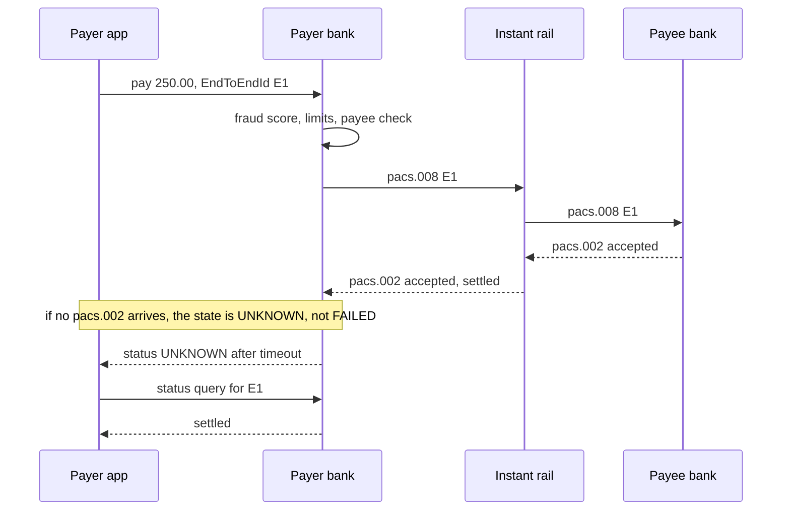

# Real-Time Payments and Open Banking

> Rules and figures checked 2026-11-06. Every date, threshold and fee on this page comes from
> the fact pins in fintech/CLAUDE.md, or from a primary source fetched on 2026-11-06 and named
> where it is used (the Federal Reserve FedNow FAQ, The Clearing House RTP page, and the ECB
> Instant Payments Regulation page). UPI rules, limits and volumes, and the SEPA Instant
> rulebook timings and amount rules, are named on this page but not stated.

---

## 1. Concept Overview

An instant payment rail moves money from one bank account to another in seconds, at any hour
of any day, and the payment is final for the sender when it settles. Every rail in this family
is a credit push: the payer's bank sends the money. The receiver cannot pull it.

The rails this page covers:

| Rail | Where | Operator | Key dated facts |
|---|---|---|---|
| RTP | US | The Clearing House | Launched 2017. $10M limit since 2025-02-09 ($1M from April 2022) |
| FedNow | US | Federal Reserve | Live 2023-07-20. $10M network limit since 2025-11-12 (was $1M) |
| SEPA Instant (SCT Inst) | Euro area and SEPA | EPC scheme, regulated by the EU Instant Payments Regulation | Euro-area PSPs receive from 2025-01-09 and send from 2025-10-09 |
| Pix | Brazil | Banco Central do Brasil | Pix Automatico from 2025-06-16. MED 2.0 mandatory from 2026-02-02 |
| UK Faster Payments (FPS) | UK | Pay.UK | APP scam reimbursement up to GBP 85,000 per claim from 2024-10-07 |
| UPI | India | NPCI | Named only. This page states no UPI rule, limit or volume |

Next to the rails sit overlay services that run before or around a payment: Confirmation of
Payee (UK) and Verification of Payee (EU) check the payee's name against the account, and
request-to-pay messages let a payee ask for a push payment.

Open banking is the other half of the page. Under PSD2, a licensed third party can read
account data (account information service, AIS) or start a payment from the user's bank
account (payment initiation service, PIS) through the bank's interface, with the user's
consent and the bank's strong customer authentication. A PIS payment usually runs on an
instant rail, which is how "pay by bank" works at a checkout.

The wallet study already has a table of instant rails and their effect on wallet top-ups, in
[Design a Digital Wallet §4.6](../../hld/case_studies/design_digital_wallet.md); this page
owns the dated rule facts behind that table, and the rail-selection matrix lives in
[Bank Rails: ACH, SEPA and Wires](../bank_rails_ach_sepa_and_wires/bank_rails_ach_sepa_and_wires.md).

---

## 2. Intuition

> **One-line analogy:** an instant payment is cash handed across a counter through a window
> that never closes. The cash arrives at once and you cannot pull it back through the window.
> If you handed it to the wrong person, you can only ask them to hand it back.

**Mental model.** Card payments put the risk after the payment: a chargeback can take the
money back for months. Instant rails move the risk before the payment: once the money
settles, the sender has no rail undo. So the engineering effort moves forward in time, into
payee checks, fraud scoring, limits and the confirmation screen.

**Why it matters.** A team that ports an ACH design to an instant rail keeps building for the
wrong failure. ACH debits come back days later. Instant credits do not come back. Their
failures are a timeout that leaves the outcome unknown, a payment to a fraudster that the
sender approved, and a weekend with no way to move liquidity into the settlement account.

**Key insight.** "Instant" removes the settlement delay, not the uncertainty. A request can
still time out with no status. The answer to a timeout is a status query with the same
reference, never a second payment with a new one.

---

## 3. Core Principles

1. **Push only.** The payer's bank sends money the payer has. There is no debit on an
   instant credit-transfer rail, so there is no "insufficient funds return".
2. **Final for the sender.** RTP settlement is final and irrevocable. FedNow and RTP each have
   a request-for-return message, and a return is a new payment. The receiver is not obliged
   to return funds under those messages.
3. **Prevention replaces recovery.** With no chargeback, the payee check, the fraud score and
   the confirmation screen carry the loss control.
4. **Always open.** The rail runs 24x7. Liquidity, fraud operations, sanctions screening,
   monitoring and on-call must run 24x7 too.
5. **Limits stack.** The network limit is a ceiling. Each participant bank can set a lower
   one, and your own product sets another. The lowest one applies.
6. **One reference per payment, kept forever.** The `EndToEndId` (and the rail's own
   transaction id) identifies the payment across the timeout, the status query, the return
   request and the return.
7. **Consent is a record.** In open banking, the user's consent is a stored object with a
   scope and an expiry, and the bank checks it on every call.
8. **Rules have dates.** IPR phases, the FedNow limit change and the Pix MED 2.0 date are all
   recent. Keep them as dated configuration.

---

## 4. Types / Architectures / Strategies

### 4.1 US: RTP and FedNow

**RTP.** The Clearing House launched RTP in 2017. The network runs 24/7, gives real-time and
final interbank settlement, and states that settlement is final and irrevocable. Its credit
transfer limit is $10 million, effective 2025-02-09; it was $1 million from April 2022.
Participants may set lower limits. RTP has messaging for a request for payment of a bill or
invoice, and a message for a bank to request the return of funds.

**FedNow.** The Federal Reserve's FedNow Service went live on 2023-07-20. It processes and
settles individual payments within seconds, 24 hours a day, 7 days a week, 365 days a year. It
settles between banks by debit and credit entries to their master accounts at the Reserve
Banks, and offers liquidity management transfers as a core feature. Request for payment is
an optional feature. The network limit rose from $1 million to $10 million effective
2025-11-12, and participants may set lower limits. A request for return of funds is a
non-value message. An actual return is a new value message, a `pacs.004`.
(Source for the operating facts: Federal Reserve, FedNow additional questions and answers,
updated 2024-12-03, fetched 2026-11-06.)

Both rails use ISO 20022 messages: `pacs.008` for the credit transfer and `pacs.002` for its
status. A bank must join each network separately, so a receiver's bank may be on one, both or
neither.

### 4.2 EU: SEPA Instant and the Instant Payments Regulation

The EU Instant Payments Regulation (Regulation (EU) 2024/886) makes PSPs that offer euro
credit transfers also offer instant ones, in phases:

| Obligation | Euro area | Non-euro area | EMIs and PIs |
|---|---|---|---|
| Receive instant payments | 2025-01-09 | 2027-01-09 | 2027-04-09 |
| Send instant payments | 2025-10-09 | 2027-07-09 | 2027-04-09 in the euro area, 2027-07-09 outside |
| Charges no higher than for other credit transfers | 2025-01-09 | 2027-01-09 | |
| Verification of Payee | 2025-10-09 | 2027-07-09 | |

**Verification of Payee (VoP).** Before the payer initiates the payment, the payer's PSP checks
the payee name against the account identifier and returns one of four results: match, close
match, no match, or other. The service is free of charge to the payer.

**Sanctions.** Instead of screening each instant payment in the flow, a PSP that offers
instant transfers checks, at least daily, whether its own payment service users are subject to
targeted financial restrictive measures. (Source for the VoP results, the free-of-charge rule
and the daily check: ECB Instant Payments Regulation page, fetched 2026-11-06.)

The EPC SCT Inst rulebook sets the scheme's timing and amount rules. This page does not state
them.

### 4.3 Brazil: Pix

The Banco Central do Brasil runs Pix. Two recent changes matter to engineers:

- **Pix Automatico**, launched on 2025-06-16, adds recurring payments under a payer
  authorization, which competes with card-on-file and boleto for subscriptions.
- **MED** (Mecanismo Especial de Devolucao) is the special return mechanism for fraud. Self-service
  MED claims in bank apps started on 2025-10-01. MED 2.0 extends fraud refunds past the first
  receiving account to the accounts the money moved to next. It was optional from 2025-11-26
  and mandatory from 2026-02-02.

MED 2.0 changes the design of a receiving institution: it must be able to trace and block
funds that left the first account, which needs a graph of onward transfers, not only a flag on
one account.

### 4.4 UK: Faster Payments, APP reimbursement and Confirmation of Payee

UK PSPs must reimburse authorized push payment (APP) scam victims on Faster Payments since
2024-10-07, up to GBP 85,000 per claim. The Bank of England set the same maximum for CHAPS. The
government decided to fold the Payment Systems Regulator into the FCA, which needs primary
legislation (HM Treasury response updated 2026-04-21).

Confirmation of Payee (CoP) checks the payee's name against the sort code and account number
before the payment. Group 2 PSPs had to offer it by 2024-10-31, and PS26/2 (October 2026)
removed the expiry of the specific direction (SD17) that requires it.

Reimbursement changes the economics. The sending PSP now pays for a scam it could not undo, so
it invests in payee checks, scam warnings and holds on risky first payments to new payees.

### 4.5 India: UPI

UPI is India's instant payment interface, run by NPCI. Interviewers ask about virtual payment
addresses (VPAs), collect requests vs push payments, UPI Lite and AutoPay. This page names
those topics and states no rule, limit or volume for them. The general idea of a collect request is in §4.6.

### 4.6 Request-to-pay and collect requests

A request-to-pay message lets a payee ask a payer to push a payment. The payer's bank shows the
request, the payer approves it with SCA, and the payer's bank sends a normal credit transfer.
RTP and FedNow both offer a request-for-payment capability. ISO 20022 names the messages
`pain.013` (request) and `pain.014` (response).

Request-to-pay looks like a direct debit to the payee and keeps the push model for the payer:
no money moves without the payer's approval. The risk is a payer who approves a request they do
not read, believing they are receiving money. Clear wording on the approval screen ("You are
paying X") and limits on unsolicited requests are the controls.

### 4.7 Open banking: AIS and PIS

| | Account information service (AIS) | Payment initiation service (PIS) |
|---|---|---|
| What the third party does | Reads balances and transactions | Starts a payment from the user's account |
| Role under PSD2 | AISP | PISP |
| User action | Consent, then SCA at the bank | Consent to one payment, then SCA at the bank |
| Typical use | Account checks, affordability, accounting feeds | Pay by bank at checkout, account funding |
| What it returns | Account data | A payment id and a status |

The bank is the account servicing PSP (ASPSP). It exposes an interface, authenticates the user
and enforces the consent. In a redirect flow, the third party never sees the user's bank
password.

**PSD3 and the PSR.** The proposed PSD3 and Payment Services Regulation are not law. The
Council adopted its first-reading positions on 2026-10-29, after Coreper approval on
2026-10-28, and Parliament's second-reading plenary has an indicative date of 2026-12-14.
Nothing is in the Official Journal, so no application date exists to design to.

**US: CFPB Section 1033.** The CFPB's personal financial data rights rule has codified
compliance dates from 2026-04-01 to 2030-04-01, but a court order stayed them 90 days (the
first date became 2026-06-30), and the CFPB's advance notice of 2025-08-22 says it will propose
to extend them. No later final rule is on consumerfinance.gov. Treat the rule as under
reconsideration with no active compliance date.

---

## 5. Architecture Diagrams

### 5.1 An instant credit transfer, with a timeout



The second payment never happens. A timeout moves the payment to an unknown state, and only a
status query with the same `EndToEndId` resolves it.

### 5.2 Pay by bank through open banking


The PISP never holds the money. It holds a consent and a payment id. The merchant learns the
outcome twice: from the PISP status and from its own bank's credit notification.

### 5.3 Where the loss control sits

```
                    before payment              at payment          after payment
Card payment     |  3DS, fraud score         |  authorization  |  chargeback for months
                 |                           |                 |  (issuer takes money back)
-----------------+---------------------------+-----------------+--------------------------
Instant payment  |  payee check (CoP / VoP), |  settlement,    |  request for return only,
                 |  fraud score, scam        |  final for the  |  APP reimbursement (UK),
                 |  warning, new-payee hold  |  sender         |  MED (Brazil)
```

On a card, most of the protection runs after the payment. On an instant rail, almost all of it
must run before.

---

## 6. How It Works - Detailed Mechanics

### 6.1 Payment states and the unknown outcome

An instant payment has five states: `CREATED`, `SENT`, `SETTLED`, `REJECTED` and `UNKNOWN`.
`UNKNOWN` is a real state, not an error. It means the bank sent the `pacs.008` and has no final
status. The only allowed exits are a status query or a late status message.

```java
import java.util.HashMap;
import java.util.Map;
import java.util.Optional;

public class InstantPaymentStates {
    enum State { CREATED, SENT, SETTLED, REJECTED, UNKNOWN }

    record Payment(String endToEndId, long amountCents, State state) {
        Payment with(State s) { return new Payment(endToEndId, amountCents, s); }
    }

    interface Rail {
        Optional<Boolean> send(String endToEndId, long amountCents); // empty means timeout
        Optional<Boolean> query(String endToEndId);
    }

    static final class FlakyRail implements Rail {
        final Map<String, Long> settled = new HashMap<>();
        boolean dropNextReply = true;

        public Optional<Boolean> send(String id, long amount) {
            settled.merge(id, amount, (a, b) -> a);           // this test rail keys payments by EndToEndId
            if (dropNextReply) { dropNextReply = false; return Optional.empty(); }
            return Optional.of(true);
        }
        public Optional<Boolean> query(String id) {
            return Optional.of(settled.containsKey(id));
        }
    }

    static Payment send(Rail rail, Payment p) {
        Optional<Boolean> reply = rail.send(p.endToEndId(), p.amountCents());
        if (reply.isEmpty()) return p.with(State.UNKNOWN);
        return p.with(reply.get() ? State.SETTLED : State.REJECTED);
    }

    static Payment resolve(Rail rail, Payment p) {
        if (p.state() != State.UNKNOWN) return p;
        return rail.query(p.endToEndId())
                .map(ok -> p.with(ok ? State.SETTLED : State.REJECTED))
                .orElse(p);
    }

    public static void main(String[] args) {
        FlakyRail rail = new FlakyRail();
        Payment p = send(rail, new Payment("E1", 25_000, State.CREATED));
        assert p.state() == State.UNKNOWN;
        p = resolve(rail, p);
        assert p.state() == State.SETTLED;
        assert rail.settled.size() == 1;
        System.out.println(p + " payments on rail=" + rail.settled.size());
    }
}
```

The [idempotency module](../idempotency_and_exactly_once_money_movement/idempotency_and_exactly_once_money_movement.md)
owns the general unknown-outcome decision. On an instant rail the rule is short: query with the
same reference, and never send a new reference for the same intent.

### 6.2 Which limit applies

The effective limit is the lowest of the network limit on the payment date, the sending bank's
limit, the receiving bank's limit and your product limit. The network limits change on fixed
dates, so the code reads the date.

```java
import java.time.LocalDate;

public class InstantLimits {
    enum Network { RTP, FEDNOW }

    static long networkLimitCents(Network n, LocalDate d) {
        LocalDate raised = n == Network.RTP ? LocalDate.of(2025, 2, 9) : LocalDate.of(2025, 11, 12);
        return d.isBefore(raised) ? 1_000_000_00L : 10_000_000_00L;
    }

    static long effectiveLimitCents(Network n, LocalDate d, long senderBank, long receiverBank, long product) {
        return Math.min(Math.min(networkLimitCents(n, d), senderBank), Math.min(receiverBank, product));
    }

    public static void main(String[] args) {
        LocalDate today = LocalDate.of(2026, 11, 6);
        long limit = effectiveLimitCents(Network.FEDNOW, today, 10_000_000_00L, 500_000_00L, 2_000_000_00L);
        System.out.println(limit / 100);
        assert limit == 500_000_00L;                                   // receiver bank caps at $500,000
        assert networkLimitCents(Network.FEDNOW, LocalDate.of(2025, 11, 11)) == 1_000_000_00L;
        assert networkLimitCents(Network.RTP, LocalDate.of(2025, 3, 1)) == 10_000_000_00L;
    }
}
```

The participant limits in the example are illustrative. A real system reads them from each
network's participant directory and refreshes them.

### 6.3 Storing payments, return requests and returns

A return request carries no money. A return is a new inbound payment that points at the
original. The tables make both visible, and a foreign key on `(returns_id, returns_dir)` makes
a return go in the opposite direction to the payment it returns.

```sql
CREATE TABLE instant_payment (
    id            bigint GENERATED ALWAYS AS IDENTITY PRIMARY KEY,
    end_to_end_id text   NOT NULL UNIQUE,
    direction     text   NOT NULL CHECK (direction IN ('out', 'in')),
    amount_cents  bigint NOT NULL CHECK (amount_cents > 0),
    state         text   NOT NULL CHECK (state IN ('created', 'sent', 'settled', 'rejected', 'unknown')),
    returns_id    bigint,
    returns_dir   text GENERATED ALWAYS AS (CASE direction WHEN 'in' THEN 'out' ELSE 'in' END) STORED,
    UNIQUE (id, direction),
    FOREIGN KEY (returns_id, returns_dir) REFERENCES instant_payment (id, direction)
);

CREATE TABLE return_request (
    id            bigint GENERATED ALWAYS AS IDENTITY PRIMARY KEY,
    payment_id    bigint NOT NULL REFERENCES instant_payment (id),
    reason        text   NOT NULL,
    sent_at       timestamptz NOT NULL,
    outcome       text CHECK (outcome IN ('returned', 'refused', 'no_answer'))
);

INSERT INTO instant_payment (end_to_end_id, direction, amount_cents, state)
VALUES ('E-100', 'out', 250000, 'settled');

INSERT INTO return_request (payment_id, reason, sent_at)
SELECT id, 'sent to wrong payee', TIMESTAMPTZ '2026-11-06 10:00+00'
FROM instant_payment WHERE end_to_end_id = 'E-100';

-- the receiver agrees: the money comes back as a new inbound payment
INSERT INTO instant_payment (end_to_end_id, direction, amount_cents, state, returns_id)
SELECT 'R-100', 'in', 250000, 'settled', id
FROM instant_payment WHERE end_to_end_id = 'E-100';

UPDATE return_request SET outcome = 'returned'
WHERE payment_id = (SELECT id FROM instant_payment WHERE end_to_end_id = 'E-100');

SELECT o.end_to_end_id AS original, r.end_to_end_id AS return_payment, r.amount_cents
FROM   instant_payment r
JOIN   instant_payment o ON o.id = r.returns_id
WHERE  r.direction = 'in' AND o.direction = 'out';
```

The original row never changes state. The ledger posts the return as its own journal entry,
which keeps the history intact for reconciliation and for a regulator.

### 6.4 Handling payee-check results

VoP and CoP return a result before the payer confirms. The product decides what each result
does. A sensible mapping:

| Result | Show the payer | Let them proceed? |
|---|---|---|
| Match | "Name matches" | Yes |
| Close match | The name the bank holds, and a warning | Yes, after they confirm the shown name |
| No match | A strong warning that the money may go to someone else | Only with an explicit override, logged |
| Other (check not possible) | That the name could not be checked | Yes, with a warning |

Store the result and the payer's choice with the payment. In the UK, that record matters when
a reimbursement claim arrives.

### 6.5 24x7 liquidity

FedNow settles in each bank's master account at the Reserve Banks, and offers liquidity
management transfers. A bank or a platform that sends instant payouts through a bank must have
funds in place before Friday evening for a weekend of outflows, because some funding paths,
such as a Fedwire transfer or an ACH credit from another bank, run only on banking days. The
sizing of that prefunding is a treasury decision, taught with numbers in
[Treasury, Liquidity and FX Operations](../treasury_liquidity_and_fx_operations/treasury_liquidity_and_fx_operations.md).

### 6.6 Open banking payment flow

1. The merchant asks the PISP to create a payment consent with the amount, currency, payee
   account and a reference.
2. The PISP redirects the shopper to their bank (the ASPSP).
3. The shopper logs in and completes SCA at the bank, and approves the payment.
4. The bank sends the instant payment and returns a payment id to the PISP.
5. The PISP reports the status to the merchant by webhook.
6. The merchant confirms the order only after a settled status, and checks it against its own
   bank's credit notification (`camt.054`) during reconciliation.

A webhook is evidence, not proof. If the webhook is lost, the merchant polls the PISP for the
payment id. If the status stays pending, the order stays pending.

---

## 7. Real-World Examples

**FedNow's limit increase.** FedNow launched on 2023-07-20 with a $1 million network limit and
raised it to $10 million effective 2025-11-12. RTP had moved to $10 million on 2025-02-09.
Both let each participant set a lower limit, so a large payment still depends on the
receiving bank.

**EU euro-area send deadline.** On 2025-10-09, every euro-area PSP that offers credit transfers,
other than payment and e-money institutions, had to be able to send instant payments and offer
Verification of Payee, at a price no higher than a standard credit transfer. VoP became a
mandatory step before payment at every euro-area bank. Euro-area payment and e-money
institutions must send instant payments from 2027-04-09.

**UK APP reimbursement.** From 2024-10-07, UK PSPs reimburse APP scam victims on Faster
Payments up to GBP 85,000 per claim. Sending PSPs responded by adding scam warnings, new-payee
holds and payee checks, because the loss now lands on them.

**Pix MED 2.0.** From 2026-02-02, Brazilian institutions must support fraud refunds that follow
the money past the first receiving account. A receiving institution needs to trace onward
transfers in near real time.

**Wallet top-ups on instant rails.** The
[digital wallet study](../../hld/case_studies/design_digital_wallet.md) shows how an instant
rail removes the optimistic-credit window of an ACH top-up and replaces it with APP scam risk.

---

## 8. Tradeoffs

### 8.1 Pay by bank vs card at checkout

| | Pay by bank (PIS on an instant rail) | Card |
|---|---|---|
| Settlement to merchant | Seconds | Days, after clearing and funding |
| Undo path | Refund as a new payment. No chargeback scheme | Refund, reversal, chargeback |
| Fraud model | SCA at the bank, payee checks. APP scam risk on the payer side | 3DS, issuer risk, chargebacks |
| Cost to merchant | Relative: usually lower (illustrative, by provider) | Interchange, scheme fees and markup |
| Conversion risk | A redirect to the bank app, unfamiliar to some users | Familiar card form |
| Recurring payments | Needs a recurring mandate product (for example Pix Automatico) | Card on file and MITs |

### 8.2 Request-to-pay vs direct debit

| | Request-to-pay | Direct debit (SDD, ACH debit) |
|---|---|---|
| Who moves the money | The payer, by approving a push | The payee's bank, by pulling |
| Return risk for the payee | None after settlement | Returns and refund rights |
| Friction for the payer | Approves each request | Approves once, at the mandate |
| Fails when | The payer ignores the request | The account is empty or the debit is disputed |

### 8.3 Payee check strictness

| Policy on "no match" | Fewer scams | Fewer abandoned payments |
|---|---|---|
| Block | Most | Least |
| Warn and require override | Middle | Middle |
| Warn only | Least | Most |

The choice is a risk-appetite decision. In the UK, the reimbursement rules make the sending PSP
pay for scams, which pushes the choice toward "warn and require override".

---

## 9. When to Use / When NOT to Use

**Use an instant rail when:**
- The receiver needs money now: payouts, insurance claims, earned wage access, marketplace
  sellers who want same-day funds.
- You want final money before you release goods or services.
- The amount is within the network limit and the receiving bank participates.

**Do not use an instant rail when:**
- You cannot run fraud checks and payee checks inside the payment flow. With no undo, a weak
  check becomes a loss.
- The receiving bank is not on the network. Fall back to ACH or a wire, and tell the user
  before they confirm.
- You need to pull money. Instant rails push. Use request-to-pay, or a debit rail.

**Use open banking PIS when:**
- Card costs or chargebacks hurt your margin, and your users bank with institutions that
  support PIS well.

**Do not use open banking PIS when:**
- Your users need buyer protection that only a card chargeback gives, unless you offer your
  own refund policy.

---

## 10. Common Pitfalls

### 10.1 Retrying a timeout with a new reference

An illustrative case: a payout service calls its bank's instant payment API with a 5-second
timeout. Under load, replies arrive after 6 seconds. The retry code builds a new request with a
new `EndToEndId`, and the bank sends both. Sellers receive double payouts, and the platform
must ask each of them to return the money.

```java
// BROKEN
import java.util.ArrayList;
import java.util.List;
import java.util.UUID;

public class InstantRetryBroken {
    static final List<String> SENT = new ArrayList<>();

    static boolean sendWithTimeout(String endToEndId) {
        SENT.add(endToEndId);           // the bank sends it
        return false;                   // but the reply comes too late
    }

    static void payout(long cents) {
        for (int attempt = 0; attempt < 2; attempt++) {
            String id = UUID.randomUUID().toString();   // new reference per attempt
            if (sendWithTimeout(id)) return;
        }
    }

    public static void main(String[] args) {
        payout(40_000);
        System.out.println("payments sent: " + SENT.size());
        // prints "payments sent: 2" for one payout
    }
}
```

The fix creates the reference once, with the payout, and turns a timeout into a status query.

```java
// FIX
import java.util.LinkedHashSet;
import java.util.Set;

public class InstantRetryFixed {
    static final Set<String> SENT = new LinkedHashSet<>();

    static boolean sendWithTimeout(String endToEndId) {
        SENT.add(endToEndId);
        return false;
    }

    static boolean querySettled(String endToEndId) {
        return SENT.contains(endToEndId);
    }

    static boolean payout(String payoutId) {
        String endToEndId = "PO-" + payoutId;          // fixed when the payout is created
        if (sendWithTimeout(endToEndId)) return true;
        return querySettled(endToEndId);               // never a second send
    }

    public static void main(String[] args) {
        boolean ok = payout("7731");
        System.out.println("settled=" + ok + " payments sent: " + SENT.size());
        assert ok && SENT.size() == 1;
    }
}
```

### 10.2 Treating "close match" as "match"

A team maps every VoP result except "no match" to "proceed" with no message. A scammer opens an
account under a name one letter off the real supplier's. The payer sees no warning and pays.
Show the bank-held name on a close match and make the payer confirm it.

### 10.3 Confirming an order on a redirect

The shopper comes back from the bank to the merchant's success URL, and the merchant ships. The
payment was still pending and later failed. The redirect only says the shopper finished at the
bank. Confirm on a settled status from the PISP and match it to the bank credit.

### 10.4 Running out of settlement funds on a weekend

A payout platform funds its instant payouts from an account that it tops up by wire on banking
days. A promotion on a Saturday doubles payouts, the account runs dry on Sunday, and payouts
fail until Monday. Forecast weekend outflows, prefund before the Friday cut-off, and alert at a
floor. The treasury module owns the sizing.

### 10.5 Treating a return request as money

Support marks a wrong-payee case as "refunded" when the bank sends the return request. The
receiver never agrees, no `pacs.004` arrives, and the customer is told the money is back. A
request carries no value. Mark the case resolved only when the return payment settles.

### 10.6 Building to a PSD3 or 1033 date that does not exist

A team plans a launch around a PSD3 application date from a blog post. PSD3 and the PSR are not
in the Official Journal, and CFPB 1033 compliance dates are stayed and under reconsideration.
Plan against the rules in force (PSD2 in the EU) and track the status from the primary source.

---

## 11. Technologies & Tools

| Tool | What it does for instant payments and open banking |
|---|---|
| FedNow Service | The Federal Reserve's 24x7x365 instant payment service, settling in master accounts |
| RTP network | The Clearing House's 24/7 instant payment network with request for payment |
| TrueLayer | Open banking provider for payment initiation and account data in the UK and EU |
| Tink | Open banking platform for account data, payment initiation and account checks in Europe |
| Plaid Auth | Returns account and routing numbers with the user's consent, for US account checks |
| Open Banking Standard | The UK API and security profile that banks expose to AIS and PIS providers |

---

## 12. Interview Questions with Answers

**Q: Can the sender recall an instant payment after it settles?**
**Short:** No. Instant payments are final for the sender, so the only path is a request for return, and any money that comes back arrives as a new payment.

RTP settlement is final and irrevocable. FedNow and RTP each have a request-for-return message.
On FedNow the request is a non-value message, and an actual return is a new value message, a
`pacs.004`. Design the ledger so a return is its own inbound entry that points at the original,
and never mark a case refunded until that entry settles.

**Q: Does a request for return oblige the receiving bank to send the money back?**
**Short:** No. Under the RTP and FedNow request-for-return messages the receiver is not obliged to return funds, so the request can be refused or ignored.

The request asks. The receiver's bank decides with its customer, and a fraudster has already
moved the money. That is why the controls belong before the payment: payee checks, fraud
scoring and holds on first payments to new payees. Track each request with an outcome of
returned, refused or no answer.

**Q: Who pays for an APP scam on UK Faster Payments?**
**Short:** Since 2024-10-07, UK PSPs must reimburse APP scam victims on Faster Payments up to GBP 85,000 per claim, and the Bank of England set the same for CHAPS.

APP means authorized push payment: the victim approved the payment, but a scammer tricked
them. The rail cannot undo it, so the rule moved the loss to the PSPs. Senders responded with
Confirmation of Payee, scam warnings and holds. Record the payee-check result and the warnings
shown, because a claim reviews them.

**Q: What does Verification of Payee check, and what results can it return?**
**Short:** It checks the payee name against the account identifier before the payment and returns match, close match, no match or other, free of charge to the payer.

The EU Instant Payments Regulation made VoP mandatory in the euro area from 2025-10-09 and
outside it from 2027-07-09. The UK equivalent is Confirmation of Payee. Neither blocks the
payment by itself. The product decides what each result does. Show the bank-held name on a
close match, and require an explicit override on no match.

**Q: How do RTP and FedNow differ?**
**Short:** The Clearing House runs RTP and the Federal Reserve runs FedNow. Both settle in seconds, around the clock, with a $10 million network limit.

RTP launched in 2017 and has had a $10 million limit since 2025-02-09. FedNow went live on
2023-07-20 and raised its limit from $1 million to $10 million effective 2025-11-12. FedNow
settles through master accounts at the Reserve Banks. A bank joins each network separately,
and each participant may set a lower limit, so a sender checks reachability and limits per
receiving bank.

**Q: Why does a 24x7 rail make liquidity harder?**
**Short:** Payments settle on weekends and holidays, but some funding paths such as wires and ACH credits run only on banking days, so the settlement account needs funds in advance.

FedNow offers liquidity management transfers, and banks plan their master account balances
for the weekend. A platform that sends instant payouts through a partner bank has the same
problem one level down: its account at the bank must cover a weekend of outflows. Forecast
outflows, prefund before the last banking-day cut-off, and alert at a floor.

**Q: What should a client do when an instant payment request times out?**
**Short:** Treat the payment as unknown and query its status with the same EndToEndId, and never send a second request with a new reference.

A timeout means no reply arrived, not that the payment failed. The rail may have settled it.
A retry with a new reference can send the money twice, with no rail undo. Keep the reference
on the payment row from creation, and resolve the unknown state with a query or a late status
message.

**Q: What does the EU Instant Payments Regulation require, and when?**
**Short:** Euro-area PSPs had to receive instant payments from 2025-01-09 and send them with Verification of Payee from 2025-10-09, at charges no higher than other credit transfers.

Non-euro-area PSPs follow on 2027-01-09 for receiving and 2027-07-09 for sending and VoP.
E-money and payment institutions have their own date, 2027-04-09 in the euro area. PSPs also
check their own users against EU sanctions lists at least daily. The SCT Inst rulebook sets
the scheme's timing and amount rules.

**Q: How does the IPR handle sanctions screening for instant payments?**
**Short:** A PSP checks at least daily whether its own users are subject to EU targeted financial sanctions, so screening runs on the customer base rather than on each payment.

Screening every instant payment in the flow adds latency and false positives inside a seconds
budget. The regulation moves the check to the customer base, run at least daily. A PSP still
needs its other AML controls. The rail runs every day, so finish the daily job and act on its
hits before the next run.

**Q: What are Pix Automatico and MED 2.0?**
**Short:** Pix Automatico, launched 2025-06-16, adds recurring Pix payments under a payer authorization. MED 2.0, mandatory from 2026-02-02, extends fraud refunds past the first receiving account.

MED is Pix's special return mechanism for fraud. MED 2.0 follows the money to the accounts it
moved to after the first one, so a receiving institution must trace onward transfers and block
funds quickly. Pix Automatico gives subscriptions a bank-rail option next to cards.

**Q: What is the difference between AIS and PIS in open banking?**
**Short:** An AIS provider reads account data with the user's consent, while a PIS provider starts a payment from the user's account, which the bank then authenticates with SCA.

Both are regulated roles under PSD2 (AISP and PISP). The bank authenticates the user and
enforces the consent. In a redirect flow, the third party never sees the bank password. AIS powers account checks
and financial dashboards. PIS powers pay by bank at a checkout.

**Q: Why would a merchant prefer pay by bank over cards, and what does it give up?**
**Short:** Pay by bank settles in seconds and avoids card fees and chargebacks, but it gives up the card's buyer protection and familiar checkout, and refunds become new payments.

Shoppers who expect chargeback protection may hesitate, and some banks give a slow
authentication experience, which hurts conversion. The merchant must build its own refund
flow on outbound payments. Offer it next to cards, not in place of them, and measure
conversion per bank.

**Q: What is the status of CFPB Section 1033 for US open banking?**
**Short:** The compliance dates are stayed by court order and the CFPB has said it will propose to extend them, so no compliance date is active.

The codified dates run from 2026-04-01 to 2030-04-01. A court order stayed them 90 days, and
the advance notice of 2025-08-22 says the CFPB will propose to extend them. No later final rule
is on consumerfinance.gov. Build data access on current bank and aggregator agreements, and
track the rulemaking.

**Q: Are PSD3 and the PSR in force?**
**Short:** No. The Council adopted its first-reading positions on 2026-10-29, Parliament's vote is pending, and nothing is in the Official Journal, so there is no application date.

Parliament's second-reading plenary has an indicative date of 2026-12-14. Until the texts are
published in the Official Journal, PSD2 and its SCA rules apply. Do not plan a launch around a
PSD3 date from a secondary source.

**Q: How does a collect request differ from a push payment, and where is its risk?**
**Short:** A collect request is the payee asking the payer to approve a push, and its risk is a payer who approves it believing they are receiving money.

The money still moves only after the payer approves, so it stays a credit push. Scammers send
requests with misleading text. The controls are clear approval wording, limits on requests
from unknown payees, and the option to block a requester. UPI is a rail where interviewers ask
about collect requests. This page states no UPI rule.

**Q: How should a merchant confirm an order paid through open banking?**
**Short:** On a settled payment status from the PISP, checked against the merchant's own bank credit, never on the shopper's return to the success URL.

The redirect only tells you the shopper finished at the bank. The payment can still be pending
or rejected. Treat the PISP webhook as evidence, poll the payment id if the webhook is late, and
reconcile against `camt.054` or the bank statement. Keep the order pending while the payment is
pending.

**Q: How do you refund a payment that arrived on an instant rail?**
**Short:** Send a new outbound credit transfer to the payer with its own reference, linked to the original payment, because the rail has no reversal of a settled payment.

Cap the sum of refunds at the original amount, check the payee account details again, and
post the refund as its own journal entry. If the payer's account is closed, the refund fails
and needs another route. A negative amount on the original row moves no money.

**Q: How do participant limits change a payout design on RTP or FedNow?**
**Short:** The effective limit is the lowest of the network limit, each bank's own limit and your product limit, so the payout engine must look up the receiving bank's limit before it sends.

A $2 million payout fits the $10 million network limit but fails at a receiving bank that set
$500,000. Read participant limits from the network directory, cache them with a refresh time,
and route an over-limit payout to a wire before the user confirms.

**Q: What does request-to-pay add on RTP and FedNow?**
**Short:** It lets a payee send a request that the payer approves at their bank, which then sends a normal credit transfer, so billers get a pull-like flow on a push rail.

RTP provides messaging for a request for payment of a bill or invoice. FedNow lists request for
payment as an optional feature. ISO 20022 names the messages `pain.013` and `pain.014`. The
payer can decline or ignore a request, so a biller still needs reminders and a fallback rail.

---

## 13. Best Practices

1. Create the `EndToEndId` with the payment, store it, and reuse it on every query and retry.
2. Model `UNKNOWN` as a state with its own resolver job.
3. Run the payee check before the confirmation screen, and store the result with the payment.
4. Look up reachability and participant limits per receiving bank before the user confirms.
5. Post returns and refunds as new journal entries that point at the original.
6. Confirm orders on settled status plus the bank credit, never on a redirect.
7. Prefund settlement accounts for weekends and holidays, and alert at a floor.
8. Staff fraud and support operations for the rail's hours, which are all hours.
9. Keep regulatory dates (IPR phases, network limits, MED 2.0) as dated configuration.
10. Track PSD3, the PSR and CFPB 1033 from their primary sources, and design to the rules in
    force.

---

## 14. Case Study

**Scenario.** A UK and EU energy supplier adds pay by bank for one-off bill payments and
refunds (assumptions: 1.2 million customers, 150,000 payments a month, an average payment of
GBP 140, and 4% of payments refunded in part after a meter correction). It uses a licensed PISP
for payment initiation, and its own bank's API to send refunds by Faster Payments in the UK and
SEPA Instant in the euro area.

**Design.**

1. Payment initiation: the PISP creates the consent, the customer authenticates at the bank,
   and the supplier marks the bill paid only on a settled status matched to a `camt.054` credit.
2. Payee checks on refunds: before each refund, the supplier runs CoP (UK) or VoP (EU) on the
   customer's account. A close match or no match sends the refund to a review queue.
3. Unknown outcomes: refunds use a fixed `EndToEndId` per refund row. A timeout becomes an
   `UNKNOWN` state that a resolver job queries every 30 seconds (illustrative).
4. Weekend liquidity: the refund account is topped up on Friday from a forecast of weekend
   refunds.

**The incident.** The first version of the refund code treated a refund like a card reversal.
It posted a negative amount against the original payment row and marked it refunded. No money
left the supplier's bank. Customers called. Finance saw a ledger that said about GBP 40,000
was refunded in the first week, with no matching debits on the bank statement (illustrative
figures).

```java
// BROKEN
import java.util.ArrayList;
import java.util.List;

public class PayByBankRefundBroken {
    record Payment(String endToEndId, long amountPence) {}
    record Line(String endToEndId, long amountPence) {}

    static final List<Line> LEDGER = new ArrayList<>();
    static final List<String> BANK_OUTBOUND = new ArrayList<>();

    static void refund(Payment p, long pence) {
        LEDGER.add(new Line(p.endToEndId(), -pence));   // "reverses" the original row
    }

    public static void main(String[] args) {
        Payment bill = new Payment("BILL-5521", 14_000);
        refund(bill, 3_500);
        System.out.println("ledger lines=" + LEDGER.size() + " bank payments=" + BANK_OUTBOUND.size());
        // prints "ledger lines=1 bank payments=0": the customer never gets the money
    }
}
```

The fix makes a refund a new outbound instant payment with its own reference, linked to the
original, capped at the amount still refundable, and booked only when the bank accepts it.

```java
// FIX
import java.util.ArrayList;
import java.util.HashMap;
import java.util.List;
import java.util.Map;

public class PayByBankRefund {
    record Payment(String endToEndId, long amountPence) {}
    record Refund(String endToEndId, String originalId, long amountPence) {}

    static final Map<String, Long> REFUNDED = new HashMap<>();
    static final List<Refund> BANK_OUTBOUND = new ArrayList<>();

    static Refund refund(Payment p, String refundId, long pence) {
        long already = REFUNDED.getOrDefault(p.endToEndId(), 0L);
        if (pence <= 0 || already + pence > p.amountPence()) {
            throw new IllegalArgumentException("refund exceeds the refundable amount");
        }
        Refund r = new Refund("RF-" + refundId, p.endToEndId(), pence);
        BANK_OUTBOUND.add(r);                       // a new credit transfer to the payer
        REFUNDED.merge(p.endToEndId(), pence, Long::sum);
        return r;
    }

    public static void main(String[] args) {
        Payment bill = new Payment("BILL-5521", 14_000);
        refund(bill, "1", 3_500);
        refund(bill, "2", 10_500);
        boolean rejected = false;
        try { refund(bill, "3", 1); } catch (IllegalArgumentException e) { rejected = true; }
        System.out.println("bank payments=" + BANK_OUTBOUND.size() + " third rejected=" + rejected);
        assert BANK_OUTBOUND.size() == 2 && rejected;
    }
}
```

**Outcome (illustrative).** Refunds now appear on the bank statement with their own references,
reconciliation matches each one to its refund row, and the refund cap stops double refunds when
an agent clicks twice. The supplier added the payee-check result to each refund record, which
it uses when a customer claims a refund went to the wrong account.
