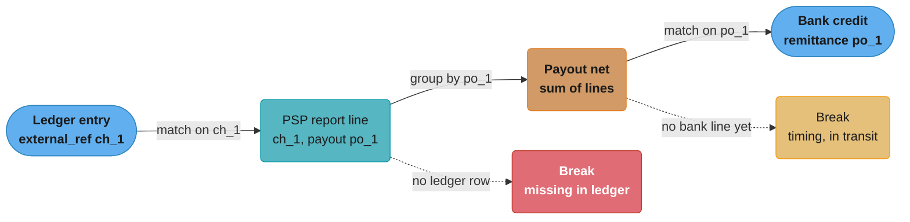
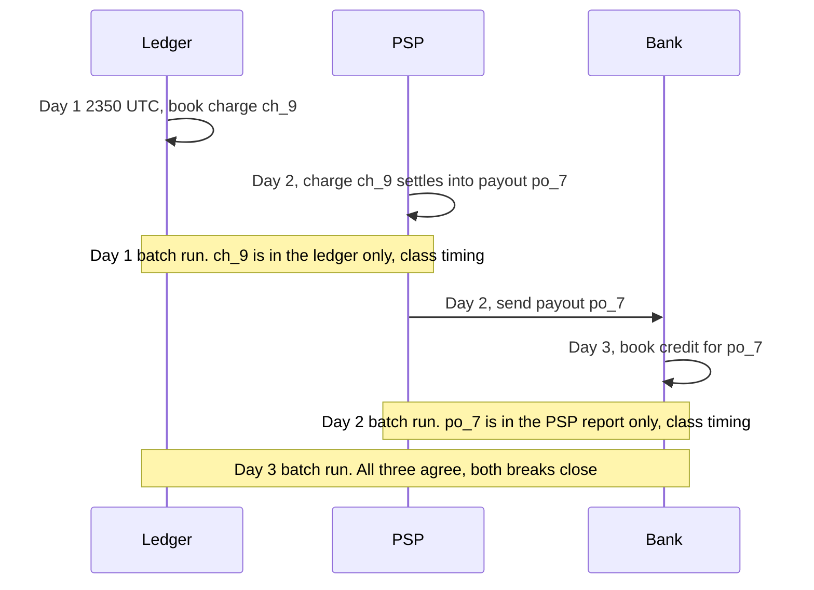

# Reconciliation and Settlement Files

> Rules and figures checked 2026-11-06. Every date, threshold and fee on this page comes from the
> fact pins in fintech/CLAUDE.md, or from the Stripe documentation pages named in §7 (accessed
> 2026-11-06). Fee amounts in the examples are illustrative.

---

## 1. Concept Overview

Reconciliation compares independent records of the same money movement and explains every
difference between them. A payment platform keeps at least three records of one card payment:

1. Its own ledger, which records what the platform owes and is owed.
2. The PSP or acquirer settlement report, which records what the card network cleared and what
   the PSP deducted as fees.
3. The bank statement, which records the cash that actually arrived in, or left, the bank account.

Each record has authority over a different fact. The PSP or network record proves that the card
event happened and what it cost. The ledger proves the obligation: who the platform owes, and
how much. The bank statement proves cash. No single record is the truth for everything, so
reconciliation does not pick a winner. It finds the disagreements, classifies them, and drives
each one to a resolution: a correcting entry, a claim against the PSP, or a timing difference
that clears by itself.

This page covers the settlement files that feed reconciliation (PSP settlement reports, BAI2,
ISO 20022 camt.052, camt.053 and camt.054, Swift MT940 and MT942, and acquirer clearing files),
the matching strategies (exact key, tolerance, many-to-one netting), the break taxonomy,
suspense accounts, aging, control totals, and the choice between batch and streaming
reconciliation. It owns the decision model for matching strategy, auto versus manual
resolution, and batch versus streaming.

The ledger model that reconciliation checks is in
[Double-Entry Ledger Design](../double_entry_ledger_design/double_entry_ledger_design.md).
Value dates, cut-offs and holiday calendars are in
[Business Days, Cut-offs and Value Dates](../case_studies/cross_cutting/business_days_cutoffs_and_value_dates.md).
The full platform built from these pieces is
[Design a Payment Reconciliation Platform](../case_studies/design_a_payment_reconciliation_platform.md).

A nightly recon job inside one payment system is already designed in
[Design a Payment System §4.5](../../hld/case_studies/design_payment_system.md), the three-way
match engine with its four break types in
[Design a Payment Processor §4.6](../../backend/case_studies/design_payment_processor/design_payment_processor.md),
and the ledger's internal balance checks in
[Design a Banking Ledger §8](../../database/case_studies/design_banking_ledger/design_banking_ledger.md).
This page does not repeat those jobs. It teaches the file formats, the matching model and the
operating discipline that all three assume.

---

## 2. Intuition

> **One-line analogy:** three witnesses saw the same car crash from three corners. Each one is
> right about what they could see. The investigator does not ask which witness is honest. She
> lines up the three statements, and every place they disagree becomes a question to answer.

**Mental model.** A match is a claim that two records describe one movement of money. The claim
needs a key that both records carry (a charge id, a payout id, an end-to-end reference) or a
rule that links them (these 412 charges, minus these fees, make this one bank credit). Every
record that no claim covers is a break. A break is not yet an error. Most breaks are timing:
the PSP settled a charge today and the bank will credit it tomorrow.

**Why it matters.** Internal checks prove the ledger is consistent with itself. They cannot prove
the ledger matches the outside world. In the Synapse case the CFPB said the partner banks held
less than Synapse's records showed consumers were owed, a shortfall of between $60 million and
$90 million. Consumers had no access to funds for weeks or months. A ledger whose total does not
match the bank balances behind it is a liability that nobody has measured.

**Key insight.** The output of reconciliation is not a match rate. It is a list of open breaks,
each with an owner, a class, an amount and an age. A hundred breaks that are one hour old are a
normal day. One break that is three weeks old is money nobody can explain.

---

## 3. Core Principles

1. **Authority is scoped.** The PSP record proves the card event, the ledger proves the
   obligation, the bank statement proves cash. Reconciliation resolves disagreements between
   them and never edits one source to agree with another.
2. **Completeness before matching.** Check that every expected file arrived, that its sequence
   number follows the last one, and that its record count and control totals agree with its
   trailer. Matching a partial file produces false breaks or, worse, false matches.
3. **Match on keys, not on amounts.** Two charges of $50.00 on the same day are common. An amount
   is a check on a match, never the reason for it.
4. **Net amounts are rules, not keys.** A payout is gross charges minus refunds, disputes and
   fees. Matching it to a bank credit means rebuilding that sum from the lines the PSP says it
   contains.
5. **Every break has a class, an owner and an age.** The class decides whether a rule can resolve
   it. The age decides when it escalates.
6. **Corrections go through the normal posting path.** A resolution posts a new balanced journal
   entry with a reason code. Nothing updates or deletes a posted entry.
7. **Suspense must drain.** A suspense account holds money the platform received or paid but
   cannot yet attribute. Its balance must trend to zero. A growing suspense balance is an
   unreconciled ledger with a nicer name.
8. **Ingest is idempotent.** Banks and PSPs resend files. The same file loaded twice must produce
   the same state as one load.

---

## 4. Types / Architectures / Strategies

### 4.1 The sources and what each one proves

| Source | Produced by | Proves | Typical delay after the event | Key it carries |
|---|---|---|---|---|
| Internal ledger | The platform | The obligation: who owes whom | Real time | Journal id, external reference |
| PSP balance or settlement report | PSP or acquirer | The card event, the fee, and which payout contains it | Hours to a day | Charge id, balance transaction id, payout id |
| Acquirer or network clearing file | Acquirer, card network | What cleared between acquirer and issuer | One or more business days | Network reference, ARN |
| Bank intraday report | Bank | Cash movements so far today | Minutes to hours | Bank reference, remittance text |
| Bank end-of-day statement | Bank | Booked cash and the closing balance | Next morning | Bank reference, remittance text |
| Bank debit and credit notification | Bank | One booked movement, pushed as it happens | Minutes | Bank reference, end-to-end id |

### 4.2 Settlement and statement file formats

| Format | Owner | What it carries | Shape |
|---|---|---|---|
| PSP settlement report | Each PSP | Per-transaction gross, fee, net, payout id | CSV or API, PSP-specific columns |
| BAI2 | US cash-management format | Balances and transactions per account | Comma-separated records with numeric record types |
| camt.053 | ISO 20022 | End-of-day bank-to-customer statement | XML, one `Stmt` per account |
| camt.052 | ISO 20022 | Intraday account report | XML, `Rpt` element |
| camt.054 | ISO 20022 | Debit and credit notification for single entries | XML, `Ntfctn` element |
| MT940 | Swift | End-of-day customer statement | Tagged text (`:20:`, `:25:`, `:60F:`, `:61:`, `:86:`, `:62F:`) |
| MT942 | Swift | Interim transaction report | Tagged text with entries since the last report and debit and credit totals (`:90D:`, `:90C:`), with no booked opening or closing balance |
| Acquirer clearing file | Acquirer or network | Cleared transactions, interchange and scheme fees | Fixed-width or delimited, acquirer-specific |

The camt messages carry structured references (`EndToEndId`, `AcctSvcrRef`) in separate
elements. MT940 puts most of that in the free-text `:86:` field, so matching against MT940 means
parsing text that each bank fills differently. That alone is a reason to ask a bank for camt.053
when it offers both.

### 4.3 Matching strategies

| Strategy | Rule | Use for | Failure mode |
|---|---|---|---|
| Exact key, one to one | Same id in both records, amounts equal | Ledger charge to PSP line | A source that drops the key |
| Exact key with tolerance | Same id, amounts within N minor units | FX conversion, fee rounding | Tolerance hides a real systematic error |
| Many to one (netting) | Sum of lines with payout id P equals bank credit for P | PSP payout to bank credit | Missing line inside the batch |
| One to many | One instruction split into several bank entries | Bank splits a large transfer | Partial arrival looks like a short payment |
| Many to many | Groups on both sides net to equal totals | Card clearing to acquirer funding | Search cost grows fast, so cap the group size |
| Heuristic | Amount, date window and text similarity | Bank lines with no structured reference | Wrong match of two equal amounts |

### 4.4 Break taxonomy

| Class | Meaning | Usual cause | Auto-resolvable? |
|---|---|---|---|
| Timing | Present in one source, expected in the other later | Settlement lag, cut-off, weekend | Yes, when it clears inside its expected window |
| Missing in ledger | PSP or bank shows money the ledger never booked | Lost webhook, a bug, fraud | No. Page someone |
| Missing externally | Ledger booked money no external source shows | Failed capture booked as success, forged event | No |
| Amount mismatch | Both present, amounts differ | Fee change, FX rate, partial capture | Only inside a stated tolerance and class |
| Duplicate | One movement appears twice | Retry without idempotency, file loaded twice | No |
| Unattributed cash | Bank credit with no reference the platform can resolve | Customer pays by wire with no reference | Goes to suspense, then manual |
| Fee variance | Fee differs from the contract | Pricing change, wrong interchange category | Post to a fee-variance account, review monthly |

### 4.5 Batch, streaming and hybrid

| Mode | How it runs | Strength | Weakness |
|---|---|---|---|
| Batch | After each file arrives, match the whole day | Simple, complete data, easy to replay | Breaks surface a day late |
| Streaming | Match each event as it arrives against an open window | Breaks surface in minutes | Many false breaks before the other side arrives |
| Hybrid | Stream provisional matches, then a batch pass closes the day | Early warning and a complete final answer | Two code paths that must agree |

---

## 5. Architecture Diagrams

### 5.1 The reference chain from charge to bank credit



Each arrow is one match and each match uses a key both sides carry. The charge id joins the
ledger to the PSP line, and the payout id joins the PSP batch to the bank credit. A break in the
first hop is an accounting problem. A break in the second hop is usually timing.

### 5.2 Why a correct day still shows breaks



The same charge produces two timing breaks on two different days, and both close without any
action. A recon system that cannot tell this pattern from a lost charge pages people every night.

### 5.3 One payout, many lines

```
  PSP report lines tagged payout po_1              Bank statement
  ------------------------------------             ---------------------------
  ch_1   charge   gross  5000  fee  175  net  4825
  ch_2   charge   gross  2500  fee  103  net  2397
  re_1   refund   gross -1000  fee    0  net -1000
                                         ---------
                         sum of net        6222   ==>   credit 6222  "PAYOUT po_1"

  Matching 6222 to the ledger's gross charges (7500) fails every time.
  Matching it to the rebuilt net of the lines in po_1 succeeds.
```

The bank sees one number. The PSP report explains it. Reconciliation rebuilds the bank number
from the lines and then compares, so a mismatch points at the line that is wrong, not at the
whole payout. The fees here are illustrative.

---

## 6. How It Works - Detailed Mechanics

### 6.1 Parse every amount into integer minor units

Settlement files rarely use the platform's internal representation. Stripe's payout
reconciliation report, for example, expresses `gross`, `fee` and `net` in major units of the
currency ("dollars for USD, yen for JPY"). The parser converts each amount with the ISO 4217
exponent of its currency and fails loudly on anything that does not convert exactly. Minor units
and exponents are covered in
[Money Representation and Currency](../money_representation_and_currency/money_representation_and_currency.md).

The program below parses report lines, checks that each line's `gross - fee = net`, rebuilds
each payout's net and matches it to bank credits by payout id.

```java
import java.math.BigDecimal;
import java.util.ArrayList;
import java.util.List;
import java.util.Map;
import java.util.TreeMap;

public class PayoutMatch {

    record ReportLine(String balanceTxn, String payoutId, String currency,
                      String gross, String fee, String net) {}

    record BankCredit(String entryRef, String remittance, String currency, long amountMinor) {}

    record Outcome(String key, String status, long expectedMinor, long actualMinor) {}

    static final Map<String, Integer> EXPONENT = Map.of("USD", 2, "EUR", 2, "JPY", 0, "KWD", 3);

    static long toMinor(String major, String currency) {
        Integer exp = EXPONENT.get(currency);
        if (exp == null) throw new IllegalArgumentException("unknown currency " + currency);
        return new BigDecimal(major).movePointRight(exp).longValueExact();
    }

    static List<Outcome> match(List<ReportLine> lines, List<BankCredit> credits) {
        Map<String, Long> netByPayout = new TreeMap<>();
        Map<String, String> currencyByPayout = new TreeMap<>();
        for (ReportLine l : lines) {
            long g = toMinor(l.gross(), l.currency());
            long f = toMinor(l.fee(), l.currency());
            long n = toMinor(l.net(), l.currency());
            if (g - f != n) throw new IllegalStateException("line does not foot: " + l.balanceTxn());
            netByPayout.merge(l.payoutId(), n, Long::sum);
            currencyByPayout.put(l.payoutId(), l.currency());
        }
        List<Outcome> out = new ArrayList<>();
        List<BankCredit> unused = new ArrayList<>(credits);
        for (var e : netByPayout.entrySet()) {
            String payout = e.getKey();
            BankCredit hit = null;
            for (BankCredit c : unused) {
                if (c.remittance().contains(payout) && c.currency().equals(currencyByPayout.get(payout))) {
                    hit = c;
                    break;
                }
            }
            if (hit == null) {
                out.add(new Outcome(payout, "IN_TRANSIT", e.getValue(), 0));
            } else {
                unused.remove(hit);
                String status = hit.amountMinor() == e.getValue() ? "MATCHED" : "AMOUNT_MISMATCH";
                out.add(new Outcome(payout, status, e.getValue(), hit.amountMinor()));
            }
        }
        for (BankCredit c : unused) out.add(new Outcome(c.entryRef(), "UNATTRIBUTED", 0, c.amountMinor()));
        return out;
    }

    public static void main(String[] args) {
        List<ReportLine> lines = List.of(
            new ReportLine("txn_1", "po_1", "USD", "50.00", "1.75", "48.25"),
            new ReportLine("txn_2", "po_1", "USD", "25.00", "1.03", "23.97"),
            new ReportLine("txn_3", "po_1", "USD", "-10.00", "0.00", "-10.00"),
            new ReportLine("txn_4", "po_2", "JPY", "1200", "65", "1135"));
        List<BankCredit> credits = List.of(
            new BankCredit("B-881", "PAYOUT po_1", "USD", 6222),
            new BankCredit("B-882", "WIRE ACME INV 7731", "USD", 500000));

        List<Outcome> result = match(lines, credits);
        result.forEach(System.out::println);

        assert result.get(0).equals(new Outcome("po_1", "MATCHED", 6222, 6222));
        assert result.get(1).equals(new Outcome("po_2", "IN_TRANSIT", 1135, 0));
        assert result.get(2).equals(new Outcome("B-882", "UNATTRIBUTED", 0, 500000));

        boolean rejected = false;
        try { toMinor("19.999", "USD"); } catch (ArithmeticException ex) { rejected = true; }
        assert rejected : "a third decimal in USD must fail, not round";
    }
}
```

`longValueExact` throws when a value has more decimals than the currency allows. A silent round
at this point would hide a PSP format change for weeks. The `po_2` payout is in transit, not
broken: it becomes a break only if no bank credit arrives inside its expected window.

### 6.2 Store each source as received, then match in SQL

Keep one table per source with the file id and line number, so every number traces back to the
byte range it came from. Uniqueness constraints make a reloaded file a no-op.

```sql
CREATE TABLE ledger_entry (
    id            bigint PRIMARY KEY,
    external_ref  text   NOT NULL,
    kind          text   NOT NULL CHECK (kind IN ('charge', 'refund')),
    currency      char(3) NOT NULL,
    amount_minor  bigint NOT NULL,
    booked_on     date   NOT NULL,
    UNIQUE (external_ref)
);

CREATE TABLE psp_line (
    file_id         text   NOT NULL,
    line_no         int    NOT NULL,
    balance_txn_id  text   NOT NULL UNIQUE,
    source_ref      text   NOT NULL,
    payout_id       text,
    currency        char(3) NOT NULL,
    gross_minor     bigint NOT NULL,
    fee_minor       bigint NOT NULL,
    net_minor       bigint NOT NULL,
    PRIMARY KEY (file_id, line_no),
    CHECK (net_minor = gross_minor - fee_minor)
);

CREATE TABLE bank_line (
    statement_id  text   NOT NULL,
    entry_ref     text   NOT NULL,
    remittance    text,
    currency      char(3) NOT NULL,
    amount_minor  bigint NOT NULL,
    booking_date  date   NOT NULL,
    value_date    date   NOT NULL,
    PRIMARY KEY (statement_id, entry_ref)
);

CREATE TABLE recon_break (
    id              bigserial PRIMARY KEY,
    class           text   NOT NULL,
    ref             text   NOT NULL,
    expected_minor  bigint,
    actual_minor    bigint,
    opened_on       date   NOT NULL,
    UNIQUE (class, ref)
);

CREATE TABLE recon_break_event (
    break_id    bigint NOT NULL REFERENCES recon_break(id),
    at          timestamptz NOT NULL DEFAULT now(),
    action      text   NOT NULL CHECK (action IN ('opened', 'note', 'resolved', 'reopened')),
    reason      text   NOT NULL,
    journal_id  bigint
);

INSERT INTO ledger_entry VALUES
    (1, 'ch_1', 'charge', 'USD',  5000, '2026-11-02'),
    (2, 'ch_2', 'charge', 'USD',  2500, '2026-11-02'),
    (3, 're_1', 'refund', 'USD', -1000, '2026-11-02');

INSERT INTO psp_line VALUES
    ('psp-2026-11-03', 1, 'txn_1', 'ch_1', 'po_1', 'USD',  5000, 175,  4825),
    ('psp-2026-11-03', 2, 'txn_2', 'ch_2', 'po_1', 'USD',  2500, 103,  2397),
    ('psp-2026-11-03', 3, 'txn_3', 're_1', 'po_1', 'USD', -1000,   0, -1000),
    ('psp-2026-11-03', 4, 'txn_4', 'ch_3', 'po_2', 'USD',  1200,  65,  1135);

INSERT INTO bank_line VALUES
    ('stmt-2026-11-04', 'B-881', 'PAYOUT po_1', 'USD', 6222, '2026-11-04', '2026-11-04');

-- Reloading the same file is a no-op, not a second copy.
INSERT INTO psp_line VALUES
    ('psp-2026-11-03', 1, 'txn_1', 'ch_1', 'po_1', 'USD', 5000, 175, 4825)
ON CONFLICT DO NOTHING;
```

The first hop compares the ledger with the PSP lines by key, with a full outer join so a record
missing on either side shows up. The second hop rebuilds each payout's net and compares it with
the bank.

```sql
INSERT INTO recon_break (class, ref, expected_minor, actual_minor, opened_on)
SELECT CASE WHEN l.id IS NULL THEN 'missing_in_ledger'
            WHEN p.balance_txn_id IS NULL THEN 'missing_at_psp'
            ELSE 'amount_mismatch' END,
       coalesce(l.external_ref, p.source_ref),
       l.amount_minor, p.gross_minor, DATE '2026-11-04'
FROM ledger_entry l
FULL OUTER JOIN psp_line p ON p.source_ref = l.external_ref
WHERE l.id IS NULL OR p.balance_txn_id IS NULL OR l.amount_minor <> p.gross_minor
ON CONFLICT (class, ref) DO NOTHING;

INSERT INTO recon_break (class, ref, expected_minor, actual_minor, opened_on)
SELECT CASE WHEN b.entry_ref IS NULL THEN 'payout_in_transit' ELSE 'payout_amount' END,
       n.payout_id, n.net, b.amount_minor, DATE '2026-11-04'
FROM (SELECT payout_id, currency, sum(net_minor) AS net
      FROM psp_line GROUP BY payout_id, currency) n
LEFT JOIN bank_line b ON b.remittance LIKE '%' || n.payout_id AND b.currency = n.currency
WHERE b.entry_ref IS NULL OR b.amount_minor <> n.net
ON CONFLICT (class, ref) DO NOTHING;

INSERT INTO recon_break_event (break_id, action, reason)
SELECT id, 'opened', 'nightly run 2026-11-04' FROM recon_break;

DO $$
BEGIN
    ASSERT (SELECT count(*) FROM psp_line) = 4, 'reload must not duplicate';
    ASSERT (SELECT count(*) FROM recon_break) = 2, 'expect two breaks';
    ASSERT EXISTS (SELECT 1 FROM recon_break WHERE class = 'missing_in_ledger' AND ref = 'ch_3');
    ASSERT EXISTS (SELECT 1 FROM recon_break WHERE class = 'payout_in_transit' AND ref = 'po_2');
END $$;
```

The run finds two breaks. `ch_3` is a charge the PSP settled and the ledger never booked, which
is the dangerous class. `po_2` is a payout that has not reached the bank yet, which is timing
until its expected arrival date passes.

### 6.3 Control totals and completeness

Before matching, prove the file is whole:

| Check | How | Catches |
|---|---|---|
| File arrived | Expected-files calendar per source per business day | A missing statement read as "no activity" |
| Sequence | File or statement sequence number is last + 1 | A skipped file |
| Duplicate | Hash of the file bytes, plus the sequence number | A resent file |
| Record count | Lines parsed equals the trailer count | A truncated download |
| Control total | Sum of amounts equals the trailer total | A parse error in one line |
| Balance roll | Opening balance + entries = closing balance | A missing entry inside the statement |

A BAI2 file shows where these totals live. Record types `01` and `99` open and close the file,
`02` and `98` a group, `03` and `49` an account, `16` is a transaction detail and `88`
continues the previous record. Each trailer carries a control total and a record count. The
account total is the sum of the amounts in `03` and `16`, and each higher total sums the
totals below it. Amounts carry no decimal point, so `6222` is USD 62.22, the `po_1` payout.
Banks vary in details, so parse against each bank's own BAI2 guide.

```text
01,BANKID,CUSTID,261104,0600,1,,,2/
02,CUSTID,BANKID,1,261103,,USD,2/
03,000123456789,USD,010,1500000,,,040,1500000,,/
16,165,6222,Z,B-881,PAYOUT po_1/
88,PSP SETTLEMENT
49,3006222,4/
98,3006222,1,6/
99,3006222,1,8/
```

The balance roll in camt.053 is the same idea in XML: the statement carries an opening booked
balance (`OPBD`) and a closing booked balance (`CLBD`), and the entries between them must sum to
the difference. The excerpt below leaves out mandatory elements such as the balance date and the
bank transaction code.

```xml
<Stmt>
  <Acct><Id><IBAN>DE89370400440532013000</IBAN></Id><Ccy>USD</Ccy></Acct>
  <Bal><Tp><CdOrPrtry><Cd>OPBD</Cd></CdOrPrtry></Tp><Amt Ccy="USD">15000.00</Amt><CdtDbtInd>CRDT</CdtDbtInd></Bal>
  <Bal><Tp><CdOrPrtry><Cd>CLBD</Cd></CdOrPrtry></Tp><Amt Ccy="USD">15062.22</Amt><CdtDbtInd>CRDT</CdtDbtInd></Bal>
  <Ntry>
    <Amt Ccy="USD">62.22</Amt><CdtDbtInd>CRDT</CdtDbtInd><Sts><Cd>BOOK</Cd></Sts>
    <BookgDt><Dt>2026-11-04</Dt></BookgDt><ValDt><Dt>2026-11-04</Dt></ValDt>
    <AcctSvcrRef>B-881</AcctSvcrRef>
    <NtryDtls><TxDtls><Refs><EndToEndId>po_1</EndToEndId></Refs></TxDtls></NtryDtls>
  </Ntry>
</Stmt>
```

### 6.4 Tolerance, FX and fee variance

A tolerance is a rule with a class, a bound and a destination account. "Accept any difference
under 5 cents" with no destination makes money disappear. The working form is:

1. Match on key first. Tolerance applies only to records already linked by a key.
2. Bound the tolerance in minor units per line (for example, 1 minor unit for a fee rounding
   rule, as an assumption you tune), and in total per day.
3. Post the difference to a named variance account (`fx_variance`, `fee_variance`) with the rule
   id as the reason code.
4. Review the variance account balance on a schedule. A steady drift in one direction is a bug
   or a contract problem, not rounding.

Fee variance is its own reconciliation: the fee the PSP charged against the fee the contract
says. On IC++ pricing the interchange and scheme fees pass through, so the check is per
interchange category. That model is in
[Interchange and Payment Economics](../card_payments_lifecycle/interchange_and_payment_economics.md).

### 6.5 Suspense accounts

A suspense account is a ledger account for money that moved but cannot yet be attributed. A
customer wire with no reference, or a bank credit for a payout id the platform does not know,
lands there:

```text
Bank credit 5,000.00 USD, remittance "WIRE ACME INV 7731", no matching invoice id
  Dr  bank_cash_usd        5,000.00
  Cr  suspense_unapplied   5,000.00
Later, ops finds invoice INV-7731 for customer acme:
  Dr  suspense_unapplied   5,000.00
  Cr  receivable_acme      5,000.00
```

Track suspense by age bucket and by count. Set a target age for each item (an assumption per
business, for example 5 business days) and escalate past it. The total suspense balance goes on
the same dashboard as the oldest open break.

### 6.6 Aging and escalation

| Age of break | Timing class | Missing in ledger or duplicate | Amount mismatch |
|---|---|---|---|
| Inside expected window | No action | Page now | Queue |
| Past window by 1 business day | Reclassify as missing externally | Incident | Owner assigned |
| Past window by 5 business days | Finance lead | Incident review | Finance lead |
| Month end | Listed in the close report | Listed in the close report | Listed in the close report |

The windows are assumptions per source: a PSP that pays out daily has a one-day window, a
weekly payout schedule has a seven-day window. Weekends and bank holidays move every window,
which is why the windows come from a business-day calendar and not from `date + 1`.

### 6.7 Streaming reconciliation

Streaming recon keeps an open window per key. When the second record arrives, the match closes.
When the window expires, the key becomes a break.

| Design choice | Recommendation |
|---|---|
| Window per key | From the expected delay of the slower source, plus margin |
| State store | Keyed state in the stream processor, or a table with an expiry index |
| Late arrival after expiry | Reopen as a match and close the break with a `resolved` event |
| Final answer | A batch pass at day close, because files can still correct earlier lines |

Watermarks and late events in stream processors are covered in
[Apache Flink](../../technologies/apache_flink/apache_flink.md).

---

## 7. Real-World Examples

**Stripe payout reconciliation report.** Stripe's report "helps you match the payouts you receive
in your bank account with the batches of payments and other transactions that they relate to".
It is available for accounts with automatic payouts. Stripe states that for instant payouts the
merchant controls timing and amount, so Stripe "can't identify which transactions are included in
each payout", and the merchant reconciles those itself. The itemized report has one row per
balance transaction with `gross`, `fee` and `net` in major units, an `automatic_payout_id`, and a
`trace_id` that the bank generates for the payout. The report groups a payout by its estimated
arrival date, not by the date the bank posts the deposit. (Stripe docs, accessed 2026-11-06.)

**Synapse.** The CFPB says Synapse's partner banks held less than Synapse's records showed
consumers were owed, a shortfall of between $60 million and $90 million. The CFPB filed in the US
Bankruptcy Court for the Central District of California, and the court entered a stipulated final
judgment on 2025-09-12 with a $1 civil money penalty, which opened the Civil Penalty Fund. The
CFPB has allocated $55,214,058 from that fund to harmed consumers. For an engineer the lesson is
the reconciliation that was missing: the sum of end-user balances in the platform ledger against
the balances in every FBO account at every partner bank, every day.

**Citibank and Revlon.** On 2020-08-11 Citibank meant to send Revlon's lenders about $7.8 million
of interest. It sent $894 million of principal plus the $7.8 million. About $385 million came
back. Lenders holding about $500 million refused. The Second Circuit decided on 2022-09-08 to
vacate and remand, holding that the discharge-for-value defense did not apply. For reconciliation
the lesson is timing: a same-day check of outgoing instructions against intended amounts finds
the error, but the money is already gone. Prevention belongs before release, as a maker-checker
control. Recon only measures the damage.

**Square Books.** Square describes Books as an immutable double-entry accounting database in
which journal entries must balance to zero and entries are append-only. That property is what
makes reconciliation corrections auditable: a fix is always a new entry.

---

## 8. Tradeoffs

### Decision model: matching strategy, auto versus manual, batch versus streaming

| Question | Choose | When | Avoid when |
|---|---|---|---|
| How to match ledger to PSP? | Exact key, one to one | The ledger stores the PSP's charge or balance transaction id | The integration never captured the id. Fix that first |
| How to match PSP to bank? | Many to one by payout id | The PSP batches payouts and the bank shows the payout id | Instant payouts, where the merchant controls the batch |
| How to match bank lines with no reference? | Heuristic, then human | Inbound customer wires, cheques | Never auto-post a heuristic match above a set amount |
| Apply tolerance? | Yes, per class with a variance account | FX conversion, fee rounding | Ledger to PSP for the same currency, where the amounts must agree exactly |
| Auto-resolve? | Only timing breaks that clear in window, and tolerance classes | The rule names its account and reason code | Missing in ledger, duplicates, unattributed cash |
| Batch or streaming? | Batch | Daily payouts, daily statements, small team | Instant rails or high fraud exposure, where a day of delay costs money |
| | Hybrid | Instant payouts, intraday camt.052 or camt.054 feeds | Sources that only deliver end-of-day files |

### Format choice when a bank offers options

| Need | MT940 | BAI2 | camt.053 |
|---|---|---|---|
| Structured end-to-end reference | Free text in `:86:` | Customer reference field in `16`, free text in `88` | `EndToEndId` element |
| Balance roll | Yes (`:60F:`, `:62F:`) | Yes (type codes on `03`) | Yes (`OPBD`, `CLBD`) |
| Parser effort per bank | High, text varies by bank | Medium | Lowest when the bank fills the references |

---

## 9. When to Use / When NOT to Use

**Use three-way reconciliation when:**

- Money passes through a PSP or acquirer before it reaches the bank, so the bank credit is a net
  of many events.
- The platform holds customer funds in FBO or safeguarding accounts. The sum of customer balances
  must equal the bank balance every day.
- Fees are deducted at source, so revenue and cost depend on a file you did not produce.

**Use streaming reconciliation when:** payouts go out on instant rails, the platform credits a
wallet before final settlement, or a fraud loss grows with every hour a break stays unseen.

**Do NOT:**

- Use reconciliation as a substitute for idempotency or for correct posting. Recon finds a
  double charge after the customer sees it. Preventing it is the job of
  [Idempotency and Exactly-Once Money Movement](../idempotency_and_exactly_once_money_movement/idempotency_and_exactly_once_money_movement.md).
- Build a heuristic matcher before you have the keys. Ask the PSP and the bank for structured
  references first. Every key you get removes a class of manual work.
- Stream-match a source that only delivers end-of-day files. You add a state store and gain
  nothing.

---

## 10. Common Pitfalls

### 10.1 Parsing major units with `double`

A team parsed the net column of a PSP report with `Double.parseDouble` and multiplied by 100.
Every payout came out a few cents short of the bank credit, and the team added a 10-cent
tolerance to make the breaks go away. The tolerance then hid a real fee change for a month. The
incident is illustrative.

```java
// BROKEN
public class MajorUnitsBroken {
    public static void main(String[] args) {
        String[] nets = {"19.99", "0.29", "4.35"};
        long total = 0;
        for (String s : nets) {
            total += (long) (Double.parseDouble(s) * 100);
        }
        System.out.println(total); // prints 2460, the bank credited 2463
    }
}
```

`19.99 * 100` is `1998.9999999999998` as a `double`, and the cast truncates it to `1998`. The
same happens to `0.29` and `4.35`, so three lines lose 3 cents.

```java
// FIX
import java.math.BigDecimal;

public class MajorUnitsFix {
    static long toMinor(String major, int exponent) {
        return new BigDecimal(major).movePointRight(exponent).longValueExact();
    }

    public static void main(String[] args) {
        String[] nets = {"19.99", "0.29", "4.35"};
        long total = 0;
        for (String s : nets) total += toMinor(s, 2);
        System.out.println(total);
        assert total == 2463;
    }
}
```

The fix uses the string's exact decimal value and the currency's exponent. Remove any tolerance
that was added to hide the old bug.

### 10.2 Matching on amount and date

A bank-to-ledger matcher joined on amount and booking date because the bank lines had no
reference. Two customers paid $50.00 on the same day, and the join produced four pairs. The
incident is illustrative.

```sql
-- BROKEN
INSERT INTO bank_line VALUES
    ('stmt-2026-11-05', 'B-901', 'CUSTOMER PAYMENT', 'USD', 5000, '2026-11-05', '2026-11-05'),
    ('stmt-2026-11-05', 'B-902', 'CUSTOMER PAYMENT', 'USD', 5000, '2026-11-05', '2026-11-05');
INSERT INTO ledger_entry VALUES
    (10, 'inv_a', 'charge', 'USD', 5000, '2026-11-05'),
    (11, 'inv_b', 'charge', 'USD', 5000, '2026-11-05');
SELECT b.entry_ref, l.external_ref
FROM bank_line b
JOIN ledger_entry l ON l.amount_minor = b.amount_minor AND l.booked_on = b.booking_date
WHERE b.statement_id = 'stmt-2026-11-05';
-- returns 4 rows for 2 payments, and each invoice looks paid twice
```

The fix has two parts. Get a key into the payment (a virtual account number per customer, or an
invoice id the customer must quote). For the lines that still arrive without one, match at most
one to one and send any amount with more than one candidate to a person.

```sql
-- FIX
CREATE TABLE bank_match (
    statement_id  text   NOT NULL,
    entry_ref     text   NOT NULL,
    ledger_id     bigint NOT NULL REFERENCES ledger_entry(id),
    rule          text   NOT NULL,
    PRIMARY KEY (statement_id, entry_ref),
    UNIQUE (ledger_id)
);
```

The two unique constraints make a many-to-many match impossible to store. A heuristic matcher
that finds two candidates for one bank line writes neither and opens a manual break.

### 10.3 Other pitfalls

- **Treating a missing file as a quiet day.** A statement that did not arrive and a statement
  with no entries look the same to a matcher. Only the expected-files calendar can tell them
  apart.
- **Matching across currencies.** A EUR payout credited to a USD account after the bank
  converts it is a match with an FX variance, not an amount mismatch. Store both the original
  and the booked amount.
- **Closing breaks by editing the source rows.** Once a row in `psp_line` is edited to agree with
  the ledger, nothing can prove what the PSP sent. Keep source rows exactly as received.
- **Suspense as a parking lot.** One payment company found months of unapplied customer wires
  in suspense during an audit (illustrative). Age every suspense item and report the total.
- **Using the PSP's reporting time zone as if it were UTC.** Daily totals then disagree every day
  by the charges made near midnight. §14 walks through this case.

---

## 11. Technologies & Tools

| Tool | Role in reconciliation |
|---|---|
| Stripe Reporting API | Payout reconciliation and balance reports, itemized per balance transaction |
| BlackLine | Account reconciliation and transaction matching for the finance close |
| Trintech Cadency | Close management and reconciliation for finance teams |
| Modern Treasury | Bank connectivity, payment operations and reconciliation of bank activity |
| PostgreSQL | Source tables, unique keys for idempotent loads, set-based matching |
| Apache Flink | Keyed state and event-time windows for streaming matching |
| Temporal | Durable workflows for break escalation and file-arrival deadlines |

---

## 12. Interview Questions with Answers

**Q: Is reconciliation the final arbiter of what happened to the money?**
**Short:** No. Each source proves a different fact: the PSP record the card event, the ledger the obligation, the bank statement cash. Recon resolves their disagreements.

Treating recon output as truth leads teams to "fix" whichever source lost the vote, and that
destroys the evidence. The PSP record has authority over the card event and its fee. The ledger
has authority over what the platform owes each party. The bank statement has authority over
cash. A break means at least one of them is wrong or late, and the resolution is a new entry in
the source that was wrong, made through its normal path.

**Q: Why can you not match a payout to a bank credit by amount alone?**
**Short:** Equal amounts are common, so an amount-only join pairs the wrong records. Use the payout id the bank shows, and treat the amount as a check on the match.

Two payouts of the same net, or a payout that happens to equal an unrelated customer wire, are
enough to make an amount match wrong. The wrong match then hides the real break twice: once for
the record matched in error, once for the one left over. Match on a key that both records carry,
such as the payout id in the remittance text or the end-to-end id in camt.053, and compare
amounts after the key has linked them.

**Q: Why does a PSP payout almost never equal the day's charges in the ledger?**
**Short:** A payout is a net: settled charges minus refunds, disputes and fees, grouped by the PSP's payout schedule, not by the ledger's booking day.

The bank credit is the sum of every balance transaction the PSP put in that payout. That set
includes refunds and dispute withdrawals from other days, fees deducted at source, and charges
that settled on a different day than they were booked. Recon rebuilds the net from the PSP's
itemized lines for that payout id and compares it to the bank credit. It then matches each line
to the ledger separately.

**Q: How do you tell a timing break from a real one?**
**Short:** Give every break class an expected clearing window from a business-day calendar. Inside the window it is timing, and past it the break becomes an incident.

A charge settled today and credited tomorrow appears as a break in today's run and clears in
tomorrow's. The recon system stores the expected window per source (one business day for a daily
payout, seven for a weekly schedule) and reclassifies a timing break that outlives it as
"missing externally". Without windows, either everything pages or nothing does.

**Q: Should the reconciliation job correct the ledger automatically?**
**Short:** Only for rule-defined classes, and only by posting a new balanced entry with a reason code. It never edits or deletes a posted entry.

An automatic fix that edits history removes the record of the error and makes the next audit
impossible. A safe auto-resolution is narrow: a fee rounding difference of at most one minor
unit posted to `fee_variance`, or a timing break that closed inside its window. Missing-in-ledger
breaks, duplicates and unattributed cash always go to a person, because the right correction
depends on why they happened.

**Q: What is a suspense account, and how does it go wrong?**
**Short:** A ledger account for money that moved but cannot yet be attributed. It goes wrong when items sit there unaged and the balance grows.

An inbound wire with no usable reference is booked against cash and a suspense account so the
cash side of the ledger stays right. Ops then finds the customer and moves the amount to the
correct receivable. Report suspense by count, amount and age, give each item a target age, and
escalate past it. A suspense balance that only grows means part of the ledger is unreconciled.

**Q: What is the most dangerous break class, and why?**
**Short:** Money that moved externally with no ledger entry, because the platform does not know its own position and may owe or pay out funds it cannot see.

A PSP charge with no ledger row can mean a lost webhook, a bug in the posting path, or someone
moving money outside the platform's controls. An unexplained bank debit is worse. Page on the
existence of these breaks, regardless of amount. A small amount from a new cause usually becomes
a large amount from the same cause the next day.

**Q: What do camt.052, camt.053 and camt.054 each carry?**
**Short:** camt.053 is the end-of-day statement, camt.052 is the intraday account report, and camt.054 notifies single debit or credit entries.

All three are ISO 20022 bank-to-customer cash-management messages. camt.053 carries the booked
entries and the opening and closing balances, so it is the basis of the daily balance roll.
camt.052 gives intraday visibility, including entries that may not be booked yet. camt.054 pushes
individual entries as they happen, which suits streaming recon. Use camt.053 for the final
answer and the other two for early warning.

**Q: How does MT940 differ from camt.053 for matching?**
**Short:** MT940 carries most references in the free-text `:86:` field, which each bank fills differently, while camt.053 has separate elements such as `EndToEndId`.

Both are end-of-day statements with an opening and closing balance. With MT940 the matcher parses
bank-specific text to find a payout id or invoice number, and a format change at one bank breaks
the parser for that bank only. With camt.053 the end-to-end reference that the payer sent sits in
its own element, so the match is a key lookup. Ask for camt.053 where a bank offers it.

**Q: What are control totals and why check them before matching?**
**Short:** Counts and sums in a file's trailer that prove the file is complete. A truncated or partly parsed file would otherwise create false breaks and false matches.

A BAI2 file closes each account, group and file with a trailer that carries a control total and a
record count. A camt.053 or MT940 statement carries opening and closing balances, so the entries
must roll one into the other. Check the expected-files calendar, the sequence number, the count,
the control total and the balance roll before the first match. A failure stops the run for that
source.

**Q: How do you make file ingestion idempotent?**
**Short:** Key each file by its source, sequence number and content hash, and key each line by file id and line number, so a resent file inserts nothing new.

Banks resend statements after outages, and SFTP pulls retry. Store each source row with the
file id and line number that produced it, and put a unique constraint on the source's own
identifier as well. A second load then hits the constraints. If a resend has the same sequence
number but different content, stop and alert, because the bank corrected the file and someone
must decide which version is authoritative.

**Q: When is tolerance matching acceptable?**
**Short:** Only after a key has linked the records, inside a bound per class, with the difference posted to a named variance account that someone reviews.

FX conversion and fee rounding produce real, explainable differences of a minor unit or two. A
tolerance without a key match turns equal-ish amounts into false matches. A tolerance without a
variance account makes the difference vanish from the books. Review the variance balance on a
schedule: a drift in one direction is a bug or a contract change.

**Q: Batch or streaming reconciliation?**
**Short:** Batch when sources deliver daily files and a day of delay is acceptable. Hybrid when instant payouts or intraday bank feeds make an unseen break costly within hours.

Streaming matches each event in an open window, so breaks surface in minutes, but every event is
a break until its counterpart arrives, and files can still correct earlier lines. A hybrid keeps
streaming as an early warning and runs a batch pass at day close as the final answer. Both paths
must produce the same result on the same inputs, so test them on replayed files.

**Q: How do you carry a key from the charge all the way to the bank line?**
**Short:** Store the PSP's charge and balance transaction ids on the ledger entry, and use a payout reference or end-to-end id that the bank prints on the credit.

Every hop needs one shared key. Ledger to PSP uses the charge id the PSP returned. PSP line to
payout uses the payout id in the PSP report. Payout to bank uses the reference the bank shows,
such as the payout id in remittance text, an `EndToEndId`, or a bank trace id. When the platform
sends money, it should generate the end-to-end id itself and store it before it sends.

**Q: What does booking date versus value date change in reconciliation?**
**Short:** Booking date is when the bank posted the entry and value date is when the funds count. Match on the booking date and track available cash by value date.

A credit booked on Friday with value date Monday appears in Friday's statement but does not earn
interest or count as available until Monday. Treasury cares about value date. The matcher cares
about which statement holds the entry. Store both on every bank line, and use the business-day
calendar when you compute expected windows.

**Q: How did the Synapse case show a reconciliation gap?**
**Short:** The CFPB says partner banks held $60 million to $90 million less than Synapse's records showed consumers were owed, so the ledger and the bank balances disagreed.

A middleware platform that holds end-user balances across FBO accounts at several banks must
prove each day that the sum of its ledger balances equals the sum of the bank balances, per bank
and per account. Consumers in that case had no access to funds for weeks or months. A daily
balance-level recon with escalation on any unexplained difference is the control that measures
this before it becomes a shortfall.

**Q: How do refunds and chargebacks show up in settlement files?**
**Short:** As negative lines inside a later payout, often far from the original charge's payout, so they match to the ledger by their own ids and net into the payout of the day they post.

A refund issued on day 10 for a charge settled on day 1 reduces the day-10 payout. A dispute
withdraws the disputed amount and often a dispute fee, and a won dispute returns the amount in a
later payout. Each is a separate balance transaction that matches a ledger entry of its own. The
dispute life cycle is in
[Disputes, Chargebacks and Refunds](../disputes_chargebacks_and_refunds/disputes_chargebacks_and_refunds.md).

**Q: Why reconcile PSP fees separately from the money?**
**Short:** The fee on each line is a cost the PSP sets, so it needs its own check against the contract, per pricing category, not only a net-amount match.

A net match proves the cash agrees with the PSP's own numbers. It says nothing about whether the
PSP charged what the contract allows. Recompute the expected fee per line from the pricing model
(blended, or interchange plus scheme fees plus markup), post the variance to a fee-variance
account, and review it monthly. A wrong interchange category on a high-volume product is a
steady overcharge that a net match never sees.

**Q: Why do daily totals from the PSP and the ledger disagree every day by a small amount?**
**Short:** The two sides cut the day at different times, often a PSP reporting time zone against UTC, so transactions near midnight land on different days.

The fix is to stop matching daily totals and to match on transaction and payout ids. Where a
daily total is still needed, for a control report, compute the ledger side in the PSP's report
time zone. Stripe's report, for example, accepts a requested time zone and defaults to UTC, and
it groups payouts by estimated arrival date.

**Q: What should a reconciliation dashboard show?**
**Short:** Open breaks by class with count, amount and the age of the oldest, the suspense balance by age, file arrival status, and the variance account balances.

Match rate alone hides the important cases, because one old missing-in-ledger break at 99.99%
matched is worse than a hundred fresh timing breaks. Show the oldest open break per class, the
sources whose file is late, the suspense balance by age bucket, and the drift in each variance
account. Alert on age and on the existence of the dangerous classes, not on count.

**Q: What does the Citibank and Revlon error teach about where reconciliation sits?**
**Short:** Citibank sent $894 million of principal plus about $7.8 million of interest instead of the interest alone. A same-day recon finds that, but the cash has already left.

About $385 million came back and lenders holding about $500 million refused, and the Second
Circuit later held on 2022-09-08 that the discharge-for-value defense did not apply. Recon is a
detective control. For outgoing payments the preventive controls sit before release: maker and
checker approval, amount limits per instruction, and a comparison of the instruction with the
intended business event.

**Q: How do you reconcile an FBO account that holds money for many customers?**
**Short:** Compare the bank balance of the FBO account with the sum of all customer balances the ledger attributes to it, every day, and explain any difference with in-flight items.

The difference is legitimate only when it equals known in-transit items: payouts sent but not
yet debited, deposits credited by the bank but not yet posted to a customer. Anything else is a
shortfall or an excess. Run this per bank account, not across banks, because a surplus at one
bank does not cover a shortfall at another. FBO structures are in
[Wallets, Stored Value and Payouts](../wallets_stored_value_and_payouts/wallets_stored_value_and_payouts.md).

---

## 13. Best Practices

1. Store the PSP's charge and balance transaction ids on every ledger entry when the PSP returns
   them.
2. Generate your own end-to-end id for every outgoing payment and store it before you send.
3. Keep every source row exactly as received, with its file id and line number.
4. Run the completeness checks (arrival, sequence, count, control total, balance roll) before
   matching.
5. Parse amounts from strings with the currency exponent and an exact conversion.
6. Match on keys. Use amounts only to confirm a keyed match.
7. Give every break a class, an owner, an expected window and an age.
8. Resolve breaks with new balanced entries that carry a reason code.
9. Bound every tolerance and post every difference to a named variance account.
10. Age suspense items and report the suspense balance next to the oldest open break.
11. Reconcile customer-fund accounts at the balance level every day, per bank account.
12. Replay old files through new matcher versions before you deploy them.

---

## 14. Case Study

### A marketplace whose daily totals never agree

**Context (illustrative).** A marketplace books card charges in its ledger with UTC timestamps. Its PSP sends a
daily report that groups activity by day in the merchant's reporting time zone,
`America/New_York`. Finance compares "ledger total for day D" with "PSP total for day D" and finds
a difference every day. The team assumes the PSP is late and adds a "carry-over" adjustment.

**First version.** The comparison groups ledger charges by UTC date.

```java
// BROKEN
import java.time.Instant;
import java.time.LocalDate;
import java.time.ZoneOffset;
import java.util.List;
import java.util.Map;
import java.util.TreeMap;

public class DailyTotalsBroken {
    record Charge(String id, Instant at, long amountMinor) {}

    public static void main(String[] args) {
        List<Charge> charges = List.of(
            new Charge("ch_1", Instant.parse("2026-11-03T15:00:00Z"), 4000),
            new Charge("ch_2", Instant.parse("2026-11-04T02:30:00Z"), 2500),
            new Charge("ch_3", Instant.parse("2026-11-04T16:00:00Z"), 1000));
        Map<LocalDate, Long> ledger = new TreeMap<>();
        for (Charge c : charges) {
            ledger.merge(LocalDate.ofInstant(c.at(), ZoneOffset.UTC), c.amountMinor(), Long::sum);
        }
        Map<LocalDate, Long> psp = Map.of(
            LocalDate.parse("2026-11-03"), 6500L,
            LocalDate.parse("2026-11-04"), 1000L);
        for (var d : ledger.keySet()) {
            System.out.println(d + " ledger=" + ledger.get(d) + " psp=" + psp.get(d));
        }
        // 2026-11-03 ledger=4000 psp=6500
        // 2026-11-04 ledger=3500 psp=1000
    }
}
```

`ch_2` happened at 02:30 UTC on November 4, which is 21:30 on November 3 in New York. The PSP
counts it on November 3 and the ledger on November 4. Every evening's late sales move between
days, so the totals never agree and the carry-over adjustment hides the cause.

**Fix.** Two changes. Match each charge by id, which needs no day at all. For the daily control
report, bucket the ledger in the PSP's reporting zone.

```java
// FIX
import java.time.Instant;
import java.time.LocalDate;
import java.time.ZoneId;
import java.util.List;
import java.util.Map;
import java.util.TreeMap;

public class DailyTotalsFix {
    record Charge(String id, Instant at, long amountMinor) {}

    static final ZoneId REPORT_ZONE = ZoneId.of("America/New_York");

    public static void main(String[] args) {
        List<Charge> charges = List.of(
            new Charge("ch_1", Instant.parse("2026-11-03T15:00:00Z"), 4000),
            new Charge("ch_2", Instant.parse("2026-11-04T02:30:00Z"), 2500),
            new Charge("ch_3", Instant.parse("2026-11-04T16:00:00Z"), 1000));
        Map<LocalDate, Long> ledger = new TreeMap<>();
        for (Charge c : charges) {
            ledger.merge(LocalDate.ofInstant(c.at(), REPORT_ZONE), c.amountMinor(), Long::sum);
        }
        Map<LocalDate, Long> psp = Map.of(
            LocalDate.parse("2026-11-03"), 6500L,
            LocalDate.parse("2026-11-04"), 1000L);
        for (var d : ledger.keySet()) {
            System.out.println(d + " ledger=" + ledger.get(d) + " psp=" + psp.get(d));
            assert ledger.get(d).equals(psp.get(d));
        }
    }
}
```

**Result.** The daily totals agree, and the carry-over adjustment, which had grown to cover one
real missing charge, is removed. That missing charge then appears as a missing-in-ledger break
by id, where it should have been from the start.

**What the team changed in the process.**

1. Charge-level matching by id became the primary control, and daily totals became a report.
2. The report time zone became a configuration value read from the PSP account settings, not a
   constant in code.
3. Daylight-saving changes went into the test data: the New York offset changes twice a year, so
   a fixed `-05:00` offset would break again in spring.
4. Every adjustment account got an owner and a monthly review, so a "carry-over" cannot hide a
   real break again.
