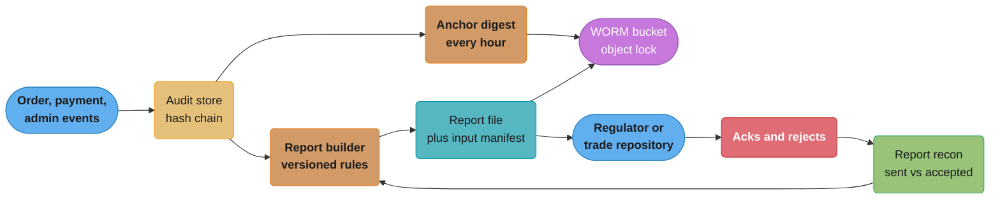
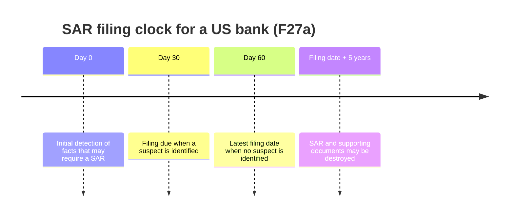

# Regulatory Reporting and Audit Trails

> Rules and figures checked 2026-11-06. Every date, threshold and fee on this page comes from the
> fact pins in fintech/CLAUDE.md, except the DORA and EMIR dates, which come from the EIOPA and
> ESMA pages fetched the same day. This page is an engineering view as of that date, not legal
> advice, and covers the US, the EU, the UK, India and Brazil only.

---

## 1. Concept Overview

A regulated financial firm must be able to answer two kinds of question long after the fact:

- **What happened?** Who placed this order, approved this payout, changed this limit, or
  filed this report, at what time, from which system, against which record.
- **What did you tell the regulator, and was it right?** Every transaction report, suspicious
  activity report and incident report, with the data it came from.

The audit trail answers the first. Regulatory reporting answers the second, and it depends on
the first: a report is only as defensible as the lineage from its fields back to the source
events.

Engineers own four parts of this:

1. **The record.** An append-only store where a change to history is either impossible or
   detectable. Options: WORM object storage, a hash chain, or the SEC Rule 17a-4 audit-trail
   alternative.
2. **The clocks.** Retention periods per record type (five years for BSA records, six for core
   broker-dealer records) and filing deadlines (a SAR within 30 days of detection, a MiFIR
   transaction report by the close of the following working day).
3. **The timestamps.** Event times that are synchronized to UTC within a stated tolerance
   (MiFID II RTS 25).
4. **The evidence.** Proof that controls ran: access reviews, change approvals, deployment
   records. Auditors test these under SOX and similar regimes.

This page owns the audit-trail store decision. Database audit logging with pgAudit, TDE and
PAN protection are owned by
[Database Security and Compliance](../../database/database_security_and_compliance/database_security_and_compliance.md),
and controls expressed as policy code by
[Policy as Code and Compliance](../../devops/policy_as_code_and_compliance/policy_as_code_and_compliance.md).
The SAR decision itself (when an alert becomes a filing) is in
[KYC, AML and Sanctions Screening](../kyc_aml_and_sanctions_screening/kyc_aml_and_sanctions_screening.md).

---

## 2. Intuition

> **One-line analogy:** an audit trail is a bound ledger book with numbered pages. You can add a
> page at the end. You cannot tear one out without a gap in the numbers, and you cannot
> rewrite one without the next page's reference to it no longer matching.

**Mental model.** Ordinary application logs are a diary: useful, editable, and kept only as long
as disk allows. An audit trail is evidence. It has an owner, a retention clock, a known format,
and a way for an outsider to check that nobody changed it. A regulatory report is a statement
made under that evidence, so each field in the report must trace back to an event in the
trail.

**Why it matters.** Regulators do not accept "the log rotated" or "we fixed the data later" as
answers. Missing or altered records turn an operational incident into an enforcement matter.
The engineering cost is small if you design it in at the start and large if you retrofit it.

**Key insight.** Tamper-evidence comes from a check that someone outside the writer's control
can run. A hash chain the database admin can recompute end to end proves nothing against that
admin. The anchor (a digest held in WORM storage or by a second party) is what makes the chain
evidence.

---

## 3. Core Principles

1. **Append, never update.** Corrections are new events that reference the old one.
2. **Make change detectable by an independent party.** Hash chains need external anchors.
   WORM storage needs a lock the writer's admins cannot remove.
3. **Every record has a retention clock and a trigger.** The clock starts at a defined event
   (creation, filing, account closure), and a legal hold stops deletion.
4. **Timestamps are UTC with a known error bound.** Record the clock source and its offset.
5. **Reports are derived, reproducible and reconciled.** Rebuild any filed report from the
   trail, and match what you sent against what the regulator accepted.
6. **Controls produce evidence as a side effect.** A deployment pipeline that records approvals
   and diffs is cheaper than a quarterly screenshot hunt.
7. **Personal data in an immutable store needs a plan.** Keep identifiers out of the chained
   payload, or encrypt them per subject so the key can be destroyed.

---

## 4. Types / Architectures / Strategies

### 4.1 What a record must prove

| Property | Question it answers | Mechanism |
|---|---|---|
| Completeness | Is any record missing? | Gapless sequence numbers per stream |
| Integrity | Was any record changed? | Hash chain with anchors, or WORM storage |
| Attribution | Who did it? | Authenticated actor id, service identity, approver id |
| Time | When, to what precision? | UTC timestamp, clock source, granularity |
| Context | Against what object, in what state? | Object reference, before and after values |
| Retention | Is it still available, and deletable on time? | Retention policy per record type, legal hold |

### 4.2 Decision model: audit-trail store

This table is the section's only copy of this decision.

| Store | Tamper property | Query | Retention control | Fits |
|---|---|---|---|---|
| Append-only PostgreSQL table, update and delete blocked by trigger and grants | Blocks the app role. A superuser can still change it | Full SQL | Partitions dropped by a retention job | Operational audit events the app reads often. Not evidence alone |
| Same table plus hash chain plus external anchors | Any change before the last anchor is detectable by the anchor holder | Full SQL | As above | Audit trail with integrity checks, the default for most fintech systems |
| WORM object storage (object lock in compliance mode) | The storage service refuses delete or overwrite until the retention date | Needs an index or a query engine on top | Per-object retain-until date, legal hold | Records that must be non-rewriteable, report archives, anchor digests |
| SEC 17a-4 audit-trail alternative | The system can recreate the original record if it is modified or deleted | Depends on system | Rule periods | Broker-dealer electronic records where WORM is not used |
| Event log (Kafka) with long retention | None by default: admins can delete topics and change retention | Replay, or sink to a store | Topic retention | Transport into one of the stores above, not the store itself |
| Vendor archive (communications) | Vendor-operated WORM | Vendor search | Vendor policy | Email, chat and voice records |

A common shape: write events to the PostgreSQL chain for the app and operations, publish an
anchor digest to WORM storage on a schedule, and archive report files and their inputs to WORM
with the rule's retention date.

### 4.3 Report families an engineer meets

| Report | Who files | Deadline or cadence | Source |
|---|---|---|---|
| SAR (US bank) | The bank | No later than 30 calendar days after initial detection. With no suspect identified, up to 30 more days, never more than 60 after detection | 31 CFR 1020.320 |
| MiFIR transaction report | EU investment firms | As soon as possible and no later than the close of the following working day | MiFIR Article 26 |
| CAT | US broker-dealers (Industry Members) | Event reporting to the Consolidated Audit Trail | SEC Rule 613 (CAT NMS Plan) |
| EMIR derivatives report | Counterparties and entities responsible for reporting | Reporting of all derivatives to trade repositories. Reporting RTS and ITS applicable from 2024-04-29 | ESMA EMIR reporting page |
| DORA major ICT incident report | EU financial entities | Reporting of major ICT-related incidents to competent authorities. DORA, Regulation (EU) 2022/2554, applies from 2025-01-17 | EIOPA DORA page |

---

## 5. Architecture Diagrams

### 5.1 Event to report lineage



Every report file is stored with a manifest of the event ranges and rule version that produced
it, so the same file can be rebuilt and explained years later.

### 5.2 Hash chain with anchors

```
 pos:      1            2            3            4            5
        +-------+    +-------+    +-------+    +-------+    +-------+
 row    | e1    |    | e2    |    | e3    |    | e4    |    | e5    |
        | prev  |<---| prev  |<---| prev  |<---| prev  |<---| prev  |
        | = G   |    | = h1  |    | = h2  |    | = h3  |    | = h4  |
        | h1    |    | h2    |    | h3    |    | h4    |    | h5    |
        +-------+    +-------+    +-------+    +-------+    +-------+
                                       |
                                       v
                         anchor in WORM: (pos 3, h3, 10:00Z)

 edit e2  -> h2 changes -> h3 changes -> anchored h3 no longer matches
 rewrite the whole chain after the edit -> internal check passes, anchor check fails
```

`h_n = SHA-256(h_(n-1) || canonical(e_n))`. The internal check catches a careless edit. Only the
anchor catches an admin who recomputes every hash after the edit.

### 5.3 SAR clock



The clock starts at initial detection, not when the case closes. Retention starts at filing
.

---

## 6. How It Works - Detailed Mechanics

### 6.1 A hash-chained audit table in PostgreSQL

The table below blocks updates, deletes and truncation for every role, assigns a gapless chain
position under a row lock, and hashes a canonical form of each row with the previous hash.
`jsonb` is used for the payload because its text output has a fixed key order, so the same
payload always hashes the same way. Plain `json` keeps the input text, and two writers that
order keys differently would produce different hashes.

```sql
CREATE TABLE audit_head (
    id    boolean PRIMARY KEY DEFAULT true CHECK (id),
    pos   bigint  NOT NULL,
    hash  bytea   NOT NULL
);
INSERT INTO audit_head VALUES (true, 0, sha256('genesis'::bytea));

CREATE TABLE audit_event (
    pos          bigint      PRIMARY KEY,
    occurred_at  timestamptz NOT NULL,
    actor        text        NOT NULL,
    action       text        NOT NULL,
    object_ref   text        NOT NULL,
    payload      jsonb       NOT NULL,
    prev_hash    bytea       NOT NULL,
    row_hash     bytea       NOT NULL
);

CREATE FUNCTION audit_canonical(p_pos bigint, p_at timestamptz, p_actor text, p_action text,
                                p_obj text, p_payload jsonb)
RETURNS bytea LANGUAGE sql IMMUTABLE AS $$
    SELECT convert_to(concat_ws('|', p_pos,
        to_char(p_at AT TIME ZONE 'UTC', 'YYYY-MM-DD"T"HH24:MI:SS.US"Z"'),
        p_actor, p_action, p_obj, p_payload::text), 'UTF8')
$$;

CREATE FUNCTION audit_chain() RETURNS trigger LANGUAGE plpgsql AS $$
DECLARE h audit_head;
BEGIN
    SELECT * INTO h FROM audit_head FOR UPDATE;   -- serializes writers
    NEW.pos := h.pos + 1;
    NEW.prev_hash := h.hash;
    NEW.row_hash := sha256(h.hash || audit_canonical(NEW.pos, NEW.occurred_at, NEW.actor,
                                                     NEW.action, NEW.object_ref, NEW.payload));
    UPDATE audit_head SET pos = NEW.pos, hash = NEW.row_hash;
    RETURN NEW;
END $$;

CREATE FUNCTION audit_refuse() RETURNS trigger LANGUAGE plpgsql AS $$
BEGIN
    RAISE EXCEPTION 'audit_event is append-only: % refused', TG_OP;
END $$;

CREATE TRIGGER audit_chain BEFORE INSERT ON audit_event
    FOR EACH ROW EXECUTE FUNCTION audit_chain();
CREATE TRIGGER audit_no_update BEFORE UPDATE OR DELETE ON audit_event
    FOR EACH ROW EXECUTE FUNCTION audit_refuse();
CREATE TRIGGER audit_no_truncate BEFORE TRUNCATE ON audit_event
    FOR EACH STATEMENT EXECUTE FUNCTION audit_refuse();

INSERT INTO audit_event (pos, occurred_at, actor, action, object_ref, payload, prev_hash, row_hash)
VALUES (0, '2026-11-06 09:30:00.000125+00', 'svc-oms', 'order.new', 'ord-1',
        '{"side":"buy","qty":100,"px":"101.25"}', '', ''),
       (0, '2026-11-06 09:30:00.000310+00', 'svc-oms', 'order.fill', 'ord-1',
        '{"qty":100,"px":"101.25"}', '', ''),
       (0, '2026-11-06 09:41:12.500000+00', 'u-ops-7', 'limit.change', 'acct-9',
        '{"old":"50000","new":"75000","ticket":"CHG-118"}', '', '');
```

The `pos`, `prev_hash` and `row_hash` values in the insert are placeholders that the trigger
overwrites. Grant the application role `INSERT` and `SELECT` only. The trigger still stops a
role that has `UPDATE` by mistake.

The check recomputes every hash and every link:

```sql
SELECT pos,
       row_hash = sha256(prev_hash || audit_canonical(pos, occurred_at, actor, action,
                                                      object_ref, payload)) AS row_ok,
       prev_hash = coalesce(lag(row_hash) OVER (ORDER BY pos), sha256('genesis'::bytea))
           AS link_ok,
       pos = row_number() OVER (ORDER BY pos) AS gapless
FROM audit_event
ORDER BY pos;
```

All three columns are true for an untouched chain. An edited row fails `row_ok`, a deleted
row fails `gapless` and `link_ok`, and an inserted row in the middle fails `link_ok`.

### 6.2 Anchoring

The chain head (`pos`, `hash`) is published on a schedule (hourly is a common assumption) to a
place the database admins cannot rewrite:

- a WORM bucket with object lock in compliance mode, under a different cloud account;
- a second party (an auditor's or a custodian's system);
- a public timestamping service or a public chain, when the firm wants third-party proof.

The check then compares the stored `row_hash` at each anchored `pos` with the anchor. Records
after the last anchor are protected only by the database's own controls, so the anchor
interval is the window of undetectable rewrite. Write the interval down as part of the design.

### 6.3 Retention clocks

| Record | Retention | Clock starts | Source |
|---|---|---|---|
| Records required under the BSA chapter | 5 years | Per the record rule | 31 CFR 1010.430 |
| Bank SAR and supporting documents | 5 years | Filing date | 31 CFR 1020.320 |
| Broker-dealer core 17a-3 records (blotters, ledgers and others in 17a-3(a)(1) to (3), (5), (21), (22)) | 6 years | Per Rule 17a-4 | SEC Rule 17a-4 |
| Most other broker-dealer records | 3 years, the first 2 easily accessible | Per Rule 17a-4 | SEC Rule 17a-4 |
| FINRA records with no other period set | At least 6 years, in a 17a-4 compliant format | Per FINRA Rule 4511 | FINRA Rule 4511 |

The engineering pattern:

1. Tag every stored record with `record_type` and `retain_until`, computed at write time or at
   the trigger event (a SAR's filing date sets its supporting documents' clock).
2. Keep a `legal_hold` flag per record or per matter. A hold overrides `retain_until`.
3. Delete by a job that reads only those two fields, and log each deletion as an audit event.
4. In WORM storage set the retain-until date on the object, so the storage refuses early
   deletion even if the job is wrong.

Personal data in a chained or WORM store collides with erasure requests. Keep identifiers out
of the chained payload (store a reference), or encrypt per subject and destroy the key. The
trade-offs are in the GDPR pitfall of
[Event Sourcing and CQRS](../../hld/event_sourcing_cqrs/event_sourcing_cqrs.md).

### 6.4 The SAR clock in code

```java
import java.time.LocalDate;

public class SarClock {
    record Case(String id, LocalDate initialDetection, boolean suspectIdentified) {}

    static LocalDate filingDue(Case c) {
        return c.suspectIdentified()
                ? c.initialDetection().plusDays(30)
                : c.initialDetection().plusDays(60); // 30 + 30, never more than 60
    }

    static LocalDate retainUntil(LocalDate filed) { return filed.plusYears(5); }

    public static void main(String[] args) {
        var known = new Case("c-1", LocalDate.of(2026, 9, 1), true);
        var unknown = new Case("c-2", LocalDate.of(2026, 9, 1), false);
        assert filingDue(known).equals(LocalDate.of(2026, 10, 1));
        assert filingDue(unknown).equals(LocalDate.of(2026, 10, 31));
        assert retainUntil(LocalDate.of(2026, 10, 1)).equals(LocalDate.of(2031, 10, 1));
        System.out.println(known.id() + " due " + filingDue(known) + ", "
                + unknown.id() + " due " + filingDue(unknown));
    }
}
```

The days are calendar days, so no business-day calendar applies. The clock starts at
initial detection, which the case system must record as its own field. It is not the alert
creation time and not the case close time. An ongoing violation that needs immediate attention
also needs a phone call to law enforcement, on top of the filing.

### 6.5 Clock synchronization under RTS 25

MiFID II RTS 25 (Delegated Regulation (EU) 2017/574) sets two numbers per activity: the maximum
divergence from UTC and the timestamp granularity.

| Activity | Max divergence from UTC | Granularity |
|---|---|---|
| HFT activity (and venues with gateway-to-gateway latency of 1 ms or less) | 100 microseconds | 1 microsecond or finer |
| Voice trading | 1 second | 1 second |

Meeting 100 microseconds is a PTP job, with grandmaster clocks traced to UTC and hardware
timestamping on the NICs. The engineering evidence is a record of the measured offset per host,
kept with the trading records, plus alerts when a host drifts.

Two traps: a timestamp truncated to milliseconds anywhere in the pipeline fails the 1
microsecond granularity even if the clock is good, and a host whose offset monitor stopped is
out of compliance by default, because you cannot show its error bound.

```java
import java.time.Duration;
import java.time.Instant;
import java.util.List;

public class ClockCheck {
    record Sample(String host, Instant at, Duration offsetFromUtc) {}

    static final Duration HFT_MAX = Duration.ofNanos(100_000); // 100 microseconds

    static boolean withinTolerance(Sample s) {
        return s.offsetFromUtc().abs().compareTo(HFT_MAX) <= 0;
    }

    static boolean truncatedToMillis(Instant t) { return t.getNano() % 1_000_000 == 0; }

    public static void main(String[] args) {
        Instant t = Instant.parse("2026-11-06T09:30:00.000125Z");
        var samples = List.of(new Sample("gw-1", t, Duration.ofNanos(40_000)),
                              new Sample("gw-2", t, Duration.ofNanos(-180_000)));
        assert withinTolerance(samples.get(0));
        assert !withinTolerance(samples.get(1));
        assert !truncatedToMillis(t);
        assert truncatedToMillis(Instant.parse("2026-11-06T09:30:00.000Z"));
        samples.stream().filter(s -> !withinTolerance(s))
               .forEach(s -> System.out.println("out of tolerance: " + s.host()));
    }
}
```

A field that happens to land on a whole millisecond is not proof of truncation by itself. Check
the schema and the serializer, and flag a stream where every timestamp is a whole millisecond.

### 6.6 Transaction and event reporting

**MiFIR transaction reports.** RTS 22 (Delegated Regulation (EU) 2017/590) defines the fields
in Annex I Table 2. The deadline under MiFIR Art. 26(1) is as soon as possible and no later than
the close of the following working day. The engineering work is mapping each field to a
source event, versioning that mapping, and reconciling the regulator's or ARM's accept and
reject feedback against what you sent.

**CAT.** The SEC issued a cost-savings exemptive order on 2025-09-30 (Release 2025-127,
34-104144). On 2026-01-13 it approved the CAIS amendment (34-104586), so Industry Members no
longer report customer names, addresses and years of birth, and CAIS deletes those fields. On
2026-04-16 it issued a concept release on a full CAT review (34-105251, S7-2026-12). For
an engineer, this means the CAT reporting schema is a moving target: version the field
mapping, and keep the PII removal reflected in your own data flows.

**EMIR.** EMIR mandates reporting of all derivatives to trade repositories, and the EMIR
reporting RTS and ITS became applicable on 2024-04-29 (ESMA). Each report is matched by the
trade repository against the counterparty's report, so a field mismatch with the other side is
a break even when your own data is internally consistent.

The common structure for all three:

1. Build the report from the audit trail with a versioned rule set.
2. Store the file, the rule version and the event ranges it read.
3. Ingest acknowledgments and rejections.
4. Track every rejection to a corrected resubmission, with the deadline clock still running.

### 6.7 Operational resilience and control evidence

**DORA.** The Digital Operational Resilience Act, Regulation (EU) 2022/2554, applies from
2025-01-17 and covers, among other things, reporting of major ICT-related incidents to
competent authorities (EIOPA). The engineering effect: the incident process must classify
incidents against the regulation's criteria quickly and produce the report data (timeline,
impact, affected services) from records that already exist. Build the incident timeline from
the same audit and observability data used in operations, see
[Observability and Monitoring](../../backend/observability_and_monitoring/observability_and_monitoring.md).

**SOX IT general controls.** For a listed company, auditors test the IT controls behind
financial reporting. For engineers that means three control families:

| Control family | What the auditor samples | Evidence that is cheap to produce |
|---|---|---|
| Access | Who can change production and financial data, and periodic reviews of that list | Group membership exports from the identity provider, review sign-offs as tickets |
| Change management | That each production change was approved, tested and deployed by someone other than the author | PR approvals, CI results and deploy records linked by commit SHA |
| Operations | Backups, job monitoring, incident handling | Job run history and alert records |

Evidence as code means the pipeline writes these records as it runs, and the audit sample is a
query. The policy-as-code side of it is in
[Policy as Code and Compliance](../../devops/policy_as_code_and_compliance/policy_as_code_and_compliance.md),
and the supply-chain records (SBOMs, signed builds) in
[Regulated Supply Chain](../../devops/devsecops_and_supply_chain_security/regulated_supply_chain.md).

### 6.8 The 17a-4 audit-trail alternative

SEC Rule 17a-4 was amended in 2022 (Release 34-96034, 2022-10-12, effective 2023-01-03,
compliance 2023-05-03). WORM stays an option, and an alternative is added: an electronic
recordkeeping system that can recreate an original record if it is modified or deleted.
The eCFR text describes it as a complete time-stamped audit trail of all changes and deletions
. A versioned record store (every update writes a new version with author and time, the
old version stays readable) fits that description. A hash chain makes the history
tamper-evident on top.

---

## 7. Real-World Examples

**Knight Capital, 2012-08-01.** In about 45 minutes Knight's SMARS router sent millions of child
orders, giving over 4 million executions in 154 stocks for over 397 million shares. Knight took
a net long position of about $3.5B in 80 stocks, lost more than $460 million, and paid a $12
million SEC penalty. The SEC order (Release 34-70694) is the source to read for how the
code reached production. For this page the lesson is that order-path changes need change
records that show what was deployed where, and that an order audit trail is what lets a firm
and a regulator count the damage.

**CAT and customer PII.** The 2026-01-13 CAIS amendment removed customer names, addresses and
years of birth from what Industry Members report, and CAIS deletes those fields. A
reporting pipeline that still assembles those fields keeps PII in its own staging tables with
no regulatory reason to hold it.

**Rule 17a-4 modernization.** The 2022 amendment let broker-dealers meet the rule with an
audit-trail system instead of WORM media. The design question is whether the system can
recreate any original record, whatever storage product holds it.

**Bank SAR program.** A bank files within 30 days of initial detection, up to 60 days when no
suspect is identified, and keeps the SAR and supporting documents for five years from filing
. The case management system's job is to make the detection date and the filing
date explicit fields, so the deadline and the retention date are computed, not remembered.

---

## 8. Tradeoffs

### 8.1 Integrity mechanism

| Mechanism | Stops | Detects | Misses |
|---|---|---|---|
| Grants and triggers | App role writes | Nothing after the fact | Superuser edits |
| Hash chain, no anchor | Nothing | Careless edits | An admin who recomputes the chain |
| Hash chain plus anchors | Nothing | Any edit before the last anchor | Edits after the last anchor |
| WORM object lock (compliance mode) | Delete and overwrite until retain-until | Not needed | Records never written |
| 17a-4 audit-trail system | Loss of the original | All changes and deletions, by design | Bugs in the versioning layer |

### 8.2 Where to build reports

| Option | Gain | Cost |
|---|---|---|
| From the audit trail | Lineage and rebuild for free | Audit events must carry every report field |
| From the operational database | Fast to start | Values change after the report, so rebuilds differ |
| Vendor reporting platform | Rule updates handled by the vendor | You still own field mapping and data quality |

### 8.3 Anchor interval

| Interval | Window of undetectable rewrite | Cost |
|---|---|---|
| Per transaction | None | One external write per event |
| Hourly | Up to 1 hour | Small |
| Daily | Up to 1 day | Smallest |

---

## 9. When to Use / When NOT to Use

**Use a hash chain with anchors when:**

- Records must be shown unaltered to an auditor or regulator, and the store also serves
  queries.
- Admins of the store are inside the threat model.

**Use WORM object storage when:**

- The rule requires non-rewriteable storage, or you archive report files and anchors.
- Access is rare and by date or key.

**Do not:**

- Treat application logs, with rotation and admin delete rights, as the audit trail.
- Put personal data into the chained payload of a store you cannot erase from.
- Build regulatory reports from mutable operational tables without snapshotting the inputs.
- Count a hash chain without an external anchor as tamper-evidence against your own admins.

---

## 10. Common Pitfalls

### 10.1 An audit table the app can rewrite

An illustrative incident: a support tool fixed a customer's limit by updating the audit row of
the original change, so the history showed one change instead of two. Nobody noticed until an
examiner asked who raised the limit.

```sql
-- BROKEN
CREATE TABLE audit_log_v0 (
    id         bigint GENERATED ALWAYS AS IDENTITY PRIMARY KEY,
    actor      text NOT NULL,
    action     text NOT NULL,
    detail     jsonb NOT NULL
);
INSERT INTO audit_log_v0 (actor, action, detail)
VALUES ('u-ops-7', 'limit.change', '{"old":"50000","new":"75000"}');
UPDATE audit_log_v0 SET detail = '{"old":"50000","new":"90000"}' WHERE id = 1;
SELECT * FROM audit_log_v0;
-- 1 | u-ops-7 | limit.change | {"new": "90000", "old": "50000"}   (history rewritten)
```

```sql
-- FIX: the append-only table from 6.1 refuses the update for every role
DO $$
DECLARE refused boolean := false;
BEGIN
    BEGIN
        UPDATE audit_event SET payload = '{"old":"50000","new":"90000"}' WHERE pos = 3;
    EXCEPTION WHEN raise_exception THEN
        refused := true;
    END;
    IF NOT refused THEN
        RAISE EXCEPTION 'audit_event accepted an update';
    END IF;
END $$;
```

A correction is a new event (`limit.change` with a reference to the old event), so the history
shows both. Revoke `UPDATE` and `DELETE` from the app role as well. The trigger is the second
line, not the only one.

### 10.2 Hashing a non-canonical form

```java
// BROKEN
import java.security.MessageDigest;
import java.time.Instant;
import java.time.ZoneId;
import java.time.format.DateTimeFormatter;
import java.util.HexFormat;

public class NonCanonicalHash {
    static String hash(String s) throws Exception {
        return HexFormat.of().formatHex(MessageDigest.getInstance("SHA-256").digest(s.getBytes()));
    }

    public static void main(String[] args) throws Exception {
        Instant at = Instant.parse("2026-11-06T09:30:00Z");
        var fmt = DateTimeFormatter.ISO_OFFSET_DATE_TIME;
        String writer = "order.new|" + at.atZone(ZoneId.of("Europe/London")).format(fmt);
        String checker = "order.new|" + at.atZone(ZoneId.of("America/New_York")).format(fmt);
        System.out.println(hash(writer).equals(hash(checker))
                ? "match" : "tamper alarm on an untouched row"); // prints the alarm
    }
}
```

```java
// FIX
import java.security.MessageDigest;
import java.time.Instant;
import java.util.HexFormat;
import java.util.Map;
import java.util.TreeMap;

public class CanonicalHash {
    static String canonical(String action, Instant at, Map<String, String> fields) {
        var sorted = new TreeMap<>(fields);                 // fixed key order
        return action + "|" + at + "|" + sorted;            // Instant.toString is UTC ISO-8601
    }

    static String hash(String s) throws Exception {
        return HexFormat.of().formatHex(MessageDigest.getInstance("SHA-256")
                .digest(s.getBytes(java.nio.charset.StandardCharsets.UTF_8)));
    }

    public static void main(String[] args) throws Exception {
        Instant at = Instant.parse("2026-11-06T09:30:00Z");
        String a = canonical("order.new", at, Map.of("qty", "100", "side", "buy"));
        String b = canonical("order.new", at, Map.of("side", "buy", "qty", "100"));
        assert hash(a).equals(hash(b));
        System.out.println("canonical: " + a);
    }
}
```

The hash is only useful if the writer and every later checker build the same bytes. Fix the
field order, the time zone (UTC), the timestamp format, the number format and the charset, and
store the canonical-form version with the row.

### 10.3 The SAR clock started at the wrong event

An illustrative case: the case system computed the filing deadline from the date the
investigator closed the case. Cases that took three weeks to work were filed late, and the
dashboard showed them as on time. The clock starts at initial detection, which must be a
stored field set when the facts were first identified.

### 10.4 Millisecond timestamps in an HFT pipeline

An illustrative case: the gateways stamped events in microseconds, but a JSON serializer in
the reporting path wrote `epochMillis`. Every timestamp in the stored trail lost its sub-ms
part, so the firm could not show 1-microsecond granularity even though the clocks met
it. Check granularity at the store, not at the source.

### 10.5 Reports built from mutable tables

A transaction report built from the live trades table cannot be rebuilt after a trade is
amended, because the input is gone. When a regulator asks why a field was wrong on a given
day, the team cannot answer. Build from the audit trail, or snapshot the inputs with the file.

---

## 11. Technologies & Tools

| Tool | What it does for audit and reporting |
|---|---|
| Amazon S3 Object Lock | WORM retention and legal hold on S3 objects, in governance or compliance mode |
| Azure Blob immutable storage | Time-based retention and legal hold on blob containers |
| Google Cloud Storage Bucket Lock | Retention policies that can be locked on a bucket |
| pgAudit | PostgreSQL statement and object audit logging |
| Debezium | Change data capture from database logs into an event stream |
| Apache Kafka | Durable event transport into the audit store and report builders |
| chrony | NTP client and server for host clock discipline |
| linuxptp | PTP implementation for Linux, for sub-millisecond clock sync with hardware timestamping |
| Open Policy Agent | Policy as code for change and access controls |
| Smarsh | Communications archiving for regulated firms |
| Global Relay | Communications archiving and surveillance |

---

## 12. Interview Questions with Answers

**Q: Does a hash chain stop a database administrator from changing audit records?**
**Short:** No, an admin can edit a row and recompute every later hash, so only an anchor held outside their control makes the change detectable.

The chain proves internal consistency, and a full recompute is internally consistent. Publish
the chain head on a schedule to WORM storage in a separate account or to a second party. The
check then compares the stored hash at each anchored position with the anchor. Edits after the
last anchor stay undetectable, so the anchor interval is a design number.

**Q: Why are application logs not an audit trail?**
**Short:** Logs rotate, admins can delete them, and they lack fixed fields, gapless sequence and retention rules, so they cannot prove completeness or integrity.

An audit trail has an owner, a schema with actor, action, object and UTC time, a gapless
sequence per stream, an integrity mechanism and a retention clock per record type. Logs are
fine as one input to it. Treating the log pipeline itself as the trail fails the first time a
retention setting or an index cleanup removes a record an examiner asks for.

**Q: When does the SAR filing clock start for a US bank?**
**Short:** At initial detection of facts that may require a filing, with filing due within 30 calendar days, or up to 60 when no suspect is identified.

31 CFR 1020.320(b)(3) sets 30 calendar days after initial detection, and allows another 30 days
to identify a suspect, never more than 60 in total. The date the case closed is not the
start. Store the detection date as its own field, compute the deadline from it, and keep the
SAR and supporting documents for five years from filing.

**Q: How does the 2022 Rule 17a-4 amendment change storage design for broker-dealers?**
**Short:** WORM stays an option, and a system that can recreate any original record after modification or deletion is now an accepted alternative.

Release 34-96034 (2022-10-12, effective 2023-01-03, compliance 2023-05-03) added the
audit-trail alternative. A versioned record store that keeps every prior version with
author and time can meet it. The design question becomes whether the system can show the
original for any record, not which media holds it.

**Q: What does RTS 25 require for HFT timestamps?**
**Short:** Maximum divergence from UTC of 100 microseconds and timestamp granularity of 1 microsecond or finer.

Delegated Regulation (EU) 2017/574 sets these for HFT activity, and for venues whose
gateway-to-gateway latency is 1 ms or less. Voice trading gets 1 second for both. The
evidence is per-host offset measurements kept with the records. A pipeline that truncates to
milliseconds fails granularity even if the clocks are good.

**Q: How long do broker-dealers keep records under Rule 17a-4?**
**Short:** Six years for the core 17a-3 records such as blotters and ledgers, and three years for most others, with the first two easily accessible.

The 6-year group covers 17a-3(a)(1) to (3), (5), (21) and (22). FINRA Rule 4511 adds a
six-year default for FINRA records with no other period, in a 17a-4 compliant format.
Model retention as `record_type` plus `retain_until`, with legal hold overriding both.

**Q: Why store a report's input manifest next to the report file?**
**Short:** It lets you rebuild and explain the exact file years later, from the same event ranges and rule version.

A regulator's question arrives long after the filing. If the report was built from live tables
that changed since, nobody can reproduce it. The manifest records the audit-trail positions read,
the mapping version and the code version. Rebuilding then gives the same bytes, and a diff
explains any correction.

**Q: Why is `jsonb` safer than `json` for a hashed payload in PostgreSQL?**
**Short:** `jsonb` normalizes key order and whitespace on input, so the same logical payload always renders to the same text and hash.

`json` keeps the input text exactly, so two writers that order keys differently create
different hashes for the same data, and the check raises false tamper alarms. `jsonb` stores a
parsed form and prints it in a fixed order. Number formats still need a rule: send prices as
strings so `101.25` and `101.250` do not diverge.

**Q: What is the deadline for a MiFIR transaction report?**
**Short:** As soon as possible and no later than the close of the following working day after the transaction.

MiFIR Art. 26(1) sets it, and RTS 22 defines the fields in Annex I Table 2. Rejections
come back from the ARM or the regulator and the clock keeps running, so the pipeline must
route each rejection to a fix and a resubmission. Keep the field mapping versioned, since
the field table gets revised.

**Q: How do you reconcile regulatory reports?**
**Short:** Match every report you sent against the acknowledgments and rejections you got back, and track each rejection to an accepted resubmission.

The checks: every reportable event produced a report, every report got an acknowledgment,
and every rejection has an owner and a deadline. For EMIR, the trade repository also matches
your report against the other counterparty's, so a field mismatch is a break even when your own
data is consistent. Daily counts of reportable events versus accepted reports catch silent
drops.

**Q: What changed in CAT reporting on 2026-01-13?**
**Short:** The SEC approved the CAIS amendment, so Industry Members no longer report customer names, addresses and years of birth, and CAIS deletes those fields.

The approval is Release 34-104586. A firm's CAT pipeline that still collects those fields
holds personal data with no reporting reason. Remove them from staging and from the mapping.
The SEC's 2026-04-16 concept release on a full CAT review means more change is possible, so
keep the mapping versioned.

**Q: How do you keep personal data out of trouble in an immutable audit store?**
**Short:** Store references or per-subject encrypted fields in the chained payload, so erasure means deleting a mapping row or a key, not editing the chain.

An append-only store cannot delete a name it hashed. Two working patterns: keep the PII in a
separate table referenced by id, or encrypt it with a per-subject key and destroy the key on an
erasure request (crypto-shredding). Retention rules still win where they apply, so a SAR's
supporting documents stay for five years from filing.

**Q: What evidence does a SOX change-management test sample?**
**Short:** That each sampled production change was approved, tested and deployed by someone other than the author, with records that link them.

Auditors pick changes from the period and ask for the approval, the test result and the deploy
record. If the PR, the CI run and the deploy event share a commit SHA and are kept, the sample
is a query. Direct production access that bypasses the pipeline breaks this, so log and review
it as an exception.

**Q: Where does Kafka fit in an audit architecture?**
**Short:** As transport into the audit store and report builders, not as the store, because admins can delete topics and change retention.

Kafka gives ordered, durable delivery and replay. Its own operators can still delete or
shorten what it holds, and it has no retention clock per record type. Sink the events into a hash-chained table
or WORM storage, and treat the topic as a buffer with its own monitoring.

**Q: Why record each host's measured clock offset, not just configure PTP?**
**Short:** The rule needs proof that the divergence stayed within tolerance, and only stored measurements show the error bound at the time of each event.

A configured daemon can fail silently. With offsets recorded per host per interval, you can
show the bound for any event time, and alerts catch drift before it becomes a reporting
breach. A host with a gap in offset data has no provable bound for that window.

**Q: What does DORA add for an engineering team at an EU financial entity?**
**Short:** It applies from 2025-01-17 and requires reporting major ICT-related incidents to competent authorities, so incident data must exist in a reportable form.

DORA is Regulation (EU) 2022/2554 (EIOPA). The practical work: incident classification against
the regulation's criteria, timelines built from existing monitoring and audit records, and a
register of ICT third-party services. A team that keeps incident timelines in chat threads
will struggle to report on time.

**Q: How should a retention deletion job be designed?**
**Short:** It deletes only records whose `retain_until` has passed and that have no legal hold, and it logs each deletion as an audit event.

Compute `retain_until` at write time or at the trigger event, never in the job. A legal hold
flag per record or per matter overrides it. In WORM storage, set the retain-until date on the
object as well, so a buggy job cannot delete early. Logging deletions answers the later
question of where a record went.

**Q: Why do order audit trails matter after a trading incident like Knight Capital?**
**Short:** They are how the firm and the regulator count the orders, executions and positions the incident created, and with deployment records they show which change caused it.

Knight's 2012-08-01 incident produced over 4 million executions in 154 stocks in about 45
minutes and a loss of more than $460 million. Untangling that needs every order and fill
with accurate time and the deployment records for the order path. Firms without both spend
days reconstructing what happened.

**Q: What is the difference between governance and compliance mode in S3 Object Lock?**
**Short:** Governance mode lets users with a special permission shorten or remove retention, while compliance mode lets no one remove it before the retain-until date.

Compliance mode is the one that fits a non-rewriteable requirement, because even the account's
administrators cannot delete early. Governance mode is useful for testing retention settings.
Put anchors and report archives in compliance mode, in an account separate from the systems
that write the records.

**Q: Why must a correction to an audit event be a new event?**
**Short:** Editing the old event destroys the record of what was originally done, which is the fact an examiner asks about.

The new event references the one it corrects, carries its own actor and time, and leaves both
visible. Readers compute the current view from the sequence. This is the same rule a ledger
follows with reversing entries, see
[Double-Entry Ledger Design](../double_entry_ledger_design/double_entry_ledger_design.md).

---

## 13. Best Practices

1. Write audit events to an append-only store with update, delete and truncate blocked for every
   role.
2. Chain the events with SHA-256 over a canonical form, and anchor the head to WORM storage in a
   separate account on a stated interval.
3. Give every record a `record_type`, a `retain_until` and a legal-hold path.
4. Store UTC timestamps at the precision the rule requires, plus the per-host clock offset.
5. Build every regulatory report from the audit trail with a versioned mapping, and store the
   file with its input manifest.
6. Reconcile sent reports against acknowledgments and rejections daily.
7. Keep personal data out of chained payloads, or encrypt it per subject.
8. Make the detection date and the filing date explicit fields in case management.
9. Link PR approvals, CI runs and deploy records by commit SHA, and keep them for the audit
   period.
10. Run the chain and anchor check on a schedule and alert on any false column.

---

## 14. Case Study

### An order audit trail for a broker-dealer

**Context.** A US broker-dealer routes retail orders and keeps its order and execution records
electronically under the Rule 17a-4 audit-trail alternative. Design inputs
(assumptions): 30 million order events a day, a 6-year retention for blotter records,
and a requirement that compliance can show any record unchanged.

**First attempt.** The team used the hash-chained `audit_event` table from §6.1 and ran the
internal check nightly. A red-team exercise tested a DBA with superuser rights who disabled the
trigger, edited one order and recomputed every later hash:

```sql
-- BROKEN
ALTER TABLE audit_event DISABLE TRIGGER audit_no_update;
UPDATE audit_event SET payload = '{"qty":1000,"px":"101.25"}' WHERE pos = 2;
DO $$
DECLARE r record; prev bytea := sha256('genesis'::bytea); h bytea;
BEGIN
    FOR r IN SELECT * FROM audit_event ORDER BY pos LOOP
        h := sha256(prev || audit_canonical(r.pos, r.occurred_at, r.actor, r.action,
                                            r.object_ref, r.payload));
        UPDATE audit_event SET prev_hash = prev, row_hash = h WHERE pos = r.pos;
        prev := h;
    END LOOP;
END $$;
SELECT bool_and(row_hash = sha256(prev_hash || audit_canonical(pos, occurred_at, actor, action,
                                                              object_ref, payload))) AS chain_ok
FROM audit_event;
-- chain_ok = true: the nightly check passes over a rewritten fill
```

The internal check passed. The fill quantity changed from 100 to 1,000 and nothing flagged it.

**Fix.** An anchor job copies the chain head to a WORM bucket in a separate account every hour.
The check compares the stored hash at each anchored position with the anchor. The `anchor`
table below stands in for the bucket listing that the check reads:

```sql
CREATE TABLE anchor (
    pos          bigint      PRIMARY KEY,
    hash         bytea       NOT NULL,
    anchored_at  timestamptz NOT NULL
);
INSERT INTO anchor SELECT pos, row_hash, now() FROM audit_event
WHERE pos = (SELECT max(pos) FROM audit_event);

DO $$
DECLARE r record; prev bytea := sha256('genesis'::bytea); h bytea; caught boolean := false;
BEGIN
    BEGIN
        -- the same rewrite as above, inside a subtransaction that is undone below
        ALTER TABLE audit_event DISABLE TRIGGER audit_no_update;
        UPDATE audit_event SET payload = '{"qty":1000,"px":"101.25"}' WHERE pos = 2;
        FOR r IN SELECT * FROM audit_event ORDER BY pos LOOP
            h := sha256(prev || audit_canonical(r.pos, r.occurred_at, r.actor, r.action,
                                                r.object_ref, r.payload));
            UPDATE audit_event SET prev_hash = prev, row_hash = h WHERE pos = r.pos;
            prev := h;
        END LOOP;
        IF EXISTS (SELECT 1 FROM anchor a JOIN audit_event e USING (pos)
                   WHERE a.hash <> e.row_hash) THEN
            RAISE EXCEPTION 'anchor mismatch';
        END IF;
    EXCEPTION WHEN raise_exception THEN
        caught := true;   -- the subtransaction rolls back, the chain is untouched
    END;
    IF NOT caught THEN
        RAISE EXCEPTION 'anchor check missed a rewritten chain';
    END IF;
END $$;

SELECT count(*) AS anchored_rows_ok
FROM anchor a JOIN audit_event e USING (pos)
WHERE a.hash = e.row_hash;
```

The anchor check fails on the rewritten chain because the anchored hash at position 3 depends
on every earlier row, including the edited fill. The production version adds three controls
the SQL cannot show: the bucket uses object lock in compliance mode in a separate account, the
DBA role has no write access to that account, and superuser sessions on the audit database
raise an alert and an audit event of their own.

**Result.** The undetectable window shrank from "forever, for anyone with superuser" to "up to
one hour, and only with superuser plus no alert". Report files built from the trail carry the
anchor position they were built at, so a later question about a filed report starts from a
position that an outside party can check.
