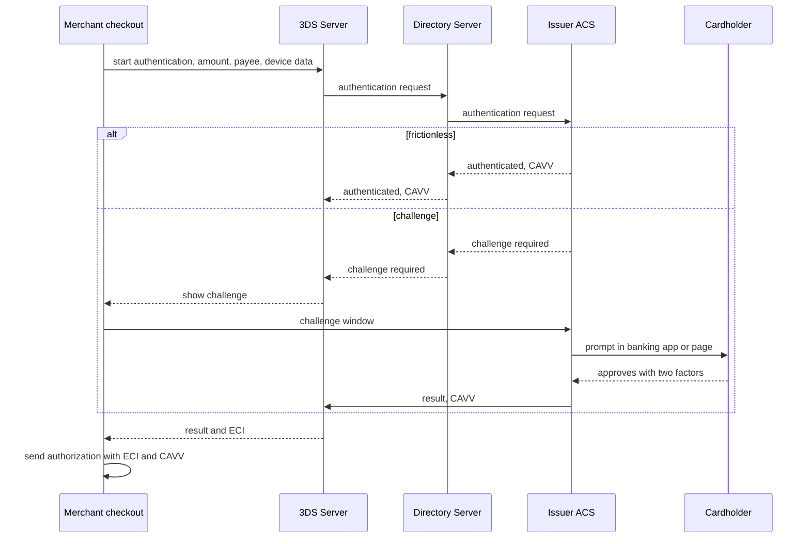
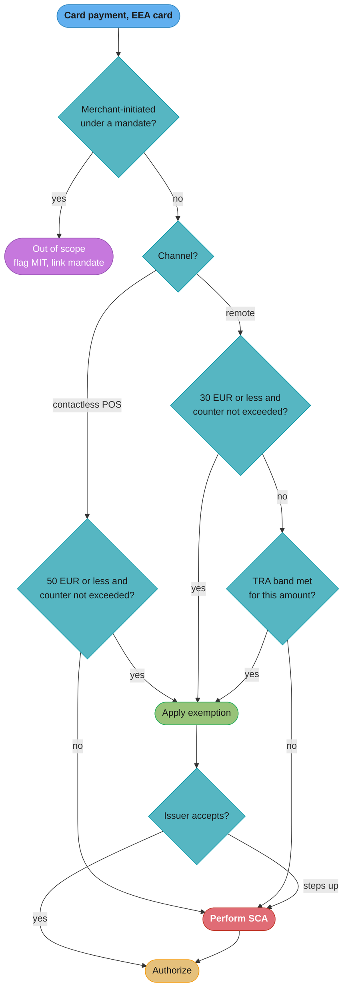

# Strong Customer Authentication and 3DS

> Rules and figures checked 2026-11-06. Dates, limits and thresholds on this page come from the
> fact pins in fintech/CLAUDE.md, from EBA Single Rulebook Q&As 2020_5619 and 2018_4414, from the
> Visa Core Rules and Visa Product and Service Rules (edition of 24 October 2026), and from the
> W3C and RBI pages named in the text. This page is an engineering view as of that date, not legal
> advice. It covers the US, the EU, the UK, India and Brazil only.

---

## 1. Concept Overview

Strong customer authentication (SCA) is a legal requirement in the EU under PSD2. EMV 3-D Secure
(3DS) is the card industry's protocol that lets an issuer authenticate a cardholder during an
online purchase. The two are often used as synonyms. They are different things:

| Term | What it is | Who defines it |
|---|---|---|
| SCA | Authentication "based on the use of two or more elements categorised as knowledge", possession and inherence, which are independent of each other | PSD2 Art. 4(30), with the RTS in Delegated Regulation (EU) 2018/389 |
| Dynamic linking | The amount and the payee are protected ("confidentiality, authenticity and integrity") through all phases of the authentication | RTS Art. 5(2) |
| Exemption | A case where the RTS lets a PSP skip SCA, such as low-value remote payments | RTS Arts. 11, 16, 18 and others |
| Out of scope | A payment SCA does not apply to at all, such as a merchant-initiated transaction | Classification under PSD2, as read by the EBA |
| EMV 3DS | A message protocol between merchant, network and issuer that carries device data, the issuer's decision and a cryptographic proof | EMVCo |

A card payment in the EU passes through four questions in order: is it in scope, can an
exemption apply, who applies it, and what does the issuer decide. 3DS is how the merchant asks
and how the issuer answers. The issuer always has the final word.

Visa makes the obligation a network rule too. In the Europe region, e-commerce transactions on
cards issued in the EEA and the UK must be "subject to strong customer authentication in line
with" PSD2 (Visa Core Rules §7.9.1.1).

The browser side of a 3DS challenge (redirect, return URL, cookie traps) is in the
[checkout case study](../../react/case_studies/design_a_checkout_and_payment_flow.md) §4.6. The
wallet transfer flow with an SCA state machine is in the
[digital wallet case study](../../hld/case_studies/design_digital_wallet.md) §4.6. Passkeys and
WebAuthn are in [Security and auth](../../hld/security_and_auth/security_and_auth.md) §4.7. This
module owns the dated rule facts and the exemption decision, and links to those pages for the
rest.

---

## 2. Intuition

**One-line analogy.** SCA is the law saying "check two of the customer's IDs before you hand
over the money". 3DS is the phone call from the shop to the bank asking "is this really your
customer?" The bank can say yes without bothering the customer, ask the customer to prove it,
or refuse.

**Mental model.** Picture a funnel. At the top are all online card payments. Merchant-initiated
payments fall out first, because SCA does not apply to them. Small payments and low-risk payments
fall out next through exemptions, if someone applies one and the issuer accepts it. Everything
left gets a challenge.

**Why it matters.** A challenge costs conversion. A missing challenge where the issuer wanted one
costs a soft decline and a second round trip. A wrong exemption costs fraud liability. Each of
these is a design choice in the checkout and the payment service.

**Key insight.** An exemption is a request, not a right. The merchant and acquirer can ask. The
issuer can always step up.

---

## 3. Core Principles

1. **SCA means two or more independent elements from different categories.** The EBA answers that
   a PSP "should apply strong customer authentication (SCA) by using at least two independent
   elements from different categories" (Q&A 2020_5619, published 2021-04-23).
2. **The authentication binds the amount and the payee.** RTS Art. 5(2) requires the
   confidentiality, authenticity and integrity of "the amount of the transaction and the payee
   throughout all of the phases of the authentication" (EBA Q&A 2018_4414, published 2021-02-26).
3. **The issuer decides.** The issuer can apply an exemption. For some exemptions (Art. 11 and
   Art. 16 for cards) the acquirer can apply it. The issuer always makes the final decision and
   can step up to SCA.
4. **MITs are out of scope by classification, not by exemption.** A payee-initiated card payment
   under a mandate needs no exemption. Setting up the mandate through a remote channel requires
   SCA.
5. **Cumulative counters track money or count, not both.** For contactless and low-value remote
   payments, a PSP tracks either the money limit or the count limit.
6. **TRA is gated by fraud rate.** Transaction risk analysis allows EUR 100 at a fraud rate of
   0.13% or less and EUR 250 at 0.06% or less, and a EUR 500 tier exists.
7. **Liability follows the authentication result.** For Visa, a card-absent fraud dispute
   (condition 10.4) is invalid for an ECI 5 transaction the issuer authenticated with EMV 3DS and
   an ECI 6 attempt, when the CAVV is in the authorization (Visa Table 11-29, conditions apply).

---

## 4. Types / Architectures / Strategies

### 4.1 EMV 3DS components

| Component | Who runs it | Job |
|---|---|---|
| 3DS Requestor | The merchant, in its checkout | Collects device and order data, starts authentication, shows the challenge |
| 3DS Server | The merchant's PSP or a 3DS vendor | Builds the authentication request and talks to the directory server |
| Directory Server (DS) | The card network | Routes the request to the right issuer's ACS by card range |
| Access Control Server (ACS) | The issuer or its ACS provider | Scores the request, decides frictionless or challenge, runs the challenge, returns the result and the cryptogram |

The Visa rules name the DS and the ACS. An issuer that does not run its own ACS must use either
the Visa Consumer Authentication Service or an ACS provider listed on the Visa Global Registry of
Service Providers (§10.15.2.2).

EMVCo's latest final 3DS specification is v2.3.1.1. Protocol and Core Functions v2.4.0.0 DRAFT 1
was published for comment on 2026-11-04 and is a draft only. EMVCo recommends v2.2 or higher.

### 4.2 Authentication outcomes and what they mean for a Visa card

| Outcome | What happened | ECI in the authorization | Card-absent fraud dispute (Visa 10.4) |
|---|---|---|---|
| Frictionless, authenticated | The ACS authenticated without a challenge | 5, with CAVV | Invalid, under the Table 11-29 conditions |
| Challenge, authenticated | The cardholder completed the issuer's challenge | 5, with CAVV | Invalid, under the Table 11-29 conditions |
| Attempt | The issuer or Visa on its behalf returned an attempt response | 6, with CAVV | Invalid when the transaction is not on a non-reloadable prepaid card |
| Data only | Data shared through Visa Secure, no authentication | 7, with CAVV | Not in the list of authenticated exceptions |
| Not authenticated | No 3DS, or 3DS failed | No authentication value | Valid dispute right for the issuer |

If an issuer does not support Visa Secure for an EMV 3DS request, "Visa will respond to an
Authentication Request, on behalf of the Issuer, with an Attempt Response that contains a CAVV"
(§10.15.2.3).

### 4.3 PSD2 exemptions pinned on this page

| Exemption | Per-transaction limit | Cumulative limit since the last SCA | Who can apply it for cards |
|---|---|---|---|
| Contactless at the point of sale (Art. 11) | EUR 50 | EUR 150 or 5 transactions | Issuer, and the acquirer can apply it |
| Low-value remote (Art. 16) | EUR 30 | EUR 100 or 5 transactions | Issuer, and the acquirer can apply it |
| Transaction risk analysis (Art. 18) | EUR 100 at fraud rate 0.13% or less, EUR 250 at 0.06% or less, a EUR 500 tier exists | Not a counter, a fraud-rate condition | Issuer. This page pins no acquirer rule for Art. 18 |

The cumulative limits use money or count, and a PSP picks one. The RTS has further
exemptions that this page does not pin, so they do not appear in the decision model below.

### 4.4 Out of scope: merchant-initiated transactions

| Payment | SCA at the payment | SCA at setup |
|---|---|---|
| Subscription renewal under a mandate | Not required, out of scope | Required when the mandate is set up remotely |
| No-show fee under a hotel agreement | Not required, out of scope | Required when the agreement is made remotely |
| Customer clicks "pay" with a saved card | Required, unless an exemption applies | Not applicable |

### 4.5 Delegated authentication and passkeys

- **Visa Delegated Authentication Program (Europe).** All EEA and UK issuers "are enrolled by
  Visa to participate ... unless they have opted out". On a transaction with the delegated
  authentication indicator, the issuer "must not request additional authentication ... unless
  there is an immediate fraud threat". A participant's monthly fraud rate must stay at or below
  the rate on issuer-authenticated EMV 3DS transactions. The participant uses ECI 05 when the
  transaction is under both the digital authentication framework and the program, and ECI 07 when
  it is under the program only, and "an Acquirer will accept liability in line with Transactions
  that contain ECI value 07" (§7.9.3).
- **Visa Payment Passkey.** In the AP and Europe regions, and from 2026-10-24 in the Canada,
  CEMEA and LAC regions (with country exceptions), an issuer must support Visa Payment Passkey
  transactions, including merchant-led enrollments, and must not systematically decline them
  (§7.10.2.2).
- **Secure Payment Confirmation (SPC).** A W3C browser API that uses a WebAuthn credential to
  sign a payment confirmation showing the amount and payee. Its status on the W3C site is
  "Candidate Recommendation Draft, 13 October 2026".

### 4.6 India and PSD3

- **India.** The RBI regulates authentication of digital payments separately from PSD2. Its
  Master Directions index lists "Reserve Bank of India (Authentication mechanisms for digital
  payment transactions) Directions, 2025", dated 2025-09-25, and "Digital Payments - E-mandate
  Framework, 2026", dated 2026-04-21. The limits in those texts are not pinned here, so a design
  for Indian cards starts by reading the Directions.
- **PSD3 and the PSR.** They are not law. Coreper approved on 2026-10-28 and the Council adopted
  its first-reading positions on the PSD and the PSR on 2026-10-29. Parliament's second-reading
  plenary has an indicative date of 2026-12-14. Nothing is in the Official Journal, and no
  application date exists to pin.

---

## 5. Architecture Diagrams

### 5.1 EMV 3DS: frictionless and challenge



The authorization that follows carries the ECI and the CAVV. The issuer checks the CAVV against
its own authentication record before it approves.

### 5.2 Decision model: exemption vs challenge vs out of scope



The issuer node is the last gate for every exemption path. A merchant flow that has no path from
"steps up" back to SCA turns every step-up into a lost sale.

### 5.3 TRA bands on one axis

```
fraud rate of the PSP applying TRA (lower is better)

  0.06% or less  |================ TRA up to EUR 250 ================|
  0.13% or less  |===== TRA up to EUR 100 =====|
  above 0.13%    no TRA, SCA or another exemption

amount (EUR)     0                     100                          250        500
                 |----------------------|----------------------------|----------|
                 low-value remote up to 30 (with counters) sits inside the first band
```

A lower fraud rate opens a larger band. The EUR 500 tier exists, and this page does not pin its
fraud rate, so the diagram stops the bands at EUR 250.

---

## 6. How It Works - Detailed Mechanics

### 6.1 The low-value counters

The low-value remote exemption needs two checks: the transaction is EUR 30 or less, and the
cumulative counter since the last SCA stays inside EUR 100 or 5 transactions. The PSP picks one
counter mode, money or count, not both. The counter runs per payer across all payees, which
is why only the issuer can see it in full.

```java
import java.util.HashMap;
import java.util.Map;

public class LowValueCounter {

    enum Mode { MONEY, COUNT }

    static final long PER_TX_LIMIT_CENTS = 30_00;
    static final long CUMULATIVE_CENTS = 100_00;
    static final int CUMULATIVE_COUNT = 5;

    record State(long sumCents, int count) {}

    private final Mode mode;
    private final Map<String, State> byPayer = new HashMap<>();

    LowValueCounter(Mode mode) { this.mode = mode; }

    boolean exempt(String payer, long amountCents) {
        if (amountCents > PER_TX_LIMIT_CENTS) return false;
        State s = byPayer.getOrDefault(payer, new State(0, 0));
        State next = new State(s.sumCents() + amountCents, s.count() + 1);
        boolean within = switch (mode) {
            case MONEY -> next.sumCents() <= CUMULATIVE_CENTS;
            case COUNT -> next.count() <= CUMULATIVE_COUNT;
        };
        if (within) byPayer.put(payer, next);
        return within;
    }

    void scaPerformed(String payer) { byPayer.remove(payer); }

    public static void main(String[] args) {
        var money = new LowValueCounter(Mode.MONEY);
        assert money.exempt("p1", 25_00);
        assert money.exempt("p1", 25_00);
        assert money.exempt("p1", 25_00);
        assert money.exempt("p1", 25_00);           // 100.00 reached, still within
        assert !money.exempt("p1", 1_00);           // 101.00 would pass the money limit
        money.scaPerformed("p1");
        assert money.exempt("p1", 1_00);
        assert !money.exempt("p1", 30_01);          // over the per-transaction limit

        var count = new LowValueCounter(Mode.COUNT);
        for (int i = 0; i < 5; i++) assert count.exempt("p2", 29_00);
        assert !count.exempt("p2", 1_00);           // sixth payment needs SCA
        System.out.println("low-value counter checks passed");
    }
}
```

In money mode, five payments of EUR 29 would fail at the fourth (EUR 116). In count mode, five
payments of EUR 29 pass and the sixth fails. The mode changes which customers see a challenge, so
it is a product decision as much as a compliance one.

### 6.2 TRA band selection

```java
import java.math.BigDecimal;

public class TraBands {

    record Band(BigDecimal maxFraudRatePct, long maxAmountCents) {}

    static final Band[] BANDS = {                              // from F9
            new Band(new BigDecimal("0.06"), 250_00),
            new Band(new BigDecimal("0.13"), 100_00),
    };

    static long traLimitCents(BigDecimal fraudRatePct) {
        for (Band b : BANDS) {
            if (fraudRatePct.compareTo(b.maxFraudRatePct()) <= 0) return b.maxAmountCents();
        }
        return 0;
    }

    public static void main(String[] args) {
        assert traLimitCents(new BigDecimal("0.05")) == 250_00;
        assert traLimitCents(new BigDecimal("0.06")) == 250_00;
        assert traLimitCents(new BigDecimal("0.10")) == 100_00;
        assert traLimitCents(new BigDecimal("0.13")) == 100_00;
        assert traLimitCents(new BigDecimal("0.20")) == 0;
        System.out.println("TRA band checks passed");
    }
}
```

`compareTo` is the right comparison: `new BigDecimal("0.13").equals(new BigDecimal("0.130"))` is
false because the scales differ. The EUR 500 tier is left out because its fraud rate is not
pinned here. Code that cannot state the rule should not apply it.

### 6.3 Binding authentication to the payment

Dynamic linking means the authentication covers one amount and one payee. The data model
enforces it: a payment that cites an authentication must match its amount, currency and payee,
and the authentication can back only one payment.

```sql
CREATE TABLE sca_authentication (
    auth_ref      text PRIMARY KEY,
    card_ref      text    NOT NULL,
    payee_id      text    NOT NULL,
    currency      char(3) NOT NULL,
    amount_minor  bigint  NOT NULL CHECK (amount_minor > 0),
    outcome       text    NOT NULL
        CHECK (outcome IN ('authenticated', 'attempted', 'not_authenticated', 'rejected', 'unavailable')),
    eci           char(2),
    cavv_present  boolean NOT NULL,
    created_at    timestamptz NOT NULL DEFAULT now()
);

CREATE TABLE card_payment (
    payment_id    text PRIMARY KEY,
    card_ref      text    NOT NULL,
    payee_id      text    NOT NULL,
    currency      char(3) NOT NULL,
    amount_minor  bigint  NOT NULL CHECK (amount_minor > 0),
    initiation    text    NOT NULL CHECK (initiation IN ('cit', 'mit')),
    exemption     text    CHECK (exemption IN ('low_value', 'tra', 'contactless')),
    auth_ref      text    UNIQUE REFERENCES sca_authentication,
    CHECK (initiation = 'cit' OR (auth_ref IS NULL AND exemption IS NULL))
);

CREATE FUNCTION check_dynamic_link() RETURNS trigger LANGUAGE plpgsql AS $$
DECLARE a sca_authentication%ROWTYPE;
BEGIN
    IF NEW.auth_ref IS NULL THEN RETURN NEW; END IF;
    SELECT * INTO a FROM sca_authentication WHERE auth_ref = NEW.auth_ref;
    IF a.outcome NOT IN ('authenticated', 'attempted') THEN
        RAISE EXCEPTION 'authentication % has outcome %', a.auth_ref, a.outcome;
    END IF;
    IF (a.card_ref, a.payee_id, a.currency, a.amount_minor)
       IS DISTINCT FROM (NEW.card_ref, NEW.payee_id, NEW.currency, NEW.amount_minor) THEN
        RAISE EXCEPTION 'authentication % does not match payment % (amount or payee)',
            a.auth_ref, NEW.payment_id;
    END IF;
    RETURN NEW;
END $$;

CREATE TRIGGER dynamic_link BEFORE INSERT OR UPDATE ON card_payment
    FOR EACH ROW EXECUTE FUNCTION check_dynamic_link();

INSERT INTO sca_authentication (auth_ref, card_ref, payee_id, currency, amount_minor, outcome, eci, cavv_present)
VALUES ('3ds-1', 'card-9', 'shop-1', 'EUR', 8900, 'authenticated', '05', true);

INSERT INTO card_payment (payment_id, card_ref, payee_id, currency, amount_minor, initiation, auth_ref)
VALUES ('pay-1', 'card-9', 'shop-1', 'EUR', 8900, 'cit', '3ds-1');

DO $$
BEGIN
    BEGIN
        INSERT INTO sca_authentication VALUES ('3ds-2', 'card-9', 'shop-1', 'EUR', 8900, 'authenticated', '05', true, now());
        INSERT INTO card_payment (payment_id, card_ref, payee_id, currency, amount_minor, initiation, auth_ref)
        VALUES ('pay-2', 'card-9', 'shop-1', 'EUR', 12900, 'cit', '3ds-2');
        RAISE EXCEPTION 'mismatch was accepted';
    EXCEPTION WHEN raise_exception THEN
        ASSERT SQLERRM LIKE '%does not match%', SQLERRM;
    END;
END $$;
```

The `outcome` column holds the final 3DS result, mapped to a name from the transaction status code
that the 3DS server returns. The codes and their meanings are in the EMVCo 3DS specification. A
payment cites an authentication only after an `authenticated` or `attempted` outcome. An attempt
gets the Visa liability treatment in §4.2, but it is not SCA, so the issuer of an EEA card can
still decline and ask for authentication.

### 6.4 Soft declines and step-up

When an issuer wants SCA that the merchant did not perform, it declines with a code that asks for
authentication. In the Visa rules, code 1A ("Additional customer authentication required") is a
category 3 decline in the Europe and CEMEA regions, so up to 20 reattempts in 30 days are allowed
(Visa Table 7-2).

The merchant then runs 3DS with a challenge preference and sends a new authorization that carries
the authentication result. Visa forbids intentionally manipulating data elements such as the ECI
on a reattempt (§1.7.2.1). The new ECI must reflect an authentication that actually happened, not
a value chosen to raise approval rate.

Design points for the payment service:

- Treat 1A as a state, not an error: `authorized`, `declined`, `sca_required`.
- Keep the same order and idempotency key across the decline, the challenge and the new
  authorization, so a double click during the challenge does not create a second payment.
- If the customer has left the session (an MIT flagged by mistake, or a background job), send a
  link that brings the customer back to authenticate. A job cannot complete a challenge.

The retry categories are in [Card payments lifecycle](../card_payments_lifecycle/card_payments_lifecycle.md).

### 6.5 Where the exemption request goes

An acquirer-applied exemption is a flag in the authorization request (or in the 3DS request, if
the merchant runs 3DS and asks for no challenge). An issuer-applied exemption happens inside the
ACS or the issuer's authorization logic. In both cases the issuer can answer with a step-up. The
merchant cannot tell in advance which exemption the issuer will honor, so the flow needs the
fallback path in §5.2.

Fraud liability depends on the route. For Visa, an ECI 5 or ECI 6 transaction with a CAVV makes a
card-absent fraud dispute invalid under the conditions in Table 11-29. A transaction sent with an
acquirer exemption and no authentication has no such protection, so the merchant or acquirer
carries the fraud. The fraud model that decides when to ask for an exemption is in
[Fraud and risk scoring](../fraud_and_risk_scoring/fraud_and_risk_scoring.md).

---

## 7. Real-World Examples

- **Visa in Europe.** Visa requires members in the Europe region to subject e-commerce on EEA and
  UK cards to SCA in line with PSD2 (§7.9.1.1). Its Delegated Authentication Program enrolls EEA
  and UK issuers unless they opt out and puts liability on the acquirer for ECI 07 transactions
  (§7.9.3).
- **Visa stand-in attempts.** When an issuer does not support Visa Secure for an EMV 3DS request,
  Visa answers with an attempt response that contains a CAVV (§10.15.2.3). Such an attempt (ECI 6)
  is one of the cases where a card-absent fraud dispute is invalid (Table 11-29).
- **Australia step-up methods.** From 2026-10-24, Visa requires issuers in Australia to offer more
  than one authentication method, including step-up that does not rely on SMS OTP as the sole
  delivery channel (§7.9.2.1). New Zealand follows on 2027-10-23.
- **EMVCo versions.** v2.3.1.1 is the latest final specification. v2.4.0.0 is a draft published
  for comment on 2026-11-04.
- **PSD3 and the PSR.** Council first-reading positions adopted on 2026-10-29, Parliament
  plenary indicative date 2026-12-14, nothing in the Official Journal.

---

## 8. Tradeoffs

| Choice | Benefit | Cost |
|---|---|---|
| Challenge every EU payment | Fraud liability shifts to the issuer under Visa's rules for ECI 5 | Lower conversion, and a challenge on cards that issuers would have let through |
| Request exemptions where eligible | Fewer challenges | Merchant or acquirer keeps fraud liability, and issuers can step up anyway |
| Acquirer-applied TRA | One risk model across all issuers | Requires the applying PSP's fraud rate to stay inside the band |
| Issuer-applied exemption (frictionless 3DS) | Issuer bears the risk call, and the result carries a CAVV | Merchant does not control the decision |
| Money-mode counter | Large payment count before SCA for small tickets | Fewer free payments for mid-size tickets |
| Count-mode counter | Predictable: every sixth payment | Many small payments still hit SCA quickly |
| Passkey or SPC | Phishing-resistant, often faster than an SMS code | Enrollment work, browser and issuer support differ |

---

## 9. When to Use / When NOT to Use

**Use an exemption request** for low-value or low-risk card-absent payments when the fraud model
says the expected fraud loss is below the cost of the conversion lost to a challenge.

**Use a challenge preference** for first payments on a new card, account changes, high-value
orders and any payment after a 1A decline.

**Use MIT classification** for every payment the merchant starts under a mandate, and perform SCA
when the mandate is set up remotely.

**Do not flag a CIT as an MIT** to avoid SCA. The issuer sees the history behind the flag, and
the classification belongs to how the payment started.

**Do not reuse an authentication** for a different amount or payee. Dynamic linking makes that
authentication invalid for the second payment.

**Do not assume EU rules apply elsewhere.** India runs its own RBI Directions, and network rules
differ by region.

---

## 10. Common Pitfalls

**Session-level "SCA done" reused for a different amount.** A wallet marked the session as
strongly authenticated after login with a passkey. A later transfer of a different amount to a
different payee went through on that flag. The authentication did not cover that amount or
payee, so it did not meet dynamic linking. The pattern below is illustrative.

```java
// BROKEN
public class SessionScaBroken {
    record Session(String userId, boolean scaDone) {}
    record Transfer(String payee, long amountCents) {}

    static boolean mayExecute(Session s, Transfer t) {
        return s.scaDone();                             // ignores amount and payee
    }

    public static void main(String[] args) {
        var session = new Session("u1", true);         // authenticated at login
        var transfer = new Transfer("unknown-iban", 950_00);
        System.out.println("executes: " + mayExecute(session, transfer)); // true
    }
}
```

The fix ties each authentication to one amount and one payee, checks both at execution, and
consumes the authentication once.

```java
// FIX
import java.util.HashSet;
import java.util.Set;

public class SessionScaFixed {
    record Transfer(String payee, long amountCents) {}
    record Authentication(String id, String userId, Transfer approved) {}

    private final Set<String> used = new HashSet<>();

    boolean mayExecute(String userId, Authentication a, Transfer t) {
        if (!a.userId().equals(userId)) return false;
        if (!a.approved().equals(t)) return false;      // amount and payee must match
        return used.add(a.id());                        // one authentication, one payment
    }

    public static void main(String[] args) {
        var svc = new SessionScaFixed();
        var approved = new Transfer("DE-shop-1", 89_00);
        var auth = new Authentication("a-1", "u1", approved);
        assert svc.mayExecute("u1", auth, new Transfer("DE-shop-1", 89_00));
        assert !svc.mayExecute("u1", auth, new Transfer("DE-shop-1", 89_00));   // replay
        var other = new Authentication("a-2", "u1", approved);
        assert !svc.mayExecute("u1", other, new Transfer("unknown-iban", 950_00));
        System.out.println("dynamic linking checks passed");
    }
}
```

**Treating 1A as a hard decline.** A merchant's payment service mapped every decline to "card
declined" and stopped. Customers whose issuer wanted SCA saw a failure instead of a challenge.
Map 1A to an authentication state and run 3DS.

**Flagging renewals as exemptions.** A subscription business sent renewals as low-value
exemption requests instead of MITs. Renewals above EUR 30 had no exemption path and were soft
declined with no customer present. §14 shows the fix.

**Assuming the merchant can count.** A checkout applied the low-value exemption on any order of
EUR 30 or less. The issuer saw the cardholder's payments at other merchants, found the
cumulative limit exceeded, and stepped up. The merchant's counter could never see those other
payments.

**Comparing fraud rates with `equals`.** A TRA check compared `BigDecimal` rates with `equals`.
`0.13` from config and `0.130` from the reporting job were not equal, so the band check failed
for a rate exactly on the threshold. Use `compareTo`, as §6.2 does.

**Pinning a PSD3 date.** A roadmap set a compliance date for PSD3 from a news article. PSD3 and
the PSR are not in the Official Journal, and no application date exists. Track the legislative
status instead.

---

## 11. Technologies & Tools

| Tool | What it is | Role |
|---|---|---|
| Visa Secure | Visa's EMV 3DS program | Network program for 3DS on Visa cards |
| Mastercard Identity Check | Mastercard's EMV 3DS program | Network program for 3DS on Mastercard cards |
| Visa Consumer Authentication Service | Visa's ACS service for issuers | ACS for issuers that do not run their own |
| Netcetera 3DS Server | Commercial 3DS server and ACS products | 3DS Server for PSPs and merchants |
| Adyen | Payment platform with gateway, processing and acquiring | Runs 3DS and exemption requests inside its payment API |
| Checkout.com | Payment platform with acquiring | Runs 3DS and exemption requests inside its payment API |
| Secure Payment Confirmation | W3C browser API | Payment-bound authentication with a WebAuthn credential |

---

## 12. Interview Questions with Answers

**Q: Who makes the final decision on whether a card payment needs SCA?**
**Short:** The issuer decides, because even when an exemption is applied the issuer can still step up to SCA.

The merchant and the acquirer can ask for an exemption. The issuer can also apply one itself. In
every case the issuer is the last gate. A checkout that treats an exemption request as a
promise of no challenge has no path for the step-up, and loses the sale.

**Q: Is "the acquirer requests an exemption and the issuer decides" a complete description?**
**Short:** No, the issuer can apply exemptions itself too, and the acquirer can apply only some, such as the contactless and low-value exemptions for cards.

The EBA's answers split the roles: the payer's PSP (the issuer) can apply an exemption, and for
Art. 11 and Art. 16 card payments the payee's PSP (the acquirer) can apply it. The issuer still
makes the final decision. Interview answers that leave out issuer-applied exemptions miss the
frictionless 3DS path.

**Q: Do merchant-initiated transactions need an SCA exemption?**
**Short:** No, payee-initiated payments under a mandate are out of scope of SCA, so they need no exemption, but setting up the mandate remotely needs SCA.

The distinction matters in the data model. An out-of-scope MIT is flagged as an MIT and points to
the mandate. An exemption is a request on a CIT that the issuer can refuse. Mixing the two sends
renewals as exemption requests, which issuers can step up while no customer is present.

**Q: Is 3DS the same thing as SCA?**
**Short:** No, SCA is a legal requirement about authentication elements, while 3DS is the card protocol that carries the issuer's authentication decision and cryptogram.

A 3DS flow can end without the cardholder doing anything, when the issuer authenticates on risk
data. A payment can also meet SCA without 3DS, as in the Visa Delegated Authentication Program,
where the merchant or wallet authenticates the cardholder. Treat 3DS as the transport and SCA as
the rule.

**Q: What are the limits of the low-value remote exemption?**
**Short:** EUR 30 per transaction, with a cumulative limit of EUR 100 or 5 transactions since the last SCA, under RTS Article 16.

The PSP tracks either the money limit or the count limit, not both. The counter runs per payer
across payees, so the issuer holds the complete picture. A merchant applying the exemption on its
own orders cannot see the cardholder's spending elsewhere.

**Q: What are the limits of the contactless exemption at the point of sale?**
**Short:** EUR 50 per transaction, with a cumulative limit of EUR 150 or 5 transactions since the last SCA, under RTS Article 11.

This is why a terminal sometimes asks for a PIN on a small contactless payment: the counter ran
out. The same money-or-count choice applies. Terminal software must handle the PIN request as a
normal step, not as a failure.

**Q: How do the TRA bands work?**
**Short:** TRA allows EUR 100 at a fraud rate of 0.13% or less and EUR 250 at 0.06% or less, and a EUR 500 tier exists for an even lower rate.

The fraud rate belongs to the PSP that applies the exemption. A rising fraud rate can push it out
of a band, which turns exempt payments into challenges overnight. Monitor the rate against the
band edge, and compare `BigDecimal` rates with `compareTo`.

**Q: What does dynamic linking require?**
**Short:** The authentication must protect the amount and the payee through all phases, so it is valid only for that amount and that payee.

RTS Art. 5(2) requires the confidentiality, authenticity and integrity of the amount and the
payee. In code, an authentication record holds both and the payment service checks both before
execution. An authentication from login, or one for a different amount, does not cover a later
payment.

**Q: What counts as two-factor SCA under the EBA's reading?**
**Short:** At least two independent elements from different categories among knowledge, possession and inherence, such that a breach of one does not compromise the others.

A password plus a one-time code to a registered device is knowledge plus possession. A passkey
on a device with a biometric unlock combines possession and inherence. Two passwords are one
category and do not qualify.

**Q: What do ECI 5 and ECI 6 mean for a Visa fraud dispute?**
**Short:** A card-absent fraud dispute under Visa condition 10.4 is invalid for ECI 5 transactions authenticated with EMV 3DS and for ECI 6 attempts, when the CAVV is in the authorization.

ECI 5 needs an authentication confirmation from the issuer through Visa Secure. ECI 6 needs an
attempt response with a CAVV, and excludes non-reloadable prepaid cards. This is the liability
shift in Visa's own rule text. It covers fraud disputes, not disputes about goods or service.

**Q: What is a data-only 3DS transaction?**
**Short:** It shares 3DS data with the issuer through Visa Secure without authenticating the cardholder, and it carries ECI 7 with a CAVV.

The issuer gets device and order data that can raise approval rates. Because there is no
authentication, it is not one of the ECI 5 or ECI 6 cases that make a fraud dispute invalid. Use
it outside SCA markets when friction is the main concern and the merchant accepts fraud
liability.

**Q: What should a merchant do after a 1A decline?**
**Short:** Run 3DS with a challenge and send a new authorization with the real authentication result, keeping the same order and idempotency key.

Visa puts 1A in category 3 for the Europe and CEMEA regions, so reattempts are allowed within 20
in 30 days. The new ECI must reflect an authentication that actually happened. Visa forbids
intentionally manipulating data elements such as the ECI on a reattempt.

**Q: What happens on a Visa EMV 3DS request when the issuer does not support Visa Secure?**
**Short:** Visa answers for the issuer with an attempt response that contains a CAVV, and the merchant sends the authorization with ECI 6.

This keeps checkout working for issuers outside the program. For the merchant the attempt still
counts: a card-absent fraud dispute on such a transaction is invalid under Table 11-29, except on
non-reloadable prepaid cards.

**Q: What are the three main components of EMV 3DS?**
**Short:** The 3DS Server on the merchant side, the Directory Server at the network, and the Access Control Server at the issuer.

The 3DS Server builds the request from the merchant's data. The DS routes it by card range. The
ACS decides frictionless or challenge and returns the result with a cryptogram. An issuer without
its own ACS uses the Visa Consumer Authentication Service or a registered ACS provider.

**Q: Which EMV 3DS version should a new integration target?**
**Short:** EMVCo's latest final specification is v2.3.1.1, v2.4.0.0 is only a draft, and EMVCo recommends v2.2 or higher.

The v2.4.0.0 Protocol and Core Functions draft was published for comment on 2026-11-04. Build on
a final version supported by your 3DS server and the networks, and treat draft features as
unavailable until a final release.

**Q: How does the Visa Delegated Authentication Program change liability?**
**Short:** A participant that authenticates the cardholder itself sends ECI 05 or 07, and the acquirer accepts liability for ECI 07 transactions.

EEA and UK issuers are enrolled unless they opt out, and they must not request extra
authentication on a delegated transaction unless there is an immediate fraud threat. The
participant must keep its monthly fraud rate at or below that of issuer-authenticated EMV 3DS
transactions to stay in the program.

**Q: Where do passkeys and Secure Payment Confirmation fit?**
**Short:** Both use a device-bound WebAuthn credential, and SPC adds a browser dialog that shows the amount and payee the signature covers.

SPC's W3C status is Candidate Recommendation Draft, dated 13 October 2026. Visa requires issuers
in the AP and Europe regions to support Visa Payment Passkey transactions, with more regions from
2026-10-24. The WebAuthn mechanics are covered in
[Security and auth](../../hld/security_and_auth/security_and_auth.md).

**Q: What is the legal status of PSD3 and the PSR?**
**Short:** They are not law: the Council adopted first-reading positions on 2026-10-29, Parliament's plenary has an indicative date of 2026-12-14, and nothing is in the Official Journal.

Coreper approved on 2026-10-28. Without publication there is no application date, so no
engineering plan can cite one. Build against PSD2 and its RTS, and track the procedure file for
changes.

**Q: Why can a merchant's own low-value counter never be trusted to avoid a step-up?**
**Short:** The cumulative limit counts the cardholder's payments at every payee, and only the issuer sees them all.

A merchant can count its own orders, which helps it avoid asking for exemptions that will surely
fail. It cannot see the coffee shop and the train ticket the cardholder paid for the same
morning. The issuer can, and it steps up when the counter is used up.

**Q: How do card authentication rules in India differ from PSD2 for an engineer?**
**Short:** India has its own RBI Directions on authentication for digital payments, dated 2025-09-25, and an e-mandate framework dated 2026-04-21, separate from PSD2.

A design for Indian cards starts from those texts, not from the EU exemption table. Visa's rules
also carve India out of several authentication programs, such as the digital authentication
framework. Keep the authentication policy per issuing country, not one global rule.

---

## 13. Best Practices

- Classify every payment as CIT or MIT at creation, and link every MIT to its mandate.
- Perform SCA when a mandate is set up remotely, and store the authentication reference on the
  mandate.
- Bind each authentication to one amount, one currency, one payee and one payment.
- Treat exemptions as requests and build the step-up path for every one.
- Map code 1A to an authentication state, not to a failure.
- Keep counters and fraud-rate bands as dated configuration, and compare rates with `compareTo`.
- Store ECI, CAVV presence and 3DS status with each payment for disputes and reconciliation.
- Target a final EMV 3DS version, v2.2 or higher.
- Track PSD3 and PSR status from the legislative record, not from roadmaps.

---

## 14. Case Study

**Scenario (illustrative).** An EU streaming service bills EUR 12.99 and EUR 49.99 monthly
plans. Renewal success on the EUR 49.99 plan was far below the cheaper plan. All figures are
illustrative.

**Root cause.** The renewal job sent every renewal as a CIT with an exemption chosen by amount.
Renewals at or below EUR 30 asked for the low-value exemption. Renewals above it had no
exemption left, so the job asked for a challenge that no customer was present to complete. No
renewal referenced a mandate.

```sql
-- BROKEN
CREATE TABLE subscription (
    sub_id        text PRIMARY KEY,
    card_ref      text   NOT NULL,
    price_minor   bigint NOT NULL
);
INSERT INTO subscription VALUES ('s-basic', 'card-1', 1299), ('s-pro', 'card-2', 4999);

SELECT sub_id,
       'cit' AS initiation,
       CASE WHEN price_minor <= 3000 THEN 'low_value_exemption'
            ELSE 'challenge_requested' END AS sca_path
FROM subscription ORDER BY sub_id;
-- s-basic | cit | low_value_exemption   issuer may step up, nobody can answer
-- s-pro   | cit | challenge_requested   nobody can answer
```

**Fix.** The signup performs SCA and stores the mandate with the authentication reference.
Renewals are MITs that point to the mandate and carry no exemption, using the `card_payment`
table from §6.3.

```sql
CREATE TABLE card_mandate (
    mandate_id      text PRIMARY KEY,
    card_ref        text   NOT NULL,
    payee_id        text   NOT NULL,
    setup_auth_ref  text   NOT NULL REFERENCES sca_authentication,
    max_amount_minor bigint NOT NULL CHECK (max_amount_minor > 0)
);

ALTER TABLE card_payment ADD COLUMN mandate_id text REFERENCES card_mandate;
ALTER TABLE card_payment ADD CONSTRAINT mit_needs_mandate
    CHECK (initiation = 'cit' OR mandate_id IS NOT NULL);

INSERT INTO sca_authentication (auth_ref, card_ref, payee_id, currency, amount_minor, outcome, eci, cavv_present)
VALUES ('3ds-signup', 'card-2', 'stream-1', 'EUR', 4999, 'authenticated', '05', true);
INSERT INTO card_payment (payment_id, card_ref, payee_id, currency, amount_minor, initiation, auth_ref)
VALUES ('first-month', 'card-2', 'stream-1', 'EUR', 4999, 'cit', '3ds-signup');
INSERT INTO card_mandate VALUES ('m-pro', 'card-2', 'stream-1', '3ds-signup', 4999);

INSERT INTO card_payment (payment_id, card_ref, payee_id, currency, amount_minor, initiation, mandate_id)
VALUES ('renewal-2', 'card-2', 'stream-1', 'EUR', 4999, 'mit', 'm-pro');

DO $$
BEGIN
    ASSERT (SELECT initiation FROM card_payment WHERE payment_id = 'renewal-2') = 'mit';
    ASSERT (SELECT exemption IS NULL AND auth_ref IS NULL FROM card_payment
            WHERE payment_id = 'renewal-2');
    BEGIN
        INSERT INTO card_payment (payment_id, card_ref, payee_id, currency, amount_minor, initiation)
        VALUES ('orphan-mit', 'card-2', 'stream-1', 'EUR', 4999, 'mit');
        RAISE EXCEPTION 'MIT without a mandate was accepted';
    EXCEPTION WHEN check_violation THEN
        NULL;
    END;
END $$;
```

**Design decisions.**

- The mandate stores the SCA reference from signup. That is the evidence that the remote setup
  was authenticated.
- An MIT row cannot carry an exemption or an authentication reference, and it must carry a
  mandate. The constraints make the misclassification impossible to store.
- A renewal declined with a retryable code follows the Visa retry limits and the written notice
  rule for declined MITs, both covered in
  [Card payments lifecycle](../card_payments_lifecycle/card_payments_lifecycle.md).
- Plan changes that raise the price above `max_amount_minor` bring the customer back for a new
  authenticated mandate.

**Outcome (illustrative).** Renewal success on the EUR 49.99 plan rose to the level of the
cheaper plan. Soft declines on renewals stopped, because renewals stopped asking for exemptions.
