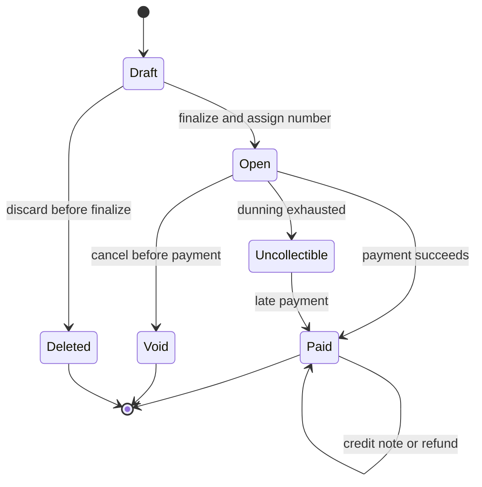
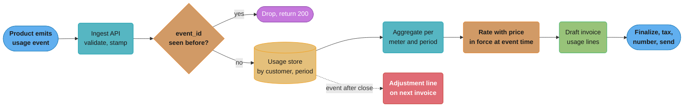
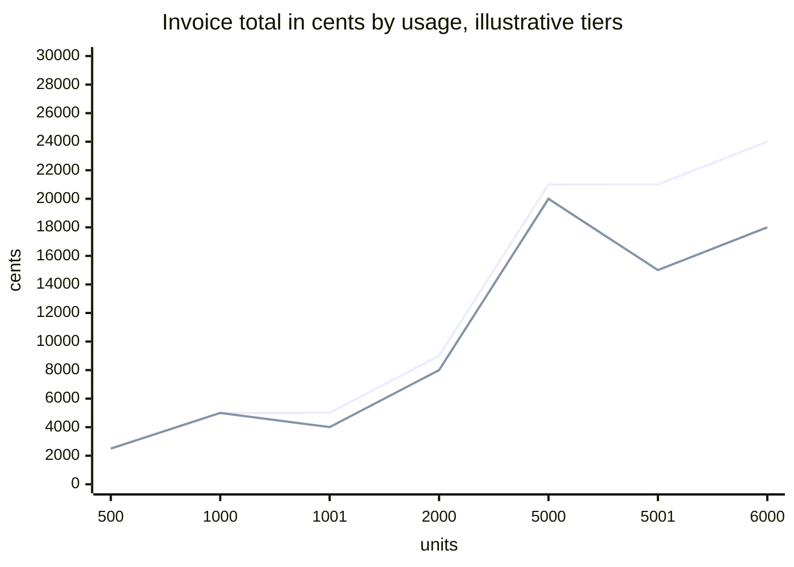

# Subscriptions, Billing and Invoicing

> Rules and figures checked 2026-11-06. Every date, threshold and fee on this page comes from the
> fact pins in fintech/CLAUDE.md, or from the Stripe Billing documentation pages named in §7
> (accessed 2026-11-06). Prices in the examples are illustrative.

---

## 1. Concept Overview

A billing system turns a price list and a record of what a customer used into invoices, and turns
invoices into payments. For a subscription business it runs for years per customer, so its errors
compound: a rounding rule that loses one cent per invoice loses it every month for every
customer.

The system has five parts:

1. **Catalog and pricing.** Products, prices per currency, and the pricing model: flat, per seat,
   metered, tiered, volume, package or prepaid credits.
2. **Subscriptions.** Which customer is on which price, with which quantity, from which billing
   anchor, and what changes are scheduled.
3. **Metering and rating.** Usage events arrive, are deduplicated, and are priced (rated) against
   the customer's price at the time of use.
4. **Invoicing.** At each period end, the system builds an invoice from recurring charges,
   prorations, rated usage, credits and tax, then finalizes it. A finalized invoice never changes.
   Corrections are credit notes.
5. **Collection and dunning.** The system charges the payment method, retries failures on a
   schedule, updates expired cards, and moves the subscription to past due, paused or canceled
   when collection fails.

This page owns the decision model for proration policy and rating timing.

Revenue recognition is the accounting view of the same contract: billing says what the customer
owes, revenue says what the business has earned. ASC 606 recognizes revenue in five steps:
identify the contract, identify the performance obligations, determine the transaction price,
allocate the price to the performance obligations, and recognize revenue when (or as) each
obligation is satisfied. For a monthly SaaS plan billed in advance, the invoice and, with card collection, the cash arrive
on day 1, and revenue is earned across the month. The vocabulary of bookings, billings, revenue and
ARR is in
[Business and Finance Vocabulary](../../soft_skills/business_and_finance_vocabulary/business_and_finance_vocabulary.md).
The billing system's job is to export the data that schedule needs: the service period, the
performance obligation and the allocated price of every invoice line.

The subscription loop and dunning schedules run well as durable workflows, which are covered in
[Durable Execution and Workflows](../../backend/durable_execution_and_workflows/durable_execution_and_workflows.md)
and [Temporal](../../technologies/temporal_durable_execution/temporal_durable_execution.md). This
page links those and teaches the billing rules they execute.

---

## 2. Intuition

> **One-line analogy:** a billing system is a utility meter and a lease in one building. The lease
> charges rent in advance on a fixed day. The meter counts what you used and bills it after. When
> you move to a bigger flat mid-month, the landlord refunds unused rent on the old flat and
> charges the rest of the month on the new one.

**Mental model.** Every amount on an invoice is a price times a quantity over a service period.
Recurring charges cover a future period. Usage charges cover a past period. A proration covers the
part of a period between a change and the period end. If you can name the price, the quantity and
the period of every line, you can explain the invoice to the customer, the auditor and the revenue
schedule.

**Why it matters.** Billing errors reach the customer in writing. A wrong invoice causes a support
ticket, a refund, a credit note, and sometimes a chargeback. A wrong proration policy causes the
same dispute every time a customer upgrades. Most of these problems come from three places:
mutable invoices, unclear time boundaries, and usage events counted twice or late.

**Key insight.** Treat a finalized invoice like a posted ledger entry. It is a legal document the
customer already has. Every correction after that point is a new document (a credit note or an
adjustment line on the next invoice) that points back to the original.

---

## 3. Core Principles

1. **Amounts are integer minor units per currency.** Each currency has its own price, set in the
   catalog. Do not convert a USD price to EUR at invoice time. Rounding rules per context are in
   [Money Representation and Currency](../money_representation_and_currency/money_representation_and_currency.md).
2. **Every line has a service period.** A line without a start and end cannot be prorated,
   credited or recognized.
3. **Finalized invoices are immutable.** Fix them with credit notes or with adjustment lines on a
   later invoice.
4. **Usage events are idempotent.** Each event carries a unique id from the producer, and the
   meter stores it once.
5. **Rate at the price in force at the time of use.** A price change on the 15th does not reprice
   usage from the 1st to the 14th.
6. **The billing anchor is fixed.** A subscription that started on January 31 renews on the last
   day of shorter months and returns to the 31st when the month has one. The anchor never drifts.
7. **Entitlement follows policy, not payment status alone.** Access during a failed-payment grace
   period is a product decision with a written rule.
8. **Money movement and invoice state are separate records.** A refund moves money. A credit note
   changes what the customer owes. One can happen without the other.

---

## 4. Types / Architectures / Strategies

### 4.1 Pricing models

| Model | Charge | Example (illustrative) | Watch for |
|---|---|---|---|
| Flat | Fixed amount per period | $49 a month | Proration on plan change |
| Per seat | Unit price x quantity | $12 per user a month | Quantity changes many times a period |
| Metered | Unit price x usage | $0.002 per API call | Late events, rating timing |
| Graduated tiers | Each unit priced by the tier it falls in | First 1,000 calls at 5c, next at 4c | Explaining the bill line by line |
| Volume tiers | All units priced at the tier the total reaches | 1,500 calls, all at 4c | Total can fall when usage rises past a tier |
| Package | Price per block of units | $10 per 1,000 calls, rounded up | Rounding direction of the last block |
| Prepaid credits | Customer buys credits, usage burns them | $1,000 of credits | Credits are a liability until used, and may expire |
| Minimum commit | Pay at least N per period, usage counts toward it | $5,000 a month minimum | True-up line at period end |

### 4.2 Invoice states

| State | Meaning | Allowed changes |
|---|---|---|
| Draft | Being built, not sent | Add, remove and edit lines |
| Open (finalized) | Number assigned, sent, awaiting payment | Pay, void, mark uncollectible, credit notes |
| Paid | Fully settled | Credit notes and refunds only |
| Void | Canceled before payment, kept for the record | None |
| Uncollectible | Written off after collection failed | Late payment can still be applied |

### 4.3 Proration policies

| Policy | On upgrade mid-period | On downgrade mid-period | Use when |
|---|---|---|---|
| None | New price from the next period | New price from the next period | Low-price plans, simple accounting |
| Prorate and invoice now | Credit unused old, charge remaining new, collect now | Credit unused old, charge remaining new, credit balance | Upgrades that unlock paid features at once |
| Prorate onto next invoice | Same lines, collected at the next renewal | Same lines, reduce the next invoice | Frequent small changes such as seats |
| Change at period end | Schedule the change, no proration | Schedule the change, no proration | Downgrades, to avoid refunds of used time |

### 4.4 Rating timing

| Timing | How | Strength | Weakness |
|---|---|---|---|
| At ingest | Price each event as it arrives, keep a running total | Live spend dashboards, spend alerts | Re-rating needed when a price or tier depends on the period total |
| At period close | Aggregate, then price once | Simple, exact for volume tiers | No live cost view, a large job at month end |
| Hybrid | Running estimate at ingest, authoritative rating at close | Live view and an exact invoice | Two computations that must agree at close |

---

## 5. Architecture Diagrams

### 5.1 Invoice life cycle



Every arrow out of `Open` keeps the original document. A void invoice stays in the series so the
numbering has no unexplained gap. A paid invoice changes only by a credit note that points to it.

### 5.2 Metering and rating pipeline



The dedupe check sits before storage, so a producer can retry freely. An event that arrives after
its period's invoice is finalized never edits that invoice. It becomes an adjustment on the next
one.

### 5.3 Proration on one timeline

```
  Period: 2026-11-01 00:00 UTC ........................................ 2026-12-01 00:00 UTC
          |<----------- used on old plan ----------->|<------ remaining on new plan ------>|
          |              1,345,020 s                 |            1,246,980 s             |
                                                     ^
                                         change at 2026-11-16 13:37 UTC

  Old plan $10.00:  credit  1000 x 1,246,980 / 2,592,000 = -481   (481.09, rounded)
  New plan $20.00:  debit   2000 x 1,246,980 / 2,592,000 = +962   (962.18, rounded)
                                                            -----
  Proration net                                              +481 cents

  Same change prorated by whole days (15 of 30 remaining):    +500 cents
```

The second-based policy and the day-based policy differ by 19 cents on this change. Both are
defensible. What is not defensible is a preview that shows one number and an invoice that shows
another.

---

## 6. How It Works - Detailed Mechanics

### 6.1 Proration math

Proration needs the period start and end as instants, the change instant, and the old and new
prices. Stripe prorates to the second by default, and its docs offer customization to day, hour,
week or month. Because the amount depends on the exact second, Stripe tells integrators to pass
the same `proration_date` to the preview and to the update, so the customer pays what the preview
showed.

```java
import java.math.BigDecimal;
import java.math.RoundingMode;
import java.time.Duration;
import java.time.Instant;
import java.time.LocalDate;
import java.time.ZoneOffset;

public class Proration {

    record Line(String description, long amountMinor) {}

    static long share(long priceMinor, long numerator, long denominator) {
        return BigDecimal.valueOf(priceMinor)
            .multiply(BigDecimal.valueOf(numerator))
            .divide(BigDecimal.valueOf(denominator), 0, RoundingMode.HALF_EVEN)
            .longValueExact();
    }

    static Line[] bySecond(Instant start, Instant end, Instant change, long oldPrice, long newPrice) {
        long total = Duration.between(start, end).toSeconds();
        long remaining = Duration.between(change, end).toSeconds();
        return new Line[] {
            new Line("Unused time on old plan", -share(oldPrice, remaining, total)),
            new Line("Remaining time on new plan", share(newPrice, remaining, total))
        };
    }

    static Line[] byDay(Instant start, Instant end, Instant change, long oldPrice, long newPrice) {
        LocalDate s = LocalDate.ofInstant(start, ZoneOffset.UTC);
        LocalDate e = LocalDate.ofInstant(end, ZoneOffset.UTC);
        LocalDate c = LocalDate.ofInstant(change, ZoneOffset.UTC);
        long total = s.until(e, java.time.temporal.ChronoUnit.DAYS);
        long remaining = c.until(e, java.time.temporal.ChronoUnit.DAYS);
        return new Line[] {
            new Line("Unused days on old plan", -share(oldPrice, remaining, total)),
            new Line("Remaining days on new plan", share(newPrice, remaining, total))
        };
    }

    static long net(Line[] lines) {
        long sum = 0;
        for (Line l : lines) sum += l.amountMinor();
        return sum;
    }

    public static void main(String[] args) {
        Instant start = Instant.parse("2026-11-01T00:00:00Z");
        Instant end = Instant.parse("2026-12-01T00:00:00Z");
        Instant change = Instant.parse("2026-11-16T13:37:00Z");

        Line[] sec = bySecond(start, end, change, 1000, 2000);
        Line[] day = byDay(start, end, change, 1000, 2000);
        System.out.println("by second: " + sec[0] + " " + sec[1] + " net " + net(sec));
        System.out.println("by day:    " + day[0] + " " + day[1] + " net " + net(day));
        assert sec[0].amountMinor() == -481 && sec[1].amountMinor() == 962;
        assert net(day) == 500;

        long feb = Duration.between(Instant.parse("2026-02-01T00:00:00Z"),
                                    Instant.parse("2026-03-01T00:00:00Z")).toSeconds();
        long mar = Duration.between(Instant.parse("2026-03-01T00:00:00Z"),
                                    Instant.parse("2026-04-01T00:00:00Z")).toSeconds();
        long tenDays = 10L * 86_400;
        long febShare = share(3000, tenDays, feb);
        long marShare = share(3000, tenDays, mar);
        System.out.println("10 days of a $30 plan: February " + febShare + ", March " + marShare);
        assert febShare == 1071 && marShare == 968;
    }
}
```

The last two lines show why a "daily rate" constant is wrong. Ten days of a $30 monthly plan cost
$10.71 in February and $9.68 in March, because the denominator is the length of the period the
customer bought. Write the policy down, show it in the preview, and use the same code for the
preview and the invoice.

Stripe's docs state two more rules worth copying. Negative prorations are not refunded
automatically and positive prorations are not billed at once by default: the credit sits on the
customer's balance and the debit waits for the next invoice unless the integration asks for
immediate invoicing (`proration_behavior=always_invoice`). And usage-based billing is not prorated,
because usage is billed for what was used.

### 6.2 Graduated and volume tiers

```java
import java.util.List;

public class Tiers {

    record Tier(long upTo, long unitMinor) {}

    static final long INF = Long.MAX_VALUE;

    static long graduated(long units, List<Tier> tiers) {
        long total = 0, prev = 0;
        for (Tier t : tiers) {
            if (units <= prev) break;
            long inTier = Math.min(units, t.upTo()) - prev;
            total = Math.addExact(total, Math.multiplyExact(inTier, t.unitMinor()));
            prev = t.upTo();
        }
        return total;
    }

    static long volume(long units, List<Tier> tiers) {
        for (Tier t : tiers) {
            if (units <= t.upTo()) return Math.multiplyExact(units, t.unitMinor());
        }
        throw new IllegalStateException("no tier");
    }

    public static void main(String[] args) {
        List<Tier> tiers = List.of(new Tier(1000, 5), new Tier(5000, 4), new Tier(INF, 3));
        for (long u : new long[] {1000, 1001, 1500, 5000, 5001}) {
            System.out.println(u + " units: graduated " + graduated(u, tiers)
                + ", volume " + volume(u, tiers));
        }
        assert graduated(1500, tiers) == 7000;
        assert volume(1500, tiers) == 6000;
        assert volume(1001, tiers) < volume(1000, tiers) : "volume pricing has a cliff";
        assert graduated(1001, tiers) > graduated(1000, tiers);
    }
}
```

Under volume pricing 1,000 units cost 5,000 cents and 1,001 units cost 4,004. Customers find that
cliff and time their usage around it. Graduated pricing has no cliff, and every additional unit
costs something.



The upper line is graduated and the lower line is volume. The volume line drops at each tier
boundary, which is the effect a customer sees when one extra unit lowers the bill.

### 6.3 Idempotent metering and rating in SQL

Each event carries the producer's id. The primary key on that id makes a retry a no-op. Rating
joins usage to the price that was in force at the event time.

```sql
CREATE TABLE price (
    price_id     text   NOT NULL,
    currency     char(3) NOT NULL,
    unit_minor   bigint NOT NULL CHECK (unit_minor >= 0),
    valid_from   timestamptz NOT NULL,
    valid_to     timestamptz NOT NULL DEFAULT 'infinity',
    PRIMARY KEY (price_id, valid_from)
);

CREATE TABLE usage_event (
    event_id     text   PRIMARY KEY,
    customer_id  text   NOT NULL,
    meter        text   NOT NULL,
    quantity     bigint NOT NULL CHECK (quantity >= 0),
    occurred_at  timestamptz NOT NULL,
    received_at  timestamptz NOT NULL DEFAULT now()
);

INSERT INTO price VALUES
    ('api_calls', 'USD', 2, '2026-10-01', '2026-11-15'),
    ('api_calls', 'USD', 1, '2026-11-15', 'infinity');

INSERT INTO usage_event (event_id, customer_id, meter, quantity, occurred_at) VALUES
    ('ev-1', 'cus_a', 'api_calls', 400, '2026-11-03 10:00Z'),
    ('ev-2', 'cus_a', 'api_calls', 600, '2026-11-20 09:00Z');

-- The producer retried ev-2 after a timeout. Nothing changes.
INSERT INTO usage_event (event_id, customer_id, meter, quantity, occurred_at)
VALUES ('ev-2', 'cus_a', 'api_calls', 600, '2026-11-20 09:00Z')
ON CONFLICT (event_id) DO NOTHING;

CREATE VIEW rated_usage AS
SELECT e.customer_id, p.currency,
       sum(e.quantity * p.unit_minor) AS amount_minor,
       sum(e.quantity)                AS units
FROM usage_event e
JOIN price p ON p.price_id = e.meter
            AND e.occurred_at >= p.valid_from
            AND e.occurred_at <  p.valid_to
WHERE e.occurred_at >= '2026-11-01' AND e.occurred_at < '2026-12-01'
GROUP BY e.customer_id, p.currency;

DO $$
BEGIN
    ASSERT (SELECT units FROM rated_usage WHERE customer_id = 'cus_a') = 1000;
    ASSERT (SELECT amount_minor FROM rated_usage WHERE customer_id = 'cus_a') = 400 * 2 + 600 * 1;
END $$;
```

The price change on November 15 applies to the 600 units used after it and not to the 400 used
before it. Rating by `occurred_at` and not by `received_at` is what makes that true even when an
event arrives late.

### 6.4 Immutable invoices and credit notes

The database enforces immutability, so no code path, migration or support tool can edit a
finalized invoice.

```sql
CREATE TABLE invoice (
    invoice_id    text   PRIMARY KEY,
    customer_id   text   NOT NULL,
    currency      char(3) NOT NULL,
    status        text   NOT NULL CHECK (status IN ('draft', 'open', 'paid', 'void', 'uncollectible')),
    number        text   UNIQUE,
    period_start  timestamptz NOT NULL,
    period_end    timestamptz NOT NULL,
    CHECK ((status = 'draft') = (number IS NULL))
);

CREATE TABLE invoice_line (
    invoice_id    text   NOT NULL REFERENCES invoice(invoice_id),
    line_no       int    NOT NULL,
    description   text   NOT NULL,
    amount_minor  bigint NOT NULL,
    service_start timestamptz NOT NULL,
    service_end   timestamptz NOT NULL,
    PRIMARY KEY (invoice_id, line_no)
);

CREATE TABLE credit_note (
    credit_note_id text   PRIMARY KEY,
    invoice_id     text   NOT NULL REFERENCES invoice(invoice_id),
    amount_minor   bigint NOT NULL CHECK (amount_minor > 0),
    reason         text   NOT NULL,
    created_at     timestamptz NOT NULL DEFAULT now()
);

CREATE FUNCTION forbid_finalized_line_change() RETURNS trigger AS $$
BEGIN
    IF (SELECT status FROM invoice
        WHERE invoice_id = coalesce(OLD.invoice_id, NEW.invoice_id)) <> 'draft' THEN
        RAISE EXCEPTION 'invoice % is finalized, issue a credit note',
            coalesce(OLD.invoice_id, NEW.invoice_id);
    END IF;
    RETURN coalesce(NEW, OLD);
END $$ LANGUAGE plpgsql;

CREATE TRIGGER invoice_line_frozen
BEFORE INSERT OR UPDATE OR DELETE ON invoice_line
FOR EACH ROW EXECUTE FUNCTION forbid_finalized_line_change();

INSERT INTO invoice VALUES
    ('in_1', 'cus_a', 'USD', 'draft', NULL, '2026-11-01', '2026-12-01');
INSERT INTO invoice_line VALUES
    ('in_1', 1, 'Pro plan, monthly', 4900, '2026-11-01', '2026-12-01'),
    ('in_1', 2, 'API calls, 1,000', 1400, '2026-11-01', '2026-12-01');
UPDATE invoice SET status = 'open', number = 'INV-2026-000141' WHERE invoice_id = 'in_1';

CREATE VIEW invoice_balance AS
SELECT i.invoice_id,
       (SELECT coalesce(sum(amount_minor), 0) FROM invoice_line l WHERE l.invoice_id = i.invoice_id)
     - (SELECT coalesce(sum(amount_minor), 0) FROM credit_note c WHERE c.invoice_id = i.invoice_id)
       AS due_minor
FROM invoice i;
```

The `CHECK` on `status` and `number` assigns the invoice number at finalization, so a draft that
is discarded never consumes a number. The trigger blocks every change to the lines of a non-draft
invoice. §10.2 shows the attempt and the credit note that replaces it.

### 6.5 Billing anchors and month ends

A monthly subscription that starts on January 31 needs a rule for February. The usual rule clamps
to the last day of the month and keeps the original anchor day for later months:

| Period | Start | End |
|---|---|---|
| 1 | 2026-01-31 | 2026-02-28 |
| 2 | 2026-02-28 | 2026-03-31 |
| 3 | 2026-03-31 | 2026-04-30 |

Compute each period end from the anchor (`anchor.plusMonths(n)`), never from the previous end. If
you add one month to February 28 you get March 28, and the anchor has drifted for the life of the
subscription. Java's `LocalDate.plusMonths` already clamps to the month's last valid day. The time
zone of the anchor is part of the contract, so store it with the subscription. Holiday and
business-day effects on collection dates are in
[Business Days, Cut-offs and Value Dates](../case_studies/cross_cutting/business_days_cutoffs_and_value_dates.md).

### 6.6 Dunning and smart retries

When a renewal charge fails, the dunning process decides whether and when to retry, whom to
notify, and what happens to access.

1. Classify the decline. Visa groups decline codes into four categories. Category 1 means the
   issuer will never approve, and the merchant must never reattempt with the same credential.
   Categories 2, 3 and 4 allow up to 20 attempts in 30 days. A reattempt must not change data
   elements such as MCC, POS entry mode or ECI. The retry rules per network are in
   [Card Payments Lifecycle](../card_payments_lifecycle/card_payments_lifecycle.md).
2. For a soft decline, schedule retries. Stripe's Smart Retries picks retry times with a model,
   and for new Stripe accounts it is on by default with up to 8 retries within 2 weeks. Stripe
   offers windows of 1 week, 2 weeks, 3 weeks, 1 month or 2 months. On a hard decline code such as
   `lost_card` or `stolen_card`, Stripe keeps the schedule but executes a retry only after it
   detects a new payment method.
3. Refresh the credential. Network updater services (Visa Account Updater, Mastercard Automatic
   Billing Updater) send new card numbers and expiry dates to enrolled merchants or their PSPs.
   Network tokens update without a new PAN. See
   [PSPs, Acquirers, Issuers and Networks](../psps_acquirers_issuers_and_networks/psps_acquirers_issuers_and_networks.md).
4. Notify the customer with a link to update the payment method, on a schedule that matches the
   retries.
5. At the end of the schedule, apply the configured outcome: cancel, mark unpaid, leave past due,
   or pause.

The schedule is a long-running process with timers, so model it as a durable workflow per invoice,
not as a cron job that scans for failed invoices.

### 6.7 Entitlements

An entitlement is the access a customer has at a given moment: features, seat count, usage limits. Derive
it from the subscription and a written grace policy, and store it where the product reads it with
low latency.

| Subscription state | Entitlement (example policy, an assumption per product) |
|---|---|
| Active | Full plan |
| Trialing | Full plan until trial end |
| Past due, inside grace | Full plan, banner shown |
| Past due, grace ended | Read-only |
| Canceled at period end | Full plan until period end |
| Canceled now or unpaid | None |

Publish entitlement changes as events. The product must not call the billing database on every
request, and a billing outage must not lock every customer out.

---

## 7. Real-World Examples

**Stripe Billing prorations.** Stripe's docs (accessed 2026-11-06) state that it calculates
prorations down to the second by default. The `proration_behavior` parameter takes
`create_prorations` (the default), `always_invoice` and `none`. Negative prorations are not
refunded automatically and positive prorations are not billed immediately by default. Usage-based
billing is not prorated. Because prorations are per second, Stripe says preview amounts can change
before the update, and it adds the `proration_date` parameter to pin them.

**Stripe Smart Retries.** For new accounts, Stripe enables Smart Retries by default with up to 8
retries within 2 weeks. Accounts can choose windows of 1 week, 2 weeks, 3 weeks, 1 month or 2
months, or a custom schedule of up to three retries with a set number of days between them. After
the last attempt the subscription is canceled, marked unpaid, left past due or paused, depending
on the account's settings.

**Visa reattempt rules.** Visa's rules (edition 24 October 2026) forbid reattempts on Category 1
decline codes with the same credential and allow up to 20 attempts in 30 days for the other
categories. A dunning schedule that ignores the category breaks network rules on the first retry.

**Temporal subscription workflows.** The Temporal module shows a subscription modeled as one
long-lived workflow that loops on a timer and uses Continue-As-New to keep its history bounded.
See [Temporal](../../technologies/temporal_durable_execution/temporal_durable_execution.md).

---

## 8. Tradeoffs

### Decision model: proration policy

| Situation | Policy | Granularity | Collect when | Reason |
|---|---|---|---|---|
| Upgrade to a higher plan | Prorate | Second, or day if the product sells by day | Now | The customer gets the value now, and immediate collection avoids free use |
| Downgrade | Change at period end | None | Next renewal | Avoids refunds for time already used |
| Seat added | Prorate | Day | Next invoice | Many small changes. One line per change is noise on the invoice |
| Seat removed | No credit, or credit at period end | Day | Next invoice | Prevents add-remove cycles that earn credits |
| Billing anchor moved | Prorate the partial period | Second | Now | The period itself changes |
| Usage-priced item | Never prorate | None | Next invoice | Usage is billed for what was used |
| Unpaid previous invoice | No proration credit | None | Next invoice | Stripe's docs warn that a credit for unpaid time can credit money never received |

### Decision model: rating timing

| Pricing | Rate at ingest | Rate at close | Hybrid |
|---|---|---|---|
| Flat per unit | Yes | Yes | Not needed |
| Graduated tiers | Yes, with a running total per period | Yes | Optional |
| Volume tiers | Estimate only. The tier is known only at close | Yes, authoritative | Yes, when customers need a live view |
| Prepaid credits | Yes. The balance must move in near real time | No | Not needed |
| Spend limits or alerts | Yes | No | Yes |

### Build or buy

| Concern | Build | Buy a billing platform |
|---|---|---|
| Pricing models | Exactly the ones you need | Many models out of the box, some products force their own |
| Usage at high volume | You own the meter and its cost | Event limits and pricing per event apply |
| Tax, invoices, dunning | Each is its own project | Usually included or integrated |
| Data ownership | Full | Export and reconciliation work needed |

---

## 9. When to Use / When NOT to Use

**Use subscription billing with proration and dunning when:**

- Customers pay on a recurring period and change plans or quantities mid-period.
- Usage is metered and priced per unit or in tiers.
- Revenue recognition needs per-line service periods.

**Use usage metering with rating at close when** the price depends on the period total (volume
tiers, minimum commits). **Rate at ingest** when customers buy prepaid credits or need spend
alerts.

**Do NOT:**

- Prorate usage lines. Bill usage for the period it happened in.
- Store a "daily rate" and multiply it by days. The period length changes every month.
- Build a metering pipeline before the pricing needs it. A flat or per-seat price needs no event
  stream.
- Let invoices be edited by support tools. Give them credit-note and adjustment actions instead.

---

## 10. Common Pitfalls

### 10.1 Integer division in the proration fraction

A team computed the fraction of the period remaining as `remainingDays / totalDays` with two
`int` values. Every upgrade produced a zero credit and a zero debit, so customers got the new plan
free until renewal. Nobody noticed for a month, because the invoices looked tidy. The incident is
illustrative.

```java
// BROKEN
public class ProrationBroken {
    public static void main(String[] args) {
        int remainingDays = 15, totalDays = 30;
        long oldPrice = 1000, newPrice = 2000;
        double fraction = remainingDays / totalDays;
        long credit = (long) (oldPrice * fraction);
        long debit = (long) (newPrice * fraction);
        System.out.println("credit=" + credit + " debit=" + debit); // prints credit=0 debit=0
    }
}
```

`15 / 30` is integer division and gives `0` before it is widened to `double`. The `double` and the
casts would add their own errors on other inputs.

```java
// FIX
import java.math.BigDecimal;
import java.math.RoundingMode;

public class ProrationFix {
    static long share(long price, long remaining, long total) {
        return BigDecimal.valueOf(price).multiply(BigDecimal.valueOf(remaining))
            .divide(BigDecimal.valueOf(total), 0, RoundingMode.HALF_EVEN).longValueExact();
    }

    public static void main(String[] args) {
        long credit = share(1000, 15, 30);
        long debit = share(2000, 15, 30);
        System.out.println("credit=" + credit + " debit=" + debit);
        assert credit == 500 && debit == 1000;
    }
}
```

Multiply before you divide, keep the arithmetic exact, and round once per line with a named mode.
Add a property test that the proration of a full period equals the full price.

### 10.2 Editing a finalized invoice

A support engineer applied a discount by updating a line on an open invoice. The customer's PDF,
the tax filing and the revenue export all showed the old amount, and the payment collected the new
one. The incident is illustrative. With the trigger from §6.4 in place, the same attempt fails.

```sql
-- BROKEN: error
UPDATE invoice_line SET amount_minor = 3900
WHERE invoice_id = 'in_1' AND line_no = 1;
```

The fix records the change as a new document that points to the original:

```sql
-- FIX
INSERT INTO credit_note (credit_note_id, invoice_id, amount_minor, reason)
VALUES ('cn_1', 'in_1', 1000, 'goodwill discount on Pro plan, November');

DO $$
BEGIN
    ASSERT (SELECT due_minor FROM invoice_balance WHERE invoice_id = 'in_1') = 4900 + 1400 - 1000;
END $$;
```

The invoice, its number and its tax stay as sent. The credit note has its own id, amount and
reason, and the tax engine and the revenue schedule each get a record of it.

### 10.3 Other pitfalls

- **Rating by arrival time.** Events that arrive after a price change get the new price for usage
  that happened before it. Rate by `occurred_at`.
- **Anchor drift.** Adding one month to the previous period end moves a January 31 anchor to the
  28th for good.
- **Retrying hard declines.** A Category 1 Visa decline retried with the same card breaks network
  rules and does not succeed.
- **Credits for unpaid time.** A customer downgrades while last month's invoice is unpaid and gets
  a credit for time they never paid for. Stripe documents this case and suggests disabling
  proration while the latest invoice is unpaid.
- **Entitlement tied to the payment call.** If the product checks access by calling the billing
  system, a billing outage locks out paying customers.
- **One invoice number per draft.** Numbers taken at draft time leave gaps when drafts are
  discarded, and finance has to explain each gap.

---

## 11. Technologies & Tools

| Tool | Role in billing |
|---|---|
| Stripe Billing | Subscriptions, prorations, invoicing, Smart Retries and credit notes on Stripe payments |
| Chargebee | Subscription billing and revenue operations on top of several payment gateways |
| Recurly | Subscription billing and dunning for consumer and B2B subscriptions |
| Zuora | Subscription order-to-revenue platform with billing and revenue recognition modules |
| Lago | Open-source usage metering and billing. Hosted metering vendors include Metronome and Orb |
| Temporal | Durable workflows for subscription loops and dunning schedules |
| PostgreSQL | Usage store with unique event ids, invoice tables with triggers that freeze finalized lines |

---

## 12. Interview Questions with Answers

**Q: Can you edit a finalized invoice to fix a mistake?**
**Short:** No. The customer already holds it and tax and revenue records derive from it. Issue a credit note, or void it if unpaid, and reissue.

A finalized invoice has a number, has been sent, and may be in a tax filing. Editing it makes the
system disagree with the document the customer has. The correction is a new document: a credit
note that references the invoice and states the amount and reason, or a void plus a new invoice
when the original is unpaid. Enforce this in the database so support tools cannot bypass it.

**Q: Why might a proration preview differ from the final invoice?**
**Short:** Proration depends on the exact time of the change. A per-second policy changes the amount between preview and update unless both use the same pinned proration time.

Stripe prorates to the second by default and documents this effect. It adds a `proration_date`
parameter so the preview and the update use the same instant. A home-built system needs the same
idea: compute the preview from an explicit change time, return that time with the preview, and
require it on the confirming call.

**Q: Why does a mid-cycle downgrade often not return cash to the customer?**
**Short:** The unused time becomes a credit on the customer's balance that reduces the next invoice, because a cash refund for each change adds payment fees and extra transactions.

Stripe states that negative prorations are not refunded automatically. Many businesses also apply
downgrades at period end so no credit arises. A cash refund is a separate action that moves money
through the payment rail. A credit balance is a liability in the ledger until it is used, so it
must appear in reconciliation like any other customer balance.

**Q: Should usage-priced items be prorated when a plan changes?**
**Short:** No. Usage is billed for what was consumed in the period, so there is no unused portion to credit. Stripe's docs state usage-based billing is not prorated.

Proration exists for charges billed in advance for a period. Usage is billed in arrears for the
units used. When a plan change also changes the unit price, rate each event by the price in force
at its own time. Events before the change get the old price and events after it get the new one.

**Q: What is the difference between graduated and volume tiered pricing?**
**Short:** Graduated prices each unit at the tier it falls in. Volume prices every unit at the tier the total reaches, so the bill can drop when usage crosses a boundary.

With tiers of 5c up to 1,000 units and 4c after, 1,500 units cost 7,000 cents graduated and 6,000
cents volume. Volume pricing has a cliff: 1,000 units cost 5,000 cents but 1,001 cost 4,004.
Graduated pricing is easier to explain line by line. Volume pricing rewards commitment but needs
the period total before the price is known, which forces rating at period close.

**Q: When should you rate usage at ingest versus at period close?**
**Short:** Rate at ingest when customers need live spend, alerts or prepaid credit burn. Rate at close when the price depends on the period total. Hybrid does both.

Rating at ingest gives a running cost but must re-rate if a later event changes the tier of
earlier ones. Rating at close is exact and simple for volume tiers and minimum commits, but
customers see nothing until the invoice. The hybrid keeps an estimate live and makes the close
calculation authoritative, and both must give the same number on the same inputs.

**Q: How do you make usage metering idempotent?**
**Short:** The producer assigns each event a unique id, and the usage store has a unique key on it, so a retry after a timeout inserts nothing.

Producers retry when they do not get an acknowledgment, so the same event can arrive several
times. Deduplicate on the producer's id, not on the content: two real calls with the same
customer, meter and quantity in the same second are both billable. Keep the ids for at least the
longest retry window, and record the received time apart from the occurred time.

**Q: What do you do with usage events that arrive after the invoice for their period is finalized?**
**Short:** Never reopen the invoice. Rate the event at its own time and add it as an adjustment line on the next invoice, with the original service period on the line.

A grace window before finalization (an hour or a day, as an assumption you size from observed
lateness) catches most late events. Anything later becomes an adjustment that names the period it
belongs to, so revenue recognition can still assign it correctly. Alert when the volume of late
events grows, because it usually means a producer is buffering or failing.

**Q: How should a monthly subscription anchored on January 31 renew?**
**Short:** On the last day of shorter months and back on the 31st when the month has one, with each period end computed from the original anchor, not from the last end.

Computing each end as the previous end plus one month moves the anchor to the 28th after February
and never back. Compute period n as `anchor.plusMonths(n)`, which clamps to the month's last day.
Store the anchor's time zone with the subscription, because a renewal at midnight in Tokyo and at
midnight UTC fall on different dates.

**Q: How many times should dunning retry a failed renewal?**
**Short:** It depends on the decline category. Never retry a Visa Category 1 decline with the same card. Other Visa categories allow up to 20 attempts in 30 days.

Within the network limit, the schedule is a business choice. Stripe's Smart Retries default for
new accounts is up to 8 retries within 2 weeks, with timing chosen by a model. Combine the retries
with customer emails and a credential refresh through account updater or network tokens, because
many failures are expired cards that no retry will fix.

**Q: What does an account updater service do for subscriptions?**
**Short:** It sends merchants or their PSPs the new card number or expiry date when an issuer reissues a card, so stored credentials keep working without asking the customer.

Visa Account Updater and Mastercard Automatic Billing Updater are the network services. The
merchant or PSP enrolls, sends the stored credentials for update, and receives replacements.
Network tokens solve the same problem in another way: the token stays the same while the issuer
changes the underlying card. Both fix expired-card failures, which no retry can fix.

**Q: Should product access stop the moment a renewal payment fails?**
**Short:** Usually not. A written grace policy keeps access, or read-only access, while dunning runs, because many failures are recoverable and abrupt lockouts lose paying customers.

Derive entitlement from the subscription state and the grace policy, and publish it to the product
as events. The product should never call the billing database on each request. Then a billing
outage does not lock out customers, and a recovered payment restores full access without a deploy.

**Q: How is billing different from revenue recognition under ASC 606?**
**Short:** Billing says what the customer owes and when. ASC 606 says when the business has earned it, so an annual plan billed in January is recognized across the year.

ASC 606 has five steps: identify the contract, identify the performance obligations, determine the
transaction price, allocate it to the obligations, and recognize revenue as each is satisfied. The
billing system feeds those steps by storing the service period, the obligation and the allocated
price on every line, including credits, prorations and adjustments. A billing system that drops
service periods makes revenue recognition a manual project.

**Q: What is the difference between a credit note and a refund?**
**Short:** A credit note reduces what the customer owes on an invoice. A refund sends money back through the payment rail. You can have either without the other.

A credit note on an unpaid invoice lowers the amount due and moves no money. A credit note on a
paid invoice creates a customer credit balance, or pairs with a refund that returns cash. A refund
without a credit note leaves the invoice saying the customer owes nothing while the money went
back, which breaks reconciliation between billing and the ledger.

**Q: How should prepaid credits be modeled?**
**Short:** As a liability in the ledger, burned down by rated usage in near real time, with an expiry policy and a clear order of use when several grants exist.

The purchase is cash in and a credit liability. Each rated usage moves value from the liability
to revenue. Expired credits move to breakage under the accounting policy. With several grants,
burn the earliest-expiring first and record which grant each burn used, so refunds and expiry
are exact.

**Q: When should a plan change take effect immediately versus at period end?**
**Short:** Upgrades usually take effect now with a prorated charge. Downgrades usually wait for the period end, which avoids refunds for used time and sudden loss of features.

An immediate upgrade unlocks paid value at once, so charging the prorated difference now prevents
free use. A downgrade at period end keeps the customer on what they paid for and creates no credit.
Store a scheduled change as data on the subscription, so the renewal applies it, and show it in
the customer portal.

**Q: Why not convert a USD price to EUR at invoice time?**
**Short:** The customer would see a different price each month as the rate moves, and tax and revenue would carry FX noise. Set a price per currency in the catalog.

A price book per currency gives stable invoices and lets pricing teams round to local price
points. The currency of the invoice is fixed by the subscription. FX happens once, in treasury,
when the business converts collected funds, which is covered in
[Treasury, Liquidity and FX Operations](../treasury_liquidity_and_fx_operations/treasury_liquidity_and_fx_operations.md).

**Q: When should tax be calculated on a subscription invoice?**
**Short:** Estimate at quote and checkout, then calculate and commit at finalization, because the address, exemptions and rates can change between signup and each renewal.

Every renewal is a new taxable supply. The finalization step calls the tax engine with the
customer's location, the product tax codes and the line amounts, stores the returned breakdown on
the invoice, and commits the transaction to the engine. Credit notes reverse the tax of the
original lines. The details are in
[Tax for Payment Engineers](../tax_for_payment_engineers/tax_for_payment_engineers.md).

**Q: How do you handle many seat changes inside one billing period?**
**Short:** Record each change with its timestamp, prorate each one by its own remaining time, and collect them as lines on the next invoice instead of charging the card per change.

Charging per change creates many small card transactions with their own fees and declines.
Aggregate the proration lines at renewal. Decide the removal policy explicitly: if removing a
seat earns a credit, a customer can add and remove seats to farm credits, so many businesses give
no credit for removals before the period end.

**Q: Why run a subscription as a durable workflow?**
**Short:** It is a loop with timers that runs for years: wait for the period end, invoice, collect, retry. A durable workflow keeps its state through crashes and deploys.

A cron job that scans tables for due work has to rebuild state each run and handle partial
failures by hand. A workflow per subscription, or per invoice for dunning, sleeps until its timer
fires and resumes exactly where it stopped. Long-lived workflows must reset their history on a
schedule, which Temporal does with Continue-As-New. See
[Durable Execution and Workflows](../../backend/durable_execution_and_workflows/durable_execution_and_workflows.md).

**Q: Why does ten days of a monthly plan cost different amounts in February and March?**
**Short:** The proration denominator is the length of the period the customer bought, so ten days are 10/28 of a February period and 10/31 of a March one.

For a $30 plan, ten days cost $10.71 in February and $9.68 in March. A "daily rate" constant
hides this and makes the sum of prorations over a full period differ from the price. Compute
shares from the actual period boundaries and test that a full period prorates to the full price.

**Q: Why should invoice numbers be assigned at finalization, not at draft creation?**
**Short:** Drafts are often discarded, and numbers taken at draft time leave gaps in the series that finance and auditors then have to explain.

Assign the next number in the series in the same transaction that changes the status from draft
to open. Use one series per legal entity, and per country where local rules require it. A void
invoice keeps its number, so the series stays complete and every number maps to a document.

---

## 13. Best Practices

1. Store prices per currency in integer minor units with validity periods.
2. Give every invoice line a service start and end.
3. Freeze finalized invoices in the database and correct them with credit notes.
4. Deduplicate usage on the producer's event id, and rate by occurred time.
5. Size a finalization grace window from measured event lateness, and route anything later to an
   adjustment line.
6. Compute period boundaries from the anchor, with the anchor's time zone stored.
7. Use one proration function for the preview and the invoice, with a pinned change time.
8. Classify declines before you retry, and follow network reattempt limits.
9. Refresh credentials with account updater or network tokens before you add retries.
10. Publish entitlements as events, with a written grace policy.
11. Export service periods and allocated prices for revenue recognition.
12. Reconcile customer credit balances with the ledger like any other liability.

---

## 14. Case Study

### Late usage events and a finalized invoice

**Context (illustrative).** An API platform bills metered calls monthly. Producers batch usage and send it every
few minutes, but one region buffers for hours during an incident. Invoices finalize at 00:00 UTC on
the first of the month. On December 1, 40,000 November calls arrive at 03:00 UTC, after the
November invoices were finalized and some were already paid.

**First version.** The rater adds each event to the invoice of its period, whatever the invoice
state.

```java
// BROKEN
import java.time.Instant;
import java.util.ArrayList;
import java.util.List;

public class LateUsageBroken {
    record Line(String description, long amountMinor) {}

    static final class Invoice {
        final String period;
        String status = "draft";
        final List<Line> lines = new ArrayList<>();
        Invoice(String period) { this.period = period; }
        long total() { return lines.stream().mapToLong(Line::amountMinor).sum(); }
    }

    static void rate(Invoice periodInvoice, long units, long unitMinor) {
        periodInvoice.lines.add(new Line("API calls " + units, units * unitMinor));
    }

    public static void main(String[] args) {
        Invoice nov = new Invoice("2026-11");
        rate(nov, 900_000, 1);
        nov.status = "paid";
        long sentToCustomer = nov.total();
        rate(nov, 40_000, 1); // event from 2026-11-30, arrived 2026-12-01T03:00Z
        System.out.println("customer paid " + sentToCustomer + ", system says " + nov.total());
        // customer paid 900000, system says 940000
    }
}
```

The system now says the paid November invoice totals 940,000 cents. The customer's PDF, the tax
record and the payment all say 900,000. Reconciliation shows a 40,000-cent difference on an invoice
marked paid, and revenue for November is wrong in a period finance may have closed.

**Fix.** A late event never touches a non-draft invoice. It goes onto the next open invoice as an
adjustment line that names the original service period.

```java
// FIX
import java.util.ArrayList;
import java.util.List;

public class LateUsageFix {
    record Line(String description, String servicePeriod, long amountMinor) {}

    static final class Invoice {
        final String period;
        String status = "draft";
        final List<Line> lines = new ArrayList<>();
        Invoice(String period) { this.period = period; }
        long total() { return lines.stream().mapToLong(Line::amountMinor).sum(); }
    }

    static void rate(Invoice periodInvoice, Invoice nextOpen, String servicePeriod,
                     long units, long unitMinor) {
        long amount = Math.multiplyExact(units, unitMinor);
        if (periodInvoice.status.equals("draft")) {
            periodInvoice.lines.add(new Line("API calls " + units, servicePeriod, amount));
        } else {
            nextOpen.lines.add(new Line("Late usage, API calls " + units, servicePeriod, amount));
        }
    }

    public static void main(String[] args) {
        Invoice nov = new Invoice("2026-11");
        Invoice dec = new Invoice("2026-12");
        rate(nov, dec, "2026-11", 900_000, 1);
        nov.status = "paid";
        rate(nov, dec, "2026-11", 40_000, 1);

        System.out.println("November total " + nov.total() + ", December lines " + dec.lines);
        assert nov.total() == 900_000;
        assert dec.total() == 40_000;
        assert dec.lines.get(0).servicePeriod().equals("2026-11");
    }
}
```

**Result.** November's invoice matches what the customer has and what was paid. December carries
one clearly labelled line for November usage, and the revenue export assigns it to November or, if
November is closed, to the period the accounting policy chooses.

**What the team changed.**

1. A finalization grace window, sized from the 99.9th percentile of event lateness (an assumption
   they measured per region), delays finalization so most late events land in the right draft.
2. The usage store records `received_at` next to `occurred_at`, and a dashboard alerts when the
   share of events later than the grace window rises.
3. The invoice tables got the database trigger from §6.4, so no code path can change a finalized
   invoice again.
4. Customer-facing invoices group adjustment lines under a "Previous period usage" heading, which
   cut support tickets about unexpected lines.
