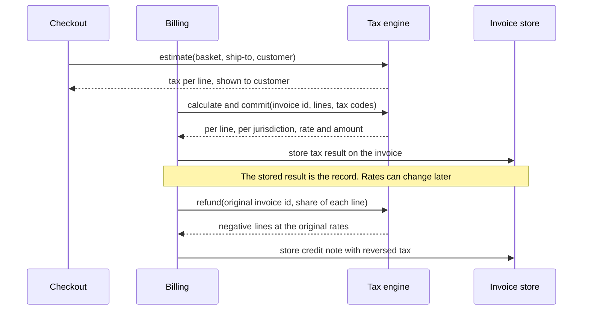
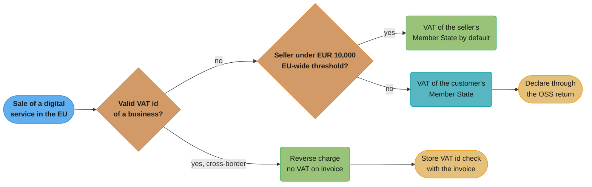

# Tax for Payment Engineers

> Rules and figures checked 2026-11-06. Every date, threshold and fee on this page comes from the
> fact pins in fintech/CLAUDE.md, or from the European Commission's OSS portal
> (vat-one-stop-shop.ec.europa.eu, accessed 2026-11-06). This page is an engineering view as of
> that date, not legal or tax advice, and covers the US, the EU, the UK, India and Brazil only.
> Tax rates in the examples are illustrative.

---

## 1. Concept Overview

Tax law is the job of tax advisers. The code that applies it is the job of payment and billing
engineers, and that code has a small number of recurring shapes:

1. **The tax call.** The system asks a tax engine for the tax on a basket at quote time, records
   the final calculation when the invoice or order is final, and reverses it on a refund.
2. **Price display.** Tax-exclusive prices (most US sales) add tax on top. Tax-inclusive prices
   (most EU, UK and Indian consumer prices) contain tax that the system must back out.
3. **Rounding.** Per line or per invoice, with the mode the jurisdiction sets.
4. **Classification.** Every SKU maps to a product tax code, because the same rate rarely applies
   to everything a business sells.
5. **Location.** An address resolves to one or more taxing jurisdictions. In the EU, the customer's
   location and status (business or consumer) decide where VAT is due.
6. **Exemptions.** Exempt buyers, B2B reverse charge, and the evidence that supports each one.
7. **Thresholds.** US economic nexus, the EU distance-selling threshold, and the reporting
   thresholds for Form 1099-K and DAC7. Each is a number in a rule that can change, so each lives
   in configuration with a source and a date.
8. **Reporting hooks.** E-invoicing mandates and platform reporting need structured data that the
   billing and payout systems must already hold.

This page teaches those shapes and the failure modes of tax APIs. The invoice and credit-note
mechanics are in
[Subscriptions, Billing and Invoicing](../subscriptions_billing_and_invoicing/subscriptions_billing_and_invoicing.md),
and rounding modes per context are in
[Money Representation and Currency](../money_representation_and_currency/money_representation_and_currency.md).

---

## 2. Intuition

> **One-line analogy:** a tax engine is a pharmacist, and your code is the prescription. The
> pharmacist knows the rules for each drug in each country. You must still write the right drug,
> the right patient and the right address on the form, and keep a copy of what was dispensed.

**Mental model.** Tax on a transaction is a function of five inputs: what was sold (tax code),
for how much (amount, inclusive or not), to whom (consumer, business, exempt), where (ship-to or
customer location) and when (the date fixes the rate). If you store those five inputs and the
engine's answer for every line, you can explain, reverse and report any transaction years later.

**Why it matters.** Tax errors cost money in two directions. Under-collection means the business
pays the tax from its own margin. Over-collection means refunds to customers and a reputation
problem. And unlike a payment error, a tax error often appears only in an audit, years later,
across every transaction with the same bug.

**Key insight.** Most tax bugs are data bugs, not math bugs. The wrong address, a missing tax code,
an unvalidated VAT id, or a refund that recomputes tax instead of reversing the stored result.
Store inputs and outputs per line, and the math is the tax engine's problem.

---

## 3. Core Principles

1. **Record the answer, not only the rate.** Store the engine's per-line, per-jurisdiction result
   on the invoice. Rates change. The invoice must not.
2. **Estimate, then commit.** A quote is an estimate. The final invoice commits the transaction to
   the engine for reporting. A refund reverses the committed lines.
3. **Reverse, never recompute.** A refund returns the tax that was charged, in proportion to the
   amount refunded, at the original rate.
4. **Thresholds are configuration with a source.** Every number in a tax rule lives in a table
   with its jurisdiction, its effective date and the source it came from.
5. **Classify every SKU.** A product with no tax code gets the engine's default, which is often
   wrong.
6. **Keep the evidence.** VAT ids with validation results, exemption certificates with expiry
   dates, and location evidence are part of the transaction record.
7. **Fail toward collection.** When the engine or a validation service is down, choose the outcome
   you can correct later at the lowest cost, and record that the fallback ran.
8. **Round as the rule says.** Per line or per invoice, half-up or half-even, is a jurisdiction
   setting, not a code style choice.

---

## 4. Types / Architectures / Strategies

### 4.1 Tax types engineers meet

| Tax | Where | Who collects | Shape |
|---|---|---|---|
| Sales and use tax | US states and local jurisdictions | Seller with nexus in the state | Added on top, rate stacks state, county, city and district |
| VAT | EU, UK and others | Each business in the chain, final consumer bears it | Usually inclusive for consumers, input VAT is reclaimed |
| GST | India and others | Registered suppliers | Like VAT, with its own structure per country |
| Digital services rules | EU for B2C digital services | Seller, by the customer's location | VAT of the customer's Member State |
| Withholding and information reporting | US 1099-K, EU DAC7 | Platform or payment settlement entity | Reports to the tax authority, not a tax on the sale |

### 4.2 Price display

| Display | Customer sees | System computes | Common in |
|---|---|---|---|
| Tax-exclusive | Price, then tax at checkout | `tax = round(net x rate)` | US sales tax, B2B quotes |
| Tax-inclusive | One price that already contains tax | `tax = round(gross x rate / (1 + rate))`, `net = gross - tax` | EU, UK and Indian consumer prices |

### 4.3 Rounding policies

| Policy | Rule | Effect |
|---|---|---|
| Per line | Round each line's tax, then sum | Line taxes add to the total. Total can differ from rate x invoice net |
| Per invoice | Sum nets per rate, round once | Total matches rate x net. Line taxes need allocation to add up |
| Per jurisdiction per line | Round each jurisdiction's share of each line | Needed when several jurisdictions tax one line |

### 4.4 Where the tax call happens

| Event | Call type | Stored result | Engine state |
|---|---|---|---|
| Cart, quote, checkout | Estimate | Shown to the customer, not stored as final | None |
| Order placed or invoice finalized | Calculate and commit | Per line, per jurisdiction, on the invoice | Committed, reportable |
| Invoice voided before payment | Void | Status change | Voided |
| Refund or credit note | Reverse a share of the original | Negative lines linked to the original | Committed return |

---

## 5. Architecture Diagrams

### 5.1 The tax call through an order's life



The estimate and the commit are separate calls. Only the commit creates a reportable transaction,
and only the stored result goes on the invoice. The refund points at the original invoice, so the
engine reverses what was charged.

### 5.2 EU VAT on B2C digital services



Two questions decide the VAT on an EU digital-services sale: is the buyer a business with a valid
VAT id, and is the seller above the EU-wide EUR 10,000 threshold. Both answers come from data the
system must store with the invoice.

### 5.3 Per-line versus per-invoice rounding

```
  Three lines, net 1.99 each, illustrative VAT rate 19%, round half up

                    net     exact tax    per-line tax
  line 1           1.99      0.3781         0.38
  line 2           1.99      0.3781         0.38
  line 3           1.99      0.3781         0.38
                  -----      ------         ----
  invoice          5.97      1.1343         1.14   <- per line
                                            1.13   <- per invoice, round(5.97 x 0.19)
                                            ----
                                     delta  0.01
```

One cent per invoice is small, but it is wrong in one direction for every invoice of that shape,
and the jurisdiction's rule decides which number is right. Store the policy per jurisdiction and
test both shapes.

---

## 6. How It Works - Detailed Mechanics

### 6.1 Inclusive and exclusive tax, and rounding

```java
import java.math.BigDecimal;
import java.math.RoundingMode;
import java.util.List;

public class TaxRounding {

    static final RoundingMode MODE = RoundingMode.HALF_UP;

    static long taxOnNet(long netMinor, BigDecimal rate) {
        return BigDecimal.valueOf(netMinor).multiply(rate).setScale(0, MODE).longValueExact();
    }

    static long taxInGross(long grossMinor, BigDecimal rate) {
        return BigDecimal.valueOf(grossMinor).multiply(rate)
            .divide(BigDecimal.ONE.add(rate), 0, MODE).longValueExact();
    }

    static long perLine(List<Long> nets, BigDecimal rate) {
        long sum = 0;
        for (long n : nets) sum += taxOnNet(n, rate);
        return sum;
    }

    static long perInvoice(List<Long> nets, BigDecimal rate) {
        long net = 0;
        for (long n : nets) net += n;
        return taxOnNet(net, rate);
    }

    public static void main(String[] args) {
        BigDecimal vat19 = new BigDecimal("0.19");
        List<Long> nets = List.of(199L, 199L, 199L);
        long a = perLine(nets, vat19);
        long b = perInvoice(nets, vat19);
        System.out.println("per line " + a + ", per invoice " + b);
        assert a == 114 && b == 113;

        BigDecimal vat20 = new BigDecimal("0.20");
        long gross = 1000;
        long tax = taxInGross(gross, vat20);
        long net = gross - tax;
        System.out.println("inclusive 10.00 at 20%: net " + net + ", tax " + tax);
        assert tax == 167 && net == 833;
        assert net + tax == gross : "inclusive price must split exactly";
    }
}
```

For an inclusive price, compute the tax and derive the net as `gross - tax`. If you round the net
and the tax separately, they can sum to one cent more or less than the price the customer saw.
The rounding mode here is illustrative. The jurisdiction's rule sets it, so read it from
configuration per jurisdiction.

### 6.2 Storing the tax result per line and per jurisdiction

```sql
CREATE TABLE tax_txn (
    tax_txn_id       text   PRIMARY KEY,
    kind             text   NOT NULL CHECK (kind IN ('sale', 'refund')),
    original_txn_id  text   REFERENCES tax_txn(tax_txn_id),
    status           text   NOT NULL CHECK (status IN ('estimated', 'committed', 'voided')),
    currency         char(3) NOT NULL,
    ship_to_country  char(2) NOT NULL,
    ship_to_region   text,
    tax_date         date   NOT NULL,
    CHECK ((kind = 'refund') = (original_txn_id IS NOT NULL))
);

CREATE TABLE tax_line (
    tax_txn_id     text    NOT NULL REFERENCES tax_txn(tax_txn_id),
    line_no        int     NOT NULL,
    jurisdiction   text    NOT NULL,
    tax_code       text    NOT NULL,
    taxable_minor  bigint  NOT NULL,
    rate           numeric(9, 6) NOT NULL,
    tax_minor      bigint  NOT NULL,
    PRIMARY KEY (tax_txn_id, line_no, jurisdiction)
);

INSERT INTO tax_txn VALUES
    ('inv_100', 'sale', NULL, 'committed', 'USD', 'US', 'XX', '2026-11-02');
INSERT INTO tax_line VALUES
    ('inv_100', 1, 'state XX', 'SAAS_GENERAL', 10000, 0.062500, 625),
    ('inv_100', 1, 'city YY',  'SAAS_GENERAL', 10000, 0.020000, 200);

-- Half refund: reverse half of each stored jurisdiction amount, at the stored rate.
INSERT INTO tax_txn VALUES
    ('cn_100', 'refund', 'inv_100', 'committed', 'USD', 'US', 'XX', '2026-11-20');
INSERT INTO tax_line (tax_txn_id, line_no, jurisdiction, tax_code, taxable_minor, rate, tax_minor)
SELECT 'cn_100', line_no, jurisdiction, tax_code,
       -taxable_minor / 2, rate, -round(tax_minor / 2.0)::bigint
FROM tax_line WHERE tax_txn_id = 'inv_100';

DO $$
BEGIN
    ASSERT (SELECT sum(tax_minor) FROM tax_line WHERE tax_txn_id = 'inv_100') = 825;
    ASSERT (SELECT sum(tax_minor) FROM tax_line WHERE tax_txn_id = 'cn_100') = -413;
END $$;
```

The two jurisdictions and their rates are illustrative. The point is the shape: one row per line
per jurisdiction, with the rate that applied on the tax date. The refund reads the stored rows,
so a rate change between the sale and the refund does not change what is returned. Rounding each
half (312.5 and 100) gives 313 and 100. With several partial refunds, the last refund should
return the remaining tax exactly, so the sum of reversals never exceeds what was charged.

### 6.3 Economic nexus as a variable

In South Dakota v. Wayfair, decided on 2018-06-21, the US Supreme Court overruled the
physical-presence rule of Quill and National Bellas Hess. The South Dakota law it upheld applied
to sellers that deliver more than $100,000 of goods or services into the state in a year, or have
200 or more separate transactions. Each state sets its own threshold, so the system treats the
threshold as data:

```sql
CREATE TABLE nexus_rule (
    state            text   NOT NULL,
    effective_from   date   NOT NULL,
    sales_over_minor bigint,
    txns_at_least    int,
    source           text   NOT NULL,
    PRIMARY KEY (state, effective_from)
);

CREATE TABLE us_sale (
    sale_id     text   PRIMARY KEY,
    state       text   NOT NULL,
    amount_minor bigint NOT NULL,
    sold_on     date   NOT NULL
);

INSERT INTO nexus_rule VALUES
    ('SD', '2018-06-21', 10000000, 200, 'South Dakota v. Wayfair, No. 17-494 (2018)');

INSERT INTO us_sale
SELECT 'sd-' || g, 'SD', 4000, DATE '2026-01-01' + (g % 300)
FROM generate_series(1, 210) g;

CREATE VIEW nexus_check AS
SELECT s.state, extract(year FROM s.sold_on)::int AS year,
       sum(s.amount_minor) AS sales_minor, count(*) AS txns,
       (sum(s.amount_minor) > r.sales_over_minor OR count(*) >= r.txns_at_least) AS over
FROM us_sale s
JOIN nexus_rule r ON r.state = s.state
GROUP BY s.state, extract(year FROM s.sold_on), r.sales_over_minor, r.txns_at_least;

DO $$
BEGIN
    ASSERT (SELECT over FROM nexus_check WHERE state = 'SD' AND year = 2026),
        '210 sales cross the 200-transaction test even at $8,400 in total';
END $$;
```

The seller in the example sold only $8,400 into the state but made 210 sales, so the count test
alone creates nexus under that law. Keep one row per state with its own source and effective
date, review the table on a schedule, and register before collecting in a new state.

### 6.4 Reporting thresholds: Form 1099-K and DAC7

A payout platform must know which payees to report. Two reporting rules:

| Rule | Who reports | Threshold | Source date |
|---|---|---|---|
| Form 1099-K | Third party settlement organization | Gross payments to a payee exceed $20,000 and transactions exceed 200 | IRS IR-2025-107, 2025-10-23 (the One, Big, Beautiful Bill restored this threshold retroactively) |
| DAC7 | Platform operators in the EU | Report seller data from 2023-01-01, by 31 January of the following year. Sellers of goods with fewer than 30 sales and no more than EUR 2,000 in a period are excluded | Directive (EU) 2021/514 |

Both tests have two conditions. The 1099-K test needs both conditions to pass. The DAC7 exclusion
needs both conditions to hold, so a goods seller is reportable when either one fails.

```sql
CREATE TABLE payee_payment (
    payee_id      text   NOT NULL,
    region        text   NOT NULL CHECK (region IN ('US', 'EU')),
    sells_goods   boolean NOT NULL,
    currency      char(3) NOT NULL,
    amount_minor  bigint NOT NULL,
    paid_on       date   NOT NULL
);

INSERT INTO payee_payment
SELECT 'us_a', 'US', false, 'USD', 12500, DATE '2026-01-01' + g FROM generate_series(1, 201) g;
INSERT INTO payee_payment
SELECT 'us_b', 'US', false, 'USD', 200000, DATE '2026-01-01' + g FROM generate_series(1, 15) g;
INSERT INTO payee_payment
SELECT 'eu_c', 'EU', true, 'EUR', 5000, DATE '2026-01-01' + g FROM generate_series(1, 35) g;
INSERT INTO payee_payment
SELECT 'eu_d', 'EU', true, 'EUR', 9000, DATE '2026-01-01' + g FROM generate_series(1, 20) g;

CREATE VIEW form_1099k_candidates AS
SELECT payee_id FROM payee_payment
WHERE region = 'US' AND extract(year FROM paid_on) = 2026
GROUP BY payee_id
HAVING sum(amount_minor) > 2000000 AND count(*) > 200;

CREATE VIEW dac7_reportable AS
SELECT payee_id FROM payee_payment
WHERE region = 'EU' AND sells_goods AND extract(year FROM paid_on) = 2026
GROUP BY payee_id
HAVING NOT (count(*) < 30 AND sum(amount_minor) <= 200000);

DO $$
BEGIN
    ASSERT (SELECT array_agg(payee_id) FROM form_1099k_candidates) = ARRAY['us_a'];
    ASSERT (SELECT array_agg(payee_id ORDER BY payee_id) FROM dac7_reportable) = ARRAY['eu_c'];
END $$;
```

`us_a` has $25,125 over 201 payments and passes both 1099-K tests. `us_b` has $30,000 over 15
payments and fails the count test. `eu_c` made 35 sales, so the DAC7 exclusion does not apply even
though its total is EUR 1,750. `eu_d` made 20 sales for EUR 1,800 and stays excluded. Payout data
and the platforms that produce it are in
[Wallets, Stored Value and Payouts](../wallets_stored_value_and_payouts/wallets_stored_value_and_payouts.md).

### 6.5 EU VAT for cross-border B2C sales

The EU changed its VAT rules for cross-border B2C e-commerce from 2021-07-01. The Commission's OSS
portal states:

- An EU-wide threshold of EUR 10,000 applies, counted over the current and the preceding calendar
  year. Below it, telecommunications, broadcasting and electronic services, and intra-EU distance
  sales of goods, follow the VAT rules of the supplier's Member State. The supplier can opt for
  the customer's Member State instead, and the option binds it for two calendar years.
- Above it, VAT is due in the customer's Member State. The seller can declare it through the One
  Stop Shop (OSS) and register in one Member State only, instead of in each Member State. OSS is
  optional, and its return does not replace the seller's domestic VAT return.
- The Import One Stop Shop (IOSS) covers distance sales of low-value goods imported into the EU in
  consignments not exceeding EUR 150.

For a B2B sale of services to a business in another Member State, the general rule is the reverse
charge: the supplier issues an invoice without VAT and the customer accounts for the VAT. The
system needs a valid VAT id to apply it, which it checks against VIES, the Commission's VAT
number validation service. Store the response and its timestamp with the invoice as evidence.

### 6.6 E-invoicing under ViDA

ViDA is Council Directive (EU) 2025/516, published in the Official Journal on 2025-03-25. From
2030-07-01, intra-EU B2B supplies need e-invoicing in the EN 16931 standard and per-transaction
digital reporting, with the invoice issued within 10 days of the chargeable event. Member States
that run a domestic real-time reporting system align it by 2035-01-01. Platform deemed-supplier
rules for short-term accommodation and passenger transport apply from 2028-07-01.

For an engineer this means three things to prepare: invoice data held as structured fields (not
only a PDF), a reliable chargeable-event timestamp per supply so the 10-day rule can be checked,
and an outbound integration per reporting channel.

### 6.7 Tax API caching and failure modes

| Concern | Do | Avoid |
|---|---|---|
| Latency at checkout | Cache estimates for an identical basket, address and customer for minutes | Caching a rate per ZIP code or postcode |
| Engine timeout at checkout | Show an estimate from the last good answer for the same inputs, mark the order for recalculation | Charging no tax because the call failed |
| Engine down at invoice finalization | Hold finalization and retry with backoff, page after a deadline | Finalizing with zero tax |
| Duplicate commits on retry | Use your invoice id as the engine's document code, so a retry finds the existing document | A new engine document per retry |
| Rate change at midnight | Pass the tax date explicitly | Letting the engine assume "today" for a backdated invoice |

Retries, circuit breakers and fallbacks in general are covered in
[Fault Tolerance Patterns](../../backend/fault_tolerance_patterns/fault_tolerance_patterns.md).

---

## 7. Real-World Examples

**South Dakota v. Wayfair (2018).** The Supreme Court decision of 2018-06-21 ended the rule that a
state could require a remote seller to collect sales tax only if the seller had a physical
presence there. The upheld South Dakota law used two tests: more than $100,000 of sales delivered
into the state in a year, or 200 or more separate transactions. Every state now sets its own
tests, which is why nexus tracking is a table and not a constant.

**Form 1099-K threshold.** The IRS stated in IR-2025-107 (2025-10-23) that the One, Big, Beautiful
Bill retroactively restored the earlier threshold: a third party settlement organization files
only when gross payments to a payee exceed $20,000 and transactions exceed 200. A platform that
coded a different threshold as a constant had to change code. A platform that kept it in a
dated configuration table changed one row.

**DAC7.** Under Council Directive (EU) 2021/514, platform operators report seller data from
2023-01-01, by 31 January of the following year, and exclude sellers of goods with fewer than 30
sales and no more than EUR 2,000 in a period. The data the report needs (seller identity, sales
count and consideration per period) already exists in a payout ledger that keeps per-seller
history.

**EU OSS and IOSS.** From 2021-07-01, the EU replaced per-country distance-selling thresholds with
an EU-wide EUR 10,000 threshold and introduced the One Stop Shop, plus the Import One Stop Shop
for consignments not exceeding EUR 150 (Commission OSS portal, accessed 2026-11-06).

---

## 8. Tradeoffs

### Tax engine: build or buy

| Factor | Build rate tables | Buy a tax engine |
|---|---|---|
| Rate and rule updates | Your team tracks every jurisdiction | Vendor updates content |
| Address to jurisdiction | Hard for US rooftop accuracy | Included |
| Filing and remittance | Separate project | Often included or integrated |
| Cost | Engineer time and audit risk | Per-transaction or subscription fees |
| Fits when | One country, few products, a single rate | Several US states, EU OSS, many product types |

### Rounding policy

| Policy | Strength | Weakness |
|---|---|---|
| Per line | Each line's tax is self-contained, easy to reverse per line | Total can differ from rate x net by a few minor units |
| Per invoice | Total matches the rate on the net | Needs an allocation rule to show tax per line |

### Fallback when a dependency is down

| Dependency | Fallback | Cost if wrong | Correction |
|---|---|---|---|
| Tax engine at checkout | Recent estimate for the same inputs | Small over or under collection | Recalculate at finalization |
| Tax engine at finalization | Hold the invoice | Delayed invoice | Retry, then manual |
| VIES for a VAT id | Charge VAT, mark validation pending | Customer is charged VAT they may not owe | Re-validate, issue a credit note |

---

## 9. When to Use / When NOT to Use

**Use a tax engine when** the business sells into more than one US state with nexus, sells B2C
digital services across EU Member States above the EUR 10,000 threshold, or has products with
different tax treatments.

**Use your own rate table when** the business sells one kind of product in one jurisdiction with
one rate, and an adviser has confirmed that scope.

**Do NOT:**

- Compute tax in the browser or the mobile app. The server owns every amount, as the
  [checkout case study](../../react/case_studies/design_a_checkout_and_payment_flow.md) explains.
- Recompute tax on a refund from the rate in force on the refund day.
- Hard-code a threshold or a rate in application code.
- Treat a failed VAT id validation as a valid one.

---

## 10. Common Pitfalls

### 10.1 The 1099-K test with the wrong operators

A payout platform coded the reporting test with `||` and `>=`. It flagged payees that passed only
one test, and a payee at exactly $20,000. The incident is illustrative.

```java
// BROKEN
import java.util.List;

public class Form1099kBroken {
    record Payee(String id, long grossMinor, int transactions) {}

    static boolean reportable(Payee p) {
        return p.grossMinor() >= 2_000_000 || p.transactions() >= 200;
    }

    public static void main(String[] args) {
        List<Payee> payees = List.of(
            new Payee("a", 2_500_000, 50),
            new Payee("b", 2_000_000, 300),
            new Payee("c", 2_000_100, 201));
        payees.forEach(p -> System.out.println(p.id() + " " + reportable(p)));
        // a true, b true, c true. Only c meets the rule
    }
}
```

The rule needs gross payments that exceed $20,000 and transactions that exceed 200. Payee `a` has
too few transactions and payee `b` does not exceed $20,000.

```java
// FIX
import java.util.List;

public class Form1099kFix {
    record Threshold(long grossOverMinor, int transactionsOver) {}
    record Payee(String id, long grossMinor, int transactions) {}

    static final Threshold FORM_1099K = new Threshold(2_000_000, 200);

    static boolean reportable(Payee p, Threshold t) {
        return p.grossMinor() > t.grossOverMinor() && p.transactions() > t.transactionsOver();
    }

    public static void main(String[] args) {
        assert !reportable(new Payee("a", 2_500_000, 50), FORM_1099K);
        assert !reportable(new Payee("b", 2_000_000, 300), FORM_1099K);
        assert reportable(new Payee("c", 2_000_100, 201), FORM_1099K);
        System.out.println("ok");
    }
}
```

In production the `Threshold` comes from a dated configuration table with its source, as in §6.3.
Test the boundary values of every threshold: exactly at the number, one above and one below.

### 10.2 Recomputing tax on a refund

A billing system refunded tax by multiplying the refund amount by the rate on the refund date.
After a rate increase, refunds returned more tax than the customer had paid. The incident is
illustrative.

```java
// BROKEN
import java.math.BigDecimal;
import java.math.RoundingMode;

public class RefundTaxBroken {
    public static void main(String[] args) {
        long net = 10_000;
        long taxCharged = BigDecimal.valueOf(net).multiply(new BigDecimal("0.19"))
            .setScale(0, RoundingMode.HALF_UP).longValueExact();
        BigDecimal rateOnRefundDay = new BigDecimal("0.20");
        long taxRefunded = BigDecimal.valueOf(net).multiply(rateOnRefundDay)
            .setScale(0, RoundingMode.HALF_UP).longValueExact();
        System.out.println("charged " + taxCharged + ", refunded " + taxRefunded);
        // charged 1900, refunded 2000
    }
}
```

The fix reverses a share of the stored tax. The original rate is irrelevant at refund time,
because the stored amount already reflects it.

```java
// FIX
import java.math.BigDecimal;
import java.math.RoundingMode;

public class RefundTaxFix {
    static long reverse(long taxCharged, long taxAlreadyRefunded, long refundNet, long originalNet,
                        long netAlreadyRefunded) {
        if (netAlreadyRefunded + refundNet == originalNet) {
            return taxCharged - taxAlreadyRefunded;
        }
        return BigDecimal.valueOf(taxCharged).multiply(BigDecimal.valueOf(refundNet))
            .divide(BigDecimal.valueOf(originalNet), 0, RoundingMode.HALF_UP).longValueExact();
    }

    public static void main(String[] args) {
        long net = 10_000, taxCharged = 1_900;
        long first = reverse(taxCharged, 0, 3_333, net, 0);
        long second = reverse(taxCharged, first, 6_667, net, 3_333);
        System.out.println("refunded " + first + " then " + second);
        assert first == 633;
        assert first + second == taxCharged : "never refund more tax than was charged";
    }
}
```

The last partial refund takes the remainder, so rounding on earlier partial refunds can never make
the total reversal exceed the tax charged.

### 10.3 Other pitfalls

- **Rates cached by ZIP code.** US ZIP codes are postal routes, and one ZIP code can cross city,
  county and special-district lines. Cache by full address or by the engine's resolved
  jurisdiction set.
- **No tax code on new SKUs.** The engine falls back to a default category, and a product that
  should be exempt is taxed (or the reverse) until someone notices.
- **Inclusive prices split by rounding net and tax separately.** The two parts can then disagree
  with the shelf price by a cent.
- **Commit on every retry.** Without a stable document code, a retried commit creates a duplicate
  taxable sale in the engine's reports.
- **Exemption certificates without expiry dates.** An expired certificate keeps a customer exempt
  for years after it lapsed.

---

## 11. Technologies & Tools

| Tool | Role |
|---|---|
| Avalara AvaTax | Tax calculation API with address resolution, tax codes, exemption certificate management and filing |
| Vertex O Series | Enterprise tax engine for indirect tax calculation, often embedded in ERP systems |
| Stripe Tax | Tax calculation and registration tracking for payments and invoices on Stripe |
| TaxJar | Sales tax calculation, nexus insights and filing for US sellers |
| Anrok | Sales tax and VAT for SaaS businesses, connected to billing platforms |
| Sovos | Tax determination, e-invoicing compliance and information reporting |
| VIES | The European Commission's service for checking EU VAT identification numbers |

---

## 12. Interview Questions with Answers

**Q: Can you cache sales tax rates by ZIP code?**
**Short:** No. A US ZIP code is a postal route that can cross city, county and district lines, so one ZIP can hold several combined rates.

Caching by ZIP code charges some customers the wrong local rate, consistently, for every order.
Cache by the full normalized address, or cache the engine's resolved jurisdiction set for that
address, and keep the cache short so rate changes take effect. For a quote, an estimate is
acceptable. For the final invoice, call the engine with the full address.

**Q: On a refund, do you recompute the tax or reverse the stored tax?**
**Short:** Reverse the stored tax in proportion to the amount refunded. Recomputing at the refund-day rate can return more or less tax than the customer paid.

The invoice records the rate and amount per jurisdiction that applied on the tax date. A refund
returns a share of those stored amounts. For several partial refunds, the last one returns the
remainder, so rounding can never make the total reversal exceed the original tax. Link the refund
to the original document in the tax engine so its reports net correctly.

**Q: Why might net plus tax not equal a tax-inclusive price?**
**Short:** Rounding net and tax separately can drift by a minor unit. Compute the tax from the gross price and derive the net as gross minus tax.

For a 10.00 price at an illustrative 20% VAT, the tax is `round(1000 x 0.20 / 1.20) = 167` and the
net is `1000 - 167 = 833`. Rounding `1000 / 1.20 = 833.33` to 833 and `166.67` to 167 happens to
work here, but on other prices the two roundings miss by a minor unit. At 20%, a gross of 3 splits
into 2.5 and 0.5, and rounding both half up gives 3 + 1 = 4. Deriving one part from the other
keeps the split exact.

**Q: Per-line or per-invoice tax rounding?**
**Short:** Whichever the jurisdiction's rule requires. They differ by a minor unit or two on many invoices, so the policy lives in configuration and both shapes get tests.

Three lines of 1.99 at an illustrative 19% give 1.14 of tax rounded per line and 1.13 rounded once
per invoice. Per line keeps each line's tax self-contained, which makes partial refunds simple.
Per invoice matches the rate applied to the total. Pick per jurisdiction, record the choice on the
invoice, and use the same function for quotes, invoices and refunds.

**Q: When should the system call the tax engine?**
**Short:** Estimate at quote and checkout, calculate and commit when the invoice or order is final, void on cancellation, and reverse on refund.

Only the committed call creates a reportable transaction in the engine. Estimates are for display
and change as the basket changes. Use the invoice id as the engine's document code, so a retried
commit finds the existing document instead of creating a second taxable sale. Store the committed
result on the invoice.

**Q: What should checkout do when the tax engine times out?**
**Short:** Use the last good estimate for the same inputs and mark the order for recalculation at finalization. Never charge zero tax because the call failed.

A zero-tax fallback under-collects on every order during the outage, and the business pays that
tax itself. A recent estimate for the same basket and address is usually right, and the commit at
finalization corrects it. If finalization itself cannot reach the engine, hold the invoice and
retry. A late invoice is cheaper than a wrong one.

**Q: What is economic nexus and what threshold triggers it?**
**Short:** A seller's duty to collect a US state's sales tax based on sales into the state, without physical presence. Each state sets its own sales and transaction thresholds.

South Dakota v. Wayfair, decided on 2018-06-21, overruled the physical-presence rule. The South
Dakota law it upheld applied to sellers with more than $100,000 of sales into the state in a year,
or 200 or more separate transactions. Model each state's rule as a dated row with its source,
aggregate sales per state continuously, and alert before a threshold is crossed so registration
happens before collection must start.

**Q: When must a platform file Form 1099-K for a payee?**
**Short:** When gross payments to the payee exceed $20,000 and the transactions exceed 200, per the IRS after the One, Big, Beautiful Bill restored that threshold retroactively.

Both conditions must hold, and both are strict: exactly $20,000 or exactly 200 transactions does
not qualify. The IRS published this in IR-2025-107 on 2025-10-23. Keep the threshold in dated
configuration, because it has changed by law before, and test the exact boundary values.

**Q: What does DAC7 require from an EU platform?**
**Short:** Platform operators report seller data from 2023-01-01, by 31 January of the next year. Goods sellers with under 30 sales and at most EUR 2,000 in a period are excluded.

The exclusion needs both conditions. A goods seller with 35 small sales is reportable even below
EUR 2,000, and one with 10 sales over EUR 2,000 is reportable too. The data comes from the payout
and order history per seller, so keep seller identity and per-period counts and totals queryable,
not only aggregated balances.

**Q: Where is VAT due on a B2C digital service sold to a consumer in another EU Member State?**
**Short:** In the customer's Member State once the seller passes the EU-wide EUR 10,000 threshold. The seller can declare it through the One Stop Shop instead of registering in each country.

The rules changed on 2021-07-01. Below the threshold, telecommunications, broadcasting and
electronic services follow the VAT rules of the supplier's Member State, unless the supplier opts
for the customer's Member State. The system therefore
needs the customer's location evidence, the seller's running EU cross-border total, and the
rate per Member State and product type.

**Q: How does the reverse charge change the invoice?**
**Short:** For a cross-border B2B service in the EU, the supplier charges no VAT and the business customer accounts for it, which requires a valid VAT id stored as evidence.

The invoice shows a zero VAT amount and a reverse-charge notice, and the customer self-assesses.
If the VAT id is invalid, the sale is B2C and VAT was due. So the system validates the id against
VIES before it applies the reverse charge, stores the response and timestamp with the invoice,
and re-validates ids on a schedule for subscriptions.

**Q: What should happen when VIES is unavailable during checkout?**
**Short:** Charge VAT, mark the VAT id as pending validation, and re-check later. If the id is valid, issue a credit note for the VAT charged.

Treating an unchecked id as valid removes VAT that may be due, and the seller then owes it.
Charging VAT and correcting later costs a credit note and a refund. Record the fallback on the
invoice so finance can see why VAT appears on a business customer's invoice. §14 walks through
this case.

**Q: What does IOSS cover?**
**Short:** Distance sales of low-value goods imported into the EU in consignments not exceeding EUR 150, letting the seller collect VAT at sale and declare it through one return.

Without IOSS, VAT on such goods is collected at import, often from the customer with a handling
fee. With IOSS, the checkout must charge VAT of the destination Member State, and the shipment
carries the seller's IOSS number. The system needs the consignment value per shipment to decide
eligibility.

**Q: What does ViDA change for invoicing systems?**
**Short:** From 2030-07-01, intra-EU B2B supplies need EN 16931 e-invoices and per-transaction digital reporting, with the invoice issued within 10 days of the chargeable event.

ViDA is Council Directive (EU) 2025/516, in the Official Journal on 2025-03-25. Member States with
their own real-time reporting systems align them by 2035-01-01, and platform deemed-supplier rules
for short-term accommodation and passenger transport apply from 2028-07-01. Engineering work:
structured invoice data, a chargeable-event timestamp per supply, and outbound reporting
integrations.

**Q: Why map every SKU to a product tax code?**
**Short:** Rates and exemptions depend on what is sold. Without a code the engine applies a default category, which is often wrong for software, food, clothing or services.

The tax code is an input to every calculation, like the address. Make it a required field on the
catalog item, review it when a product is created, and alert on transactions that used the
default code. A missing code is silent: the invoice looks normal until an audit finds the wrong
rate on every sale of that product.

**Q: How should exemption certificates be stored?**
**Short:** As documents linked to the customer with jurisdiction, exemption reason, issue date and expiry, checked at each calculation so an expired certificate stops the exemption.

An exemption applies only in the jurisdictions the certificate covers and only while it is valid.
Pass the exemption to the engine per transaction rather than marking the customer "tax exempt"
forever. Keep the document, because in an audit the certificate is the evidence for every untaxed
sale to that customer.

**Q: Why store the engine's full response on each invoice line?**
**Short:** Rates, rules and jurisdiction boundaries change. The stored response is the only record of what was charged and why, and refunds and audits read it years later.

Store the jurisdictions, rates, taxable amounts, tax amounts, the tax code and the tax date per
line. Recomputing later with a new engine version or new rates gives a different answer. The stored
rows also feed reconciliation between tax collected on invoices and tax remitted in returns, which
uses the same discipline as
[Reconciliation and Settlement Files](../reconciliation_and_settlement_files/reconciliation_and_settlement_files.md).

**Q: What does a platform deemed-supplier rule mean for a marketplace?**
**Short:** The platform is treated as the seller for VAT purposes, so it charges and remits the VAT instead of the underlying seller. ViDA applies this to short-term accommodation and passenger transport from 2028-07-01.

The marketplace then needs the VAT logic of a merchant: the location of the supply, the rate, the
invoice and the return, for transactions where it does not own the inventory. Seller data that
was only needed for payouts becomes part of the tax calculation. The merchant-of-record model is
covered in
[PSPs, Acquirers, Issuers and Networks](../psps_acquirers_issuers_and_networks/psps_acquirers_issuers_and_networks.md).

---

## 13. Best Practices

1. Call the engine to estimate at checkout, commit at finalization, and reverse on refunds.
2. Use your own invoice id as the engine's document code, so commits are idempotent.
3. Store the engine's per-line, per-jurisdiction result and tax date on every invoice.
4. Reverse stored tax on refunds, with the last partial refund taking the remainder.
5. Derive the net from the gross for tax-inclusive prices.
6. Keep rounding policy, thresholds and rates in dated configuration with their sources.
7. Require a product tax code on every catalog item.
8. Validate VAT ids before the reverse charge and store the result as evidence.
9. Track exemption certificates with jurisdiction and expiry.
10. Aggregate sales per US state and alert before nexus thresholds.
11. Compute 1099-K and DAC7 candidates from per-payee history, and test the boundary values.
12. Keep invoice data structured, ready for e-invoicing mandates.

---

## 14. Case Study

### A SaaS seller and a VIES outage

**Context (illustrative).** A SaaS company sells monthly plans to EU businesses and consumers. Business customers
enter a VAT id at signup, and the checkout validates it against VIES before it applies the reverse
charge. During a VIES outage, the validation call times out for 40 minutes. The engineering policy
in this case is the team's own choice, reviewed by its tax adviser, not a rule from a source.

**First version.** The checkout code treated "could not validate" as "valid".

```java
// BROKEN
public class VatIdBroken {
    enum Check { VALID, INVALID, UNAVAILABLE }

    record Invoice(String customer, long netMinor, long vatMinor, String note) {}

    static Invoice invoice(String customer, long net, long vatAtCustomerRate, Check check) {
        if (check != Check.INVALID) {
            return new Invoice(customer, net, 0, "reverse charge");
        }
        return new Invoice(customer, net, vatAtCustomerRate, "VAT charged");
    }

    public static void main(String[] args) {
        Invoice i = invoice("consumer-typed-a-fake-id", 10_000, 1_900, Check.UNAVAILABLE);
        System.out.println(i);
        // Invoice[customer=consumer-typed-a-fake-id, netMinor=10000, vatMinor=0, note=reverse charge]
    }
}
```

Every signup during the outage got the reverse charge, including consumers who typed a made-up id
to avoid VAT. The VAT on those invoices was still due, and the company owed it from its own
margin.

**Fix.** An unavailable check charges VAT and records the pending state. A later job re-validates
and, when the id turns out valid, issues a credit note for the VAT.

```java
// FIX
import java.util.ArrayList;
import java.util.List;

public class VatIdFix {
    enum Check { VALID, INVALID, UNAVAILABLE }

    record Invoice(String id, String customer, long netMinor, long vatMinor, String note) {}
    record CreditNote(String invoiceId, long vatMinor, String reason) {}

    static Invoice invoice(String id, String customer, long net, long vat, Check check) {
        return switch (check) {
            case VALID -> new Invoice(id, customer, net, 0, "reverse charge, VIES valid");
            case INVALID -> new Invoice(id, customer, net, vat, "VAT charged, VAT id invalid");
            case UNAVAILABLE -> new Invoice(id, customer, net, vat, "VAT charged, VIES pending");
        };
    }

    static List<CreditNote> revalidate(List<Invoice> pending, List<Check> laterResults) {
        List<CreditNote> notes = new ArrayList<>();
        for (int i = 0; i < pending.size(); i++) {
            if (laterResults.get(i) == Check.VALID) {
                Invoice inv = pending.get(i);
                notes.add(new CreditNote(inv.id(), inv.vatMinor(), "reverse charge after VIES check"));
            }
        }
        return notes;
    }

    public static void main(String[] args) {
        Invoice real = invoice("in_1", "acme-gmbh", 10_000, 1_900, Check.UNAVAILABLE);
        Invoice fake = invoice("in_2", "consumer-typed-a-fake-id", 10_000, 1_900, Check.UNAVAILABLE);
        assert real.vatMinor() == 1_900 && fake.vatMinor() == 1_900;

        List<CreditNote> notes = revalidate(List.of(real, fake), List.of(Check.VALID, Check.INVALID));
        System.out.println(notes);
        assert notes.size() == 1 && notes.get(0).invoiceId().equals("in_1");
    }
}
```

**Result.** During later outages, every invoice carried VAT. The re-validation job issued credit
notes for the real businesses within a day, and the invoices with made-up ids kept their VAT. The
VAT rate in the example is illustrative.

**What the team changed.**

1. Every external validation result (valid, invalid, unavailable) became a stored value with a
   timestamp, not a boolean.
2. Fallback outcomes appear on the invoice as a note, so finance and support can see why VAT was
   charged.
3. Subscriptions re-validate VAT ids on a schedule, because a business can lose its registration
   after signup.
4. The team wrote down, for each tax dependency, which failure direction it chooses and who
   approved it, and added that table to the runbook.
