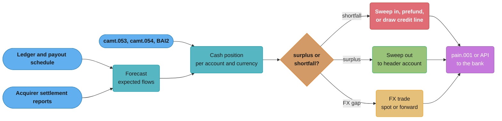
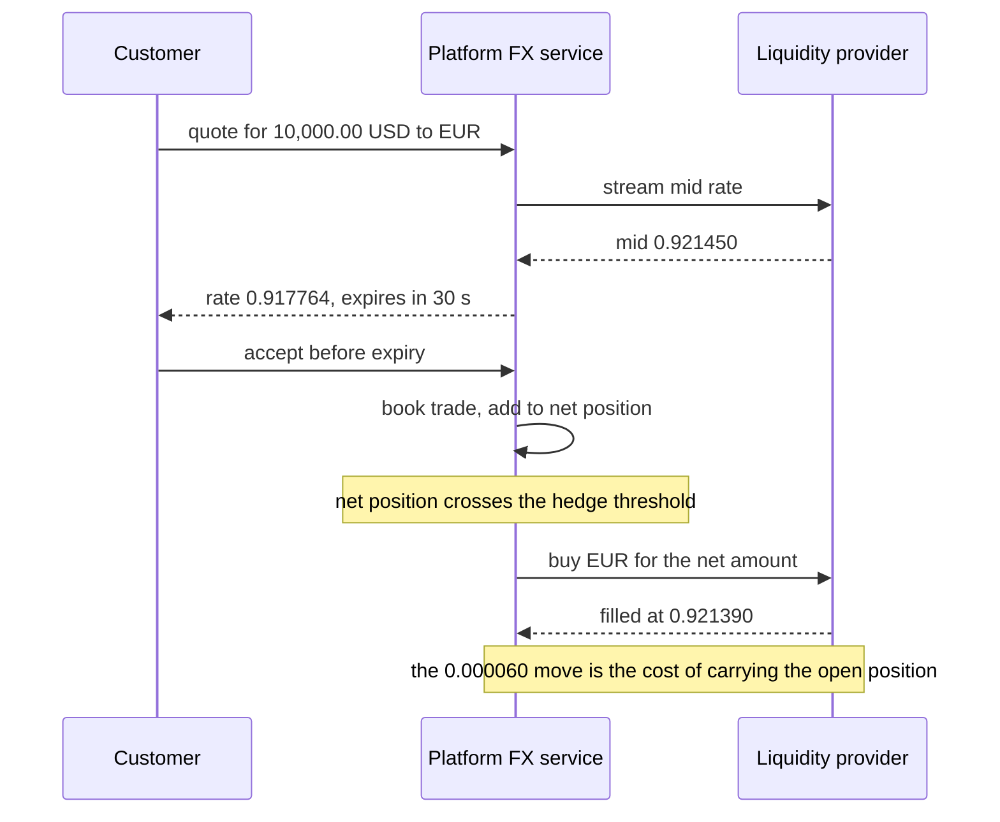

# Treasury, Liquidity and FX Operations

> Rules and figures checked 2026-11-06. Every date, threshold and fee on this page comes from
> the fact pins in fintech/CLAUDE.md, or from a primary source fetched on 2026-11-06 and named
> where it is used (the CLS settlement page, the BIS report on FX settlement risk, and the
> Federal Reserve FedNow FAQ). Rates, balances and buffers in the examples are illustrative.

---

## 1. Concept Overview

Treasury in a payments company answers one question every hour: is the right amount of money,
in the right currency, in the right account, before the payments that need it? Card
settlements arrive in one bank, payouts leave from another, instant rails settle at 3 a.m. on a
Sunday, and customers convert currencies at rates the company quoted minutes earlier. Treasury
is the function, and the software, that keeps all of that funded and limits what it costs.

The topics on this page:

- **Cash positioning.** The balance of every account, per currency, now and projected to the
  end of the day, from bank statements and the ledger.
- **Liquidity forecasting.** Expected inflows and outflows per day and per hour, with a
  buffer for the error.
- **Prefunding.** Putting money in place before payouts, instant rail settlement accounts and
  nostro accounts need it, or using a credit line instead.
- **Sweeps and intraday liquidity.** Moving money between accounts by rule, and funding a
  wire system during the day.
- **FX.** Spot and forward trades (concept level), customer quotes with a lock and an expiry,
  and the choice between hedging, passing the rate through and netting.
- **Settlement risk.** Herstatt risk and how CLS removes it with payment versus payment.
- **Bank connectivity.** Host-to-host files, SWIFT and bank APIs.

The wallet study scopes multi-currency out and sketches the conversion legs in
[Design a Digital Wallet §4.5](../../hld/case_studies/design_digital_wallet.md), and the
payment system study books FX position accounts in
[Design a Payment System](../../hld/case_studies/design_payment_system.md). This page teaches
the company-level treasury that funds and hedges those positions and does not repeat the
per-transaction legs.

---

## 2. Intuition

> **One-line analogy:** treasury is the fuel planner for a fleet of trucks that never stop.
> Each truck (a bank account) burns fuel on its own route and schedule. The planner moves fuel
> between depots before a truck runs dry, buys fuel in other countries at today's price for
> tomorrow's trip, and keeps a reserve tank for the routes it cannot predict.

**Mental model.** Money has three properties that treasury manages at once: where it is (which
bank, which account), what it is (which currency) and when it is usable (value date, cut-off,
the rail's hours). A payment fails if any one of the three is wrong, even when the company has
plenty of money overall. "We had $40 million, but not $2 million in EUR at the bank that
sends SEPA Instant on Saturday" is the typical treasury incident.

**Why it matters.** Idle cash costs money (it earns less than it could, or it was borrowed).
Missing cash costs more: failed payouts, missed settlement, overdraft charges, and in a bad
case a bank that stops sending payments. FX adds price risk: a rate quoted to a customer at
10:00 and covered at 10:20 can move against the company.

**Key insight.** Most treasury design is a trade between the cost of holding money early and
the cost of not having it in time. Prefunding, buffers and hedges buy certainty with cash.
Credit lines, netting and just-in-time sweeps save cash and buy risk. A principal engineer's
job is to make that trade explicit, with numbers, per account and per currency.

---

## 3. Core Principles

1. **Position by account, currency and time.** A single company-wide balance hides every
   shortfall that matters.
2. **Confirmed is not expected.** A cash position separates funds on the bank statement from
   funds that a forecast or a settlement report says will arrive. Only confirmed funds pay.
3. **The ledger proves the obligation, the bank proves the cash.** Treasury reads both and
   explains the difference. Reconciliation owns the matching.
4. **Fund before the cut-off, not before the payment.** A payment that needs money at 9:00
   Monday may need a transfer that must leave by Friday's cut-off.
5. **A quote is a short option given away.** Between the quote and the customer's acceptance,
   the customer chooses and the company carries the rate risk. Expiry bounds it.
6. **Net before you hedge.** Customer flows in opposite directions cancel. Hedge only the net.
7. **Settle FX payment versus payment where you can.** Paying one leg before receiving the
   other is settlement risk.
8. **Every movement is a ledger entry.** Sweeps, prefunding transfers, FX trades and fees each
   post balanced entries, per currency.

---

## 4. Types / Architectures / Strategies

### 4.1 Cash positioning

A cash position for one account and one currency on one day:

```text
opening balance (from yesterday's camt.053 or BAI2 closing balance)
+ confirmed credits today      (camt.054 notifications, intraday statement)
- confirmed debits today
= current position
+ expected credits             (card settlement reports, scheduled sweeps in)
- expected debits              (scheduled payouts, sweeps out, FX settlements)
= projected end-of-day position
- minimum buffer               (a policy number per account)
= surplus or shortfall
```

The inputs come from two kinds of source. Bank statements and intraday notifications tell you
what has happened. The ledger, payout schedules and settlement reports tell you what should
happen. The projected position mixes both, so each line keeps its source and its confidence.

### 4.2 Liquidity forecasting

A forecast predicts net flows per account, per currency and per period (day, or hour for
24x7 rails). Typical inputs for a payments company:

| Flow | Source | Predictability |
|---|---|---|
| Card settlement inflows | Acquirer settlement reports, sales by day | High: sales are known before settlement |
| Payout outflows | Payout schedule, balances due | High for scheduled, low for on-demand instant payouts |
| Refunds and chargebacks | History by weekday and season | Medium |
| FX settlements | Trades already booked | High |
| Fees, tax, payroll | Calendars and invoices | High |

The forecast error is the reason for a buffer. A common approach sizes the buffer from the
history of forecast misses, for example the 99th percentile of daily under-forecast over the
last 90 days (illustrative). The buffer is a policy, reviewed when volumes change.

### 4.3 Prefunding and credit lines

Three places need money in advance:

- **Payout providers and push-to-card programs.** The provider pays recipients only from a
  funded balance, or on a credit limit.
- **Instant rail settlement.** FedNow settles in master accounts at the Reserve Banks (a
  participant's own, or a correspondent's), and offers liquidity management transfers. A platform that sends instant payments
  through a partner bank needs its own account at that bank funded for nights, weekends and
  holidays.
- **Nostro accounts.** A company that pays out in many currencies through correspondents or
  local partners holds balances in each currency before payments leave.

The alternative to prefunding is a credit line: the bank or provider pays first and the
company settles later, up to a limit. §8.1 compares the two.

### 4.4 Sweeps and intraday liquidity

A sweep moves money between accounts by a rule:

- **Zero-balance sweep.** At the end of the day, every sub-account's balance moves to a
  header account. Sub-accounts start each day at zero.
- **Target-balance sweep.** Each account keeps a target, and the sweep moves the excess out
  or fills the gap.
- **Threshold sweep.** Money moves only when a balance crosses a floor or a ceiling.

Intraday liquidity is the money a bank needs during the day to send payments before the
incoming ones arrive. Fedwire Funds is a real-time gross settlement system, so each payment
settles at its full amount when it is sent, funded from the bank's account balance or from
Federal Reserve intraday credit (daylight overdrafts). CHIPS matches and offsets payments with a
liquidity-saving algorithm, so the same flow needs less. A company sees this as cut-offs and
release order: send large payments after the expected large receipts, when the bank's own
intraday limit is tight.

### 4.5 FX: spot, forwards, quotes and hedges

**Spot.** A spot trade exchanges two currencies on the spot date, which the market convention
for the currency pair sets.

**Forward.** A forward fixes today the rate for an exchange on a later date. The forward rate
differs from spot by forward points, which reflect the interest-rate difference between the two
currencies. A company uses forwards to fix the cost of a known future payment.

**Customer quote with lock and expiry.** A platform shows the customer a rate (the mid rate
plus a markup), locks it for a stated time, and accepts the conversion only before expiry. The
lock is risk the platform carries. Three strategies handle it:

| Strategy | What the platform does | Who carries rate risk |
|---|---|---|
| Pass-through | Converts at the rate it gets when the payment executes, and shows the customer a rate only after | The customer |
| Quote-and-lock, covered per trade | Locks the customer rate and buys the currency from a liquidity provider at once | The platform, for the seconds between quote acceptance and cover |
| Quote-and-lock with netting and periodic hedging | Locks customer rates, nets opposite flows internally, and hedges the net position at intervals or above a threshold | The platform, on the open net position |

**Netting.** If one customer converts USD to EUR and another converts EUR to USD in the same
hour, the platform can match them internally and trade only the difference. Netting cuts
spread costs and settlement volume. It needs a ledger that tracks the open position per
currency in real time.

### 4.6 Settlement risk and CLS

In an FX trade, each side pays one currency and receives the other. If the two payments do
not settle at the same moment, one party can pay and not receive. The BIS described this risk
in 1996 as the risk that a bank "could pay over the funds it owes on a trade, but not receive
the funds", and it is often called Herstatt risk.

CLS removes it with payment versus payment (PvP): both legs of a trade settle together or
neither does. CLS states that it settles payments in 18 of the most actively traded
currencies, settles over USD 8.0 trillion of payments each day, and that its multilateral
netting shrinks funding requirements by over 96%. (Source: CLS, CLSSettlement page, fetched
2026-11-06.) A fintech rarely joins CLS directly. It reaches PvP as a third party of a CLS
settlement member bank, and it should know which of its FX trades settle that way and which do
not.

### 4.7 Bank connectivity

| Channel | How it works | Good for | Watch for |
|---|---|---|---|
| Host-to-host (H2H) | Files over SFTP or a bank's managed transfer, usually `pain.001` out and `camt.053` or BAI2 in | Batch payments and statements with one bank | Each bank's own file variant and cut-offs |
| SWIFT | One SWIFT connection to many banks, for statements and payment instructions | Multi-bank, multi-country treasuries | Cost of the connection and of the service bureau |
| Bank APIs | REST APIs for balances, payments and notifications | Real-time balances, instant payments | Different API per bank, rate limits |
| Aggregator or TMS | A vendor connects to the banks and exposes one API or screen | Many banks without many integrations | A new dependency in the money path |

SWIFT ended MT and ISO 20022 coexistence for cross-border payment instructions between banks
(CBPR+) on 2025-11-22. Since that date, interbank cross-border instructions carry ISO 20022
data. Corporate-to-bank formats are agreed with each bank, so a treasury still checks which
format each bank sends and accepts.

---

## 5. Architecture Diagrams

### 5.1 From bank data to funding actions



Bank data says what happened. The ledger and settlement reports say what should happen. The
position joins them, and each gap becomes a funding action that is itself a payment.

### 5.2 Quote, lock, accept and cover



The rates are illustrative. The platform's spread pays for the time between acceptance and
cover. If the cover waits too long, a market move can exceed the spread.

### 5.3 A weekend for an instant payout account

```
Balance of the instant payout account, USD thousands (illustrative)

Fri 17:00  |##############################|  3,000  last wire funding arrives
Sat 00:00  |#######################       |  2,300
Sat 12:00  |################              |  1,600
Sun 00:00  |##########                    |  1,000
Sun 12:00  |#####                         |    500  floor alert
Mon 06:00  |#                             |    100
Mon 09:00  |##############################|  3,000  Monday funding lands

Needed on Friday = peak cumulative weekend outflow (2,900) + buffer
```

Nothing can refill the account between Friday's last funding and Monday's first. The Friday
transfer must cover the whole gap.

---

## 6. How It Works - Detailed Mechanics

### 6.1 Projected position per account

```java
import java.util.List;

public class CashPosition {
    enum Kind { CONFIRMED, EXPECTED }
    record Flow(String account, long cents, Kind kind) {}
    record Account(String id, String currency, long openingCents, long bufferCents) {}
    record Position(String account, long currentCents, long projectedCents, long shortfallCents) {}

    static Position position(Account a, List<Flow> flows) {
        long current = a.openingCents();
        long projected;
        long expected = 0;
        for (Flow f : flows) {
            if (!f.account().equals(a.id())) continue;
            if (f.kind() == Kind.CONFIRMED) current = Math.addExact(current, f.cents());
            else expected = Math.addExact(expected, f.cents());
        }
        projected = Math.addExact(current, expected);
        long shortfall = Math.max(0, a.bufferCents() - projected);
        return new Position(a.id(), current, projected, shortfall);
    }

    public static void main(String[] args) {
        Account payouts = new Account("US-PAYOUT", "USD", 2_000_000_00L, 500_000_00L);
        List<Flow> flows = List.of(
                new Flow("US-PAYOUT", -800_000_00L, Kind.CONFIRMED),      // payouts sent
                new Flow("US-PAYOUT", 1_200_000_00L, Kind.EXPECTED),      // card settlement due
                new Flow("US-PAYOUT", -2_100_000_00L, Kind.EXPECTED));    // scheduled payouts
        Position p = position(payouts, flows);
        System.out.println(p);
        assert p.currentCents() == 1_200_000_00L;
        assert p.projectedCents() == 300_000_00L;
        assert p.shortfallCents() == 200_000_00L;                          // fund $200,000 before cut-off
    }
}
```

The account has $1.2 million now and $300,000 projected, below its $500,000 buffer. Treasury
sends $200,000 before the funding cut-off. If the expected card settlement is late, the
shortfall grows to $1.4 million, which is why late settlement reports raise an alert.

### 6.2 Sizing a weekend prefund

The prefund for a 24x7 account equals the largest cumulative outflow between the last funding
before the weekend and the first one after it, plus a buffer.

```java
public class WeekendPrefund {
    static long peakCumulativeOutflow(long[] hourlyNetCents) {
        long running = 0, peak = 0;
        for (long net : hourlyNetCents) {
            running = Math.addExact(running, net);
            peak = Math.max(peak, -running);
        }
        return peak;
    }

    static long prefund(long[] hourlyNetCents, int bufferPercent) {
        long peak = peakCumulativeOutflow(hourlyNetCents);
        return Math.addExact(peak, Math.multiplyExact(peak, bufferPercent) / 100);
    }

    public static void main(String[] args) {
        long[] hours = new long[64];                       // Fri 17:00 to Mon 09:00
        for (int h = 0; h < hours.length; h++) {
            int hourOfDay = (17 + h) % 24;
            hours[h] = (hourOfDay >= 8 && hourOfDay < 20) ? -60_000_00L : -20_000_00L; // illustrative
        }
        hours[30] += 150_000_00L;                          // a weekend inflow from card settlement
        long need = prefund(hours, 20);
        System.out.println("prefund USD " + need / 100);
        assert need > peakCumulativeOutflow(hours);
    }
}
```

An inflow during the weekend lowers the peak only if it arrives before the low point. Using
the total net outflow instead of the running peak underfunds an account whose inflows arrive
late.

### 6.3 A customer FX quote with lock and expiry

The quote stores the rate as a `BigDecimal`, the expiry as an `Instant`, and converts minor
units across currencies with different exponents. USD has 2 decimal places and JPY has 0, so
the conversion scales by `10^(buyExponent - sellExponent)`. The rounding mode is `DOWN`, so the
platform never credits more than the quote covers. The
[money representation module](../money_representation_and_currency/money_representation_and_currency.md)
owns the rounding policy per context.

```java
import java.math.BigDecimal;
import java.math.RoundingMode;
import java.time.Duration;
import java.time.Instant;

public class FxQuote {
    record Quote(String id, String sell, int sellExp, String buy, int buyExp,
                 BigDecimal customerRate, Instant expiresAt) {}

    static Quote quote(String id, String sell, int sellExp, String buy, int buyExp,
                       BigDecimal mid, int markupBps, Instant now, Duration lock) {
        BigDecimal factor = BigDecimal.ONE.subtract(BigDecimal.valueOf(markupBps).movePointLeft(4));
        BigDecimal rate = mid.multiply(factor).setScale(6, RoundingMode.DOWN);
        return new Quote(id, sell, sellExp, buy, buyExp, rate, now.plus(lock));
    }

    static long accept(Quote q, long sellMinor, Instant now) {
        if (!now.isBefore(q.expiresAt())) throw new IllegalStateException("quote " + q.id() + " expired");
        BigDecimal sell = BigDecimal.valueOf(sellMinor).movePointLeft(q.sellExp());
        BigDecimal buy = sell.multiply(q.customerRate()).setScale(q.buyExp(), RoundingMode.DOWN);
        return buy.movePointRight(q.buyExp()).longValueExact();
    }

    public static void main(String[] args) {
        Instant t0 = Instant.parse("2026-11-06T15:00:00Z");
        Quote usdJpy = quote("Q1", "USD", 2, "JPY", 0, new BigDecimal("152.4310"), 40, t0, Duration.ofSeconds(30));
        long yen = accept(usdJpy, 1_000_000L, t0.plusSeconds(10));       // 10,000.00 USD
        System.out.println(usdJpy.customerRate() + " -> JPY " + yen);
        assert usdJpy.customerRate().compareTo(new BigDecimal("151.821276")) == 0;
        assert yen == 1_518_212L;

        boolean expired = false;
        try { accept(usdJpy, 1_000_000L, t0.plusSeconds(30)); } catch (IllegalStateException e) { expired = true; }
        assert expired;
    }
}
```

The mid rate, the 40 bps markup and the 30-second lock are illustrative. The expiry check
uses the server's clock at acceptance, never a time sent by the client.

### 6.4 Net exposure and the hedge trigger

Each accepted customer conversion adds to an open position per currency. Netting means the
position is a sum, and the hedge trades only the net.

```sql
CREATE TABLE fx_customer_trade (
    id          bigint GENERATED ALWAYS AS IDENTITY PRIMARY KEY,
    quote_id    text   NOT NULL UNIQUE,
    sell_ccy    char(3) NOT NULL,
    sell_minor  bigint NOT NULL CHECK (sell_minor > 0),
    buy_ccy     char(3) NOT NULL,
    buy_minor   bigint NOT NULL CHECK (buy_minor > 0),
    hedged      boolean NOT NULL DEFAULT false,
    CHECK (sell_ccy <> buy_ccy)
);

-- customers sell USD and buy EUR (the platform is short EUR), and some do the reverse
INSERT INTO fx_customer_trade (quote_id, sell_ccy, sell_minor, buy_ccy, buy_minor) VALUES
    ('Q-1', 'USD', 1000000, 'EUR', 917764),
    ('Q-2', 'USD',  500000, 'EUR', 458882),
    ('Q-3', 'EUR',  600000, 'USD', 649000);

-- the platform's open position per currency: it receives what customers sell
-- and owes what customers buy
WITH legs AS (
    SELECT sell_ccy AS ccy,  sell_minor AS minor FROM fx_customer_trade WHERE NOT hedged
    UNION ALL
    SELECT buy_ccy,         -buy_minor           FROM fx_customer_trade WHERE NOT hedged
)
SELECT ccy, sum(minor) AS net_minor,
       abs(sum(minor)) >= 500000 AS hedge_now          -- illustrative threshold: 5,000.00
FROM   legs
GROUP  BY ccy
ORDER  BY ccy;
```

The result: EUR net `-776646` (the platform owes 7,766.46 EUR more than it holds from these
trades) and USD net `851000`. Both rows cross the illustrative threshold, but they are one
exposure seen from two sides: the platform is short EUR and long USD. It buys about 7,766 EUR
with USD, and the USD left over is its spread. Without netting it would have bought 13,766.46 EUR and sold
6,000 EUR in separate trades, paying the spread on both.

### 6.5 Funding cut-offs across time zones

A treasury that funds a EUR account from USD on Friday must book the FX trade, settle it, and
move EUR to the account before the EUR bank's cut-off for that value date. Each step has a
time in a different zone. Keep cut-offs as `ZonedDateTime` values in each bank's zone, compute
the latest safe start for each funding chain, and alert when the chain starts late. The
[business days and cut-offs file](../case_studies/cross_cutting/business_days_cutoffs_and_value_dates.md)
owns the calendar arithmetic.

---

## 7. Real-World Examples

**CLS and FX settlement risk.** CLS states that it settles over USD 8.0 trillion of payments a
day in 18 currencies with payment versus payment, and that multilateral netting shrinks funding
requirements by over 96%. PvP removes the settlement risk the BIS described in 1996, and the
netting means each member funds its net position, not every trade.

**FedNow and 24x7 liquidity.** FedNow processes and settles payments 24 hours a day, 365 days
a year, through master accounts at the Reserve Banks, and provides liquidity management
transfers. A bank on FedNow must plan its master account balance for weekends and holidays.
Platforms on top of those banks need the same planning for their own accounts.

**SWIFT CBPR+ cutover.** From 2025-11-22, cross-border payment instructions between banks use
ISO 20022, not MT. The receiving bank gets richer remittance and party data. A treasury sees it
only if its bank passes it on in the statement format agreed with that bank, so check that the
parser keeps it.

**Citibank and Revlon's lenders.** On 2020-08-11 Citibank sent $894 million of principal plus
about $7.8 million of interest when it meant to send only the interest. About $385 million came
back, and recovery of the rest needed litigation. A treasury payment is usually a wire, and a
wire is final, so release controls (maker-checker, limits per operator, amount shown in words)
are part of treasury design.

**Wallet multi-currency.** The
[digital wallet study](../../hld/case_studies/design_digital_wallet.md) shows a conversion as
two same-currency legs through FX clearing accounts, with a rate lock that adds a pending state
to an instant flow. That is the per-transaction view of the quote-and-lock strategy in §4.5.

---

## 8. Tradeoffs

### 8.1 Prefund vs credit line

| Factor | Prefund | Credit line |
|---|---|---|
| Who takes credit risk | The company, on the bank or provider that holds the prefunded money | The bank or provider, on the company |
| Cost | Opportunity cost of idle cash, plus funding transfers | Interest on drawn amounts, commitment fees, often collateral |
| Availability | Limited by cash on hand | Limited by the approved limit, which the lender can cut in stress |
| Operations | Forecast, top-up job, weekend plan | Daily settlement of the drawn amount, limit monitoring |
| Failure mode | The balance runs dry and payments stop | The limit is reached or withdrawn and payments stop |
| Fits | 24x7 rails, new relationships, volatile volume | Stable volume, strong balance sheet, long bank relationship |

A common middle path: prefund the predictable base, and use a credit line for peaks. Size the
prefund from the forecast and the line from the forecast error.

### 8.2 Quote-and-lock vs hedge vs pass-through

| Factor | Pass-through | Quote-and-lock, cover per trade | Quote-and-lock, net and hedge |
|---|---|---|---|
| Customer experience | Rate known only after execution | Rate fixed for the lock | Rate fixed for the lock |
| Platform rate risk | None | Seconds between acceptance and cover | The open net position until the hedge |
| Spread cost | Provider spread on each trade | Provider spread on each trade | Spread on the net only |
| Systems needed | Simple | Real-time cover execution | Real-time position, limits, hedge engine |
| Fits | B2B payments where the payer accepts the rate | Low volume, many currency pairs | High volume with flows in both directions |

Lock length is the main setting in quote-and-lock: a longer lock helps conversion and costs
more risk. Set it per currency pair from how much the pair moves in that time, and shorten it when
the market is volatile.

### 8.3 Bank connectivity

| | Host-to-host | SWIFT | Bank APIs | Aggregator or TMS |
|---|---|---|---|---|
| Setup per bank | High | Low after the first | Medium | Low |
| Real-time data | No, batch | Partial | Yes | Depends on the bank behind it |
| Instant payments | Rarely | Rarely | Yes | Depends |
| Vendor dependency | Bank only | SWIFT and a service bureau | Bank only | The aggregator |

---

## 9. When to Use / When NOT to Use

**Build a treasury system (positions, forecasts, sweeps) when:**
- The company holds money at more than one bank or in more than one currency, or pays out on
  24x7 rails.
- Failed payouts or overdraft charges from late funding have happened more than once.

**Do not build it when:**
- One bank and one currency cover the business. A bank portal and a daily report are enough.
- A treasury management system fits the needs. Buy it and integrate the ledger.

**Use quote-and-lock when:**
- Customers need to know the amount the recipient gets before they confirm.
- You can cover or net the position within the lock.

**Do not use quote-and-lock when:**
- You cannot execute cover in real time and have no position limits. Use pass-through.

**Hedge with forwards when:**
- A known future payment in another currency is large enough that a rate move matters.

**Do not hedge when:**
- Customer flows already net close to zero, or the exposure is shorter than the hedge's
  operating cost justifies.

---

## 10. Common Pitfalls

### 10.1 Accepting an expired quote

An illustrative case: the FX service checks expiry against a timestamp the mobile app sends.
A modified client sends an old timestamp and accepts a quote 20 minutes after it expired, after
the currency moved 1.2%. A group of users repeats it on every large move.

```java
// BROKEN
import java.math.BigDecimal;
import java.math.RoundingMode;
import java.time.Instant;

public class QuoteExpiryBroken {
    record Quote(BigDecimal rate, Instant expiresAt) {}

    static boolean accept(Quote q, Instant clientSaysNow) {
        return clientSaysNow.isBefore(q.expiresAt());        // trusts the client clock
    }

    public static void main(String[] args) {
        Quote q = new Quote(new BigDecimal("0.917764"), Instant.parse("2026-11-06T15:00:30Z"));
        boolean ok = accept(q, Instant.parse("2026-11-06T15:00:10Z")); // server time is 15:20:00
        BigDecimal market = new BigDecimal("0.906751");
        BigDecimal lossPer10k = q.rate().subtract(market).multiply(new BigDecimal("10000"))
                .setScale(2, RoundingMode.HALF_EVEN);
        System.out.println("accepted=" + ok + " loss per 10,000 USD = EUR " + lossPer10k);
        // prints accepted=true and a loss of EUR 110.13 per 10,000 USD converted
    }
}
```

The fix reads the server clock, and stores the acceptance time the server saw.

```java
// FIX
import java.math.BigDecimal;
import java.time.Clock;
import java.time.Instant;
import java.time.ZoneOffset;

public class QuoteExpiry {
    record Quote(BigDecimal rate, Instant expiresAt) {}

    static boolean accept(Quote q, Clock serverClock) {
        return serverClock.instant().isBefore(q.expiresAt());
    }

    public static void main(String[] args) {
        Quote q = new Quote(new BigDecimal("0.917764"), Instant.parse("2026-11-06T15:00:30Z"));
        Clock server = Clock.fixed(Instant.parse("2026-11-06T15:20:00Z"), ZoneOffset.UTC);
        boolean ok = accept(q, server);
        System.out.println("accepted=" + ok);
        assert !ok;
    }
}
```

### 10.2 Converting with `double`

A conversion service multiplies amounts as `double` and casts to `long`. The binary error
truncates a cent on some amounts. The
[money representation module](../money_representation_and_currency/money_representation_and_currency.md)
owns the general rule. This is how it shows up in FX.

```java
// BROKEN
public class FxDoubleBroken {
    public static void main(String[] args) {
        double amount = 1.15;                 // 1.15 units of the sell currency
        double rate = 1.0;                    // same-value pair, to isolate the error
        long minor = (long) (amount * rate * 100);
        System.out.println(minor);
        // prints 114, not 115: 1.15 * 100 is 114.99999999999999 in binary
    }
}
```

```java
// FIX
import java.math.BigDecimal;
import java.math.RoundingMode;

public class FxDecimal {
    public static void main(String[] args) {
        BigDecimal amount = new BigDecimal("1.15");
        BigDecimal rate = new BigDecimal("1.000000");
        long minor = amount.multiply(rate).setScale(2, RoundingMode.DOWN).movePointRight(2).longValueExact();
        System.out.println(minor);
        assert minor == 115;
    }
}
```

### 10.3 Counting expected money as cash

A position report adds the acquirer's expected settlement to the bank balance and shows a
surplus. The acquirer settles a day late after a bank holiday in its country, and the payout
run on the "surplus" overdraws the account. Keep confirmed and expected apart (§14).

### 10.4 One bank for everything

A platform holds all customer and operating money at one bank. When that bank has an outage,
or its credit limit for the platform is cut, every payout stops. Spread accounts across banks
by function, keep a funded backup payout path, and test the failover.

### 10.5 Ignoring the funding chain's cut-offs

Treasury books an FX trade on Friday afternoon in New York to fund a EUR payout account. The
EUR leg settles on the spot date, after the weekend, and the account runs dry on Saturday. Plan
funding chains backward from the moment the money is needed, through every cut-off and value
date.

### 10.6 Hedging the gross

A hedging job buys every currency customers buy and sells every currency they sell, trade by
trade, even though flows in opposite directions cancel within the hour. Spread costs double.
Net first, and hedge the net position against a threshold and a time limit.

---

## 11. Technologies & Tools

| Tool | What it does for treasury and FX |
|---|---|
| Kyriba | Treasury management system: cash positioning, forecasting, bank connectivity and payments |
| SWIFTNet | SWIFT's network for bank statements and payment instructions across many banks |
| CLSSettlement | CLS's payment-versus-payment settlement service for FX trades |
| 360T | FX trading platform for spot, forwards and swaps with many liquidity providers |
| Modern Treasury | Payment operations API with bank connections, balances and reconciliation |
| TigerBeetle | Double-entry database that keeps per-currency positions with pending transfers |

---

## 12. Interview Questions with Answers

**Q: How should an FX quote's expiry be enforced?**
**Short:** On the server's clock at acceptance, with the acceptance time stored, so a client can never accept a quote after it expires by sending an old timestamp.

The lock is risk the platform gives away for free. A client-supplied time turns it into an
open-ended option. Keep the quote id, the rate, the expiry and the server acceptance time on
the trade, and reject acceptances after expiry with a fresh quote.

**Q: Why is "expected settlement" dangerous in a cash position?**
**Short:** Expected money can arrive late or short, so counting it as cash lets the company send payments that overdraw the account when the inflow slips.

Bank holidays, acquirer delays and returns all move expected inflows. Keep confirmed and
expected flows in separate columns, fund payments only from confirmed money plus an approved
credit line, and alert when an expected inflow passes its due time.

**Q: When should a payments company prefund an account instead of using a credit line?**
**Short:** Prefund when payments must run at hours or volumes where a lender may not extend credit, such as 24x7 rails or a new relationship, and use a line for peaks above a forecastable base.

Prefunding removes the lender's credit risk on the company, but leaves the company with credit
risk on whoever holds the prefunded money, and it needs cash and a forecast. A credit line
saves cash but costs interest and fees, needs approval and can be cut in stress, which is when
it matters most. Many teams prefund the predictable base and draw a line for the forecast error. Put both
costs in one table per account before choosing.

**Q: How do you choose between pass-through, quote-and-lock and hedging for customer FX?**
**Short:** Pass-through puts rate risk on the customer, quote-and-lock puts it on the platform for the lock, and netting with periodic hedging keeps only the net position open.

Customers who need a known recipient amount need a lock. Low volume with many pairs suits cover
per trade. High volume with flows in both directions suits netting and hedging the net, which
cuts spread costs. The choice also sets the systems you need: a real-time position, limits and
a hedge engine.

**Q: Why does a 24x7 instant rail change treasury planning?**
**Short:** Payments settle at night and on weekends, but funding transfers such as wires and ACH run on banking days, so accounts must hold enough before the last weekday cut-off.

FedNow settles around the clock in master accounts at the Reserve Banks and offers liquidity
management transfers. A platform's account at its partner bank has no such tool on Sunday. Size
the Friday prefund from the peak cumulative weekend outflow, add a buffer, and alert at a floor.

**Q: What is Herstatt risk, and how does CLS remove it?**
**Short:** It is the risk of paying one currency in an FX trade and not receiving the other, and CLS removes it by settling both legs together with payment versus payment.

The BIS described it in 1996 as the risk that a bank could pay what it owes on a trade and not
receive the funds. CLS states it settles payments in 18 currencies with PvP, and that its
netting shrinks funding needs by over 96%. A fintech usually reaches PvP through a member bank.
Know which of your trades settle with PvP.

**Q: Why net customer FX flows before hedging?**
**Short:** Flows in opposite directions cancel, so hedging only the net position pays the spread once on a smaller amount instead of on every gross trade.

If customers buy 13,766 EUR and sell 6,000 EUR in an hour, the platform needs to buy only the
difference. Netting needs a real-time position per currency, built from accepted quotes, and a
rule for when to hedge (a threshold, a time limit or both). The ledger records each customer
conversion and each hedge trade as separate balanced entries.

**Q: What is the difference between a cash position and a ledger balance?**
**Short:** A cash position is money at a bank per account and currency, with confirmed and expected flows, while a ledger balance is what the company owes or is owed in its books.

The two differ by timing (payments in flight), fees the bank took, and errors. Treasury uses
the bank data to decide what it can pay now, and the ledger to know what it must pay. The
differences go to reconciliation, which finds and resolves them.

**Q: How do you size a liquidity buffer for an account?**
**Short:** From the history of forecast errors for that account, for example a high percentile of daily under-forecast, reviewed when volume or the business mix changes.

A buffer covers what the forecast misses, not the forecast itself. Measure misses per account
and per weekday, because payout days and settlement days differ. A buffer sized for the
average miss fails on the days that matter. Treat the percentile as a risk appetite that
finance signs off.

**Q: What is a sweep, and which kind would you use for a payout account?**
**Short:** A sweep moves money between accounts by rule, and a payout account usually uses a target-balance sweep that tops it up to a level sized from the forecast.

A zero-balance sweep empties sub-accounts into a header account at day end, which suits
collection accounts. A target-balance sweep keeps a working level. A threshold sweep moves
money only past a floor or ceiling. Each sweep is a payment with a cut-off, so schedule it before
the bank's last cut-off for the value date.

**Q: Why does Fedwire need more intraday liquidity than CHIPS for the same flow?**
**Short:** Fedwire settles each payment in full as it is sent, while CHIPS uses a liquidity-saving algorithm that matches and offsets payments, so less money is needed during the day.

Fedwire Funds is real-time gross settlement, funded from the account balance or Fed intraday
credit. CHIPS gives continuous intraday settlement with finality once a payment is released and
settled. A company sees the difference through its
bank's intraday limits and release timing. Release large outgoing wires after large expected
receipts when limits are tight.

**Q: What is the difference between a spot and a forward FX trade?**
**Short:** A spot trade exchanges currencies on the spot date set by market convention, while a forward fixes today the rate for an exchange on a later date.

The forward rate equals spot adjusted by forward points, which reflect the interest-rate
difference between the two currencies. A company uses forwards to fix the cost of a known
future payment, such as a payroll in another currency. A forward is a commitment, so the
company must have the currency to deliver on the date.

**Q: How do you convert between currencies with different minor-unit exponents?**
**Short:** Convert the amount to major units with its currency's exponent, multiply by the rate as a decimal, and round to the target currency's exponent with a stated rounding mode.

USD has 2 decimal places and JPY has 0, so 10,000.00 USD at 151.821276 becomes 1,518,212 JPY
with rounding down. Never use `double` for the multiplication. Choose the rounding mode per
context, and book any rounding residue to its own account so each currency's books still
balance.

**Q: What bank connectivity options does a treasury have, and when does each fit?**
**Short:** Host-to-host files suit batch work with one bank, SWIFT suits many banks, bank APIs suit real-time balances and instant payments, and an aggregator suits many banks with few integrations.

Host-to-host usually carries `pain.001` out and `camt.053` or BAI2 in. SWIFT adds one
connection for many banks at the cost of a service bureau. APIs differ per bank. An aggregator
adds a dependency in the money path. Many treasuries mix them: SWIFT for statements, APIs for
instant payouts.

**Q: What did the end of SWIFT MT coexistence for CBPR+ change for treasury systems?**
**Short:** Since 2025-11-22, cross-border payment instructions between banks use ISO 20022, which carries richer party and remittance data that a treasury sees only in formats its banks agree to send.

The change was between banks, so corporate-to-bank formats still depend on each bank's
agreement. A treasury that truncates the richer data loses matching keys for cross-border
receipts. Review field widths and storage in the statement parser.

**Q: How do you plan funding for a EUR payout account from USD on a Friday?**
**Short:** Work backward from when the EUR is needed through the FX trade's value date and the EUR bank's cut-off, and book the trade early enough that the money lands before the weekend.

An FX trade booked late on Friday can settle after the weekend. Keep each bank's cut-off in its
own time zone, compute the latest safe start of the whole chain, and alert when it starts late.
If the chain cannot make it, prefund on Thursday.

**Q: What controls belong around treasury payments?**
**Short:** Maker-checker approval, limits per operator, the amount shown in words, call-back checks on changed beneficiaries, and a hold on payments that break a pattern.

Treasury payments are mostly wires, and a wire is final. In 2020 Citibank meant to send
Revlon's lenders about $7.8 million of interest and also sent $894 million of principal.
Recovery of most of it needed litigation. Controls before release are cheaper than recovery after.

**Q: How should FX trades and sweeps appear in the ledger?**
**Short:** Each as balanced journal entries per currency, with FX clearing or position accounts that join the two currency legs and record the rate and the spread.

A conversion is two same-currency legs linked by one trade id, never one entry that mixes
currencies. The position accounts show the open exposure. Hedge trades post against the same
accounts, so the position after hedging is a ledger query. The
[double-entry ledger module](../double_entry_ledger_design/double_entry_ledger_design.md)
owns the account model.

**Q: Why spread operational accounts across more than one bank?**
**Short:** One bank is a single point of failure: an outage, a cut credit limit or a compliance hold at that bank stops every payment the company makes.

Split accounts by function (collections, payouts, operating) and keep a funded backup payout
path at a second bank. Test the switch, because a backup path that has never sent a payment
fails when it is first needed. The cost is more reconciliation and more idle cash.

---

## 13. Best Practices

1. Keep positions per account, per currency and per hour for 24x7 accounts.
2. Separate confirmed and expected flows in every report and every funding decision.
3. Size buffers from measured forecast error, per account and weekday.
4. Plan funding chains backward from the need, through each cut-off and value date.
5. Enforce quote expiry on the server clock and store the acceptance time.
6. Net customer FX flows before hedging, with a threshold and a time limit.
7. Use `BigDecimal` or integer minor units with a stated rounding mode for every conversion.
8. Book FX trades, sweeps and hedges as balanced entries per currency.
9. Put maker-checker and limits on every treasury payment.
10. Keep a funded backup payout path at a second bank, and test it.

---

## 14. Case Study

**Scenario.** A cross-border payout platform pays freelancers in 12 currencies (assumption).
Clients fund in USD and EUR. The platform holds prefunded balances with local payout partners
in each currency and converts with quote-and-lock. Daily volume is about $30 million
equivalent (assumption).

**Design.**

| Decision | Choice | Reason |
|---|---|---|
| Payout partner funding | Prefund the forecast base per currency, plus a credit line at two partners for peaks | Partners in smaller markets offered no credit |
| Customer FX | Quote-and-lock for 30 s (illustrative), net per currency, hedge above a threshold or every 15 minutes | Flows partly offset across clients |
| Positions | Hourly per partner and currency, confirmed and expected kept apart | Partners in different time zones |
| Connectivity | APIs for partners, SWIFT statements for the two main banks | Real-time balances where payouts run |

**The incident.** On a Monday that was a US bank holiday, the position report showed $1.2
million at the PHP payout partner, and the payout run sent the day's PHP payouts. The
report had added the expected USD client funding, converted to PHP, as if it had arrived. The
client funding was a wire that settled a day later because of the holiday. The partner balance
went negative, the partner paused payouts, and 3,400 freelancers waited a day (illustrative).

```sql
-- BROKEN
CREATE TABLE partner_flow_broken (
    partner     text   NOT NULL,
    ccy         char(3) NOT NULL,
    usd_cents   bigint NOT NULL,
    confirmed   boolean NOT NULL
);
INSERT INTO partner_flow_broken VALUES
    ('PH-1', 'PHP',  70000000, true),     -- balance at the partner, USD equivalent
    ('PH-1', 'PHP',  50000000, false);    -- client wire expected today

SELECT partner, sum(usd_cents) AS position_usd_cents
FROM   partner_flow_broken
GROUP  BY partner;
-- 120000000: reports $1.2M and lets a $900,000 payout run go out
```

The fix keeps confirmed and expected apart, allows payouts only against confirmed funds plus
any approved credit line, and reports the gap as a funding action.

```sql
CREATE TABLE partner_flow (
    partner     text    NOT NULL,
    ccy         char(3) NOT NULL,
    usd_cents   bigint  NOT NULL,
    confirmed   boolean NOT NULL
);
CREATE TABLE partner_credit_line (
    partner     text PRIMARY KEY,
    limit_cents bigint NOT NULL CHECK (limit_cents >= 0)
);
INSERT INTO partner_flow VALUES
    ('PH-1', 'PHP', 70000000, true),
    ('PH-1', 'PHP', 50000000, false);
INSERT INTO partner_credit_line VALUES ('PH-1', 0);

CREATE VIEW partner_position AS
SELECT f.partner,
       sum(f.usd_cents) FILTER (WHERE f.confirmed)      AS confirmed_cents,
       sum(f.usd_cents) FILTER (WHERE NOT f.confirmed)  AS expected_cents,
       coalesce(max(c.limit_cents), 0)                  AS credit_cents
FROM   partner_flow f
LEFT   JOIN partner_credit_line c USING (partner)
GROUP  BY f.partner;

DO $$
DECLARE
    payout_run bigint := 90000000;   -- $900,000 of PHP payouts today
    spendable  bigint;
BEGIN
    SELECT confirmed_cents + credit_cents INTO spendable FROM partner_position WHERE partner = 'PH-1';
    ASSERT spendable = 70000000, 'only confirmed funds count';
    ASSERT payout_run > spendable, 'the run must wait for funding or be split';
END $$;
```

**Outcome (illustrative).** The payout engine now reads `confirmed_cents + credit_cents`
before each run, splits a run that exceeds it, and raises a funding action for the gap. The
team added a holiday calendar per funding source to the forecast, and extended credit lines
to the three largest payout partners, PH-1 among them, so a late client wire no longer stops
payouts.
