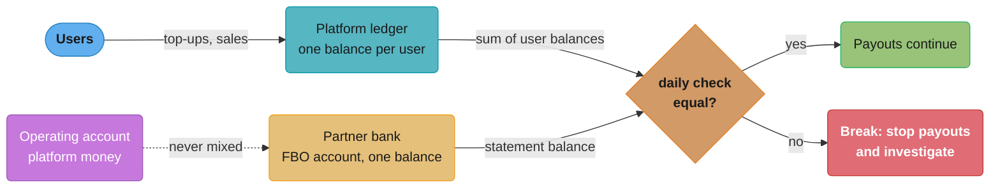
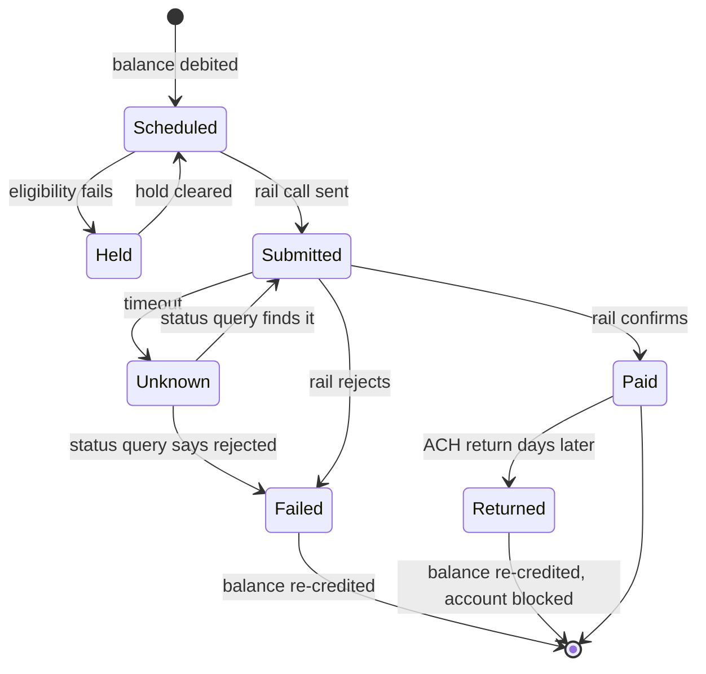

# Wallets, Stored Value and Payouts

> Rules and figures checked 2026-11-06. Every date, threshold and fee on this page comes from
> the fact pins in fintech/CLAUDE.md. This page is an engineering view as of that date, not
> legal advice, and covers the US, the EU, the UK, India and Brazil only.

---

## 1. Concept Overview

A wallet balance is a promise. When a user "adds $100" to an app, the app now owes the user
$100, and the cash sits in a bank account the app controls. The two numbers must agree every
day: what the platform owes its users, and the cash it holds for them. Most of this module is
about keeping those two numbers equal while money comes in, waits, gets reserved and goes out.

The topics:

- **Stored value.** Closed-loop value can be spent only with the issuer (a gift card, in-app
  credits, a ride-share balance). Open-loop value can be spent anywhere a network accepts it
  (a prepaid card on Visa or Mastercard). In the EU, stored value that is accepted by third
  parties is usually e-money, issued by an e-money institution (EMI) or a bank under EMD2.
- **Where the cash sits.** A US platform usually holds customer money in an FBO ("for benefit
  of") account at a partner bank, in its own name for its customers. An EU EMI or payment
  institution must safeguard customer funds under EMD2 and PSD2.
- **Licensing (one paragraph here).** Holding and moving other people's money in the US is
  money transmission, licensed state by state. CSBS reports that 31 states have enacted the
  Money Transmission Modernization Act in full or in part, as of September 2026. The licensing
  choice (own licence, partner bank, or a provider's licence) is a build-vs-buy decision,
  taught in [Build vs Buy and Licensing Strategy](../build_vs_buy_and_licensing_strategy/build_vs_buy_and_licensing_strategy.md).
- **Balances.** Pending, available and reserved, and rolling reserves for merchants.
- **Payout engines.** Schedules, batching, rail choice, push-to-card, bank-account checks and
  payout returns.
- **Marketplace splits, escheatment and tax reporting hooks.**

The wallet study designs peer-to-peer transfers, optimistic locking on the balance row and a
KYC tier table in [Design a Digital Wallet](../../hld/case_studies/design_digital_wallet.md).
This page links those and teaches the stored-value rules, the balance buckets and the payout
engine that study assumes.

---

## 2. Intuition

> **One-line analogy:** a wallet platform is a coat check. Each ticket says what the platform
> owes one guest. The coats are the cash in the bank. The business is fine only while every
> ticket has a coat behind it, and the counter can hand coats back the moment a guest asks.

**Mental model.** Every dollar a platform holds for users is in one of three places in the
ledger: on its way in (pending), free to spend or withdraw (available), or held back for a
known risk (reserved). Every dollar going out is a payout with a lifecycle that can end in
"paid" and then, days later, "returned". The cash at the bank must equal the sum of all the
user buckets, plus the platform's own money, every day.

**Why it matters.** When the two numbers drift, users lose money. The CFPB says Synapse's
partner banks held less than Synapse's records showed consumers were owed, a shortfall of
between $60 million and $90 million, and consumers had no access to funds for weeks or months.
A daily check of ledger against bank, per FBO account, is the control that finds drift while it
is small.

**Key insight.** The hard part of an instant payout is funding. Push-to-card and instant rails
already send money in seconds. The platform must have the money in the right account at 2 a.m.
on a Sunday, and must accept that the payout is final once sent.

---

## 3. Core Principles

1. **A balance is a liability.** The platform owes the user. The ledger records the
   obligation, and the bank statement proves the cash. Reconciliation finds the gaps between
   them.
2. **Customer money is not company money.** Keep it in FBO or safeguarding accounts, never in
   the operating account, and never use it to pay the platform's bills.
3. **Available is derived.** Available equals settled funds minus reserves minus pending
   debits. A balance row may cache it only when the transaction that posts the entries also
   updates the row. Never store a separate "available" number that can drift from the entries.
4. **Money in is not final.** A card top-up can be charged back, and an ACH top-up can be
   returned. Hold or limit funds for the return window of the rail that brought them.
5. **Money out is not final either, until it lands.** An ACH payout can be returned days
   later. An instant-rail payout is final for the sender. FedNow and RTP carry a request for
   return, but the receiver is not obliged to send the money back. Plan for a push-to-card
   payout in the same way, and run the risk check before either.
6. **Every payout has one reference and one row.** A retry, a resend or a rebuilt file reuses
   it.
7. **Rules differ by region.** EMD2 and PSD2 safeguarding in the EU, state money transmission
   in the US, and tax reporting thresholds are dated rules. Keep them as configuration.

---

## 4. Types / Architectures / Strategies

### 4.1 Closed loop, open loop and e-money

| Type | Where it can be spent | Examples | What it usually needs |
|---|---|---|---|
| Closed loop | Only with the issuer | Gift cards, in-app credits, game currency | Consumer protection and escheatment rules. Often outside money transmission, depending on the state |
| Open loop | Anywhere the network accepts it | Prepaid cards, payroll cards | An issuing bank or BIN sponsor, network rules |
| E-money (EU) | With third parties that accept it | EMI wallets, multi-currency accounts | An EMI licence, EMD2 safeguarding and redemption rules |
| Platform balance with payouts | Withdrawn to bank or card | Marketplace seller balances, gig earnings | Money transmission licensing (US) or a payment institution licence (EU), or a licensed provider |

### 4.2 FBO accounts and safeguarding

**US: FBO accounts.** The platform opens an account at a partner bank titled "Platform, FBO its
customers". The bank sees one account. The platform's ledger splits it into one sub-balance per
user. Two failure modes follow from that split:

- The ledger and the bank disagree, and nobody notices until a run on balances.
- A middleware provider keeps the per-user ledger, and the platform and the bank each trust it.
  When that provider fails, nobody can say who owns what. That is the Synapse case (§7).

**EU: EMD2.** An e-money institution safeguards the funds it receives for issued e-money.
Funds paid by a payment instrument are safeguarded once credited to the EMI, and in any case
within five business days of issuance (EMD2 Art. 7). E-money is issued and redeemed at par
value at any moment (Art. 11), and an EMI must not pay interest tied to how long the user
holds the e-money (Art. 12).

**EU: PSD2.** A payment institution safeguards user funds either by segregation or by
insurance (PSD2 Art. 10). Under segregation, funds are never commingled with the
institution's own money, and funds still held at the end of the business day after receipt
go to a separate account at a credit institution or into secure, liquid, low-risk assets,
insulated from other creditors in insolvency. Under insurance, an insurance policy or
comparable cover from an insurer or bank outside the institution's group protects the funds.

### 4.3 Balance buckets

| Bucket | Meaning | Moves to available when |
|---|---|---|
| Pending | Money credited but not yet settled or still inside a rail's risk window | Settlement, or the risk window closes |
| Available | Money the user can spend or withdraw | Never "moves". Payouts and transfers spend it |
| Reserved | Money held back against a known risk: disputes, refunds, a rolling reserve | The reserve's release date, or the risk closes |

Available is computed from entries, or cached in a row that the posting transaction updates:
settled credits minus settled debits minus active reserves minus pending debits. The
[double-entry ledger module](../double_entry_ledger_design/double_entry_ledger_design.md) owns
the balance models (derived, materialized in the same transaction, snapshot plus delta).

### 4.4 Rolling and fixed reserves

A platform that pays merchants or sellers before their buyers' money is final carries the risk
of refunds and chargebacks after the payout. A reserve keeps part of the money back.

- **Rolling reserve.** A percentage of each day's sales is held for a fixed number of days,
  then released. The reserve rolls forward with sales.
- **Fixed reserve.** A set amount is held for as long as the risk lasts, often for a
  high-risk merchant or after a spike in disputes.
- **Delayed payout.** Funds stay pending for a number of days before they become available.

The percentage and the hold period are risk decisions. The examples on this page use
illustrative values (10% for 90 days).

### 4.5 Payout engines

A payout engine turns available balances into money in recipients' accounts. Its parts:

1. **Schedule.** Daily, weekly, monthly, or on demand. A schedule picks which balances pay out
   and when.
2. **Eligibility.** KYC complete, bank account checked, no hold, no negative balance, balance
   above a minimum.
3. **Rail choice.** Standard ACH or SEPA credit, Same Day ACH, an instant rail, push-to-card,
   or a wire for large amounts. The matrix is in
   [Bank Rails §8](../bank_rails_ach_sepa_and_wires/bank_rails_ach_sepa_and_wires.md).
4. **Batching.** Group payouts by currency, rail and funding account, so one bank file or one
   API batch carries many payouts.
5. **Submission and tracking.** One row per payout with a rail reference, and a state machine
   that ends in paid, failed or returned.
6. **Returns.** A returned payout re-credits the recipient's balance with a new ledger entry,
   and blocks the bad account until the recipient fixes it.

**Push-to-card.** Visa Direct and Mastercard Move are the networks' push-payment and
money-movement products. Visa states that Visa Direct reaches 18 billion or more eligible
endpoints in 195 or more countries and territories, and that actual fund availability may
depend on the receiving financial institution. So the speed of a push-to-card payout depends on
the card and its issuer. Check eligibility when the user adds the card, and show the expected
time.

**Bank-account checks before the first payout.** Use a prenote, micro-deposits that the user
confirms, or an open-banking account check. Each cuts payouts that fail or return as "account
closed" or "no account".

### 4.6 Marketplace splits

A marketplace takes a buyer's payment and splits it between a seller and itself. Two models:

- **Split at capture.** The PSP divides the payment as it settles, and the seller's share goes
  to the seller's connected account. The marketplace's ledger records the split.
- **Split at payout.** The full payment lands in the platform's balance, the ledger allocates
  it, and the payout engine pays the seller's share later.

Who is the merchant of record decides who carries chargebacks and tax duties. The
[PSPs, acquirers, issuers and networks module](../psps_acquirers_issuers_and_networks/psps_acquirers_issuers_and_networks.md)
owns the MoR and PayFac roles. Allocation of a total across parties without losing a cent is
in [Money Representation and Currency](../money_representation_and_currency/money_representation_and_currency.md).

### 4.7 Escheatment and tax reporting hooks

**Escheatment.** In the US, a balance that stays dormant for a period that each state sets
becomes unclaimed property. The holder tries to contact the owner, then reports and remits
the money to the state of the owner's last known address. The wallet needs: a last-activity
date per balance, a dormancy rule per state, an outreach record, and a ledger entry that moves
the balance to an "escheated" liability account when it is remitted.

**Form 1099-K.** A third party settlement organization files Form 1099-K for a payee only when
gross payments to that payee exceed $20,000 and transactions exceed 200. The One, Big,
Beautiful Bill restored that threshold retroactively (IRS IR-2025-107, 2025-10-23). The payout
engine must count both per payee and per year. The
[tax module](../tax_for_payment_engineers/tax_for_payment_engineers.md) owns the details.

---

## 5. Architecture Diagrams

### 5.1 Who holds what in an FBO structure



The bank knows one number. The platform knows a number per user. The daily check is the only
place the two meet.

### 5.2 Payout lifecycle



"Paid" is not the last state for a payout on a rail with returns. The re-credit on `Failed` and
`Returned` is a new ledger entry, never an edit of the original debit.

### 5.3 Balance buckets for one seller

```
Seller balance on 2026-11-06 (amounts in USD, illustrative)

pending    |#######                         |   700   card sales not yet settled
reserved   |##########                      | 1,000   10% rolling reserve, 90 days
available  |##############################  | 3,000   can pay out today
           +--------------------------------+
ledger total                                  4,700

payout today = available = 3,000, not 4,700
```

A payout engine that pays the ledger total sends money that may still come back as a refund or
a chargeback.

---

## 6. How It Works - Detailed Mechanics

### 6.1 Balances and a guarded payout in SQL

The balance row keeps the three buckets, and a `CHECK` stops available from going negative.
The row is a cache: the transaction that posts each journal entry also updates it. A payout
debits available with a conditional `UPDATE`, so two payouts racing on the same balance cannot
both succeed.

```sql
CREATE TABLE wallet_balance (
    user_id         bigint PRIMARY KEY,
    currency        char(3) NOT NULL,
    pending_cents   bigint  NOT NULL DEFAULT 0 CHECK (pending_cents >= 0),
    reserved_cents  bigint  NOT NULL DEFAULT 0 CHECK (reserved_cents >= 0),
    available_cents bigint  NOT NULL DEFAULT 0 CHECK (available_cents >= 0)
);

CREATE TABLE payout (
    id           bigint GENERATED ALWAYS AS IDENTITY PRIMARY KEY,
    user_id      bigint NOT NULL REFERENCES wallet_balance (user_id),
    amount_cents bigint NOT NULL CHECK (amount_cents > 0),
    rail         text   NOT NULL CHECK (rail IN ('ach', 'same_day_ach', 'instant', 'card_push', 'wire')),
    state        text   NOT NULL CHECK (state IN ('scheduled', 'submitted', 'unknown', 'paid', 'failed', 'returned')),
    rail_ref     text UNIQUE
);

INSERT INTO wallet_balance VALUES (42, 'USD', 70000, 100000, 300000);

-- payout: debit available only if enough is there, in the same statement
WITH debit AS (
    UPDATE wallet_balance
    SET    available_cents = available_cents - 250000
    WHERE  user_id = 42 AND available_cents >= 250000
    RETURNING user_id
)
INSERT INTO payout (user_id, amount_cents, rail, state)
SELECT user_id, 250000, 'ach', 'scheduled' FROM debit;

-- a second payout of the same size finds too little and creates nothing
WITH debit AS (
    UPDATE wallet_balance
    SET    available_cents = available_cents - 250000
    WHERE  user_id = 42 AND available_cents >= 250000
    RETURNING user_id
)
INSERT INTO payout (user_id, amount_cents, rail, state)
SELECT user_id, 250000, 'ach', 'scheduled' FROM debit;

DO $$
BEGIN
    ASSERT (SELECT count(*) FROM payout WHERE user_id = 42) = 1, 'one payout only';
    ASSERT (SELECT available_cents FROM wallet_balance WHERE user_id = 42) = 50000, 'available 500.00';
END $$;
```

The real system also posts a journal entry for each payout (debit the user's balance account,
credit a payouts-in-flight account). The row-level guard is the second line of defence after
the ledger's own invariants.

### 6.2 Daily safeguarding check

The check compares the sum of what the platform owes users with the bank balance of the FBO or
safeguarding account, per currency and per account. A shortfall is a stop-the-line event.

```sql
CREATE TABLE fbo_statement (
    account_id    text   NOT NULL,
    currency      char(3) NOT NULL,
    as_of         date   NOT NULL,
    closing_cents bigint NOT NULL,
    PRIMARY KEY (account_id, as_of)
);

INSERT INTO wallet_balance VALUES (43, 'USD', 0, 0, 120000), (44, 'USD', 25000, 0, 80000);
INSERT INTO fbo_statement VALUES ('FBO-US-1', 'USD', '2026-11-05', 700000);

WITH owed AS (
    SELECT currency, sum(pending_cents + reserved_cents + available_cents) AS cents
    FROM   wallet_balance GROUP BY currency
), in_flight AS (
    SELECT w.currency, coalesce(sum(p.amount_cents), 0) AS cents
    FROM   payout p JOIN wallet_balance w USING (user_id)
    WHERE  p.state IN ('scheduled', 'submitted', 'unknown')
    GROUP  BY w.currency
)
SELECT s.account_id,
       s.closing_cents                                 AS bank_cents,
       o.cents                                         AS owed_cents,
       f.cents                                         AS in_flight_cents,
       s.closing_cents - o.cents - f.cents             AS unexplained_cents
FROM   fbo_statement s
JOIN   owed o      ON o.currency = s.currency
JOIN   in_flight f ON f.currency = s.currency
WHERE  s.as_of = DATE '2026-11-05';
```

The query reports a bank balance of 700,000, 445,000 owed to users, 250,000 in payouts that
left the balances but not yet the bank (the payout from §6.1), and an unexplained difference of
5,000 cents. That 50.00 is a break to investigate before the next payout run. A real check also
adds top-ups in flight and the platform's own funds in the account. The
[reconciliation module](../reconciliation_and_settlement_files/reconciliation_and_settlement_files.md)
owns matching and break handling.

### 6.3 Rolling reserve schedule

```java
import java.time.LocalDate;
import java.util.Map;
import java.util.TreeMap;

public class RollingReserve {
    record Rule(int percent, int holdDays) {}

    static Map<LocalDate, Long> releaseSchedule(Map<LocalDate, Long> dailySalesCents, Rule rule) {
        Map<LocalDate, Long> releases = new TreeMap<>();
        dailySalesCents.forEach((day, sales) -> {
            long held = Math.multiplyExact(sales, rule.percent()) / 100;
            releases.merge(day.plusDays(rule.holdDays()), held, Long::sum);
        });
        return releases;
    }

    static long heldOn(Map<LocalDate, Long> dailySalesCents, Rule rule, LocalDate on) {
        long held = 0;
        for (var e : dailySalesCents.entrySet()) {
            LocalDate start = e.getKey();
            if (!on.isBefore(start) && on.isBefore(start.plusDays(rule.holdDays()))) {
                held += Math.multiplyExact(e.getValue(), rule.percent()) / 100;
            }
        }
        return held;
    }

    public static void main(String[] args) {
        Rule rule = new Rule(10, 90);                                  // illustrative
        Map<LocalDate, Long> sales = new TreeMap<>(Map.of(
                LocalDate.of(2026, 8, 1), 1_000_000L,
                LocalDate.of(2026, 9, 1), 2_000_000L));
        System.out.println(releaseSchedule(sales, rule));
        assert heldOn(sales, rule, LocalDate.of(2026, 9, 15)) == 300_000L;
        assert heldOn(sales, rule, LocalDate.of(2026, 10, 30)) == 200_000L;   // first tranche released
    }
}
```

The program prints `{2026-10-30=100000, 2026-11-30=200000}`: each day's reserve releases 90 days
later. The release is a ledger entry from the reserve account to the seller's available
account, run by a scheduled job that is safe to run twice.

### 6.4 Batching payouts

```java
import java.util.List;
import java.util.Map;
import java.util.TreeMap;
import java.util.stream.Collectors;

public class PayoutBatcher {
    record Payout(long id, String currency, String rail, long amountCents) {}
    record BatchKey(String currency, String rail) implements Comparable<BatchKey> {
        public int compareTo(BatchKey o) { return (currency + rail).compareTo(o.currency + o.rail); }
    }
    record Batch(BatchKey key, int count, long totalCents) {}

    static List<Batch> batch(List<Payout> payouts) {
        Map<BatchKey, List<Payout>> groups = payouts.stream().collect(Collectors.groupingBy(
                p -> new BatchKey(p.currency(), p.rail()), TreeMap::new, Collectors.toList()));
        return groups.entrySet().stream()
                .map(e -> new Batch(e.getKey(), e.getValue().size(),
                        e.getValue().stream().mapToLong(Payout::amountCents).sum()))
                .toList();
    }

    public static void main(String[] args) {
        List<Batch> b = batch(List.of(
                new Payout(1, "USD", "ach", 31_000), new Payout(2, "USD", "ach", 54_000),
                new Payout(3, "EUR", "sepa", 12_000), new Payout(4, "USD", "card_push", 9_900)));
        b.forEach(System.out::println);
        assert b.size() == 3;
        assert b.stream().filter(x -> x.key().rail().equals("ach")).findFirst().orElseThrow().totalCents() == 85_000;
    }
}
```

Each batch carries control totals (count and sum). The bank or provider returns the same totals,
and a mismatch stops the batch before the next one goes.

### 6.5 Handling a payout return

When an ACH payout comes back as returned, the engine:

1. Matches the return to the payout by trace number.
2. Moves the payout to `returned`.
3. Posts a new journal entry that credits the user's available balance and debits the
   payouts-in-flight or bank account.
4. Marks the bank account as failed, so the next payout waits for the user to fix it.
5. Tells the user, with the return reason in plain words.

If the user already has a negative balance from a chargeback, the returned amount first covers
that. The [disputes module](../disputes_chargebacks_and_refunds/disputes_chargebacks_and_refunds.md)
owns the chargeback side.

---

## 7. Real-World Examples

**Synapse.** Synapse was a middleware provider between fintech apps and partner banks. The
CFPB says the partner banks held less than Synapse's records showed consumers were owed, a
shortfall of between $60 million and $90 million. Consumers had no access to funds for weeks or
months, and many did not get their full balance. The CFPB filed in the US Bankruptcy Court for
the Central District of California, and the court entered a stipulated final judgment on
2025-09-12 with a $1 civil money penalty, which opens the CFPB's Civil Penalty Fund. The CFPB
has allocated $55,214,058 from that fund to harmed consumers. The engineering lesson: the
per-user ledger behind an FBO account is the only record of who owns the money, so the bank,
the provider and the platform must each be able to check it daily.

**State money transmission.** CSBS reports that 31 states have enacted the Money Transmission
Modernization Act in full or in part, as of September 2026. A platform that holds and moves
user money in many states either holds licences, or uses a bank or licensed provider, and its
design must show which party holds the money at each step.

**EU e-money.** EMD2 requires par redemption at any moment and bans interest tied to holding
time. A product that "pays interest on your wallet balance" in the EU is not plain e-money. It
needs a different structure, for example a deposit at a bank.

**Push-to-card payouts.** Visa Direct and Mastercard Move are the products behind many
"instant cash out" buttons. The wallet study's Venmo and Cash App rows show the standard vs
instant tiers in
[Design a Digital Wallet §6](../../hld/case_studies/design_digital_wallet.md).

**Tax reporting.** The restored Form 1099-K threshold (over $20,000 and over 200 transactions)
decides which sellers get a form, so the counter behind it runs on every payout.

---

## 8. Tradeoffs

### 8.1 Instant vs standard payout

| Factor | Instant payout (instant rail or push-to-card) | Standard payout (ACH or SEPA credit) |
|---|---|---|
| Time to recipient | Seconds to minutes | One or more banking days |
| Cost per payout | Higher, often passed on as a recipient fee (illustrative: a percentage with a minimum) | Low or free |
| Funding | Prefunded balance that covers nights and weekends | Funded from daily settlement |
| Fraud window | None: final for the sender. Checks run before | Days to catch fraud before money lands |
| Failure mode | Card or bank not eligible, which shows at once | Return days later, after "paid" |
| Reach | Eligible cards, or banks on the instant network | Almost every bank account |
| When it wins | Gig earnings, sellers who need cash now, claims | Scheduled payouts, low-margin flows |

### 8.2 Prefund vs post-fund

| | Prefund | Post-fund |
|---|---|---|
| How it works | The platform moves money to the payout provider or settlement account before payouts | The provider pays out first and collects from the platform afterwards |
| Who takes credit risk | The platform, on the provider that holds the prefunded money | The provider, on the platform |
| Cash cost to the platform | Cash tied up in the prefunded balance | Cash stays with the platform until settlement |
| What it needs | A forecast and a top-up process, including weekends | Credit approval, a limit, and often collateral |
| Failure mode | Balance runs dry and payouts stop | Limit reached and payouts stop, or the platform fails to settle |
| When it wins | New platforms, instant payouts, 24x7 rails | Large platforms with strong credit and steady volume |

The [treasury module](../treasury_liquidity_and_fx_operations/treasury_liquidity_and_fx_operations.md)
owns the sizing of a prefund and the choice of a credit line.

### 8.3 Split at capture vs split at payout

| | Split at capture | Split at payout |
|---|---|---|
| Where the seller's share sits | In the seller's connected account at the PSP | In the platform's balance |
| Flexibility | Low: the split is fixed when the payment settles | High: fees, adjustments and holds before payout |
| Licensing exposure | Lower: the PSP holds and moves seller money | Higher: the platform holds seller money |
| Reconciliation | Per payment, at the PSP | Platform ledger against bank, per payout |

---

## 9. When to Use / When NOT to Use

**Use a stored-value balance when:**
- Users move money inside your product often, and a ledger transfer is cheaper and faster than
  a rail payment each time.
- You have a licence, a partner bank or a licensed provider that holds the money, and a daily
  check of ledger against bank.

**Do not use a stored-value balance when:**
- Money only passes through. A direct payout from settlement, or a PSP split, avoids holding
  customer funds at all.
- You cannot run a daily safeguarding check. Without it, drift grows silently.

**Use instant payouts when:**
- Recipients value speed enough to pay a fee or to stay on your platform for it.
- You can prefund for weekends and run fraud checks before the payout.

**Do not use instant payouts when:**
- Most recipients are new and unverified. The payout is final for the sender, so a fraud ring
  cashes out in minutes.
- Your margin cannot carry the per-payout cost, and recipients will not pay a fee.

**Use a rolling reserve when:**
- Sellers are paid before buyers' money is final, and refunds or chargebacks can arrive later.

**Do not use a reserve as a fix for:**
- Missing fraud controls at onboarding. A reserve limits the loss. It does not stop it.

---

## 10. Common Pitfalls

### 10.1 Paying out pending funds

An illustrative case: a marketplace pays sellers from the ledger total. Fraudulent buyers use
stolen cards, the sellers (part of the same ring) cash out the next morning, and the
chargebacks arrive three weeks later against an empty balance.

```java
// BROKEN
public class PayoutAmountBroken {
    record Balance(long settledCents, long pendingCents, long reservedCents) {}

    static long payable(Balance b) {
        return b.settledCents() + b.pendingCents();      // ledger total
    }

    public static void main(String[] args) {
        Balance b = new Balance(400_000, 70_000, 100_000);
        System.out.println(payable(b));
        // prints 470000: the ledger total, with 700.00 of pending sales and the 1,000.00 reserve
    }
}
```

The fix pays only available: settled minus reserved. Pending stays until it settles and its
risk window passes.

```java
// FIX
public class PayoutAmount {
    record Balance(long settledCents, long pendingCents, long reservedCents) {}

    static long payable(Balance b) {
        return Math.max(0, b.settledCents() - b.reservedCents());
    }

    public static void main(String[] args) {
        Balance b = new Balance(400_000, 70_000, 100_000);
        long p = payable(b);
        System.out.println(p);
        assert p == 300_000;
        assert payable(new Balance(50_000, 0, 100_000)) == 0;
    }
}
```

### 10.2 Marking a payout final at "paid"

A payout service deletes the payout row's tracking job when the ACH file is accepted. Three
days later a return arrives for a closed account, and nothing re-credits the seller. The
money sits unexplained in the FBO account. Keep payouts open until the rail's return window
passes, and post the re-credit as a new entry.

### 10.3 Commingling customer money

A start-up pays a vendor invoice from the FBO account "for a day" because the operating account
is short. The daily check now shows a shortfall, and the platform is in breach of its bank
agreement and, in the EU, of the safeguarding rules. Give the operating and customer accounts
different payment permissions, and block payouts from the FBO account to anyone but users.

### 10.4 A ledger the platform cannot see

A platform relies on a middleware provider's ledger for per-user balances and never pulls the
data. When the provider fails, the platform cannot tell users or the bank who owns what. Keep
your own copy of every user's balance and every movement, and reconcile it with the bank and
the provider daily.

### 10.5 Retrying a payout with a new reference

The payout job times out on a push-to-card call and retries with a new idempotency key. Both
calls succeed. Create the payout's reference once, store it, and resolve a timeout by
querying the provider, as the
[idempotency module](../idempotency_and_exactly_once_money_movement/idempotency_and_exactly_once_money_movement.md)
teaches.

### 10.6 Forgetting dormant balances

A wallet that never reaches dormancy rules holds old balances indefinitely as its own money.
States audit unclaimed property, and the platform owes the balances plus penalties. Track the
last activity per balance, and run escheatment as a scheduled process with outreach records.

---

## 11. Technologies & Tools

| Tool | What it does for wallets and payouts |
|---|---|
| Visa Direct | Visa's push-payment product for payouts to eligible cards and accounts |
| Mastercard Move | Mastercard's portfolio of domestic and cross-border money movement |
| Stripe Connect | Platform accounts for marketplaces: onboarding, split payments and payouts to connected accounts |
| Adyen for Platforms | Marketplace onboarding, balance accounts, split payments and payouts |
| Modern Treasury | Payment operations over bank connections, with ledgers and reconciliation for payouts |
| TigerBeetle | Double-entry accounting database with pending and posted transfers for balance holds |

---

## 12. Interview Questions with Answers

**Q: Is a user's wallet balance money in a bank account?**
**Short:** No. It is the platform's liability to the user, backed by cash in an FBO or safeguarding account that must equal the sum of all user balances.

The bank usually sees one account for all users. Only the platform's ledger splits it per user.
If the ledger and the bank drift apart, users lose money when they withdraw. Run a daily check
of total user balances, plus funds in flight, against the bank balance of each account, and stop
payouts on an unexplained difference.

**Q: What went wrong at Synapse, in engineering terms?**
**Short:** The CFPB says partner banks held $60 million to $90 million less than Synapse's records showed consumers were owed, so the per-user ledger and the bank cash did not match.

Consumers had no access to funds for weeks or months, and many did not get their full balance.
The court entered a stipulated judgment on 2025-09-12 with a $1 penalty, which let the CFPB
allocate $55,214,058 from its Civil Penalty Fund. The design lesson: every party that relies on
a per-user ledger must hold a copy and check it against bank balances daily.

**Q: How must an EU e-money institution safeguard customer funds?**
**Short:** It safeguards funds received for issued e-money, and funds paid by a payment instrument are safeguarded once credited and in any case within five business days of issuance.

EMD2 Art. 7 points to the PSD safeguarding methods: segregation or insurance. Under
segregation, the funds are never commingled and are insulated from other creditors in
insolvency. Design the accounts so customer funds land in the safeguarding account, and track
the days between issuance and safeguarding.

**Q: Can an EU e-money wallet pay interest on balances?**
**Short:** No. EMD2 bans interest tied to how long the user holds e-money, and requires issuance and redemption at par value at any moment.

Par redemption means the user can get the full nominal value back whenever they ask, which
rules out lock-ups and discounts on redemption. A product that wants to pay a yield needs a
different structure, such as a deposit at a bank. Check these rules before a product team
designs a "savings wallet".

**Q: What are the two safeguarding methods under PSD2 for a payment institution?**
**Short:** Segregation, where funds stay apart and go to a separate account or safe liquid assets by the end of the next business day, or insurance from a firm outside the group.

Under segregation, funds still held at the end of the business day after receipt go to a
separate account at a credit institution or into secure, liquid, low-risk assets. Under
insurance, an insurance policy or comparable cover from an insurer or bank outside the
payment institution's group protects them. Either way, the ledger must show which funds are
covered at all times.

**Q: What is the difference between closed-loop and open-loop stored value?**
**Short:** Closed-loop value is spent only with the issuer, like a gift card or in-app credit, while open-loop value is spent anywhere a payment network accepts it.

Open-loop products run on a card network through an issuing bank or BIN sponsor. Closed-loop
products avoid the network but still face consumer and escheatment rules. In the EU, value
accepted by third parties is usually e-money. The type decides the licence, so settle it
before you design the ledger.

**Q: How do pending, available and reserved balances differ?**
**Short:** Pending money has not settled or is still in a risk window, reserved money is held for a known risk, and only available money can be spent or paid out.

Available is derived: settled credits minus settled debits minus reserves minus pending debits.
Storing it as an independent number lets it drift. The payout engine reads available only. Each
bucket change is a journal entry, so the history explains every number.

**Q: What is a rolling reserve, and how is it different from a delayed payout?**
**Short:** A rolling reserve holds a share of each day's sales for a fixed period and then releases it, while a delayed payout keeps the full amount pending for a number of days.

A reserve covers refunds and chargebacks that arrive after payout, and it scales with sales.
A delay is simpler and stricter. A fixed reserve holds a set amount for as long as a risk lasts.
Run releases as an idempotent scheduled job that posts one entry per release date.

**Q: How do you decide between instant and standard payouts?**
**Short:** Weigh the recipient's need for speed and willingness to pay a fee against the platform's cost, the prefunding it needs and the finality of an instant payout.

Instant payouts on push-to-card or instant rails land in seconds to minutes and are final for
the sender, so fraud checks must run before them and the funding account must cover
weekends. Standard payouts cost little and give days to catch fraud, but returns can arrive
after "paid". Many platforms offer both and charge a fee for instant.

**Q: What is the difference between prefunding and post-funding a payout provider?**
**Short:** With prefunding, the platform moves the money before payouts go out. With post-funding, the provider pays first and collects later, so it takes credit risk on the platform.

Prefunding ties up cash and needs a forecast that covers nights and weekends. Post-funding
keeps cash with the platform but needs credit approval, a limit and often collateral. New
platforms usually prefund. Large platforms with steady volume negotiate post-funding.

**Q: How does a push-to-card payout work, and what can fail?**
**Short:** The payout provider sends a credit through Visa Direct or Mastercard Move to an eligible card, and Visa says actual fund availability may depend on the receiving institution.

Visa states that Visa Direct reaches 18 billion or more eligible endpoints in 195 or more
countries and territories, and that actual fund availability may depend on the receiving
financial institution. Check eligibility when the user adds the card, and reject an
ineligible card before the first payout. Plan as if a push-to-card credit cannot be pulled
back, so the risk check runs before it.

**Q: What should happen when an ACH payout comes back as returned?**
**Short:** Match the return by trace number, move the payout to returned, post a new entry that re-credits the user, and block the bank account until the user fixes it.

The return can arrive days after the payout showed "paid", so payouts stay open until the
return window passes. If the user has a negative balance from a chargeback, the re-credit
covers that first. Tell the user the reason in plain words, and do not retry to the same
account automatically.

**Q: How do you check a bank account before the first payout?**
**Short:** Use a prenote, micro-deposits that the user confirms, or an open-banking account check, so the first payout does not fail or return for a wrong account.

A prenote tests the routing and account number. Micro-deposits and open-banking checks also
show the user controls the account, which stops payouts to a fraudster's account. Run the
check again when the user changes the account, and hold the first payout to a changed account.

**Q: Why does US money transmission licensing matter to a wallet design?**
**Short:** Holding and moving users' money is money transmission, licensed state by state, so the design must show which licensed party holds the money at every step.

CSBS reports that 31 states have enacted the Money Transmission Modernization Act in full or in
part, as of September 2026, which makes rules more uniform but does not remove state licences.
A platform holds licences itself, partners with a bank, or uses a licensed provider. The choice
is in the build vs buy module.

**Q: When does a payout platform file Form 1099-K for a payee?**
**Short:** A third party settlement organization files only when gross payments to the payee exceed $20,000 and the number of transactions exceeds 200 in the year.

The One, Big, Beautiful Bill restored this threshold retroactively, and the IRS confirmed it in
IR-2025-107 on 2025-10-23. Both conditions must hold. Count gross payments and transactions per
payee per year in the payout engine, and keep the tax identity data that the form needs.

**Q: What is escheatment, and what does a wallet need for it?**
**Short:** Escheatment is the transfer of dormant balances to a state as unclaimed property, so the wallet tracks last activity, applies each state's dormancy rule and remits balances.

Each US state sets its own dormancy period and reporting rules. Before remitting, the holder
tries to contact the owner. In the ledger, remittance moves the balance to an escheated
liability account with a record of the outreach. Run it as a scheduled process.

**Q: Where should a marketplace split a buyer's payment between seller and platform?**
**Short:** Split at capture through the PSP to keep seller money off the platform's books, or split at payout for flexibility, at the cost of holding seller money.

Split at capture lowers licensing exposure and moves reconciliation to the PSP. Split at
payout lets the platform apply fees, holds and adjustments before paying the seller. The merchant
of record carries chargebacks and tax duties either way, so decide the MoR before the split.

**Q: How do you stop two payouts from spending the same available balance?**
**Short:** Debit available with a conditional update that requires enough balance in the same statement, and back it with a constraint that available cannot go negative.

Two concurrent requests that each read the balance first and then write can both pass the
check. A single `UPDATE ... WHERE available >= amount` lets only one succeed. The ledger's own
invariants are the next line of defence, and the daily safeguarding check is the last.

---

## 13. Best Practices

1. Derive available from entries. Never store it as an independent number.
2. Keep customer money in FBO or safeguarding accounts, with payment permissions that block any
   transfer except to users.
3. Run a daily check of total user balances plus funds in flight against each bank account, and
   stop payouts on an unexplained difference.
4. Keep your own copy of every per-user balance and movement, even when a provider runs a
   ledger.
5. Pay out available only, and hold pending funds for the inbound rail's risk window.
6. Give each payout one row, one reference and a state machine that includes returns.
7. Check a bank account or card before the first payout, and again after any change.
8. Prefund instant payouts for nights and weekends, with an alert at a floor.
9. Count 1099-K gross payments and transactions per payee per year.
10. Run escheatment and reserve releases as idempotent scheduled jobs.

---

## 14. Case Study

**Scenario.** A gig-work platform pays 220,000 couriers (assumption). Earnings land in each
courier's balance after each delivery. Couriers can cash out once a day for free by standard
ACH, or any time by push-to-card for a fee. The platform holds courier money in an FBO account
at a partner bank and prefunds a push-to-card provider.

**Design decisions.**

| Decision | Choice | Reason |
|---|---|---|
| Balance model | Pending until the delivery's customer payment settles, then available | Card payments from customers can fail or be disputed |
| Instant payout limit | Per courier per day, illustrative $500 for couriers under 30 days old | No recall on push-to-card |
| Prefund | Friday top-up sized to the forecast weekend outflow plus a buffer | The provider stops at a zero balance |
| Daily check | Ledger total plus in-flight payouts vs FBO statement | Finds drift while it is small |

**The incident.** Couriers double-tapped "cash out" on a slow network. The mobile app sent two
requests, and the payout service read the available balance twice before either write
committed. Both payouts went out, and some couriers ended with negative balances that the
platform had to recover from future earnings (illustrative: 1,900 couriers in one evening).

```sql
-- BROKEN
CREATE TABLE courier_balance_broken (courier_id bigint PRIMARY KEY, available_cents bigint NOT NULL);
INSERT INTO courier_balance_broken VALUES (7, 15000);

-- two requests each read 15000, decide "enough", then write
UPDATE courier_balance_broken SET available_cents = available_cents - 12000 WHERE courier_id = 7;
UPDATE courier_balance_broken SET available_cents = available_cents - 12000 WHERE courier_id = 7;

SELECT available_cents FROM courier_balance_broken WHERE courier_id = 7;
-- -9000: both cash-outs succeeded against a 150.00 balance
```

The fix puts the balance test inside the write, makes the payout row unique per client request,
and adds a constraint as a backstop.

```sql
CREATE TABLE courier_balance (
    courier_id      bigint PRIMARY KEY,
    available_cents bigint NOT NULL CHECK (available_cents >= 0)
);
CREATE TABLE courier_payout (
    request_id   uuid   PRIMARY KEY,
    courier_id   bigint NOT NULL REFERENCES courier_balance (courier_id),
    amount_cents bigint NOT NULL CHECK (amount_cents > 0)
);
INSERT INTO courier_balance VALUES (7, 15000), (8, 30000);

-- each tap runs this once, with the request_id the app made for that tap
WITH debit AS (
    UPDATE courier_balance SET available_cents = available_cents - 12000
    WHERE  courier_id = 7 AND available_cents >= 12000
    RETURNING courier_id
)
INSERT INTO courier_payout SELECT '6f1d0c1e-8a0b-4b7e-9d55-1f0a2b3c4d5e', courier_id, 12000 FROM debit;

-- a second tap with a new id finds too little balance and creates nothing
WITH debit AS (
    UPDATE courier_balance SET available_cents = available_cents - 12000
    WHERE  courier_id = 7 AND available_cents >= 12000
    RETURNING courier_id
)
INSERT INTO courier_payout SELECT '0b9e7c4a-3d2f-4e1a-8c6b-5a4f3e2d1c0b', courier_id, 12000 FROM debit;

-- courier 8 has enough for two cash-outs, and the app resends the same id
WITH debit AS (
    UPDATE courier_balance SET available_cents = available_cents - 12000
    WHERE  courier_id = 8 AND available_cents >= 12000
    RETURNING courier_id
)
INSERT INTO courier_payout SELECT 'c3a19e2b-7d4f-4c8a-b1e6-2f9d8c7b6a50', courier_id, 12000 FROM debit;

DO $$
BEGIN
    WITH debit AS (
        UPDATE courier_balance SET available_cents = available_cents - 12000
        WHERE  courier_id = 8 AND available_cents >= 12000
        RETURNING courier_id
    )
    INSERT INTO courier_payout SELECT 'c3a19e2b-7d4f-4c8a-b1e6-2f9d8c7b6a50', courier_id, 12000 FROM debit;
EXCEPTION WHEN unique_violation THEN
    RAISE NOTICE 'duplicate request: the debit rolled back with the insert';
END $$;

DO $$
BEGIN
    ASSERT (SELECT available_cents FROM courier_balance WHERE courier_id = 7) = 3000, 'one cash-out';
    ASSERT (SELECT available_cents FROM courier_balance WHERE courier_id = 8) = 18000, 'resend debits nothing';
    ASSERT (SELECT count(*) FROM courier_payout) = 2, 'one payout row per request';
END $$;
```

A double tap resends the same `request_id`. Its insert fails on the primary key, and the error
rolls back the debit in the same statement. The service catches the error and returns the
first payout. Do not add `ON CONFLICT (request_id) DO NOTHING` to this statement: PostgreSQL
runs a data-modifying `WITH` to completion even when the outer insert skips the row, so the
balance drops and no payout row records it. A request with a new id finds too little balance
and creates nothing.

**Outcome (illustrative).** Negative balances from double cash-outs dropped to zero. The daily
FBO check, which had flagged the evening as a 2.1% shortfall against the ledger's expected
outflow, returned to a zero unexplained difference, and the team added an alert on any
negative available balance.
