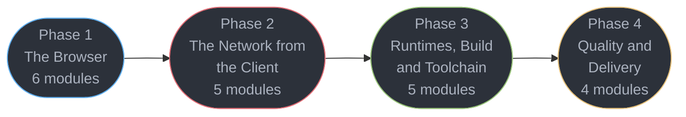

# Frontend Platform — Senior Engineer & Interview Prep Guide

The platform half of the front-end track: the browser, the network seen from the client,
the runtimes, the build pipeline, and the quality gates. The language lives in
[../typescript/](../typescript/README.md); the library lives in [../react/](../react/README.md).

This section exists because the rest of this repository already teaches the *server* half of
every front-end concern and none of the client half. CORS is deep in `fastapi/` and
`spring/` — as server configuration. WebSocket framing is thorough in `backend/` — from the
server. Asset caching is thorough in `hld/cdn/` — from the CDN. **What was missing is every
one of those concerns seen from the browser**, plus the platform a front-end engineer
actually ships onto.

> **No runnable application** — all content is Markdown with runnable-shaped TypeScript, JavaScript and CSS blocks.

---

## 1. Section Overview

This section covers:

- **The browser** — JavaScript language semantics, the multi-process architecture and the
  critical rendering path, the DOM and its event model, CSS layout and the cascade,
  animation and motion, and the event loop that schedules all of it
- **The network from the client** — `fetch` and the browser HTTP cache, the same-origin
  model and preflight *as the browser performs it*, the client threat model, browser auth,
  and realtime transports
- **Runtimes, build and toolchain** — client memory and leak debugging, the Node and edge
  runtimes, bundling, package management and the JavaScript supply chain, and linting
- **Quality and delivery** — Core Web Vitals, accessibility, service workers and offline,
  and shipping a front-end with observability that survives contact with production

**Nothing here is React-specific.** Every technique applies to a React app, a Vue app, or
the 578KB of dependency-free vanilla JavaScript that powers this repository's own learning
game — which is used throughout as a worked example of the platform without a framework.

---

## 2. Module Table

| # | Module Directory | Phase | Difficulty | Key Topics |
|---|-----------------|-------|-----------|-----------|
| 1 | [javascript_language_semantics](javascript_language_semantics/javascript_language_semantics.md) | 1 — The Browser | Intermediate | Prototypes, closures, `this` binding, coercion, iterators/generators, `Proxy`/`Reflect`/`Symbol`/`WeakRef`, ESM live bindings |
| 2 | [browser_architecture_and_the_rendering_pipeline](browser_architecture_and_the_rendering_pipeline/browser_architecture_and_the_rendering_pipeline.md) | 1 — The Browser | Advanced | Multi-process, site isolation, parse to style to layout to paint to composite, reflow vs repaint, forced synchronous layout |
| 3 | [the_dom_and_web_apis](the_dom_and_web_apis/the_dom_and_web_apis.md) | 1 — The Browser | Intermediate | DOM as tree and API, capture/bubble/delegation, passive listeners, the three observers, custom elements, shadow DOM |
| 4 | [css_layout_and_the_cascade](css_layout_and_the_cascade/css_layout_and_the_cascade.md) | 1 — The Browser | Intermediate | Box model, flexbox vs grid, specificity, cascade layers, container queries, logical properties and RTL, stacking contexts |
| 5 | [css_animation_and_motion](css_animation_and_motion/css_animation_and_motion.md) | 1 — The Browser | Intermediate | Compositor-only properties, FLIP, Web Animations API, the View Transitions API, scroll-driven animation, `prefers-reduced-motion` |
| 6 | [the_event_loop_and_scheduling](the_event_loop_and_scheduling/the_event_loop_and_scheduling.md) | 1 — The Browser | Advanced | Tasks vs microtasks, `requestAnimationFrame`, `requestIdleCallback`, long tasks, `scheduler.yield`, Web Workers |
| 7 | [http_in_the_browser_and_fetch](http_in_the_browser_and_fetch/http_in_the_browser_and_fetch.md) | 2 — Network from the Client | Intermediate | `fetch`, streams, `AbortController`, retry and timeout, the browser HTTP cache, ETag, HTTP/2 and HTTP/3 request strategy |
| 8 | [cors_cookies_and_the_same_origin_model](cors_cookies_and_the_same_origin_model/cors_cookies_and_the_same_origin_model.md) | 2 — Network from the Client | Advanced | Same-origin policy, preflight from the browser side, `credentials`, opaque responses, `SameSite`, partitioned cookies |
| 9 | [browser_security_and_the_client_threat_model](browser_security_and_the_client_threat_model/browser_security_and_the_client_threat_model.md) | 2 — Network from the Client | Advanced | XSS sinks, CSP and nonces, Trusted Types, SRI, prototype pollution, `postMessage`, build-time env leaks |
| 10 | [auth_in_the_browser](auth_in_the_browser/auth_in_the_browser.md) | 2 — Network from the Client | Advanced | Token storage tradeoffs, OAuth 2.1 with PKCE, silent refresh, passkeys and WebAuthn, logout and session invalidation |
| 11 | [realtime_in_the_browser](realtime_in_the_browser/realtime_in_the_browser.md) | 2 — Network from the Client | Intermediate | `WebSocket` and `EventSource` clients, reconnect with backoff and jitter, heartbeats, ordering, WebTransport |
| 12 | [client_memory_and_performance_debugging](client_memory_and_performance_debugging/client_memory_and_performance_debugging.md) | 3 — Runtimes, Build & Toolchain | Advanced | Heap snapshots, detached DOM and listener retention, GC-hostile shapes, hidden classes, the WASM boundary |
| 13 | [the_node_and_edge_runtimes](the_node_and_edge_runtimes/the_node_and_edge_runtimes.md) | 3 — Runtimes, Build & Toolchain | Advanced | libuv event-loop phases, streams and backpressure, ESM/CJS interop, worker threads, edge runtimes and their constraints |
| 14 | [modules_bundling_and_the_build_pipeline](modules_bundling_and_the_build_pipeline/modules_bundling_and_the_build_pipeline.md) | 3 — Runtimes, Build & Toolchain | Advanced | ESM semantics, tree-shaking and what defeats it, code splitting, Vite 8 on Rolldown, Turbopack, HMR, source maps |
| 15 | [package_management_and_supply_chain](package_management_and_supply_chain/package_management_and_supply_chain.md) | 3 — Runtimes, Build & Toolchain | Intermediate | npm/pnpm/yarn resolution, lockfiles, workspaces and task graphs, peer deps and duplicate React, provenance |
| 16 | [linting_formatting_and_code_quality](linting_formatting_and_code_quality/linting_formatting_and_code_quality.md) | 3 — Runtimes, Build & Toolchain | Intermediate | ESLint 10 flat config, typescript-eslint type-aware rules and their cost, Biome, oxlint, Prettier |
| 17 | [web_performance_and_core_web_vitals](web_performance_and_core_web_vitals/web_performance_and_core_web_vitals.md) | 4 — Quality & Delivery | Advanced | LCP, INP, CLS at p75 via CrUX; lab vs field; resource hints; images and fonts; the performance budget |
| 18 | [accessibility_and_wcag](accessibility_and_wcag/accessibility_and_wcag.md) | 4 — Quality & Delivery | Intermediate | WCAG 2.2 AA, the accessibility tree, semantic HTML first, ARIA as last resort, keyboard and focus, axe in CI |
| 19 | [pwa_service_workers_and_offline](pwa_service_workers_and_offline/pwa_service_workers_and_offline.md) | 4 — Quality & Delivery | Advanced | Storage APIs and quotas, SW lifecycle and scope traps, caching strategies, background sync, install and update UX |
| 20 | [frontend_delivery_and_observability](frontend_delivery_and_observability/frontend_delivery_and_observability.md) | 4 — Quality & Delivery | Advanced | Static hosting and edge, immutable hashed assets, the post-deploy chunk 404, RUM, source-map upload, client OpenTelemetry |

---

## 3. 4-Phase Learning Path



### Phase 1 — The Browser (6 modules)

| # | Module | Why it is here |
|---|--------|----------------|
| 1 | [JavaScript Language Semantics](javascript_language_semantics/javascript_language_semantics.md) | The substrate everything else runs on, taught once for the whole track |
| 2 | [Browser Architecture & the Rendering Pipeline](browser_architecture_and_the_rendering_pipeline/browser_architecture_and_the_rendering_pipeline.md) | You cannot reason about jank without knowing which stage you triggered |
| 3 | [The DOM & Web APIs](the_dom_and_web_apis/the_dom_and_web_apis.md) | The API every framework is a wrapper over |
| 4 | [CSS Layout & the Cascade](css_layout_and_the_cascade/css_layout_and_the_cascade.md) | Layout is a correctness concern, not a styling preference |
| 5 | [CSS Animation & Motion](css_animation_and_motion/css_animation_and_motion.md) | Simultaneously a performance topic and an accessibility requirement |
| 6 | [The Event Loop & Scheduling](the_event_loop_and_scheduling/the_event_loop_and_scheduling.md) | Why the page froze, and where the work should have gone instead |

### Phase 2 — The Network from the Client (5 modules)

| # | Module | Why it is here |
|---|--------|----------------|
| 7 | [HTTP in the Browser & fetch](http_in_the_browser_and_fetch/http_in_the_browser_and_fetch.md) | The client half of `backend/http_protocols` |
| 8 | [CORS, Cookies & the Same-Origin Model](cors_cookies_and_the_same_origin_model/cors_cookies_and_the_same_origin_model.md) | The half that server-side CORS documentation never shows you |
| 9 | [Browser Security & the Client Threat Model](browser_security_and_the_client_threat_model/browser_security_and_the_client_threat_model.md) | The attacks that land in the browser, not on the server |
| 10 | [Auth in the Browser](auth_in_the_browser/auth_in_the_browser.md) | Where the token actually lives, and what that costs you |
| 11 | [Realtime in the Browser](realtime_in_the_browser/realtime_in_the_browser.md) | Reconnect, ordering and presence from the client's side |

### Phase 3 — Runtimes, Build & Toolchain (5 modules)

| # | Module | Why it is here |
|---|--------|----------------|
| 12 | [Client Memory & Performance Debugging](client_memory_and_performance_debugging/client_memory_and_performance_debugging.md) | The SPA that gets slower the longer it is open |
| 13 | [The Node & Edge Runtimes](the_node_and_edge_runtimes/the_node_and_edge_runtimes.md) | Node is on the critical path even for a browser-only product |
| 14 | [Modules, Bundling & the Build Pipeline](modules_bundling_and_the_build_pipeline/modules_bundling_and_the_build_pipeline.md) | What actually ships, and why it is bigger than you think |
| 15 | [Package Management & Supply Chain](package_management_and_supply_chain/package_management_and_supply_chain.md) | Resolution, lockfiles, and the attack surface of `node_modules` |
| 16 | [Linting, Formatting & Code Quality](linting_formatting_and_code_quality/linting_formatting_and_code_quality.md) | And the classes of bug a linter structurally cannot catch |

### Phase 4 — Quality & Delivery (4 modules)

| # | Module | Why it is here |
|---|--------|----------------|
| 17 | [Web Performance & Core Web Vitals](web_performance_and_core_web_vitals/web_performance_and_core_web_vitals.md) | The metrics you are measured on, and the incident narrative behind them |
| 18 | [Accessibility & WCAG](accessibility_and_wcag/accessibility_and_wcag.md) | A legal requirement, a quality bar, and an interview topic |
| 19 | [PWA, Service Workers & Offline](pwa_service_workers_and_offline/pwa_service_workers_and_offline.md) | Storage, caching strategy, and the update trap that bricks a deploy |
| 20 | [Frontend Delivery & Observability](frontend_delivery_and_observability/frontend_delivery_and_observability.md) | Shipping it, and knowing what happened after you did |

**Dependencies to note:**

- **Phase 1 is a prerequisite for [`../react/`](../react/README.md).** React's styling,
  performance and rendering modules all assume the pipeline, the DOM and the cascade.
- Module 6 (event loop) precedes module 12 (memory/perf debugging) and module 17 (Web
  Vitals) — INP is a scheduling problem before it is anything else.
- Module 14 (bundling) precedes module 20 (delivery): you cannot reason about cache
  invalidation without knowing what a content hash is over.
- Modules 5 and 18 are deliberately adjacent in concern: `prefers-reduced-motion` is an
  accessibility requirement, not a nicety.

---

## Learning Paths

This section is exhaustive by design. That is right for a reference and wrong for someone
two weeks from an interview, so there are **three ways through it**; the game's Study view
surfaces them as a Full / Senior / Principal toggle.

### Full Path (20 modules)

The complete curriculum in the order above — see
[4-Phase Learning Path](#3-4-phase-learning-path). Nothing is dropped.

The two curated tiers below are **different cuts, not nested depths**. Senior is the craft:
can you build it, debug it at 3am, and say why it broke. Principal is the judgment: which
approach at what cost, what the failure modes are, and what you tell a team *not* to do.

<!-- study-path-table senior -->
### Senior Path (20 modules)

| # | Module | Files |
|---|--------|-------|
| 1 | [javascript_language_semantics](javascript_language_semantics/javascript_language_semantics.md) | module page only |
| 2 | [browser_architecture_and_the_rendering_pipeline](browser_architecture_and_the_rendering_pipeline/browser_architecture_and_the_rendering_pipeline.md) | module page only |
| 3 | [the_dom_and_web_apis](the_dom_and_web_apis/the_dom_and_web_apis.md) | module page only |
| 4 | [css_layout_and_the_cascade](css_layout_and_the_cascade/css_layout_and_the_cascade.md) | module page only |
| 5 | [css_animation_and_motion](css_animation_and_motion/css_animation_and_motion.md) | module page only |
| 6 | [the_event_loop_and_scheduling](the_event_loop_and_scheduling/the_event_loop_and_scheduling.md) | module page only |
| 7 | [http_in_the_browser_and_fetch](http_in_the_browser_and_fetch/http_in_the_browser_and_fetch.md) | module page only |
| 8 | [cors_cookies_and_the_same_origin_model](cors_cookies_and_the_same_origin_model/cors_cookies_and_the_same_origin_model.md) | module page only |
| 9 | [browser_security_and_the_client_threat_model](browser_security_and_the_client_threat_model/browser_security_and_the_client_threat_model.md) | module page only |
| 10 | [auth_in_the_browser](auth_in_the_browser/auth_in_the_browser.md) | module page only |
| 11 | [realtime_in_the_browser](realtime_in_the_browser/realtime_in_the_browser.md) | module page only |
| 12 | [client_memory_and_performance_debugging](client_memory_and_performance_debugging/client_memory_and_performance_debugging.md) | module page only |
| 13 | [the_node_and_edge_runtimes](the_node_and_edge_runtimes/the_node_and_edge_runtimes.md) | module page only |
| 14 | [modules_bundling_and_the_build_pipeline](modules_bundling_and_the_build_pipeline/modules_bundling_and_the_build_pipeline.md) | module page only |
| 15 | [package_management_and_supply_chain](package_management_and_supply_chain/package_management_and_supply_chain.md) | module page only |
| 16 | [linting_formatting_and_code_quality](linting_formatting_and_code_quality/linting_formatting_and_code_quality.md) | module page only |
| 17 | [web_performance_and_core_web_vitals](web_performance_and_core_web_vitals/web_performance_and_core_web_vitals.md) | module page only |
| 18 | [accessibility_and_wcag](accessibility_and_wcag/accessibility_and_wcag.md) | module page only |
| 19 | [pwa_service_workers_and_offline](pwa_service_workers_and_offline/pwa_service_workers_and_offline.md) | module page only |
| 20 | [frontend_delivery_and_observability](frontend_delivery_and_observability/frontend_delivery_and_observability.md) | module page only |
<!-- /study-path-table -->

<!-- study-path-table principal -->
### Principal Path (12 modules)

| # | Module | Files |
|---|--------|-------|
| 6 | [the_event_loop_and_scheduling](the_event_loop_and_scheduling/the_event_loop_and_scheduling.md) | module page only |
| 7 | [http_in_the_browser_and_fetch](http_in_the_browser_and_fetch/http_in_the_browser_and_fetch.md) | module page only |
| 8 | [cors_cookies_and_the_same_origin_model](cors_cookies_and_the_same_origin_model/cors_cookies_and_the_same_origin_model.md) | module page only |
| 9 | [browser_security_and_the_client_threat_model](browser_security_and_the_client_threat_model/browser_security_and_the_client_threat_model.md) | module page only |
| 10 | [auth_in_the_browser](auth_in_the_browser/auth_in_the_browser.md) | module page only |
| 12 | [client_memory_and_performance_debugging](client_memory_and_performance_debugging/client_memory_and_performance_debugging.md) | module page only |
| 13 | [the_node_and_edge_runtimes](the_node_and_edge_runtimes/the_node_and_edge_runtimes.md) | module page only |
| 14 | [modules_bundling_and_the_build_pipeline](modules_bundling_and_the_build_pipeline/modules_bundling_and_the_build_pipeline.md) | module page only |
| 15 | [package_management_and_supply_chain](package_management_and_supply_chain/package_management_and_supply_chain.md) | module page only |
| 17 | [web_performance_and_core_web_vitals](web_performance_and_core_web_vitals/web_performance_and_core_web_vitals.md) | module page only |
| 19 | [pwa_service_workers_and_offline](pwa_service_workers_and_offline/pwa_service_workers_and_offline.md) | module page only |
| 20 | [frontend_delivery_and_observability](frontend_delivery_and_observability/frontend_delivery_and_observability.md) | module page only |

**Not in this path** (8 of 20, Full Path only): `javascript_language_semantics`, `browser_architecture_and_the_rendering_pipeline`, `the_dom_and_web_apis`, `css_layout_and_the_cascade`, `css_animation_and_motion`, `realtime_in_the_browser`, `linting_formatting_and_code_quality`, `accessibility_and_wcag`
<!-- /study-path-table -->

---

## 4. Version Notes

Verified 2026-09-02. Re-check against each project's own release page before writing a
version number into prose — this section pins faster-moving things than any other in the repo.

| Area | Pin | Note |
|------|-----|------|
| Node.js | **26 Current**, **24 "Krypton" Active LTS** | 24 started 2025-05-06, 30-month window |
| Vite | **8**, on **Rolldown** | Rolldown is the default bundler; the old esbuild-dev / Rollup-build split is gone |
| ESLint | **10** | flat config only — `eslintrc` fully removed. ESLint 9 reached EOL 2026-08-06 |
| typescript-eslint | **8.69.0** | does not yet support TypeScript 7 / tsgo |
| Biome / oxlint | **2.5** / type-aware **GA 2026-07-22** | oxlint's type-aware linting is no longer alpha; docs still note incomplete rule coverage |
| esbuild / swc | **0.28.2** / **1.16.1** | neither is declared legacy; Rolldown displaces esbuild's dev-server role only |
| pnpm / npm / Yarn Berry | **11.25.0** / **12.0.2** / **4.18.0** | pnpm 12 (Rust rewrite) went stable 2026-08-26 under the `next-12` tag |
| Turborepo / Nx | **2.10.12** / **23.2.0** | |
| Prettier | **3.9.6** | |
| Deno / Bun | **2.9** / **1.4.0** | |

### The metric and standard pins that answers are graded against

**Core Web Vitals.** LCP good below **2.5s**, INP good below **200ms**, CLS good below
**0.1** — all measured at the **75th percentile** of real users via the CrUX dataset, and a
URL must pass all three to pass overall. **INP fully replaced FID in March 2024**; do not
teach FID as current. INP is the most commonly failed of the three.

**Accessibility.** **WCAG 2.2 AA is the operative standard** — ADA, Section 508 and the
European Accessibility Act all reference it, and it is what an audit tests against.
**WCAG 3.0 is a W3C Working Draft** (latest 2026-03-03): 174 "requirements" rather than
success criteria, and a Bronze/Silver/Gold model in place of A/AA/AAA, where Bronze is
roughly today's 2.2 AA. Candidate Recommendation is targeted for **Q4 2027** and legal
adoption is estimated 2030 or later. Teach 2.2 AA as actionable; mention 3.0 as direction
only.

**REPLACE, DO NOT ANNOTATE.** An answer names the current API, never "`foo()` is
deprecated, use `bar()`". The three exceptions are in root `CLAUDE.md`.

---

## 5. Case Studies

**None as standalone files.** The applied, end-to-end design work for the client lives in
[`../react/case_studies/`](../react/case_studies/case_studies.md).

Two module `## 14. Case Study` sections carry the weight instead, and are held to a higher
bar than a normal §14:

- **`web_performance_and_core_web_vitals`** — a full before-and-after performance incident
  with real numbers at every stage. This is the most transferable single artifact in the
  track and the section's most-cited page.
- **`pwa_service_workers_and_offline`** — an offline-first sync and conflict-resolution
  design, which is the half of "offline" that is genuinely hard.

---

## 6. Cross-Section Links

Every row below is a real collision. The rule is the same in each case: the existing module
owns the server or theory side, this section owns the client side, and neither restates the
other.

| This section's module | Existing owner | Boundary |
|-----------------------|----------------|----------|
| `http_in_the_browser_and_fetch` | [`../backend/http_protocols/`](../backend/http_protocols/http_protocols.md) | backend owns the protocol — HTTP/2, HPACK, TLS, ALPN. This owns the client: `fetch`, the browser cache, request strategy |
| `cors_cookies_and_the_same_origin_model` | [`../fastapi/middleware_and_lifecycle/`](../fastapi/middleware_and_lifecycle/middleware_and_lifecycle.md), [`../spring/spring_security_architecture/`](../spring/spring_security_architecture/spring_security_architecture.md) | those own server configuration. This owns preflight, `credentials`, opaque responses |
| `auth_in_the_browser` | [`../backend/auth_and_authorization_systems/`](../backend/auth_and_authorization_systems/auth_and_authorization_systems.md), [`../hld/security_and_auth/`](../hld/security_and_auth/security_and_auth.md) | those own issuance and the storage verdict. This owns PKCE, silent refresh, the WebAuthn ceremony |
| `realtime_in_the_browser` | [`../backend/websockets_and_sse/`](../backend/websockets_and_sse/websockets_and_sse.md), [`../hld/realtime_updates/`](../hld/realtime_updates/realtime_updates.md) | those own framing and server scaling. This owns the client, reconnect and ordering |
| `the_node_and_edge_runtimes` | [`../backend/os_and_io_performance/`](../backend/os_and_io_performance/os_and_io_performance.md), [`../cs_fundamentals/processes_threads_and_context_switching/async_io_and_event_loops.md`](../cs_fundamentals/processes_threads_and_context_switching/async_io_and_event_loops.md) | those own OS-level I/O and the general event-loop concept. This owns Node's phases and edge constraints |
| `client_memory_and_performance_debugging` | [`../cs_fundamentals/how_code_runs_compilers_and_interpreters/`](../cs_fundamentals/how_code_runs_compilers_and_interpreters/how_code_runs_compilers_and_interpreters.md) | that owns JIT and interpreter theory. This owns heap snapshots and SPA leak patterns |
| `package_management_and_supply_chain` | [`../python/packaging_and_project_tooling/`](../python/packaging_and_project_tooling/packaging_and_project_tooling.md), [`../devops/`](../devops/README.md) | those own their language's packaging. This owns npm resolution and the JavaScript supply chain |
| `frontend_delivery_and_observability` | [`../hld/cdn/`](../hld/cdn/cdn.md), [`../devops/cloud_networking_and_cdn/`](../devops/cloud_networking_and_cdn/cloud_networking_and_cdn.md) | those own CDN mechanics. This owns asset invalidation, RUM, source maps, browser-to-backend trace propagation |
| `browser_security_and_the_client_threat_model` | [`../backend/backend_security_owasp/`](../backend/backend_security_owasp/backend_security_owasp.md) | that owns server-side OWASP. This owns the browser-resident attack classes |
| `browser_architecture_and_the_rendering_pipeline` vs `css_layout_and_the_cascade` | each other | the pipeline module owns layout/paint/composite *mechanics*; the CSS module owns *authoring*. Both state the line |

---

## 7. Build Manifest

Per-file status tracker. **This is the resume point** — the first `pending` row is the next
unit of work. Flip `pending` to `done` in the same commit as the file, filling in the
measured counts; a `done` row with no counts is not trustworthy.

Target per module page: **700-900 lines, 6-8 Mermaid fences, 15-18 Q&As** (every one
carrying an authored `**Short:**` line), all 14 template sections.

| # | File | Phase | Status | Q&As | Lines |
|---|------|-------|--------|-----:|------:|
| 1 | `javascript_language_semantics/javascript_language_semantics.md` | 1 | **done** | 18 | 900 |
| 2 | `browser_architecture_and_the_rendering_pipeline/browser_architecture_and_the_rendering_pipeline.md` | 1 | **done** | 18 | 880 |
| 3 | `the_dom_and_web_apis/the_dom_and_web_apis.md` | 1 | **done** | 18 | 880 |
| 4 | `css_layout_and_the_cascade/css_layout_and_the_cascade.md` | 1 | **done** | 18 | 873 |
| 5 | `css_animation_and_motion/css_animation_and_motion.md` | 1 | **done** | 16 | 900 |
| 6 | `the_event_loop_and_scheduling/the_event_loop_and_scheduling.md` | 1 | **done** | 18 | 883 |
| 7 | `http_in_the_browser_and_fetch/http_in_the_browser_and_fetch.md` | 2 | **done** | 18 | 880 |
| 8 | `cors_cookies_and_the_same_origin_model/cors_cookies_and_the_same_origin_model.md` | 2 | **done** | 16 | 845 |
| 9 | `browser_security_and_the_client_threat_model/browser_security_and_the_client_threat_model.md` | 2 | **done** | 18 | 879 |
| 10 | `auth_in_the_browser/auth_in_the_browser.md` | 2 | **done** | 16 | 880 |
| 11 | `realtime_in_the_browser/realtime_in_the_browser.md` | 2 | **done** | 16 | 880 |
| 12 | `client_memory_and_performance_debugging/client_memory_and_performance_debugging.md` | 3 | **done** | 18 | 893 |
| 13 | `the_node_and_edge_runtimes/the_node_and_edge_runtimes.md` | 3 | **done** | 18 | 879 |
| 14 | `modules_bundling_and_the_build_pipeline/modules_bundling_and_the_build_pipeline.md` | 3 | **done** | 18 | 879 |
| 15 | `package_management_and_supply_chain/package_management_and_supply_chain.md` | 3 | **done** | 18 | 875 |
| 16 | `linting_formatting_and_code_quality/linting_formatting_and_code_quality.md` | 3 | **done** | 16 | 887 |
| 17 | `web_performance_and_core_web_vitals/web_performance_and_core_web_vitals.md` | 4 | **done** | 18 | 900 |
| 18 | `accessibility_and_wcag/accessibility_and_wcag.md` | 4 | **done** | 18 | 881 |
| 19 | `pwa_service_workers_and_offline/pwa_service_workers_and_offline.md` | 4 | **done** | 18 | 879 |
| 20 | `frontend_delivery_and_observability/frontend_delivery_and_observability.md` | 4 | **done** | 18 | 941 |

### Conventions reminder (for future batch agents)

- The page is named for its folder: `<module>/<module>.md`.
- **Never** name a file `*_deep_dive.md` or `*_internals.md` — FATAL under `--strict`.
- Q&As go under `## 12. Interview Questions with Answers`, each with a `**Short:**` line of
  15-220 characters as the first non-blank line of the answer.
- Tag code fences ` ```ts ` / ` ```js ` / ` ```css `, not ` ```typescript `.
- Say **"client hydration"**, never bare "hydration" — the word already means feed-object
  hydration in 14 files across `backend/` and `hld/`, and the MCQ distractor pool will mix
  them.
- Adding a file means adding its line to the `<!-- study-paths -->` block below **in the
  same commit**, then running `python3 game/extract.py --write-paths`.

<!-- study-paths
     THE source of truth for this section's file inventory and study-tier membership.
     Every module and every file it owns is listed here with the tiers it belongs to;
     `-` means Full path only. Content files carry NO structural metadata. Order is never
     declared here: it comes from STUDY_ORDER in game/app.js. The tier TABLES in this file
     are generated from this block by `python3 game/extract.py --write-paths`. A file on
     disk missing from this block, or listed here and absent from disk, FAILS
     `extract.py --strict`.

     Entries are added AS EACH FILE LANDS -- listing a not-yet-written file is fatal.

javascript_language_semantics
  javascript_language_semantics.md  senior
web_performance_and_core_web_vitals
  web_performance_and_core_web_vitals.md  senior, principal
cors_cookies_and_the_same_origin_model
  cors_cookies_and_the_same_origin_model.md  senior, principal
browser_architecture_and_the_rendering_pipeline
  browser_architecture_and_the_rendering_pipeline.md  senior
the_dom_and_web_apis
  the_dom_and_web_apis.md  senior
the_event_loop_and_scheduling
  the_event_loop_and_scheduling.md  senior, principal
css_layout_and_the_cascade
  css_layout_and_the_cascade.md  senior
modules_bundling_and_the_build_pipeline
  modules_bundling_and_the_build_pipeline.md  senior, principal
browser_security_and_the_client_threat_model
  browser_security_and_the_client_threat_model.md  senior, principal
auth_in_the_browser
  auth_in_the_browser.md  senior, principal
accessibility_and_wcag
  accessibility_and_wcag.md  senior
realtime_in_the_browser
  realtime_in_the_browser.md  senior
http_in_the_browser_and_fetch
  http_in_the_browser_and_fetch.md  senior, principal
client_memory_and_performance_debugging
  client_memory_and_performance_debugging.md  senior, principal
linting_formatting_and_code_quality
  linting_formatting_and_code_quality.md  senior
package_management_and_supply_chain
  package_management_and_supply_chain.md  senior, principal
pwa_service_workers_and_offline
  pwa_service_workers_and_offline.md  senior, principal
the_node_and_edge_runtimes
  the_node_and_edge_runtimes.md  senior, principal
css_animation_and_motion
  css_animation_and_motion.md  senior
frontend_delivery_and_observability
  frontend_delivery_and_observability.md  senior, principal
-->
