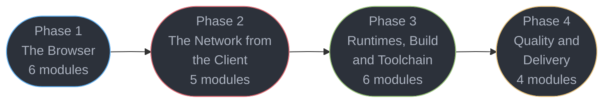

# Frontend Platform — Senior Engineer & Interview Prep Guide

The platform half of the front-end track: the browser, the network seen from the client,
the runtimes, the build pipeline, and the quality gates. The language lives in
[../typescript/](../typescript/README.md); the library lives in [../react/](../react/README.md).

This section exists because the rest of this repository already teaches the *server* half of
every front-end concern and none of the client half. CORS is deep in `fastapi/` and
`spring/` — as server configuration. WebSocket framing is thorough in `backend/` — from the
server. Asset caching is thorough in `hld/cdn/` — from the CDN. **What was missing is every
one of those concerns seen from the browser**, plus the platform a front-end engineer
actually ships onto.

> **No runnable application** — all content is Markdown with runnable-shaped TypeScript, JavaScript and CSS blocks.

---

## 1. Section Overview

This section covers:

- **The browser** — JavaScript language semantics, the multi-process architecture and the
  critical rendering path, the DOM and its event model, CSS layout and the cascade,
  animation and motion, and the event loop that schedules all of it
- **The network from the client** — `fetch` and the browser HTTP cache, the same-origin
  model and preflight *as the browser performs it*, the client threat model, browser auth,
  and realtime transports
- **Runtimes, build and toolchain** — client memory and leak debugging, the Node and edge
  runtimes, bundling, package management and the JavaScript supply chain, and linting
- **Quality and delivery** — Core Web Vitals, accessibility, service workers and offline,
  and shipping a front-end with observability that survives contact with production

**Nothing here is React-specific.** Every technique applies to a React app, a Vue app, or
the 578KB of dependency-free vanilla JavaScript that powers this repository's own learning
game — which is used throughout as a worked example of the platform without a framework.

---

## 2. Module Table

| # | Module Directory | Phase | Difficulty | Key Topics |
|---|-----------------|-------|-----------|-----------|
| 1 | [javascript_language_semantics](javascript_language_semantics/javascript_language_semantics.md) | 1 — The Browser | Intermediate | Prototypes, closures, `this` binding, coercion, iterators/generators, `Proxy`/`Reflect`/`Symbol`/`WeakRef`, ESM live bindings |
| 2 | [browser_architecture_and_the_rendering_pipeline](browser_architecture_and_the_rendering_pipeline/browser_architecture_and_the_rendering_pipeline.md) | 1 — The Browser | Advanced | Multi-process, site isolation, parse to style to layout to paint to composite, reflow vs repaint, forced synchronous layout |
| 3 | [the_dom_and_web_apis](the_dom_and_web_apis/the_dom_and_web_apis.md) | 1 — The Browser | Intermediate | DOM as tree and API, capture/bubble/delegation, passive listeners, the three observers, custom elements, shadow DOM |
| 4 | [css_layout_and_the_cascade](css_layout_and_the_cascade/css_layout_and_the_cascade.md) | 1 — The Browser | Intermediate | Box model, flexbox vs grid, specificity, cascade layers, container queries, logical properties and RTL, stacking contexts |
| 5 | [css_animation_and_motion](css_animation_and_motion/css_animation_and_motion.md) | 1 — The Browser | Intermediate | Compositor-only properties, FLIP, Web Animations API, the View Transitions API, scroll-driven animation, `prefers-reduced-motion` |
| 6 | [the_event_loop_and_scheduling](the_event_loop_and_scheduling/the_event_loop_and_scheduling.md) | 1 — The Browser | Advanced | Tasks vs microtasks, `requestAnimationFrame`, `requestIdleCallback`, long tasks, `scheduler.yield`, Web Workers |
| 7 | [http_in_the_browser_and_fetch](http_in_the_browser_and_fetch/http_in_the_browser_and_fetch.md) | 2 — Network from the Client | Intermediate | `fetch`, streams, `AbortController`, retry and timeout, the browser HTTP cache, ETag, HTTP/2 and HTTP/3 request strategy |
| 8 | [cors_cookies_and_the_same_origin_model](cors_cookies_and_the_same_origin_model/cors_cookies_and_the_same_origin_model.md) | 2 — Network from the Client | Advanced | Same-origin policy, preflight from the browser side, `credentials`, opaque responses, `SameSite`, partitioned cookies |
| 9 | [browser_security_and_the_client_threat_model](browser_security_and_the_client_threat_model/browser_security_and_the_client_threat_model.md) | 2 — Network from the Client | Advanced | XSS sinks, CSP and nonces, Trusted Types, SRI, prototype pollution, `postMessage`, build-time env leaks |
| 10 | [auth_in_the_browser](auth_in_the_browser/auth_in_the_browser.md) | 2 — Network from the Client | Advanced | Token storage tradeoffs, OAuth 2.1 with PKCE, silent refresh, passkeys and WebAuthn, logout and session invalidation |
| 11 | [realtime_in_the_browser](realtime_in_the_browser/realtime_in_the_browser.md) | 2 — Network from the Client | Intermediate | `WebSocket` and `EventSource` clients, reconnect with backoff and jitter, heartbeats, ordering, WebTransport |
| 12 | [client_memory_and_performance_debugging](client_memory_and_performance_debugging/client_memory_and_performance_debugging.md) | 3 — Runtimes, Build & Toolchain | Advanced | Heap snapshots, detached DOM and listener retention, GC-hostile shapes, hidden classes, the WASM boundary |
| 13 | [the_node_and_edge_runtimes](the_node_and_edge_runtimes/the_node_and_edge_runtimes.md) | 3 — Runtimes, Build & Toolchain | Advanced | libuv event-loop phases, streams and backpressure, ESM/CJS interop, worker threads, edge runtimes and their constraints |
| 14 | [modules_bundling_and_the_build_pipeline](modules_bundling_and_the_build_pipeline/modules_bundling_and_the_build_pipeline.md) | 3 — Runtimes, Build & Toolchain | Advanced | ESM semantics, tree-shaking and what defeats it, code splitting, Vite 8 on Rolldown, Turbopack, HMR, source maps |
| 15 | [package_management_and_supply_chain](package_management_and_supply_chain/package_management_and_supply_chain.md) | 3 — Runtimes, Build & Toolchain | Intermediate | npm/pnpm/yarn resolution, lockfiles, workspaces and task graphs, peer deps and duplicate React, provenance |
| 16 | [linting_formatting_and_code_quality](linting_formatting_and_code_quality/linting_formatting_and_code_quality.md) | 3 — Runtimes, Build & Toolchain | Intermediate | ESLint 10 flat config, typescript-eslint type-aware rules and their cost, Biome, oxlint, Prettier |
| 17 | [frontend_testing_and_ci](frontend_testing_and_ci/frontend_testing_and_ci.md) | 3 — Runtimes, Build & Toolchain | Advanced | jsdom vs happy-dom vs a real browser, Vitest 5 browser mode, MSW 3 at the network boundary, Playwright traces and sharding, flake taxonomy and quarantine, visual regression economics, CI budget gates |
| 18 | [web_performance_and_core_web_vitals](web_performance_and_core_web_vitals/web_performance_and_core_web_vitals.md) | 4 — Quality & Delivery | Advanced | LCP, INP, CLS at p75 via CrUX; lab vs field; resource hints; images and fonts; the performance budget |
| 19 | [accessibility_and_wcag](accessibility_and_wcag/accessibility_and_wcag.md) | 4 — Quality & Delivery | Intermediate | WCAG 2.2 AA, the accessibility tree, semantic HTML first, ARIA as last resort, keyboard and focus, axe in CI |
| 20 | [pwa_service_workers_and_offline](pwa_service_workers_and_offline/pwa_service_workers_and_offline.md) | 4 — Quality & Delivery | Advanced | Storage APIs and quotas, SW lifecycle and scope traps, caching strategies, background sync, install and update UX |
| 21 | [frontend_delivery_and_observability](frontend_delivery_and_observability/frontend_delivery_and_observability.md) | 4 — Quality & Delivery | Advanced | Static hosting and edge, immutable hashed assets, the post-deploy chunk 404, RUM, source-map upload, client OpenTelemetry |

---

## 3. 4-Phase Learning Path



### Phase 1 — The Browser (6 modules)

| # | Module | Why it is here |
|---|--------|----------------|
| 1 | [JavaScript Language Semantics](javascript_language_semantics/javascript_language_semantics.md) | The substrate everything else runs on, taught once for the whole track |
| 2 | [Browser Architecture & the Rendering Pipeline](browser_architecture_and_the_rendering_pipeline/browser_architecture_and_the_rendering_pipeline.md) | You cannot reason about jank without knowing which stage you triggered |
| 3 | [The DOM & Web APIs](the_dom_and_web_apis/the_dom_and_web_apis.md) | The API every framework is a wrapper over |
| 4 | [CSS Layout & the Cascade](css_layout_and_the_cascade/css_layout_and_the_cascade.md) | Layout is a correctness concern, not a styling preference |
| 5 | [CSS Animation & Motion](css_animation_and_motion/css_animation_and_motion.md) | Simultaneously a performance topic and an accessibility requirement |
| 6 | [The Event Loop & Scheduling](the_event_loop_and_scheduling/the_event_loop_and_scheduling.md) | Why the page froze, and where the work should have gone instead |

### Phase 2 — The Network from the Client (5 modules)

| # | Module | Why it is here |
|---|--------|----------------|
| 7 | [HTTP in the Browser & fetch](http_in_the_browser_and_fetch/http_in_the_browser_and_fetch.md) | The client half of `backend/http_protocols` |
| 8 | [CORS, Cookies & the Same-Origin Model](cors_cookies_and_the_same_origin_model/cors_cookies_and_the_same_origin_model.md) | The half that server-side CORS documentation never shows you |
| 9 | [Browser Security & the Client Threat Model](browser_security_and_the_client_threat_model/browser_security_and_the_client_threat_model.md) | The attacks that land in the browser, not on the server |
| 10 | [Auth in the Browser](auth_in_the_browser/auth_in_the_browser.md) | Where the token actually lives, and what that costs you |
| 11 | [Realtime in the Browser](realtime_in_the_browser/realtime_in_the_browser.md) | Reconnect, ordering and presence from the client's side |

### Phase 3 — Runtimes, Build & Toolchain (6 modules)

| # | Module | Why it is here |
|---|--------|----------------|
| 12 | [Client Memory & Performance Debugging](client_memory_and_performance_debugging/client_memory_and_performance_debugging.md) | The SPA that gets slower the longer it is open |
| 13 | [The Node & Edge Runtimes](the_node_and_edge_runtimes/the_node_and_edge_runtimes.md) | Node is on the critical path even for a browser-only product |
| 14 | [Modules, Bundling & the Build Pipeline](modules_bundling_and_the_build_pipeline/modules_bundling_and_the_build_pipeline.md) | What actually ships, and why it is bigger than you think |
| 15 | [Package Management & Supply Chain](package_management_and_supply_chain/package_management_and_supply_chain.md) | Resolution, lockfiles, and the attack surface of `node_modules` |
| 16 | [Linting, Formatting & Code Quality](linting_formatting_and_code_quality/linting_formatting_and_code_quality.md) | And the classes of bug a linter structurally cannot catch |
| 17 | [Front-End Testing & CI](frontend_testing_and_ci/frontend_testing_and_ci.md) | Which environment owns each fact under test, and how CI keeps the suite fast and trusted |

### Phase 4 — Quality & Delivery (4 modules)

| # | Module | Why it is here |
|---|--------|----------------|
| 18 | [Web Performance & Core Web Vitals](web_performance_and_core_web_vitals/web_performance_and_core_web_vitals.md) | The metrics you are measured on, and the incident narrative behind them |
| 19 | [Accessibility & WCAG](accessibility_and_wcag/accessibility_and_wcag.md) | A legal requirement, a quality bar, and an interview topic |
| 20 | [PWA, Service Workers & Offline](pwa_service_workers_and_offline/pwa_service_workers_and_offline.md) | Storage, caching strategy, and the update trap that bricks a deploy |
| 21 | [Frontend Delivery & Observability](frontend_delivery_and_observability/frontend_delivery_and_observability.md) | Shipping it, and knowing what happened after you did |

**Dependencies to note:**

- **Phase 1 is a prerequisite for [`../react/`](../react/README.md).** React's styling,
  performance and rendering modules all assume the pipeline, the DOM and the cascade.
- Module 6 (event loop) precedes module 12 (memory/perf debugging) and module 18 (Web
  Vitals) — INP is a scheduling problem before it is anything else.
- Module 14 (bundling) precedes module 21 (delivery): you cannot reason about cache
  invalidation without knowing what a content hash is over.
- Modules 5 and 19 are deliberately adjacent in concern: `prefers-reduced-motion` is an
  accessibility requirement, not a nicety.

---

## Learning Paths

This section is exhaustive by design. That is right for a reference and wrong for someone
two weeks from an interview, so there are **three ways through it**; the game's Study view
surfaces them as a Full / Senior / Principal toggle.

### Full Path (21 modules)

The complete curriculum in the order above — see
[4-Phase Learning Path](#3-4-phase-learning-path). Nothing is dropped.

The two curated tiers below are **different cuts, not nested depths**. Senior is the craft:
can you build it, debug it at 3am, and say why it broke. Principal is the judgment: which
approach at what cost, what the failure modes are, and what you tell a team *not* to do.

<!-- study-path-table senior -->
### Senior Path (21 modules)

| # | Module | Files |
|---|--------|-------|
| 1 | [javascript_language_semantics](javascript_language_semantics/javascript_language_semantics.md) | module page only |
| 2 | [browser_architecture_and_the_rendering_pipeline](browser_architecture_and_the_rendering_pipeline/browser_architecture_and_the_rendering_pipeline.md) | module page only |
| 3 | [the_dom_and_web_apis](the_dom_and_web_apis/the_dom_and_web_apis.md) | module page only |
| 4 | [css_layout_and_the_cascade](css_layout_and_the_cascade/css_layout_and_the_cascade.md) | module page only |
| 5 | [css_animation_and_motion](css_animation_and_motion/css_animation_and_motion.md) | module page only |
| 6 | [the_event_loop_and_scheduling](the_event_loop_and_scheduling/the_event_loop_and_scheduling.md) | module page only |
| 7 | [http_in_the_browser_and_fetch](http_in_the_browser_and_fetch/http_in_the_browser_and_fetch.md) | module page only |
| 8 | [cors_cookies_and_the_same_origin_model](cors_cookies_and_the_same_origin_model/cors_cookies_and_the_same_origin_model.md) | module page only |
| 9 | [browser_security_and_the_client_threat_model](browser_security_and_the_client_threat_model/browser_security_and_the_client_threat_model.md) | module page only |
| 10 | [auth_in_the_browser](auth_in_the_browser/auth_in_the_browser.md) | module page only |
| 11 | [realtime_in_the_browser](realtime_in_the_browser/realtime_in_the_browser.md) | module page only |
| 12 | [client_memory_and_performance_debugging](client_memory_and_performance_debugging/client_memory_and_performance_debugging.md) | module page only |
| 13 | [the_node_and_edge_runtimes](the_node_and_edge_runtimes/the_node_and_edge_runtimes.md) | module page only |
| 14 | [modules_bundling_and_the_build_pipeline](modules_bundling_and_the_build_pipeline/modules_bundling_and_the_build_pipeline.md) | module page only |
| 15 | [package_management_and_supply_chain](package_management_and_supply_chain/package_management_and_supply_chain.md) | module page only |
| 16 | [linting_formatting_and_code_quality](linting_formatting_and_code_quality/linting_formatting_and_code_quality.md) | module page only |
| 17 | [frontend_testing_and_ci](frontend_testing_and_ci/frontend_testing_and_ci.md) | module page only |
| 18 | [web_performance_and_core_web_vitals](web_performance_and_core_web_vitals/web_performance_and_core_web_vitals.md) | module page only |
| 19 | [accessibility_and_wcag](accessibility_and_wcag/accessibility_and_wcag.md) | module page only |
| 20 | [pwa_service_workers_and_offline](pwa_service_workers_and_offline/pwa_service_workers_and_offline.md) | module page only |
| 21 | [frontend_delivery_and_observability](frontend_delivery_and_observability/frontend_delivery_and_observability.md) | module page only |
<!-- /study-path-table -->

<!-- study-path-table principal -->
### Principal Path (13 modules)

| # | Module | Files |
|---|--------|-------|
| 6 | [the_event_loop_and_scheduling](the_event_loop_and_scheduling/the_event_loop_and_scheduling.md) | module page only |
| 7 | [http_in_the_browser_and_fetch](http_in_the_browser_and_fetch/http_in_the_browser_and_fetch.md) | module page only |
| 8 | [cors_cookies_and_the_same_origin_model](cors_cookies_and_the_same_origin_model/cors_cookies_and_the_same_origin_model.md) | module page only |
| 9 | [browser_security_and_the_client_threat_model](browser_security_and_the_client_threat_model/browser_security_and_the_client_threat_model.md) | module page only |
| 10 | [auth_in_the_browser](auth_in_the_browser/auth_in_the_browser.md) | module page only |
| 12 | [client_memory_and_performance_debugging](client_memory_and_performance_debugging/client_memory_and_performance_debugging.md) | module page only |
| 13 | [the_node_and_edge_runtimes](the_node_and_edge_runtimes/the_node_and_edge_runtimes.md) | module page only |
| 14 | [modules_bundling_and_the_build_pipeline](modules_bundling_and_the_build_pipeline/modules_bundling_and_the_build_pipeline.md) | module page only |
| 15 | [package_management_and_supply_chain](package_management_and_supply_chain/package_management_and_supply_chain.md) | module page only |
| 17 | [frontend_testing_and_ci](frontend_testing_and_ci/frontend_testing_and_ci.md) | module page only |
| 18 | [web_performance_and_core_web_vitals](web_performance_and_core_web_vitals/web_performance_and_core_web_vitals.md) | module page only |
| 20 | [pwa_service_workers_and_offline](pwa_service_workers_and_offline/pwa_service_workers_and_offline.md) | module page only |
| 21 | [frontend_delivery_and_observability](frontend_delivery_and_observability/frontend_delivery_and_observability.md) | module page only |

**Not in this path** (8 of 21, Full Path only): `javascript_language_semantics`, `browser_architecture_and_the_rendering_pipeline`, `the_dom_and_web_apis`, `css_layout_and_the_cascade`, `css_animation_and_motion`, `realtime_in_the_browser`, `linting_formatting_and_code_quality`, `accessibility_and_wcag`
<!-- /study-path-table -->

---

## 4. Version Notes

Verified 2026-10-18 against each project's registry dist-tags or release page. Re-check against each project's own release page before writing a
version number into prose — this section pins faster-moving things than any other in the repo.

| Area | Pin | Note |
|------|-----|------|
| Node.js | **26 Current**, **24 "Krypton" Active LTS** | 24 started 2025-05-06, 30-month window |
| Vite | **8**, on **Rolldown** | Rolldown bundles both dev and build; Oxc transforms and minifies JS and Lightning CSS minifies CSS |
| ESLint | **10** | flat config only — `eslintrc` fully removed. ESLint 9 reached EOL 2026-08-06 |
| typescript-eslint | **8.71.2** | does not yet support TypeScript 7 / tsgo |
| Biome / oxlint | **2.5** / type-aware **GA 2026-07-22** | oxlint's type-aware linting is no longer alpha; docs still note incomplete rule coverage |
| esbuild / swc | **0.28.2** / **1.16.18** | neither is declared legacy; Vite 8 calls esbuild only on opt-in (`build.minify: 'esbuild'`), so it is an optional peer dependency |
| pnpm / npm / Yarn Berry | **12.14.0** / **12.2.0** / **4.18.1** | pnpm 12 (Rust rewrite) is `latest` since 2026-10-15, 11.x is `latest-11` (11.28.6); npm 12 blocks dependency lifecycle scripts unless `allowScripts` permits them |
| Turborepo / Nx | **2.11.9** / **23.3.0** | |
| Prettier | **3.9.10** | |
| Deno / Bun | **2.9** / **1.4.3** | |

### The metric and standard pins that answers are graded against

**Core Web Vitals.** LCP good below **2.5s**, INP good below **200ms**, CLS good below
**0.1** — all measured at the **75th percentile** of real users via the CrUX dataset, and a
URL must pass all three to pass overall. **INP fully replaced FID in March 2024**; do not
teach FID as current. INP is the most commonly failed of the three.

**Accessibility.** **WCAG 2.2 AA is the engineering target** and what an audit tests
against. The laws cite older versions: the ADA Title II rule adopts 2.1 AA, Section 508
incorporates 2.0 AA, and the European Accessibility Act applies through EN 301 549 v3.2.1,
which maps to 2.1 AA. Content that meets 2.2 AA meets all three.
**WCAG 3.0 is a W3C Working Draft** (latest 2026-09-10): 180 requirements (106 core, 74
supplemental) plus 35 assertions; conformance means every core requirement is met, and
Bronze/Silver/Gold are reporting tiers above it. Candidate Recommendation is targeted for **Q4 2027** and legal
adoption is estimated 2030 or later. Teach 2.2 AA as actionable; mention 3.0 as direction
only.

**REPLACE, DO NOT ANNOTATE.** An answer names the current API, never "`foo()` is
deprecated, use `bar()`". The three exceptions are in root `CLAUDE.md`.

---

## 5. Case Studies

**None as standalone files.** The applied, end-to-end design work for the client lives in
[`../react/case_studies/`](../react/case_studies/case_studies.md).

Two module `## 14. Case Study` sections carry the weight instead, and are held to a higher
bar than a normal §14:

- **`web_performance_and_core_web_vitals`** — a full before-and-after performance incident
  with real numbers at every stage. This is the most transferable single artifact in the
  track and the section's most-cited page.
- **`pwa_service_workers_and_offline`** — an offline-first sync and conflict-resolution
  design, which is the half of "offline" that is genuinely hard.

---

## 6. Cross-Section Links

Every row below is a real collision. The rule is the same in each case: the existing module
owns the server or theory side, this section owns the client side, and neither restates the
other.

| This section's module | Existing owner | Boundary |
|-----------------------|----------------|----------|
| `http_in_the_browser_and_fetch` | [`../backend/http_protocols/`](../backend/http_protocols/http_protocols.md) | backend owns the protocol — HTTP/2, HPACK, TLS, ALPN. This owns the client: `fetch`, the browser cache, request strategy |
| `cors_cookies_and_the_same_origin_model` | [`../fastapi/middleware_and_lifecycle/`](../fastapi/middleware_and_lifecycle/middleware_and_lifecycle.md), [`../spring/spring_security_architecture/`](../spring/spring_security_architecture/spring_security_architecture.md) | those own server configuration. This owns preflight, `credentials`, opaque responses |
| `auth_in_the_browser` | [`../backend/auth_and_authorization_systems/`](../backend/auth_and_authorization_systems/auth_and_authorization_systems.md), [`../hld/security_and_auth/`](../hld/security_and_auth/security_and_auth.md) | those own issuance and the storage verdict. This owns PKCE, silent refresh, the WebAuthn ceremony |
| `realtime_in_the_browser` | [`../backend/websockets_and_sse/`](../backend/websockets_and_sse/websockets_and_sse.md), [`../hld/realtime_updates/`](../hld/realtime_updates/realtime_updates.md) | those own framing and server scaling. This owns the client, reconnect and ordering |
| `the_node_and_edge_runtimes` | [`../backend/os_and_io_performance/`](../backend/os_and_io_performance/os_and_io_performance.md), [`../cs_fundamentals/processes_threads_and_context_switching/async_io_and_event_loops.md`](../cs_fundamentals/processes_threads_and_context_switching/async_io_and_event_loops.md) | those own OS-level I/O and the general event-loop concept. This owns Node's phases and edge constraints |
| `client_memory_and_performance_debugging` | [`../cs_fundamentals/how_code_runs_compilers_and_interpreters/`](../cs_fundamentals/how_code_runs_compilers_and_interpreters/how_code_runs_compilers_and_interpreters.md) | that owns JIT and interpreter theory. This owns heap snapshots and SPA leak patterns |
| `package_management_and_supply_chain` | [`../python/packaging_and_project_tooling/`](../python/packaging_and_project_tooling/packaging_and_project_tooling.md), [`../devops/`](../devops/README.md) | those own their language's packaging. This owns npm resolution and the JavaScript supply chain |
| `frontend_delivery_and_observability` | [`../hld/cdn/`](../hld/cdn/cdn.md), [`../devops/cloud_networking_and_cdn/`](../devops/cloud_networking_and_cdn/cloud_networking_and_cdn.md) | those own CDN mechanics. This owns asset invalidation, RUM, source maps, browser-to-backend trace propagation |
| `browser_security_and_the_client_threat_model` | [`../backend/backend_security_owasp/`](../backend/backend_security_owasp/backend_security_owasp.md) | that owns server-side OWASP. This owns the browser-resident attack classes |
| `browser_architecture_and_the_rendering_pipeline` vs `css_layout_and_the_cascade` | each other | the pipeline module owns layout/paint/composite *mechanics*; the CSS module owns *authoring*. Both state the line |

---

## Known Gaps & Planned Work

Recorded 2026-09-04 after a section-wide gap review. Every item below was verified against
the live files — the "zero mentions" claims are grep results across all 20 module pages, not
impressions. Each entry is written to be briefable on its own, so a session can pick up any
one line without reading the rest.

### Planned case studies (5)

The section ships **no standalone case studies** and defers to
[`../react/case_studies/`](../react/case_studies/case_studies.md). All seven files there are
React-shaped — component architecture, state, rendering strategy — so no *platform* case
study exists anywhere in the repo. These five are the missing shape: the browser and the
delivery pipeline as the system under design, with no framework in the problem statement.

1. **`hold_a_core_web_vitals_win_across_four_teams`** — the org mechanics of *keeping* a
   performance win, not getting one. Distinct from `web_performance_and_core_web_vitals`
   §14, which is a single tuning pass and self-labels as a composite. Teaches: a legitimate
   CrUX-versus-lab disagreement and how to adjudicate it; per-team budgets wired as a
   Lighthouse CI ratchet; the quarter the regression came back through a marketing tag
   nobody owned; negotiating a third-party byte allowance with the team that wants the tag;
   and why grading at p75 rather than p50 changes which fix you pick.
2. **`migrate_a_40_package_monorepo_to_vite_8`** — migration as a project with a schedule
   and a rollback, not a config diff. Teaches: strangler sequencing with dual builds
   running side by side; proving parity through bundle diff and chunk-hash stability; the
   plugin-API gaps discovered in week three, after the decision was already made; CI cache
   invalidation during cutover; the rollback plan and its trigger; and the one package that
   never migrates and why that is an acceptable end state.
   `modules_bundling_and_the_build_pipeline` teaches the destination and nothing about the
   journey.
3. **`design_a_client_observability_and_rum_pipeline`** — the whole telemetry system under
   an explicit cost budget. Teaches: sampling strategy and the diagnostic cost of each
   choice; PII scrubbing in breadcrumbs, URLs and request bodies; source-map upload keyed to
   release tags; browser-to-backend trace propagation and the CORS preflight it adds;
   alerting on a p75 Core Web Vital rather than an average; and cardinality control before
   the bill arrives.
4. **`govern_the_third_party_scripts_on_a_commercial_site`** — the tags nobody in
   engineering owns. Teaches: inventorying scripts with no owner; attributing INP and byte
   cost per tag so the conversation has numbers in it; the facade pattern and worker
   sandboxing; CSP `connect-src` as the enforcement mechanism rather than a policy document;
   a consent gate that actually gates rather than one that fires the tag and asks after; and
   the conversation with marketing, which is the part that decides the outcome.
5. **`remediate_to_wcag_2_2_aa_under_a_legal_deadline`** — triage against a date. Teaches:
   turning 41 audit findings into a sequenced plan; the six criteria new in 2.2 encountered
   in situ rather than as a table; a screen-reader test protocol spanning NVDA, JAWS and
   VoiceOver; axe-in-CI as a ratchet rather than a gate; writing the VPAT/ACR; and the
   roughly 30-40% of real barriers that no automated tool can see.

### Planned modules (4, ranked)

1. **`images_media_and_fonts`** — sibling of `web_performance_and_core_web_vitals`, which
   currently rents the entire topic. Cover: `sizes`/`srcset` arithmetic and the specific
   ways it goes wrong; art direction versus resolution switching; AVIF/WebP/JPEG-XL with
   byte math rather than adjectives; how `loading`, `decoding` and `fetchpriority` interact;
   video and HLS basics; variable fonts; subsetting and `unicode-range` (**0** hits
   repo-wide); `size-adjust` and `ascent-override`; and the CLS that is attributable to
   media specifically.
2. **`internationalization_and_intl`** — sibling of `css_layout_and_the_cascade`, which owns
   logical properties and RTL today and has nothing to hand off to. Near-total zero:
   `Intl.` **2** hits, "i18n" **0**, "pluraliz" **0**, "hreflang" **0**. Cover: locale
   negotiation; the `Intl` formatter family; ICU message format and why string concatenation
   breaks under plurals and gender; per-locale bundle splitting — the bundling module's own
   §14 uses a locale glob as its BROKEN example and never explains i18n; `lang`/`dir` and
   bidi isolation; and currency and timezone traps.
3. **`web_workers_and_client_threading`** — sibling of `the_event_loop_and_scheduling`.
   Cover: worker lifecycle and its real cost; `postMessage` structured clone versus
   transferables with measured copy cost; SharedArrayBuffer and Atomics under cross-origin
   isolation (COOP/COEP is taught in the security module and currently has nowhere to land);
   worker pools; OffscreenCanvas; and SharedWorker plus cross-tab leader election — which is
   also the fix for the 30-open-sockets problem `realtime_in_the_browser` raises in its own
   §10 and §12.
4. **`client_storage_and_indexeddb`** — sibling of `pwa_service_workers_and_offline`. All
   23 IndexedDB hits in the section sit inside the PWA module, and `the_dom_and_web_apis`
   mentions it **zero** times. Cover: choosing among localStorage, IndexedDB, the Cache API
   and OPFS; transaction and index semantics; quota estimation and eviction (Chromium at
   roughly 60% of disk, WebKit's 7-day script-writable eviction); `navigator.storage.persist()`;
   migrating a client schema across releases; and the structured-clone boundary.

### Planned in-module topic gaps

Every row was verified at zero or near-zero mentions section-wide.

| Gap | Belongs in |
|---|---|
| FedCM | `auth_in_the_browser` |
| Storage Access API; Local Network Access (prose in §6) | `cors_cookies_and_the_same_origin_model` |
| DOM clobbering | `browser_security_and_the_client_threat_model` |
| Speculation Rules API | `web_performance_and_core_web_vitals`, `http_in_the_browser_and_fetch` |
| Early Hints (103) | `http_in_the_browser_and_fetch` |
| Web Push / VAPID | `pwa_service_workers_and_offline` |
| `:has()`, anchor positioning, native nesting, `@scope`, `@property` | `css_layout_and_the_cascade` |
| bfcache | `browser_architecture_and_the_rendering_pipeline` |
| Module federation, import maps, persistent build caching | `modules_bundling_and_the_build_pipeline` (Vite 8's own release notes name these) |
| WebRTC data channels; BroadcastChannel mechanics | `realtime_in_the_browser` |
| Node permission model (`--permission`), single-executable applications | `the_node_and_edge_runtimes` |
| WASM boundary mechanics (named twice in the section, never taught) | `client_memory_and_performance_debugging` |
| `isInputPending` | `the_event_loop_and_scheduling` |
| Feature detection / progressive enhancement / Baseline-as-method | currently ownerless; "Baseline" is cited 24 times across 5 modules as a *fact* and never taught as a *method* |
| Client-side routing and the Navigation API | homeless between this section and `react/meta_frameworks_and_routing` — needs an owner decision before anyone writes it |

**FedCM pairs with the third-party-cookie status.** `cors_cookies_and_the_same_origin_model`
§6.5 states that status: Safari blocks third-party cookies, Firefox partitions them, and
Chrome keeps them after Google retired most Privacy Sandbox APIs on 2025-10-17, keeping CHIPS
and FedCM. `auth_in_the_browser` does not mention FedCM, and neither module links the other.

The Storage Access API and Local Network Access (which replaced Private Network Access in
Chrome 142) are Q&As in `cors_cookies_and_the_same_origin_model` §12; both still need prose
in §6, which is why the row stays.

### Planned section-level expansions

| Module | Section | What is wrong |
|---|---|---|
| `css_layout_and_the_cascade` | §10 | only 2 pitfalls, and **neither is quantified** — unique in the section |
| `javascript_language_semantics` | §10 | correctness demos where the template asks for production war stories |
| `the_node_and_edge_runtimes` | §10 | only 2 pitfalls |
| `the_dom_and_web_apis` | §6.10 | a persuasive essay with no numbers in it |
| `browser_architecture_and_the_rendering_pipeline` | §9 | restates §6 rather than adding pitfalls |
| `linting_formatting_and_code_quality` | §7 | anonymizes both incidents, where `web_performance_and_core_web_vitals` §7 names real companies — pick one convention |

### Planned cross-links

| From | To | Why |
|---|---|---|
| `the_dom_and_web_apis` | `pwa_service_workers_and_offline` | IndexedDB lives entirely in the PWA module |
| `browser_architecture_and_the_rendering_pipeline` | `web_performance_and_core_web_vitals` | bfcache and font loading |
| `cors_cookies_and_the_same_origin_model` | `auth_in_the_browser` (both directions) | third-party cookies and FedCM |
| `accessibility_and_wcag` | `auth_in_the_browser` | added 2026-09-04 for SC 3.3.8; the reverse link is still missing |

---

## 7. Build Manifest

Per-file status tracker. **This is the resume point** — the first `pending` row is the next
unit of work. Flip `pending` to `done` in the same commit as the file, filling in the
measured counts; a `done` row with no counts is not trustworthy.

Target per module page: **700-900 lines, 6-8 Mermaid fences, 15-18 Q&As** (every one
carrying an authored `**Short:**` line), all 14 template sections.

| # | File | Phase | Status | Q&As | Lines |
|---|------|-------|--------|-----:|------:|
| 1 | `javascript_language_semantics/javascript_language_semantics.md` | 1 | **done** | 20 | 1004 |
| 2 | `browser_architecture_and_the_rendering_pipeline/browser_architecture_and_the_rendering_pipeline.md` | 1 | **done** | 18 | 880 |
| 3 | `the_dom_and_web_apis/the_dom_and_web_apis.md` | 1 | **done** | 18 | 885 |
| 4 | `css_layout_and_the_cascade/css_layout_and_the_cascade.md` | 1 | **done** | 18 | 873 |
| 5 | `css_animation_and_motion/css_animation_and_motion.md` | 1 | **done** | 16 | 937 |
| 6 | `the_event_loop_and_scheduling/the_event_loop_and_scheduling.md` | 1 | **done** | 18 | 883 |
| 7 | `http_in_the_browser_and_fetch/http_in_the_browser_and_fetch.md` | 2 | **done** | 21 | 996 |
| 8 | `cors_cookies_and_the_same_origin_model/cors_cookies_and_the_same_origin_model.md` | 2 | **done** | 18 | 878 |
| 9 | `browser_security_and_the_client_threat_model/browser_security_and_the_client_threat_model.md` | 2 | **done** | 20 | 977 |
| 10 | `auth_in_the_browser/auth_in_the_browser.md` | 2 | **done** | 16 | 882 |
| 11 | `realtime_in_the_browser/realtime_in_the_browser.md` | 2 | **done** | 17 | 969 |
| 12 | `client_memory_and_performance_debugging/client_memory_and_performance_debugging.md` | 3 | **done** | 18 | 893 |
| 13 | `the_node_and_edge_runtimes/the_node_and_edge_runtimes.md` | 3 | **done** | 18 | 882 |
| 14 | `modules_bundling_and_the_build_pipeline/modules_bundling_and_the_build_pipeline.md` | 3 | **done** | 19 | 950 |
| 15 | `package_management_and_supply_chain/package_management_and_supply_chain.md` | 3 | **done** | 19 | 896 |
| 16 | `linting_formatting_and_code_quality/linting_formatting_and_code_quality.md` | 3 | **done** | 16 | 887 |
| 17 | `frontend_testing_and_ci/frontend_testing_and_ci.md` | 3 | **done** | 17 | 899 |
| 18 | `web_performance_and_core_web_vitals/web_performance_and_core_web_vitals.md` | 4 | **done** | 18 | 915 |
| 19 | `accessibility_and_wcag/accessibility_and_wcag.md` | 4 | **done** | 18 | 940 |
| 20 | `pwa_service_workers_and_offline/pwa_service_workers_and_offline.md` | 4 | **done** | 19 | 916 |
| 21 | `frontend_delivery_and_observability/frontend_delivery_and_observability.md` | 4 | **done** | 18 | 995 |

### Conventions reminder (for future batch agents)

- The page is named for its folder: `<module>/<module>.md`.
- **Never** name a file `*_deep_dive.md` or `*_internals.md` — FATAL under `--strict`.
- Q&As go under `## 12. Interview Questions with Answers`, each with a `**Short:**` line of
  15-220 characters as the first non-blank line of the answer.
- Tag code fences ` ```ts ` / ` ```js ` / ` ```css `, not ` ```typescript `.
- Say **"client hydration"**, never bare "hydration" — the word already means feed-object
  hydration in 14 files across `backend/` and `hld/`, and the MCQ distractor pool will mix
  them.
- Adding a file means adding its line to the `<!-- study-paths -->` block below **in the
  same commit**, then running `python3 game/extract.py --write-paths`.

<!-- study-paths
     THE source of truth for this section's file inventory and study-tier membership.
     Every module and every file it owns is listed here with the tiers it belongs to;
     `-` means Full path only. Content files carry NO structural metadata. Order is never
     declared here: it comes from STUDY_ORDER in game/app.js. The tier TABLES in this file
     are generated from this block by `python3 game/extract.py --write-paths`. A file on
     disk missing from this block, or listed here and absent from disk, FAILS
     `extract.py --strict`.

     Entries are added AS EACH FILE LANDS -- listing a not-yet-written file is fatal.

javascript_language_semantics
  javascript_language_semantics.md  senior
web_performance_and_core_web_vitals
  web_performance_and_core_web_vitals.md  senior, principal
cors_cookies_and_the_same_origin_model
  cors_cookies_and_the_same_origin_model.md  senior, principal
browser_architecture_and_the_rendering_pipeline
  browser_architecture_and_the_rendering_pipeline.md  senior
the_dom_and_web_apis
  the_dom_and_web_apis.md  senior
the_event_loop_and_scheduling
  the_event_loop_and_scheduling.md  senior, principal
css_layout_and_the_cascade
  css_layout_and_the_cascade.md  senior
modules_bundling_and_the_build_pipeline
  modules_bundling_and_the_build_pipeline.md  senior, principal
browser_security_and_the_client_threat_model
  browser_security_and_the_client_threat_model.md  senior, principal
auth_in_the_browser
  auth_in_the_browser.md  senior, principal
accessibility_and_wcag
  accessibility_and_wcag.md  senior
realtime_in_the_browser
  realtime_in_the_browser.md  senior
http_in_the_browser_and_fetch
  http_in_the_browser_and_fetch.md  senior, principal
client_memory_and_performance_debugging
  client_memory_and_performance_debugging.md  senior, principal
linting_formatting_and_code_quality
  linting_formatting_and_code_quality.md  senior
package_management_and_supply_chain
  package_management_and_supply_chain.md  senior, principal
pwa_service_workers_and_offline
  pwa_service_workers_and_offline.md  senior, principal
the_node_and_edge_runtimes
  the_node_and_edge_runtimes.md  senior, principal
css_animation_and_motion
  css_animation_and_motion.md  senior
frontend_delivery_and_observability
  frontend_delivery_and_observability.md  senior, principal
frontend_testing_and_ci
  frontend_testing_and_ci.md  senior, principal
-->
