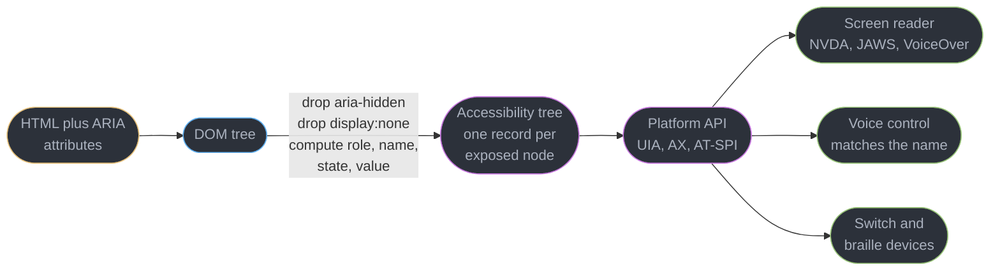
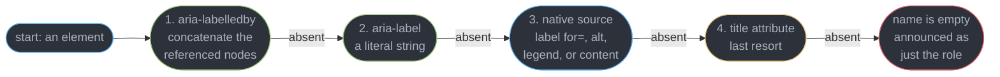
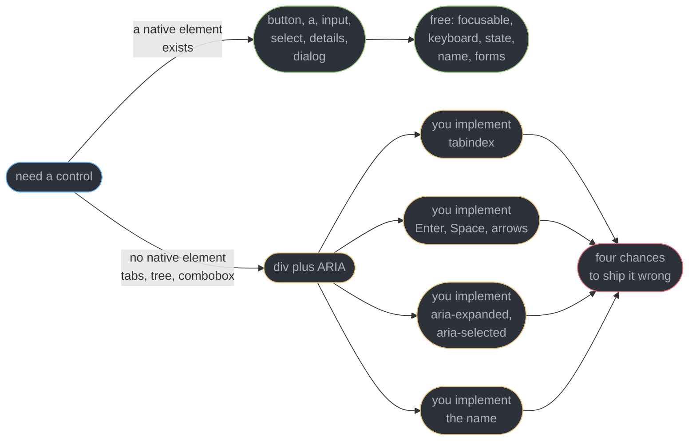
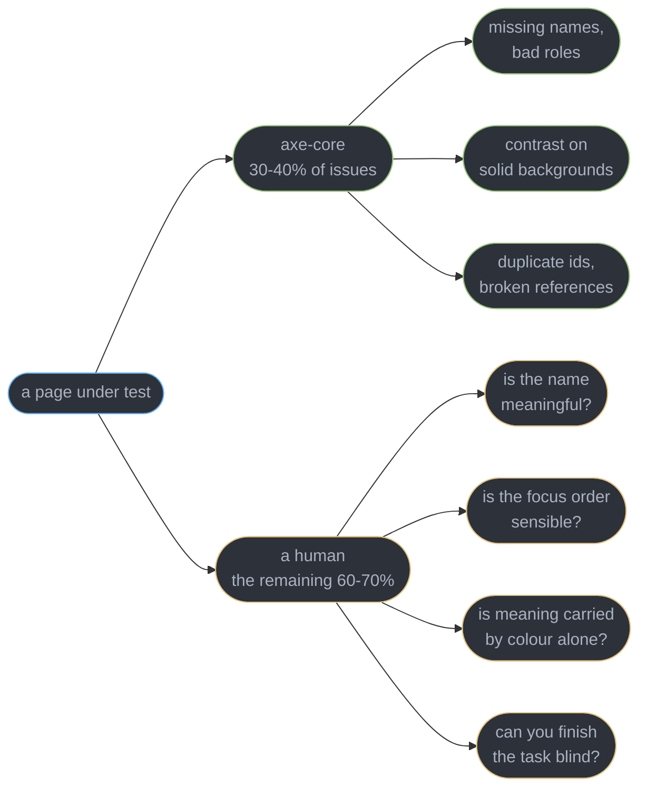
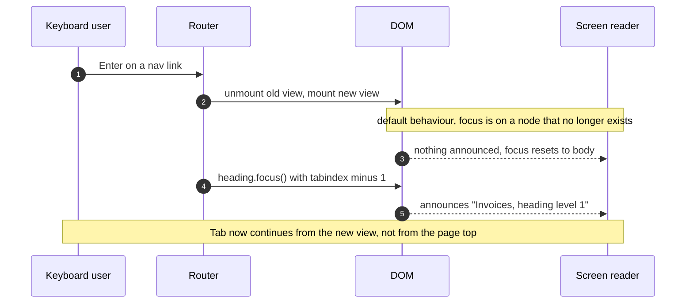
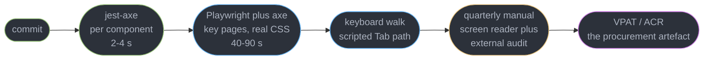

# Accessibility and WCAG

---

## 1. Concept Overview

A control that nobody can operate is a broken control. That sentence is the whole module: a
submit button that a keyboard cannot reach, or that a screen reader announces as an unlabelled
`button`, has the same status as one that throws on click — it does not work for a class of
users, and the fact that the class is people rather than browsers changes nothing about the
defect.

Three forces make this engineering rather than decoration.

**It is law.** In the United States the ADA and Section 508 both point at WCAG; in the European
Union the European Accessibility Act has applied to consumer-facing digital products since
2025-06-28. All of them reference the same technical standard, and **WCAG 2.2 Level AA is what
an audit actually tests against**.

**It is correctness.** Every WCAG success criterion is a falsifiable statement about the
product. "Every function is operable by keyboard" is a test, not a preference, and a build can
assert it.

**It overlaps almost entirely with quality.** Semantic markup gives search crawlers the same
structure it gives a screen reader. Keyboard support is what power users mean by "this app is
fast". A 4.5:1 contrast ratio is what makes the interface legible on a phone in direct
sunlight. Captions are watched by more people in noisy rooms than by deaf users. Accessibility
work is rarely a cost paid only for accessibility.

This module owns the platform layer — the accessibility tree, name computation, WCAG 2.2 AA as
a test suite, keyboard and focus mechanics, screen readers, and CI. It does not own:

| Topic | Owner |
|-------|-------|
| Component ARIA patterns, live regions, roving tabindex, focus traps | [Accessible Component Patterns](../../react/accessible_component_patterns/accessible_component_patterns.md) |
| Error summaries and label association in forms | [Forms and Validation](../../react/forms_and_validation/forms_and_validation.md) |
| React refs, `useImperativeHandle`, imperative focus in effects | [Refs and Focus Management](../../react/refs_and_focus_management/refs_and_focus_management.md) |
| Test runners, CI wiring, Playwright setup | [Testing and Frontend CI](../../react/testing_and_frontend_ci/testing_and_frontend_ci.md) |
| `prefers-reduced-motion`, vestibular-safe animation | [CSS Animation and Motion](../css_animation_and_motion/css_animation_and_motion.md) |
| Logical properties, RTL, cascade layers | [CSS Layout and the Cascade](../css_layout_and_the_cascade/css_layout_and_the_cascade.md) |
| The DOM the accessibility tree is projected from | [The DOM and Web APIs](../the_dom_and_web_apis/the_dom_and_web_apis.md) |
| LCP, INP, CLS at p75 | [Web Performance and Core Web Vitals](../web_performance_and_core_web_vitals/web_performance_and_core_web_vitals.md) |

---

## 2. Intuition

> Assistive technology does not read your screen. It reads a **second tree the browser builds
> for it**, and your CSS is not in that tree at all.

**Mental model.** The browser publishes an API of your page: every node that survives becomes a
record with four fields — **role** (what kind of thing), **name** (what it is called), **state**
(checked, expanded, disabled) and **value**. A screen reader, a switch device and voice control
are three clients of that API. When you write `<div class="btn">Save</div>`, the API record says
`role: generic, name: "Save"` — a paragraph that happens to say Save.

**Why it matters.** The interview question is never "should we be accessible". It is "your
design system's icon button ships in 340 places and an audit found all 340 unlabelled — what
happened and what do you do", and the answer is a property of name computation and of where
components live, not of goodwill.

**Key insight.** Accessibility failures are almost never caused by missing effort. They are
caused by **building a control out of parts that carry no semantics**, then repairing it with
ARIA that promises behaviour nobody implemented. The native `<button>` ships focusability,
Enter and Space activation, a pressed state, a name computed from its content and a form
association — five behaviours, zero lines. Replacing it with a `div` throws all five away and
gives you the chance to reimplement four of them wrong.

---

## 3. Core Principles

1. **Semantics first, ARIA as a repair.** The first rule of ARIA is not to use ARIA. Every
   attribute you add is a claim about behaviour that you must then implement by hand.
2. **ARIA changes what is *reported*, never what *happens*.** `role="button"` adds no keyboard
   handler, no focusability, no activation. It only changes the announcement — which is why a
   wrong role is worse than none.
3. **Every interactive element needs a computed name.** No name means the control cannot be
   announced, cannot be listed in the screen reader's element list, and cannot be targeted by
   voice control, which addresses controls by their visible name.
4. **Everything reachable by mouse must be reachable by keyboard, and you must be able to get
   back out.** That is 2.1.1 and 2.1.2 together, and the second is the one people forget.
5. **Focus must be visible, unobscured and never lost.** A focus ring is the keyboard user's
   cursor; deleting it is deleting the pointer.
6. **Automation is a floor, not a verdict.** Roughly **30-40%** of real issues are
   machine-detectable. Shipping on a green axe run is shipping on 35% of a test suite.

---

## 4. Types / Architectures / Strategies

### 4.1 POUR — the four principles, and what fails under each

| Principle | The question it asks | Where teams actually fail |
|-----------|---------------------|---------------------------|
| **Perceivable** | can it be sensed at all? | contrast, images with no alt text, meaning carried by colour alone |
| **Operable** | can it be driven? | keyboard access, focus visibility, target size, keyboard traps |
| **Understandable** | is it predictable and recoverable? | error identification, unlabelled inputs, focus changing context on its own |
| **Robust** | does it survive being read by a machine? | name, role, value on custom widgets; status messages |

### 4.2 The 2.2 AA criteria that audits actually flag

These thirteen account for the large majority of findings in a typical commercial audit. The
six marked **new in 2.2** are the ones a team that last audited against 2.1 has never been
tested on, and they are disproportionately represented in first-time 2.2 findings.

| SC | Level | Requirement | The concrete number |
|----|-------|-------------|--------------------|
| **1.4.3** Contrast (Minimum) | AA | text against its background | **4.5:1** normal, **3:1** large (18.66px bold or 24px regular) |
| **1.4.11** Non-text Contrast | AA | UI boundaries, focus rings, meaningful graphics | **3:1** |
| **2.1.1** Keyboard | A | every function operable from a keyboard | no exceptions for "mouse-only" affordances |
| **2.1.2** No Keyboard Trap | A | focus can always move back out | Escape, or Tab out |
| **2.4.7** Focus Visible | AA | the focused element has a visible indicator | any visible change; `outline: none` alone fails |
| **2.4.11** Focus Not Obscured | AA, **new in 2.2** | the focused element is not fully hidden by author content | sticky headers and cookie bars are the usual cause |
| **2.5.7** Dragging Movements | AA, **new in 2.2** | anything done by dragging has a single-pointer alternative | a reorder list needs move-up/move-down buttons; a slider needs arrow keys and a number input |
| **2.5.8** Target Size (Minimum) | AA, **new in 2.2** | pointer targets are large enough | **24 x 24 CSS px**, or spaced so 24px circles do not overlap |
| **3.2.6** Consistent Help | A, **new in 2.2** | help mechanisms appear in the same relative order on every page that has them | the support link moving from header to footer between routes fails it |
| **3.3.7** Redundant Entry | A, **new in 2.2** | information already given is not asked for again in the same process | a checkout re-asking for the shipping address at the billing step, with no copy-forward |
| **3.3.8** Accessible Authentication (Minimum) | AA, **new in 2.2** | no cognitive function test without an alternative | no puzzle, no transcription, no recall test; the field must accept paste and autofill |
| **3.3.1 / 3.3.3** Error Identification / Suggestion | A / AA | errors named in text, with a correction where known | "Enter a date as DD/MM/YYYY", not "Invalid" |
| **4.1.2** Name, Role, Value | A | custom widgets expose all three programmatically | the criterion every hand-built `div` widget fails |

### 4.3 WCAG 2.2 AA versus WCAG 3.0 — what to build against

| | **WCAG 2.2** | **WCAG 3.0** |
|---|---|---|
| Status | **W3C Recommendation — the operative standard** | **W3C Working Draft**, latest 2026-03-03 |
| Conformance | A / AA / AAA, pass-fail per criterion | **Bronze / Silver / Gold**, Bronze roughly equal to today's 2.2 AA |
| Referenced by law | ADA, Section 508, the European Accessibility Act | nothing |
| Next milestone | in force now | Candidate Recommendation targeted **Q4 2027** |
| Legal adoption | now | estimated **2030 or later** |

**Build against 2.2 AA. Read 3.0 as direction.** A team that plans its 2027 roadmap around
Bronze conformance is planning around a document that will change before it is a Recommendation,
and is not conformant with anything a regulator can currently cite.

---

## 5. Architecture Diagrams

### 5.1 The accessibility tree is a second projection of the DOM



Your CSS never reaches the right-hand side. Colour, position and font size are invisible there,
which is why "it is obviously a button, it is blue and rounded" is not an argument.

### 5.2 How an accessible name is computed — first match wins



Step 1 beats everything below it, so an `aria-labelledby` pointing at a missing id computes to
an empty name and **silently discards the visible text underneath**. That single precedence rule
causes more real-world name bugs than any other.

### 5.3 Semantic HTML first, ARIA only where the platform has no element



The native path is not shorter because it is idiomatic; it is shorter because the four boxes on
the lower path are code somebody has to write, test and keep correct through every refactor.

### 5.4 What CI catches, and what only a person catches



Both halves are cheap. The mistake is treating the green half as the whole, which is exactly
what a 100 Lighthouse score encourages.

---

## 6. How It Works — Detailed Mechanics

### 6.1 The accessibility tree, and reading it

The browser builds the accessibility tree from the DOM after style resolution. A node is
**excluded** if it is `display: none`, `visibility: hidden`, `hidden`, `inert`, or carries
`aria-hidden="true"` — and `aria-hidden` removes the entire subtree, including anything
focusable inside it, which is how you get a control that a screen reader cannot see but a Tab
key can still reach.

Every surviving node carries four things. Read them in Chrome DevTools under Elements ->
Accessibility, or in code:

```js
// Chrome DevTools console only — the same data the Accessibility pane shows
const node = document.querySelector("#save");
console.log(await getComputedAccessibleName(node));   // "Save draft"
console.log(node.computedRole);                       // "button"
// A control whose name logs as "" is the single highest-severity finding in an audit.
```

`aria-hidden="true"` on a decorative icon inside a labelled button is correct and common.
`aria-hidden="true"` on anything containing a focusable element is always a bug: use `inert`,
which removes the subtree from *both* the accessibility tree and the tab order.

### 6.2 Name computation in practice

```html
<!-- 1. aria-labelledby wins, and concatenates in the order the ids are listed -->
<button id="b1" aria-labelledby="verb noun">X</button>        <!-- name: "Delete invoice" -->
<span id="verb">Delete</span><span id="noun">invoice</span>

<!-- 2. aria-label wins over content -->
<button aria-label="Close dialog">X</button>                  <!-- name: "Close dialog" -->

<!-- 3. native source: label association, alt text, element content -->
<label for="email">Work email</label><input id="email">       <!-- name: "Work email" -->
<button></button>          <!-- name: "Delete" -->
<button>Save draft</button>                                   <!-- name: "Save draft" -->

<!-- No name at all: announced as "button", unfindable, untargetable by voice -->
<button><svg>...</svg></button>
```

Two rules that follow. **`aria-label` on a visible control must contain the visible text**, or
voice control users who say "click Save" address a control whose name is "Submit form" and
nothing happens — that is criterion 2.5.3, Label in Name. And **`aria-label` is ignored on
generic elements**: on a `span` or a `div` with no role it computes nothing, which is why
labelling a wrapper instead of the control is a silent no-op.

### 6.3 What a native control gives you, and what you must rebuild

```html
<button type="button" class="btn">Save draft</button>          <!-- five behaviours, zero JS -->

<!-- The full repair: every attribute replaces something the button had for free -->
<div role="button" tabindex="0" aria-pressed="false" class="btn">Save draft</div>
```

The native line is focusable in document order, activates on **both** Enter and Space, exposes
`role: button`, reports `disabled` state and participates in the form. The repaired `div` needs
all of this as well:

```js
el.addEventListener("keydown", (e) => {
  if (e.key === "Enter" || e.key === " ") { e.preventDefault(); el.click(); }
});                                    // Space scrolls the page unless you preventDefault
el.addEventListener("click", () => el.setAttribute("aria-pressed", String(next)));
// Still missing: form submission, :disabled semantics, Windows High Contrast Mode styling.
```

Four attributes and nine lines of JavaScript to reach parity with `<button>`, and it is still
not at parity. **This is the entire argument for semantic HTML**, and it is an argument about
lines of code, not about principle.

Where the platform genuinely has no element — tabs, trees, comboboxes, treegrids — ARIA is
correct and necessary. The keyboard interaction patterns for those live in
[Accessible Component Patterns](../../react/accessible_component_patterns/accessible_component_patterns.md).

### 6.4 Keyboard order and focus visibility

Tab order is **document order**, filtered to focusable elements. Two attributes modify it:

| Value | Effect | Verdict |
|-------|--------|---------|
| `tabindex="0"` | focusable, at its document-order position | correct for a custom widget |
| `tabindex="-1"` | focusable **only** via `element.focus()`, skipped by Tab | the tool for focus management |
| `tabindex="1"` and above | jumps ahead of every natural element on the page | **antipattern** |

A positive `tabindex` creates one global ordering the whole document must agree on. Add a second
component using `tabindex="1"` and the two now interleave by source order; add a third-party
widget and the ordering is out of your control. The fix is always to reorder the DOM.

```css
/* BROKEN in spirit: :focus-visible with no visible change fails 2.4.7 */
button:focus { outline: none; }

/* FIX: a ring that meets 1.4.11 at 3:1 against both the button and the page */
:focus-visible {
  outline: 3px solid #0b57d0;
  outline-offset: 2px;                 /* separates the ring from the control's own border */
}
:focus:not(:focus-visible) { outline: none; }   /* mouse clicks stay quiet, keyboard does not */
```

`:focus-visible` is the whole reason people used to remove outlines: the browser now applies the
ring on keyboard interaction and withholds it on mouse click, so there is no remaining reason to
delete it. `outline` is also the only property that survives Windows High Contrast Mode, which
discards `box-shadow` and `border-color` overrides — a focus ring built from `box-shadow` alone
disappears entirely for the users most likely to need it.

**Skip links** answer 2.4.1: 40 navigation links before the content is 40 Tab presses on every
page load.

```html
<a href="#main" class="skip-link">Skip to main content</a>   <!-- absolute, left: -9999px -->
<main id="main" tabindex="-1">...</main>   <!-- -1 so the link's target can receive focus -->
```

Move it on screen with `.skip-link:focus { left: 8px; top: 8px; }` — visible when, and only
when, focused. Never hide it with `display: none`, which removes it from the tab order entirely.

### 6.5 Focus on route change in an SPA

A full page load moves focus to the document root and the screen reader announces the new title.
A client-side route change does neither: the old link is removed from the DOM, focus falls back
to `<body>`, and the next Tab starts from the top of the page with no announcement that anything
happened.



```ts
// Fragment: run on every completed navigation, after the new view has painted.
function onRouteChange(title: string, heading: HTMLElement | null) {
  document.title = `${title} — Acme`;      // browsers announce the title on some platforms
  heading?.setAttribute("tabindex", "-1"); // programmatically focusable, not in the tab order
  heading?.focus({ preventScroll: false });
}
```

Focus the new view's `<h1>`, not the container: the announcement then carries both name and
level, telling the user where they landed. The React mechanics — refs, effect ordering, why a
layout effect can fire before the node exists — belong to
[Refs and Focus Management](../../react/refs_and_focus_management/refs_and_focus_management.md).

### 6.6 Error identification and suggestion

```html
<label for="dob">Date of birth</label>
<input id="dob" name="dob" aria-describedby="dob-err" aria-invalid="true" autocomplete="bday">
<p id="dob-err">Enter your date of birth as DD/MM/YYYY. 31/13/1990 has no month 13.</p>
```

`aria-invalid="true"` satisfies the machine half of 3.3.1; the message text satisfies the human
half, and the second sentence satisfies 3.3.3 by naming the correction. A red border alone fails
3.3.1 and 1.4.1 both, since colour is the only carrier. `autocomplete` is criterion 1.3.5. Error
summaries and their focus behaviour are owned by
[Forms and Validation](../../react/forms_and_validation/forms_and_validation.md).

### 6.7 Accessible Authentication: 3.3.8 in a real login flow

3.3.8 is the criterion most likely to be failed by a login screen that everyone considers
finished, because it is the only success criterion that tests the *user's memory and
reasoning* rather than the markup. A **cognitive function test** is anything that asks the
user to remember, transcribe or solve — a password typed from memory, a code copied out of a
second device, a "select the traffic lights" puzzle, a security question, a maths problem.
At AA, each step of the process must offer a route that does not require one.

Three things satisfy it, and only three in practice:

| Mechanism | Why it passes | The failure right next to it |
|-----------|---------------|------------------------------|
| Passkeys / WebAuthn | authentication is a biometric or device gesture; nothing is remembered or transcribed | none — this is the cleanest pass available |
| A password field that accepts paste and autofill | the password manager does the remembering, so the *user* performs no cognitive function test | `onpaste="return false"`, or `autocomplete="off"` on the password field, reinstates the test and fails |
| Object recognition or personal-content CAPTCHA | recognising a common object or your own photo is exempted by the criterion | text-transcription and puzzle CAPTCHAs are not exempt and fail at AA |

```html
<!-- FAILS 3.3.8: paste blocked, autofill suppressed, a memory test with no way out. -->
<input type="password" name="pw" autocomplete="off" onpaste="return false">

<!-- PASSES: the manager can fill it, the user can paste it, and nothing is remembered. -->
<input type="password" name="pw" autocomplete="current-password">
```

The trap is that blocking paste is almost always argued for on *security* grounds, and the
argument is backwards — it forces short, memorable, reused passwords, which is the outcome
the policy was meant to prevent. Two more that a review misses: an SMS or TOTP code the user
must read from another device and retype is a transcription test unless the field carries
`autocomplete="one-time-code"` so the platform can fill it, and an email "magic link" passes
cleanly because the user copies nothing. The strongest answer is to make passkeys the primary
path, which satisfies 3.3.8 and 3.3.9 (the AAA form, which drops the object-recognition
exception) at the same time. The protocol mechanics — credential creation, the authenticator,
discoverable credentials, fallback ordering — are owned by
[Auth in the Browser](../auth_in_the_browser/auth_in_the_browser.md), and 3.3.8 is the
accessibility reason to prefer them, on top of the phishing-resistance reason that module
gives.

The other three new criteria have a similarly narrow test. **2.5.7** asks whether every
drag interaction has a single-pointer alternative: a kanban board needs a keyboard or menu
move, a range slider needs arrow keys, a signature pad needs a typed-name fallback.
**3.2.6** asks whether the help affordance — a phone number, a chat launcher, a contact link
— sits in the same relative place on every page that has one; moving it between header and
footer across routes is the failure. **3.3.7** asks whether a multi-step process re-requests
information the user already gave it; a checkout that cannot copy the shipping address
forward to billing fails, and the fix is usually a checkbox, not new markup.

### 6.8 Screen readers in practice

Three matter, and they differ enough that testing one is not testing the others.

| Reader | Platform | Pair with | Primary reader, WebAIM 2024 survey |
|--------|----------|-----------|-----------------------------------|
| **JAWS** | Windows, commercial | Chrome | ~40% |
| **NVDA** | Windows, free | Chrome or Firefox | ~38% |
| **VoiceOver** | macOS and iOS, built in | Safari | ~10% desktop, dominant on mobile |

The mechanic that trips developers is **browse mode versus focus mode** (NVDA calls the second
one focus mode, JAWS calls it forms mode; VoiceOver's model differs again). In **browse mode**
the reader intercepts keystrokes to navigate a *virtual buffer* — H jumps between headings, B
between buttons, arrow keys move by line — so your `keydown` handler for the down-arrow **never
receives the event**. The reader switches to **focus mode** automatically when focus lands on a
role it recognises as a text field or a composite widget, and then passes keys through.

The practical consequence: a custom listbox built from `div`s with a down-arrow handler works
perfectly for a sighted keyboard user and does nothing at all in browse mode, because the role
never told the reader to switch modes. Correct roles are not annotation — **they are the switch
that routes the keyboard to your code**.

**How to actually test.** Turn one on, turn the monitor off or close your eyes, and try to
complete one real task end to end — sign in, add to cart, submit the form. Fifteen minutes of
this finds things no tool reports: a name that parses but means nothing ("button button"), a
reading order that jumps, an error announced before the field it refers to. Four keys make you
productive: Tab, the element-list shortcut, H for headings, and the mode-toggle modifier.

### 6.9 Testing and CI

```ts
// Component level: jest-axe over the rendered output. Fast, runs on every commit.
import { axe, toHaveNoViolations } from "jest-axe";
expect.extend(toHaveNoViolations);

it("icon button exposes a name", async () => {
  const { container } = render(<IconButton icon="trash" label="Delete invoice" />);
  expect(await axe(container)).toHaveNoViolations();
});
```

```ts
// Page level: the real browser, real CSS, real focus. Catches what jsdom cannot.
import AxeBuilder from "@axe-core/playwright";

test("checkout has no serious violations", async ({ page }) => {
  await page.goto("/checkout");
  const results = await new AxeBuilder({ page })
    .withTags(["wcag2a", "wcag2aa", "wcag22aa"])       // scope to the standard you claim
    .analyze();
  expect(results.violations.filter(v => v.impact === "serious" || v.impact === "critical"))
    .toEqual([]);
});
```

jsdom has no layout engine, so `jest-axe` **cannot evaluate contrast, target size or focus
order** — those rules need the Playwright run. Gate the build on `serious` and `critical`,
report `moderate` and `minor`, and add a snapshot of the accessibility tree
(`page.accessibility.snapshot()`) for the components that keep regressing.



Lighthouse's accessibility score is a **weighted average of a subset of axe rules against one
page state**, so an unopened modal and an untriggered error state both score 100 by not
existing. Treat it as a smoke test, never as the gate.

### 6.10 Building it in rather than bolting it on

The leverage point is the **design system**. Fixing the icon button once fixes it in all 340
usages; finding it in an audit means 340 tickets across 12 teams. Concretely:

- **Ship the name as a required prop.** `IconButton` with a mandatory `label` cannot be
  constructed without one — the type system enforces 4.1.2 at compile time.
- **Own the primitives.** Focus ring, skip link, visually-hidden utility, `:focus-visible`
  reset, contrast tokens — six things, written once.
- **Put an a11y line in every ticket's acceptance criteria**, next to the browser matrix:
  "operable by keyboard, focus visible, every control named". A written criterion is reviewed.

The economics are not subtle. Fixing an unnamed control in a component costs one commit. Finding
it post-launch costs an audit, a remediation plan, retesting and a re-audit, and it lands in
every consuming codebase. Industry retrofit estimates run several times the build-in cost, and
that is before legal exposure. The artefact procurement asks for is a **VPAT** — the template —
filled in to produce an **ACR**, an Accessibility Conformance Report, stating for each criterion
whether the product Supports, Partially Supports or Does Not Support it. Enterprise and public
sector deals stall without one.

---

## 7. Real-World Examples

**340 unnamed icon buttons from one component.** A B2B SaaS vendor failed a customer's
procurement audit on a single finding: the design system's `IconButton` rendered an SVG with no
`aria-label` hook, so every usage computed an empty name. The fix was 4 lines in one component
plus a required TypeScript prop; the finding had produced 340 audit entries and blocked a
contract for eleven weeks.

**A cookie banner that failed 2.4.11.** A retailer added a fixed-position consent bar 96px tall
across the bottom of the viewport. Keyboard users tabbing down the checkout form reached the
final two fields with focus rings entirely behind the bar — focus was correct, invisible, and a
new-in-2.2 AA failure. `scroll-padding-bottom: 112px` on the scroll container fixed it in one
line.

---

## 8. Tradeoffs

| Dimension | Native element | `div` plus ARIA |
|-----------|---------------|-----------------|
| Lines to reach parity | 1 | ~13, and still incomplete |
| Keyboard behaviour | free, and correct per platform | hand-written, per key |
| Form participation | automatic | `formAssociated` plus `attachInternals` |
| High Contrast Mode | handled by the OS | you style it |

The honest counterweight: `<select>` with rich options and date inputs with brand styling are
still hard to restyle, which is the legitimate reason teams build custom widgets. Build that
widget **once**, in the design system, against the Authoring Practices pattern.

| Gate | Cost per run | Issues found | Blind spots |
|------|-------------|--------------|-------------|
| `jest-axe` on components | 2-4 s | names, roles, references | contrast, target size, focus order |
| Playwright plus axe on pages | 40-90 s | the above plus contrast and target size | anything requiring judgment |
| Manual screen-reader pass | 2-4 h per flow | meaning, order, task completion | does not scale to every PR |
| External audit plus ACR | 3-6 weeks | the full standard, defensibly | a point-in-time snapshot |

---

## 9. When to Use / When NOT to Use

**Use a native element** whenever one exists, which is more often than people assume:
`<details>` for disclosure, `<dialog>` for modals with its own focus trap and Escape handling,
`<input type="date">` over a picker component, `<a>` for navigation and `<button>` for actions.

**Use ARIA when** the platform has no element for the pattern — tabs, trees, comboboxes,
treegrids, live regions — and then implement the full Authoring Practices keyboard pattern, not
a subset of it.

**Do NOT** use `aria-hidden="true"` on anything containing a focusable element, **do NOT** use a
positive `tabindex`, **do NOT** remove a focus outline without a replacement that meets 3:1,
**do NOT** put a `role` on an element that already has it (`<button role="button">` is noise, and
`<nav role="navigation">` is the same noise), and **do NOT** treat a green axe run or a
Lighthouse 100 as evidence of anything beyond the machine-checkable 30-40%.

**Do NOT** ship an accessibility overlay widget. They cannot repair the accessibility tree of a
page whose semantics are wrong, and they are named in a large share of US accessibility
litigation as an aggravating rather than mitigating factor.

---

## 10. Common Pitfalls

### Pitfall 1: the icon-only button with no accessible name

```html
<!-- BROKEN — computes to name "", announced as "button". Voice control cannot target it. -->
<button class="icon-btn"><svg viewBox="0 0 24 24"><path d="M3 6h18..."/></svg></button>
<!-- axe: "Buttons must have discernible text" (button-name, impact: critical) -->

<!-- FIX — name on the control, icon hidden from the tree as pure decoration -->
<button class="icon-btn" aria-label="Delete invoice">
  <svg viewBox="0 0 24 24" aria-hidden="true" focusable="false"><path d="M3 6h18..."/></svg>
</button>
```

`focusable="false"` matters: some browsers otherwise put an inline SVG in the tab order,
producing a stop with no name and no action. The durable fix is component-level — make `label`
a required prop so the broken form cannot be written.

### Pitfall 2: `aria-hidden` over something focusable

```html
<!-- BROKEN — Tab still lands on the input, which the screen reader cannot see at all -->
<div class="drawer" aria-hidden="true"><input name="q"><button>Search</button></div>
<!-- axe: "aria-hidden elements must not contain focusable elements" (impact: serious) -->

<!-- FIX — inert removes the subtree from BOTH the tab order and the accessibility tree -->
<div class="drawer" inert><input name="q"><button>Search</button></div>
```

This is the most common modal bug in the wild: the background is `aria-hidden`, the user tabs
past the last control in the dialog, and focus silently enters content the reader announces as
nothing. `inert` is supported across all current browsers and is the correct primitive.

### Pitfall 3: meaning carried by colour alone

```html
<!-- BROKEN — .field--error { border-color: #d93025 } and nothing else. Fails 1.4.1 and 3.3.1. -->
<input id="qty" class="field--error">

<!-- FIX — text carries the meaning, colour reinforces it, and the field points at the text -->
<input id="qty" aria-invalid="true" aria-describedby="qty-err" class="field--error">
<p id="qty-err"><svg aria-hidden="true">...</svg> Enter a quantity between 1 and 50.</p>
```

The same failure appears as a red-and-green status column in a table, a required-field asterisk
that is styled but not read, and a chart legend distinguishing seven series by hue only. The
test is one sentence: **print it in greyscale and see whether it still communicates.**

---

## 11. Technologies & Tools

| Tool | Role | Relevance |
|------|------|-----------|
| axe-core | Rules engine | The engine behind nearly every scanner, including Lighthouse's a11y audits |
| jest-axe | Test matcher | Runs axe-core in component tests; no layout, so no contrast rules |
| Playwright | Browser automation | `@axe-core/playwright` plus a real accessibility-tree snapshot |
| Lighthouse | Page auditor | Weighted subset of axe rules on one page state; a smoke test |
| NVDA | Screen reader | Free on Windows, the reader most teams can install today; pair with Firefox |
| JAWS | Screen reader | Commercial Windows reader, the most common primary reader in enterprise |
| VoiceOver | Screen reader | Built into macOS and iOS, the default on mobile |
| Storybook | Component workshop | The a11y addon runs axe per story, at the leverage point |

---

## 12. Interview Questions with Answers

**Q: Why is a control with no accessible name broken even when it looks perfect on screen?**
**Short:** Assistive technology announces the computed name, so a nameless button is read as bare "button", cannot be found in the element list, and cannot be targeted by voice control.

The accessibility tree exposes role, name, state and value — not your CSS — so a beautifully
styled icon button with an empty name is a record saying `role: button, name: ""`. Voice control
addresses controls by name, so "click Delete" matches nothing. This is criterion 4.1.2 and axe
reports it as `button-name` at critical impact. Verify with DevTools' Accessibility pane.

**Q: Why does a `div` with an onClick handler fail an audit, and what does a native `button` give you free?**
**Short:** A div carries no role, is not in the tab order, does not activate on Enter or Space, and exposes no state, so it fails both 2.1.1 and 4.1.2 at once.

`<button>` supplies focusability, Enter and Space activation, `role: button`, disabled-state
reporting and form participation — five behaviours for zero lines. The repair costs
`role="button"`, `tabindex="0"`, a `keydown` handler that must `preventDefault()` on Space to
stop page scroll, and manual state, and still misses forms and High Contrast Mode.

**Q: What fraction of accessibility issues does automated tooling catch, and what does it miss?**
**Short:** Roughly 30-40 percent — automation checks machine-verifiable rules, and cannot judge whether a name is meaningful, whether focus order makes sense, or whether meaning is carried by colour alone.

axe-core reliably finds missing names, invalid roles, broken `aria-labelledby` references,
duplicate ids and text contrast on solid backgrounds. It cannot tell that "button button" is a
useless name, that Tab jumps from header to footer, that a red-versus-green status column is
unreadable in greyscale, or that the task cannot be finished. Automate the floor, book the pass.

**Q: What contrast ratios does WCAG 2.2 AA require, and what counts as large text?**
**Short:** 4.5:1 for normal text and 3:1 for large text, which means 18.66px bold or 24px regular, plus 3:1 for UI component boundaries and meaningful graphics.

The AA text rule is 1.4.3; the 3:1 rule for non-text — focus rings, input borders, icons that
carry meaning — is 1.4.11 and is the one teams miss, because a 1.5:1 grey input border passes no
check anyone ran. AAA raises text to 7:1. Pure decoration and disabled controls are exempt.
Encode the passing pairs as design tokens rather than checking colours per screen.

**Q: How is an accessible name computed, and what wins?**
**Short:** Precedence runs aria-labelledby first, then aria-label, then the native source such as a label element, alt text or element content, and finally the title attribute.

First match wins, which produces the nastiest silent bug in the platform: an `aria-labelledby`
pointing at an id that no longer exists computes to an empty name and discards the perfectly
good visible text below it. `aria-label` is also ignored on generic elements — putting it on a
wrapping `div` with no role does nothing. Check the computed name, never the markup.

**Q: Why is bad ARIA worse than no ARIA?**
**Short:** ARIA changes only what assistive technology reports and never what the element does, so a wrong role promises behaviour nobody implemented and overrides the truth the browser had.

`role="button"` on a `div` adds no focusability, no keyboard handler and no activation — it
tells the screen reader to announce "button" and to expect Enter and Space that will never
fire. Without the role the user at least hears text and knows to look further; with it they hear
a promise that breaks. The first rule of ARIA is not to use ARIA.

**Q: What is wrong with `outline: none`, and what is the correct pattern?**
**Short:** Removing the focus ring with no equally visible replacement fails 2.4.7 and deletes the keyboard user's cursor, leaving them navigating a page with no indication of where they are.

The historical motive was that mouse clicks also showed the ring; `:focus-visible` solved that
years ago by applying the indicator on keyboard interaction only. Use `outline` rather than
`box-shadow`, because Windows High Contrast Mode discards `box-shadow` and your ring vanishes
for exactly the users relying on it. The ring itself must meet 3:1 under 1.4.11.

**Q: Why is a positive `tabindex` an antipattern?**
**Short:** Any positive value pulls its element ahead of every naturally focusable element, creating one page-wide ordering that every future component and third-party widget must be renumbered against.

`tabindex="1"` through `tabindex="32767"` form a sequence traversed before anything with
`tabindex="0"`, so adding a second component that also uses `1` interleaves them by source
order, and a vendor widget you do not control can insert itself anywhere. The fix is always to
reorder the DOM so document order is the order you want. Only `0` and `-1` are legitimate.

**Q: What does `tabindex="-1"` do, and when do you want it?**
**Short:** Negative tabindex makes an element focusable by script only while keeping it out of the Tab sequence, which is how you move focus to a heading, a dialog or a skip-link target.

`document.getElementById("main").focus()` does nothing on an element that is not focusable, so
the skip-link target, the route-change heading and the newly opened panel each need `-1`. It
does not make the element interactive and does not give it a role — it only makes
`.focus()` work. Never use it to remove a genuinely interactive control from the tab order.

**Q: What breaks when a single-page app changes route, and how do you fix it?**
**Short:** Focus stays on a node that was just unmounted, so it resets to the body, nothing is announced, and the next Tab starts again from the top of the page.

A full page load moves focus to the document and announces the title; a client-side navigation
does neither. Update `document.title`, then give the new view's `h1` a `tabindex="-1"` and focus
it, which announces both the name and the heading level so the user knows where they landed.
React specifics are in `refs_and_focus_management`; a live region is the alternative for
partial updates.

**Q: What is target size 2.5.8, and how do you satisfy it for a dense toolbar?**
**Short:** Interactive targets must be at least 24 by 24 CSS pixels, or be spaced so that a 24px circle centred on each target does not overlap a neighbour's circle.

New in WCAG 2.2 at AA level. A 16px icon button in a 6-item toolbar fails on size but can pass
on spacing — give each a 24px hit area with padding, or leave enough gap that the circles clear.
The exceptions are inline links in a sentence, targets whose size is set by the user agent, and
cases where the same action is available at a larger size elsewhere.

**Q: What is new in WCAG 2.2, and should you plan against WCAG 3.0?**
**Short:** 2.2 added nine criteria including focus not obscured at 2.4.11 and target size at 2.5.8, while 3.0 remains a Working Draft with no legal force behind it.

2.2 Level AA is what the ADA, Section 508 and the European Accessibility Act reference and what
an audit tests. 3.0's latest draft is 2026-03-03: roughly 174 requirements and a
Bronze/Silver/Gold model where Bronze is approximately today's 2.2 AA, with Candidate
Recommendation targeted for Q4 2027 and legal adoption estimated 2030 or later.

**Q: What is browse mode versus focus mode, and why does it break custom widgets?**
**Short:** NVDA and JAWS intercept keystrokes in browse mode to navigate a virtual buffer, so arrow-key handlers on a custom widget never receive the event until a recognised role switches the reader into focus mode.

In browse mode H jumps between headings and arrows move by line — your `keydown` listener is
never called. The reader switches modes when focus enters a text field or a composite widget it
recognises by role, and only then passes keys through. A listbox built from unlabelled `div`s
works for a sighted keyboard user and does nothing for a screen reader user: the role is the switch.

**Q: Do you need to test with a real screen reader, and how do you do it usefully?**
**Short:** Turn one on, blank the monitor, and try to complete one real task end to end — nothing else finds a name that parses correctly but means nothing to a listener.

NVDA is free on Windows and pairs with Firefox, VoiceOver is built into macOS and pairs with
Safari, and JAWS still dominates enterprise Windows and behaves differently enough to matter.
Test the flows that carry revenue — sign in, checkout, the primary form — rather than sampling
pages. Fifteen minutes finds reading-order jumps and names no scanner can call meaningless.

**Q: How do you wire axe into CI, and what should fail the build?**
**Short:** Run axe-core through jest-axe in component tests and through the Playwright integration on real pages, failing the build on serious and critical violations only.

`jest-axe` runs in 2-4 seconds per component but has no layout engine, so contrast, target size
and focus order are invisible to it — those need the Playwright run against real CSS. Scope with
`withTags(["wcag2a","wcag2aa","wcag22aa"])` so the gate matches the standard you claim. Report
moderate and minor rather than blocking, or the gate gets disabled within a month.

**Q: Why is a Lighthouse accessibility score of 100 misleading?**
**Short:** The score is a weighted average of a subset of axe rules evaluated against one page state, so every unopened modal, untriggered error and unwalked keyboard path scores perfectly by not existing.

It also inherits the 30-40 percent ceiling of automation itself, so a 100 means "no
machine-detectable issue in the initial render", which is a much smaller claim than teams
report to stakeholders. Use it as a smoke test on pull requests, and put the real gate in
Playwright with axe plus a scripted keyboard walk of each critical flow.

**Q: What do criteria 3.3.1 and 3.3.3 require of a form error?**
**Short:** 3.3.1 requires the error to be identified in text and the field named, while 3.3.3 requires a suggestion for correction whenever one is known.

A red border alone fails both, and fails 1.4.1 too because colour is the only carrier. Mark the
field `aria-invalid="true"`, point `aria-describedby` at the message, and write it as "Enter
your date of birth as DD/MM/YYYY" rather than "Invalid". On submit, move focus to an error
summary linking each failure to its field — the pattern owned by `forms_and_validation`.

**Q: Why is retrofitting accessibility so much more expensive than building it in, and what is a VPAT?**
**Short:** Retrofit costs run several times the build-in cost because one component defect becomes hundreds of usages across teams, and a VPAT is the template whose filled-in form procurement demands.

An unnamed icon button costs one commit inside the design system and produces 340 audit findings
outside it — the leverage point is the component, not the page. The filled-in VPAT is an ACR, an
Accessibility Conformance Report, stating Supports, Partially Supports or Does Not Support per
criterion; enterprise and public-sector deals stall without one. Make the accessible name a
required prop and the defect becomes unwritable.

---

## 13. Best Practices

1. **Reach for the native element first** — `button`, `a`, `input`, `select`, `details`,
   `dialog`. Write ARIA only where the platform has no element, and then implement the whole
   Authoring Practices keyboard pattern.
2. **Make the accessible name a required prop** on every component that renders a control, so
   4.1.2 is enforced by the type checker rather than by an auditor.
3. **Style `:focus-visible` with an `outline`**, never delete it, and keep it at 3:1 against
   both the control and the page so it survives Windows High Contrast Mode.
4. **Use `inert`, not `aria-hidden`, to disable a region** — `aria-hidden` leaves focusable
   descendants reachable by Tab and invisible to the reader.
5. **Move focus deliberately on every route change and every dialog open**, to the new view's
   heading, and return it to the trigger on close.
6. **Encode contrast as tokens** rather than checking colours per screen, and apply the
   greyscale test: if printing it in grey removes the meaning, colour was the only carrier.
7. **Gate CI on serious and critical axe violations**, and book a manual screen-reader pass of
   the revenue flows each quarter — the 60-70 percent automation cannot see.

---

## 14. Case Study

### A checkout that passed every scanner and could not be completed by keyboard

A retailer's three-step checkout scored **100 in Lighthouse** and returned zero axe violations in
CI. A customer complaint led to a manual pass: the flow could not be completed with a keyboard
at all, and a screen reader user reached step 2 and stopped. The audit produced 41 findings; four
defects accounted for 37 of them.

```html
<!-- BROKEN 1 — the payment-method selector, three of them, one per step -->
<div class="card" onclick="select('visa')">
  <span>Visa ending 4242</span>
</div>
<!-- Not focusable, no role, no Enter handler. axe saw a div with an image: zero violations. -->

<!-- BROKEN 2 — the address drawer, hidden the wrong way -->
<div class="drawer" aria-hidden="true">
  <input name="line1"><button>Save address</button>
</div>
<!-- Tab entered a subtree the reader announced as nothing. Focus vanished for 6 stops. -->
```

```css
/* BROKEN 3 — the theme reset, added in 2021 to hide "ugly rings" on mouse click */
*:focus { outline: none; }

/* BROKEN 4 — validation state, and the only carrier of the meaning */
.invalid { border-color: #d93025; }
```

Why CI was green on all four: axe has no rule that says a `div` with an `onclick` should have
been a button, because the click handler is not in the DOM's semantics. `aria-hidden` over
focusable content **is** an axe rule, but the drawer only rendered after a user action the test
never performed. `outline: none` is a styling choice no scanner can distinguish from an
intentional custom indicator. And colour-only meaning is on the standard's list of things
automation cannot evaluate. Four defects, four different reasons for a false green.

```html
<!-- FIX 1 — a radio group, which is what the control always was -->
<fieldset>
  <legend>Payment method</legend>
  <label><input type="radio" name="pay" value="visa"> Visa ending 4242</label>
  <label><input type="radio" name="pay" value="mc"> Mastercard ending 8891</label>
</fieldset>
<!-- Arrow-key navigation, single tab stop, grouped name, form participation: all native. -->

<!-- FIX 2 — inert removes the drawer from both the tab order and the accessibility tree -->
<div class="drawer" inert><input name="line1"><button>Save address</button></div>
```

```css
/* FIX 3 — the ring returns for keyboard use only, at 3:1, and survives High Contrast Mode */
:focus-visible { outline: 3px solid #0b57d0; outline-offset: 2px; }
:focus:not(:focus-visible) { outline: none; }
```

The fourth fix moved the meaning into text: `aria-invalid`, an `aria-describedby` message naming
the correction, and an error summary per step that takes focus on a failed submit. Two more
changes came with them — `scroll-padding-bottom: 112px` so the sticky order bar stopped covering
the focused field (2.4.11), and 24px hit areas on the quantity steppers (2.5.8).

**Outcome, measured over one quarter.** Keyboard completion of the full checkout went from
impossible to 100% in a scripted Playwright walk of 34 tab stops. Screen-reader task completion
with NVDA and VoiceOver on 5 participants went from 0 of 5 to 5 of 5, median 4m 10s. The 41
findings closed to 2 minor ones, and the ACR moved from Partially Supports to Supports on 9
criteria, unblocking two public-sector contracts. Checkout conversion rose 1.3% overall, which
nobody predicted and which is consistent with radio buttons being easier to use than divs.

**The lesson.** Every one of the four defects was invisible to a green CI run, and three of them
were invisible *by construction* rather than by oversight. The scanner cannot see a control that
was never marked as one, a state the test never entered, or meaning that lives only in a hue.
The fix was not more tooling — it was one keyboard walk, one screen-reader session, and
returning four hand-built controls to the native elements they should have been.
