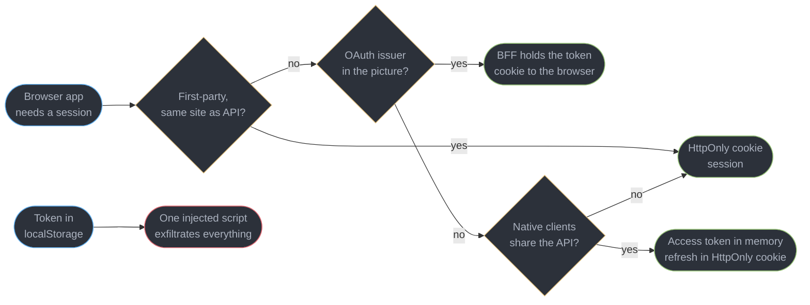
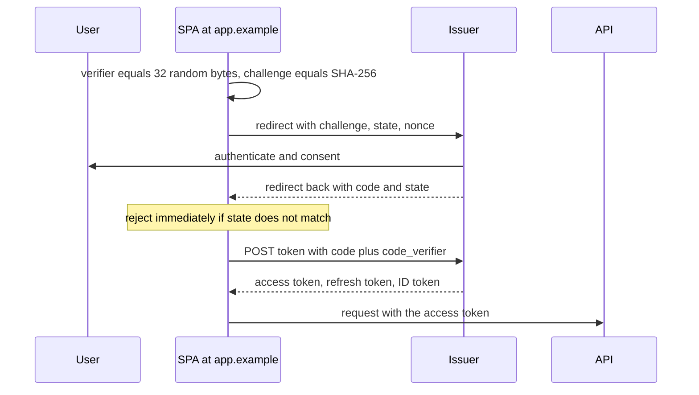
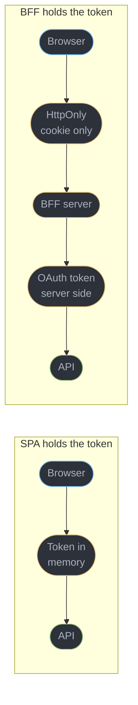
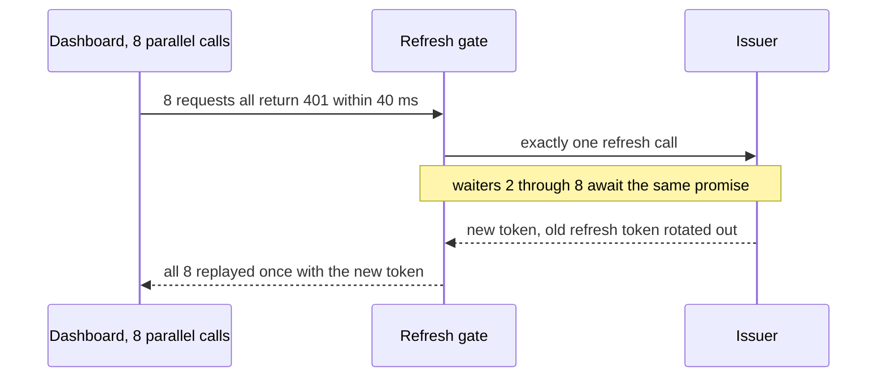
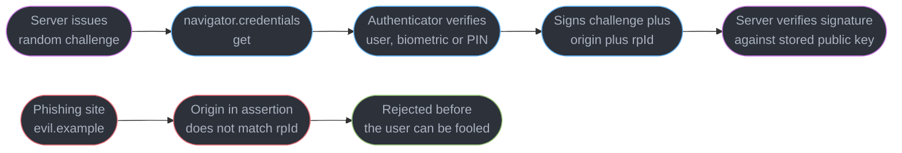
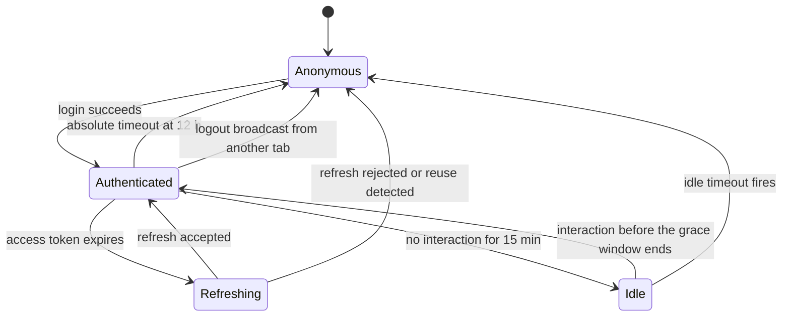

# Auth in the Browser

---

## 1. Concept Overview

A browser is the worst place in your architecture to keep a secret. It runs code from your
bundle, from every dependency in it, from an analytics tag someone added in a hurry, and
from whatever an XSS hole lets in — all with the same authority as your own code. So the
central question of client-side authentication is not "which token format" but **where the
credential lives, and what an attacker who achieves script execution can do with it**.

This module owns the client half. `backend/auth_and_authorization_systems/` and
`hld/security_and_auth/` own token issuance, JWT internals, signing and revocation; none
of them show what the browser actually does — the PKCE handshake it performs, the refresh
call it makes at the worst possible moment, the WebAuthn ceremony it drives, or the three
other tabs it forgets to log out. Cookie attributes, `SameSite`, CORS credentials and CSRF
belong to
[`../cors_cookies_and_the_same_origin_model/cors_cookies_and_the_same_origin_model.md`](../cors_cookies_and_the_same_origin_model/cors_cookies_and_the_same_origin_model.md);
XSS sinks, CSP and the client threat model belong to
[`../browser_security_and_the_client_threat_model/browser_security_and_the_client_threat_model.md`](../browser_security_and_the_client_threat_model/browser_security_and_the_client_threat_model.md).
This page assumes both and builds on them.

Five things decide whether a browser auth implementation is sound: where the credential
sits, how it was obtained, renewed and destroyed, and what the client may conclude from it.
Most production bugs are in the last three.

---

## 2. Intuition

> A token in `localStorage` is a password written on a sticky note on a monitor in a room
> where you have invited three hundred strangers to stand.

**Mental model.** Think of the credential as having a *reach*: the set of code that can read
it. An `HttpOnly` cookie has a reach of zero — no script can read it, so no script can send
it anywhere. A token in `localStorage` has a reach of every script the page ever executes,
including the transitive dependency you did not audit. The cryptography is identical in both
cases; the reach differs, and reach is what an attacker exploits.

**Why it matters.** The debate is usually argued as "cookies are vulnerable to CSRF,
tokens are not", which compares a mitigated risk to an unmitigated one. CSRF has a
complete, boring, decades-old defence (`SameSite=Lax` plus a token on state-changing
endpoints). Token exfiltration through XSS does not — you are relying on never having an
XSS bug, in a codebase with 900 transitive dependencies.

**Key insight.** Everything the client does about authorization is user experience. Hiding an
admin button, guarding a route, decoding a JWT to read `role` — none of it is a security
control, because the person you are defending against runs your code in their own browser
with DevTools open.

---

## 3. Core Principles

1. **Reach beats format.** Whether the credential is a JWT, an opaque handle or a session id
   matters far less than whether JavaScript can read it — `HttpOnly` removes the XSS read
   path entirely, and nothing else in the client does.
2. **A browser application is a public client.** It ships to the user, so it holds no
   secret. Every "client secret" in a front-end bundle is public, whatever the environment
   variable is called.
3. **Every credential is bound to something.** PKCE binds a code to the tab that requested
   it, `nonce` binds an ID token to one login attempt, a passkey binds an assertion to an
   origin. Unbound credentials are replayable.
4. **Short access, long refresh, rotate the refresh.** A 5-to-15-minute access token
   bounds the damage of a leak; a rotating refresh token with reuse detection turns a
   stolen refresh token into a detectable event rather than a silent one.
5. **Logout is a server action.** Deleting a token client-side removes the UI's copy, not the
   session; anything the server would still honour is still valid.
6. **Sessions are shared across tabs, so lifecycle changes must be broadcast.** One tab
   logging out leaves three others rendering an authenticated shell over a dead session.
7. **The client never decides authorization**, and a user-supplied destination such as a
   `returnTo` parameter is attacker input to validate, never reflect.

---

## 4. Types / Architectures / Strategies

### 4.1 Where the credential can live

| Location | Readable by script | Survives reload | XSS exfiltration | CSRF surface | Verdict |
|----------|-------------------|-----------------|------------------|--------------|---------|
| `HttpOnly; Secure; SameSite=Lax` cookie | no | yes | not possible | yes, mitigated by `SameSite` plus token | **default for first-party apps** |
| `localStorage` | yes | yes, until cleared | one script, whole token | none | avoid |
| In-memory JS variable | yes | no — lost on reload | only while the tab lives | none | acceptable with a refresh cookie |
| Non-`HttpOnly` cookie | yes | yes | one script, whole token | yes | worst of both |

The asymmetry is not close. `localStorage` also persists across tabs until something clears
it, so a token stolen at 09:00 may still be live at 17:00; a memory-held token dies with the
tab.

**The honest exceptions.** If the same API serves iOS and Android clients that cannot use
cookies, a bearer token is the shared contract. If the app and the API are genuinely
cross-site and third-party cookie restrictions apply, cookies become fragile. The mitigation
in both cases: hold the access token **in memory only**, keep the refresh credential in an
`HttpOnly` cookie, and accept one silent refresh round trip per full page reload.

### 4.2 The three architectures

| Shape | Browser holds | Server needed | Best for |
|-------|--------------|---------------|----------|
| **Cookie session** | an opaque `HttpOnly` cookie | one you already have | first-party apps |
| **BFF (token-mediating backend)** | an `HttpOnly` session cookie fronting an OAuth token | a small backend per front end | first-party apps on an OAuth issuer |
| **Public SPA client** | access token in memory, refresh in an `HttpOnly` cookie | none beyond the API | multi-client APIs, static hosting |

### 4.3 OAuth 2.1 flows a browser may use

| Flow | Status for a browser client | Why |
|------|---------------------------|-----|
| Authorization code + PKCE | **the only one** | code is bound to the requesting tab |
| Implicit (`response_type=token`) | removed in OAuth 2.1 | token in the URL fragment lands in history, `Referer` and logs |
| Resource owner password | removed | the app must handle the password, defeating federation |
| Client credentials | server-side only | requires a real secret the browser cannot hold |

### 4.4 Authentication factors in the browser

| Mechanism | Phishing-resistant | Notes |
|-----------|-------------------|-------|
| Password | no | still the fallback everywhere |
| TOTP | no — the code is typeable into a fake site | better than nothing |
| Passkey, platform authenticator | **yes, by construction** | Touch ID, Windows Hello, Android; origin signed into the assertion |
| Passkey, roaming authenticator | yes | a hardware key, portable across machines you do not own |

---

## 5. Architecture Diagrams

### Where the credential should live



`localStorage` sits off to the side deliberately: it is not a branch of the decision, it is
the outcome you are avoiding.

### Authorization code with PKCE, from the browser's side



The verifier never leaves the tab, so a code stolen from a log, a `Referer` header or a
malicious app on the same device cannot be exchanged.

### BFF versus the browser holding a token



The BFF costs a server you must run and scale. It buys an architecture in which no OAuth
token exists in the browser at all, so an injected script has nothing to take. Gateway
placement is covered in
[`../../backend/api_gateway_patterns/api_gateway_patterns.md`](../../backend/api_gateway_patterns/api_gateway_patterns.md).

### The refresh stampede, and the single-flight fix



Without the gate, seven of the eight present a refresh token that was just consumed, the
issuer sees reuse, and it revokes the whole family — logging the user out at the moment the
app was trying to keep them in.

### The WebAuthn ceremony



The private key never leaves the authenticator and the origin is inside the signed data, so
there is nothing for a user to type into a lookalike site.

### Session lifecycle across four tabs



Every arrow into `Anonymous` must reach all open tabs, and three of them originate somewhere
other than the tab the user is looking at.

---

## 6. How It Works — Detailed Mechanics

### 6.1 What script execution actually costs you

Against a JS-readable token the attack is two lines: read `localStorage`, hand it to
`navigator.sendBeacon`, which survives the page unloading. No user interaction, and the token
stays live for its full lifetime. Against an `HttpOnly` cookie the equivalent does not exist
— `document.cookie` does not contain it — so the attacker is reduced to making requests
*through* the page, bounded by the session and visible in server-side telemetry.

### 6.2 PKCE: generating the verifier and challenge

```ts
function base64url(bytes: ArrayBuffer): string {
  return btoa(String.fromCharCode(...new Uint8Array(bytes)))
    .replace(/\+/g, "-").replace(/\//g, "_").replace(/=+$/, "");
}

export async function makePkce() {
  const random = crypto.getRandomValues(new Uint8Array(32));
  const verifier = base64url(random.buffer);          // 43 chars, never leaves this tab
  const digest = await crypto.subtle.digest("SHA-256", new TextEncoder().encode(verifier));
  return { verifier, challenge: base64url(digest) };  // only the challenge goes in the URL
}
```

`S256` is the only challenge method OAuth 2.1 permits for a public client; `plain` sends the
verifier itself and binds nothing.

### 6.3 Starting the login

```ts
const { verifier, challenge } = await makePkce();
const state = crypto.randomUUID();
const nonce = crypto.randomUUID();

sessionStorage.setItem("auth.tx", JSON.stringify({
  verifier, state, nonce, returnTo: location.pathname + location.search,
}));

location.assign("https://issuer.example/authorize?" + new URLSearchParams({
  response_type: "code", client_id: "spa-prod",   // client_id is public, and that is fine
  redirect_uri: "https://app.example/callback", scope: "openid profile api.read",
  code_challenge: challenge, code_challenge_method: "S256", state, nonce,
}));
```

`sessionStorage` is correct here and only here: the transaction is per-tab, lives about 30
seconds, and holds nothing useful after the exchange — the `verifier` is worthless without
the matching `code`.

### 6.4 Handling the callback

```ts
const params = new URLSearchParams(location.search);
const tx = JSON.parse(sessionStorage.getItem("auth.tx") ?? "{}");
sessionStorage.removeItem("auth.tx");                    // single use, always

if (!tx.state || params.get("state") !== tx.state) {
  throw new Error("state mismatch: discard the code, do not exchange it");
}

const tokens = await fetch("https://issuer.example/token", {
  method: "POST",
  headers: { "Content-Type": "application/x-www-form-urlencoded" },
  body: new URLSearchParams({
    grant_type: "authorization_code", client_id: "spa-prod",
    code: params.get("code")!, redirect_uri: "https://app.example/callback",
    code_verifier: tx.verifier,                          // proves this tab started it
  }),
}).then(r => r.json());

history.replaceState({}, "", safeReturnTo(tx.returnTo)); // strip code and state from the URL
```

`state` is CSRF protection for the callback: without it an attacker hands the victim a URL
carrying the attacker's own code and silently logs them into the attacker's account.
`history.replaceState` matters too — leaving `?code=` in the address bar puts it in browser
history and in any `Referer` a later subresource sends.

### 6.5 Validating the ID token

```ts
import { jwtVerify, createRemoteJWKSet } from "jose";

const jwks = createRemoteJWKSet(new URL("https://issuer.example/.well-known/jwks.json"));
const { payload } = await jwtVerify(tokens.id_token, jwks, {
  issuer: "https://issuer.example",   // iss
  audience: "spa-prod",               // aud -- a token minted for another client is not yours
  clockTolerance: 60,                 // seconds, for clock skew
});
if (payload.nonce !== tx.nonce) throw new Error("ID token replayed from another login");
```

Skipping `aud` is the classic mistake: an issuer serving 40 applications mints valid,
correctly signed tokens for all of them, and a client without an `aud` check accepts every
one. `nonce` stops a captured ID token being replayed into a fresh login. JWT structure,
signing algorithms and revocation are owned by
[`../../backend/auth_and_authorization_systems/auth_and_authorization_systems.md`](../../backend/auth_and_authorization_systems/auth_and_authorization_systems.md).

### 6.6 The BFF, from the client's point of view

```ts
// There is no token here, and that is the entire point.
const me = await fetch("/bff/api/me", { credentials: "include" }).then(r => r.json());
```

The browser sends one `HttpOnly` cookie. The BFF looks up the server-side session, attaches
the OAuth access token, forwards the call, and refreshes without the browser ever knowing.
Cost: a stateful server on the request path plus session storage. Benefit: the XSS
token-theft class does not exist, because there is no token to steal.

### 6.7 Silent refresh without a stampede

Three properties make a refresh wrapper correct, and the `// BROKEN` to `// FIX` pair in
§10 is the whole implementation. The in-flight promise is **shared**, so 8 concurrent 401s
produce 1 refresh. It is **cleared in `finally`**, so a failed refresh does not poison every
later call. The retry is **single**, so a persistently rejecting endpoint produces one extra
request rather than an infinite loop. Put it in one wrapper; a per-call-site refresh is the
same bug written 40 times.

**Rotation and reuse detection.** Each refresh returns a new refresh token and invalidates
the old one, so a consumed token presented again means a copy leaked and the issuer revokes
the entire family. That is why the stampede is dangerous: it manufactures reuse from your own
client.

### 6.8 Registering a passkey

```ts
const options = await fetch("/auth/passkey/register/options", { method: "POST" }).then(r => r.json());
const credential = await navigator.credentials.create({
  publicKey: {
    ...options,                                  // server-issued challenge and user handle
    rp: { id: "app.example", name: "Acme" },     // rpId must match the origin's domain
    pubKeyCredParams: [{ type: "public-key", alg: -7 }, { type: "public-key", alg: -257 }],
    authenticatorSelection: { residentKey: "required", userVerification: "preferred" },
  },
});

await fetch("/auth/passkey/register", { method: "POST", body: serialize(credential) });
```

What is stored where: the **private key stays in the authenticator** (Secure Enclave, TPM or
a hardware key), synced between the user's own devices by the platform. Your server stores
only the **public key**, the credential id and a signature counter, so a database dump leaks
nothing usable — there is no password-equivalent to crack.

### 6.9 Signing in, including conditional UI

```ts
// the field carries autocomplete="username webauthn" so the browser can offer the passkey
if (await PublicKeyCredential.isConditionalMediationAvailable?.()) {
  const assertion = await navigator.credentials.get({
    publicKey: { challenge, rpId: "app.example", userVerification: "preferred" },
    mediation: "conditional",     // offers the passkey in the field's autofill list
    signal: controller.signal,    // abort if the user picks the password path instead
  });
}
```

Conditional UI makes passkeys feel like autofill rather than a separate button, which is
what moves adoption from 12% to 60%. Note the `signal`: the conditional request stays
pending and must be aborted when the user picks the fallback. **Ship passkeys *alongside* a
fallback**, not instead of one — a borrowed machine or an unsupported platform still needs a
way in, and recovery is the hardest unsolved part of a passkey deployment.

### 6.10 Logging out everywhere, including the tabs you cannot see

```ts
const channel = new BroadcastChannel("auth");
channel.onmessage = (e) => { if (e.data?.type === "logout") resetToAnonymous(e.data.reason); };

export async function logout(reason = "user") {
  try {
    await fetch("/auth/logout", { method: "POST", credentials: "include" });  // the real one
  } finally {
    channel.postMessage({ type: "logout", reason });   // the other three tabs
    resetToAnonymous(reason);
  }
}
```

`BroadcastChannel` is same-origin and does not fire in the posting tab, so the local reset
is explicit. As a fallback, writing a key to `localStorage` fires a `storage` event in every
*other* same-origin tab — the same mechanism with a worse API.

**What the server must actually invalidate**: the session record or refresh-token family
and, where the issuer supports it, the upstream OIDC session via RP-initiated logout. An
issued access token stays valid until it expires unless you keep a revocation list, which is
the strongest practical argument for 5-to-15-minute access tokens.

### 6.11 Idle versus absolute timeout

```ts
const IDLE_MS = 15 * 60_000;           // since last interaction: protects an unattended screen
const ABSOLUTE_MS = 12 * 60 * 60_000;  // hard cap: bounds a stolen session however active it is

let lastSeen = Date.now();
for (const evt of ["pointerdown", "keydown", "visibilitychange"]) {
  addEventListener(evt, () => { lastSeen = Date.now(); }, { passive: true });
}
setInterval(() => { if (Date.now() - lastSeen > IDLE_MS) logout("idle"); }, 30_000);
```

The client timer is a **courtesy**, not the control: it closes the UI promptly. The server
enforces both windows independently, because a user who edits `lastSeen` in DevTools must
gain nothing. Warn 60 seconds before the idle logout — silently discarding a half-written
form is how users learn to distrust a product.

### 6.12 The redirect round trip and its hazard

```ts
export function safeReturnTo(raw: string | null | undefined): string {
  if (!raw) return "/";
  if (raw.startsWith("//") || raw.includes("\\")) return "/";   // protocol-relative tricks
  const url = new URL(raw, location.origin);
  if (url.origin !== location.origin) return "/";               // absolute off-site target
  return url.pathname + url.search + url.hash;
}
```

An unvalidated `returnTo` gives an attacker a link that starts on *your* domain, shows
*your* login page, and lands the user on a lookalike site — the pattern that makes phishing
mail pass a careful reader's domain check. Never echo the raw value into the page. For a
seamless return, record the scroll offset and wizard step alongside `returnTo` in the same
`sessionStorage` transaction and restore them after `history.replaceState`.

### 6.13 Route guards are UX

A router check such as "if the session has no `admin` role, render Forbidden" is a rendering
decision, not a security boundary: the user can edit the session object in the console, patch
the bundle, or call the API with `curl`. The guard exists so a legitimate user does not click
into a page that will fail, and the enforcement is the server's `403`. The same rule governs
Server Functions — see
[`../../react/server_components_and_server_functions/server_components_and_server_functions.md`](../../react/server_components_and_server_functions/server_components_and_server_functions.md),
where an exported async function is a public HTTP endpoint that must authorize itself.

---

## 7. Real-World Examples

**The `localStorage` breach that was not an XSS in first-party code.** A tag-manager script
was compromised upstream, ran with full page authority for 6 hours, and read
`localStorage.access_token` on every page view. The application's own code contained no XSS
sink at all, and the 24-hour tokens had no rotation, so the exposure outlived the incident by
a day. An `HttpOnly` cookie would have made this an availability problem, not a breach.

**The passkey rollout that stalled at 12%.** A team shipped a "Sign in with a passkey" button
beside the password field and saw 12% adoption in three months. Moving to conditional UI —
`autocomplete="username webauthn"` plus `mediation: "conditional"` — took adoption to 61% in
six weeks with no other change. Discoverability, not cryptography, limits passkey rollouts.

**The `returnTo` in the password-reset mail.** A reset link of the form
`https://app.example/login?returnTo=https://app-example.attacker.test/session-expired` was
sent to 4,000 users. The domain in the visible link was genuine, the login page was genuine,
and the redirect after a successful login was not. Fourteen users re-entered credentials on
the destination. A three-line origin check would have prevented every one.

---

## 8. Tradeoffs

| Choice | Gains | Costs | Use when |
|--------|-------|-------|---------|
| `HttpOnly` cookie session | XSS cannot read the credential; automatic on every request | CSRF surface; cross-site friction | first-party browser app |
| Token in `localStorage` | trivial to implement; works cross-origin | one injected script takes everything, and it persists | essentially never |
| Access token in memory | dies with the tab; no CSRF | reload costs a refresh round trip; needs a refresh cookie anyway | native clients share the API |
| BFF | no token in the browser at all; central refresh and logout | a stateful server to run, scale and page for | first-party app on an OAuth issuer |
| Short access token (5-15 min) | small blast radius | refresh machinery, stampede risk | the default, against 24 h |
| Passkey plus fallback | phishing-resistant and adoptable | two code paths to maintain | every realistic rollout |

---

## 9. When to Use / When NOT to Use

### Use an `HttpOnly` cookie session when

- The app and the API are first-party and same-site, which is most products.
- Browsers are the only client, or the others have their own auth path, and you want
  `SameSite=Lax` doing the CSRF work for free.

### Use a BFF when

- An OAuth or OIDC issuer is mandatory and you want no token in the browser.
- You already run a server for SSR, so the marginal cost is a session store, and central
  logout, refresh and audit are requirements rather than nice-to-haves.

### Use an in-memory access token when

- Native or partner clients consume the same token API, or the app is genuinely cross-site
  and third-party cookie restrictions bite.

### Do NOT

- **Put a token in `localStorage`** because a tutorial did — the one choice that turns any
  XSS into a full account takeover.
- **Trust a decoded JWT claim** for anything but rendering; even a verified claim proves
  what the *issuer* said, not what *this* API will allow.
- **Ship a "client secret"** in a browser bundle. There is no such thing.
- **Treat a client-side logout as a logout**, or **reflect `returnTo` unvalidated**.

---

## 10. Common Pitfalls

### Pitfall 1: N concurrent refreshes trigger reuse detection

```ts
// BROKEN: every 401 starts its own refresh. 8 parallel calls, 8 refreshes,
// 7 of them presenting a refresh token the issuer already rotated out.
async function apiFetch(url: string, init?: RequestInit) {
  const res = await fetch(url, init);
  if (res.status === 401) {
    await fetch("/auth/refresh", { method: "POST", credentials: "include" });
    return fetch(url, init);
  }
  return res;
}
```

```ts
// FIX: one shared in-flight promise. 8 waiters, 1 refresh, 1 rotation.
let inflight: Promise<void> | null = null;
const refreshOnce = () =>
  (inflight ??= fetch("/auth/refresh", { method: "POST", credentials: "include" })
    .then(r => { if (!r.ok) throw new Error("refresh_failed"); })
    .finally(() => { inflight = null; }));
```

The symptom is distinctive: users are logged out during heavy page loads and never during
light ones, and the issuer logs a refresh-token-reuse alert naming your own client id.

### Pitfall 2: the client decides authorization

```ts
// BROKEN: the button is hidden, the endpoint is not.
const claims = JSON.parse(atob(token.split(".")[1]));
if (claims.role === "admin") renderDeleteButton();  // FIX: fine to render, server must 403
```

`atob` decodes; it does not verify. A user pastes their own `{"role":"admin"}` payload and
the button appears — whether anything happens depends entirely on the server, which must
return `403` for the call regardless of what the UI rendered.

### Pitfall 3: logging out in one tab only

Clearing memory and navigating to `/login` leaves three other tabs rendering an
authenticated shell, and their next API call fails with a raw `401` mid-action. Broadcast
the logout (§6.10) and have the receiving tab reset immediately.

### Pitfall 4: refreshing on a timer instead of on demand

A `setInterval` refresh keeps a session alive for a user who closed the laptop three hours
ago, and it drifts under background throttling — Chromium clamps timers in hidden tabs to
roughly one per minute. Refresh on a `401`, or when a request starts within 60 seconds of
expiry.

### Pitfall 5: `sessionStorage` treated as safe storage

`sessionStorage` is per-tab, which people read as "isolated", but any script in that tab
reads it freely. Correct for a 30-second PKCE transaction, wrong for a token.

### Pitfall 6: an XSS-hardening plan with no CSP

Every argument here assumes XSS is possible. A strict `Content-Security-Policy` with nonces
is the control that reduces its likelihood, and it belongs with the credential decision
rather than after it — see
[`../browser_security_and_the_client_threat_model/browser_security_and_the_client_threat_model.md`](../browser_security_and_the_client_threat_model/browser_security_and_the_client_threat_model.md).

---

## 11. Technologies & Tools

| Tool | What it is for | How you invoke it |
|------|---------------|-------------------|
| WebAuthn | Passkeys and hardware authenticators | `navigator.credentials.create` and `.get` |
| OAuth 2.1 | The authorization framework a browser client uses | authorization code plus PKCE |
| OpenID Connect | Identity on top of OAuth | `scope=openid`, ID token |
| Web Crypto API | Verifier hashing and random generation | `crypto.subtle.digest` |
| jose | JWT verification against a JWKS | `jwtVerify` |
| oauth4webapi | A low-level, spec-faithful OAuth client | `authorizationCodeGrantRequest` |
| Auth.js | Session and provider glue for JS frameworks | route handler plus provider config |
| Keycloak | Self-hosted OIDC issuer | realm plus public client |
| Auth0 | Hosted identity provider | universal login plus SPA SDK |
| BroadcastChannel | Cross-tab session synchronisation | `new BroadcastChannel("auth")` |

Token issuance, rotation and revocation on the server are owned by
[`../../hld/security_and_auth/security_and_auth.md`](../../hld/security_and_auth/security_and_auth.md).

---

## 12. Interview Questions with Answers

**Q: Why is an `HttpOnly` cookie better than a token in `localStorage`?**
**Short:** Marking a cookie HttpOnly deletes the JavaScript read path, so an injected script cannot exfiltrate the credential whatever authority it runs with.

`document.cookie` never contains an `HttpOnly` cookie, so the two-line `sendBeacon`
exfiltration that defeats `localStorage` has nothing to read. `localStorage` is worse still
because it persists across tabs until cleared, so a token taken at 09:00 may still be live at
17:00. The usual counter — cookies have CSRF exposure — compares a solved problem
(`SameSite=Lax` plus a token on state-changing endpoints) with an unsolved one.

**Q: What does PKCE actually prevent, and why does a browser app need it?**
**Short:** Binding the authorization code to a random verifier only the requesting tab holds, so a code stolen in transit cannot be redeemed.

The client generates 32 random bytes, sends `SHA-256` of them as `code_challenge`, and sends
the raw value as `code_verifier` at token exchange. An attacker who captures the code from a
log, a `Referer` header or a URI-scheme hijack on a shared device has no verifier, so the
exchange fails — the per-transaction proof that replaces the secret a public client lacks.

**Q: Why is a client-side route guard not a security control?**
**Short:** Users run your bundle in their own browser, so any check it performs can be edited, patched out, or skipped by calling the API directly.

A guard hides a page; it does not protect the endpoint behind it. Someone with DevTools flips
the condition, and `curl` skips the front end entirely. Its real job is not routing a
legitimate user into a screen that will 403. Enforcement is the server checking authorization
on every request, Server Functions included — they are public HTTP endpoints.

**Q: What happens when eight parallel requests all get a 401 at the same moment?**
**Short:** Each starts its own refresh, and under rotation the later seven present a consumed token, which the issuer correctly treats as theft.

Reuse detection revokes the entire token family and forces re-authentication — your own
client has manufactured the attack signature. The fix is a single shared in-flight promise:
the first `401` starts the refresh, the rest await it, all eight replay once. Clear it in a
`finally` so a failed refresh does not poison later calls, and retry exactly once.

**Q: Why was the implicit flow removed in OAuth 2.1?**
**Short:** Returning the access token in the URL fragment put it in browser history, referrer headers, server logs and screenshots.

There was also no way to bind the token response to the request that asked for it.
Authorization code plus PKCE gives a public client the same capability while keeping the
token in a POST response body and binding the exchange to the originating tab.
`response_type=token` in a codebase is a migration, not a preference.

**Q: What is the difference between `state` and `nonce`?**
**Short:** State protects the callback against CSRF by proving this browser started the flow, while nonce ties the ID token to that one login attempt.

`state` is generated before the redirect, stored per-tab, and compared on return; a mismatch
means someone else's authorization code has reached your user, which would log them into the
attacker's account. `nonce` travels to the issuer and returns inside the signed ID token, so
a captured ID token replayed into a fresh login fails the comparison. You need both.

**Q: What must actually be invalidated when a user logs out?**
**Short:** The server-side session or refresh-token family plus the upstream identity-provider session -- deleting client state alone changes nothing.

A client-side clear removes the UI's copy of a credential the server would still honour, so a
copy taken earlier keeps working. Call the logout endpoint, revoke the refresh family, and
where the issuer supports RP-initiated logout end the OIDC session too, or the next login
completes silently. An issued access token stays valid until expiry unless you keep a
revocation list — the strongest argument for 5-to-15-minute lifetimes.

**Q: A user logs out in one tab while three others are open. What happens?**
**Short:** Those tabs keep rendering an authenticated shell until their next API call fails, so the logout has to be broadcast to them.

`BroadcastChannel` is the clean mechanism: post a message on logout and have every listener
reset to anonymous immediately. It does not fire in the posting tab, so reset locally too.
The older equivalent writes a key to `localStorage`, firing a `storage` event in every other
same-origin tab. Broadcast login as well, so the other tabs recover without a reload.

**Q: What does a BFF buy you, and what does it cost?**
**Short:** Keeping every OAuth token server-side behind an HttpOnly session cookie, at the price of a stateful server on the request path.

The browser holds one opaque cookie and knows nothing about tokens; the BFF exchanges the
code, stores the tokens, refreshes them, and forwards calls. The XSS token-theft class
disappears, and logout and refresh become central. The cost is a server to run, scale, patch
and page for — for an app already running SSR that marginal cost is small.

**Q: Why is a passkey phishing-resistant when a TOTP code is not?**
**Short:** The origin is inside the signed assertion, so an authenticator will not produce a valid signature for a lookalike domain.

A TOTP code is six digits a user can type into anything, including a proxy that forwards them
instantly. WebAuthn signs a server-issued challenge together with the origin and `rpId`, the
private key never leaves the authenticator, and the browser refuses to invoke a credential
registered for `app.example` on `app-example.attacker.test` — structural, not vigilance.

**Q: How does refresh-token rotation with reuse detection work?**
**Short:** Every refresh returns a new token and invalidates the old one, so a second use of a consumed token proves a copy leaked.

The issuer revokes the whole family and forces re-authentication, converting a silent theft
into a loud, attributable event, and it bounds the value of a stolen refresh token to the
window before the client next refreshes. The catch is that a buggy client produces the same
signal — concurrent refreshes, a retried request, a stale tab waking up.

**Q: What is the open-redirect risk in a `returnTo` parameter?**
**Short:** An attacker crafts a link on your real domain showing your real login page that lands the user on a lookalike site afterwards.

The visible domain passes a careful reader's check, which is what makes it effective in
phishing mail. Validate by parsing with `new URL(raw, location.origin)` and rejecting
anything whose origin differs, plus a guard for protocol-relative `//host` and backslash
variants. Prefer a short allowlist of paths when the valid destinations are few.

**Q: Can the client trust a claim it decoded from a JWT?**
**Short:** Only for rendering -- decoding is not verification, and even a verified claim states what the issuer said, not what the API will allow.

`atob(token.split(".")[1])` performs no signature check at all, so a user can substitute any
payload and watch the admin UI appear. Verifying properly means fetching the JWKS and
checking `iss`, `aud` and `exp` — worth doing for an ID token, and still not an authorization
decision. The API re-checks, because only it knows the user's current permissions.

**Q: What is the difference between idle and absolute session timeout?**
**Short:** Idle measures time since the last interaction and protects an unattended screen, while absolute caps total lifetime regardless of activity.

A typical pair is 15 minutes idle and 12 hours absolute; regulated environments run tighter.
The absolute cap is what bounds a stolen session, because an attacker with a live session is
active and never trips an idle timer. Enforce both server-side — the client timer can be
edited in DevTools — and warn 60 seconds ahead so a half-written form is not lost.

**Q: When would you choose a roaming authenticator over a platform one?**
**Short:** When the credential must move between machines the user does not own, or when a synced platform passkey falls outside the compliance boundary.

A platform authenticator — Touch ID, Windows Hello, Android biometrics — is bound to a device
and syncs through the user's own account, which makes everyday adoption practical. A roaming
hardware key is portable, works on a machine you have never seen, and is provably not backed
up to a consumer cloud. Offer platform passkeys first, hardware keys for high-privilege
accounts.

**Q: Why does a browser application have no client secret?**
**Short:** Everything shipped to the browser is readable, so a value in the bundle is public whatever the build tool names the variable.

Bundlers inline environment variables at build time, and view-source or the network panel
recovers them in seconds. OAuth calls this a public client, and the browser flow follows from
it: no `client_secret` at the token endpoint, PKCE instead, and exact-match `redirect_uri`
registration so the issuer knows where a code may be delivered.

## 13. Best Practices

1. **Default to an `HttpOnly; Secure; SameSite=Lax` cookie session** for a first-party
   browser app, and justify any deviation against a written threat model. If a token must
   live in the browser, keep it **in memory only** — never `localStorage`.
2. **Authorization code with PKCE (`S256`) is the only flow.** Validate `state` on the
   callback and `nonce`, `iss`, `aud` and `exp` on the ID token.
3. **Strip `code` and `state` from the URL** with `history.replaceState` before rendering.
4. **Refresh in exactly one place**, single-flight, cleared in `finally`, retried once.
5. **Keep access tokens at 5 to 15 minutes** and rotate refresh tokens with reuse detection.
6. **Logout calls the server, then broadcasts** to every other tab; enforce idle and absolute
   timeouts server-side, and warn before the idle one fires.
7. **Validate every `returnTo` against your own origin** or an allowlist of paths.
8. **Ship passkeys with conditional UI alongside a fallback**, and design account recovery
   before launch rather than after the first support ticket.
9. **Treat every route guard as UX** and re-check on the server, every request.

---

## 14. Case Study

### The dashboard that logged everyone out at 09:05

**The system.** A B2B analytics SPA on `https://app.acme.test`, an OIDC issuer, 6,200 daily
users, access tokens at 10 minutes with rotating refresh tokens and reuse detection. Tokens
lived in `localStorage`. Each dashboard load fired 11 parallel API calls.

**The symptom.** Every weekday between 09:00 and 09:15, support saw a spike of "logged out
while working" tickets — 180 on the worst day, never reproducible on demand. The issuer's
logs showed `refresh_token_reuse_detected` events, all with the SPA's client id.

**Step 1 — the reproduction.** The pattern was arrival time, not load: users had left a tab
open overnight, the access token expired long before they touched it, and the first
interaction fired all 11 calls at once, all returning `401` within 40 ms.

```ts
// BROKEN: refresh logic duplicated at every call site, no coordination.
async function apiFetch(url: string, init?: RequestInit) {
  const res = await fetch(url, { ...init, headers: authHeaders() });
  if (res.status !== 401) return res;
  const t = await fetch("/auth/refresh", {
    method: "POST",
    body: JSON.stringify({ refresh_token: localStorage.getItem("refresh_token") }),
  }).then(r => r.json());
  localStorage.setItem("access_token", t.access_token);
  localStorage.setItem("refresh_token", t.refresh_token);   // 11 racing writers
  return fetch(url, { ...init, headers: authHeaders() });
}
```

Call 1 rotated the refresh token; calls 2 through 11 held the old value in a closure and
presented it. Reuse detection revoked the family. The control was correct, and the client
was the attacker.

**Step 2 — the single-flight fix.** Reuse-detection events fell from 340 per week to 0 in
four days.

```ts
// FIX: one shared promise, cleared in finally, replayed once.
let inflight: Promise<void> | null = null;

const refreshOnce = () =>
  (inflight ??= fetch("/auth/refresh", { method: "POST", credentials: "include" })
    .then(r => { if (!r.ok) throw new Error("refresh_failed"); })
    .finally(() => { inflight = null; }));

export async function apiFetch(url: string, init: RequestInit = {}) {
  const res = await fetch(url, { ...init, credentials: "include" });
  if (res.status !== 401) return res;
  await refreshOnce();
  return fetch(url, { ...init, credentials: "include" });
}
```

**Step 3 — the finding nobody had asked for.** Both tokens sat in `localStorage`, reachable
by every script including three third-party tags. The team moved the refresh token into an
`HttpOnly; Secure; SameSite=Lax` cookie set by a thin BFF, kept the access token in memory,
and deleted 90 lines of storage code. A reload now costs one silent refresh, 84 ms at p75.

**Step 4 — logout and tabs.** Once the session was a cookie, logout had to be a server call,
and `BroadcastChannel` closed the last symptom: users who logged out in one tab and kept
working in another had been hitting raw `401` screens mid-action.

| Metric | Before | After |
|--------|--------|-------|
| Refresh calls per dashboard load | 11 | 1 |
| Reuse-detection events per week | 340 | 0 |
| "Logged out while working" tickets per week | 610 | 4 |
| Tokens reachable by page script | 2 | 0 |
| Stale authenticated tabs after logout | up to 5 | 0 |

**What the team took away.**

1. A refresh stampede is indistinguishable from token theft, and the issuer is right to
   treat it as theft. Single-flight refresh is a correctness requirement, not a nicety.
2. Refresh logic belongs in exactly one wrapper — eleven call sites meant eleven bugs.
3. `localStorage` had been chosen years earlier because it was easy, and nobody revisited it
   until an unrelated incident opened the file.
4. 84 ms on reload bought the removal of an entire attack class, and nobody argued for it.
5. The tab-sync bug sat in the queue for 14 months labelled a UI error, not an auth one.
