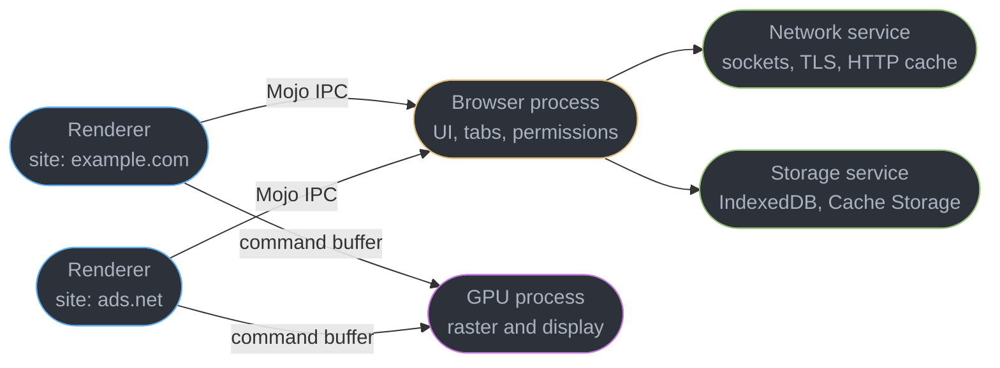
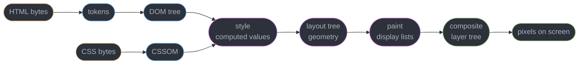
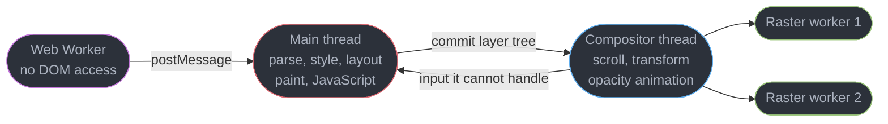
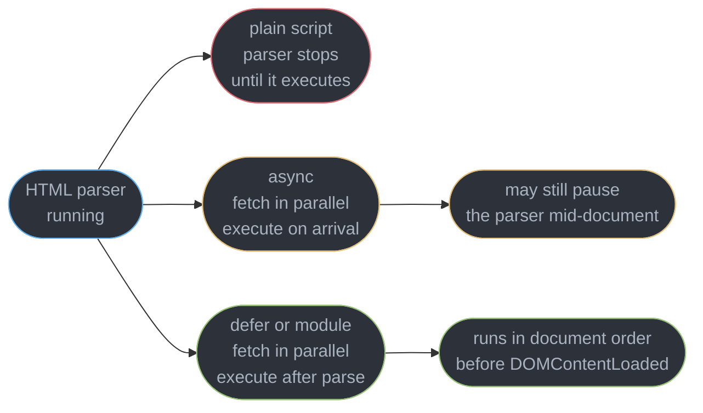
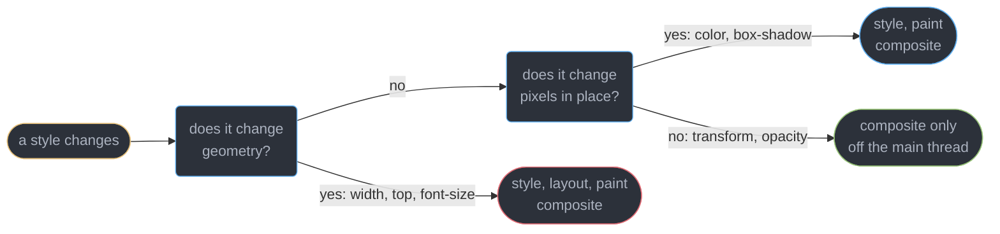
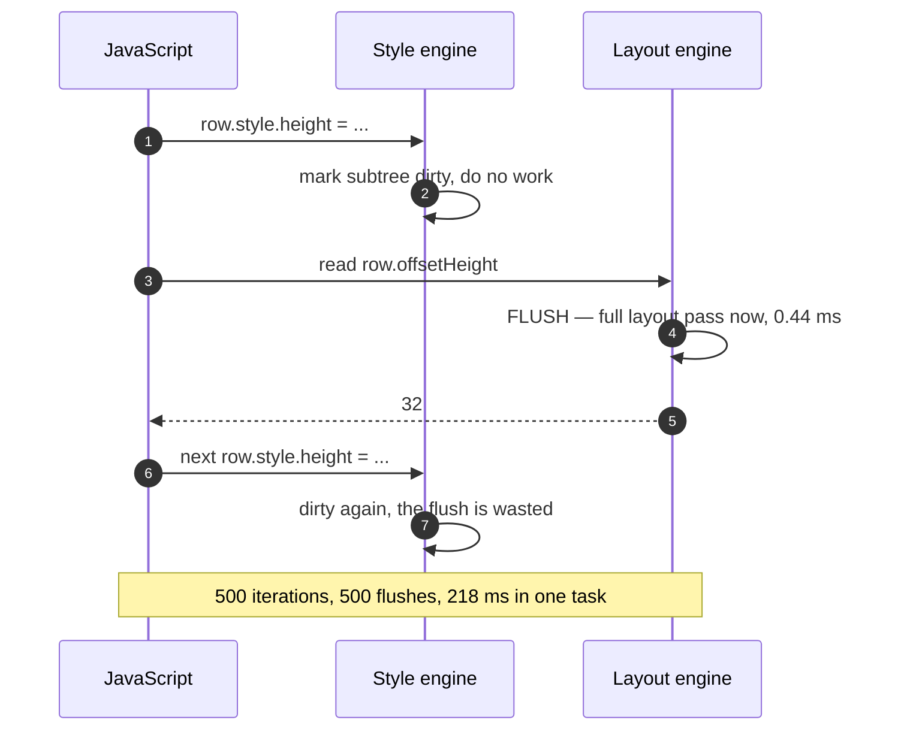

# Browser Architecture and the Rendering Pipeline

---

## 1. Concept Overview

Every front-end performance complaint — jank, a frozen button, a slow first paint, a
stuttering scroll — resolves to two facts about how a browser is built: work is split across
**processes** for safety, and across **threads inside one process** for speed.

| Layer | Unit | What it buys | What it costs |
|-------|------|--------------|---------------|
| Multi-process | one renderer per site | a crash or an exploit is contained | roughly 40-130 MB of RAM per renderer |
| Renderer threads | main, compositor, raster, workers | scroll and transform survive a busy main thread | main-thread work queues behind JavaScript |
| Pipeline stages | style, layout, paint, composite | later stages can be skipped | an early stage invalidates every stage after it |

The pipeline runs on a clock: at 60 Hz a frame is **16.7 ms**, at 120 Hz **8.3 ms**, and
everything the main thread does must fit inside that or the frame is dropped.

This module owns the **mechanics** of layout, paint and compositing: what triggers each
stage, what each costs, and how to stop paying for it. It does not teach what surrounds it:

| Topic | Owner |
|-------|-------|
| Tasks, microtasks, `requestIdleCallback`, `scheduler.yield()` | [The Event Loop and Scheduling](../the_event_loop_and_scheduling/the_event_loop_and_scheduling.md) |
| CSS *authoring* — the cascade, specificity, container queries, layers | [CSS Layout and the Cascade](../css_layout_and_the_cascade/css_layout_and_the_cascade.md) |
| Animation technique, FLIP, `prefers-reduced-motion` | [CSS Animation and Motion](../css_animation_and_motion/css_animation_and_motion.md) |
| Heap snapshots, detached nodes, leak hunting | [Client Memory and Performance Debugging](../client_memory_and_performance_debugging/client_memory_and_performance_debugging.md) |
| LCP, INP and CLS definitions and thresholds | [Web Performance and Core Web Vitals](../web_performance_and_core_web_vitals/web_performance_and_core_web_vitals.md) |

The CSS boundary is the one people cross by accident: **that module tells you which selector
wins and how to express a grid; this one tells you what recomputing that grid costs and when
the browser is forced to do it.**

---

## 2. Intuition

> A browser is a **compiler with a deadline**. It compiles bytes into pixels, and it must
> finish a full pass every 16.7 ms while a user is looking at it.

**Mental model.** A print shop with one typesetter and many press operators. The typesetter
(the main thread) reads the manuscript, decides where every word sits, and hands finished
plates to the presses (the compositor and raster threads). A press can re-run a plate at a
different position or ink density alone. Anything that changes *where the words sit* goes
back to the one typesetter, and there is a queue.

**Why it matters.** `transform: translateX(40px)` is a press instruction. `left: 40px` is a
manuscript edit, queued behind whatever JavaScript is already there.

**Key insight, and the one that catches everyone.** JavaScript and layout run on the **same
thread**, with no preemption: once a task starts the browser cannot interrupt it to handle a
click. A 300 ms `JSON.parse` is a 300 ms unresponsive button, and no CSS tuning fixes it.

---

## 3. Core Principles

1. **Processes are for safety, threads are for speed.** A separate renderer contains a crash
   and a memory-disclosure exploit; separate threads inside it keep scrolling alive.
2. **A renderer is sandboxed** — no file, no socket. Every such request is brokered by the
   browser process over Mojo IPC.
3. **One thread does parse, style, layout, paint and JavaScript.** This single fact explains
   almost every front-end performance rule you have ever been given.
4. **Invalidation cascades forward.** Geometry forces layout, paint and composite; colour
   forces paint and composite; `transform` forces composite only.
5. **Stages are skippable, never reorderable** — the browser's whole strategy is to enter
   the pipeline as late as it can.
6. **Reading a layout-dependent property flushes pending layout synchronously**, which is
   how a loop of 500 elements turns into 500 layouts inside one frame.
7. **A layer is memory.** Compositing trades RAM for time, at `width * height * 4` bytes.
8. **Measure on the flame chart, not by reasoning** — which stage is expensive is empirical
   and moves between Chrome versions.

---

## 4. Types / Architectures / Strategies

### 4.1 The processes in a modern Chromium browser

| Process | Count | Responsibility | Sandboxed |
|---------|-------|----------------|-----------|
| Browser | 1 | UI chrome, tabs, permissions, brokering all I/O | No — it is the broker |
| Renderer | 1 per site instance | Blink parsing, style, layout, paint, V8 | Yes, tightly |
| GPU | 1 | Rasterisation and compositing across all tabs | Yes, partially |
| Network service | 1 utility process | Sockets, TLS, the HTTP cache, cookies | Yes |
| Storage service | 1 utility process | IndexedDB, Cache Storage, quota | Yes |
| Utility / audio / extension | n | Codecs, audio output, each extension | Yes |

Chrome's Task Manager (Shift+Esc) lists them live with the site each renderer is locked to.

### 4.2 The pipeline stages, and what invalidates each

| Stage | Input | Output | Thread |
|-------|-------|--------|--------|
| Parse | bytes | DOM tree, CSSOM | main |
| Style | DOM + CSSOM | computed style per element | main |
| Layout | computed style | box geometry (the layout tree) | main |
| Pre-paint | layout tree | paint property trees, layer decisions | main |
| Paint | layout tree | display lists (draw commands, not pixels) | main |
| Commit | display lists | layer tree handed to the compositor | main to compositor |
| Raster | display lists | tile bitmaps | raster pool / GPU |
| Draw | tiles | quads submitted to the GPU | compositor |

Paint produces **commands, not pixels**: rasterising `drawRect` into bytes is a separate
stage on a worker pool, which is why a paint-heavy page can still scroll.

### 4.3 Four ways to get work off the main thread

| Strategy | What moves off the main thread | Limit |
|----------|-------------------------------|-------|
| Promote to a layer | `transform` and `opacity` animation | costs `w * h * 4` bytes of RAM |
| Move to a Web Worker | parsing, diffing, crypto | no DOM, so never layout or paint |
| `content-visibility: auto` | layout and paint for offscreen subtrees | needs `contain-intrinsic-size` |
| Yield between chunks | nothing moves, the task is split | owned by [The Event Loop and Scheduling](../the_event_loop_and_scheduling/the_event_loop_and_scheduling.md) |

---

## 5. Architecture Diagrams

### 5.1 Process topology and the sandbox boundary



A renderer holds no socket and no file handle. A cross-origin `fetch` is an IPC message the
browser process forwards to the network service, applying CORS before copying bytes back — so
a compromised renderer cannot read a response it was never allowed to see.

### 5.2 The critical rendering path



Only elements generating a box reach the layout tree: `display: none` produces none and is
dropped after style, while `visibility: hidden` still lays out and occupies space.

### 5.3 Where the work lands inside one frame

```
  ONE FRAME AT 60 Hz  =  16.7 ms of main-thread budget

  0 ms                                                       16.7 ms
  |================================================================|
  | input | rAF  | style | layout  | pre-paint | paint  |  commit  |
  | 1.1ms | 2.4  | 1.8   | 3.2     | 0.9       | 2.6    |  0.7 ms  |
  |================================================================|
                            main thread used 12.7 ms, 4.0 ms spare

  compositor thread, in parallel:  raster tiles --> draw quads --> present

  THE SAME FRAME WITH ONE 52 ms TASK ON THE MAIN THREAD

  0 ms           16.7          33.3          50.0              64 ms
  |================|================|================|=============|
  |    JavaScript: one 52 ms task, not preemptible     | re-render |
  |================|================|================|=============|
         ^ click at 6 ms                               ^ handler at 52 ms
         3 frames dropped, at 16.7, 33.3 and 50.0 ms
         46 ms of input delay before the handler even starts running
```

The second bar is the whole argument for splitting long tasks. Nothing was slow in a CSS
sense — style, layout and paint are the 12 ms tail; the 52 ms of JavaScript occupied the only
thread that can answer a click, and a task cannot be preempted.

### 5.4 Threads inside one renderer process



The red thread is the contended one. A Web Worker has no DOM, so it takes CPU work off the
main thread but never rendering work.
---

## 6. How It Works — Detailed Mechanics

### 6.1 Bytes to DOM, and why the parser stops

The HTML parser consumes bytes, emits tokens and builds nodes incrementally, so a partially
received document renders. Two things interrupt it.
A **stylesheet does not block parsing but blocks rendering**: the browser will not build a
render tree from a CSSOM it knows is incomplete, because that flashes unstyled text and then
reflows the page. It also blocks any script that follows it, since that script may call
`getComputedStyle()`. A **synchronous script blocks the parser outright**, because
`document.write()` can insert bytes at the parser's current position.

```html
<head>
  <link rel="stylesheet" href="/app.css">        <!-- render-blocking, 180 ms on 4G -->
  <script src="/analytics.js"></script>          <!-- parser-blocking, adds 240 ms -->
  <link rel="preload" as="font" href="/i.woff2" crossorigin>
</head>
```

That head costs roughly 420 ms of serialised critical path on 4G; moving the script to
`defer` removes 240 ms of it without changing a line of the script.

### 6.2 Script loading: the four behaviours

```html
<script src="a.js"></script>                <!-- blocks parsing, runs immediately -->
<script src="b.js" async></script>          <!-- parallel fetch, runs on arrival, any order -->
<script src="c.js" defer></script>          <!-- parallel fetch, runs after parse, in order -->
<script src="d.js" type="module"></script>  <!-- deferred by default, plus its import graph -->
```



`async` is the trap: it removes the *fetch* from the critical path but not the *execution*,
so if the file lands mid-document the parser still stops to run it. Use `async` only for
independent scripts, `defer` for anything that touches the DOM.

The **preload scanner** is a second, lightweight parser that runs ahead whenever the real one
is blocked, looking only for URLs to start fetching. It cannot see a resource absent from the
markup — injected by JavaScript, a CSS `background-image`, an `@import` — so those need an
explicit `rel="preload"`.

### 6.3 Reflow, repaint, composite: which property does which



On a 2,000-node page a reflow costs 4-40 ms, a repaint 1-8 ms, and a composite-only change
under 0.5 ms — and the last of those does not run on the main thread at all.

| Property | Layout | Paint | Composite | Note |
|----------|--------|-------|-----------|------|
| `width`, `height`, `padding`, `margin` | yes | yes | yes | invalidates siblings and ancestors |
| `top`, `left`, `right`, `bottom` | yes | yes | yes | even on `position: absolute` |
| `font-size`, `font-family`, `line-height` | yes | yes | yes | can reflow the whole document |
| `display`, `float`, `position` | yes | yes | yes | changes the box tree itself |
| `color`, `background-color` | no | yes | yes | repaint of the element's own tiles |
| `box-shadow`, `border-radius`, `outline` | no | yes | yes | expensive to raster, cheap to invalidate |
| `visibility` | no | yes | yes | box still occupies space |
| `transform`, `translate`, `rotate`, `scale` | no | no | yes | compositor thread |
| `opacity` | no | no | yes | compositor thread |
| `filter`, `backdrop-filter` | no | no | yes | compositor, but GPU-expensive |

`transform` is cheaper than `top` because it is a matrix applied to an already-rasterised
layer at draw time, while `top` changes the box's position in the layout tree and can move
every sibling after it. Authoring belongs to
[CSS Animation and Motion](../css_animation_and_motion/css_animation_and_motion.md).

### 6.4 Forced synchronous layout — the highest-value section in this module

The browser keeps layout **dirty** on purpose: a style write only marks nodes invalid, and
layout runs once, later, just before paint. Reading a layout-dependent property defeats that
— the browser must produce a correct number now, so it flushes synchronously mid-JavaScript.

**The properties and methods that force a layout flush:**

| Category | Members |
|----------|---------|
| Element box | `offsetTop`, `offsetLeft`, `offsetWidth`, `offsetHeight`, `offsetParent` |
| Client box and scroll | `clientWidth`, `clientHeight`, `scrollTop`, `scrollHeight`, `scrollIntoView()` |
| Rects and computed style | `getBoundingClientRect()`, `getClientRects()`, `getComputedStyle()` |
| Window, focus, SVG | `innerWidth`, `scrollY`, `element.focus()`, `getBBox()`, `computeCTM()` |

Read one of these once per frame and the cost is one layout; interleave reads and writes in
a loop and you pay one layout per iteration:

```js
// BROKEN — read, write, read, write: 500 elements means 500 forced layouts
for (const row of rows) {                       // rows.length === 500
  const h = row.offsetHeight;                   // READ  -> flush all pending layout
  row.style.height = (h * 1.5) + "px";          // WRITE -> mark layout dirty again
}
// DevTools console: [Violation] Forced reflow while executing JavaScript took 218ms
```

```js
// FIX — read every value first, then write every value: exactly 1 layout
const heights = rows.map(r => r.offsetHeight);  // 500 reads, 1 flush (layout stays clean)
rows.forEach((r, i) => {                        // 500 writes, 0 flushes
  r.style.height = (heights[i] * 1.5) + "px";
});
```

Measured on a 500-row table in Chrome 141 on an M2: 218 ms before, 4.1 ms after, a 53x
reduction from reordering two lines. The rule generalises: **within one task, all reads
before all writes.** FastDOM formalises it, but a two-pass loop needs no library.



### 6.5 Where `requestAnimationFrame` belongs

An animation-frame callback runs **after input handling and before style and layout** in the
same frame, which makes it the correct place to *write* styles: the write lands immediately
before the layout that was going to happen anyway. It is not a safe place to *read* geometry,
because an earlier callback in the same frame may already have dirtied layout.

```js
let pending = null;                                    // one rAF for the whole batch
function scheduleWidths(elements) {
  const measured = elements.map(el => el.getBoundingClientRect().width);  // 1 flush, now
  if (pending) cancelAnimationFrame(pending);
  pending = requestAnimationFrame(() => {                                 // writes only
    elements.forEach((el, i) => el.style.setProperty("--w", measured[i] + "px"));
    pending = null;
  });
}
```

Coalescing with one `pending` handle matters as much as the ordering: a `scroll` handler
fires 60 times a second, and 60 callbacks writing the same value is 60 wasted style passes.

### 6.6 Compositing and layer promotion

An element gets its own compositor layer when the browser decides it can be drawn
independently. The triggers, roughly by how often they surprise people:


| Trigger | Note |
|---------|------|
| A running `transform` or `opacity` animation | promoted for the animation's duration only |
| `will-change: transform` or `will-change: opacity` | promoted eagerly and held |
| `transform: translateZ(0)` or `translate3d(0,0,0)` | the old hack, still works |
| A video, canvas, WebGL context, `position: fixed` or `backdrop-filter` | always its own layer |
| **Overlap with an already-composited layer** | implicit compositing — the cause of layer explosion |

```css
.card { will-change: transform; }        /* held for the element's life: memory all session */

.card { transition: transform 200ms; }   /* better: promote at the interaction, release after */
.card:hover, .card:focus-within { will-change: transform; }
```

`will-change` is a **hint, not an instruction** — the browser may ignore it, and Chrome caps
how much it honours. The memory arithmetic is unforgiving: a layer costs `width * height * 4`
bytes, so a full-screen layer is **8.3 MB** at 1920x1080 and **13.6 MB** on a phone with a
412x915 CSS viewport at DPR 3 (a 1236x2745 backing store). Forty promoted cards is over
500 MB of GPU memory and an OOM tab.

**Layer explosion** is usually implicit: promote one element with `translateZ(0)` and every
element that overlaps it and paints after it must be promoted too, or the paint order breaks.
One hack on a sticky header can promote a hundred list items nobody touched.

### 6.7 Skipping work the user cannot see

```css
/* Layout and paint are skipped entirely for subtrees outside the viewport. */
.feed-item {
  content-visibility: auto;
  contain-intrinsic-size: auto 320px;   /* placeholder height: no scrollbar jump, no CLS */
}
```

`content-visibility: auto` moves offscreen subtrees out of layout and paint until they near
the viewport, typically cutting initial rendering on a 5,000-item feed by 60-90%.
**`contain-intrinsic-size` is not optional** — without it every offscreen item measures zero
height, the scrollbar is wrong, and entering items shift content, failing CLS, defined in
[Web Performance and Core Web Vitals](../web_performance_and_core_web_vitals/web_performance_and_core_web_vitals.md).

### 6.8 Measuring it

The Chrome DevTools **Performance** panel is the primary instrument. Record an interaction
and read the **Main** track flame chart: yellow is scripting, purple is style and layout,
green is paint and composite. A task over 50 ms gets a red hatched corner labelled *Long
task*. A forced layout appears as a purple `Layout` block nested *inside* a yellow script
block, with a red triangle and the tooltip *Forced reflow is a likely performance
bottleneck*; the **Summary** tab names the exact line that read the property.

The **Layers** panel shows every composited layer, its memory and its promotion reason — the
fastest way to diagnose layer explosion. The **Rendering** drawer's **Paint flashing** shows
repainted regions in green: if a whole card flashes when one label changed, invalidation is
too coarse. In the field use `long-animation-frame` rather than `longtask`, because it
attributes cost to a source file and function:

```js
new PerformanceObserver(list => {
  for (const frame of list.getEntries()) {
    for (const s of frame.scripts) {
      report({ url: s.sourceURL, fn: s.sourceFunctionName,
               duration: Math.round(s.duration),
               forcedStyleAndLayout: Math.round(s.forcedStyleAndLayoutDuration) });
    }
  }
}).observe({ type: "long-animation-frame", buffered: true });
```

`forcedStyleAndLayoutDuration` turns "the page feels slow" into a file and a function name,
reported from real users rather than a lab run.

---

## 7. Real-World Examples

**A crashed tab that took nothing with it.** A memory-corruption bug in a WebGL shader
compiler kills one renderer. The user sees *Aw, Snap* in that tab only; twelve other tabs,
each in its own renderer, keep running and the browser process still holds the session. The
same boundary makes a compromised renderer useless to an attacker: no cookies for other
sites, no socket.

**Site isolation and Spectre.** Spectre, disclosed 2018-01, made every same-process memory
boundary unreliable — speculative execution plus a high-resolution timer lets a page read
memory it was never given. Chromium's answer was structural: every **site** (scheme plus
registrable domain) gets its own process. A *site* is coarser than an *origin*, so
`https://a.example.com` and `https://b.example.com` share a renderer while
`https://example.com` and `https://example.org` do not. `Cross-Origin-Opener-Policy:
same-origin` plus `Cross-Origin-Embedder-Policy: require-corp` opts into full cross-origin
isolation, the precondition for `SharedArrayBuffer`.

**A scroll that stuttered because of one listener.** A product page bound
`document.addEventListener("touchstart", fn)` for a carousel. A non-passive listener may call
`preventDefault()`, so the compositor cannot scroll until the main thread confirms it did
not, and the whole document becomes a non-fast scroll region — 90-140 ms of added scroll
latency per touch on a mid-range Android device. `{ passive: true }` removed it entirely.

---

## 8. Tradeoffs

| Dimension | Process per site | One process for everything |
|-----------|------------------|----------------------------|
| Crash containment | one tab dies | the browser dies |
| Spectre exposure | cross-site memory is unreachable | any page can attempt a read |
| Memory | 40-130 MB per renderer | one heap |

| Dimension | Animate `transform` | Animate `left` |
|-----------|--------------------|----------------|
| Thread | compositor | main |
| Stages per frame | composite only | style, layout, paint, composite |
| Survives a busy main thread | yes | no, it freezes |
| Cost of promotion | `w * h * 4` bytes of layer memory | none, but siblings can move |

| Dimension | `defer` | `async` | plain script |
|-----------|---------|---------|--------------|
| Blocks the parser | no | on arrival, unpredictably | always |
| Execution order | document order | arrival order | document order |
| Runs before `DOMContentLoaded` | yes | not guaranteed | yes |
| Safe to touch the DOM | yes | no, the DOM may be partial | only above itself |

---

## 9. When to Use / When NOT to Use

**Promote to a layer when** an element genuinely animates `transform` or `opacity`, or is a
video or canvas. Scope `will-change` to the interaction — a permanently promoted element pays
its 8-14 MB for the whole session. **Use `content-visibility: auto` when** a long list
renders far outside the viewport, always with `contain-intrinsic-size`. **Reach for a Web
Worker when** the work is pure computation — parsing a 4 MB JSON payload, diffing, crypto.

**Do NOT** interleave geometry reads and style writes in a loop; that is the single most
common front-end performance defect, and it is free to fix.

**Do NOT** sprinkle `translateZ(0)` as a general speed-up — it dates from a 2012 era of
browsers that did not promote automatically, and today it mostly produces implicit layer
explosion. **Do NOT** animate `width`, `height`, `top` or `left` in a loop of any size, and
**do NOT** trust that a CSS-only change is cheap: `box-shadow` on 400 elements is a real
raster cost.

---

## 10. Common Pitfalls

### Pitfall 1: the read-write-read loop over a list (BROKEN → FIX)

```js
// BROKEN — measuring inside the same loop that writes, so layout flushes 200 times
function equalizeCards(cards) {                 // cards.length === 200
  cards.forEach(card => {
    const tallest = Math.max(...cards.map(c => c.getBoundingClientRect().height));
    card.style.minHeight = tallest + "px";      // dirties layout for the next iteration
  });
}
// [Violation] Forced reflow while executing JavaScript took 340ms

// FIX — one measurement pass, then one write pass: 1 layout instead of 200
function equalizeCards(cards) {
  const heights = cards.map(c => c.getBoundingClientRect().height);   // all reads
  const tallest = Math.max(...heights);
  for (const card of cards) card.style.minHeight = tallest + "px";    // all writes
}
```

The inner `cards.map()` makes the broken version quadratic: 200 iterations times 200 reads is
40,000 rect calls, each flushing because the previous iteration wrote. 340 ms against 6 ms.

### Pitfall 2: `will-change` applied globally

```css
/* BROKEN — every card is promoted for the whole session */
.card { will-change: transform, opacity, left, top; }
/* FIX — promote only while it is actually about to change */
.card { transition: transform 180ms ease-out; }
.card:hover { will-change: transform; }
```

`will-change: left` is worse than useless: `left` cannot be composited, so the browser
promotes the element *and* still runs layout every frame. Only `transform`, `opacity`,
`filter` and `backdrop-filter` are worth naming.

### Pitfall 3: `getComputedStyle` hidden inside a helper

```js
// BROKEN — the helper looks pure, but it flushes layout on every call
const isVisible = el => getComputedStyle(el).display !== "none";
items.forEach(el => { el.classList.toggle("on", isVisible(el)); });  // write, read, write

// FIX — read the class list, which needs no layout at all
items.forEach(el => { el.classList.toggle("on", !el.classList.contains("hidden")); });
```

A forced reflow rarely appears at the call site — it hides behind a utility named
`measure()`, `isVisible()` or `getSize()`, which is why the Summary tab's line attribution is
worth more than reading the code.

### Pitfall 4: assuming a Web Worker helps with rendering

Moving a virtual-DOM diff to a worker removes real work from the main thread. Moving the
*application* of that diff is impossible — every `appendChild` and style write happens on the
thread that owns the DOM. If the flame chart shows 40 ms of `Layout` against 6 ms of
scripting, only doing less layout helps.

---

## 11. Technologies & Tools

| Tool | Role | Relevance to the pipeline |
|------|------|--------------------------|
| Chrome DevTools | Profiler and inspector | Performance flame chart, Layers panel, Paint flashing |
| Blink | Chromium's rendering engine | Owns style, layout, paint, compositing |
| V8 | JavaScript engine | Shares the main thread with layout |
| Skia | 2D graphics library | Executes the display lists that paint produces |
| Lighthouse | Lab audit | Flags render-blocking resources and long main-thread work |
| WebPageTest | Lab audit with filmstrip | Frame-by-frame view of the critical rendering path |
| Perfetto | Trace viewer | Full Chromium traces across processes and threads |
| PerformanceObserver | Browser API | `long-animation-frame` attribution from real users |

---

## 12. Interview Questions with Answers

**Q: What forces a synchronous layout, and why is it expensive?**
**Short:** Reading a geometry property such as `offsetHeight` or `getBoundingClientRect()` after a style write makes the browser run the whole layout pass immediately instead of once per frame.

The browser normally batches: a style write only marks nodes dirty and layout runs once
before paint. Reading `offsetTop`, `clientWidth`, `scrollHeight`, `getBoundingClientRect()`,
`getComputedStyle()`, `element.focus()` or SVG `getBBox()` needs a correct number now, so it
flushes — which is how a 500-row loop becomes 500 layouts and 218 ms in one task.

**Q: Why is animating `transform` cheaper than animating `top`?**
**Short:** Transform and opacity are applied to an already-rasterised layer on the compositor thread, so neither layout nor paint runs, while `top` changes the box position in the layout tree.

`transform` becomes a matrix the compositor multiplies at draw time, on a thread that is not
the main thread, so the animation survives busy JavaScript. Changing `top` moves the box in
the layout tree and can move every following sibling, so style, layout and paint re-run every
frame — 11 ms per frame against 0.3 ms in one measured dashboard. Animate only these two.

**Q: Why does a long JavaScript task block a click from being handled?**
**Short:** A task runs to completion with no preemption, and the same main thread that runs JavaScript is the only one that dispatches input events and runs event handlers.

The browser cannot interrupt a running task to service a click, so the event waits. A 52 ms
task means up to 52 ms of input delay plus three dropped frames at 60 Hz. This is what INP
measures, at a good threshold of 200 ms at p75 — see
[Web Performance and Core Web Vitals](../web_performance_and_core_web_vitals/web_performance_and_core_web_vitals.md).

**Q: What is the difference between a reflow and a repaint?**
**Short:** Reflow recomputes geometry — box positions and sizes — and then forces paint and composite, while a repaint only redraws pixels inside boxes whose geometry is unchanged.

Reflow is triggered by `width`, `height`, `padding`, `top`, `font-size` or a text change and
cascades to siblings and ancestors, costing 4-40 ms on a 2,000-node page. Repaint comes from
`color`, `background-color`, `visibility` and `box-shadow`, at 1-8 ms. `transform` and
`opacity` skip both at under 0.5 ms, off the main thread. Read the tiers off the flame chart.

**Q: What is the difference between `async`, `defer` and `type="module"` on a script?**
**Short:** Async executes as soon as it downloads and can still pause the parser mid-document, defer executes in document order after parsing finishes, and a module script is deferred by default.

All three fetch in parallel, so all three remove the download from the critical path. Only
`defer` guarantees both ordering and a complete DOM, making it the right default for anything
that touches the page, while `async` suits independent scripts. A `type="module"` script
behaves like `defer` and also fetches its whole import graph before executing.

**Q: Why does a stylesheet block rendering when it does not block parsing?**
**Short:** Stylesheets block the render tree because building one from an incomplete CSSOM would flash unstyled content and then reflow the entire document.

The parser keeps building the DOM while CSS downloads, but the browser refuses to enter the
style stage until every render-blocking stylesheet has arrived. A stylesheet also blocks any
script that follows it, since that script may call `getComputedStyle()`. Keep render-blocking
CSS small, inline the above-the-fold rules, and load the rest without blocking.

**Q: How do you fix layout thrashing in a loop that must both measure and write?**
**Short:** Batching every read before every write turns one layout per iteration into exactly one layout for the whole loop, with no change to the logic.

Run a first pass that collects every measurement into an array, then a second pass that
applies every style write: layout stays clean through the reads and dirty through the writes,
so the browser flushes once. In a 500-row table that was 218 ms down to 4.1 ms. If the writes
must land next frame, schedule one coalesced `requestAnimationFrame`, not one per element.

**Q: What causes an element to get its own compositor layer?**
**Short:** Compositor promotion comes from a running transform or opacity animation, `will-change`, a 3D transform, a video or canvas, `position: fixed`, or overlapping something already composited.

The last one is implicit compositing and is the usual surprise: if element B paints after a
promoted element A and overlaps it, B must be promoted too or the paint order breaks — which
is how one `translateZ(0)` on a sticky header promotes a hundred list items. The DevTools
Layers panel names the promotion reason and the memory cost per layer.

**Q: Why should `will-change` not be applied to many elements permanently?**
**Short:** Each promoted layer costs `width * height * 4` bytes of GPU memory, so a full-screen layer is 8.3 MB on desktop and 13.6 MB on a DPR-3 phone.

`will-change` is a hint the browser may ignore, and Chrome caps how much it honours. A
permanent `will-change: transform` on 40 cards is over 500 MB of layer memory and an OOM tab
on mobile. Naming a non-compositable property such as `will-change: left` is worse still: the
element is promoted and still runs layout every frame. Apply it on hover, release after.

**Q: Why does a crashed tab not take the browser down, while a busy tab can still feel like it froze?**
**Short:** Process boundaries contain a crash so only the affected renderer dies, but a busy renderer freezes its own main thread and nothing else, which looks identical to the user in that tab.

A renderer crash produces the *Aw, Snap* page in one tab while the browser process and every
other renderer keep running. An infinite loop is different: the process is healthy but its
main thread never yields, so that tab alone stops painting and handling input. The one
exception is same-site tabs opened through `window.open` with a live opener, which share it.

**Q: What is a "site" for the purpose of process isolation, and why not use the origin?**
**Short:** One renderer process per site means scheme plus registrable domain, so subdomains share a process while different registrable domains never do.

`https://a.example.com` and `https://b.example.com` are the same site and share a renderer,
because `document.domain` historically let them reach into each other synchronously.
`https://example.com` and `https://example.org` are always separated. Origin-level isolation
is opt-in via `Origin-Agent-Cluster`, and full cross-origin isolation needs COOP plus COEP.

**Q: Which thread handles scrolling, and when does it fall back to the main thread?**
**Short:** Scrolling runs on the compositor thread by default, which is why a page scrolls while JavaScript is busy, until a non-passive listener forces the compositor to wait.

A `touchstart` or `wheel` listener registered without `{ passive: true }` may call
`preventDefault()`, so the compositor must ask the main thread first — the region becomes a
non-fast scroll region, adding 90-140 ms per touch on mid-range Android. Mark every
scroll-adjacent listener passive; the API is in
[The DOM and Web APIs](../the_dom_and_web_apis/the_dom_and_web_apis.md).

**Q: What is the preload scanner and what defeats it?**
**Short:** A second lightweight parser scans ahead for subresource URLs while the primary parser is blocked, so downloads start early even behind a blocking script.

It only reads markup, so anything absent from the HTML is invisible to it: images injected by
JavaScript, CSS `background-image` URLs, `@import`ed stylesheets, anything behind a
client-side router. Those need an explicit `rel="preload"` with the right `as` value, and a
font preload needs `crossorigin` even same-origin. Watch for a resource that starts late.

**Q: Do `display: none` and `visibility: hidden` cost the same in the pipeline?**
**Short:** Display none removes the element from the layout tree entirely so no geometry is computed, while visibility hidden keeps its box, keeps its space, and still runs layout.

`display: none` is why the layout tree is smaller than the DOM tree, and toggling it reflows
the surrounding content in both directions. `visibility: hidden` only skips paint, so
toggling it is a repaint. For a frequently toggled element `opacity: 0` plus
`pointer-events: none` is composite-only, but stays focusable unless you also set `inert`.

**Q: What does `content-visibility: auto` actually skip?**
**Short:** Offscreen subtrees skip layout, paint and rasterisation until they approach the viewport, which typically cuts initial rendering on a long list by 60-90%.

It applies `contain: layout paint style` to the subtree while it is far from the viewport, so
the browser never computes geometry for content the user cannot see. It must be paired with
`contain-intrinsic-size`, or every skipped subtree measures zero height, the scrollbar is
wrong, and entering items shift content — failing CLS at its 0.1 threshold.

**Q: What is in the render tree that is not in the DOM, and vice versa?**
**Short:** The layout tree holds only elements that generate a box, so `display: none` subtrees and `head` are absent, while generated content from pseudo-elements is present.

`::before` and `::after` boxes exist in the layout tree with no DOM node behind them, and an
anonymous box appears wherever a block-level element sits among inline siblings. The DOM also
holds comment and script nodes that never generate boxes. This is why `querySelectorAll`
counts differ from layout counts, and why a huge hidden subtree costs memory but no layout.

**Q: How do you identify a forced reflow in the Performance panel?**
**Short:** A red-cornered Layout block nested inside a yellow scripting block is the signature, and the Summary tab names the source line that read the property.

Record the interaction, expand the Main track, and look for purple `Layout` bars *inside* a
script call rather than after it. Chrome also logs `[Violation] Forced reflow while executing
JavaScript took Nms` for anything over 50 ms. In the field, `long-animation-frame`'s
`forcedStyleAndLayoutDuration` reports the same cost with a `sourceURL` and function name.

**Q: Why is `requestAnimationFrame` the right place for style writes but a trap for reads?**
**Short:** Animation-frame callbacks run after input handling and immediately before style and layout, so a write there costs nothing extra while a read there can flush a layout another callback just dirtied.

Multiple callbacks run in registration order within one frame, so a callback that reads
geometry after an earlier one wrote forces a synchronous layout mid-frame. Keep the callback
write-only, measure in the previous frame, and coalesce with one handle. Idle work belongs in
[The Event Loop and Scheduling](../the_event_loop_and_scheduling/the_event_loop_and_scheduling.md).

---

## 13. Best Practices

1. **All reads before all writes, within every task** — the highest-return rule in front-end
   performance, and it costs two lines of reordering.
2. **Animate only `transform` and `opacity`.** For a size change animate `scale()`, or accept
   the layout cost knowingly.
3. **Default every script to `defer`**, and justify each `async` or blocking script in review.
4. **Scope `will-change` to the interaction** and release it after, never naming a
   non-compositable property in it.
5. **Keep every task under 50 ms**, measured with `long-animation-frame` rather than by feel.
6. **Pair `content-visibility: auto` with `contain-intrinsic-size`** on every long list, and
   **mark scroll-adjacent listeners `{ passive: true }`** so the compositor never waits.
7. **Check the Layers panel before and after any compositing change**, and **profile on a
   4x-throttled CPU** — implicit promotion is invisible in the source, and a fast laptop
   hides everything a mid-range Android device will not.

---

## 14. Case Study

### A virtualised table whose scroll dropped to 11 fps

An internal admin console renders a 12-column table over a 40,000-row dataset, virtualised to
about 60 visible rows. After a 2026-06 release adding a sticky header and per-row height
measurement, scrolling fell from 60 fps to 11 fps and clicking a row took 400-900 ms.

A 6-second Performance trace showed the shape immediately: 82% of main-thread time in
`Layout`, in blocks nested inside `onScroll`, each tagged with the forced-reflow triangle.
The Layers panel showed **214 composited layers** totalling 690 MB, against 3 before. Two
independent defects:

```js
// BROKEN 1 — measure and position in the same pass, once per visible row per scroll event
function positionRows(rows, scrollTop) {
  let offset = 0;
  for (const row of rows) {                        // 60 rows, fires on every scroll event
    const h = row.getBoundingClientRect().height;  // READ  -> flush layout
    row.style.transform = `translateY(${offset}px)`;
    row.style.height = h + "px";                   // WRITE -> dirty again, next read flushes
    offset += h;
  }
}
```

```css
/* BROKEN 2 — the sticky header was promoted, and every row overlapped it */
.table-header { will-change: transform; position: sticky; top: 0; }
.table-row    { will-change: transform, height; }
```

The header's promotion was deliberate. `will-change` on `.table-row` was added "for
smoothness" and did two harmful things: it promoted 60 rows unconditionally, and by naming
`height` — which cannot be composited — kept them all in layout anyway. Overlap with the
promoted header dragged in the rest implicitly, reaching 214 layers.

```js
// FIX 1 — measure once into a cache, write in a second pass. Heights change only on resize.
const heightCache = new Map();                     // row key -> measured height in px
function measureRows(rows) {                       // on mount and on ResizeObserver only
  for (const r of rows) heightCache.set(r.dataset.key, r.getBoundingClientRect().height);
}
function positionRows(rows) {                      // on every scroll: writes only
  let offset = 0;
  for (const row of rows) {
    row.style.transform = `translateY(${offset}px)`;
    offset += heightCache.get(row.dataset.key) ?? 44;   // 44px is the default row height
  }
}
```

```css
/* FIX 2 — promote the one element that actually animates, and contain the rows */
.table-header { position: sticky; top: 0; will-change: transform; }
.table-row    { contain: layout paint; }           /* no promotion, no implicit cascade */
```

`contain: layout paint` stopped the implicit cascade: a contained element cannot affect
layout or paint outside its own box, so the compositor no longer had to promote it.

**Outcome, over 10 days of real traffic.** Scroll frame rate went from 11 fps to a steady
58-60 fps, main-thread layout per scroll event from 74 ms to 1.2 ms (62x), composited layers
from 214 to 4, GPU memory from 690 MB to 21 MB, and INP at p75 from 780 ms to 142 ms — from
failing to passing the 200 ms threshold in
[Web Performance and Core Web Vitals](../web_performance_and_core_web_vitals/web_performance_and_core_web_vitals.md).
The diff was 19 lines of JavaScript and 2 CSS declarations.

**The lesson.** Neither defect was a slow algorithm. One was a **read placed after a write**,
turning a batched layout into 60 synchronous ones per scroll event; the other a **compositing
hint applied without checking what it promoted**, turning a memory optimisation into a 690 MB
regression. Both are invisible in review and obvious in a 6-second trace.
