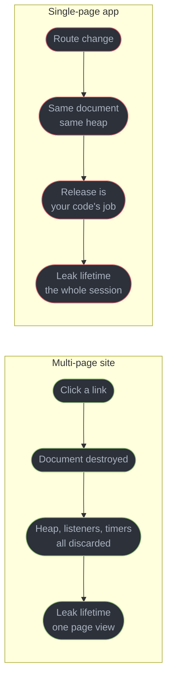
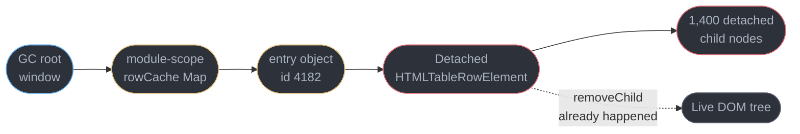
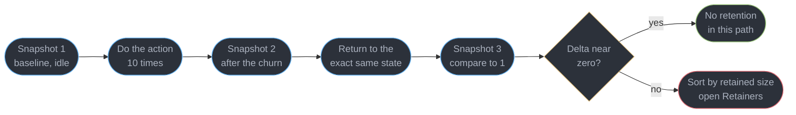
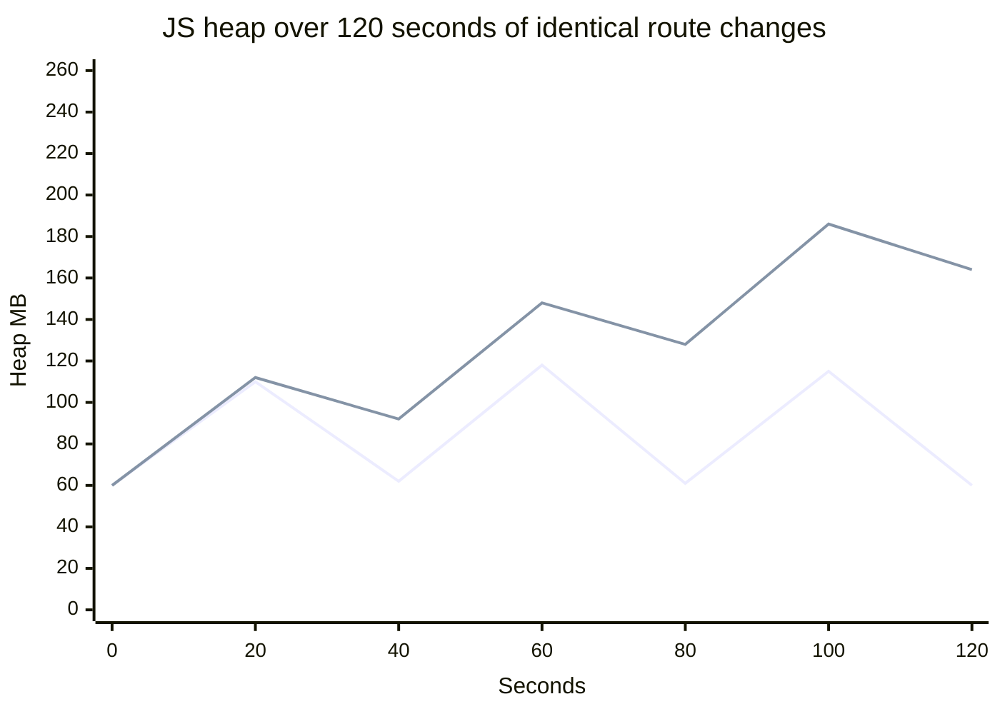
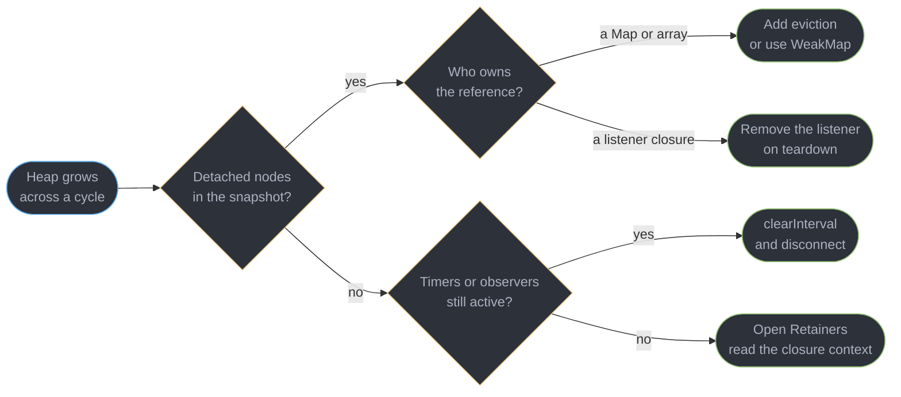
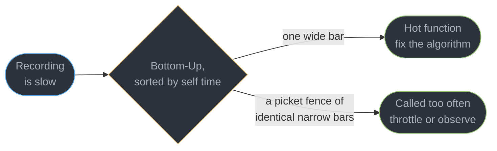

# Client Memory and Performance Debugging

---

## 1. Concept Overview

A user opens your dashboard on Monday morning and leaves the tab open until Friday. On
Monday it renders a route change in 40 ms; by Wednesday the same interaction takes 900 ms
and the tab is holding 1.8 GB. Nothing in the code changed. The application simply never
let go of anything, and a garbage collector cannot reclaim what your own objects still
point at.

This module is about **diagnosing a real page**. It is deliberately named for the
actionable half. The theory lives elsewhere and is not re-taught here:
[`../../cs_fundamentals/memory_management_and_virtual_memory/memory_management_and_virtual_memory.md`](../../cs_fundamentals/memory_management_and_virtual_memory/memory_management_and_virtual_memory.md)
owns garbage-collection algorithms, generational collection, mark-and-sweep and virtual
memory; and
[`../../cs_fundamentals/how_code_runs_compilers_and_interpreters/how_code_runs_compilers_and_interpreters.md`](../../cs_fundamentals/how_code_runs_compilers_and_interpreters/how_code_runs_compilers_and_interpreters.md)
owns JIT tiers, interpreters, inline caching as a compiler technique and why any of it
works. What you get here is the workflow: take a heap snapshot, read the Retainers pane,
name the object that will not die, and delete the line of code holding it.

Four neighbours own topics that recur:
[`../browser_architecture_and_the_rendering_pipeline/browser_architecture_and_the_rendering_pipeline.md`](../browser_architecture_and_the_rendering_pipeline/browser_architecture_and_the_rendering_pipeline.md)
owns layout, paint, composite and forced synchronous layout;
[`../the_event_loop_and_scheduling/the_event_loop_and_scheduling.md`](../the_event_loop_and_scheduling/the_event_loop_and_scheduling.md)
owns tasks, microtasks and long-task yielding;
[`../web_performance_and_core_web_vitals/web_performance_and_core_web_vitals.md`](../web_performance_and_core_web_vitals/web_performance_and_core_web_vitals.md)
owns LCP, INP and CLS at p75; and
[`../../react/react_performance_and_profiling/react_performance_and_profiling.md`](../../react/react_performance_and_profiling/react_performance_and_profiling.md)
owns re-render cost, memoisation and the React Profiler.

---

## 2. Intuition

> A garbage collector does not free unused objects. It frees **unreachable** ones. Every
> leak is something you are still holding on purpose, by accident.

**Mental model.** Think of a leak as a rope, not a puddle. Nothing is spilling; something
is tied down. The debugging question is never "where did memory go" but "trace the rope
back to the post" — the post being a GC root such as `window`, the live DOM tree, or a
running timer's callback. Heap-snapshot tooling exists to draw that rope.

**Why it matters.** A page that leaks 4 MB per route change survives a demo and dies in
production: 300 route changes across a work day is 1.2 GB, and on a 4 GB Android device the
browser discards the tab long before that. The user reports "the app logged me out" and
nobody connects it to memory.

**Key insight.** The leak classes are few and boring — six of them cover almost everything
— and each has a distinctive retaining-path shape you can recognise on sight in the
Retainers pane. Learning the six shapes converts a multi-day investigation into a ten-minute
one.

---

## 3. Core Principles

1. **Reachability is the only rule.** If a path of references exists from a GC root to your
   object, it stays. Setting one of five references to `null` frees nothing.
2. **A long-lived SPA has no reset.** Navigation used to be the world's most effective
   memory manager. Client-side routing removed it, so release is now deliberate work.
3. **Retained size is the number that matters.** Shallow size tells you how fat one object
   is; retained size tells you how much the heap shrinks if it dies.
4. **Never trust a single snapshot.** The interesting quantity is a delta between two
   points that should have been identical, not an absolute number.
5. **Every subscription is a two-sided contract.** Whatever adds a listener, timer,
   observer or store subscription is responsible for removing it, in the same file.
6. **Measure before you optimise object shape.** Hidden-class and megamorphic problems are
   real but rank below leaks and below a 200 ms `scroll` handler in almost every real app.
7. **The lab underestimates the field.** Your laptop has 32 GB and never discards a tab. A
   leak's first production symptom is usually a mid-range Android device reloading itself.

---

## 4. Types / Architectures / Strategies

### 4.1 The leak taxonomy, by what retains the object

| Leak | What holds it | Retaining path you will see |
|------|--------------|----------------------------|
| Detached DOM | a JS variable, array, `Map` or framework ref pointing at a removed node | `window` to a module-scope array to `Detached HTMLDivElement` |
| Listener never removed | the event target's internal listener list holds the handler, the handler's closure holds everything | `window` to `EventListener` to the closure's `context` |
| Timer still running | the timer queue holds the callback for the lifetime of the page | GC root to `setInterval` callback to captured state |
| Over-capturing closure | one closure keeps the whole enclosing scope alive, including variables it never reads | closure `context` object listing unrelated names |
| Cache with no eviction | a module-level `Map` grows monotonically | `window` to `Map` to 40,000 entries |
| Observer never disconnected | `IntersectionObserver`, `MutationObserver`, `ResizeObserver` and store subscriptions hold both callback and targets | observer to its `callback` and its target list |

### 4.2 The tools, and what each one answers

| Tool | Panel | The question it answers |
|------|-------|------------------------|
| Heap snapshot | Memory | "What is on the heap right now, and what holds it?" |
| Comparison view | Memory, snapshot 3 | "What survived a cycle that should have left nothing?" |
| Detached elements | Memory | "Which removed DOM nodes are still referenced?" |
| Allocation instrumentation on timeline | Memory | "Where in time and in code is this being allocated?" |
| Allocation sampling | Memory | "Cheap, long-running attribution by call stack" |
| Performance recording | Performance | "Where is CPU time going, and which frames are long?" |
| `measureUserAgentSpecificMemory()` | your own code | "What does the whole page cost on real users' devices?" |

---

## 5. Architecture Diagrams

### Why the same bug was invisible for twenty years



The defect class did not appear because JavaScript changed. It appeared because the
free-every-navigation reset was removed.

### The retaining path, which is what you are actually hunting



The node is out of the document, which is why the UI looks correct. One `Map` entry keeps
it and its entire subtree alive, which is why the heap does not shrink.

### The three-snapshot technique



Snapshot 1 exists to give snapshot 3 something honest to subtract. Taking a snapshot forces
a garbage collection first, so anything still present in snapshot 3 is genuinely reachable.

### Sawtooth versus staircase



The lower series allocates hard and returns to a 60 MB floor after every collection: healthy
churn. The upper series has the same peaks but a floor climbing 60, 92, 128, 164 MB — about
35 MB retained per cycle. Only the trough line matters; peaks tell you nothing.

### Shallow versus retained size, drawn

```
        window                       shallow   retained
          |
          +-- appState  ------------      56        4,812,000
                |
                +-- rows  (Array) --      131,088   4,811,000
                      |
                      +-- row[0] --       72        1,204
                      +-- row[1] --       72        1,204   (each row also
                      +-- ...             ...       ...      holds a detached
                      +-- row[3999] --    72        1,204     <tr> subtree)

  Sorting by shallow size puts the 131 KB Array on top and hides the 4.8 MB problem.
  Sorting by retained size puts appState on top, which is where the fix goes.
```

Retained size is computed over the dominator tree: it is what the heap loses if the object
becomes unreachable, which is the only figure that predicts the effect of a fix.

### Leak triage, in the order that costs least



Detached nodes first because the filter takes four seconds and identifies the owner
immediately; closure inspection last because it is the slowest read.

---

## 6. How It Works — Detailed Mechanics

### 6.1 Detached DOM: the leak that accounts for most of them

A node removed from the document is not freed if JavaScript still points at it. The
reference does not have to be to the node you removed — a reference to any descendant keeps
the whole detached subtree alive, because `parentNode` walks upward. A module-scope
`Map<string, HTMLTableRowElement>` written to on every render (the §14 case) is the canonical
instance: ten refreshes of a 4,000-row table leave 40,000 rows on the heap and one in the
document. Find them by taking a snapshot and typing `Detached` into the class filter, which
lists them as `Detached HTMLTableRowElement`. The Memory panel's **Detached elements**
profiling type does the same in one click and names the retaining JS object beside each.

Two cheap confirmations from the console, no snapshot needed:

```js
document.body.contains(suspectNode);   // false while the node is still on the heap
queryObjects(HTMLTableRowElement);     // DevTools-only: every live instance, in one array
```

`queryObjects` runs a collection first, so its count is a reachable count. Watch it across
ten cycles: 4,000 to 8,000 to 12,000 is a leak stated in one number.

### 6.2 Listeners, timers and observers: the three that outlive their component

These are one bug with three faces. Each registers a callback with something whose lifetime
is the page, and the callback's closure then retains everything the component ever touched.

```ts
// One teardown object, used by every kind of subscription.
function createScope() {
  const undo: Array<() => void> = [];
  return {
    on<K extends keyof WindowEventMap>(t: EventTarget, k: K, f: EventListener, o?: AddEventListenerOptions) {
      t.addEventListener(k, f, o);
      undo.push(() => t.removeEventListener(k, f, o));
    },
    every(ms: number, f: () => void) {
      const id = setInterval(f, ms);
      undo.push(() => clearInterval(id));
    },
    watch(o: { disconnect(): void }) { undo.push(() => o.disconnect()); },
    destroy() { for (const f of undo.splice(0)) f(); },
  };
}
```

`removeEventListener` compares by **function identity plus the `capture` flag**. Passing a
fresh arrow function, or omitting `{ capture: true }` on removal when it was present on
addition, removes nothing and reports no error — the single most common reason a "fixed"
listener leak persists. An `AbortSignal` sidesteps identity entirely:
`addEventListener("scroll", h, { signal })`, then one `controller.abort()` detaches every
listener registered with that signal.

`setInterval` is worse than `setTimeout` because it never stops on its own. An interval
registered by a route that unmounted is still firing, still allocating, and still holding
its closure; ten route visits mean ten intervals running concurrently against a component
that no longer exists. `IntersectionObserver`, `MutationObserver`, `ResizeObserver` and
`PerformanceObserver` all hold their callback and their observed targets until
`disconnect()`.

### 6.3 Closures that capture more than they need

A V8 closure captures a **context object**, not individual variables — one shared scope per
enclosing function invocation. Two closures created side by side share it, so the small one
keeps alive whatever the large one needed.

```js
// BROKEN: onClick never reads `pixels`, but shares its context, so 40 MB is retained
function mountEditor(canvas) {
  const pixels = canvas.getContext("2d").getImageData(0, 0, 3200, 3200);  // ~41 MB
  const label = canvas.dataset.label;
  document.body.addEventListener("click", () => log(label));              // holds `pixels`
}

// FIX: read what you need, then let the big value fall out of scope
function mountEditor(canvas) {
  const label = canvas.dataset.label;
  {
    const pixels = canvas.getContext("2d").getImageData(0, 0, 3200, 3200);
    process(pixels);
  }                                                                       // freed here
  document.body.addEventListener("click", () => log(label));
}
```

The Retainers pane names this precisely: the retaining edge reads `context` and expanding it
lists every variable in the shared scope, including the 41 MB `ImageData` the handler never
mentions. Closure semantics at the language level belong to
[`../javascript_language_semantics/javascript_language_semantics.md`](../javascript_language_semantics/javascript_language_semantics.md).

### 6.4 A cache is a leak with a business justification

Any `Map` at module scope grows until the tab closes; nothing distinguishes "cache" from
"leak" except a bound. `Map` preserves insertion order, so a least-recently-used cap is six
lines: on `get`, `delete` then `set` the key to move it to the back; on `set`, drop
`m.keys().next().value` once `m.size` exceeds the cap.

Bound by **entry count only when entries are uniform**. A cache of API responses whose sizes
range from 200 bytes to 4 MB needs a byte budget, not a count: 500 entries is 100 KB or 2 GB
depending on the day.

### 6.5 Allocation timelines: where the churn comes from

A snapshot says what is alive. An allocation timeline says where it came from. Record
**Allocation instrumentation on timeline** in the Memory panel, exercise the page, and read
the bar chart: each vertical bar is an allocation, bars still blue at the end of the
recording are allocations that survived. Select a range of surviving bars and the panel
shows the constructors plus the exact stack that allocated them.

Use **allocation sampling** instead when the recording needs to run for minutes.
Instrumentation records every allocation and slows the page by roughly 2 to 5 times;
sampling attributes by stack at a statistical interval, costs a few percent, and is the only
one usable on a session long enough to expose a slow leak.

### 6.6 GC-hostile shapes, briefly

The theory is
[`../../cs_fundamentals/how_code_runs_compilers_and_interpreters/how_code_runs_compilers_and_interpreters.md`](../../cs_fundamentals/how_code_runs_compilers_and_interpreters/how_code_runs_compilers_and_interpreters.md).
Three practical smells:

```js
// Smell 1: properties added after construction -- each add is a hidden-class transition,
// so these two objects have different shapes and every call site that sees both deoptimises.
const a = { x: 1 };  a.y = 2;
const b = { x: 1, y: 2 };            // FIX: initialise every field in one literal or one
                                     // constructor, using null for "not known yet"
// Smell 2: a call site fed more than 4 shapes goes megamorphic and falls back to a
// hash lookup per property access; normalise the shapes, or hoist the branch.
// Smell 3: 100,000 {x, y, z} objects are 100,000 traced allocations, roughly 5 MB.
const xs = new Float64Array(100_000);   // three of these is exactly 2.4 MB, contiguous,
const ys = new Float64Array(100_000);   // and zero work for the collector to trace
const zs = new Float64Array(100_000);
```

Rank these below leaks and below a slow event handler. They pay off in a particle system, a
grid virtualiser, a WASM boundary or a hot parse loop, and are noise in a settings form.

### 6.7 `WeakMap`, `WeakRef` and `FinalizationRegistry`

A `WeakMap` key is not a GC root. That is the whole feature, and it exactly fits per-node
metadata — the case where a normal `Map` turns every removed node into a detached leak:

```ts
const meta = new WeakMap<Element, { openedAt: number; scrollTop: number }>();
meta.set(panel, { openedAt: Date.now(), scrollTop: 0 });
// When `panel` is removed and nothing else references it, both node and metadata go.
```

`WeakMap` keys must be objects, and the map is not iterable and has no `size` — those are
the price of the guarantee, since observing the set would leak collection timing. `WeakRef`
gives the same weakness for a single value, read with `ref.deref()` which returns
`undefined` once collected.

```ts
const registry = new FinalizationRegistry((id: string) => {
  console.debug("collected", id);   // diagnostics ONLY
});
registry.register(bigThing, "bigThing:4182");
```

**`FinalizationRegistry` offers no timing guarantee and no guarantee of running at all.**
Callbacks may fire seconds after collection, in a batch, or never — the specification permits
an engine to skip them entirely, and none run if the page is closed or discarded. Never
close a file handle, release a lock, decrement a reference count, flush a buffer or update
UI state from one. Its one honest use is exactly the snippet above: a development-time
signal telling you whether an object you expected to die actually did.

### 6.8 CPU profiling: two shapes of slow

Record in the Performance panel and read the flame chart top-down; each bar's width is
wall-clock time, and the two columns that decide your next move are:

```
  Call tree (total time)            Bottom-Up (self time)
  ------------------------------    ------------------------------
  renderGrid          1,240 ms      formatCurrency        890 ms   <- the actual cost
    formatRow         1,180 ms        Intl.NumberFormat     210 ms
      formatCurrency    890 ms      layoutRow              95 ms
        Intl.Number..   210 ms      renderGrid             60 ms   <- only 60 ms of its own
```

Total time is what a function plus everything it called cost; self time excludes callees.
`renderGrid` at 1,240 ms total and 60 ms self is a router, not a problem. `formatCurrency`
at 890 ms self is the problem, and Bottom-Up sorted by self time finds it in one click.



The two findings that dominate real applications:

```tsx
// BROKEN 1: an accidental O(n^2) inside render -- .find() per row over the same array.
// At 800 rows this is 640,000 comparisons and a 780 ms frame.
{rows.map(r => <Cell key={r.id} owner={users.find(u => u.id === r.ownerId)} />)}

// FIX: one pass to build an index, then O(1) per row -- 780 ms becomes 6 ms.
const byId = useMemo(() => new Map(users.map(u => [u.id, u])), [users]);
{rows.map(r => <Cell key={r.id} owner={byId.get(r.ownerId)} />)}
```

The second is death by a thousand calls: a `scroll` handler firing 90 times per second, each
call cheap at 3 ms and collectively 270 ms per second of main thread. It appears in the
flame chart as a picket fence of identical narrow bars, never as one tall one, so a profile
read by looking for the widest bar misses it completely. The fix is to read layout once
outside the handler and do the work in `requestAnimationFrame`; the scheduling half is
[`../the_event_loop_and_scheduling/the_event_loop_and_scheduling.md`](../the_event_loop_and_scheduling/the_event_loop_and_scheduling.md),
and React-level render cost is
[`../../react/react_performance_and_profiling/react_performance_and_profiling.md`](../../react/react_performance_and_profiling/react_performance_and_profiling.md).

### 6.9 Production, not just the lab

Your laptop never discards a tab, so a leak that is obvious to 4 GB Android users is
invisible in development. Three signals close that gap.

```ts
// Requires cross-origin isolation: COOP same-origin + COEP require-corp.
if (crossOriginIsolated && performance.measureUserAgentSpecificMemory) {
  const { bytes, breakdown } = await performance.measureUserAgentSpecificMemory();
  beacon("mem", { bytes, sessionMinutes: (Date.now() - startedAt) / 60_000 });
}
```

It returns the whole page's memory — JS heap, DOM, and same-agent-cluster iframes — not just
the JS heap, and it deliberately resolves at an unpredictable moment so the timing cannot be
used as a side channel. Sample it once every few minutes and chart the **p95 by session
duration**: a healthy app is flat, a leaking one is a line with a slope.

The other two signals cost nothing. `document.wasDiscarded` is `true` when a tab the browser
evicted under memory pressure is being restored, and a rising rate of that flag is usually
the first honest production symptom of a leak. And the Reporting API delivers `crash`
reports whose `reason` is `oom` when the renderer was killed for memory, or `unresponsive`
when the main thread hung:

```json
{ "type": "crash", "url": "https://app.example/dashboard",
  "body": { "reason": "oom" } }
```

Catch the regression before it ships with a scripted navigate-and-snapshot loop, run in CI
against a real browser:

```ts
const client = await page.target().createCDPSession();
await page.goto("https://staging.example/dashboard");
for (let i = 0; i < 20; i++) {                       // 20 identical round trips
  await page.click("#reports"); await page.click("#dashboard");
}
await client.send("HeapProfiler.collectGarbage");     // force a collection first
const { usedSize } = (await client.send("Runtime.getHeapUsage")) as { usedSize: number };
const perCycle = (usedSize - baseline) / 20;
if (perCycle > 512_000) throw new Error(`leaking ${(perCycle / 1024).toFixed(0)} KB/cycle`);
```

Two details make it usable rather than flaky. **Collect before measuring**, or normal churn
fails the build. And set the threshold from a measured baseline plus headroom — 512 KB per
cycle catches a 35 MB-per-cycle regression with no false alarms, where a 50 KB threshold
fails on a Tuesday for no reason.

---

## 7. Real-World Examples

**The interval that multiplied.** A polling widget called `setInterval(poll, 5000)` in its
setup and cleared nothing on teardown. Each visit to the page added an interval. After 40
navigations the app issued 8 requests per second to an endpoint sized for 0.2, the API team
opened an abuse investigation, and the client-side symptom — 40 dead component states
retained — was never the thing anyone looked at.

**The 41 MB tooltip.** A charting wrapper read `getImageData(0, 0, 3200, 3200)` for a
hover-hit-test and, in the same function body, registered a one-line `click` handler. The
handler never touched the pixel buffer, but both closures shared one V8 context, so every
mounted chart retained 41 MB. Eight charts on a dashboard was 328 MB. The Retainers pane
named it in one read — the edge said `context`, and expanding it listed `pixels`.

**The 78 ms scroll handler.** An infinite-scroll list read `element.getBoundingClientRect()`
for all 60 visible items inside its `scroll` handler. Each read forced layout, the handler
ran 90 times per second, and INP at p75 sat at 640 ms. Hoisting the measurement to an
`IntersectionObserver` took the handler to 0.4 ms and INP to 84 ms. The Performance panel had
shown it as a solid picket fence of 3 ms bars, invisible to anyone looking for a tall one.

---

## 8. Tradeoffs

| Choice | Gains | Costs | Use when |
|--------|-------|-------|---------|
| `WeakMap` for node metadata | retention solved structurally, zero teardown code | not iterable, no `size`, keys must be objects | metadata keyed by a DOM node or instance |
| Explicit teardown scope | works for listeners, timers, observers alike | every subscription must route through it | any component with side effects |
| Allocation instrumentation | exact stack for every surviving allocation | 2 to 5 times slower, unusable for long runs | a reproducible leak under 60 seconds |
| `measureUserAgentSpecificMemory()` | whole-page truth from real devices | needs COOP plus COEP, resolves at an unpredictable time | a leak reported only in production |
| Typed arrays over objects | 2.4 MB contiguous rather than 5 MB in 100,000 traced allocations | no per-item shape, manual indexing | numeric grids, particles, a WASM boundary |

---

## 9. When to Use / When NOT to Use

### Take a heap snapshot when

- Memory climbs across a cycle that returns the app to an identical state, or the tab is
  reported to slow down over hours rather than instantly.
- You can reproduce the cycle in under 60 seconds. Anything longer, sample instead.

### Record a CPU profile when

- An interaction is slow *now*, at a repeatable moment — INP regressions, a janky scroll, a
  600 ms route transition. A profile answers "what ran", never "what stayed".

### Do NOT

- **Do not read one snapshot's absolute number.** A 400 MB heap on a data-heavy app can be
  correct. The delta across a null cycle is the measurement.
- **Do not put program logic in a `FinalizationRegistry`.** No timing guarantee, no
  execution guarantee, none at all on page close.
- **Do not tune object shapes before fixing leaks.** Hidden-class work is worth 5 to 15
  percent on a hot loop; a leak is worth the tab.
- **Do not treat `performance.memory` as the measurement.** It reports the JS heap only, in
  quantised buckets, and misses DOM and worker memory entirely — which is most of a leak in
  a DOM-heavy app.

---

## 10. Common Pitfalls

### Pitfall 1: the component that adds a `window` listener and never removes it

```ts
// BROKEN: `window` lives for the session, so this handler -- and every variable in its
// scope, including the 12 MB `rows` array -- is retained for the session too.
function mountTable(rows: Row[], el: HTMLElement) {
  window.addEventListener("resize", () => relayout(rows, el));
  window.addEventListener("keydown", e => { if (e.key === "Escape") close(el); });
}
```

Fifteen route changes leave 15 resize handlers, 15 keydown handlers, 15 detached `el`
subtrees and 180 MB retained. The snapshot shows it as `Detached HTMLDivElement` with a
retainer chain reading `window` to `EventListener` to `context`.

```ts
// FIX: one AbortController, one abort() -- identity-proof, and covers every listener.
function mountTable(rows: Row[], el: HTMLElement) {
  const ac = new AbortController();
  const { signal } = ac;
  window.addEventListener("resize", () => relayout(rows, el), { signal });
  window.addEventListener("keydown", e => { if (e.key === "Escape") close(el); }, { signal });
  return () => ac.abort();                    // call this from teardown, unconditionally
}
```

### Pitfall 2: `removeEventListener` that removes nothing

```ts
el.addEventListener("scroll", () => onScroll(), { capture: true });
el.removeEventListener("scroll", () => onScroll());   // different function, and no capture
```

Removal matches on function identity **and** the `capture` flag. Neither matches here, both
calls return `undefined`, and no error is reported anywhere. This is the reason a listener
leak survives its own fix. Keep a named reference, or use a `signal`.

### Pitfall 3: an infinite `IntersectionObserver`

An observer that lazy-loads images and never calls `unobserve()` on a loaded target keeps
every image element it has ever seen. On an infinite feed after 2,000 items this is a 400 MB
detached-node population that no route change clears, because the route never changes.

---

## 11. Technologies & Tools

| Tool | What it is for | How you invoke it |
|------|---------------|-------------------|
| Chrome DevTools | Heap snapshots, allocation timelines, flame charts | Memory and Performance panels |
| Firefox Profiler | Cross-browser CPU and allocation profiling | Performance panel, shareable URLs |
| Puppeteer | Scripted navigate-and-snapshot loops in CI | `CDPSession`, `HeapProfiler` domain |
| Playwright | Same, across Chromium, Firefox and WebKit | `context.newCDPSession()` |
| memlab | Automated leak detection from scripted scenarios | `memlab run --scenario s.js` |

Field metrics and Core Web Vitals thresholds are
[`../web_performance_and_core_web_vitals/web_performance_and_core_web_vitals.md`](../web_performance_and_core_web_vitals/web_performance_and_core_web_vitals.md);
shipping RUM and source maps is
[`../frontend_delivery_and_observability/frontend_delivery_and_observability.md`](../frontend_delivery_and_observability/frontend_delivery_and_observability.md).

---

## 12. Interview Questions with Answers

**Q: What is a detached DOM node, and why does removing it from the page not free it?**
**Short:** Removing a node only unlinks it from the document tree, and any remaining JavaScript reference keeps it, its children and its listeners on the heap.

`removeChild` and `replaceChildren` change the tree, not reachability. A `Map`, an array, a
closure or a framework ref still pointing at the node — or at any descendant, since
`parentNode` walks upward — retains the entire subtree. Find them by filtering a heap
snapshot for `Detached`, or with the Memory panel's Detached elements tool, then read the
Retainers pane to see which object owns the reference and delete that edge.

**Q: What is the difference between shallow size and retained size, and which do you sort by?**
**Short:** Retained size counts everything freed if the object became unreachable, which is the only figure that predicts what a fix actually recovers.

Shallow size is the object's own bytes — an array of 4,000 pointers is 131 KB regardless of
what it points at. Retained size is computed over the dominator tree and includes everything
reachable only through that object, so the same array can retain 4.8 MB of detached rows.
Sorting by shallow size puts small fat objects on top and hides the real owner. Always sort
by retained size, then open Retainers on the top row.

**Q: Describe the three-snapshot technique.**
**Short:** Three snapshots isolate genuine retention by comparing a settled baseline against the state after a cycle that should have returned the app to exactly that baseline.

Take snapshot 1 after the app has settled, perform the suspect action ten times, take
snapshot 2, return to the identical starting state, then take snapshot 3 and switch the view
to Comparison against snapshot 1. Anything with a positive delta survived a round trip that
should have netted zero. Each snapshot forces a collection first, so survivors are genuinely
reachable rather than merely uncollected.

**Q: Why do single-page applications leak where traditional multi-page sites did not?**
**Short:** Navigation used to destroy the document and its entire heap on every link click, so a retained object could not outlive one page view.

A full navigation discarded the JavaScript heap, every listener, every timer and the whole
DOM — the browser was doing memory management for you. Client-side routing keeps one
document alive for the entire session, so release becomes deliberate application code. The
same buggy line that was harmless for twenty years now accumulates across 300 route changes,
which is why teardown discipline is an SPA-era requirement rather than a style preference.

**Q: A component adds a `window` resize listener and never removes it. What is retained?**
**Short:** Window outlives the component, so its listener list holds the handler and the handler's closure holds every variable in the scope where it was created.

The chain is `window` to the internal listener list to the handler function to its `context`,
and that context includes the DOM element, the data array and anything else in scope — often
10 MB or more per mount. Fifteen route changes leave fifteen copies. Register with
`{ signal }` from an `AbortController` and call `abort()` in teardown, which removes every
listener at once and cannot be defeated by function identity.

**Q: Why is a forgotten `setInterval` worse than a forgotten `setTimeout`?**
**Short:** An interval keeps its callback registered and firing for the lifetime of the page, so both the closure and the CPU cost recur indefinitely.

A `setTimeout` callback becomes unreachable after it fires once. An interval is re-armed
forever, so the timer queue is a permanent GC root for its closure, and each unmounted
instance is still executing — one polling widget visited 40 times issues 8 requests per
second against an endpoint sized for 0.2. Store the id and `clearInterval` in teardown, and
prefer a self-rescheduling `setTimeout` when the work must not overlap.

**Q: How can a closure retain memory it never uses?**
**Short:** Closures capture the whole enclosing scope as one shared context object, so a small handler keeps alive every variable its siblings needed.

V8 allocates one context per invocation of the enclosing function and every closure created
there shares it. A click handler that reads one string keeps a 41 MB `ImageData` alive if
both were declared in the same function body. The Retainers pane shows the edge as `context`
and expanding it lists the unrelated variables. Scope the large value inside a block or a
separate function so it falls out before the closure is created.

**Q: Is a cache a leak?**
**Short:** Unbounded caches are leaks with a business justification, because a module-scope Map grows monotonically until the tab is closed.

Nothing distinguishes "cache" from "leak" except a bound. Give every cache an eviction
policy at creation — a least-recently-used cap is eight lines on top of `Map`'s insertion
order. Bound by entry count only when entries are uniform: 500 responses is 100 KB or 2 GB
depending on the endpoint, so size-varying caches need a byte budget and a periodic sweep.

**Q: What does an undisconnected `IntersectionObserver` hold on to?**
**Short:** Observers hold a strong reference to their callback and to every element they observe, so a lazy-load observer accumulates the whole feed.

`IntersectionObserver`, `MutationObserver`, `ResizeObserver` and `PerformanceObserver` all
retain callback and targets until `disconnect()`. An infinite feed that lazy-loads images and
never calls `unobserve()` on a loaded target holds every element it has ever seen — after
2,000 items that is roughly 400 MB of detached nodes that no route change will clear.
`unobserve` per target on completion, `disconnect` on teardown.

**Q: When does a `WeakMap` genuinely solve a retention problem?**
**Short:** Weak keys let the entry disappear with its key, which exactly fits metadata attached to a DOM node or an instance you do not own.

`weakMap.set(node, { scrollTop })` does not make `node` reachable, so when the node leaves
the document and nothing else references it, both node and metadata are collected. That is
the one case a plain `Map` turns into a guaranteed detached-node leak. The price is that a
`WeakMap` is not iterable and has no `size` — observing membership would expose collection
timing — so it is unusable when you need to enumerate.

**Q: Can you use `FinalizationRegistry` to release a resource?**
**Short:** Finalization callbacks fire on no schedule and may never fire at all, so nothing that must happen can be attached to one.

The specification permits an engine to defer callbacks indefinitely, batch them, or skip
them entirely, and none run when the page is closed or discarded. Closing a handle,
releasing a lock, flushing a buffer or updating UI from one produces a bug that appears
under memory pressure on someone else's device. Its honest use is diagnostic: log an id and
confirm during development that an object you expected to die actually did.

**Q: What is the difference between a sawtooth and a staircase in a memory graph?**
**Short:** Healthy churn returns to the same floor after every collection, while a leak leaves each trough higher than the last even when the peaks are identical.

Read the troughs, never the peaks. A page swinging 60 to 118 MB every four seconds is
allocating hard and freeing everything — normal. A page whose troughs go 60, 92, 128, 164 MB
is retaining about 35 MB per cycle, and its peaks look exactly like the healthy one's. This
is why "memory spikes to 200 MB" is not a bug report and "the floor rises 35 MB per route
change" is.

**Q: You have found a suspicious object in a snapshot. What do you do next?**
**Short:** Retainers show the incoming edges from that object upward to a GC root, which names the exact code holding it.

Select the object and read the Retainers pane bottom-up until you reach `window`, the DOM
tree or a timer. The edge names are the diagnosis: `context` means a closure, a numeric
index means an array, a `Map` entry means a cache, `EventListener` means a subscription. The
Distance column is a fast filter first — a 5 MB object two edges from a root is almost
always a module-scope container.

**Q: What is the difference between self time and total time in a flame chart?**
**Short:** Self time attributes only the work a function did itself, while total time includes everything it called, so only self time names the culprit.

A router at 1,240 ms total and 60 ms self is not slow; it called something that is. Switch to
Bottom-Up and sort by self time to find the 890 ms `formatCurrency` underneath it. Total time
is what you use afterwards, to decide whether to optimise that function or to stop calling it
so often.

**Q: A scroll handler is 3 ms per call. Why is it the biggest problem in the profile?**
**Short:** Thousands of cheap calls cost more than one expensive one, and they never appear as a wide bar so a profile read by eye misses them.

A `scroll` handler firing 90 times per second at 3 ms is 270 ms of main thread per second of
scrolling. In the flame chart it is a picket fence of identical narrow bars, invisible to
anyone looking for the widest one; Bottom-Up sorted by self time surfaces it instantly.
Common cause is a layout read such as `getBoundingClientRect()` inside the handler — hoist
the measurement out, or replace it with an `IntersectionObserver`.

**Q: Why does adding properties after construction hurt performance?**
**Short:** Adding properties after the literal creates a different hidden class, so two logically identical objects have different shapes and every call site that sees both deoptimises.

`{ x: 1 }` then `a.y = 2` produces a shape reached by transition, which is not the shape of
`{ x: 1, y: 2 }`. A property access site fed more than four shapes goes megamorphic and falls
back to a hash lookup per access instead of a cached offset. Initialise every field in one
literal or constructor, using `null` for values not yet known. The engine-level explanation
is
[`../../cs_fundamentals/how_code_runs_compilers_and_interpreters/how_code_runs_compilers_and_interpreters.md`](../../cs_fundamentals/how_code_runs_compilers_and_interpreters/how_code_runs_compilers_and_interpreters.md).

**Q: When is a typed array worth the loss of named fields?**
**Short:** Contiguous typed arrays replace one hundred thousand traced allocations with three flat buffers, which changes both memory and collection cost rather than only access speed.

Three `Float64Array(100_000)` is exactly 2.4 MB in three allocations the collector never has
to trace through. The equivalent 100,000 `{x, y, z}` objects measure roughly 5 MB and are
100,000 separate objects to mark. That matters in a particle system, a grid virtualiser or at
a WASM boundary, and is pure obfuscation in a settings form — measure before converting.

**Q: How do you detect a memory leak in production rather than in DevTools?**
**Short:** Cross-origin isolation unlocks a whole-page memory measurement you can sample from real sessions and chart against how long the tab has been open.

`performance.measureUserAgentSpecificMemory()` needs COOP `same-origin` plus COEP
`require-corp`, returns JS heap plus DOM plus same-agent-cluster frames, and resolves at an
unpredictable moment so it cannot be used as a timing side channel. Sample every few minutes
and chart p95 against session duration: flat is healthy, sloped is a leak. Pair it with
`document.wasDiscarded`, which is `true` when a tab evicted under memory pressure is restored,
and with Reporting API `crash` reports carrying `reason: "oom"`.

---

## 13. Best Practices

1. **Every subscription has a teardown in the same file.** Listeners, timers, observers and
   store subscriptions route through one scope object with one `destroy()`.
2. **Register listeners with `{ signal }`.** One `AbortController` per component beats
   matching function identity plus the `capture` flag by hand.
3. **`WeakMap` for anything keyed by a node or an instance you do not own.**
4. **Every cache gets a bound at creation** — an entry cap for uniform entries, a byte
   budget when sizes vary by more than 10 times.
5. **Sort snapshots by retained size, never shallow.** Then read Retainers upward to a root.
6. **Compare a settled baseline, and read troughs not peaks.** Load, exercise once, wait
   5 seconds, then take snapshot 1; a rising floor is the leak signal and the peak is noise.
7. **Bottom-Up by self time is the first click in a CPU profile**, before the flame chart.
8. **Gate CI on KB retained per cycle**, forcing a collection before the measurement and
   setting the threshold from a measured baseline plus headroom.

---

## 14. Case Study

### The trading dashboard that had to be reloaded at lunchtime

**The system.** An institutional price grid, 4,000 instrument rows, updating on a WebSocket
feed at roughly 200 messages per second, one route in a client-side-routed SPA. Traders kept
it open from 08:00 to 17:00. By 13:00 route transitions took 900 ms, by 16:00 the tab held
2.1 GB, and the team's documented workaround was "reload after lunch".

**Step 1 — measure the cycle, not the number.** Snapshot 1 after load and one settle cycle:
118 MB. Ten route transitions away and back. Snapshot 3: 476 MB. That is 35.8 MB retained
per transition on a page whose visible state was byte-identical at both ends.

**Step 2 — read the retainers.** The Comparison view's top row by retained size was
`Detached HTMLTableRowElement`, 3.4 million of them across the day. The retaining chain read
`window` to `rowCache` to a `Map` entry to the node.

```ts
// BROKEN: strong keys, no eviction, and a listener per row on a target that never dies.
const rowCache = new Map<string, HTMLTableRowElement>();

function renderRows(data: Row[]) {
  tbody.replaceChildren();                          // rows leave the document
  for (const d of data) {
    const tr = buildRow(d);
    rowCache.set(d.id, tr);                         // ...and are retained here forever
    window.addEventListener("resize", () => fitRow(tr, d));   // never removed
    tbody.append(tr);
  }
}
```

Three defects stacked. The `Map` retained every row ever built. Each `resize` listener
retained its own `tr` and `d` through the closure, independently of the `Map`. And with
`replaceChildren` firing 200 times per second on a feed burst, the population grew about
800,000 rows per hour.

```ts
// FIX: metadata weakly keyed by the live node, one delegated listener, bounded rendering.
const rowMeta = new WeakMap<HTMLTableRowElement, Row>();   // dies with the node
let scope = createScope();

function renderRows(data: Row[]) {
  scope.destroy();                                   // drop the previous cycle's listeners
  scope = createScope();
  tbody.replaceChildren();
  for (const d of data) {
    const tr = buildRow(d);
    rowMeta.set(tr, d);
    tbody.append(tr);
  }
  scope.on(window, "resize", () => fitRows(tbody));  // ONE listener for all 4,000 rows
}
```

**Step 3 — stop re-rendering 4,000 rows for a 12-row delta.** The feed updated at most 12
instruments per message; the code rebuilt the whole table. Patching only changed cells cut
allocation per message from about 4,000 nodes to 12, which removed the churn that had made
the leak grow so fast.

**Step 4 — gate it.** The navigate-and-snapshot loop from §6.9 went into CI at 512 KB per
cycle, forcing `HeapProfiler.collectGarbage` before measuring. It caught a reintroduction of
the same pattern six weeks later, in a different component, before review.

| Metric | Before | After |
|--------|--------|-------|
| Retained per route transition | 35.8 MB | 0.4 MB |
| Heap at 17:00 | 2,100 MB | 141 MB |
| Detached rows across a session | 3.4 million | under 5,000 |
| `resize` listeners after 10 cycles | 40,000 | 1 |
| Route transition at 16:00 | 900 ms | 42 ms |
| Tab discards per week, p95 device | 31 | 0 |

**What the team took away.**

1. The absolute number was never the bug report. 118 MB to 476 MB across a cycle that should
   have netted zero was, and it took four minutes to measure.
2. Two independent retainers held the same nodes. Fixing the `Map` alone would have moved
   the number 30 percent and convinced everyone the diagnosis was wrong.
3. The largest win was not the leak fix. Rendering 12 changed cells instead of 4,000 rows
   removed the allocation pressure that had turned a slow leak into a same-day outage.
