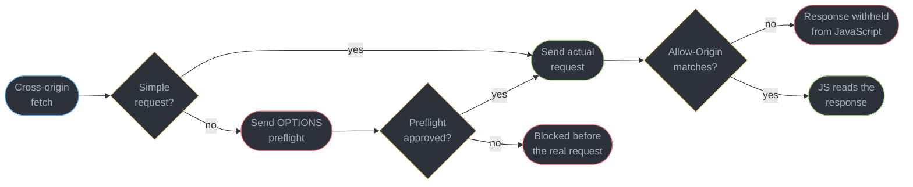
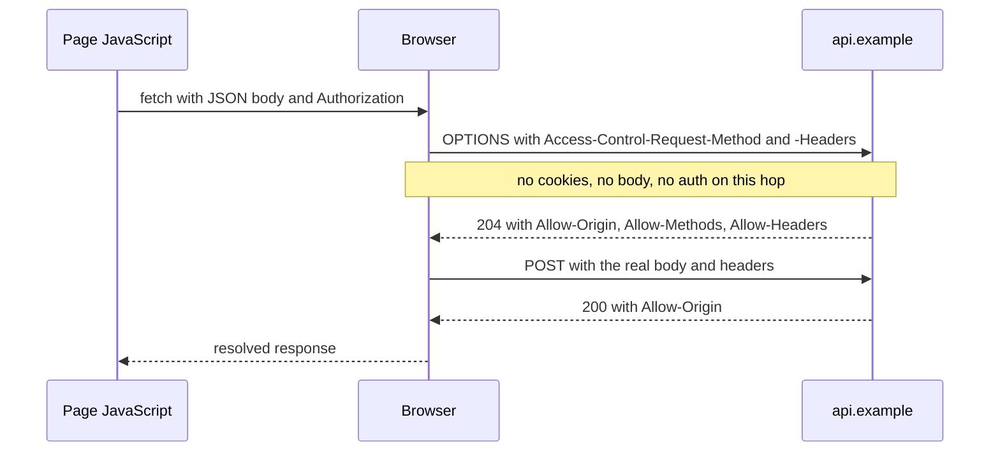
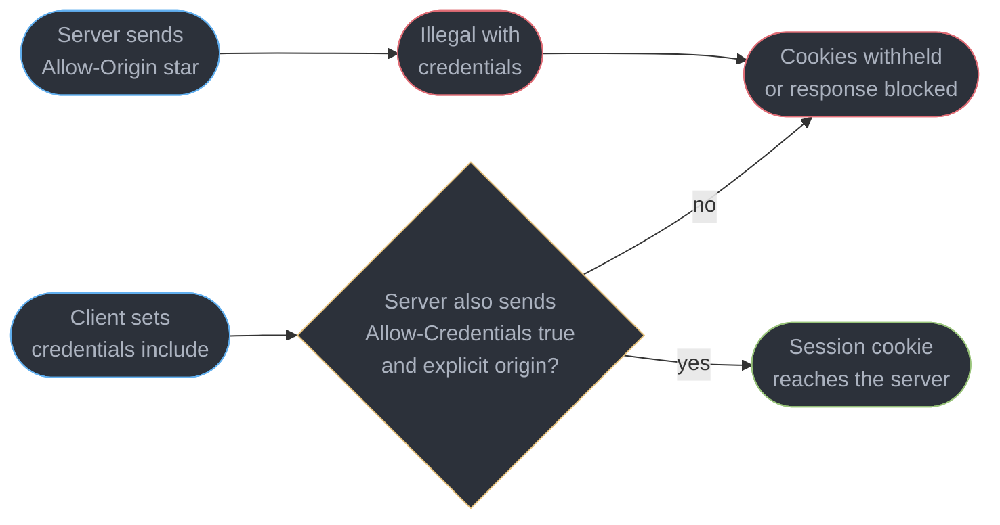
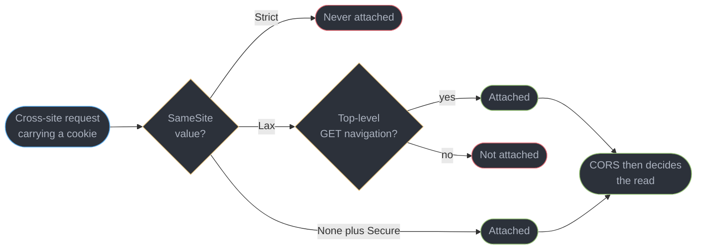
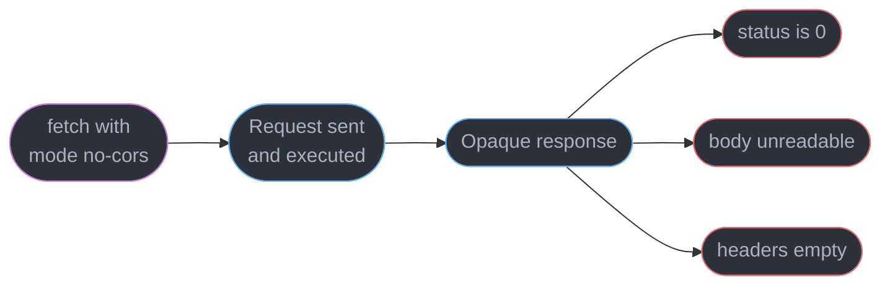
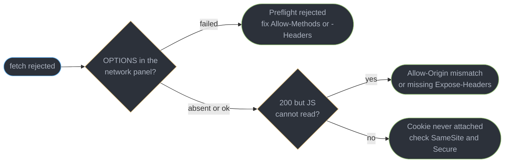

# CORS, Cookies and the Same-Origin Model

---

## 1. Concept Overview

Every cross-origin bug a front-end engineer debugs comes from one design decision: the
browser will happily *send* a request almost anywhere, and then refuse to let JavaScript
*read* the response. That asymmetry is deliberate, it is the foundation of web security,
and it is the reason CORS errors feel so unlike ordinary failures. The request succeeded.
The server answered. The network panel shows a 200. And `fetch` still rejects.

This module is the browser's half of a topic the rest of this repository covers only from
the server. `fastapi/middleware_and_lifecycle/` and `spring/spring_security_architecture/`
explain how to configure a CORS middleware; neither shows what the browser did before that
middleware ran, why the preflight was sent, or why the error message names no header. That
gap is where the debugging time goes.

The material divides into three layers that people routinely conflate. The **same-origin
policy** is the browser's rule about what one origin may read from another. **CORS** is the
mechanism a server uses to relax that rule for specific callers. **Cookies** ride on a
separate, older set of rules — `SameSite`, `Secure`, `HttpOnly`, `Domain`, `Path` — that
interact with CORS but are not part of it, which is why a request can be allowed by CORS
and still arrive without credentials.

Getting these three straight is what turns a class of unexplainable errors into a
five-minute diagnosis.

---

## 2. Intuition

> The same-origin policy is not a lock on the door. It is a rule that you may knock on any
> door you like, but you may only listen to the answer from your own house.

**Mental model.** The browser is a shared runtime executing code from many mutually
distrusting parties, all with the user's ambient credentials attached. If
`evil.example` could `fetch("https://bank.example/accounts")` and read the body, every
logged-in session on the web would be readable by every page. The policy blocks the read.
It mostly does not block the send, because the web was built on cross-origin sends —
forms, images, scripts — and breaking those retroactively was never an option.

**Why it matters.** That "mostly does not block the send" is the origin of CSRF, of
preflight, and of `SameSite`. Every mitigation in this module exists because a request can
have effects on the server whether or not the caller is allowed to read what comes back.

**Key insight.** A CORS error is never a client-side bug you can fix in client-side code.
The browser is enforcing a decision the *server* failed to express. No amount of header
setting on the request fixes it, which is why the `mode: "no-cors"` "fix" people find is
not a fix — it silences the error by making the response permanently unreadable.

---

## 3. Core Principles

1. **An origin is the triple: scheme, host, port.** `https://app.example` and
   `http://app.example` are different origins. So are `app.example` and
   `www.app.example`, and `:443` and `:8443`. Nothing about "the same company" or "the
   same domain" enters into it.
2. **The policy restricts reading, not sending.** A cross-origin ``, `<script>`,
   `<form>` submit and a `fetch` all leave the browser. Only the *response* is gated.
3. **CORS is a server-side relaxation, expressed in response headers.** The client cannot
   opt itself in. Every `Access-Control-*` header is set by the server.
4. **A preflight is a separate real HTTP request.** `OPTIONS`, sent before the actual one,
   carrying no credentials and no body. A server that routes `OPTIONS` to authentication
   will fail every preflight.
5. **Credentials are opt-in on both sides, and both must agree.** The client sets
   `credentials: "include"`; the server sets `Access-Control-Allow-Credentials: true` and
   an explicit origin. `*` with credentials is forbidden by specification.
6. **Cookies obey their own rules, before CORS is consulted.** `SameSite=Lax` will drop a
   cookie from a cross-site `fetch` regardless of how permissive the CORS configuration is.
7. **The error message is deliberately vague.** Telling the page exactly why it was
   refused would leak information about the other origin, so the browser tells the console
   and gives JavaScript an opaque failure.

---

## 4. Types / Architectures / Strategies

### 4.1 What the same-origin policy actually gates

| Operation | Cross-origin allowed? | Notes |
|-----------|----------------------|-------|
| ``, `<script src>`, `<link rel=stylesheet>` | send yes, read no | dimensions and load/error events leak a little |
| `<form>` submit | yes | the basis of CSRF; no CORS involvement at all |
| `fetch` / `XMLHttpRequest` | send yes, read only with CORS | the case this module is about |
| `<iframe>` embedding | yes unless `X-Frame-Options` / `frame-ancestors` | reading its DOM is blocked |
| `window.postMessage` | yes, by design | the sanctioned channel; verify `event.origin` |
| Canvas `getImageData` after drawing a cross-origin image | no, canvas is tainted | needs `crossorigin` plus CORS headers |
| Reading a cross-origin stylesheet's `cssRules` | no | same tainting idea |

### 4.2 Simple versus preflighted requests

A request avoids preflight only if it meets **every** condition:

| Condition | Allowed values |
|-----------|---------------|
| Method | `GET`, `HEAD`, `POST` |
| Headers | only CORS-safelisted: `Accept`, `Accept-Language`, `Content-Language`, `Content-Type`, `Range` (plus a few limits) |
| `Content-Type` | only `application/x-www-form-urlencoded`, `multipart/form-data`, `text/plain` |
| No listener on `XMLHttpRequest.upload`, no `ReadableStream` body | |

**`Content-Type: application/json` is not on that list.** That single fact is why almost
every real API call is preflighted — the thing people are surprised by is the common case,
not the exception.

### 4.3 The response headers that matter

| Header | Purpose | Trap |
|--------|---------|------|
| `Access-Control-Allow-Origin` | the one origin allowed to read | `*` is illegal with credentials; only one value, never a list |
| `Access-Control-Allow-Credentials` | permits cookies and TLS client certs | must be exactly `true` |
| `Access-Control-Allow-Methods` | preflight response only | must include the actual method |
| `Access-Control-Allow-Headers` | preflight response only | must include every non-safelisted request header, including `Authorization` |
| `Access-Control-Expose-Headers` | which response headers JS may read | without it, JS sees only the safelisted seven |
| `Access-Control-Max-Age` | preflight cache lifetime in seconds | capped by the browser; Chromium caps at 7200 |
| `Vary: Origin` | tells caches the response varies by caller | omitting it poisons shared caches |

### 4.4 Cookie attributes

| Attribute | Effect | When you want it |
|-----------|--------|-----------------|
| `HttpOnly` | unreadable from JavaScript | always, for session cookies — it removes the XSS exfiltration path |
| `Secure` | HTTPS only | always; required for `SameSite=None` |
| `SameSite=Strict` | never sent cross-site, including top-level navigation | high-value actions; breaks inbound links to logged-in pages |
| `SameSite=Lax` | sent on top-level GET navigation only | the modern default when unspecified |
| `SameSite=None` | sent cross-site | required for a genuinely cross-site API; must pair with `Secure` |
| `Domain` | widens to subdomains | omitting it is *narrower* and safer than setting it |
| `Partitioned` (CHIPS) | one cookie jar per top-level site | third-party contexts that must still work under partitioning |

---

## 5. Architecture Diagrams

### The decision the browser makes on every cross-origin fetch



The two rejection points are different failures with different fixes. A preflight failure
means the real request never happened. An `Allow-Origin` failure means it did happen, and
had whatever effect it has on the server.

### A preflighted request on the wire



Two round trips for one call. `Access-Control-Max-Age` collapses the first for subsequent
requests, which is why a cold API call can be measurably slower than a warm one.

### Why credentials need both sides to agree



### SameSite decides before CORS is consulted



A cookie can be dropped here and never reach the CORS layer at all, which is why "CORS is
configured correctly but the user is logged out" is such a common report.

### What an opaque response actually is



`no-cors` does not bypass the policy. It opts out of *seeing the answer*, while the request
still reaches the server with whatever effect it has.

### The three cross-origin failure modes, distinguished



---

## 6. How It Works — Detailed Mechanics

### 6.1 Reading the error correctly

The console message names the failing condition, and each phrasing maps to one fix:

```
Access to fetch at 'https://api.example/v1/orders' from origin 'https://app.example'
has been blocked by CORS policy: Response to preflight request doesn't pass access
control check: No 'Access-Control-Allow-Origin' header is present on the requested
resource.
```

"Response to preflight" means the `OPTIONS` failed and **the real request never ran**.
Without that phrase, the actual request ran and only the read was blocked — which matters
enormously if the request was a `POST` that created something.

```ts
try {
  const res = await fetch("https://api.example/v1/orders", {
    method: "POST",
    headers: { "Content-Type": "application/json" },
    body: JSON.stringify(order),
  });
} catch (err) {
  // err is a TypeError: "Failed to fetch" -- deliberately uninformative.
  // The reason is in the console, never in the exception, because exposing it
  // to script would leak facts about the other origin.
}
```

`fetch` rejects with a bare `TypeError` for a CORS failure, a DNS failure and an offline
network alike. You cannot distinguish them in code; the console is the only source.

### 6.2 Why your API call is preflighted

```ts
// No preflight: text/plain is a safelisted Content-Type
await fetch(url, { method: "POST", body: "hello" });

// Preflight: application/json is NOT safelisted
await fetch(url, {
  method: "POST",
  headers: { "Content-Type": "application/json" },
  body: JSON.stringify({ id: 1 }),
});

// Preflight: any custom or non-safelisted header, including Authorization
await fetch(url, { headers: { Authorization: `Bearer ${token}` } });
```

The preflight is a real request against the same path. A server whose auth middleware runs
before its CORS middleware will return `401` to the `OPTIONS`, and the browser reports a
CORS failure — the developer then spends an hour on CORS configuration for what is an
ordering bug.

### 6.3 Credentials: the four-part contract

```ts
// BROKEN: the cookie is never sent, so the API sees an anonymous caller
const res = await fetch("https://api.example/me");

// FIX: opt in on the client...
const res = await fetch("https://api.example/me", { credentials: "include" });
```

...and the server must satisfy three conditions simultaneously:

```
Access-Control-Allow-Origin: https://app.example      # explicit, never *
Access-Control-Allow-Credentials: true
Vary: Origin                                          # so caches do not cross wires
```

If the server echoes `*` while the client sends credentials, the browser rejects the
response even though every header "looks" permissive. The specification forbids the
combination because `*` means "any origin", and any-origin plus ambient credentials is the
exact hole the same-origin policy exists to close.

The fourth part is the cookie itself: it must carry `SameSite=None; Secure` to be attached
cross-site at all. All four have to hold. Three out of four fails silently as "logged out".

### 6.4 `SameSite` and what changed under it

`SameSite` defaults to `Lax` when unspecified, so a cookie set without the attribute is
sent on top-level GET navigation and **not** on a cross-site `fetch`, a cross-site `POST`,
or a request from an iframe.

```
Set-Cookie: session=...; HttpOnly; Secure; SameSite=Lax; Path=/
```

That is the correct shape for a same-site application. For a genuinely cross-site API —
`app.example` calling `api.other-company.example` — you need:

```
Set-Cookie: session=...; HttpOnly; Secure; SameSite=None; Path=/
```

`SameSite=None` without `Secure` is rejected outright. And note the distinction the name
gets wrong: `SameSite` is about **site** (registrable domain plus scheme), not origin, so
`app.example` and `api.example` are the same site and different origins. A request between
them is same-site for cookies and cross-origin for CORS — which is precisely why a team can
have CORS problems and no cookie problems, or the reverse.

### 6.5 Partitioned cookies (CHIPS)

As third-party cookies are restricted, a cookie set in a third-party context can opt into
partitioned storage — one jar per top-level site:

```
Set-Cookie: sess=...; Secure; SameSite=None; Partitioned; Path=/
```

An embedded widget on `news.example` and the same widget on `shop.example` then get
separate cookies. This preserves the legitimate embedded-session use case while removing
cross-site tracking. If your product ships an embed, this is the migration path.

### 6.6 Exposing response headers

```ts
const res = await fetch(url);
res.headers.get("Content-Type");   // works: safelisted
res.headers.get("X-Total-Count");  // null, unless the server exposes it
```

JavaScript can read only seven response headers by default: `Cache-Control`,
`Content-Language`, `Content-Length`, `Content-Type`, `Expires`, `Last-Modified`, `Pragma`.
Anything else — a pagination count, a rate-limit budget, a request id for support —
requires:

```
Access-Control-Expose-Headers: X-Total-Count, X-Request-Id, X-RateLimit-Remaining
```

This is the second-most-common "the server is sending it, I can see it in the network
panel, and my code gets `null`" report after the credentials one.

### 6.7 Avoiding the problem: same-origin by deployment

The most reliable CORS configuration is not having one. Serving the API under the same
origin as the app — `https://app.example/api/*` proxied to the backend — removes preflight
entirely, removes the credentials negotiation, and lets cookies stay `SameSite=Lax`.

```
app.example/            -> static front end
app.example/api/*       -> reverse proxy to the internal API
```

The costs are real and worth stating: a proxy hop to operate and pay for, a shared cache
key space, and one deployment coupling you did not have. But for a first-party application
this trade is usually correct, and a great deal of CORS configuration in the wild exists
only because the API was put on a different subdomain by default. See
[`../../hld/cdn/cdn.md`](../../hld/cdn/cdn.md) for the caching consequences and
[`../frontend_delivery_and_observability/frontend_delivery_and_observability.md`](../frontend_delivery_and_observability/frontend_delivery_and_observability.md)
for the routing layer.

### 6.8 CSRF still exists, and CORS does not stop it

CORS governs reads. A cross-site `<form method="POST">` needs no CORS approval at all, and
under `SameSite=Lax` a top-level navigation still carries the cookie. So:

```html
<!-- BROKEN: this submits with the victim's cookie if SameSite is None -->
<form action="https://bank.example/transfer" method="POST">
  <input name="to" value="attacker"><input name="amount" value="10000">
</form>
```

The defences are `SameSite=Lax` or `Strict` on the session cookie (which covers most of
it), plus a synchroniser token or the double-submit pattern for anything state-changing,
plus requiring `Content-Type: application/json` so the request is forced into preflight
where CORS *does* apply. Server-side depth lives in
[`../../backend/backend_security_owasp/backend_security_owasp.md`](../../backend/backend_security_owasp/backend_security_owasp.md);
Server Function CSRF specifically is in
[`../../react/server_components_and_server_functions/server_components_and_server_functions.md`](../../react/server_components_and_server_functions/server_components_and_server_functions.md).

---

## 7. Real-World Examples

**The SSO subdomain split.** A product served the app from `app.example` and the auth API
from `auth.example`. Login worked in development (same origin via a dev proxy) and failed
in staging with no error other than the user appearing logged out. The cookie was
`SameSite=Lax` and staging was genuinely cross-site. The fix was `SameSite=None; Secure`
plus explicit `Allow-Origin` and `Allow-Credentials`, but the better fix — adopted a
quarter later — was moving auth under `app.example/auth` and reverting the cookie to `Lax`.

**The pagination header nobody could read.** An API returned `X-Total-Count` and the front
end rendered "page 1 of NaN". The header was visible in DevTools, which convinced three
engineers the client was at fault. `Access-Control-Expose-Headers` was missing. DevTools
shows the wire; `res.headers` shows what the policy permits, and the two differ by design.

**The preflight that 401'd.** A gateway ran authentication before CORS. Every `OPTIONS`
returned `401`, every browser reported a CORS error, and the team spent a day widening CORS
configuration that was already correct. Preflights carry no credentials by specification,
so `OPTIONS` must be answered before any auth check.

---

## 8. Tradeoffs

| Choice | Gains | Costs | Use when |
|--------|-------|-------|---------|
| Same-origin via reverse proxy | no CORS, no preflight, `SameSite=Lax` works | a proxy hop to run, deployment coupling | first-party app and API |
| Cross-origin API with CORS | independent deploys, an API usable by third parties | preflight latency, credentials negotiation | a public or multi-consumer API |
| `SameSite=Lax` | strong CSRF defence by default | breaks genuine cross-site sessions | same-site architecture |
| `SameSite=None; Secure` | cross-site sessions work | needs other CSRF defences; subject to third-party restrictions | embedded widgets, cross-company APIs |
| Cookie session | `HttpOnly` removes the XSS read path; automatic | CSRF surface; cross-site complexity | first-party browser apps |
| `Authorization` header token | no CSRF surface; simple cross-origin | must be stored somewhere JS reaches, so XSS can take it | third-party APIs, native clients |
| `Access-Control-Max-Age` high | fewer preflights | policy changes take longer to propagate | stable APIs |

| Approach | Extra round trip | Cross-site cookies | CSRF exposure |
|----------|-----------------|--------------------|---------------|
| Same-origin proxy | none | not needed | low with `Lax` |
| CORS + cookies | preflight, then cached | required | moderate, needs tokens |
| CORS + bearer token | preflight, then cached | not used | low |

---

## 9. When to Use / When NOT to Use

### Reach for same-origin (a proxy) when

- The API is first-party and deployed by the same organisation.
- Sessions are cookie-based and you want `SameSite=Lax` to do the CSRF work.
- Preflight latency is measurable — a cold call pays two round trips.

### Reach for cross-origin CORS when

- The API has consumers you do not control, including third parties.
- The API and the front end have genuinely independent deploy cycles and owners.
- A CDN or edge layer makes a proxy hop expensive or awkward.

### Do NOT

- **Use `mode: "no-cors"` to make an error go away.** It makes the response permanently
  unreadable; you have hidden the failure, not fixed it.
- **Reflect the `Origin` header unconditionally** with `Allow-Credentials: true`. That is
  `*`-with-credentials wearing a disguise and it allows every site on the internet to read
  authenticated responses. Match against an allowlist.
- **Disable CORS in the browser with a flag or extension** beyond a one-off local debug.
  It hides the failure from exactly the person who needs to see it.
- **Set `Domain=.example.com` reflexively.** Omitting `Domain` is narrower and safer;
  widening shares the cookie with every subdomain, including one an attacker may control.

---

## 10. Common Pitfalls

### Pitfall 1: `*` with credentials

```ts
// BROKEN -- server sends Allow-Origin: * while the client sends credentials.
// Browser rejects the response despite every header looking permissive.
await fetch("https://api.example/me", { credentials: "include" });
```

```
# FIX -- echo the specific allowed origin and vary on it
Access-Control-Allow-Origin: https://app.example
Access-Control-Allow-Credentials: true
Vary: Origin
```

The server must match `Origin` against an allowlist and echo it. Reflecting it blindly is
equivalent to `*` and worse, because it looks deliberate.

### Pitfall 2: the preflight hits authentication

`OPTIONS` carries no credentials. A middleware chain that authenticates before it handles
CORS returns `401`, and the browser reports it as a CORS failure. Answer `OPTIONS` first,
unconditionally.

### Pitfall 3: `SameSite` blamed on CORS

CORS is configured correctly, the response arrives, and the API says unauthenticated. The
cookie was never attached because it is `SameSite=Lax` on a cross-site call. Check the
request's Cookie header in DevTools before touching CORS at all — if the cookie is absent
there, CORS is not your problem.

### Pitfall 4: reading a header the policy hides

`res.headers.get("X-Request-Id")` returns `null` while DevTools shows the header plainly.
The network panel shows the wire; `Headers` shows what CORS exposed. Add
`Access-Control-Expose-Headers`.

### Pitfall 5: a redirect during preflight

A preflight that receives a 3xx fails in most browsers. An API that redirects
`http` → `https`, or appends a trailing slash, will break preflight while the direct
request appears fine. Send the client at the final URL.

### Pitfall 6: missing `Vary: Origin` behind a cache

A shared cache stores the response for the first origin that asked and serves it to the
next, whose origin does not match — producing a CORS error that appears and disappears with
cache state. Always `Vary: Origin` on a CORS response.

---

## 11. Technologies & Tools

| Tool | What it is for | How you invoke it |
|------|---------------|-------------------|
| Chrome DevTools | Inspecting the preflight and the Cookie header | Network panel, filter `OPTIONS` |
| curl | Reproducing a preflight without a browser | `curl -X OPTIONS -H "Origin: ..." -i` |
| Fetch API | The client side of every request here | `fetch(url, { credentials })` |
| CORS | The specification being enforced | response headers |
| SameSite | Cookie-scoping attribute | `Set-Cookie` |
| CHIPS | Partitioned third-party cookies | `Partitioned` attribute |
| Content Security Policy | A different origin control, often confused with CORS | `Content-Security-Policy` header |
| Reverse proxy | Collapsing two origins into one | nginx, Caddy, a framework rewrite |

Server-side configuration for these headers lives in
[`../../fastapi/middleware_and_lifecycle/middleware_and_lifecycle.md`](../../fastapi/middleware_and_lifecycle/middleware_and_lifecycle.md)
and
[`../../spring/spring_security_architecture/spring_security_architecture.md`](../../spring/spring_security_architecture/spring_security_architecture.md).
The client threat model, including CSP and XSS, is
[`../browser_security_and_the_client_threat_model/browser_security_and_the_client_threat_model.md`](../browser_security_and_the_client_threat_model/browser_security_and_the_client_threat_model.md).

---

## 12. Interview Questions with Answers

**Q: Why does a CORS error show a successful request in the network panel?**
**Short:** Enforcement happens after the response arrives, so the browser withholds it from JavaScript rather than preventing the server from processing it.

The same-origin policy gates reading, not sending. For a simple request the browser
dispatches it, the server executes it, and the response comes back; only then does the
browser check `Access-Control-Allow-Origin` and refuse to hand the result to script. This
is why a blocked cross-origin `POST` can still have created a row. A *preflight* failure is
the one case where the real request never runs, and the console says "Response to preflight
request" when that is what happened.

**Q: Which requests trigger a preflight, and why is `application/json` one of them?**
**Short:** Anything outside the safelist does, and JSON is outside it because a form could never produce that content type without script.

The no-preflight set is `GET`/`HEAD`/`POST` with only safelisted headers and a
`Content-Type` of `x-www-form-urlencoded`, `multipart/form-data` or `text/plain` — exactly
what an HTML form could send before `fetch` existed. Those were already possible
cross-origin, so allowing them changed nothing. `application/json` and an `Authorization`
header are both new capabilities, so the browser asks permission first. The practical
consequence is that almost every real API call is preflighted.

**Q: Why is `Access-Control-Allow-Origin: *` rejected when the client sends credentials?**
**Short:** Any-origin plus ambient cookies is precisely the hole the same-origin policy exists to close, so the specification forbids the combination.

If a server could say "any origin may read this" while the browser attached the user's
session cookie, every site could read every authenticated response from that server. The
server must therefore name a specific origin, which forces it to make a deliberate
allowlist decision. Reflecting the `Origin` header without checking it re-creates the hole
while looking intentional, so match against a list.

**Q: CORS looks correct but the API says the user is not authenticated. What do you check?**
**Short:** Whether the Cookie header is on the request at all, because SameSite drops it before CORS is ever consulted.

`SameSite=Lax`, which is the default when the attribute is absent, prevents a cookie from
being attached to a cross-site `fetch`. The request then arrives anonymous no matter how
permissive the CORS headers are. Look at the outgoing request's Cookie header in DevTools
first: if it is missing there, the fix is `SameSite=None; Secure` (or moving to same-origin),
not CORS configuration.

**Q: What is the difference between "same-site" and "same-origin"?**
**Short:** Origin is scheme plus host plus port, while site is the registrable domain plus scheme, so two origins can be same-site.

`https://app.example` and `https://api.example` are **different origins** and the **same
site**. That means a request between them is subject to CORS but is not cross-site for
cookie purposes, so `SameSite=Lax` cookies still flow. Conflating the two is why teams
sometimes fix a cookie problem that did not exist while the real failure was an
`Allow-Origin` mismatch.

**Q: What does `mode: "no-cors"` actually do?**
**Short:** It opts the caller out of reading the response, returning an opaque object with status 0 and no headers, while the request still executes.

It is regularly suggested as a CORS fix and is the opposite. The request leaves the browser
and has whatever effect it has on the server; you simply cannot see the outcome, cannot
check the status, and cannot read the body. It is legitimate only for fire-and-forget
cases such as populating a cache with an opaque entry, and never for an API call whose
answer you need.

**Q: Why does JavaScript get `null` for a header that DevTools clearly shows?**
**Short:** Only seven response headers are readable by default, and everything else requires the server to list it in Access-Control-Expose-Headers.

The safelist is `Cache-Control`, `Content-Language`, `Content-Length`, `Content-Type`,
`Expires`, `Last-Modified` and `Pragma`. A pagination total, a rate-limit budget or a
request id needs explicit exposure. DevTools shows what came over the wire; the `Headers`
object shows what the policy permits script to see, and the gap between them is the whole
point of the mechanism.

**Q: Does CORS protect against CSRF?**
**Short:** No -- a cross-site form post needs no CORS approval, because the attack depends on the request happening rather than on reading the reply.

CORS governs whether script may read a response. CSRF only needs the side effect. An HTML
form can `POST` cross-origin with no preflight and no CORS involvement whatsoever. The real
defences are `SameSite=Lax` or `Strict` on the session cookie, a synchroniser or
double-submit token on state-changing endpoints, and requiring `application/json` so the
request is forced into the preflight path where CORS does apply.

**Q: Why did every preflight start returning 401?**
**Short:** The auth middleware runs before the CORS handler, and a preflight carries no credentials by specification, so it cannot satisfy an auth check.

`OPTIONS` is dispatched by the browser with no cookies, no `Authorization` header and no
body. Any middleware chain that authenticates first will reject it, and the browser
surfaces that as a CORS error rather than a 401, which sends people to the wrong
configuration file. Answer `OPTIONS` unconditionally, ahead of authentication.

**Q: What does `Access-Control-Max-Age` change, and what is the risk?**
**Short:** It caches the preflight result for a number of seconds, removing the extra round trip while delaying any policy change from taking effect.

A high value turns a two-round-trip API call into one for the cache lifetime, which is
worth real milliseconds on a chatty client. The cost is that tightening `Allow-Methods` or
`Allow-Headers` will not reach browsers holding a cached preflight. Browsers cap it —
Chromium at 7200 seconds — so the exposure is bounded, but plan policy changes around it.

**Q: Why is `HttpOnly` on a session cookie worth more than it looks?**
**Short:** It removes the cookie from document.cookie entirely, so an XSS payload cannot read or exfiltrate the session even with full script execution.

XSS gives an attacker the ability to run code as the page. If the session lives in a
JavaScript-readable place — `localStorage`, or a non-`HttpOnly` cookie — that code can post
it to an attacker-controlled host and the session is stolen outright. `HttpOnly` reduces
the attack to acting *through* the page, which is worse but recoverable, and is why cookie
sessions remain preferable to `localStorage` tokens for first-party apps.

**Q: When is `SameSite=Strict` the wrong choice?**
**Short:** When users arrive from external links, since Strict withholds the cookie even on top-level navigation and the landing page appears logged out.

Someone clicking a link from an email or a search result reaches your site with no session
attached, sees a signed-out page, and often re-authenticates or leaves. `Lax` exists
precisely for this: it sends the cookie on top-level `GET` navigation while withholding it
from cross-site subrequests. Reserve `Strict` for high-value cookies where that friction is
an acceptable trade.

**Q: What problem do partitioned cookies solve?**
**Short:** They give an embedded third party a separate cookie jar per top-level site, keeping legitimate sessions working while removing the cross-site tracking key.

An embedded widget historically got one cookie readable from every site it appeared on,
which is the tracking mechanism third-party cookie restrictions are removing. `Partitioned`
opts a cookie into per-top-level-site storage, so the widget still has a session on
`news.example` and a separate one on `shop.example`. If your product ships an embed, this
is the migration path rather than `SameSite=None` alone.

**Q: How would you eliminate CORS from an application entirely?**
**Short:** Serve the API under the front end's own origin through a reverse proxy, which removes preflight, credential negotiation and cross-site cookie rules at once.

Routing `app.example/api/*` to the backend makes every call same-origin: no `OPTIONS`, no
`Allow-Credentials` handshake, and `SameSite=Lax` continues to work. The costs are a proxy
to operate, a shared cache key space and one more deployment coupling. For a first-party
application this is usually the better trade, and much of the CORS configuration in the
wild exists only because the API was placed on a different subdomain by default.

**Q: Why do preflights fail when the server issues a redirect?**
**Short:** A 3xx response to an OPTIONS request is not followed, so the preflight is treated as unapproved and the real request is never sent.

An API that redirects `http` to `https`, or normalises a missing trailing slash, will break
the preflight while a direct `curl` against the same URL looks fine — which makes it a
confusing failure to diagnose. Point the client at the final, canonical URL so no redirect
occurs on the preflight hop.

**Q: What breaks if you omit `Vary: Origin` on a CORS response?**
**Short:** A shared cache stores the response for whichever origin asked first and serves it to a different one, producing errors that come and go with cache state.

The response body is identical but the `Access-Control-Allow-Origin` header is
origin-specific, so it must be part of the cache key. Without `Vary: Origin`, a CDN or
proxy will happily reuse the entry, and the second origin receives an `Allow-Origin` naming
someone else. The symptom — intermittent CORS failures that vanish on a hard refresh — is
distinctive once you have seen it.

---

## 13. Best Practices

1. **Prefer same-origin.** A reverse proxy that puts the API under the app's origin removes
   this entire class of problem; reach for CORS when you genuinely have multiple consumers.
2. **Match `Origin` against an allowlist and echo it.** Never reflect it unconditionally,
   and never pair `*` with credentials.
3. **Always send `Vary: Origin`** on any response carrying `Access-Control-Allow-Origin`.
4. **Answer `OPTIONS` before authentication runs.** Preflights carry no credentials.
5. **Session cookies get `HttpOnly; Secure; SameSite=Lax`** by default, and `Path=/` with
   `Domain` omitted unless a subdomain genuinely needs it.
6. **Use `SameSite=None; Secure` only for genuinely cross-site sessions**, and add CSRF
   tokens when you do.
7. **Expose the response headers your client reads.** Audit for `X-Total-Count`-style
   headers the front end silently receives as `null`.
8. **Check the request's Cookie header before debugging CORS.** If the cookie is absent,
   the problem is `SameSite`, not `Access-Control-*`.
9. **Never ship `mode: "no-cors"`** as a fix. It hides the failure and leaves the effect.
10. **Set `Access-Control-Max-Age` deliberately** — high enough to save the round trip,
    low enough that a policy change lands within your incident window.

---

## 14. Case Study

### The migration that logged everyone out

**The system.** A B2B analytics product served its React app from `https://app.acme.test`
and, after a platform migration, moved its API from `https://app.acme.test/api` to
`https://api.acme.test`. Cookie sessions, 40,000 daily users, 11 engineers.

**The symptom.** Immediately after the cutover, every user was signed out on load. The
network panel showed `200` responses. CORS had been configured; `Access-Control-Allow-Origin`
was present. Three engineers spent a day widening CORS configuration that was already
correct.

**Step 1 — the request, not the response.** The diagnosis took two minutes once someone
looked at the right half of the exchange: the outgoing request had **no Cookie header at
all**. CORS governs the response. If the credential never left the browser, no response
header can help.

```ts
// BROKEN #1: no credentials opt-in, so fetch sends no cookie cross-origin
const me = await fetch("https://api.acme.test/v1/me").then(r => r.json());
```

```
# BROKEN #2: the cookie itself cannot go cross-site
Set-Cookie: session=...; HttpOnly; Secure; Path=/          # SameSite defaults to Lax
```

```
# BROKEN #3: wildcard origin, which is illegal once credentials are involved
Access-Control-Allow-Origin: *
```

Three independent defects, each individually sufficient to produce "logged out", and each
invisible in the response headers everyone was staring at.

**Step 2 — the four-part fix.**

```ts
// FIX: opt in on the client
const me = await fetch("https://api.acme.test/v1/me", {
  credentials: "include",
}).then(r => r.json());
```

```
# FIX: cookie may travel cross-site
Set-Cookie: session=...; HttpOnly; Secure; SameSite=None; Path=/

# FIX: explicit origin, credentials permitted, cache keyed correctly
Access-Control-Allow-Origin: https://app.acme.test
Access-Control-Allow-Credentials: true
Vary: Origin
```

**Step 3 — the preflight bill.** Sessions worked, and the dashboard got slower. Every API
call was now preflighted (`application/json` plus `Authorization`), and the gateway sent no
`Access-Control-Max-Age`, so each of the 14 calls on the dashboard paid two round trips.

```
Access-Control-Max-Age: 600
```

**Step 4 — the CSRF debt.** `SameSite=None` removed a CSRF defence the team had been
relying on without knowing it. They added a double-submit token on state-changing
endpoints, which is work the migration created and nobody had budgeted.

| Metric | Before cutover | After cutover | After fixes |
|--------|---------------|---------------|-------------|
| Authenticated users on load | 100% | 0% | 100% |
| Preflight requests per dashboard load | 0 | 14 | 1 |
| Dashboard API time, p75 | 340 ms | 710 ms | 380 ms |
| CSRF defence | `SameSite=Lax` | none | double-submit token |
| CORS configuration to maintain | none | 6 headers | 6 headers |

Six months later the team moved the API back under `app.acme.test/api` behind a reverse
proxy, reverted the cookie to `SameSite=Lax`, deleted the CORS configuration and the CSRF
token machinery, and recovered the original p75.

**What the team took away.**

1. Look at the **request** before the response. A missing Cookie header is a `SameSite`
   problem and no CORS header will fix it.
2. `Allow-Origin: *` and `credentials: "include"` are mutually exclusive by specification,
   and the failure names neither.
3. Splitting an app and its API across origins is a four-part change — client flag, cookie
   attribute, CORS headers, CSRF replacement — and teams routinely budget for one.
4. Preflight is a latency decision, not just a configuration one. Fourteen uncached
   preflights doubled the dashboard's API time.
5. The cheapest CORS configuration remains the one you do not have.
