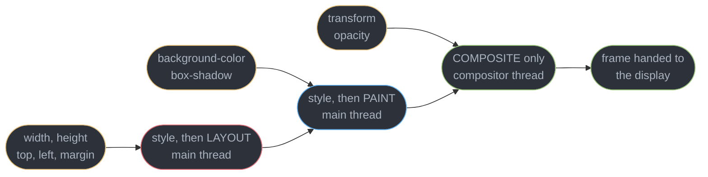
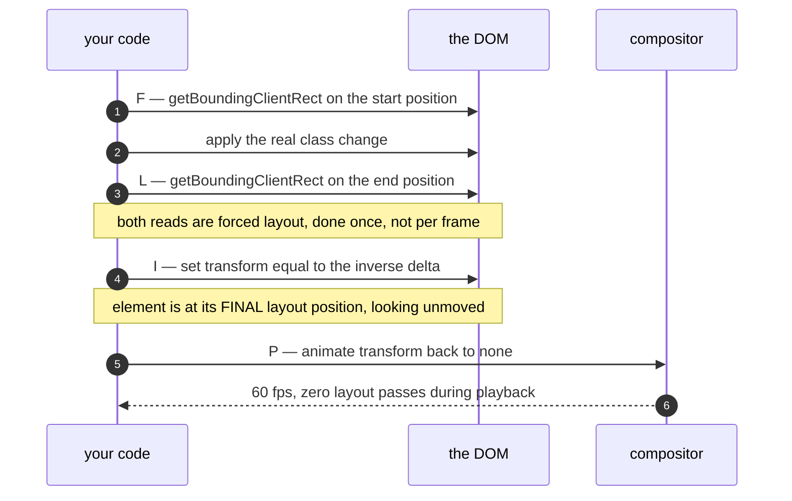
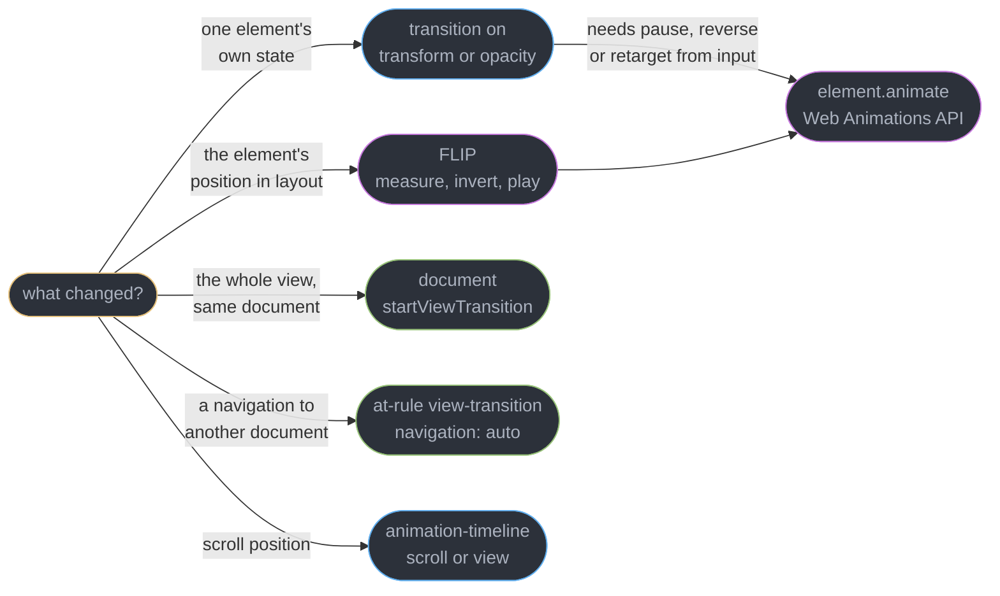
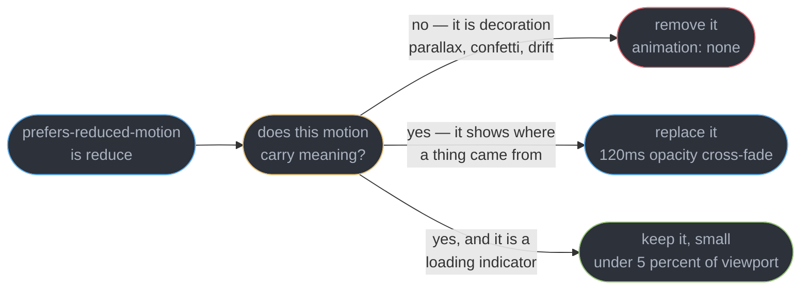
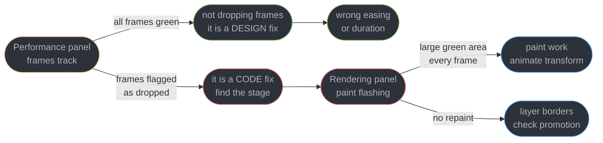

# CSS Animation and Motion

---

## 1. Concept Overview

Motion on the web is two engineering problems wearing one costume. It is a **performance
problem**, because an animation is a promise to produce a new frame every 16.7 ms and a
missed frame is visible to everyone. And it is an **accessibility requirement**, because
large-field motion triggers nausea, dizziness and migraine in people with vestibular
disorders — a documented harm, not a preference.

The reason this belongs in a platform section rather than a design one: **the same technique
choice decides both**. Animating `transform` instead of `left` moves the work off the main
thread *and* gives you a single property to neutralise under `prefers-reduced-motion`.
Animating `left` costs a layout pass per frame *and* leaves you with a slide that nobody can
turn off without rewriting the rule. One decision, two consequences.

| Topic | Owner |
|-------|-------|
| Layout, paint, composite, forced synchronous layout, layer promotion | [Browser Architecture and the Rendering Pipeline](../browser_architecture_and_the_rendering_pipeline/browser_architecture_and_the_rendering_pipeline.md) |
| Box model, cascade, specificity, stacking contexts, containment | [CSS Layout and the Cascade](../css_layout_and_the_cascade/css_layout_and_the_cascade.md) |
| Tasks and microtasks, `requestAnimationFrame`, long tasks, `scheduler.yield` | [The Event Loop and Scheduling](../the_event_loop_and_scheduling/the_event_loop_and_scheduling.md) |
| WCAG 2.2 AA, the accessibility tree, focus management | [Accessibility and WCAG](../accessibility_and_wcag/accessibility_and_wcag.md) |
| CLS, LCP, INP at p75, the performance budget | [Web Performance and Core Web Vitals](../web_performance_and_core_web_vitals/web_performance_and_core_web_vitals.md) |
| React transitions and the React view-transition component | [Concurrent Rendering and Transitions](../../react/concurrent_rendering_and_transitions/concurrent_rendering_and_transitions.md) |
| Tailwind animation utilities, motion design tokens | [Styling and Design Systems](../../react/styling_and_design_systems/styling_and_design_systems.md) |

---

## 2. Intuition

> An animation is a **loop with a hard deadline**, and the only question that matters is
> which thread has to meet it.

**Mental model.** Every animation is the same shape: a value interpolated over time, sampled
once per display refresh. What changes is *who samples it*. `transform` and `opacity` are
sampled by the compositor thread, which owns a texture that was painted once and is now being
re-positioned. `width` is sampled by the main thread, which must re-solve layout, re-paint the
affected region and re-upload the texture — for every frame, in competition with your
JavaScript.

**Why it matters.** A 400 ms slide that drops half its frames does not look "slightly worse";
it reads as a broken product, and it is one of the few defects users describe unprompted.
The same 400 ms slide, played at full amplitude on a page that also parallaxes, makes a
subset of users physically unwell.

**Key insight.** **The cheap technique and the accessible technique are the same technique.**
A compositor-only animation is one property you can swap for a cross-fade in a four-line
media query. A layout animation is geometry smeared across a stylesheet, and neutralising it
means rewriting it. Choose the compositor path and the accessibility work becomes trivial;
choose the layout path and you pay twice.

---

## 3. Core Principles

1. **Animate `transform` and `opacity`, or explain why not.** Everything else re-enters the
   main thread's pipeline once per frame. This is the whole discipline in one line.
2. **The budget is the refresh interval, not "fast".** 16.7 ms at 60 Hz, 8.3 ms at 120 Hz,
   and the browser needs roughly 4-6 ms of that for its own work.
3. **Reduced motion is a default, not a toggle you offer.** The OS already asked; the media
   query is the answer being delivered to you, and ignoring it is the bug.
4. **Reduce or replace, do not delete.** Motion that communicates state change still has a
   job under `prefers-reduced-motion` — a 120 ms cross-fade does it without the vestibular
   load of a 600 px slide.
5. **Layout changes can still be animated cheaply** — measure first and last, animate the
   difference as a transform. That is what FLIP is.
6. **Measure the frame, not the feeling.** The Performance panel's frames track is the
   arbiter; "it looks smooth on my M4" is not a measurement.

---

## 4. Types / Architectures / Strategies

### 4.1 The three tiers, and the two that are cheap

Every animatable property lands in one of three tiers: **composite-only** (`transform`,
`opacity`) runs on the compositor and survives a busy main thread; **paint** (`color`,
`box-shadow`) repaints every frame; **layout** (`width`, `top`, `margin`) recomputes geometry
every frame and is the tier that visibly janks. Diagram 5.2 maps each property to the stage it
re-enters; 5.4 is the technique decision that follows.

### 4.2 Which timeline drives the animation

Three timelines exist: the document's wall clock (the default), scroll progress
(`animation-timeline: scroll()`), and view progress (`animation-timeline: view()`). The last
two hand the progress value to the compositor, so the animation advances even while the main
thread is blocked — which is exactly the failure mode of the `scroll` listener they replace.
Worked through in §6.6.

---

## 5. Architecture Diagrams

### 5.1 One frame at 60 Hz, two ways

```
   60 Hz display: a new frame is scanned out every 16.7 ms. Miss it, and the previous
   frame is shown twice — one dropped frame, visible as a stutter.

   ANIMATING transform  (compositor thread owns it)
   main thread    |== your JS 9ms ==|.................|== your JS 9ms ==|
   compositor     |t|              |t|              |t|              |t|
   frames out     v----------------v----------------v----------------v
                  0              16.7            33.4             50.1 ms   60 fps

   ANIMATING left  (main thread owns it, and your JS is already there)
   main thread    |== JS 9ms ==|= style 2 =|= layout 11 =|= paint 6 =|= composite 2 =|
                  |<---------------------- 30 ms --------------------------------->|
   frames out     v---------------- MISSED ---------------v
                  0              16.7            33.4             50.1 ms   ~33 fps

   The layout+paint block is not overhead you can tune away: it re-runs every frame,
   for as long as the animation lasts, on the same thread that must also answer input.
```

Frame budget is a deadline, not an average. 30 ms of work per frame does not mean "slightly
slow" — it means every second frame is dropped, and the animation runs at half rate.

### 5.2 Where each property enters the pipeline



Everything enters the pipeline somewhere and runs to the end. The only question is how far
back you start, and only the last stage runs on a thread your JavaScript cannot block.

### 5.3 FLIP: animate a layout change with compositor properties only



The element never moves in layout terms during playback — it was already placed by the class
change. Only its transform is interpolated, so the whole animation is compositor work.

### 5.4 Choosing among the five techniques



The imperative branch is entered only when you need to *address* a running animation. If the
animation plays to completion and nothing interrupts it, CSS is smaller and cheaper.

### 5.5 The View Transitions snapshot model

```mermaid
flowchart LR
    classDef old fill:#2c313a,stroke:#e06c75,color:#abb2bf
    classDef work fill:#2c313a,stroke:#e5c07b,color:#abb2bf
    classDef new fill:#2c313a,stroke:#98c379,color:#abb2bf
    classDef tree fill:#2c313a,stroke:#c678dd,color:#abb2bf
    A(["1. old DOM<br/>rendering frozen"]) --> B(["2. snapshot every<br/>view-transition-name"])
    B --> C(["3. your callback runs<br/>DOM is updated"])
    C --> D(["4. snapshot the<br/>new state"])
    D --> E(["5. pseudo-element tree<br/>built over the page"])
    E --> F(["6. default cross-fade<br/>plus a morph per name"])
    F --> G(["7. tree torn down<br/>live DOM revealed"])
    class A old
    class B,D work
    class C tree
    class E,F work
    class G new
```



Steps 2 and 4 are what make this cheap: the browser animates two flat images, not two live
DOM trees. It is also why the callback must be synchronous about its DOM writes — rendering
is suspended for the whole of step 3.

### 5.6 The reduced-motion decision, per animation



"Reduce" is not "none". A spinner that vanishes leaves a user unsure whether the app is
working; a 600 px zoom that vanishes loses nothing but nausea.

---

## 6. How It Works — Detailed Mechanics

### 6.1 Why compositor-only is qualitatively different

The compositor thread holds the page as a set of textures. Changing `transform` or `opacity`
changes a matrix and an alpha value on an already-painted texture: no layout solve, no
rasterisation, no main-thread involvement once the animation has started. The main thread can
then be blocked by a 900 ms JSON parse and the animation still runs at full refresh rate.

Promotion is conditional. The animation must target only compositable properties, and the
element must not be disqualified by a non-composited blend mode or a `background-attachment:
fixed` ancestor. The Performance panel's Animations track labels a promoted animation
"Composited" and otherwise gives a reason, such as
`Animation has a non-replace composite mode`.

```css
/* NOT composited: `height` drags the whole rule onto the main thread. */
.panel { transition: transform 240ms, height 240ms; }

/* Composited. The size change becomes a scale, or moves to a FLIP animation. */
.panel { transition: transform 240ms, opacity 240ms; }
```

Layer promotion, tiling and raster budgets belong to
[Browser Architecture and the Rendering Pipeline](../browser_architecture_and_the_rendering_pipeline/browser_architecture_and_the_rendering_pipeline.md);
this module only cares which properties buy the ticket.

### 6.2 Transitions, keyframes and the `all` hazard

A `transition` interpolates between two computed values when one changes. `@keyframes` runs a
named multi-step sequence on its own schedule with no triggering state change.

```css
.card { transition: transform 200ms cubic-bezier(0.2, 0, 0, 1), opacity 150ms linear; }
.card:hover { transform: translateY(-4px) scale(1.02); }

@keyframes pulse {
  from { transform: scale(1);    opacity: 1;   }
  50%  { transform: scale(1.06); opacity: 0.7; }
  to   { transform: scale(1);    opacity: 1;   }
}
.badge { animation: pulse 1.2s ease-in-out infinite; }
```

`transition: all` fails twice. Performance: it opts in every property that changes for any
reason, so a class toggle that also changes `height` silently animates layout. Correctness: it
animates properties added later by a design-system upgrade, and the resulting jank is
un-greppable — no rule in the stylesheet names the property misbehaving.

`animation-fill-mode` decides what the element looks like outside the active window. The
default `none` snaps it back to its authored styles the instant the run ends, which is behind
nearly every "it animates in, then jumps back" bug.

| `animation-fill-mode` | During `animation-delay` | After it ends |
|-----------------------|--------------------------|---------------|
| `none` (initial) | authored styles | authored styles — **the snap-back** |
| `forwards` | authored styles | holds the last keyframe |
| `backwards` | applies the first keyframe | authored styles |
| `both` | applies the first keyframe | holds the last keyframe |

Two adjacent pieces close the old gaps: `@starting-style` supplies a "before it existed" value
so an entry animation works on a newly inserted node, and `transition-behavior: allow-discrete`
lets `display` and `overlay` participate, so a popover can fade out instead of vanishing.

### 6.3 FLIP in full

**F**irst, **L**ast, **I**nvert, **P**lay: read the start geometry, make the real layout
change, read the end geometry, apply a transform cancelling the difference, animate it to zero.

```js
function flip(el, mutate, duration = 300) {
  const first = el.getBoundingClientRect();          // F
  mutate();                                          // the real class or DOM change
  const last = el.getBoundingClientRect();           // L — one forced layout, once

  const dx = first.left - last.left;                 // I
  const dy = first.top  - last.top;
  const sx = first.width / last.width;
  if (!dx && !dy && sx === 1) return;

  return el.animate(                                 // P — compositor from here on
    [{ transform: `translate(${dx}px, ${dy}px) scale(${sx})` }, { transform: 'none' }],
    { duration, easing: 'cubic-bezier(0.2, 0, 0, 1)', fill: 'none' }
  ).finished;
}
```

Both `getBoundingClientRect()` calls are forced synchronous layouts, deliberately — twice per
animation rather than eighteen times over a 300 ms run at 60 Hz. That trade is the point.

**Where it breaks.** The inverting `scale` scales rendered content along with the box, so text
in a card growing from 200 px to 400 px is squashed at the start and a border radius becomes an
ellipse. Mitigations: animate `translate` only and let size snap; counter-scale the inner
content with the reciprocal transform on a child; or use View Transitions, whose cross-fade
absorbs the distortion by design. FLIP also cannot animate a genuine content reflow — text
re-wrapping from three lines to two has no transform that expresses it.

### 6.4 The Web Animations API

`element.animate(keyframes, options)` returns an `Animation` object, and the value of that
object is that it is *addressable*: CSS gives you a rule, WAAPI gives you a handle.

```js
const anim = panel.animate(
  [{ transform: 'translateX(100%)' }, { transform: 'translateX(0)' }],
  { duration: 280, easing: 'ease-out', fill: 'both' }
);

anim.pause();
anim.currentTime = 140;               // seek to the midpoint
anim.reverse();                       // play backwards from wherever it is
anim.updatePlaybackRate(2.5);         // speed up smoothly, no jump
await anim.finished;                  // a promise, not a transitionend listener
anim.commitStyles();                  // write the final values to the style attribute
anim.cancel();
```

The decisive case is an **interruptible** animation. Reversing a CSS transition restarts it
from the declared endpoint at full duration, so a drawer caught 20% open takes the whole 280 ms
to close at a visibly wrong speed; `anim.reverse()` reverses from `currentTime` and takes
56 ms. Composite modes are the second reason: the default `'replace'` discards the previous
animation on that property, while `composite: 'add'` layers them, which is how a hover lift and
a drag offset share `transform` without either knowing about the other.

`commitStyles()` followed by `cancel()` is the escape from `fill: 'forwards'`, which otherwise
keeps the animation alive forever holding its end value — 400 retained `Animation` objects on a
long-lived single-page app is a real leak, findable in a heap snapshot
([Client Memory and Performance Debugging](../client_memory_and_performance_debugging/client_memory_and_performance_debugging.md)).

### 6.5 The View Transitions API

A view transition animates a *state change* rather than an element: you hand the browser a
callback that updates the DOM, and it cross-fades a snapshot of before against one of after.

```js
if (!document.startViewTransition) { render(nextState); }
else {
  const t = document.startViewTransition({
    update: () => render(nextState),     // DOM writes must be synchronous
    types: ['forward'],                  // selectable via :active-view-transition-type()
  });
  await t.ready;                         // pseudo-elements exist, animations about to run
  await t.finished;                      // teardown complete
}
```

```css
@view-transition { navigation: auto; }        /* cross-document: BOTH pages must opt in */
.hero-image { view-transition-name: hero; }   /* snapshotted separately, morphed */

::view-transition-old(root) { animation: 90ms linear both fade-out; }
::view-transition-new(root) { animation: 210ms cubic-bezier(0, 0, 0.2, 1) both fade-in; }
:root:active-view-transition-type(forward) ::view-transition-new(root) {
  animation-name: slide-from-right;
}
```

The pseudo-element tree is `::view-transition` at the root, then a
`::view-transition-group(name)` per name wrapping an `-image-pair` of `-old(name)` and
`-new(name)`. Those are ordinary CSS boxes — style them and the transition is styled.
Rendering is **suspended** for the whole update callback, so a slow synchronous render reads as
a freeze rather than a slow animation.

**The trap that fires first is duplicate names.** Every `view-transition-name` must be unique
among elements rendered at snapshot time; two visible cards sharing one abort the transition:

```
Aborting view transition due to duplicate view-transition-name: card
```

This is exactly why **React 19.2 changed `useId`'s generated prefix to `_r_`**. The older
prefix used characters that are not valid in a CSS identifier, so
`view-transition-name: ${useId()}` produced a declaration the parser dropped silently — no
transition and no error. With `_r_` the id is a legal ident, making "one unique name per list
item" a one-liner. React's view-transition component and the scheduling around it belong to
[Concurrent Rendering and Transitions](../../react/concurrent_rendering_and_transitions/concurrent_rendering_and_transitions.md).

### 6.6 Scroll-driven animations

`animation-timeline` swaps the progress source from the document clock to a scroll position.
Nothing else changes — same `@keyframes`, same easing.

```css
@keyframes grow { from { transform: scaleX(0); } to { transform: scaleX(1); } }
.progress {                                    /* a reading-progress bar, no JS at all */
  transform-origin: left;
  animation: grow linear both;
  animation-timeline: scroll(root block);      /* 0% at scrollTop 0, 100% at the end */
}

@keyframes reveal { from { opacity: 0; transform: translateY(24px); } to { opacity: 1; } }
.card {
  animation: reveal linear both;
  animation-timeline: view();                  /* this element crossing the scrollport */
  animation-range: entry 0% cover 30%;
}
```

The scroll-listener version is the canonical jank story: `scroll` fires on the main thread
several times per frame, and the handler typically reads `getBoundingClientRect()` then writes
a style — a forced synchronous layout inside a high-frequency event. With a 40 ms long task in
flight the effect stops dead and then snaps ([The Event Loop and
Scheduling](../the_event_loop_and_scheduling/the_event_loop_and_scheduling.md) owns why).
Declarative progress is computed by the compositor from a scroll offset it is already applying,
so it advances during that long task.

Support is Chrome and Edge since 115 and Safari since 26, so check Baseline before making one
load-bearing. It degrades correctly by construction: `animation-timeline` is ignored where
unsupported, so with `both` fill the element sits at its `from` state — guard with
`@supports (animation-timeline: scroll())` and put the visible end state outside it.

### 6.7 `prefers-reduced-motion` is a requirement

Vestibular disorders affect a large population, and the trigger is **large-field motion**:
parallax layers, full-screen zooms, long slides — anything where a big area of the visual field
moves independently of the user's intent. Reported effects are nausea, vertigo and migraine
lasting hours. Operating systems expose "Reduce motion" for this reason, and
`prefers-reduced-motion: reduce` is that setting arriving in your stylesheet.

WCAG 2.2 puts two criteria around it. **2.2.2 Pause, Stop, Hide (Level A)** requires a
mechanism to stop motion that starts automatically, lasts over 5 seconds and runs alongside
other content. **2.3.3 Animation from Interactions (Level AAA)** asks that interaction-driven
motion be disableable. AA is the operative bar
([Accessibility and WCAG](../accessibility_and_wcag/accessibility_and_wcag.md) owns the
standard), so 2.2.2 is what you must pass — honouring the query satisfies both at once.

```css
/* The global safety net. Not the whole answer, but it must exist. */
@media (prefers-reduced-motion: reduce) {
  *, *::before, *::after {
    animation-duration: 0.01ms !important;
    animation-iteration-count: 1 !important;
    transition-duration: 0.01ms !important;
    scroll-behavior: auto !important;
  }
}

/* Better, per component: REPLACE the motion rather than delete it. */
.drawer { transition: transform 280ms var(--ease-out-quart); }
@media (prefers-reduced-motion: reduce) {
  .drawer { transition: opacity 120ms linear; transform: none; }
}
```

`0.01ms` rather than `0` is deliberate: a zero duration means the animation never runs, so
`animationend` and `transitionend` never fire and any code awaiting them deadlocks. `0.01ms`
completes on the next frame and still fires the events.

```js
const reduce = window.matchMedia('(prefers-reduced-motion: reduce)');

function slideIn(el) {
  const frames = reduce.matches
    ? [{ opacity: 0 }, { opacity: 1 }]                                   // replace
    : [{ opacity: 0, transform: 'translateY(24px)' }, { opacity: 1, transform: 'none' }];
  return el.animate(frames, { duration: reduce.matches ? 120 : 280, easing: 'ease-out' });
}
reduce.addEventListener('change', applyMotionPreference);   // it changes at runtime
```

`matchMedia` returns a live object. Users flip the OS setting mid-session, most often *because*
your page made them feel unwell, so listening for `change` rather than sampling `.matches` once
at boot is the difference between respecting the preference and noticing it.

### 6.8 Debugging and measuring



**Frames track.** Green frames met the deadline; flagged frames did not. This separates the two
failures that look identical: a **dropped frame** is work that overran 16.7 ms, so the previous
image is scanned out twice; a **slow frame** is composited and on time but its easing or
duration makes the motion *feel* sluggish. Treating one as the other wastes days.

**Rendering panel.** Paint flashing tints repainted regions green — a large rectangle every
frame is paint work you should not be doing. Layer borders draws promoted layers in orange,
confirming a promotion or exposing the 40 layers a stray `will-change` created. The Animations
panel then lets you scrub, slow playback to 10%, and see the resolved curve.

**`will-change` is a hint with a bill.** A layer costs roughly `width x height x 4` bytes of
GPU memory: one full-screen layer on a 412x915 CSS px phone at 3x device-pixel ratio is
1236 x 2745 x 4, about **13.6 MB**, and thirty of them is 400 MB and a killed tab on a
mid-range Android. Apply it on the state *preceding* the animation — `.card:hover
{ will-change: transform }` — and release it after. `transform: translateZ(0)` as a blanket
hack is worse: permanent, and it creates a stacking context that traps a `z-index` months
later. If you cannot name the frame it fixed in a profile, delete it.

---

## 7. Real-World Examples

**A list reorder that stopped dropping frames.** A project-management board animated card
reordering by transitioning `top` on 60 absolutely positioned cards. The Performance panel
showed 11.4 ms of layout plus 6.2 ms of paint per frame, and the drag ran at roughly 22 fps
on a 2019 ThinkPad. Rewritten as FLIP — two `getBoundingClientRect()` reads per card at the
start, then `element.animate()` on `transform` — the per-frame main-thread cost fell to
0.4 ms and the drag held 60 fps. The two forced layouts cost 3.1 ms once; the version they
replaced was paying 17.6 ms eighteen times.

**A marketing site that shipped a health defect.** A product page opened with a full-viewport
parallax hero: three layers translating at different rates, driven by a `scroll` listener.
Support received 14 complaints in six weeks describing dizziness and nausea, which the team
initially triaged as a rendering bug. The fix was two changes: the listener became
`animation-timeline: view()`, and a `prefers-reduced-motion` block replaced the parallax with
a static image and a 150 ms opacity fade. Complaints went to zero, and INP at p75 for the
page fell from 240 ms to 88 ms because the listener had been forcing layout on every scroll
event.

**A cross-document transition that never ran.** A docs site added
`@view-transition { navigation: auto; }` and saw nothing. The cause was that only the new
page carried the rule; the outgoing page needed it too, since the browser must know before
unloading whether to snapshot. One line added to the shared layout fixed every route at once.

---

## 8. Tradeoffs

| Dimension | CSS transitions and keyframes | Web Animations API |
|-----------|------------------------------|--------------------|
| Code size | one declaration, no JS | a function call plus lifecycle |
| Interruptible mid-flight | restarts from the declared endpoint | `reverse()` from `currentTime` |
| Addressable while running | no handle exists | `pause`, `seek`, `updatePlaybackRate` |
| Layering two animations | last rule wins | `composite: 'add'` |
| Runs before JS loads | yes | no |

| Dimension | FLIP | View Transitions |
|-----------|------|------------------|
| What it animates | one element you chose | the whole view, or every named element |
| Cost | 2 forced layouts, then compositor | 2 snapshots, rendering suspended during the callback |
| Content distortion | scale squashes text unless counter-scaled | cross-fade absorbs it by design |
| Works across a navigation | no | yes, if both documents opt in |
| Browser support | universal | check Baseline for cross-document |

Scroll-driven animations trade browser support for correctness: the declarative version cannot
jank, but you need an `@supports` guard and a sensible unsupported state.

---

## 9. When to Use / When NOT to Use

**Use `transition`** for any state change on `transform` or `opacity` that plays to
completion. **Use `@keyframes`** for repeating or multi-step sequences. **Use FLIP** whenever
a layout change must be animated and the element's content will not distort visibly.
**Use the Web Animations API** when an animation must be paused, reversed, seeked or layered
— drags, gestures, and anything responding to live input. **Use View Transitions** for route
changes and whole-view state changes, and for shared-element morphs where FLIP's distortion
would show. **Use `animation-timeline`** for every scroll-linked effect. **Always ship the
`prefers-reduced-motion` block in the same commit as the animation.**

**Do NOT** animate `width`, `height`, `top`, `left`, `margin` or `font-size` — express the
change as a `transform` or use FLIP. **Do NOT** write `transition: all`. **Do NOT** leave
`will-change` on an element permanently, and never write `transform: translateZ(0)` as a
blanket "GPU acceleration" hack: it promotes a layer, creates a stacking context that will
trap a `z-index` later
([CSS Layout and the Cascade](../css_layout_and_the_cascade/css_layout_and_the_cascade.md)),
and costs megabytes. **Do NOT** animate an element into a position it did not previously
occupy without reserving its space — an un-reserved entry animation is a CLS failure measured
by [Web Performance and Core Web Vitals](../web_performance_and_core_web_vitals/web_performance_and_core_web_vitals.md).
**Do NOT** treat `prefers-reduced-motion` as an opt-in toggle you build in the settings page.

---

## 10. Common Pitfalls

### Pitfall 1: animating `left` and `width` instead of `transform`

```css
/* BROKEN — measured at 17.6ms of main-thread work per frame on a 60-card board. */
.card       { position: absolute; transition: left 300ms, top 300ms, width 300ms; }
.card--wide { left: 480px; top: 120px; width: 400px; }
```
```css
/* FIX — 0.4ms per frame, composited, and it survives a blocked main thread. */
.card       { position: absolute; transition: transform 300ms cubic-bezier(0.2, 0, 0, 1); }
.card--wide { transform: translate(480px, 120px) scaleX(1.6); }
```

`left` and `width` re-run layout and paint every frame: 11.4 ms layout plus 6.2 ms paint,
against a 16.7 ms budget that your own JavaScript is already eating into, so the animation
lands at roughly 22 fps. The transform version changes a matrix on an existing texture. When
the size change must be a real size change rather than a scale, that is precisely the case
FLIP exists for (§6.3).

### Pitfall 2: `fill: 'forwards'` retaining every animation ever run

```js
// BROKEN — each toast leaves a live Animation object holding its end value, forever.
toast.animate(frames, { duration: 240, fill: 'forwards' });
```
```js
// FIX — bake the end value into the element, then release the animation.
const a = toast.animate(frames, { duration: 240, fill: 'forwards' });
a.finished.then(() => { a.commitStyles(); a.cancel(); });
```

A dashboard showing 8 toasts a minute accumulated about 3,800 retained `Animation` objects
over an eight-hour shift, each pinning its target element. `document.getAnimations().length`
in the console is the one-line diagnostic.

---

## 11. Technologies & Tools

| Tool | Role | Relevance |
|------|------|-----------|
| Chrome DevTools | Inspector and profiler | Frames track, Animations panel, paint flashing, layer borders |
| Firefox Profiler | Profiler | Per-frame breakdown with a separate compositor track |
| Motion | Animation library | WAAPI-backed springs, layout animations, gesture handling |
| GSAP | Animation library | Timeline sequencing and orchestration across many elements |
| Lottie | Vector playback | After Effects compositions as JSON, canvas or SVG rendered |
| web-vitals | Field measurement | CLS attribution, which names the element that shifted |
| Playwright | Test runner | `reducedMotion` context option and animation-disabled screenshots |
| Baseline | Support signal | Whether view transitions and scroll timelines are safe to require |

---

## 12. Interview Questions with Answers

**Q: Why is animating `transform` cheaper than animating `left`?**
**Short:** Compositor-only properties skip layout and paint entirely, so the animation runs on the compositor thread against an already-painted texture while the main thread stays free.

`left` re-runs style, layout, paint and composite every single frame on the main thread — in
one measured case 11.4 ms of layout plus 6.2 ms of paint against a 16.7 ms budget, landing at
roughly 22 fps. `transform` changes a matrix on a texture that was painted once. The decisive
consequence is that a blocked main thread stops the `left` animation dead but not the
`transform` one: the compositor keeps ticking the matrix while JavaScript is busy, which is
why a page can be visibly unresponsive and still animate smoothly. So animate `transform` and
`opacity` by default, and where an element genuinely has to end up at a new layout position,
set that position once and express the motion as a transform on top of it.

**Q: What problem does FLIP solve, and how does it work?**
**Short:** Measuring both positions once and animating the inverting transform lets a genuine layout change play back entirely on compositor properties, at two forced layouts instead of one per frame.

First: read `getBoundingClientRect()`. Last: apply the real class change and read it again.
Invert: set a `transform` equal to the delta so the element looks unmoved despite being at its
final position. Play: animate that transform to `none`. The two reads are forced synchronous
layouts on purpose — 3.1 ms once, replacing 17.6 ms eighteen times over a 300 ms animation.

**Q: Why is `prefers-reduced-motion` a requirement rather than a nicety?**
**Short:** Vestibular disorders make large-field motion cause nausea, vertigo and migraines lasting hours, so parallax and full-screen zooms are a health harm and the OS setting is the user already telling you.

WCAG 2.2 covers it with 2.2.2 Pause, Stop, Hide at Level A — any auto-starting motion over
5 seconds needs a stop mechanism — and 2.3.3 at AAA. The correct implementation is to
*replace* motion, not delete it: a 120 ms cross-fade still communicates that a panel arrived,
without the vestibular load of a 600 px slide. Read it with `matchMedia` in JS and listen for
`change`, since the user can flip the OS setting mid-session, and mirror the same rule in CSS
with `@media (prefers-reduced-motion: reduce)`. Use `0.01ms` rather than `0` in the global
reset so `transitionend` and `animationend` still fire and nothing waiting on them deadlocks.

**Q: What does `will-change` actually cost?**
**Short:** Layer promotion allocates roughly width times height times four bytes of GPU memory, so one full-screen layer on a 3x phone is about 13.6 MB and thirty of them get the tab killed.

It is a hint to prepare an element, usually by giving it its own compositor layer, and the
browser needs roughly 100 ms of warning for it to help at all. Apply it on a state that
precedes the animation — `.card:hover { will-change: transform }` — and remove it when the
animation ends. `transform: translateZ(0)` as a blanket hack is worse: it is permanent, and it
holds the same GPU memory whether or not anything is animating, so a grid of 48 promoted cards
costs you hundreds of megabytes at rest. Treat any `will-change` you cannot tie to a specific
frame you fixed in a profile as a defect, and delete it.

**Q: Why is `transition: all` a bad idea?**
**Short:** Transitioning every property opts in changes you never intended, including ones a later dependency upgrade adds, so a class toggle can silently start animating layout with nothing in the stylesheet naming it.

The performance half: a hover state that also changes `height` now animates layout at 60 Hz.
The correctness half is worse, because it is un-greppable — no rule mentions the offending
property, so nobody connects the jank to a change made in a different file six months earlier.
Name every transitioned property; a property added later is then simply not animated.

**Q: Exactly which properties are compositor-only?**
**Short:** Only `transform` and `opacity` run compositor-only in every engine -- filter and backdrop-filter get a GPU pass, and every other property re-enters the main thread at paint or at layout.

`background-color`, `color`, `box-shadow` and `border-radius` are paint-only: cheaper than
layout but still main-thread, and a full-bleed repaint is roughly 2.1 million pixels per frame.
`width`, `height`, `top`, `left`, `margin` and `font-size` force layout. One caveat: animating
a compositable property *alongside* a non-compositable one in the same rule drags the whole
animation back onto the main thread, so `transition: transform 300ms, height 300ms` is a layout
animation with extra steps. Split the two halves into separate rules, or drop the
non-compositable one and reach the same visual result with a scale.

**Q: What is the frame budget, and how do you tell a dropped frame from a slow one?**
**Short:** The frame budget is the display refresh interval — 16.7 ms at 60 Hz, 8.3 ms at 120 Hz — and the browser needs 4 to 6 ms of that for its own work.

A **dropped** frame is work that overran the deadline, so the previous image is scanned out
twice; the Performance panel's frames track flags it red. A **slow** frame is composited and
on time but its easing or duration makes the motion feel sluggish, and the frames track is all
green. The first is a code fix and the second is a design fix; treating one as the other is
how a team spends a week optimising an animation that was never dropping a frame. Read the
frames track before you open the profiler, and only reach for paint flashing once it is red.

**Q: When do you reach for the Web Animations API instead of CSS?**
**Short:** Imperative control wins whenever an animation must be addressed while it is running — paused, seeked, reversed from its current position, retargeted, or layered on another.

The canonical case is a drawer the user can grab mid-slide. Reversing a CSS transition
restarts from the declared endpoint at full duration, so a drawer caught 20% open takes the
whole 280 ms to close at a visibly wrong speed; `anim.reverse()` reverses from `currentTime`
and takes 56 ms. `composite: 'add'` is the other reason — a hover lift and a drag offset can
both write `transform` without one clobbering the other, which no pair of CSS rules can do.
Keep CSS for declarative, fire-and-forget state changes, and reach for WAAPI the moment an
animation has to be addressed after it has started.

**Q: What does `animation-fill-mode` control?**
**Short:** Fill mode decides what the element looks like outside the animation's active window, and the default of none is why an element snaps back the instant its entry animation finishes.

`forwards` holds the last keyframe after the run; `backwards` applies the first keyframe
during `animation-delay`; `both` does each. The trap is that `fill: 'forwards'` in WAAPI keeps
the `Animation` object alive holding its end value, so a toast-heavy dashboard accumulated
3,800 retained animations in one shift. Follow it with `commitStyles()` then `cancel()`, and
the end value stays on the element as an inline style with nothing retained behind it. Audit
`document.getAnimations().length` on any long-lived single-page app; a count that only ever
grows is this bug and nothing else.

**Q: How does the View Transitions API actually work?**
**Short:** Snapshots of the old and new states become a pseudo-element tree that the browser cross-fades, so it animates two flat images rather than two live DOM trees.

`document.startViewTransition({ update })` freezes rendering, snapshots every element with a
`view-transition-name`, runs your callback, snapshots the new state, then builds
`::view-transition-group`, `-image-pair`, `-old` and `-new` pseudo-elements you can style like
any box. Rendering is suspended for the whole callback, so a slow synchronous render reads as
a frozen page rather than a slow animation. Await your data *before* calling
`startViewTransition`, keep the callback to the DOM mutation itself, and give a
`view-transition-name` only to the handful of elements that actually move.

**Q: What is different about cross-document view transitions?**
**Short:** Both pages must opt in with the at-rule, because the browser has to decide whether to snapshot the outgoing document before it unloads it.

`@view-transition { navigation: auto; }` goes in a shared stylesheet so it lands on every
route — putting it only on the destination is the most common reason nothing happens.
Same-origin navigations only. Same-document transitions use `startViewTransition()` instead
and are the right tool inside a single-page app. Check Baseline before making the effect
load-bearing: a browser without support simply performs an ordinary navigation, so the design
has to still read without the transition. Treat it as progressive enhancement and never let a
route's correctness depend on the transition firing.

**Q: Why did React 19.2 change the prefix `useId` generates?**
**Short:** Generated ids had to become valid CSS identifiers, and the new `_r_` prefix makes an id usable directly as a view-transition-name.

The older prefix used characters that are illegal in a CSS ident, so
`view-transition-name: ${useId()}` produced a declaration the parser dropped — no transition,
no error, nothing in the console. Since every `view-transition-name` must be unique among
rendered elements, per-item ids are exactly what a list needs, and `_r_` makes that a
one-liner instead of a hand-rolled sanitizer. On an older React, sanitize the id yourself
before using it in a CSS property rather than passing it through raw and wondering why nothing
animates.

**Q: What do scroll-driven animations replace, and why are they cheaper?**
**Short:** Scroll progress drives the animation from the compositor, so the effect advances even while the main thread is blocked by a long task that would freeze a scroll listener.

`animation-timeline: scroll(root block)` maps 0% to 100% onto a scroll container's range;
`animation-timeline: view()` tracks the element's own crossing of the scrollport, sliced by
`animation-range`. The listener version fires several times per frame and typically calls
`getBoundingClientRect()` then writes a style — a forced synchronous layout inside a handler
that has to finish before the frame can composite. The declarative form has no handler at all,
so a long task cannot desynchronise the effect from the scroll position. Keep the JavaScript
version only where the effect needs state a timeline cannot express.

**Q: How do you debug a janky animation in DevTools?**
**Short:** Paint flashing and layer borders in the Rendering panel show whether an animation is repainting or promoted, and the Performance panel's frames track says whether frames were actually dropped.

Start with the frames track — if no frames are dropped, the problem is easing or duration, not
cost. If they are, turn on paint flashing: a large green rectangle every frame means paint
work. Layer borders confirm whether promotion happened and expose stray layers. The Animations
panel then lets you scrub and slow playback to 10% to see the curve.

**Q: What does a `cubic-bezier` control, and why does CSS need `linear()`?**
**Short:** Cubic-bezier maps elapsed time to progress with two control points, which is geometrically incapable of oscillating, so a real spring needs an arbitrary list of stops.

`x` values must stay within 0-1 but `y` may exceed it, which is how `cubic-bezier(0.34, 1.56,
0.64, 1)` overshoots once and settles. A spring bounces several times, and no two-control-point
curve can. `linear(0, 0.42 12%, 0.94 26%, 1.04 38%, 0.99 52%, 1)` samples one. `steps(n)` is
the third family, for sprite sheets. Default to `ease-out` for anything appearing.

**Q: Where does FLIP break down?**
**Short:** Content reflow inside the animated element has no transform that expresses it, and the inverting scale squashes text and turns a border radius into an ellipse during playback.

Text re-wrapping from three lines to two cannot be interpolated by any matrix. The distortion
is fixable three ways: animate `translate` only and let the size snap; counter-scale the inner
content with the reciprocal transform on a child; or hand the job to the View Transitions API,
whose cross-fade between two snapshots absorbs the difference by design. FLIP also assumes the
element survives the change: if the framework destroys and recreates the node, there is nothing
left to animate, so match old to new by a stable key before you take the first measurement.

---

## 13. Best Practices

1. **Restrict animation to `transform` and `opacity` by default**, and treat any other
   animated property as a decision that needs a sentence of justification in review.
2. **Name every transitioned property.** `transition: all` is a defect ticket.
3. **Ship the `prefers-reduced-motion` block in the same commit as the animation**, and make
   it replace rather than delete — a cross-fade where a slide was.
4. **Use `0.01ms`, never `0`, in the global reduced-motion reset**, so `transitionend` and
   `animationend` still fire and no code waiting on them deadlocks.
5. **Give every entry animation reserved space.** Motion that changes layout is a CLS
   failure, not an animation bug.
6. **Apply `will-change` before the animation and release it after** — if you cannot name the frame it fixed in a profile, delete it.
7. **Pair `commitStyles()` with `cancel()` whenever you use `fill: 'forwards'`** in WAAPI, and
   audit `document.getAnimations().length` on any long-lived single-page app.
8. **Test with reduced motion on in CI.** Playwright's `reducedMotion: 'reduce'` context
   option makes both the accessible path and the screenshot suite deterministic.

---

## 14. Case Study

### A shopping app where the animations were the performance problem

A retail single-page app shipped a product grid with three animations: cards lifting on
hover, the grid re-ordering when a filter changed, and a full-viewport parallax hero. On a
mid-range Android device the filter re-order ran at 19 fps, INP at p75 was 310 ms against the
200 ms threshold, and CLS was 0.24 against 0.1. Support had also logged 9 tickets in two
months describing dizziness on the landing page. Four separate bug reports, filed by three
teams.

```css
/* BROKEN — every one of these is the same mistake at a different scale. */
.card        { position: absolute; transition: all 320ms ease;
               will-change: transform, opacity, filter, box-shadow; }  /* 1 layer per card */
.card--moved { left: 640px; top: 240px; width: 380px; }   /* layout+paint, every frame */
.hero-layer  { position: fixed; }                          /* moved by a scroll listener */
```
```js
// BROKEN — forced synchronous layout inside a handler that fires 4-6 times per frame.
window.addEventListener('scroll', () => {
  document.querySelectorAll('.hero-layer').forEach((el, i) => {
    const top = el.getBoundingClientRect().top;            // read: forces layout
    el.style.transform = `translateY(${top * (i + 1) * 0.3}px)`;  // write: invalidates it
  });
});
```

The profile made the shared root cause obvious. The re-order was 11.4 ms of layout plus 6.2 ms
of paint per frame. `will-change` on 48 cards had promoted 48 layers at 1236 x 2745 x 4 bytes
each — the Rendering panel's layer borders lit up the entire grid in orange, and the tab was
holding 340 MB of GPU memory. The scroll listener's read-then-write pattern forced layout on
every one of roughly 300 events per second of scrolling, which is what was destroying INP: the
handler was blocking input response, not the animation.

```css
/* FIX 1 — compositor properties only, and will-change scoped to the hovered card. */
.card       { position: absolute; transition: transform 320ms cubic-bezier(0.2, 0, 0, 1),
                                              opacity 200ms linear; }
.card:hover { will-change: transform; }

/* FIX 2 — the parallax becomes declarative, and reserves its own space. */
@supports (animation-timeline: view()) {
  .hero-layer { animation: drift linear both; animation-timeline: view(); }
}
@keyframes drift { from { transform: translateY(0); } to { transform: translateY(-80px); } }

/* FIX 3 — reduce, do not delete. The hero still reads as an arrival. */
@media (prefers-reduced-motion: reduce) {
  .hero-layer { animation: none; }
  .card       { transition: opacity 120ms linear; }
}
```

```js
// FIX 4 — the re-order becomes FLIP: two reads per card, then compositor playback.
function reorder(cards, applyFilter) {
  const firsts = new Map(cards.map(c => [c, c.getBoundingClientRect()]));
  applyFilter();                                            // the real layout change
  for (const c of cards) {
    const f = firsts.get(c), l = c.getBoundingClientRect();
    const dx = f.left - l.left, dy = f.top - l.top;
    if (!dx && !dy) continue;
    c.animate([{ transform: `translate(${dx}px, ${dy}px)` }, { transform: 'none' }],
              { duration: 320, easing: 'cubic-bezier(0.2, 0, 0, 1)' });
  }
}
```

**Outcome, measured over 28 days at p75 on real users.** The filter re-order went from 19 fps
to a steady 60, with per-frame main-thread cost falling from 17.6 ms to 0.4 ms. INP fell from
310 ms to 96 ms, passing the 200 ms threshold, almost entirely from deleting the scroll
listener. CLS fell from 0.24 to 0.03 once the entry animations reserved space. GPU memory for
the grid view went from 340 MB to 21 MB, and the crash rate on devices with 4 GB of RAM fell
by 71%. The dizziness tickets stopped. Net diff: 118 lines removed, 46 added.

**The lesson.** Four tickets, three teams, one root cause: **motion was being expressed in
layout terms instead of compositor terms.** Every fix was the same substitution — `left` and
`width` became `transform`, a scroll listener became a scroll timeline, a permanent
`will-change` became a scoped one — and each substitution paid twice, once in frame cost and
once in making the reduced-motion variant a four-line media query rather than a rewrite.
