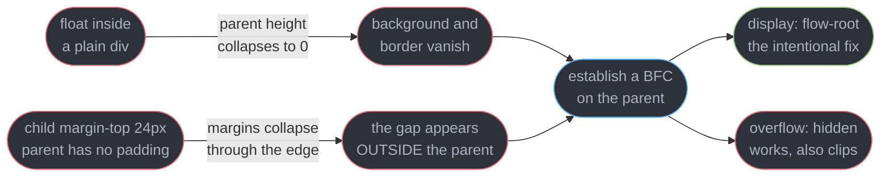
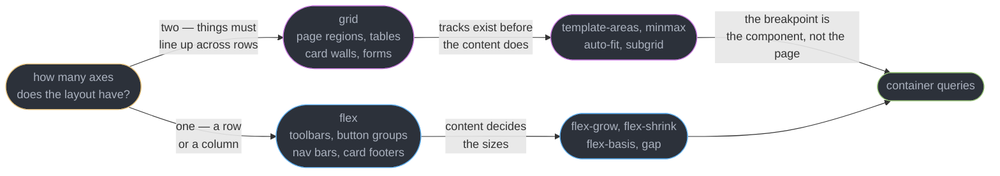
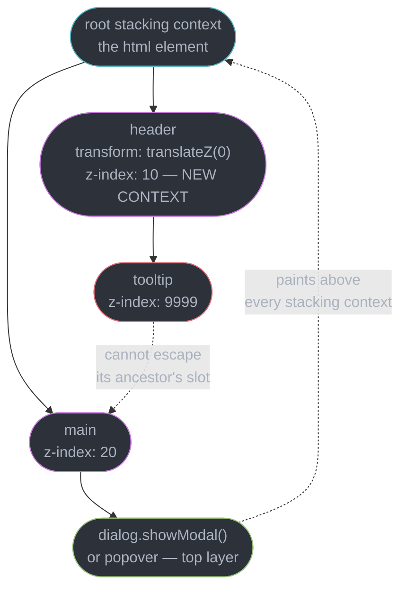
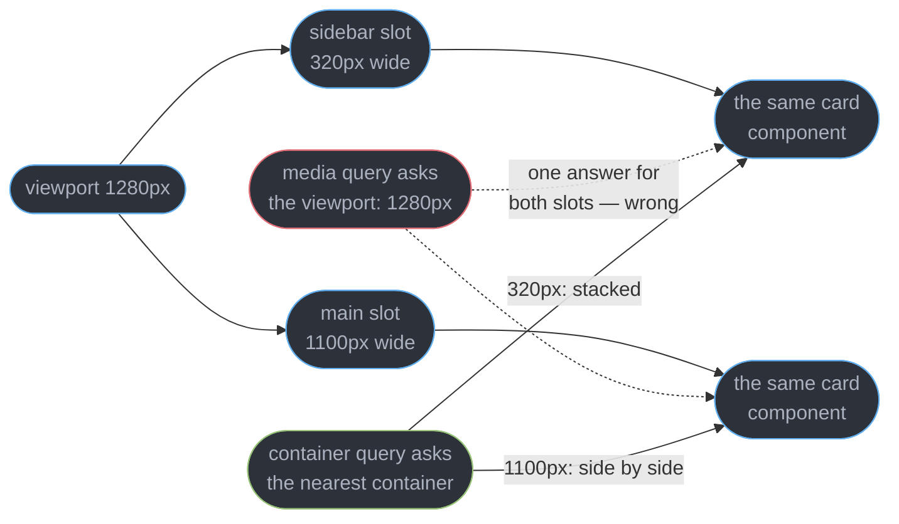

# CSS Layout and the Cascade

---

## 1. Concept Overview

A broken layout is a bug. It has a reproduction, a root cause and a fix, and the cause is
almost never "CSS is weird" — it is a formatting context, a stacking context or the cascade
doing exactly what the specification says. Treating CSS as taste is what produces the
`z-index: 9999` and the fourth `!important` in a file. Four independent systems decide what a
page looks like, and confusing them is the source of most of the confusion:

| System | Answers | Failure looks like |
|--------|---------|--------------------|
| The cascade | which declaration wins | "my rule is not applying" |
| Formatting contexts | how boxes size and stack in flow | collapsed margins, an uncontained float |
| Layout algorithms | flex, grid, flow, table geometry | an item that refuses to shrink |
| Stacking contexts | what paints over what | `z-index: 9999` doing nothing |

**This module owns authoring.** The mechanics of what the browser does with your stylesheet —
style recalculation, layout, paint, composite, reflow versus repaint, forced synchronous
layout — belong to
[Browser Architecture and the Rendering Pipeline](../browser_architecture_and_the_rendering_pipeline/browser_architecture_and_the_rendering_pipeline.md).
That module tells you what reading `offsetHeight` costs; this one tells you which CSS to write
so the geometry is right in the first place. The line is stated in both files on purpose.

| Topic | Owner |
|-------|-------|
| Layout, paint, composite, forced synchronous layout | [Browser Architecture and the Rendering Pipeline](../browser_architecture_and_the_rendering_pipeline/browser_architecture_and_the_rendering_pipeline.md) |
| Transitions, compositor-only properties, `prefers-reduced-motion` | [CSS Animation and Motion](../css_animation_and_motion/css_animation_and_motion.md) |
| Tailwind, CSS Modules, design tokens, CSS-in-JS | [Styling and Design Systems](../../react/styling_and_design_systems/styling_and_design_systems.md) |
| CLS, LCP, the performance budget | [Web Performance and Core Web Vitals](../web_performance_and_core_web_vitals/web_performance_and_core_web_vitals.md) |
| The accessibility tree, focus order, reflow at 320 CSS px | [Accessibility and WCAG](../accessibility_and_wcag/accessibility_and_wcag.md) |

---

## 2. Intuition

> CSS is a **constraint solver you configure by declaration**, and every "mystery" is a
> constraint you did not know you had written.

**Mental model.** You are not drawing pixels; you are handing the engine a set of rules and
letting it solve for geometry. `width: 300px` is not a promise about the rendered box — it is
one input among `box-sizing`, the containing block, `min-width`, the flex algorithm and the
parent's formatting context, several of which have non-obvious initial values.

**Why it matters.** The three highest-frequency front-end interview questions are all cascade
or context questions in disguise: why `z-index` failed, why a flex item will not shrink, and
which of two competing rules wins. None of them is answerable by trial and error, and all
three are answerable in one sentence once you know the model.

**Key insight.** Almost every surprising CSS behaviour comes from a property doing **two jobs
at once**. `overflow: hidden` clips *and* creates a block formatting context. `opacity: 0.99`
fades *and* creates a stacking context. `transform` moves *and* creates both a stacking
context and a containing block for fixed descendants. `container-type: inline-size` enables
container queries *and* forces containment. The second job is the one that bites.

---

## 3. Core Principles

1. **The cascade is a sort, not a search.** Every declaration for a property is collected,
   then ordered by origin and importance, then layer, then specificity, then source order.
   Nothing is skipped and nothing is "overridden" — one value wins the sort.
2. **Specificity is a tuple, never a number.** `(id, class, type)` compares
   left to right, and 11 classes never beat 1 id. Thinking of it as 0-1-1-0 arithmetic is
   the mistake that produces `!important`.
3. **A box's behaviour is decided by its formatting context, not by itself.** The same
   `<div>` sizes one way inside flow, another inside a flex container, another inside a grid.
4. **Painting order is a tree, not a scale.** `z-index` sorts siblings *inside one stacking
   context*; it can never lift a box past an ancestor's position in the parent context.
5. **Physical directions are a localisation bug.** `left` and `right` are hard-coded facts
   about English; `inline-start` and `inline-end` are the same design expressed as a rule.
6. **Layout correctness is testable.** RTL, 320 CSS px, 200% zoom and a 40-character product
   name are inputs, and a layout that breaks on any of them has a defect, not a preference.

---

## 4. Types / Architectures / Strategies

### 4.1 Formatting contexts

A formatting context is an independent region with its own layout rules. Boxes inside one do
not interact with boxes outside it.

| Context | Established by | What it changes |
|---------|---------------|-----------------|
| Block (BFC) | root, floats, `overflow` not `visible`, `display: flow-root`, flex/grid items, `position: absolute`/`fixed`, `contain: layout`, table cells | contains floats, stops margin collapse across its edge, does not overlap outside floats |
| Inline (IFC) | a block container with only inline children | line boxes, baselines, `vertical-align` |
| Flex (FFC) | `display: flex` / `inline-flex` | one-axis distribution, `min-width: auto` on items |
| Grid (GFC) | `display: grid` / `inline-grid` | two-axis placement, `min-width: auto` on items |

`display: flow-root` exists for exactly one reason: to create a BFC and nothing else. It is
what people meant every time they wrote `overflow: hidden` on a wrapper.

### 4.2 Picking a layout algorithm

| Need | Use | Why |
|------|-----|-----|
| Distribute items along one axis | flex | content-sized, wraps as a unit, no track model |
| Place items in rows *and* columns that line up | grid | tracks exist independently of content |
| A responsive card wall with no breakpoints | grid `auto-fit` + `minmax` | the browser computes the column count |
| A nested card whose rows align with the outer grid | `subgrid` | the child adopts the parent's tracks |
| A component that adapts to its container | container queries | viewport width is the wrong question |

Flex and grid are not competitors at the page level — a real page is a grid of regions, each
of which is usually a flex row or a flow block.

---

## 5. Architecture Diagrams

### 5.1 The box model and what `box-sizing` moves

```
        margin  (transparent, collapses vertically, background never paints here)
   +--------------------------------------------------------------------+
   |  +--------------------------------------------------------------+  |
   |  |                  border  (2px, paints, hit-tested)            |  |
   |  |  +--------------------------------------------------------+  |  |
   |  |  |          padding  (16px, the background DOES paint)     |  |  |
   |  |  |  +--------------------------------------------------+  |  |  |
   |  |  |  |   content   <- `width` applies HERE by default    |  |  |  |
   |  |  |  |             <- and `%` heights need a parent      |  |  |  |
   |  |  |  +--------------------------------------------------+  |  |  |
   |  |  +--------------------------------------------------------+  |  |
   |  +--------------------------------------------------------------+  |
   +--------------------------------------------------------------------+

   declared:  width: 300px;  padding: 16px;  border: 2px

   box-sizing: content-box   300 content + 32 padding + 4 border  = 336px on screen
   box-sizing: border-box    264 content + 32 padding + 4 border  = 300px on screen
                             ^ content is solved for; the declared width is the OUTER edge
```

`border-box` does not change the box model — it changes which edge `width` names, which is why
`width: 100%` plus padding overflows under `content-box` and fits under `border-box`.

### 5.2 How the cascade resolves one property


Steps run in order and stop at the first that separates the candidates. "My rule is not
applying" is a claim about which step you lost at, and the DevTools Styles pane shows the loser
struck through with the winner above it.

### 5.3 What a block formatting context fixes



`overflow: hidden` fixes both problems because a scroll container is a BFC — and it also
silently clips a dropdown, a focus ring and a `box-shadow`. `display: flow-root` buys the
containment with none of the side effect.

### 5.4 Deciding between flex and grid



**Hand-tuning widths so two flex rows line up means you wanted a grid; declaring a
single-column grid means you wanted flex.**

### 5.5 Why `z-index: 9999` does nothing



The tooltip's 9999 sorts it inside the header only. The header's own 10 loses to main's 20 and
the whole subtree goes with it — raising the number is arithmetic applied to the wrong tree.

---

## 6. How It Works — Detailed Mechanics

### 6.1 Block formatting contexts, margin collapse and the float trap

Two adjacent vertical margins in the same BFC **collapse to the larger of the two**, not the
sum — between siblings, through an empty block, and between a parent and its first or last
child when no border, padding or BFC separates them. Horizontal margins never collapse, and
neither do margins on flex or grid items, which is why the behaviour feels extinct until it
turns up in a flow section.

```css
/* A 24px child margin escapes the parent and pushes the PARENT down instead. */
.card       { background: #2c313a; }        /* no border, no padding: nothing separates */
.card > h2  { margin-block-start: 24px; }   /* collapses through .card's top edge */

.card { display: flow-root; }        /* FIX: new BFC, zero side effects */
.card { padding-block-start: 1px; }  /* also works: a separator now exists */
.card { overflow: hidden; }          /* also works, and clips shadows and dropdowns */
```

The float case is the same mechanism from the other side: a floated child is out of flow, so
its parent's auto height computes to `0` and the background disappears. A BFC contains its
floats, which is all `clearfix` ever emulated.

### 6.2 Specificity, and why `!important` is a symptom

Specificity is the tuple `(id, class-like, type-like)`, compared left to right with no
carrying. `class-like` counts classes, attribute selectors and pseudo-classes; `type-like`
counts element names and pseudo-elements.

```css
#app .list li.active a          { color: red; }    /* (1, 2, 2) — the id decides it */
.list .item .link .a .b .c .d   { color: blue; }   /* (0, 7, 0) — 7 classes lose to 1 id */

:where(.theme-dark) .btn        { color: teal; }   /* (0, 1, 0) — :where() contributes 0 */
:is(#app, .sidebar) .btn        { color: lime; }   /* (1, 1, 0) — :is() takes its MOST specific arg */
.btn:not(#app)                  { color: pink; }   /* (1, 1, 0) — :not() counts its argument too */
```

`:where()` scoring zero is what makes low-specificity defaults writable: a design system ships
`:where(.btn) { padding: 8px 16px }` at `(0, 0, 0)`, and any consumer's single class overrides
it without a fight.

Inheritance is a separate mechanism from the cascade. Roughly 130 properties inherit —
`color`, `font-*`, `line-height`, `visibility`, `cursor`, `direction`, `text-align`, plus every
custom property. Layout properties do not, because a `margin: 20px` cascading into every
descendant would be unusable.

```css
.reset {
  color:   inherit;      /* take the parent's computed value, always */
  border:  initial;      /* the SPEC's initial value: medium none currentcolor */
  padding: unset;        /* = inherit if the property inherits, = initial if it does not */
  margin:  revert;       /* roll back to the previous origin: the UA stylesheet */
  font:    revert-layer; /* roll back to the previous cascade LAYER instead */
}
```

`revert` is the one people miss: `all: revert` on a widget root restores the browser's own
stylesheet, a far better starting point than `all: unset`, which strips `display: block` off a
`<div>` and leaves an inline box.

### 6.3 Cascade layers end the specificity arms race

`@layer` declares precedence **once, up front, by name**, before any of the CSS exists. Order
of declaration is order of priority, and specificity is only consulted *inside* a layer.

```css
/* One line, at the top of the entry stylesheet. This is the whole contract. */
@layer reset, vendor, base, components, utilities;
@import url("vendor.css") layer(vendor);

@layer vendor     { #vendor-widget .btn { background: hotpink; } }  /* (1,1,0) — and it loses */
@layer components { .btn { background: var(--brand); } }            /* (0,1,0) — and it wins */
```

A third-party stylesheet full of `#id .class .class` selectors can no longer out-specify you,
because the comparison never reaches specificity. Two rules catch people. **Unlayered normal
styles beat every layer**, so a stray rule outside `@layer` silently outranks your `utilities`.
And **`!important` inverts the layer order entirely**:

```mermaid
flowchart LR
    classDef n fill:#2c313a,stroke:#98c379,color:#abb2bf
    classDef i fill:#2c313a,stroke:#e06c75,color:#abb2bf
    classDef h fill:#2c313a,stroke:#e5c07b,color:#abb2bf
    subgraph NORMAL["normal declarations — later layer wins"]
        direction LR
        N1(["reset"]) --> N2(["base"]) --> N3(["components"]) --> N4(["utilities"]) --> N5(["unlayered<br/>STRONGEST"])
    end
    subgraph IMPORTANT["important declarations — order REVERSES"]
        direction LR
        I1(["unlayered !important<br/>WEAKEST"]) --> I2(["utilities !important"]) --> I3(["components !important"]) --> I4(["base !important"]) --> I5(["reset !important<br/>STRONGEST"])
    end
    NORMAL --> IMPORTANT
    class N1,N2,N3,N4,N5 n
    class I1,I2,I3,I4,I5 i
    class NORMAL,IMPORTANT h
```



The inversion is deliberate: a layer declared *first* is the one you trust least to be
overridable, so when it insists it should win. In practice `!important` in `utilities` loses to
`!important` in `reset` — the opposite of everyone's intuition, and one more reason to stop
reaching for it.

### 6.4 Flex: three properties and one trap

`flex` is shorthand for `flex-grow flex-shrink flex-basis`, initial value `0 1 auto` — do not
grow, do shrink, size from content.

| Shorthand | Expands to | Behaviour |
|-----------|-----------|-----------|
| `flex: 1` | `1 1 0%` | all items equal width regardless of content |
| `flex: auto` | `1 1 auto` | items grow from their content size, so longer text stays wider |
| `flex: none` | `0 0 auto` | never grows, never shrinks — the right value for an icon |
| `flex: 0 1 200px` | as written | 200px preferred, may shrink, never grows |

The trap is that **flex items have `min-width: auto`, not `0`**, along the main axis. An item
will not shrink below its min-content size, so one unbreakable string, a `<pre>` block or a
nested scroll container blows the row wider than its container.

```css
.row  { display: flex; gap: 12px; }
.cell { flex: 1; }                      /* still overflows: min-width auto = min-content */
.cell { flex: 1; min-inline-size: 0; }  /* now it can shrink; add overflow-wrap to break text */
```

Grid items carry the identical default, where the idiom is `minmax(0, 1fr)` instead of `1fr`.
If a track is wider than you asked for, this is the reason.

### 6.5 Grid: tracks, areas and the two `auto-` keywords

```css
.page {
  display: grid;
  grid-template-areas: "nav head" "nav main" "nav foot";
  grid-template-columns: minmax(200px, 240px) minmax(0, 1fr);  /* minmax(0,...) — see 6.4 */
  grid-template-rows: auto 1fr auto;      /* sticky footer, no hacks */
  min-block-size: 100dvh;                 /* dvh, not vh: the mobile URL bar */
  gap: 16px;
}
.sidebar { grid-area: nav; }

/* A card wall with zero media queries. The browser computes the column count. */
.cards { display: grid; gap: 16px;
         grid-template-columns: repeat(auto-fit, minmax(min(260px, 100%), 1fr)); }
.cards > .card { display: grid; grid-row: span 3; grid-template-rows: subgrid; }
```

`auto-fill` creates as many tracks as fit and **keeps the empty ones**, so three cards in a
1200px container sit at 260px each with space to the right. `auto-fit` collapses empty tracks
to zero, so those same three stretch to 389px each. Use `auto-fit` for a gallery, `auto-fill`
when the column rhythm must stay stable as items are added. The `min(260px, 100%)` guard is
required — a bare `minmax(260px, 1fr)` overflows a 240px phone, because 260px is a hard floor.

`subgrid` fixes what `grid-template-areas` cannot: each card is its own grid, so a title
wrapping to two lines in one card and one in another leaves the buttons misaligned. Making the
card adopt the parent's rows fixes every card at once, in the one extra line above.

### 6.6 Container queries: the component asks about itself

A media query asks about the viewport. That is the wrong question for a component rendered in a
320px sidebar and a 1100px main column **on the same page at the same viewport width** — no
media query can distinguish those two cases.

```css
.card-slot { container-type: inline-size; container-name: card; }

.card { display: grid; gap: 12px; }
@container card (min-width: 420px) {
  .card { grid-template-columns: 160px 1fr; }    /* image beside text */
}
.card__title { font-size: clamp(1rem, 4cqi, 1.5rem); }  /* cqi = 1% of container inline size */
```

Three mechanics decide whether this works. **You cannot query the element itself** — the rule
matches an *ancestor* container, so the wrapper carries `container-type` and the card responds.
**`container-type: inline-size` forces containment**: the element's inline size stops depending
on its contents, which breaks shrink-to-fit boxes, and layout and style containment come as
part of the package. **That containment creates a stacking context and a containing block for
absolutely positioned descendants** — the second job again (§6.8). `container-type: size`
queries both axes and needs an explicit block size, or the element collapses to zero height.



Media queries still own what is genuinely global: `prefers-color-scheme`,
`prefers-reduced-motion`, `pointer: coarse`, print. Container queries own everything about a
component's own box.

### 6.7 Logical properties are an internationalisation requirement

`left` and `right` encode an assumption about English. In Arabic, Hebrew, Persian and Urdu the
inline axis runs right to left, and every hard-coded physical property becomes a defect —
labels on the wrong side of inputs, back arrows pointing forward, a sidebar on the wrong edge.

| Physical | Logical | In `dir="rtl"` |
|----------|---------|----------------|
| `margin-left` | `margin-inline-start` | the right margin |
| `left: 0` | `inset-inline-start: 0` | `right: 0` |
| `text-align: left` | `text-align: start` | right-aligned |
| `border-top` | `border-block-start` | unchanged — block axis |
| `width` / `height` | `inline-size` / `block-size` | swap under vertical writing modes |

```css
/* BROKEN in RTL: the icon sits on the wrong side and the text runs into it. */
.alert { padding-left: 40px; border-left: 4px solid var(--warn); text-align: left; }

/* FIX: correct in every writing mode, with no [dir="rtl"] override sheet. */
.alert { padding-inline-start: 40px; border-inline-start: 4px solid var(--warn); text-align: start; }
```

`dir` is an HTML attribute, not a CSS property, and it **inherits down the DOM** — set
`<html dir="rtl" lang="ar">` and every descendant flips, including across a shadow boundary.
Select on it with `:dir(rtl)` rather than `[dir="rtl"]`: the attribute selector matches only
the element literally carrying the attribute, while `:dir()` matches computed directionality
anywhere in the subtree. User-generated text needs `dir="auto"` per field, which infers
direction from the first strong character. Physical properties stay correct for genuinely
physical things — a shadow offset toward a light source, an icon that must never mirror.

### 6.8 Stacking contexts

Painting order is a tree. A stacking context is a self-contained painting unit: its descendants
are sorted among themselves, then the whole unit is painted as one atom in its parent's
ordering. `z-index` sorts *within* one context and can never address across contexts.

The triggers: the root element; `position: relative`/`absolute` with `z-index` not `auto`;
`position: fixed` or `sticky` unconditionally; a flex or grid child with a `z-index`; `opacity`
below 1; `transform`, `filter`, `backdrop-filter`, `perspective`, `clip-path`, `mask`;
`mix-blend-mode` not `normal`; `isolation: isolate`; `will-change` naming any of these;
`contain: layout`/`paint`/`content`/`strict` and `container-type`; `content-visibility` not
`visible`; and `view-transition-name`. The two you will actually hit are a sticky header and a
`transform: translateZ(0)` someone added for "GPU acceleration" three years ago.

There are three real fixes, and raising the number is not one of them. **Move the element out
of the trapping ancestor**, rendering overlays into a portal at the document root.
**Restructure the ancestors' `z-index`**, since that is where the comparison actually happens.
Or **leave the stacking model entirely via the top layer**: `dialog.showModal()` and the
`popover` attribute paint above every stacking context with no `z-index` at all, and that is
now the correct answer for modals, tooltips and menus.

```css
/* The top layer ignores z-index, transforms and overflow: hidden ancestors alike. */
[popover]     { border: 0; padding: 12px; border-radius: 8px; }
::backdrop    { background: rgb(0 0 0 / 0.4); }   /* the top layer's own backdrop pseudo */
.overlay-root { isolation: isolate; }             /* when you must stay in the normal flow */
```

`isolation: isolate` is the honest alternative to `opacity: 0.999`: a stacking context with no
rendering side effect, for when a component's `z-index` values must not leak.

### 6.9 Containment and `content-visibility`

`contain` promises the browser that a subtree's effects are bounded, which lets it skip work.
`content-visibility: auto` is the packaged version: off-screen elements skip layout, paint and
style entirely, and are processed only when they scroll near the viewport.

```css
.comment { content-visibility: auto;
           contain-intrinsic-size: auto 180px; }  /* `auto` caches the real rendered size */
.widget  { contain: layout paint; }               /* effects cannot escape this subtree */
```

`contain-intrinsic-size` is not optional: without it a skipped element reports zero height, the
scrollbar collapses and the page jumps as content renders — a self-inflicted CLS failure that
[Core Web Vitals](../web_performance_and_core_web_vitals/web_performance_and_core_web_vitals.md)
measures. On a 500-comment thread this takes initial layout from roughly 380 ms to 42 ms,
because only the 6 comments near the viewport are laid out. Two caveats: skipped content **is
still revealed by find-in-page and anchor links**, and it remains in the DOM, so
`querySelectorAll` still returns it. What the browser does with the promise — the pipeline
stages it skips — belongs to
[the rendering pipeline](../browser_architecture_and_the_rendering_pipeline/browser_architecture_and_the_rendering_pipeline.md).

---

## 7. Real-World Examples

**A design system that stopped losing to a vendor widget.** A fintech dashboard embedded a
third-party charting library whose stylesheet used `#chart-root .legend .label` selectors. The
in-house override file had grown to 340 lines and 61 `!important` declarations over two years.
Wrapping the vendor import in `@layer vendor` and the design system in `@layer components` —
a four-line change plus one `@import ... layer()` — let 58 of the 61 `!important` declarations
be deleted, and the override file shrank to 71 lines. Nothing about the vendor CSS changed.

**A card component shipped in three slot widths.** A marketing site rendered the same product
card in a 300px sidebar, a two-column grid and a full-width hero. The media-query version
carried three variant classes and a prop to pick between them, and the wrong one was passed
often enough to be a recurring bug ticket. One `container-type: inline-size` on the slot and
two `@container` rules deleted the prop, the three classes and the bug class with them.

---

## 8. Tradeoffs

| Dimension | Flexbox | Grid |
|-----------|---------|------|
| Axes | one at a time | two simultaneously |
| Track sizing | derived from content | declared independently of content |
| Items line up across rows | only by hand-set widths | by construction |
| Source order independence | `order` only, and it breaks tab order | full placement, same tab-order caveat |
| Wrapping | `flex-wrap`, rows size independently | `auto-fit` / `auto-fill`, tracks stay aligned |

Cascade layers trade one-time architectural discipline for the permanent removal of specificity
fights: layer order must be decided before writing CSS, and a stray unlayered rule beats every
layer.

---

## 9. When to Use / When NOT to Use

**Use `display: flow-root`** whenever you need a BFC, and reserve `overflow: hidden` for when
you genuinely want clipping. **Use grid** the moment two rows must align, and **flex** for a
single row or column of content-sized items. **Use `@layer`** in any codebase that imports
third-party CSS or ships a design system — the value is proportional to how many authors touch
the stylesheet. **Use container queries** for every component-level breakpoint, and
**logical properties by default**, physical ones only where the thing really is physical.
**Use `content-visibility: auto`** on long uniform lists past roughly 50 items, always paired
with `contain-intrinsic-size`.

**Do NOT** raise a `z-index` past 10 without checking the ancestor chain in the DevTools Layers
panel — the answer is a stacking context, not a number. **Do NOT** reach for `!important` to
win a specificity fight; layer the CSS instead. **Do NOT** put `container-type` on an element
whose width should be decided by its contents, or it collapses. **Do NOT** use
`content-visibility: auto` on content that must be measured immediately. **Do NOT** use `order`
or grid placement to reorder anything interactive: the visual order moves and the tab order
does not, which is a WCAG 2.2 failure owned by
[Accessibility and WCAG](../accessibility_and_wcag/accessibility_and_wcag.md).

---

## 10. Common Pitfalls

### Pitfall 1: `z-index` defeated by a transformed ancestor

```css
/* BROKEN — the tooltip disappears behind main content whatever number you use. */
.app-header  { position: sticky; top: 0; z-index: 10;
               transform: translateZ(0); }     /* added for "GPU acceleration" in 2023 */
.app-main    { position: relative; z-index: 20; }
.tooltip     { position: absolute; z-index: 9999; }   /* inside .app-header. Trapped. */

/* FIX — leave the stacking model entirely. No z-index anywhere. */
.tooltip     { position: absolute; }
```
```html
<button popovertarget="tip">Help</button>
<div id="tip" popover class="tooltip">Rates refresh every 60 seconds.</div>
```

The header's `transform` creates a stacking context, so `.tooltip`'s 9999 sorts it only among
the header's own children; the header as a whole is compared to `.app-main` using **10 against
20**, and loses. A popover renders in the top layer, above every stacking context, with no
ordering declared at all. Verify the diagnosis in DevTools: the Layers panel shows the header
as its own compositing root, and Elements shows a "stacking context" badge.

### Pitfall 2: a flex item that refuses to shrink

```css
/* BROKEN — one long URL in .cell pushes the row 340px past its container. */
.row  { display: flex; gap: 12px; max-inline-size: 600px; }
.cell { flex: 1; }                       /* min-width: auto = min-content = the whole URL */

/* FIX — allow the item to go below min-content, then decide how to handle the overflow. */
.cell { flex: 1; min-inline-size: 0; overflow-wrap: anywhere; }
```

`min-width: auto` on flex items is the initial value, not something you set, and grid items
carry the same default — the grid idiom is `minmax(0, 1fr)` in place of `1fr`. The symptom is
always the same: a container that is wider than its declared `max-width`, with no rule
anywhere in DevTools that explains the width.

---

## 11. Technologies & Tools

| Tool | Role | Relevance |
|------|------|-----------|
| Chrome DevTools | Inspector | Flexbox and Grid overlays, the Layers panel, computed-value tracing |
| Firefox DevTools | Inspector | The best grid inspector, plus a dedicated font and inactive-CSS panel |
| Lightning CSS | Transformer and minifier | Rust-based transform, autoprefixing and syntax lowering |
| PostCSS | CSS transform pipeline | Plugin host for custom syntax and polyfills |
| Stylelint | Linter | Enforces logical properties, specificity ceilings, layer usage |
| Autoprefixer | PostCSS plugin | Vendor prefixes driven by Browserslist targets |
| Open Props | CSS variable library | Design tokens as plain custom properties, no build step |
| Baseline | Support status | The interoperability signal that replaced hand-reading support tables |

---

## 12. Interview Questions with Answers

**Q: I set `z-index: 9999` and the element still renders underneath. Why?**
**Short:** An ancestor established a stacking context, so the 9999 only sorts the element among that ancestor's children and the whole subtree is painted at the ancestor's own position.

`z-index` is not a global scale. If a parent has `transform`, `opacity` below 1, `filter`,
`position: fixed`, `will-change` or `contain`, it is a self-contained painting unit and its
children can never be lifted past it. Fix it by moving the element out of the trapping
ancestor, by reordering the ancestors, or by using `dialog.showModal()` or `popover`, which
paint in the top layer above every stacking context with no `z-index` at all.

**Q: What creates a stacking context?**
**Short:** Roughly a dozen triggers, including positioned elements with a z-index, position fixed or sticky, opacity below 1, transform, filter, isolation isolate, will-change and any containment.

The root element; `position: relative`/`absolute` with `z-index` not `auto`; `position: fixed`
or `sticky` unconditionally; a flex or grid child with a `z-index`; `opacity` below 1;
`transform`, `filter`, `backdrop-filter`, `perspective`, `clip-path`, `mask`; `mix-blend-mode`;
`isolation: isolate`; `will-change` naming any of these; `contain` and `container-type`;
`content-visibility`; `view-transition-name`. Only `isolation: isolate` has no visual effect.

**Q: When do you reach for flexbox and when for grid?**
**Short:** Flex distributes along a single axis and derives track sizes from content, grid places items on two axes with tracks that exist independently of what goes in them.

Use flex for a toolbar, a nav bar, a button group, a card footer — one row or column of
content-sized items. Use grid for page regions, forms and card walls, and the moment two rows
must line up. The tell: if you are hand-tuning widths so two flex rows align you wanted a grid,
and if you declared a single-column grid you wanted flex. A page grid of flex rows is the norm.

**Q: Why will a flex item not shrink below its content, and how do you fix it?**
**Short:** Flex items default to min-width auto rather than zero, so the flex algorithm refuses to shrink one below its min-content size, which one long unbreakable string sets.

Set `min-inline-size: 0` on the item and it will shrink; add `overflow-wrap: anywhere` or
`overflow: hidden` to decide what happens to the content. Grid items carry the identical
default, where the idiom is `minmax(0, 1fr)` instead of `1fr`. The symptom is a container wider
than its own declared `max-width` with no rule in DevTools that explains it.

**Q: How does specificity work, and why is it not a single number?**
**Short:** Specificity compares three independent counts — ids, then class-like selectors, then type-like selectors — left to right with no carrying, so eleven classes never beat one id.

`#app .btn` is `(1, 1, 0)` and `.a.b.c.d.e.f.g` is `(0, 7, 0)`; the first column decides it and
the rest is never read. `:where()` always contributes zero, which is how a design system ships
overridable defaults; `:is()` and `:not()` take their most specific argument. An inline `style`
attribute is not specificity at all but a separate, higher step in the cascade.

**Q: Is `!important` ever legitimate, and what does it actually do?**
**Short:** Marking a declaration important moves it into a separate cascade band whose origin order is inverted, so an author important beats every normal author rule and a user important beats it.

Three legitimate uses: a user stylesheet, an accessibility override, and forcing a value into
third-party CSS you cannot re-layer. Everywhere else it signals that the cascade was never
architected, and the fix is `@layer` or `:where()`. It also does not compose — once two
`!important` rules collide you are back to specificity with one fewer tool left.

**Q: What is a block formatting context, and why does `overflow: hidden` "fix" things?**
**Short:** An independent layout region whose boxes do not interact with the outside, which is why one contains its floats and blocks margins from collapsing through its edges.

`overflow: hidden` creates a scroll container, and a scroll container is a BFC — so it fixes
the collapsed-height float parent and the escaping margin as a side effect, while clipping
dropdowns, shadows, focus rings and any sticky child. `display: flow-root` creates a BFC and
nothing else. Floats, flex and grid items, absolute boxes and `contain: layout` also make one.

**Q: Why do margins collapse, and how do you stop it?**
**Short:** Adjacent vertical margins in the same block formatting context merge into the larger of the two rather than adding, including between a parent and its first or last child.

It happens between siblings, through an empty block, and between a parent and its first or last
child when no border, padding or BFC separates them — which is why a child's `margin-top: 32px`
moves the parent instead. Stop it with `display: flow-root`, with 1px of padding or a border,
or by switching the parent to flex or grid. Horizontal margins never collapse.

**Q: What problem do cascade layers solve that specificity cannot?**
**Short:** Declaring layer order up front decides precedence by architecture rather than by selector shape, so a vendor stylesheet using id selectors loses to your single-class rule.

`@layer reset, vendor, base, components, utilities;` at the top of the entry file is the whole
contract: later layers win, and specificity is compared only inside a layer. Import directly
with `@import url("v.css") layer(vendor)`. Two traps — unlayered normal styles beat every
layer, and `!important` **inverts** the order so the first layer's important wins.

**Q: How are container queries different from media queries, and what do they cost?**
**Short:** Container queries measure the nearest ancestor declared as a container rather than the viewport, which is the only way one component can adapt to a 320px sidebar and a 1100px column at the same viewport width.

The container carries `container-type: inline-size`, the component reads
`@container (min-width: 420px)`, and `cqi` units size relative to it. The cost is real:
containment means the container's width stops depending on its contents, and it creates a
stacking context and a containing block for absolute descendants. You also cannot query the
element itself. Media queries keep `prefers-color-scheme`, `pointer: coarse` and print.

**Q: What does `box-sizing: border-box` actually change?**
**Short:** Border-box folds padding and border inside the declared width instead of adding them outside it, so width names the outer edge and the content box is solved for.

With `width: 300px; padding: 16px; border: 2px`, `content-box` renders 336px and `border-box`
renders 300px. It is why `width: 100%` plus padding overflows its parent under the default and
fits under `border-box`, and why nearly every reset opens with
`*, *::before, *::after { box-sizing: border-box }`. The box model itself is unchanged.

**Q: Why use logical properties instead of `margin-left` and `right`?**
**Short:** Inline-start resolves to the left in a left-to-right language and the right in Arabic or Hebrew, so one declaration is correct in every writing mode with no override sheet.

`margin-inline-start`, `padding-inline`, `inset-inline-start` and `text-align: start` flip with
`dir`; `margin-left` does not, and each one is a defect the moment an RTL locale ships. `dir` is
an HTML attribute that inherits down the DOM; select on computed direction with `:dir(rtl)`
rather than `[dir="rtl"]`, and use `dir="auto"` per field for user-generated text.

**Q: What is the difference between `auto-fit` and `auto-fill`?**
**Short:** Auto-fill keeps empty tracks at their minimum size while auto-fit collapses them to zero, so with a 1fr maximum auto-fit stretches the existing items to fill the row.

Three cards in a 1200px container with `repeat(auto-fill, minmax(260px, 1fr))` sit at 260px
each with empty space to the right; `auto-fit` stretches them to 389px each. Use `auto-fit` for
a gallery that should always look full and `auto-fill` when the column rhythm must stay stable.
Both need `minmax(min(260px, 100%), 1fr)`, or the grid overflows any narrower viewport.

**Q: What does `minmax()` give you that `clamp()` does not?**
**Short:** Minmax bounds a grid track between two sizes and participates in track sizing, while clamp bounds a single computed value and knows nothing about the other tracks.

`grid-template-columns: minmax(200px, 240px) minmax(0, 1fr)` gives a sidebar that never
collapses below 200px or grows past 240px — and the `minmax(0, 1fr)` is required rather than
`1fr` because grid items default to `min-width: auto`. `clamp(1rem, 4cqi, 1.5rem)` is for a
value such as a font size. They compose: tracks with `minmax`, sizes inside them with `clamp`.

**Q: What is `subgrid` for?**
**Short:** Subgrid adopts the parent grid's track sizes inside a nested grid, so elements in different children align to shared rows or columns instead of each sizing independently.

The canonical case is a card wall where a title wraps to two lines in one card and one in
another, so the buttons stop lining up. `grid-row: span 3; grid-template-rows: subgrid` on each
card makes every title, body and button row share the parent's tracks. It works on either axis
independently, and gaps and line names inherit too. The alternatives are fixed heights or JS.

**Q: What do `revert`, `unset`, `initial` and `inherit` each do?**
**Short:** Revert rolls back to the previous cascade origin, unset means inherit for inherited properties and initial for the rest, initial is the spec default, and inherit takes the parent value.

`initial` is the value in the specification, not the browser's: `display: initial` is `inline`,
not `block`, which is why `all: unset` on a `<div>` leaves an inline box. `revert` restores the
UA stylesheet, so `all: revert` is the right reset for a widget root, and `revert-layer` rolls
back to the previous cascade layer instead of the previous origin.

**Q: What does `content-visibility: auto` buy, and what is the risk?**
**Short:** Skipping layout, style and paint for off-screen subtrees cuts initial layout dramatically, but without contain-intrinsic-size the elements report zero height and the page jumps.

On a 500-comment thread it takes initial layout from roughly 380 ms to 42 ms, because only the
6 comments near the viewport are laid out. Always pair it with
`contain-intrinsic-size: auto 180px`, whose `auto` keyword caches the last real size. Skipped
content is still in the DOM and still revealed by find-in-page, so it is not virtualisation.

**Q: Which CSS properties inherit, and which do not?**
**Short:** Inheritance passes a computed value down to descendants for typography and text-related properties plus every custom property, while layout and box properties do not inherit.

`color`, `font-family`, `line-height`, `text-align`, `white-space`, `visibility`, `cursor`,
`direction` and `list-style` inherit; `display`, `position`, `margin`, `padding`, `border`,
`width`, `overflow` and `z-index` do not, because a `margin: 20px` reaching every descendant
would be unusable. Custom properties always inherit, which is what makes theme scoping work.

---

## 13. Best Practices

1. **Declare `@layer` order in the first line of the entry stylesheet**, before any CSS exists,
   and import third-party sheets straight into a layer. Retrofitting is far harder.
2. **Use `display: flow-root` for containment and `overflow: hidden` only for clipping** —
   they are two different intentions that happen to share one side effect.
3. **Write logical properties by default.** Physical properties are for things that are
   genuinely physical, and a Stylelint rule keeps the codebase honest for free.
4. **Treat every `z-index` above 10 as a code smell** and every `!important` as a defect
   ticket. Check the ancestor chain for a stacking context before touching either.
5. **Reach for the top layer** — `dialog.showModal()` and `popover` — for modals, tooltips and
   menus, rather than portals plus a z-index register.
6. **Pair `content-visibility: auto` with `contain-intrinsic-size` every time**, and put
   `min-inline-size: 0` or `minmax(0, 1fr)` on any flex or grid item holding variable text.
7. **Test RTL, 320 CSS px, 200% zoom and a 40-character product name in CI** — a layout that
   survives all four has no room left for the usual defects.

---

## 14. Case Study

### A dashboard where every CSS defect had the same root cause

An analytics product shipped a dashboard with a sticky header, an embedded third-party chart
widget, a card grid and a new Arabic locale. Four bug tickets were open, filed by four teams as
four unrelated problems: tooltips rendering behind the chart, the sidebar collapsing in Arabic,
a card wall whose action buttons never lined up, and a 4,200-row audit table taking 2.8 seconds
to become interactive. The CSS was 14,600 lines with 83 `!important` declarations.

```css
/* BROKEN — every one of these is the same class of mistake. */
.header      { position: sticky; inset-block-start: 0; z-index: 10;
               will-change: transform; }        /* stacking context nobody knew about */
.tooltip     { position: absolute; z-index: 99999 !important; }   /* trapped inside .header */
#chart .axis .label { font-size: 11px !important; }  /* out-specifying the vendor, line 1 of 410 */
.sidebar     { padding-left: 24px; border-left: 1px solid; float: left; }  /* wrong side in RTL */
.wall        { display: grid; grid-template-columns: repeat(3, 1fr); }     /* cards misalign */
.audit-row   { contain: none; }                                            /* 4,200 rows laid out */
```

The four tickets shared one diagnosis: **the team was fighting the model rather than using
it.** `will-change: transform` on the header created a stacking context, so the tooltip's 99999
sorted it only among the header's own children. The 410-line override file existed because
specificity was the only tool anyone reached for. The physical properties were an RTL defect
waiting for a locale. And `1fr` tracks cannot align rows the cards do not share.

```css
/* FIX 1 — architecture, declared once, before any other CSS. */
@layer reset, vendor, base, components, utilities;
@import url("vendor/chart.css") layer(vendor);
@layer components { .axis .label { font-size: 11px; } }   /* (0,2,0) beats (1,2,0) in vendor */

/* FIX 2 — leave the stacking model instead of bidding against it. */
.tooltip { position: absolute; }   /* rendered with the popover attribute, top layer */

/* FIX 3 — logical properties, and a grid whose cards share the parent's rows. */
.sidebar { padding-inline-start: 24px; border-inline-start: 1px solid; }
.wall    { display: grid; gap: 16px;
           grid-template-columns: repeat(auto-fit, minmax(min(280px, 100%), 1fr));
           grid-auto-rows: auto 1fr auto; }
.wall > .card { display: grid; grid-row: span 3; grid-template-rows: subgrid; }

/* FIX 4 — stop laying out 4,194 invisible rows. */
.audit-row { content-visibility: auto; contain-intrinsic-size: auto 44px; }
```

The sidebar's `float: left` also went, replaced by the page-level grid, which removed the last
`overflow: hidden` clearfix and with it a clipped dropdown nobody had connected to it.

**Outcome, measured over 30 days at p75.** `!important` declarations went from 83 to 4, the
survivors being two accessibility overrides and two forced into an iframe-adjacent widget. The
chart override file went from 410 lines to 38, and the Arabic locale shipped with 14 physical
declarations remaining, all deliberate. Time to interactive on the audit table went from
2,840 ms to 610 ms and initial layout for that view from 380 ms to 42 ms; CLS went from 0.19 to
0.02, passing the 0.1 threshold. Total diff: 1,970 lines removed, 240 added.

**The lesson.** Four tickets, four teams, one root cause. Every fix was a property doing its
second job — `will-change` creating a stacking context, `overflow: hidden` creating a BFC,
`1fr` colliding with `min-width: auto`, `padding-left` encoding a language. None of these is
obscure and none was visible in code review; all four were obvious the moment someone asked
*which context is this box in* instead of *what number makes it work*.
