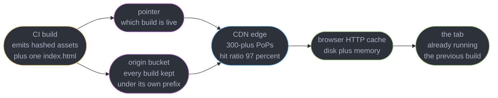
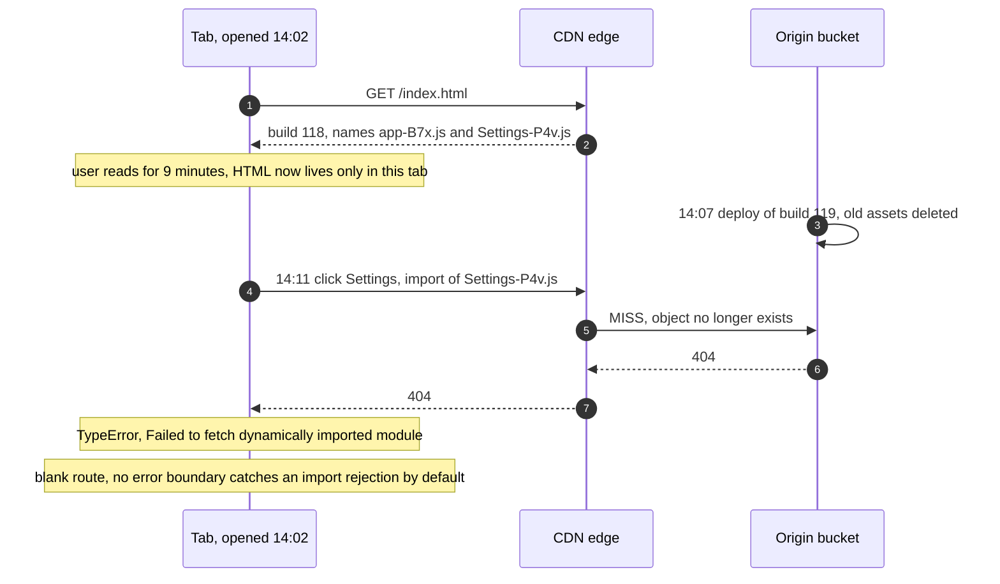
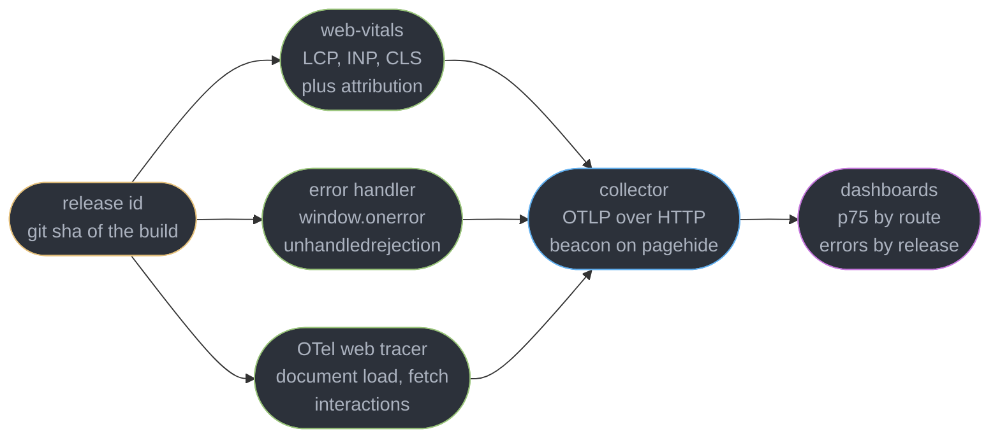
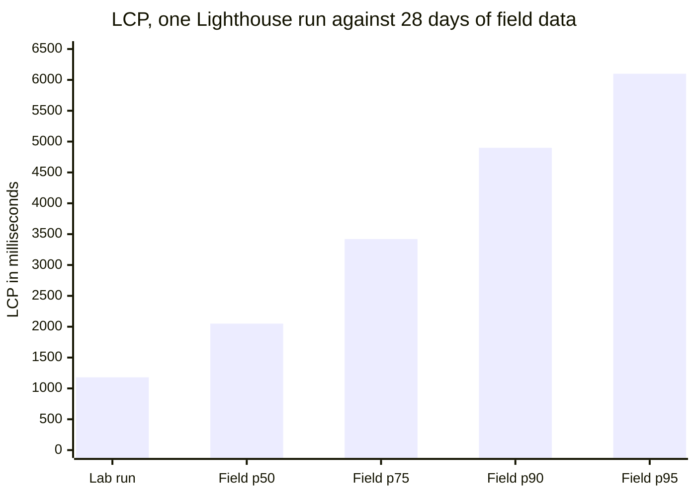
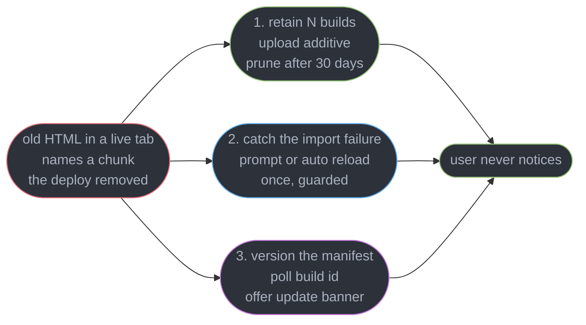
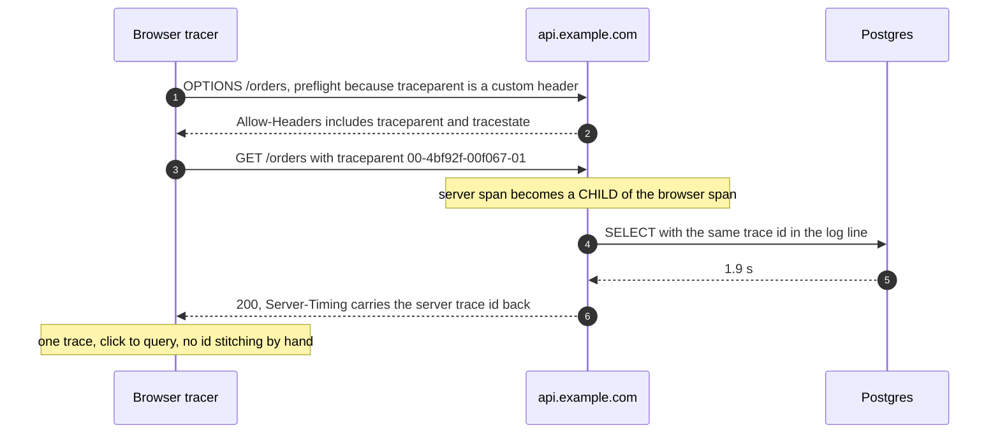

# Frontend Delivery and Observability

---

## 1. Concept Overview

Every other module in this section ends at the moment the code is correct. This one starts
there. A front-end build is a directory of static files, and turning that directory into
something 4 million people load — and then knowing what happened to them — is a separate
discipline with its own failure modes, none of which reproduce on `localhost`.

Two of those failure modes are famous enough to have their own incident channels. The first
is a **cache you cannot reach**: you shipped a fix, the CDN is serving last week's file, and
"tell them to hard-refresh" is not a rollout plan. The second is the **post-deploy chunk
404**: the deploy succeeded, monitoring is green, and every user who had a tab open when it
landed is now staring at a blank route. Both are caused by the same thing — a deploy is not
one atomic event to a browser that already downloaded half of the previous one.

The observability half is the mirror image. Server telemetry tells you the API returned 200 in
40 ms. It cannot tell you the page took 4.1 seconds because a hero image loaded late, that the
stack trace is `t.n is not a function` at `app.a1b2c3.js:1:48291`, or that the slow request the
user complained about is the same request as the slow query in the database log.

| This module owns | Owner elsewhere |
|------------------|-----------------|
| Static hosting, atomic deploys, asset invalidation, the chunk 404 | CDN mechanics, cache hierarchy, origin shielding: [CDN](../../hld/cdn/cdn.md) and [Cloud Networking and CDN](../../devops/cloud_networking_and_cdn/cloud_networking_and_cdn.md) |
| RUM collection, sampling, field data | LCP/INP/CLS definitions and how to fix them: [Web Performance and Core Web Vitals](../web_performance_and_core_web_vitals/web_performance_and_core_web_vitals.md) |
| Source-map upload, release tagging, client tracing | Server spans, metrics, alerting: [Observability and Monitoring](../../backend/observability_and_monitoring/observability_and_monitoring.md) |
| What the deploy does to a hashed chunk | How the chunk got its hash: [Modules, Bundling and the Build Pipeline](../modules_bundling_and_the_build_pipeline/modules_bundling_and_the_build_pipeline.md) |
| The HTTP cache from the deploy side | `fetch`, ETag, the browser cache from the client side: [HTTP in the Browser and Fetch](../http_in_the_browser_and_fetch/http_in_the_browser_and_fetch.md) |
| The chunk 404 without a service worker | The service-worker update trap: [PWA, Service Workers and Offline](../pwa_service_workers_and_offline/pwa_service_workers_and_offline.md) |
| Where the app is served from | What an edge runtime can execute: [The Node and Edge Runtimes](../the_node_and_edge_runtimes/the_node_and_edge_runtimes.md) |

**Verified 2026-09-02:** Core Web Vitals thresholds are LCP under **2.5 s**, INP under
**200 ms**, CLS under **0.1**, all at the **75th percentile** of real users via CrUX. `web-vitals`
is at **v5**, which removed the FID export entirely. OpenTelemetry's browser SDK
(`@opentelemetry/sdk-trace-web`) is stable for tracing; browser **metrics** and **logs** are not.

---

## 2. Intuition

> Shipping a front end is **replacing the shelves in a shop while customers are still
> holding the old catalogue**. The catalogue is the HTML. Every product code in it is a
> content hash. Reprint the catalogue every visit, never renumber a product, and never throw
> away last week's stock until the last customer holding last week's catalogue has gone home.

**Mental model for the two cache headers.** There is exactly one mutable file in your build —
`index.html` — and it is a list of pointers. Everything it points at is immutable by
construction, because its name contains a hash of its bytes. So the HTML gets `no-cache` (check
with me every time) and every hashed file gets `max-age=31536000, immutable` (never ask again).
One revalidation buys you the whole application.

**Why it matters.** The alternative is guessing. Teams without content hashes set
`max-age=300` on everything, ship a fix, and spend the next five minutes unable to say which
users have it. Teams with content hashes know exactly: everyone whose next navigation
revalidates the HTML, which is everyone, within one page load.

**Key insight.** *Invalidation is a design decision made at build time, not an operation you
perform at deploy time.* If you are reaching for a CDN purge on a normal deploy, your filenames
are wrong. Purge is for the HTML and for mistakes, not for assets.

---

## 3. Core Principles

1. **A hashed filename is the cache key.** Content changed means URL changed means the cache
   was never wrong. This makes the CDN and the browser cache both correct without coordination.
2. **Exactly one file may be mutable.** The entry HTML. Everything else is addressed by content.
3. **A deploy is a pointer flip, not a file copy.** Upload the whole build, verify it, then
   change one reference. Anything else has a window where two builds are live in one page.
4. **Old builds are load-bearing.** A running tab is a client of the previous deploy and stays
   one until it reloads. Deleting the previous build breaks users who did nothing wrong.
5. **The client is the only place the whole user experience is visible.** Server p99 is a
   component of it, never a proxy for it.
6. **Field data is the measurement; lab data is the experiment.** They disagree for real
   reasons, and the field number is the one your users have.
7. **An error without a source map and a release id is an unactionable string.** Both are
   produced at build time or not at all.
8. **A trace that stops at the server boundary answers half the question.** The half that is
   already instrumented.

---

## 4. Types / Architectures / Strategies

### 4.1 Four ways to serve a front end

| | Static from a bucket + CDN | Edge SSR | Node SSR origin | Static + client render |
|---|---|---|---|---|
| What ships | HTML, JS, CSS files | a handler per route | a long-lived server | one HTML shell |
| Where HTML is made | build time | request time, at the edge | request time, in one region | never |
| Cold start | none | under 5 ms | 200-500 ms | none |
| TTFB, Frankfurt to a US-east origin | 12 ms (edge hit) | 20-40 ms | 140-180 ms | 12 ms |
| Rollback | pointer flip, seconds | redeploy the worker | redeploy the container | pointer flip |
| Personalisation | none in HTML | per request | per request | after client JS runs |

The rows that matter for this module are the last two. Static delivery makes rollback a metadata
change; SSR makes it a deployment. And any HTML that varies per user is HTML you cannot cache at
the edge with `max-age`, which puts the whole `no-cache` trick under strain — the usual answer is
a cacheable shell plus a personalised fetch, or `stale-while-revalidate` with a short TTL.



### 4.2 The cache-control matrix

Two rules cover almost everything. A **content-hashed** file (`app.a1b2c3.js`) gets
`Cache-Control: public, max-age=31536000, immutable` — its name changes when its bytes do, so
it can never be stale. The **HTML that references it** gets `no-cache`, meaning revalidate
every time. Everything else is a variation: an unhashed image is `max-age` plus an ETag, an
API response is `no-store` if it is personalised. §6.1 works through why this pair is the
whole trick.

---

## 5. Architecture Diagrams

### 5.1 Second-visit arithmetic

```
  FIRST VISIT, cold cache 495.9 KB over the wire, LCP 2.1 s
  SECOND VISIT, 3 days later, same build: index.html 304 (~350 B), everything
  else served from disk cache. Over the wire ~350 B, LCP 0.6 s.

  AFTER A DEPLOY, same user, next navigation

  index.html          4.1 KB   200   <-- the ONLY thing that had to be revalidated
  assets/app-Q8m.js 183.4 KB   200   <-- new hash, so a real download
  assets/vnd-K2p.js      0 B  hit    <-- vendor bytes unchanged, name unchanged, still cached
  assets/idx-9qL.css     0 B  hit
  ----------------------------------
  over the wire     187.5 KB         62 percent of the payload survived the deploy
```

One conditional request decides the fate of the entire application, and a vendor chunk whose
bytes did not change survives every deploy for a year. That last row is the reason vendor code
is split out at all — see
[Modules, Bundling and the Build Pipeline](../modules_bundling_and_the_build_pipeline/modules_bundling_and_the_build_pipeline.md).

### 5.2 The post-deploy chunk 404, on a timeline



The window is exactly the length of a session that spans a deploy. With a 12-minute median
session and 6 deploys a day, a service with 40,000 daily sessions puts roughly 1,900 of them
across a deploy boundary — and only the fraction that then navigate to a not-yet-loaded route
actually break. That is why it is 0.2 percent of users, why it never appears in staging (nobody
is mid-session), and why it is always reported as "the app randomly goes blank".

### 5.3 Three signals, joined by one id



The release id is what makes the three joinable. Without it you have a vitals chart, an error
feed and a trace store that cannot answer "did the deploy at 14:07 do this".

### 5.4 Why the lab number is not the field number



The lab run is a single scripted load of a cold cache on emulated hardware over a fixed throttled
link. The field bars are every real device, network, cache state and scroll position, and CWV
grades you at **p75** — the fourth bar from the left is what your users get, and 3,420 ms fails.
Both numbers are correct measurements of different things.

---

## 6. How It Works — Detailed Mechanics

### 6.1 The hash, the pointer and the two headers

The build emits a graph. `index.html` is the only node with a stable name; every edge out of it
carries a content hash computed from the file's bytes (plus, for a chunk, the hashes of its own
imports — which is why changing one leaf can rename its parents).

```html
<!-- dist/index.html - the entire mutable surface of the deploy -->
<link rel="stylesheet" href="/assets/idx-9qL7fH2s.css">
<link rel="modulepreload" href="/assets/vnd-K2p8dR1w.js">
<script type="module" src="/assets/app-B7xK2p9q.js"></script>
```

The header assignment is per path prefix, and on a bucket + CDN setup it is metadata written at
upload time, not a server config:

```json
{
  "headers": [
    { "for": "/assets/*",  "values": { "Cache-Control": "public, max-age=31536000, immutable" } },
    { "for": "/*.html",    "values": { "Cache-Control": "public, no-cache" } },
    { "for": "/sw.js",     "values": { "Cache-Control": "public, no-cache" } }
  ]
}
```

`no-cache` does **not** mean do not cache. It means store it, but revalidate before every reuse.
The browser sends `If-None-Match: "a9f3..."`, the edge answers `304 Not Modified` in about 12 ms
from a nearby PoP, and no body crosses the wire. `no-store` is the one that forbids storage, and
using it on the HTML costs you a full 4 KB download plus origin round trip on every navigation
for no benefit.

**`Vary` is part of the cache key.** `Vary: Accept-Encoding` is correct and cheap — two or three
variants. `Vary: User-Agent` multiplies one object into thousands of near-identical copies and
takes an edge hit ratio from 97 percent to under 40; `Vary: Cookie` on an HTML response makes it
effectively per-user and uncacheable. Cache-key design belongs to
[CDN](../../hld/cdn/cdn.md); the front-end consequence is simply: never let a header you do not
control into the key of a static asset.

**Purge versus invalidation.** An *invalidation* marks objects stale so the next request
revalidates against origin — a CloudFront invalidation is asynchronous, typically completes in
under 60 seconds, and is billed per path after the first 1,000 paths a month. A *purge* evicts
outright; Fastly's is roughly 150 ms globally and supports surrogate keys, so you can purge
"everything tagged `build-118`" in one call. With content hashes you need neither on a normal
deploy: only the HTML changed, and it was `no-cache` anyway. Keep purge for the HTML on a
platform that caches it, and for the day you shipped a secret.

### 6.2 The post-deploy chunk 404 and its three fixes



**Fix 1, retention, is the one that actually removes the failure** and costs almost nothing.
Upload every build into the same key space and never delete on deploy; prune objects older than
30 days on a schedule. A build's assets are typically 500 KB to 4 MB, so 180 retained builds of
a 4 MB app is 720 MB — about $0.017 a month in S3 Standard. There is no reason not to.

**Fix 2, detection, is the safety net** for the case where retention was not enough (a 90-day-old
tab, a rolled-back build). The rejection is catchable and has a stable shape:

```ts
// Chrome: "Failed to fetch dynamically imported module"; Firefox and Safari word it
// differently, which is why the guard below matches on a pattern rather than a string.
const RELOADED = "chunk-reload-at";

export function isStaleChunkError(e: unknown): boolean {
  const m = e instanceof Error ? e.message : String(e);
  return /dynamically imported module|Importing a module script failed|error loading dynamically/i.test(m);
}

export function recoverFromStaleChunk(): void {
  const last = Number(sessionStorage.getItem(RELOADED) ?? 0);
  if (Date.now() - last < 10_000) return;          // guard: never loop on a real 404
  sessionStorage.setItem(RELOADED, String(Date.now()));
  location.reload();
}

window.addEventListener("vite:preloadError", (e) => {   // Vite fires this before it throws
  e.preventDefault();
  recoverFromStaleChunk();
});
```

The 10-second guard is not optional. Without it, an asset that is genuinely missing — a broken
build, a bad CDN rule — turns into an infinite reload loop that hammers your origin from every
open tab simultaneously. Reload once, and if the same failure recurs, render an error state.

**Fix 3, the manifest poll**, converts a surprise into a choice. Publish `/build.json`
(`{"buildId":"9f2c1ab"}`, `no-cache`), fetch it every 5 minutes and on `visibilitychange`, and
when it differs from the build id compiled into the running bundle, show a non-blocking "a new
version is available" banner. This is the same shape as the service-worker update flow, which
[PWA, Service Workers and Offline](../pwa_service_workers_and_offline/pwa_service_workers_and_offline.md)
owns — if you have a service worker, use its lifecycle instead of polling.

### 6.3 Atomic deploys, previews and rollback

An **atomic deploy** uploads the complete build to new immutable storage and then changes one
pointer. Nothing about the live site changes until that flip, and the flip is a single
metadata write. A non-atomic `rsync --delete` over the live directory is the opposite: for the
30-90 seconds of the upload, the site serves a *mix* of two builds — an old `index.html`
pointing at assets already deleted, or a new one pointing at assets not yet written. That is the
worst failure mode in this module, because it is a self-inflicted chunk 404 affecting **every**
visitor rather than only mid-session ones, and it clears by itself so the postmortem finds
nothing.

If you must deploy to a bucket by hand, **ordering recovers most of atomicity**:

```json
{
  "step 1": "sync /assets with --cache-control immutable, NO --delete",
  "step 2": "verify every href in the new index.html returns 200 from the bucket",
  "step 3": "put index.html and build.json last, with --cache-control no-cache",
  "step 4": "invalidate only /index.html and /build.json",
  "step 5": "prune objects older than 30 days, on a schedule, never in the deploy job"
}
```

**Preview deploys** apply the same machinery per branch: every push builds and publishes to its
own immutable URL (`pr-482.preview.example.com`) with `X-Robots-Tag: noindex` and, if the app is
not public, an access gate. The value is that review happens against the real artifact — real
bundle size, real CDN, real Lighthouse run — instead of a screenshot. The cost is a preview
environment's API: pointing 40 previews at production data is how test rows end up in a real
table, so previews get a seeded database or a read-only proxy.

**Rollback is the same pointer flip in reverse**, and it completes in the time it takes the edge
to see the new pointer — seconds, no rebuild, no CI queue. It only works if step 1 above never
deleted anything. Teams that prune inside the deploy job discover on their worst day that
rolling back requires a rebuild from a commit that may no longer build.

### 6.4 Feature flags on the client

Flag evaluation happens in one of two places and the choice is entirely about first paint.

```ts
// Server-side evaluation: the variant is decided before the HTML is written, so the first
// paint is already correct. Costs a per-user HTML response, so the page can no longer be
// cached at the edge with a long max-age.
const flags = await client.getAllValues({ userId, country });    // in the SSR handler
html = html.replace("__FLAGS__", JSON.stringify(flags));         // inlined into the shell

// Client-side evaluation: the HTML stays static and cacheable, but the flag payload arrives
// 200-600 ms after first paint - which is a visible flash of the wrong variant AND a CLS hit
// if the two variants differ in height.
const flags = await fetch("/flags").then((r) => r.json());       // BROKEN as the only source
```

The **flash of wrong content** is the whole problem. The mitigations, in order of preference:
evaluate on the server and inline the result; bootstrap from a cached payload in
`localStorage` so a returning user paints the variant they had last time; or, if neither is
possible, render a skeleton of the *correct height* until flags resolve so at least CLS stays
under 0.1. Never hide the whole page behind the flag fetch — that converts a flicker into 600 ms
of blank screen, which is strictly worse for LCP.

Two costs that get forgotten. **Bundle cost:** a flag that switches between two implementations
ships both, so a flag guarding a 60 KB checkout rewrite costs every user 60 KB until the loser is
deleted. Splitting the variants behind `import()` moves the cost to the users who get that
variant. **Cleanup debt:** each live flag doubles a code path, so 12 flags is a theoretical 4,096
combinations of which you test maybe 3. Give every flag a removal date at creation, alert when it
is 30 days past, and treat "flags older than 90 days" as a tracked metric — this is the only
part of flagging that reliably rots.

### 6.5 RUM: measuring the users you actually have

```ts
import { onLCP, onINP, onCLS, onTTFB } from "web-vitals/attribution";

const send = (m: { name: string; value: number; rating: string; attribution: unknown }) => {
  const body = JSON.stringify({
    metric: m.name, value: Math.round(m.value), rating: m.rating,
    route: routePattern(),                     // "/product/:id", NEVER the raw URL
    release: __BUILD_ID__, attribution: m.attribution,
  });
  navigator.sendBeacon("/rum", body);          // survives the page being closed
};

onLCP(send); onINP(send); onCLS(send); onTTFB(send);
```

Three details carry the whole implementation. **`sendBeacon`** because vitals finalise at
`pagehide` — a `fetch` issued then is cancelled by the navigation, so you silently lose exactly
the sessions that left, which are the slow ones. **`routePattern()`** because grouping by raw URL
gives you one bucket per product id and no p75 for anything. And **the attribution build**, which
is the difference between a number and a fix:

| Metric | What attribution adds |
|--------|----------------------|
| LCP | the element's selector, its URL, and the split into TTFB / resource load delay / resource load duration / element render delay |
| INP | the interaction target, and the split into input delay / processing duration / presentation delay |
| CLS | the largest shift's source element and the load state when it happened |

"LCP is 3.4 s" is a status report. "LCP is 3.4 s, the element is `img.hero`, and 2.1 s of it is
resource load delay" says the image is discovered late — add `fetchpriority="high"` or preload it.
What to do with each of those splits belongs to
[Web Performance and Core Web Vitals](../web_performance_and_core_web_vitals/web_performance_and_core_web_vitals.md).

**Sampling.** Vitals are one small beacon per page view and are usually kept at 100 percent; a
250-byte beacon at 40,000 page views a day is 10 MB. Traces are the expensive signal. Sample at
the **session** level, not the event level — a 10 percent event sample gives you 10 percent of
each trace, which is nothing; a 10 percent session sample gives you complete traces for 10
percent of users. Always keep 100 percent of sessions that produced an error.

### 6.6 Error tracking and source maps

A production stack frame is `at t (https://app.x.com/assets/app-B7xK2p9q.js:1:48291)`. The source
map is the only thing that turns that back into `at submitOrder (src/checkout/submit.ts:74:11)`.

```js
// vite.config.js - build the map, upload it, keep it off the CDN
import { sentryVitePlugin } from "@sentry/vite-plugin";

export default {
  build: { sourcemap: "hidden" },        // .map files exist, no sourceMappingURL comment shipped
  plugins: [
    sentryVitePlugin({
      org: "acme", project: "web",
      release: { name: process.env.GIT_SHA },
      sourcemaps: {
        assets: "./dist/assets/**",
        filesToDeleteAfterUpload: "./dist/assets/**/*.map",   // gone before the deploy step
      },
    }),
  ],
};
```

**Do not serve maps publicly.** A `.map` file contains your complete unminified source, including
comments, internal module paths, TODOs and any string a bundler inlined. For an open-source front
end that is fine. For a private codebase it is source disclosure with a public URL, and it is
found by anyone who opens DevTools. `sourcemap: "hidden"` plus `filesToDeleteAfterUpload` is the
combination: the map reaches the tracker, never the bucket. If you must serve maps for internal
debugging, put them behind the same auth as your admin surface, not behind an unguessable path.

**Matching a map to a frame** is done by **debug id** in current tooling — a uuid injected into
both the bundle and its map, so the tracker pairs them without you getting the release string,
path prefix or `dist` value exactly right. Tag the release with the git sha anyway: that is what
lets the tracker say "first seen in `9f2c1ab`, 41 minutes after deploy", which is the sentence
that ends most front-end incidents.

**The noise problem is the reason most error feeds are ignored.** A raw feed from 40,000 sessions
a day is dominated by things you cannot fix:

| Noise class | Signature | Handling |
|-------------|-----------|----------|
| Browser extensions | frames from `chrome-extension://`, `moz-extension://` | drop by frame URL scheme |
| Bots and scrapers | headless UA, no interaction events | drop by UA allowlist |
| Cancelled requests | `AbortError`, `TypeError: Failed to fetch` on unload | drop when `document.visibilityState` is hidden |
| Third-party scripts | frames only from an ad or chat domain | separate project, not your feed |
| `ResizeObserver loop limit exceeded` | no user impact in practice | drop outright |
| Cross-origin scripts | the literal message `Script error.` | fix with `crossorigin` plus CORS headers, do not drop |

That last row is worth doing properly: a `<script src>` from a different origin reports every
error as the bare string `Script error.` with no stack. Adding the `crossorigin` attribute and
`Access-Control-Allow-Origin` on the asset response restores the full stack — and since your JS is
usually on a CDN hostname, this affects almost everyone.

### 6.7 Client OpenTelemetry and the trace that crosses the boundary

```ts
// imports omitted: WebTracerProvider, BatchSpanProcessor, OTLPTraceExporter,
// registerInstrumentations, FetchInstrumentation, DocumentLoadInstrumentation

const provider = new WebTracerProvider({
  spanProcessors: [new BatchSpanProcessor(new OTLPTraceExporter({ url: "/v1/traces" }))],
});
provider.register();

registerInstrumentations({
  instrumentations: [
    new DocumentLoadInstrumentation(),
    new FetchInstrumentation({
      // WITHOUT this list the traceparent header is never attached to a cross-origin request
      propagateTraceHeaderCorsUrls: [/^https:\/\/api\.example\.com\//],
      clearTimingResources: true,
    }),
  ],
});
```



**The CORS requirement is the step everyone misses.** `traceparent` is not a CORS-safelisted
header, so adding it turns a simple `GET` into a preflighted one and the server must answer
`Access-Control-Allow-Headers: traceparent, tracestate`. If it does not, the browser blocks the
request entirely — instrumenting tracing breaks your API calls, which is a memorable way to learn
it. Preflight mechanics belong to
[CORS, Cookies and the Same-Origin Model](../cors_cookies_and_the_same_origin_model/cors_cookies_and_the_same_origin_model.md);
mitigate the extra round trip with `Access-Control-Max-Age: 86400`.

**What the browser can and cannot instrument.** It can: document load broken into DNS, TCP, TLS,
request, response and DOM processing; every `fetch` and `XMLHttpRequest`; user interactions;
long tasks. It cannot: see inside a cross-origin resource's timing unless the server sends
`Timing-Allow-Origin`; see anything below the network layer; or observe a request made by a
third-party script it did not wrap. Browser **tracing** is stable; browser **metrics and logs**
in the OTel JS SDK are not, so send vitals through your RUM path rather than as OTel metrics.

**The sampling decision belongs to the browser**, because the browser is the root of the trace.
It sets the sampled flag in `traceparent`, and the backend must use a `ParentBased` sampler so
it honours that decision — if the backend samples independently at 1 percent, 99 percent of your
browser-rooted traces have no server half, which is the exact half you wanted. Never let the
browser send OTLP directly to a vendor endpoint with a real API key in the bundle: point it at
your own collector path on your own origin, which also avoids ad blockers eating the beacon.

At 40,000 sessions a day with 10 percent trace sampling that is roughly 40,000 vitals beacons,
300 filtered error events and 100,000 spans — a small bill anywhere. The number that grows
dangerously is spans per session: one `fetch` instrumentation on a 2-second poll emits 1,800
spans in an hour-long session by itself, so cap it with a sampler or exclude the polling URL.

---

## 7. Real-World Examples

**The deploy that broke checkout for 0.3 percent of users, for a year.** A retailer deployed
with `aws s3 sync --delete` and saw a small, constant background of "blank page" tickets that
support attributed to ad blockers. Instrumenting `unhandledrejection` and grouping by message
surfaced 2,140 `Failed to fetch dynamically imported module` events in 30 days, all within 15
minutes of a deploy. Removing `--delete` and adding a 30-day prune job took the count to 0 in the
next 30 days. The fix was one flag.

**The green Lighthouse score that never matched reality.** A media site had a 96 performance
score in CI and a failing CWV report in Search Console. The lab run loaded the article page with
no cookie banner; real users got a consent iframe that was the LCP element 68 percent of the
time. Field p75 LCP was 4.9 s against a lab 1.2 s. Nothing about the lab measurement was wrong —
it was measuring a page no logged-out user ever saw.

**The source map that leaked the pricing engine.** A B2B product shipped `.map` files to its CDN
alongside the bundles. A competitor's engineer opened DevTools, got fully readable TypeScript
including the discount-tier constants, and quoted them back in a sales call. The bundle was
already public; the *source* was the disclosure.

---

## 8. Tradeoffs

| Decision | Option A | Option B | Take A when |
|----------|----------|----------|-------------|
| Asset caching | hashed + `immutable` | short `max-age` on everything | always — B has no upside |
| HTML caching | `no-cache` | `s-maxage` + `stale-while-revalidate` | you need instant rollout; B when TTFB dominates and 60 s of staleness is fine |
| Invalidating | rename by hash | purge on deploy | always — purge is for mistakes |
| Flag evaluation | server-side | client-side | first paint depends on the flag; B when the HTML must stay edge-cacheable |
| Old builds | retain 30 days | delete on deploy | always — retention costs cents |
| Trace sampling | 10 percent of sessions | 100 percent of everything | volume exceeds budget; B under 5,000 sessions a day |
| RUM | build on `web-vitals` | buy a vendor SDK | you want 3 KB and full control; B when you also want session replay |
| Source maps | hidden, uploaded | public on the CDN | the codebase is private, which is nearly always |

---

## 9. When to Use / When NOT to Use

**Use content-hashed immutable assets** for every build output without exception; it is the only
invalidation strategy that cannot be wrong. **Use atomic deploys with a pointer flip** wherever
the platform offers them, and emulate the ordering by hand where it does not. **Use retention
plus import-failure detection together** — retention prevents the common case, detection covers
the long tail. **Use server-side flag evaluation** for anything visible above the fold. **Use the
`web-vitals` attribution build** from day one; the plain build gives you numbers you cannot act
on. **Use a first-party collector path** for RUM and traces so ad blockers do not silently
delete your worst sessions.

**Do NOT** run `rsync --delete` or `s3 sync --delete` against a live front end. **Do NOT** put
`max-age` on HTML that must roll out instantly. **Do NOT** serve `.map` files from a private
codebase. **Do NOT** reload more than once on an import failure without a time guard — you will
DDoS your own origin from every open tab. **Do NOT** report vitals with `fetch` on `pagehide`;
use `sendBeacon`. **Do NOT** group RUM by raw URL. **Do NOT** add `traceparent` to cross-origin
requests before the server allows the header. **Do NOT** sample traces independently on the
server when the browser is the trace root. **Do NOT** treat a flag with no removal date as
shipped work.

---

## 10. Common Pitfalls

### Pitfall 1: a flag fetch that blanks the page and moves the layout (BROKEN → FIX)

```tsx
// BROKEN - the whole app waits on the flag service, then the variant swaps in.
function App() {
  const [flags, setFlags] = useState(null);
  useEffect(() => { fetch("/flags").then(r => r.json()).then(setFlags); }, []);
  if (!flags) return null;                        // 380 ms of white screen at p75
  return flags.newHero ? <HeroB /> : <HeroA />;   // and HeroB is 140 px taller: CLS 0.31
}
// LCP moved from 1.9 s to 2.6 s because the largest element cannot start loading until the
// flag lands, and CLS 0.31 fails the 0.1 threshold on its own.

// FIX - bootstrap synchronously from the server-inlined payload, fall back to last-known,
// and reserve the height so a late correction cannot shift anything.
const boot = window.__FLAGS__ ?? JSON.parse(localStorage.getItem("flags") ?? "{}");

function App() {
  const [flags, setFlags] = useState(boot);
  useEffect(() => {
    fetch("/flags").then(r => r.json()).then(f => {
      localStorage.setItem("flags", JSON.stringify(f));
      setFlags(f);
    });
  }, []);
  return <div style={{ minHeight: 520 }}>{flags.newHero ? <HeroB /> : <HeroA />}</div>;
}
// First paint is correct for the 94 percent of users whose variant is stable between visits.
// LCP back to 1.9 s, CLS 0.02.
```

The reserved `minHeight` is what makes the fallback safe rather than merely faster: even when the
bootstrap guess is wrong, the correction swaps content inside a fixed box and contributes no
layout shift.

---

## 11. Technologies & Tools

| Tool | Role | Relevance |
|------|------|-----------|
| web-vitals | RUM library | v5, attribution build, ~3 KB gzipped |
| Amazon CloudFront | CDN | invalidations, behaviours per path prefix |
| Fastly | CDN | instant purge, surrogate keys, VCL |
| Cloudflare Pages | Static hosting | atomic deploys, per-branch previews |
| Vercel | Static and SSR hosting | immutable deploys, instant rollback |
| Netlify | Static hosting | `_headers` file, deploy previews |
| Sentry | Error tracking | debug-id source maps, release health |
| Grafana Faro | RUM and tracing | OTel-native browser SDK |
| Datadog RUM | RUM | sessions, replay, trace correlation |
| OpenTelemetry | Tracing | `sdk-trace-web`, OTLP over HTTP |
| Lighthouse CI | Lab measurement | budgets and assertions in CI |
| CrUX | Field dataset | the p75 that CWV grades you on |
| LaunchDarkly | Feature flags | server and client evaluation |
| OpenFeature | Flag standard | vendor-neutral SDK interface |

---

## 12. Interview Questions with Answers

**Q: What causes the post-deploy chunk 404, and why does it never reproduce in staging?**
**Short:** The deploy deleted the hashed chunks that a still-running tab's already-loaded HTML names, so a later dynamic import 404s for users who were mid-session when the deploy landed.

The old HTML lives only in that tab's memory; it was never re-fetched, so it still points at
`Settings-P4v.js` from build 118 while the bucket now holds build 119's names. The failure is a
rejected `import()` — `TypeError: Failed to fetch dynamically imported module` — which no error
boundary catches by default, so the route renders blank. Staging never reproduces it because
you deploy and then open a fresh tab, so nobody is holding the old HTML. Reproduce it on
purpose: load the app, deploy, then navigate to a lazy route in the tab you left open. The fix
is to retain the previous build's assets for a release or two and catch the rejected import to
prompt a reload.

**Q: Why do content-hashed assets get `immutable` while the HTML that references them gets `no-cache`?**
**Short:** A content hash makes the URL change whenever the bytes change, so the file can be cached forever, but the list of those URLs must be revalidated every load or the new names are never discovered.

The pair is what makes invalidation unnecessary: `app-B7x.js` can never be stale, because
different bytes would be `app-Q8m.js`. The HTML is the single mutable pointer, so it costs one
conditional request — about 350 bytes and a 304 from a nearby PoP — to learn the entire new
graph. `immutable` matters beyond `max-age` because a reload otherwise forces revalidation of
every subresource, so a user pressing refresh pays one conditional request per file; `immutable`
tells the browser not to bother. Apply `max-age=31536000, immutable` to anything with a hash in
its name, and to nothing without one.

**Q: Why must source maps not be served publicly?**
**Short:** Serving maps publicly hands anyone your full unminified source, comments and internal paths, so upload them to the error tracker at build time and delete them from the deploy artifact.

A `.map` is not a debugging hint, it is the original source embedded in JSON, and DevTools finds
it automatically from the `sourceMappingURL` comment. Build with `sourcemap: "hidden"` so the
map is emitted without that comment, upload it via the tracker's build plugin, and delete the
files before the upload step runs. For an open-source front end this does not apply. If you need
maps in production for a first-party debugging tool, serve them from a path behind
authentication rather than from the directory next to the bundle, and check the deploy artifact
for stray `.map` files in CI rather than trusting the build config.

**Q: Why do lab performance numbers and field numbers legitimately disagree?**
**Short:** Lab runs one scripted load on fixed emulated hardware and a throttled link, while field data is the p75 of every real device, network, cache state and interaction the site actually gets.

A Lighthouse LCP of 1.2 s and a CrUX p75 of 4.9 s can both be accurate: the lab loaded a page
with no cookie banner, no logged-in shell, no third-party ad, on a machine faster than a
mid-range Android. CWV grades you at the **75th percentile** of real users, so a quarter of your
traffic is worse than the number you are judged on, and one median lab run cannot represent that
tail. Use the lab to compare two builds under identical conditions, where its determinism is the
point, and use the field to decide whether you have a problem at all.

**Q: What is the difference between a CDN purge and an invalidation, and when do you need either?**
**Short:** Invalidation marks cached objects stale so the next request revalidates against origin, a purge evicts them outright, and with content-hashed filenames a normal deploy needs neither.

CloudFront invalidations are asynchronous, usually complete inside 60 seconds, and are billed per
path beyond 1,000 a month; Fastly's purge is roughly 150 ms globally and supports surrogate keys
so you can drop everything tagged with one build. Because only the HTML changes on a hashed
deploy, and the HTML is `no-cache`, the deploy invalidates nothing. Keep purge for two cases: an
unhashed asset you had no choice but to ship, and a security incident where a bad object has to
stop being served immediately. If a routine deploy needs a purge, the filenames are the bug.

**Q: What is an atomic deploy, and what exactly goes wrong without one?**
**Short:** Uploading every file first and flipping a single pointer last makes the deploy atomic, while an in-place sync serves a mix of two builds for the whole length of the upload.

During a non-atomic upload the site can serve build 119's HTML naming assets not yet written, or
build 118's HTML naming assets already deleted — a self-inflicted chunk 404 hitting every visitor
rather than only mid-session ones. It is the worst failure mode here because it heals itself when
the upload finishes, so the postmortem finds a green site and no evidence. If your platform has
no atomic switch, build one: upload to a new immutable prefix, then move a pointer yourself.
Never let CI run a bare `sync --delete` against the live prefix.

**Q: How does rollback work on a static front end, and what makes it fail?**
**Short:** Rollback is a pointer flip back to the previous immutable build, so it takes seconds and needs no rebuild — provided old builds were retained rather than overwritten.

Every build lives under its own immutable key space, so "roll back" means pointing the live
reference at the previous one and invalidating the HTML. It fails for exactly one reason: a
deploy job that prunes old objects, which turns a 5-second metadata change into a rebuild from a
commit that may no longer compile on the current toolchain. Prune on a schedule, 30 days back,
never as a step inside the deploy job, and keep the last ten builds unconditionally. Rehearse
the rollback the same week you build the pipeline, because the failure mode only shows up when
you need it.

**Q: What is the flash of wrong content with client-side feature flags, and how do you avoid it?**
**Short:** Evaluating a flag in the browser means the first paint renders the default variant and swaps when the payload lands, producing both a visible flicker and a layout shift.

The flag response typically arrives 200-600 ms after first paint, so users see variant A become
variant B, and if the two differ in height that is a CLS contribution — 0.31 in one real case
against a 0.1 threshold. Best fix is server-side evaluation with the result inlined into the
HTML shell, which costs edge cacheability of that HTML. Otherwise bootstrap synchronously from a
cookie or `localStorage` copy of the last known assignment, and reserve the height of the taller
variant so that even a wrong first guess cannot shift layout.

**Q: What does it take to propagate a trace from the browser into the backend?**
**Short:** The browser cannot send traceparent cross-origin unless the server lists it in Access-Control-Allow-Headers, and adding that header turns a simple request into a preflighted one.

You configure `propagateTraceHeaderCorsUrls` on the fetch instrumentation with a pattern matching
your API origin, and the server must answer the preflight with
`Access-Control-Allow-Headers: traceparent, tracestate`. Miss that and the browser blocks the
request outright, so enabling tracing breaks your API calls. Set `Access-Control-Max-Age: 86400`
on the preflight response so each browser pays that extra round trip once a day rather than once
per call, and roll tracing out behind a sampling flag so a CORS misconfiguration cannot take the
whole API down at once.

**Q: Why tag errors with a release id when the source map already resolves the stack?**
**Short:** Tagging every error with the release that produced it is what lets the tracker say which deploy introduced a regression and pick the right map among many builds.

Debug ids handle the map-to-bundle pairing, but they do not tell you *when* a group of errors
started. A release tag turns "41 new occurrences of this TypeError" into "first seen in 9f2c1ab,
41 minutes after deploy", which is usually the entire investigation. It also drives release
health — crash-free session rate per build — which is what you watch during a staged rollout to
decide whether to continue or roll back. Tag the release from the same commit SHA the build
embedded, not from a timestamp, or the two halves stop lining up the first time a build is
retried.

**Q: What does the `web-vitals` attribution build give you that the standard build does not?**
**Short:** The attribution build reports which element, which resource and which phase produced the score, turning a bare LCP number into a named image and the sub-parts that made it slow.

For LCP it gives the element selector, the resource URL and a four-way split into TTFB, resource
load delay, resource load duration and element render delay; for INP the interaction target plus
input delay, processing duration and presentation delay; for CLS the largest shift's source
element. "LCP 3.4 s, `img.hero`, 2.1 s of it resource load delay" says the browser found the
image late, so the fix is a preload or `fetchpriority="high"`, not a smaller file — and the bare
number would have sent you to the image compression settings. The build costs about 3 KB gzipped
over the standard one, which is worth it on any site you actually intend to fix.

**Q: Why is an unfiltered client error feed unreadable, and what do you drop?**
**Short:** Browser extensions, bots and cancelled navigations generate errors your code cannot fix, and an unfiltered feed buries real regressions under them at roughly ten to one.

Drop frames whose URL scheme is `chrome-extension://` or `moz-extension://`, drop headless and
bot user agents, drop `AbortError` and `Failed to fetch` raised while `document.visibilityState`
is hidden, drop `ResizeObserver loop limit exceeded`, and route third-party script errors to a
separate project. One thing you must **not** drop is the literal message `Script error.` — that
is the browser withholding detail from a cross-origin script, and the fix is `crossorigin` on the
script tag plus `Access-Control-Allow-Origin` on the response. Filter in the SDK's `beforeSend`
rather than in the tracker's UI, so you also stop paying for the events.

**Q: How does the `Vary` header affect front-end asset caching?**
**Short:** Vary adds a request header to the cache key, so varying on a header with many values fragments one object into thousands of copies and collapses the edge hit ratio.

`Vary: Accept-Encoding` is fine — two or three variants, and it is required for correctness with
compression. `Vary: User-Agent` produces a distinct cached object per UA string and can take a
97 percent hit ratio below 40; `Vary: Cookie` on HTML makes it effectively per-user and
uncacheable. The front-end rule is simply that no header you do not control belongs in the key
for a static asset: `Vary: Accept-Encoding` and nothing else. If a response genuinely differs per
user, it is not a static asset and belongs on a different cache policy entirely.

**Q: How do you sample RUM and traces without losing the sessions you care about?**
**Short:** Head sampling decides at page load and keeps a whole session or none of it, which preserves complete traces at the cost of missing rare slow sessions unless you always keep errors.

Vitals beacons are ~250 bytes and usually run at 100 percent — 40,000 page views a day is 10 MB.
Traces are the expensive signal, so sample at the **session** level: a 10 percent per-span sample
gives you a tenth of every trace, which is useless, while a 10 percent session sample gives
complete traces for a tenth of users. Always force-keep sessions that produced an error or a
failing Core Web Vital, which is a decision you can only make once the session ends — so pair
head sampling with an error-triggered override rather than choosing between them. Sample by a
hash of the session id so the same session is kept consistently across every signal.

**Q: What can and cannot a browser tracer instrument?**
**Short:** A browser tracer sees document load timing, fetch and XHR, user interactions and long tasks, but cannot see inside cross-origin resources or below the network layer.

`DocumentLoadInstrumentation` breaks the initial load into DNS, TCP, TLS, request, response and
DOM processing; fetch and interaction instrumentations cover the rest. It cannot read a
cross-origin resource's detailed timings unless that server sends `Timing-Allow-Origin`, cannot
observe anything the browser does not expose through Performance APIs, and cannot see requests
made by a browser extension or inside a third-party iframe. Anything below the network layer —
resolver behaviour, TCP retransmits, TLS negotiation detail — belongs to backend and synthetic
monitoring, so do not design a browser tracer expecting to find it there.

**Q: Why use `no-cache` rather than `no-store` on the entry HTML?**
**Short:** no-cache still stores the response and revalidates it with an ETag, so an unchanged page costs only a 304 of headers, while no-store forbids storage and forces a full download every navigation.

The names are backwards from intuition: `no-cache` means "cache it, but ask me first". The
browser sends `If-None-Match`, gets a 304 from a nearby PoP in about 12 ms, and reuses the stored
4 KB body. `no-store` skips the store entirely, so every navigation pays a full body transfer and
an origin round trip for a file that usually did not change. Reserve `no-store` for responses
that must never touch disk — an authenticated HTML shell carrying user data on a shared machine
is the honest case. For an anonymous marketing page, `no-store` is a self-inflicted TTFB tax on
every navigation.

**Q: What is the real cost of a feature flag, and when is a flag technical debt?**
**Short:** Every live flag doubles a code path and ships both implementations to every user, so a flag with no removal date becomes permanent branching that nobody dares delete.

A flag guarding a 60 KB rewrite costs all users 60 KB until the losing branch is removed —
splitting the variants behind `import()` moves that cost to the users who get the variant.
Combinatorially, 12 live flags is 4,096 theoretical states against maybe three you actually test.
Give every flag a removal date at creation, alert at 30 days past it, and track "flags older than
their removal date" as a number the team is accountable for, the same way it is accountable for
failing tests. A flag that survives its own experiment is no longer a flag, it is a fork.

**Q: What do preview deploys give you that a staging environment does not?**
**Short:** A preview deploy publishes each branch to its own immutable URL through the same pipeline as production, so review happens against a real artifact instead of a screenshot or a shared box.

Every push gets a real CDN URL with the real build, so bundle size, Lighthouse runs and
accessibility scans all measure what will ship, and two branches never fight over one staging
box. Two things to get right: mark previews `X-Robots-Tag: noindex` and gate access if the app is
not public, and never point 40 previews at production data — that is how test rows land in real
orders. Give previews a seeded database and a short expiry, or the cost of keeping them alive
quietly becomes a line item nobody owns.

---

## 13. Best Practices

1. **Content-hash every asset and set `max-age=31536000, immutable`; set `no-cache` on HTML and
   `sw.js`.** This is the whole invalidation strategy and it has no downside.
2. **Never delete on deploy.** Additive upload, HTML last, prune on a nightly schedule 30 days
   back. Retention is what makes rollback a pointer flip.
3. **Ship import-failure detection with a 10-second reload guard** in every code-split app, and
   publish a `build.json` so you can offer an update instead of a surprise.
4. **Emit hidden source maps, upload them to the tracker, delete them before deploy**, and tag
   every release with the git sha.
5. **Report vitals with `sendBeacon` from the attribution build, grouped by route pattern**, and
   send them to a first-party path so ad blockers do not delete your worst sessions.
6. **Filter the error feed on day one** — extensions, bots, hidden-tab aborts — and fix
   `Script error.` properly with `crossorigin` plus CORS rather than dropping it.
7. **Sample traces per session, never per span**, and force-keep every session with an error.
8. **Evaluate above-the-fold flags on the server**, reserve height for anything flag-dependent,
   and give every flag a removal date when you create it.

---

## 14. Case Study

### A blank-page bug that support blamed on ad blockers for eleven months

A B2B analytics product served a code-split SPA from S3 behind CloudFront: 74 route chunks,
2.9 MB total, 38,000 sessions a day, 6-8 deploys a day. Support had a standing macro for "the app
goes blank, please hard-refresh" — 60 to 90 tickets a month, attributed to ad blockers and
corporate proxies. Nothing appeared in the error tracker, because the tracker had no client SDK
at all; the only telemetry was server-side.

Instrumenting the client took an afternoon and answered it in a day.

```ts
// BROKEN 1 - errors were reported, but nothing was actionable. No release, no source map,
// no rejection handler at all - so the single largest failure class was invisible.
window.onerror = (msg) => { fetch("/log", { method: "POST", body: String(msg) }); };
// Everything arrived as: "Script error." from app-B7xK2p9q.js:1:0
// (cross-origin CDN host, no crossorigin attribute, so the browser withheld the stack)
// and unhandled promise rejections - which is what a failed import() is - were never caught.

// BROKEN 2 - the deploy job, run 6-8 times a day.
//   aws s3 sync ./dist s3://analytics-prod --delete --cache-control "max-age=300"
// Three defects in one line: --delete removes the running build's chunks, a 300 s max-age on
// the HTML means a fix takes 5 minutes to reach anyone, and the same 300 s on hashed assets
// forces 74 needless revalidations per reload.
```

Within 24 hours of adding `unhandledrejection` reporting plus the `crossorigin` attribute and an
`Access-Control-Allow-Origin` header on the asset bucket, the top error group was
`Failed to fetch dynamically imported module`, 2,140 events in 30 days, 96 percent of them within
15 minutes of a deploy timestamp. It correlated with nothing about ad blockers.

```ts
// FIX 1 - report rejections with a release id, and recover from the stale-chunk case once.
Sentry.init({ dsn: DSN, release: __BUILD_ID__, sampleRate: 1.0 });

window.addEventListener("unhandledrejection", (e) => {
  if (!isStaleChunkError(e.reason)) return;              // real errors still reach Sentry
  e.preventDefault();
  const last = Number(sessionStorage.getItem("chunk-reload-at") ?? 0);
  if (Date.now() - last < 10_000) return;                // guard against a reload loop
  sessionStorage.setItem("chunk-reload-at", String(Date.now()));
  location.reload();
});
```

```ts
// FIX 2 - the deploy, rewritten. Additive, correct headers per prefix, pointer last.
//   aws s3 sync ./dist/assets s3://analytics-prod/assets \
//     --cache-control "public, max-age=31536000, immutable"       # no --delete
//   aws s3 cp ./dist/index.html s3://analytics-prod/index.html \
//     --cache-control "public, no-cache"                          # the pointer flip
//   aws s3 cp ./dist/build.json s3://analytics-prod/build.json --cache-control "public, no-cache"
//   aws cloudfront create-invalidation --paths "/index.html" "/build.json"
// A nightly Lambda deletes /assets objects with LastModified older than 30 days.
// Retained storage settled at 610 MB, $0.014 a month.
```

The third change was an update banner driven by `build.json`, polled every 5 minutes and on
`visibilitychange`, so long-lived sessions were offered a reload rather than being ambushed by
one.

**Outcome, measured over the following 60 days.** Stale-chunk errors went from 2,140 per 30 days
to **9** — all nine from tabs older than the 30-day retention window, all nine auto-recovered by
the reload path with no ticket. Blank-page tickets went from 74 a month to **2**. Repeat-visit
bytes over the wire fell from 2.9 MB to **~350 bytes** on an unchanged build, and median repeat
LCP fell from 2.4 s to **0.9 s**, because 74 assets stopped revalidating. Time to roll out an
urgent fix went from "up to 5 minutes and unverifiable" to one navigation. Total diff: 61 lines
across the deploy script and the error bootstrap.

**The lesson, and it is two.** First, **the deploy script was the bug**, not the application
code — one `--delete` flag and one wrong `max-age` produced eleven months of tickets that no
amount of front-end debugging could have found. Second, **an error class you do not collect does
not exist**: a failed `import()` is a promise rejection, `window.onerror` never sees one, and
cross-origin scripts reduce everything to `Script error.` until you add nine characters of
attribute and one response header. The team had telemetry the whole time; it was pointed at the
wrong half of the system.
