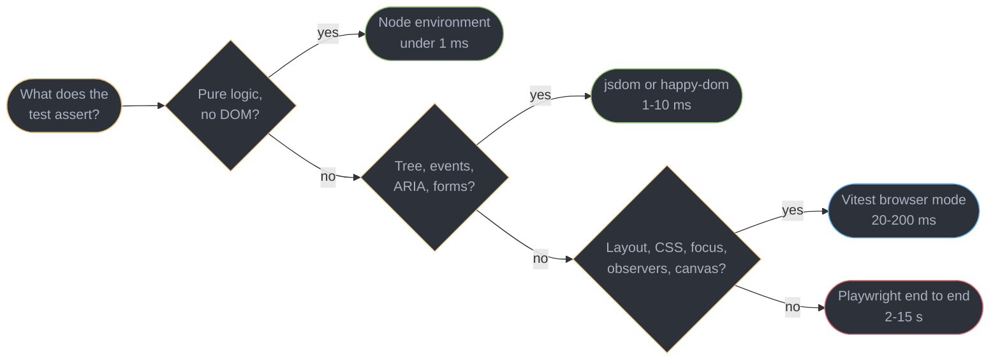
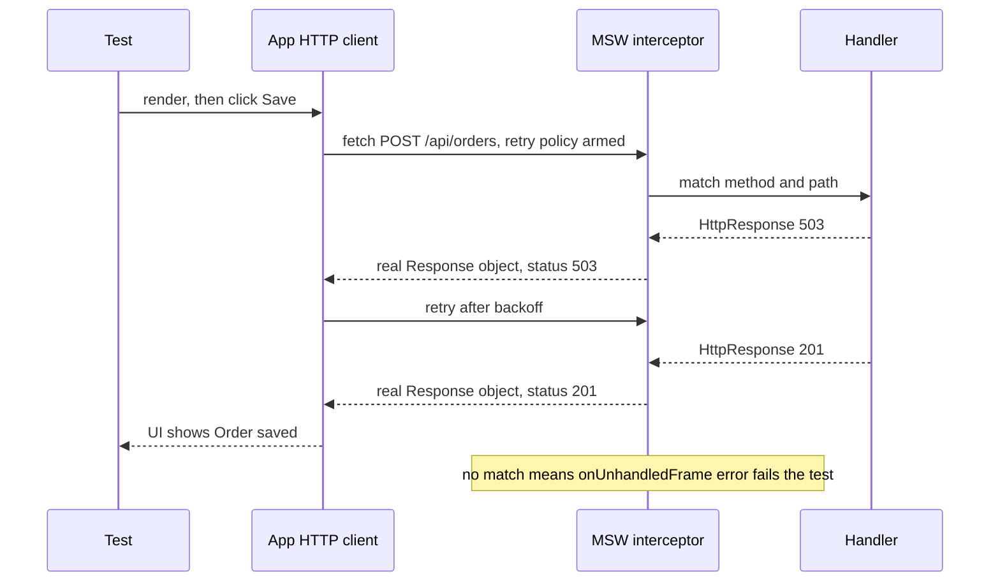
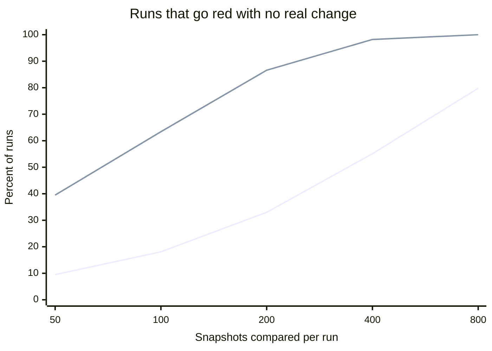

# Front-End Testing and CI

---

## 1. Concept Overview

A front-end test suite answers one question per test: does a fact about the product still hold?
Every design decision in the suite follows from where that fact lives. A price formatter's
output lives in pure JavaScript. A menu's `aria-expanded` lives in the DOM. A sticky header's
position lives in layout, which only a rendering engine computes. A checkout lives across a
router, a cookie, a server and three pages. Run each test in the cheapest environment that
actually contains its fact, and the suite is fast and trustworthy. Run it anywhere else and it
is either slow or lying.

This module is the platform layer under every framework's testing story:

| Concern | The platform question | Where it is answered |
|---------|----------------------|----------------------|
| Environment fidelity | Which browser facts does a simulated DOM lack? | §6.1, §6.2 |
| The network boundary | Where should a fake API answer, and what must still run? | §6.3 |
| Time | Who owns `setTimeout`, `Date` and animation frames in a test? | §6.4 |
| End-to-end | What does a browser automation tool add beyond assertions? | §6.5 |
| Flakiness | How do you measure, classify and contain non-determinism? | §6.6 |
| Visual regression | When does a screenshot diff pay for its false positives? | §6.7 |
| CI | How do shards, retries, reports and budget gates fit together? | §6.8 |

Versions this module is written against, from each project's npm registry entry on 2026-10-19:
**Vitest 5.0.5** (5.0.0 released 2026-09-03), **MSW 3.0.3** (3.0.0 released 2026-09-28),
**Playwright 1.64.1**, **jsdom 30.1.3** and **happy-dom 21.0.3**.

What this module does **not** own: the React-specific layer (Testing Library queries, `act()`,
Server Components) is in
[Testing and Frontend CI](../../react/testing_and_frontend_ci/testing_and_frontend_ci.md); axe
rules and the screen-reader protocol are in
[Accessibility and WCAG](../accessibility_and_wcag/accessibility_and_wcag.md); lint gates are in
[Linting, Formatting and Code Quality](../linting_formatting_and_code_quality/linting_formatting_and_code_quality.md);
Core Web Vitals lab measurement is in
[Web Performance and Core Web Vitals](../web_performance_and_core_web_vitals/web_performance_and_core_web_vitals.md).

---

## 2. Intuition

**One-line analogy.** A test environment is a flight simulator: excellent for the instruments it
models, silent about everything it does not, and a pilot who forgets which is which crashes on a
real runway.

**Mental model.** Picture four rooms of increasing cost. The first holds only a JavaScript engine.
The second adds a DOM written in JavaScript, with no pixels. The third is a real browser tab.
The fourth is a real browser driving a deployed application. Every test belongs in exactly one
room, decided by the fact it asserts, and each room up costs roughly an order of magnitude more
per test.

**Why it matters.** A suite that runs layout assertions in jsdom passes them for the wrong reason,
since every rectangle there is zero by zero. A suite that runs everything in Playwright takes 40
minutes, so people stop running it. A suite that retries failures without recording them hides
the race conditions it exists to find.

**Key insight.** Flakiness is a measurement problem before it is a fix. A suite cannot be made
deterministic one anecdote at a time; it becomes trustworthy when every non-deterministic outcome
is recorded, classified and owned.

---

## 3. Core Principles

1. **Test in the cheapest environment that contains the fact.** Logic in Node, DOM structure in
   jsdom, layout and CSS in a real browser, cross-page flows end to end.
2. **A simulated DOM has no layout engine.** Sizes, positions, scrolling, observers and computed
   cascade are absent, not approximate.
3. **Mock at the network boundary, not inside your code.** The HTTP client, its retries, its error
   mapping and its cache must execute in the test.
4. **An unhandled request is a test failure.** A suite that can reach a real network will, and
   then it depends on staging being up.
5. **Wait for a condition, never for a duration.** A sleep is either too short on a slow runner
   or wasted on a fast one; both happen every day.
6. **Own the clock explicitly.** Any test whose outcome depends on `Date.now()` or a timer either
   fakes time or is a flake with a delay.
7. **Retries without records hide bugs.** A retry turns a red run green; only the recorded
   `flaky` status turns it into information.
8. **Every quarantined test has an owner and an expiry.** Otherwise quarantine is deletion with
   extra steps.
9. **A visual diff is a statistical test.** Its false-positive rate multiplies by the number of
   snapshots per run, so scope decides whether anyone still reads the results.

---

## 4. Types / Architectures / Strategies

### 4.1 The four environments

| Environment | What it is | Has | Lacks | Typical cost per test |
|-------------|-----------|-----|-------|-----------------------|
| Node | V8 with no DOM | language, `fetch`, timers | `document`, `window` | under 1 ms |
| jsdom 30 | the DOM and HTML spec, implemented in JavaScript | tree, events, ARIA attributes, forms | layout, painting, real CSS cascade, observers | 1-10 ms, after a per-file environment setup that dominates small files |
| happy-dom 21 | a smaller, faster DOM implementation | the same surface, less of the spec | the same as jsdom, plus more spec gaps | faster setup than jsdom |
| Real browser (Vitest browser mode, Playwright component tests) | Chromium, Firefox or WebKit in a page | layout, CSS, focus, observers, canvas, real events | a server, routing, cookies across pages | 20-200 ms |
| End to end (Playwright) | a real browser against the running application | everything a user has | speed and isolation | 2-15 s |

### 4.2 Three places a fake API can sit

| Mock point | What still runs | What it hides |
|------------|-----------------|---------------|
| The data hook or service module (`vi.mock("./api")`) | rendering only | the client, serialization, status handling, retries, cache keys |
| `globalThis.fetch` replaced by a stub | the code above `fetch` | `Request` construction, headers, `res.ok` handling written against the real `Response` |
| The request boundary (MSW) | every line of application code | only the server, which a contract test covers |

### 4.3 The flake taxonomy

Luo, Hariri, Eloussi and Marinov, "An Empirical Analysis of Flaky Tests" (FSE 2014), classified
201 commits that fixed flaky tests across 51 open-source projects. The top three root causes, which still map
onto front-end suites:

| Category | Share in the study | Front-end form |
|----------|-------------------|----------------|
| Async wait | 45% | asserting before a fetch, transition or animation settles |
| Concurrency | 20% | two responses resolving in either order; parallel workers sharing a database row |
| Test order dependency | 12% | a module-level cache, a mock or `localStorage` left behind by the previous test |

The remaining causes in that study (resource leaks, network, time, I/O, randomness, floating point,
unordered collections) appear in front-end suites as port collisions, real network calls,
`Date.now()`, and `Math.random()` in fixtures.

---

## 5. Architecture Diagrams

### Choosing the environment from the fact under test



The question is never "unit or integration". It is which environment holds the fact, and the
answer fixes the cost before a line of the test is written.

### Where MSW answers a request



Everything left of the interceptor is production code. In Node the interceptor sits under the
request modules and `fetch`; in a browser it is a Service Worker, so the request really leaves the
page.

### False visual failures as snapshot count grows



The lower line is a per-snapshot false-positive rate of 0.2%, the upper line 1%, from
`1 - (1 - p)^N`. At 400 snapshots even the careful setup is red on more than half of all runs,
which is why §6.7 scopes visual tests to a component gallery rather than to pages.

---

## 6. How It Works — Detailed Mechanics

### 6.1 What jsdom does not have

jsdom implements the DOM, HTML parsing, events and much of the Web IDL surface in JavaScript.
It does not run a rendering engine, so these are absent, not approximate:

| Browser fact | In jsdom |
|--------------|----------|
| `getBoundingClientRect()`, `offsetWidth`, `clientHeight` | all zero |
| Media queries, `matchMedia` | not implemented; tests must stub it |
| `IntersectionObserver`, `ResizeObserver` | not defined |
| `scrollIntoView`, scroll position, `position: sticky` | no layout, so nothing to scroll |
| Computed style from stylesheets | a small set of properties only, never layout results |
| `:focus-visible`, hover, pointer hit testing | no rendering, so no hit testing |
| `<canvas>` drawing | `getContext()` returns `null` without the native `canvas` package |
| Contrast, target size, clipping | no pixels |

The dangerous case is not a test that crashes on a missing API. It is a test that passes because
the missing value happens to satisfy the assertion:

```ts
// BROKEN: passes in jsdom because every rect is 0, so "top is 0" is always true
test("header sticks while scrolling", () => {
  render(table);
  document.querySelector("tbody")!.scrollTop = 4_000;
  expect(header.getBoundingClientRect().top).toBe(0);
});
```

That assertion is true in jsdom for any header, sticky or not. Move it to a real browser (§6.2),
or assert something jsdom can actually observe, such as the `class` the sticky logic applies.

**happy-dom versus jsdom.** happy-dom 21 starts faster and runs most DOM-structure tests
correctly, at the price of implementing less of the spec, which shows up as differences in
parsing edge cases, form validation and event details. Use jsdom by default and switch a project
to happy-dom only after the suite passes there without per-test workarounds.

### 6.2 Vitest 5 and browser mode

Vitest runs test files in worker processes on top of Vite's transform pipeline, so tests import
the same TypeScript, JSX and CSS modules the app does without a separate compile step.

```ts
// vitest.config.ts: one command, three environments, chosen by file name
import { defineConfig } from "vitest/config";
import { playwright } from "@vitest/browser-playwright";

export default defineConfig({
  test: {
    projects: [
      { test: { name: "node", include: ["src/**/*.test.ts"], environment: "node" } },
      { test: { name: "dom", include: ["src/**/*.dom.test.ts"], environment: "jsdom",
                setupFiles: ["./test/msw.node.ts"] } },
      {
        test: {
          name: "browser",
          include: ["src/**/*.browser.test.ts"],
          browser: {
            enabled: true,
            provider: playwright(),
            instances: [{ browser: "chromium" }, { browser: "webkit" }],
            traceView: true,
          },
        },
      },
    ],
  },
});
```

Inline projects inherit the root config by default in Vitest 5, and projects that do not change
the Vite config share one Vite server, so a shared module is transformed once.

**Pools and isolation.** Each file runs in a fresh module graph by default (`isolate: true`) in
the `forks` pool. Isolation is what prevents test order dependency between files, and it is also
where the time goes: the Vitest 5 announcement shows a run breaking down as "environment 79%,
import 13%, transform 6%, tests 1%". The `vmThreads` and `vmForks` pools reuse a process and run
each file in a fresh `vm` context, which is faster, but every file then has its own realm, so an
`instanceof` check against a class from another realm fails, as described in
[JavaScript Language Semantics](../javascript_language_semantics/javascript_language_semantics.md).
`isolate: false` is the fastest setting and is safe only for suites with no module-level state.

**Browser mode** runs the same test file inside a real page driven by Playwright. Locators match
exact text by default, and `browser.traceView` records every interaction and assertion as a DOM
snapshot you can step through after a CI failure. The cost is measurable: on the Vitest 5
benchmark's 92-module React app on an Apple M4, the whole run took 1.07 s in jsdom (`vmThreads`)
and 2.01 s in Browser Mode on Chromium. That is cheap enough for the tests whose subject is a
browser fact and too expensive to be the default for all of them.

```ts
// header.browser.test.ts: every assertion here is meaningless in jsdom
import { expect, test } from "vitest";
import { page } from "vitest/browser";

test("header stays at the top of the scroller", async () => {
  mountTable(document.body, { rows: 10_000, rowHeight: 32 });     // fragment: app code
  const scroller = document.querySelector<HTMLElement>("[data-scroller]")!;
  scroller.scrollTop = 4_000;
  await expect.poll(() => scroller.querySelector("thead")!.getBoundingClientRect().top)
    .toBe(scroller.getBoundingClientRect().top);
  await expect.element(page.getByRole("row", { name: /Row 125/ })).toBeVisible();
});
```

**Vitest 5 changes an existing suite feels.** `clearMocks` defaults to `true`, so call history no
longer leaks between tests. An unawaited async assertion such as `expect(p).resolves.toBe(1)`
now fails the test instead of printing a warning. `expect.poll` fails when its callback does not
resolve within the timeout. Vite is a required peer dependency, and the WebdriverIO browser
provider moved to the `vitest-community` organization, leaving Playwright and the preview provider
in core.

### 6.3 MSW 3 at the network boundary

MSW intercepts at the request layer: in Node by extending the request classes `fetch` and the
`http` modules use, and in the browser through a registered Service Worker. Application code
builds a real `Request`, receives a real `Response`, and runs its own status handling, retry and
caching on it.

```ts
// test/handlers.ts
import { http, HttpResponse } from "msw/http";

export const handlers = [
  http.get("https://api.example.test/orders/:id", ({ params }) =>
    HttpResponse.json({ id: params.id, totalCents: 41_200, currency: "USD" })),
];
```

```ts
// test/msw.node.ts, a Vitest setup file
import { beforeAll, afterEach, afterAll } from "vitest";
import { setupServer } from "msw/node";
import { handlers } from "./handlers.js";

export const server = setupServer(...handlers);
beforeAll(() => server.listen({ onUnhandledFrame: "error" }));
afterEach(() => server.resetHandlers());
afterAll(() => server.close());
```

`onUnhandledFrame: "error"` makes a request no handler matched fail the test, which is the
difference between a hermetic suite and one that quietly calls staging. `server.use()` prepends a
handler for the current test only, which is how the 503, the 401 and the slow response get tested
without a second handler file.

**What MSW 3 changed.** It is ESM-only and requires Node.js 22 or later. Handlers and helpers
import from per-feature entry points instead of the package root: `http` and `HttpResponse` from
`msw/http`, `graphql` from `msw/graphql`, `delay` from `msw/utils/delay`. The
`onUnhandledRequest` option is `onUnhandledFrame`, and it covers every unhandled network frame:
requests and WebSocket connections. `worker.stop()` returns a promise to await. `delay()`
schedules an ordinary `setTimeout`, so under a test runner's fake timers a handler that calls
`delay(300)` resolves only when the test advances the clock (§6.4). The same `handlers` array feeds `setupWorker` from
`msw/browser` for Vitest browser mode, Storybook and local development, after
`npx msw init public/` writes `mockServiceWorker.js`.

What MSW cannot give you is contract truth: a handler that returns a field the server removed
passes forever. Generate handlers from the OpenAPI or GraphQL schema, or keep one contract test
per endpoint against the real service.

### 6.4 Owning the clock

A test that depends on wall-clock time fails at midnight, at a daylight-saving change, or on a
slow runner where a 1-second timeout really took 1.2 seconds. Each runner offers a fake clock:

```ts
// Vitest: fake timers in a jsdom or Node test
import { vi, test, expect } from "vitest";

test("session warning appears after 29 minutes", async () => {
  vi.useFakeTimers({ now: new Date("2026-03-01T09:00:00Z") });
  startSession();                                   // fragment: schedules the warning
  await vi.advanceTimersByTimeAsync(29 * 60_000);
  expect(document.querySelector("[role=alertdialog]")).not.toBeNull();
  vi.useRealTimers();
});
```

```ts
// Playwright: the page's clock, controlled from the test
await page.clock.install({ time: new Date("2026-03-01T09:00:00Z") });
await page.goto("/account");
await page.clock.fastForward("29:00");
await expect(page.getByRole("alertdialog", { name: "Session ending" })).toBeVisible();
```

`advanceTimersByTimeAsync` matters with MSW: it advances timers and lets pending promises run
between them, so a mocked `delay()` resolves inside the advanced window. Playwright recommends
`page.clock.setFixedTime()` when the test only needs `Date.now()` pinned, and `install()` when it
must also pause or fast-forward timers. Vitest 5 fakes `Temporal` alongside `Date`, under
`vi.useFakeTimers()` and through `vi.setSystemTime()` alone.
Task, microtask and frame ordering under fake timers follows the rules in
[The Event Loop and Scheduling](../the_event_loop_and_scheduling/the_event_loop_and_scheduling.md).

### 6.5 Playwright as a platform tool

Playwright's locator actions auto-wait: a `click()` waits until the element is attached, visible,
stable, enabled and receives pointer events, retrying until the action timeout. Web-first
assertions such as `await expect(locator).toHaveText(...)` retry the same way until the
assertion timeout. Those two properties remove the largest flake category in §4.3, as long as
tests never read the DOM once and assert on the snapshot.

**Fixtures** replace `beforeEach` with typed, composable setup that tears itself down:

```ts
// fixtures.ts
import { test as base } from "@playwright/test";

type Worker = { account: { id: string; email: string } };
type Test = { cartPage: CartPage };                 // fragment: a page object

export const test = base.extend<Test, Worker>({
  account: [async ({}, use) => {
    const account = await createAccount();          // once per worker process
    await use(account);
    await deleteAccount(account.id);                // runs after the worker's last test
  }, { scope: "worker" }],
  cartPage: async ({ page, account }, use) => {
    await seedCart(account.id, ["sku-1", "sku-2"]);
    await use(new CartPage(page));
  },
});
```

A test asks for `cartPage` by name and receives a seeded cart; one that does not ask pays nothing.
Worker-scoped fixtures give each parallel worker its own account, which removes the concurrency
flake of two workers editing the same row.

**Traces.** A trace is a zip holding a DOM snapshot before and after every action, the network
log, console output and a screenshot filmstrip. `trace: "on-first-retry"` records only when a
retry happens; `"retain-on-first-failure"` records the first run and keeps it only if that run
failed, which captures the failure itself rather than the retry that passed.

**Selection.** `--only-changed=origin/main` runs only test files changed since that ref,
`--last-failed` reruns the previous failures, and `--fail-on-flaky-tests` turns any test that
needed a retry into a failure.

### 6.6 Flake: measure, classify, quarantine

Two numbers frame the problem. A test that fails 40% of the time passes 93.6% of runs with
`retries: 2`, so the race it is detecting ships. And a suite of 600 tests that are each flaky
0.1% of the time goes red on 45% of runs with no retries, but on 0.06% of runs with one retry.
Retries are therefore necessary for throughput and useless as information, unless the retried
result is recorded. Google reported in 2016 that 1.5% of its test runs were flaky and that 84%
of pass-to-fail transitions in post-submit involved a flaky test.

Playwright reports a test that failed and then passed as `flaky`, distinct from `passed`.
The policy that works:

1. Record every `flaky` result per test ID, from the JSON or blob report, into a table.
2. When a test is flaky 3 times in 7 days, tag it `@quarantine` and open an issue with an owner.
3. Run the blocking job with `--grep-invert @quarantine --retries=1`.
4. Run a non-blocking job with `--grep @quarantine --repeat-each=10` and post the pass rate.
5. Expire every quarantine after 14 days: the owner fixes the test or deletes it.

Classify each fix by §4.3's taxonomy. The distribution says where the suite's structural problem
is: mostly async wait means sleeps and one-shot DOM reads; mostly order dependency means shared
module state or `isolate: false`; mostly concurrency means shared server data between workers.

### 6.7 Visual regression and its false positives

Playwright's `toHaveScreenshot()` compares against a committed baseline with pixelmatch. The
defaults are `threshold: 0.2` (per-pixel perceived colour difference, 0 strict, 1 lax) and
`animations: "disabled"`, and the baseline file name includes browser and platform, for example
`checkout-chromium-linux.png`, because font rasterization differs between operating systems.
Vitest 5 browser mode has the equivalent `expect.element(locator).toMatchScreenshot()`.

The economics are the §5 chart. With a per-snapshot false-positive rate `p` and `N` snapshots per
run, `1 - (1 - p)^N` of runs fail with no real change. Teams respond to a high rate by running
`--update-snapshots` without looking, at which point the suite approves everything. Four controls
keep `p` low:

| Source of false positives | Control |
|---------------------------|---------|
| Baselines made on a Mac, compared on Linux CI | generate and compare in the same container image |
| Animation, caret blink, hover state | `animations: "disabled"`, `caret: "hide"`, move the mouse off the page |
| Timestamps, avatars, ads, third-party embeds | `mask: [locator]`, `page.clock.setFixedTime()`, MSW fixtures |
| Sub-pixel antialiasing on gradients and text | `maxDiffPixelRatio: 0.001` per test where it is needed |

Then scope `N`: snapshot a component gallery (each component in its key states) rather than full
pages, where every copy edit changes a baseline. Hosted services such as Chromatic and Percy
store baselines outside the repository and add a review queue, priced per snapshot.

### 6.8 CI: shards, merged reports, budget gates

Playwright shards by file by default and by individual test when `fullyParallel: true`, which is
the setting that keeps shards balanced when one spec holds 200 tests. Vitest shards by file.
Both write a blob report per shard and merge them in a final job:

```yaml
jobs:
  e2e:
    strategy:
      fail-fast: false
      matrix: { shard: [1, 2, 3, 4] }
    steps:
      - run: npx playwright test --shard=${{ matrix.shard }}/4 --reporter=blob
      - uses: actions/upload-artifact@v4
        with: { name: blob-${{ matrix.shard }}, path: blob-report }
  report:
    needs: e2e
    if: ${{ !cancelled() }}
    steps:
      - uses: actions/download-artifact@v4
        with: { pattern: blob-*, path: all-blob-reports, merge-multiple: true }
      - run: npx playwright merge-reports --reporter html,json ./all-blob-reports
```

`fail-fast: false` stops one red shard from cancelling the others, so the merged report is
complete. The merged JSON is also the input to the flake table in §6.6.

**Budget gates** sit next to the tests and fail the merge on a number rather than an assertion:
an entry-chunk size limit with `size-limit`, Lighthouse CI assertions on lab metrics, and a
wall-clock budget for the suite itself, since a suite that grows from 8 to 25 minutes changes how
often people run it. The bundle side is in
[Modules, Bundling and the Build Pipeline](../modules_bundling_and_the_build_pipeline/modules_bundling_and_the_build_pipeline.md),
and the RUM side in
[Frontend Delivery and Observability](../frontend_delivery_and_observability/frontend_delivery_and_observability.md).

---

## 7. Real-World Examples

**The date picker that failed on the 31st.** A booking app's suite was green for 11 months and
red on 7 days a year. A test created "a date next month" with `new Date().setMonth(m + 1)`, which
on January 31 yields March 3. The fix was `vi.useFakeTimers({ now })` with a fixed date in every
date test, plus one test that pins the clock to January 31 on purpose.

**The suite that called staging.** A Node test environment had MSW handlers for 40 endpoints but
`onUnhandledFrame` left at its default `"warn"`. A new feature's endpoint had no handler, so its
tests hit the real staging API and passed until staging was redeployed during a CI run. Setting
the unhandled option to `"error"` turned up 9 more endpoints the suite had been calling for real.

**The screenshot suite nobody read.** A design system snapshotted 380 full pages on developer
laptops and compared them on Linux CI. Roughly 70% of runs had a diff, `--update-snapshots`
became a reflex, and a broken focus ring shipped through an approved baseline. Moving baseline
generation into the CI container and replacing pages with 140 component states brought diff runs
under 5%, and reviewers started reading them again.

---

## 8. Tradeoffs

| Choice | Gains | Costs | Use when |
|--------|-------|-------|---------|
| jsdom | spec-faithful DOM, 1-10 ms tests | no layout, observers or pixels | structure, events, ARIA, forms |
| happy-dom | faster environment setup | more spec gaps, fewer people debugging them | a large DOM-only suite that passes there cleanly |
| Vitest browser mode | real layout, CSS, focus, one runner with unit tests | about 2x the run time of jsdom on the Vitest 5 benchmark | the 5-10% of tests whose subject is a browser fact |
| Playwright end to end | real routing, cookies, server | 2-15 s per test, more flake surface | critical journeys, tens not hundreds |
| MSW at the request boundary | all client code runs | handlers drift from the real API | every test that touches the network |
| `vi.mock` of the API module | trivial setup | hides the client's bugs | never for HTTP; fine for clocks and randomness wrappers |
| `retries: 2` with no records | green pipeline | real races ship as passes | never |
| Retries with a quarantine table | throughput and information | a table, an owner, an expiry job | any suite over a few hundred browser tests |
| Full-page screenshots | catches anything visual | false positives scale with page count | a handful of marketing pages at most |
| Component-gallery screenshots | low false positives, reviewable diffs | misses composition bugs | design systems and shared components |

---

## 9. When to Use / When NOT to Use

**Use jsdom when** the assertion is about the tree: an element exists, has a role, has a name,
responds to an event, submits a form. **Use browser mode when** the assertion mentions a size,
a position, a scroll offset, a computed colour, focus visibility, an observer callback or a canvas.
**Use end to end when** the fact spans pages, cookies or a real server, and keep that set to the
journeys that would page someone if they broke. **Use visual regression when** a component has a
small number of stable states and a reviewer who will look at each diff.

**Do NOT** assert layout in jsdom; it passes for the wrong reason. **Do NOT** mock your own HTTP
client module; mock the network. **Do NOT** leave unhandled requests as warnings. **Do NOT** use
`waitForTimeout` or `sleep` to wait for the UI. **Do NOT** enable retries without recording
`flaky` results. **Do NOT** generate screenshot baselines on a laptop. **Do NOT** set
`isolate: false` on a suite that has module-level caches.

---

## 10. Common Pitfalls

### Pitfall 1: waiting for a duration (BROKEN → FIX)

```ts
// BROKEN: 500 ms is too short on a loaded CI runner and wasted on a laptop
await page.getByRole("button", { name: "Save" }).click();
await page.waitForTimeout(500);
expect(await page.getByRole("status").textContent()).toBe("Saved");

// FIX: a web-first assertion retries until the condition holds or the timeout expires
await page.getByRole("button", { name: "Save" }).click();
await expect(page.getByRole("status")).toHaveText("Saved");
```

The broken form also reads the text once, so a status that flips from "Saving" to "Saved" 20 ms
after the read fails the test. This single pattern is the "async wait" category that made up 45%
of the flaky tests in Luo et al.

### Pitfall 2: mocking the client instead of the network (BROKEN → FIX)

```ts
// BROKEN: the real client never runs, so its 401 handling is untested
vi.mock("../api/orders", () => ({ getOrder: vi.fn().mockResolvedValue({ id: "o-9" }) }));

// FIX: the request leaves the client and is answered at the boundary
server.use(http.get("https://api.example.test/orders/:id", () =>
  new HttpResponse(null, { status: 401 })));
await renderOrderPage("o-9");                       // fragment: app entry
expect(await findByRole(document.body, "link", { name: "Sign in again" })).toBeTruthy();
```

A team shipped a client that turned every 401 into a blank page while 300 component tests passed,
because every one of them mocked `getOrder` directly.

### Pitfall 3: fake timers that freeze MSW `delay()` (BROKEN → FIX)

```ts
// BROKEN: hangs until the test timeout
vi.useFakeTimers();
server.use(http.get("https://api.example.test/search", async () => {
  await delay(300);                                 // delay from msw/utils/delay
  return HttpResponse.json([]);
}));
await search("shoes");                              // awaits a fetch that awaits a frozen timer

// FIX: start the request, then advance the fake clock past the delay
vi.useFakeTimers();
const pending = search("shoes");
await vi.advanceTimersByTimeAsync(300);
await pending;
```

`delay()` is a plain `setTimeout`, so once `vi.useFakeTimers()` replaces the timer functions the
test owns the clock for mocked latency like everything else.

### Pitfall 4: baselines from the wrong machine

A screenshot generated on macOS and compared on Linux differs in font hinting on every glyph.
Playwright names the file `...-chromium-darwin.png` versus `...-chromium-linux.png`, so a team
that commits only the Mac files gets "missing snapshot" on CI and, after one careless
`--update-snapshots`, a Linux baseline nobody reviewed. Generate baselines in the CI image with
the exact Playwright version pinned.

### Pitfall 5: order-dependent tests revealed by sharding

A suite that always ran files in one order passed for a year. Sharding moved one file to a
different worker, and a module-level cache that the previous file had filled was now empty. The
symptom is a test that fails only on shard 3. Run `--sequence.shuffle` in Vitest weekly, keep
`isolate: true`, and reset module state in `afterEach` rather than relying on file order.

---

## 11. Technologies & Tools

| Tool | What it is for | How you invoke it |
|------|---------------|-------------------|
| Vitest | Test runner on Vite's transform pipeline, 5.0.5 | `vitest run`, `--shard=1/4`, `--merge-reports` |
| Playwright | Browser automation and test runner, 1.64.1 | `npx playwright test`, `--shard`, `merge-reports` |
| MSW | Request interception at the network boundary, 3.0.3 | `setupServer` from `msw/node`, `setupWorker` from `msw/browser` |
| jsdom | DOM and HTML implemented in JavaScript, 30.1.3 | `environment: "jsdom"` |
| happy-dom | Faster, smaller DOM implementation, 21.0.3 | `environment: "happy-dom"` |
| Testing Library | Accessible-role queries over any DOM | `getByRole`, `findByText` |
| Chromatic | Hosted visual review for component stories | CI upload per pull request |
| Percy | Hosted visual diffing | CI upload per pull request |
| size-limit | Bundle size budget gate | `size-limit` in CI |
| Lighthouse CI | Lab performance and accessibility assertions | `lhci autorun` |

---

## 12. Interview Questions with Answers

**Q: Why can a test pass in jsdom while the same feature is broken in every browser?**
**Short:** jsdom has no layout engine, so sizes, positions, scrolling, observers and stylesheet-driven styles are absent, and an assertion about them can pass on the zero values it returns.

`getBoundingClientRect()` returns zeros, `IntersectionObserver` and `ResizeObserver` are not
defined, `matchMedia` is not implemented, and only a few computed properties reflect stylesheets.
A test asserting that a sticky header's `top` is 0 passes for any header. Keep jsdom for tree,
event, ARIA and form assertions, and move anything about geometry, CSS, focus visibility or
observers to Vitest browser mode or Playwright.

**Q: Why is `waitForTimeout(500)` a flake generator, and what replaces it?**
**Short:** A fixed sleep is too short on a slow runner and wasted on a fast one; a web-first assertion that retries until the condition holds replaces it.

Playwright's `await expect(locator).toHaveText("Saved")` re-queries the DOM until it matches or
the assertion timeout expires, and locator actions auto-wait for visible, stable, enabled
elements. The sleep version also reads the DOM once, so a state change 20 ms later fails. In
Vitest, `expect.poll(fn)` and `expect.element(locator)` do the same job. Async wait was 45% of the
flaky tests in Luo et al.'s 2014 study, and sleeps are its most common form.

**Q: A test fails 40% of the time and CI retries failures twice. What does the dashboard show?**
**Short:** Green on 93.6% of runs, because the test fails all three attempts only 6.4% of the time, so the race it detects ships unless retried passes are recorded as flaky.

`0.4^3 = 0.064`. Retries are a throughput tool: a suite of 600 tests each flaky 0.1% goes red on
45% of runs without retries and on 0.06% with one. The information is in the retry, so record
Playwright's `flaky` status per test, quarantine a test that is flaky 3 times in 7 days, and run
`--fail-on-flaky-tests` on the quarantine job rather than on the blocking one.

**Q: Why mock the API at the request boundary instead of mocking the module that wraps it?**
**Short:** A request-level mock lets the real client build the request and handle the response, so its status mapping, retries, headers and cache keys are tested, which a module mock skips entirely.

`vi.mock("../api/orders")` replaces the code most likely to be wrong with a function that returns
the happy path. MSW returns a real `Response`, so a 401, a 503 followed by a 201, or a malformed
body exercises the production client. The remaining gap is contract drift, closed by generating
handlers from the API schema or by one contract test per endpoint against the real service.

**Q: What should happen when a test makes a request that no MSW handler matches?**
**Short:** The test should fail, by passing onUnhandledFrame set to error, because a silent passthrough makes the suite depend on a real network and a real environment.

The default only warns, and a warning in a 4,000-line CI log is invisible. A new endpoint without
a handler then calls staging, passes while staging is up, and fails when staging redeploys,
which reads as a flake. With `"error"` the missing handler shows up the first time the test runs.
In MSW 3 the option is `onUnhandledFrame` on both `server.listen()` and `worker.start()`.

**Q: Why does a test that combines fake timers with an MSW `delay()` hang?**
**Short:** MSW's delay() schedules an ordinary setTimeout, so under vi.useFakeTimers the mocked latency waits on the frozen fake clock until the test advances it.

With `vi.useFakeTimers()` active, a `delay(300)` in a handler registers its timer with the fake
clock, so `await fetch(...)` never resolves and the test hits its timeout. Start the request
without awaiting it, call `await vi.advanceTimersByTimeAsync(300)`, then await the request, or use
real timers for that test.

**Q: jsdom or happy-dom?**
**Short:** jsdom by default for its spec coverage; happy-dom only for a DOM-only suite that already passes there without workarounds, where its faster setup is the point.

Both lack layout entirely, so neither replaces a real browser. happy-dom implements less of the
HTML and DOM specs, which surfaces as differences in parsing edge cases, form validation and event
properties, and each difference costs a debugging session that saves nothing. Environment setup
dominates small test files, which is where happy-dom's speed shows; measure the whole run on your
own suite before switching.

**Q: When is Vitest browser mode worth its cost over jsdom?**
**Short:** When the assertion is a browser fact such as layout, CSS, focus or an observer; on the Vitest 5 benchmark a 92-module React app ran in 1.07 s on jsdom and 2.01 s in browser mode.

Browser mode runs the same test file in Chromium, Firefox or WebKit through the Playwright
provider, so geometry, computed styles, real focus and `IntersectionObserver` work. The roughly
2x run time is fine for the 5-10% of tests that need it and wasteful for tree and event tests.
Split them with Vitest projects by file suffix, such as `*.browser.test.ts`, so one `vitest run`
covers both.

**Q: What does `isolate` control in Vitest, and when is turning it off safe?**
**Short:** It gives each test file a fresh module graph and globals; turning it off is faster but lets module-level state leak between files, so it is safe only for suites with no such state.

Isolation is the main cost of a run; the Vitest 5 announcement shows a breakdown of 79% environment
setup against 1% running tests. With `isolate: false`, a cache filled by one file is visible to the
next, so results depend on file order, and sharding reorders files. The `vmThreads` and `vmForks`
pools are a middle ground: faster, but each file gets its own realm, so `instanceof` across that
boundary fails.

**Q: How does Playwright distribute tests across shards, and why can one shard run far longer?**
**Short:** It shards by file unless fullyParallel is true, so one large spec lands on a single shard; with fullyParallel it balances individual tests across shards.

`--shard=2/4` takes a quarter of the parallelizable units, and the unit is the file by default.
A 200-test checkout spec then runs on one machine while three finish early. Set
`fullyParallel: true` to shard by test, write `--reporter=blob` per shard, and merge with
`npx playwright merge-reports` so the report and the flake table cover the whole run. Use
`fail-fast: false` in the CI matrix so one red shard does not cancel the rest.

**Q: What is a Playwright fixture, and why is it better than `beforeEach`?**
**Short:** A fixture is named, typed setup that a test requests by parameter and that tears itself down after use, scoped per test or per worker, so tests pay only for what they ask for.

`test.extend` defines fixtures whose code runs up to `await use(value)`, hands the value to the
test, then runs teardown. A worker-scoped `account` fixture creates one account per parallel
worker, which stops two workers from editing the same data. Fixtures compose: `cartPage` can
depend on `page` and `account`. A `beforeEach` runs for every test in the file whether it needs the
setup or not, and its teardown lives in a separate hook that is easy to forget.

**Q: How do you test behaviour that depends on time?**
**Short:** Replace the clock: vi.useFakeTimers with a fixed now in Vitest, page.clock in Playwright, then advance time explicitly instead of waiting for it.

`vi.advanceTimersByTimeAsync(29 * 60_000)` runs 29 minutes of timers and the promises between them
in milliseconds. In Playwright, `page.clock.setFixedTime()` pins `Date.now()`, and
`page.clock.install()` plus `fastForward("29:00")` also drives timers. Pin dates that break code on
purpose, such as January 31 for "add a month" and a daylight-saving boundary, so the calendar
bugs fail every run instead of seven days a year.

**Q: How do you contain flaky tests without hiding real bugs?**
**Short:** Record every retried pass, quarantine a test that is flaky 3 times in 7 days with an owner and a 14-day expiry, and run quarantined tests in a non-blocking job.

The blocking job runs `--grep-invert @quarantine` with one retry; a second job runs
`--grep @quarantine --repeat-each=10` and reports the pass rate. At expiry the test is fixed or
deleted. Classify each fix as async wait, concurrency or order dependency, the top three causes in
Luo et al.: the distribution points at the structural fix, such as banning sleeps or giving each
worker its own data.

**Q: Why do visual regression suites end up ignored, and how do you keep them useful?**
**Short:** False positives multiply with snapshot count, 1 - (1 - p)^N, so 400 snapshots at 0.2% each fail 55% of runs with no change; pin the environment and snapshot components, not pages.

Once most runs show a diff, `--update-snapshots` becomes a reflex and the suite approves
regressions. Generate baselines in the CI container, since Playwright stores one per platform;
keep `animations: "disabled"` and `caret: "hide"`; `mask` timestamps and third-party embeds; and
pin data with MSW and `page.clock`. Snapshot each component's key states instead of full pages,
which change on every copy edit.

**Q: Which Vitest 5 changes break an existing Vitest 4 suite?**
**Short:** clearMocks now defaults to true, unawaited async assertions fail the test, expect.poll fails on timeout, and Vite became a required peer dependency.

A test that read a mock's call count from an earlier test now sees zero. An
`expect(p).resolves.toBe(1)` missing its `await` used to pass with a warning and now fails, which
usually exposes a real bug. Yarn users must add `vite` to `package.json`, since Yarn does not
install peers. The WebdriverIO browser provider moved to the `vitest-community` organization, so
Playwright is the core provider for running browser mode in CI.

**Q: What does a Playwright trace contain, and which trace mode suits CI?**
**Short:** A DOM snapshot around every action, the network log, console output and a screenshot filmstrip; retain-on-first-failure keeps the trace of the failing run itself.

`on-first-retry` records only the retry, which for a flaky test is often the run that passed, so
the evidence of the failure is missing. `retain-on-first-failure` records the first attempt and
keeps it only when it failed, so CI stores traces only for failures. Open one with
`npx playwright show-trace trace.zip` and step to the action whose snapshot first diverges from
what the test expected.

**Q: Which gates belong in front-end CI that are numbers rather than assertions?**
**Short:** A bundle-size limit on the entry chunk, Lighthouse CI thresholds on lab metrics, and a wall-clock budget for the test suite itself.

Each catches a regression no functional test sees: an import that adds 74 kB, a render-blocking
font, or a suite that grew from 8 to 25 minutes and stopped being run before merge. Fail the job on
the threshold, print the delta against the base branch in the pull request, and change a budget
only in a reviewed commit. Lab metrics gate regressions; field Core Web Vitals at p75 still decide
whether users are affected.

---

## 13. Best Practices

1. **Pick the environment from the fact under test**: Node, jsdom, browser mode, end to end.
2. **Never assert geometry, computed style or observers in jsdom.**
3. **Mock HTTP with MSW at the request boundary** and fail on unhandled requests.
4. **Generate handlers from the API schema**, or keep one contract test per endpoint.
5. **Wait on conditions**: web-first assertions, `expect.poll`, `expect.element`; no sleeps.
6. **Own time**: fake timers with a fixed `now`, `page.clock`, and deliberate edge dates.
7. **Give each parallel worker its own data** through worker-scoped fixtures.
8. **Record every retried pass** and run a quarantine with owners and a 14-day expiry.
9. **Keep traces for the first failure**, not for the retry.
10. **Generate screenshot baselines in the CI image** and snapshot components, not pages.
11. **Shard with `fullyParallel: true`, merge blob reports, and keep `fail-fast: false`.**
12. **Gate merges on budgets**: bundle size, lab metrics and suite duration.

---

## 14. Case Study

### A main branch that was red on 31% of runs

**The system.** A B2B ordering front end: 2,300 Vitest tests in jsdom, 180 Playwright tests
against a preview deployment, 6 parallel shards, about 70 merges a day. The main branch failed on
31% of runs over a 30-day window, and engineers re-ran failed jobs an average of 1.6 times per
pull request before merging.

**Step 1: measure.** The team exported Playwright's JSON report for 30 days and counted results
per test. 23 tests produced 91% of all `flaky` results. Vitest had no flake data at all, because
the jsdom suite failed rarely, which turned out to be part of the problem.

**Step 2: classify the 23.**

| Category | Tests | Typical cause |
|----------|-------|---------------|
| Async wait | 13 | `waitForTimeout`, one-shot `textContent()` reads |
| Concurrency | 6 | all workers sharing one seeded customer account |
| Order dependency | 3 | a cart left in the account by a previous test |
| Time | 1 | an "expires tomorrow" banner computed from the real clock |

**Step 3: fix by category, not by test.**

```ts
// BROKEN: every worker logs in as the same seeded customer and edits one cart
test.use({ storageState: "auth/customer.json" });
test("adds a line item", async ({ page }) => {
  await page.goto("/cart");
  await page.getByRole("button", { name: "Add SKU-1" }).click();
  await page.waitForTimeout(800);
  expect(await page.getByRole("row").count()).toBe(2);   // header plus one line
});

// FIX: a worker-scoped account, an empty cart per test, and a retrying assertion
test("adds a line item", async ({ page, account, emptyCart }) => {
  await page.goto("/cart");
  await page.getByRole("button", { name: "Add SKU-1" }).click();
  await expect(page.getByRole("row")).toHaveCount(2);
});
```

An ESLint rule banned `waitForTimeout` in test files, which removed the async-wait category in one
pull request. The worker-scoped `account` fixture removed the concurrency and order categories
together. `page.clock.setFixedTime()` fixed the banner.

**Step 4: the bug the flakes were hiding.** One of the 13 async-wait tests did not become stable
after the sleep was replaced: it failed 1 run in 25 even with a web-first assertion. The trace,
recorded with `retain-on-first-failure`, showed two `PATCH /cart` responses arriving in reverse
order after a double click, and the UI showing the older one. That was a production bug, and it
had been passing on retry for five months.

**Step 5: the jsdom gap.** The team then asked why the jsdom suite never caught layout bugs and
found 41 tests asserting `getBoundingClientRect()` values, all of which passed on zeros. Twelve
were moved to Vitest browser mode and the rest deleted as tests of nothing.

| Metric | Before | After 6 weeks |
|--------|--------|---------------|
| Main-branch runs that failed | 31% | 2.4% |
| Average re-runs per pull request | 1.6 | 0.1 |
| Tests in quarantine | none tracked | 2, both with owners and expiry dates |
| Playwright suite duration on 6 shards | 14 min 10 s | 9 min 40 s |
| Production bugs found by the flake work | 0 | 1, the out-of-order cart update |

**What the team took away.**

1. The 23 flaky tests were not 23 problems. They were four causes, and fixing the causes removed
   them in three pull requests.
2. Retries had turned a real ordering bug into a test that "sometimes fails". The flake table,
   not the retry, found it.
3. A green jsdom suite was partly green because jsdom returns zeros. Passing is only evidence when
   the environment contains the fact the test asserts.
