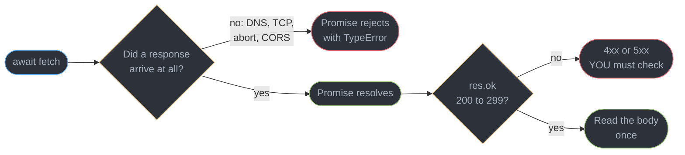
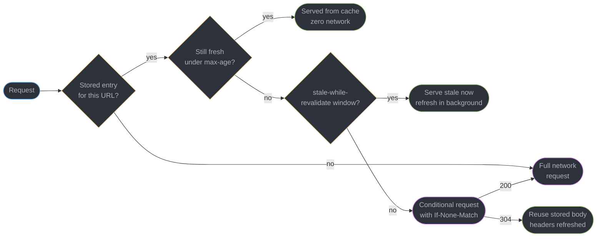
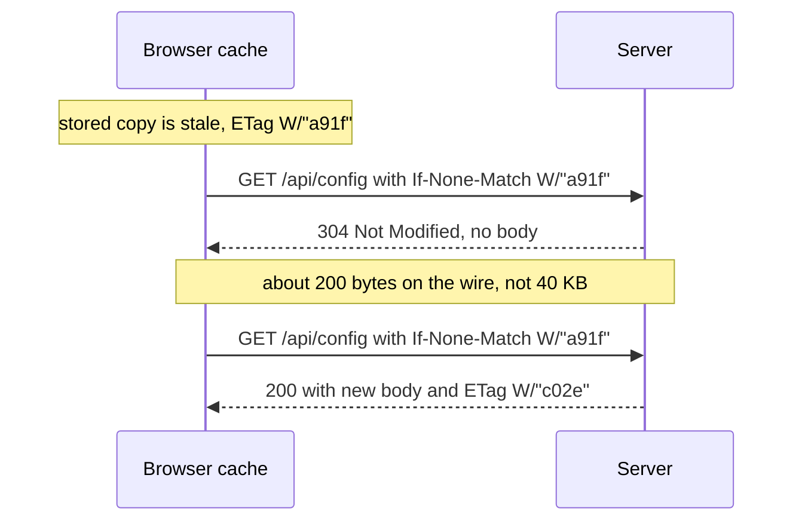
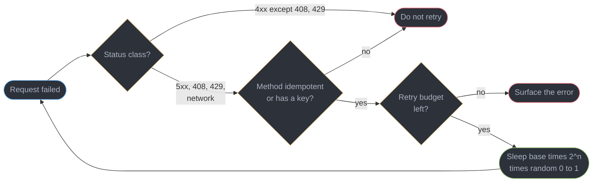
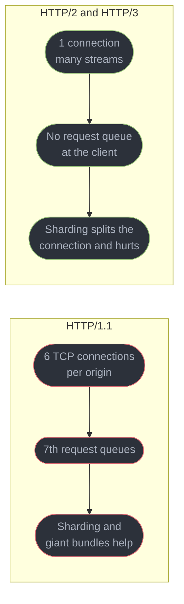
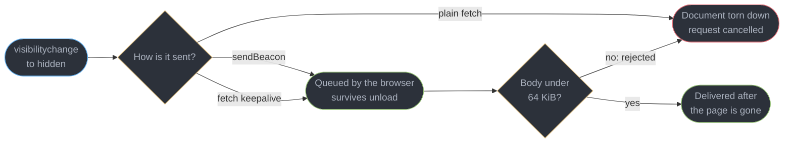

# HTTP in the Browser and fetch

---

## 1. Concept Overview

`fetch` looks like a function that returns a response. It is closer to a request submitted
to a large, opinionated subsystem you do not control: between your call and the socket sit
the HTTP cache, the connection pool, the preload scanner's priority queue, the service
worker, the credentials rules and the redirect follower, and the same layers sit in reverse
on the way back. Almost every "why did that request do *that*" question is a question about
one of them.

**Where the boundary is.** [`../../backend/http_protocols/http_protocols.md`](../../backend/http_protocols/http_protocols.md)
owns the protocol itself: HTTP/2 frames and HPACK, TLS handshakes, ALPN negotiation, QUIC
packet structure. This module owns the **client** — what `fetch` does with the request you
hand it, what the browser cache does around it, and how to build a request layer that
survives a flaky 4G connection, a cold API, and a user closing the tab mid-upload. Where
the two meet, this module states the client-visible consequence and links rather than
restating the wire format.

Three neighbours own topics that recur here and are deliberately not re-taught: cross-origin
rules, preflight, `credentials` and `SameSite` belong to
[`../cors_cookies_and_the_same_origin_model/cors_cookies_and_the_same_origin_model.md`](../cors_cookies_and_the_same_origin_model/cors_cookies_and_the_same_origin_model.md);
CDN and shared-cache mechanics to [`../../hld/cdn/cdn.md`](../../hld/cdn/cdn.md); persistent
connections to [`../realtime_in_the_browser/realtime_in_the_browser.md`](../realtime_in_the_browser/realtime_in_the_browser.md).

---

## 2. Intuition

> `fetch` promises you a conversation happened. It promises nothing about what was said.

**Mental model.** `fetch` is a courier. The promise resolves when the courier comes back
with an envelope; a `500` is an envelope containing bad news and a `404` is a different one,
and both are successful deliveries. It rejects only when the courier never came back — DNS
failed, the connection dropped, the request was aborted, or the same-origin policy refused
to hand over the envelope.

**Key insight.** The browser already has a cache, a connection pool and a priority
scheduler better than anything you will bolt on. The productive question is never "how do I
build this" but "which header or hint makes the existing layer do the right thing".

---

## 3. Core Principles

1. **`fetch` rejects on transport failure, never on status.** `res.ok` (status 200-299) is
   the check; the rejection is a bare `TypeError` naming no cause.
2. **A `Response` body is a one-shot stream.** `res.clone()` before the first read if two
   consumers need it — before, never after.
3. **The browser cache is a real HTTP cache.** The server's `Cache-Control` decides
   freshness; `fetch`'s `cache` option decides how hard the browser uses what it stored.
4. **There is no built-in timeout.** A request with no signal can hang for as long as the
   OS keeps the socket alive. Every production request needs an `AbortSignal`.
5. **Aborting is a client-side act.** It frees your connection and settles your promise. It
   does not undo work the server already started.
6. **Retry only what is safe to repeat.** `GET`, `HEAD`, `PUT` and `DELETE` are idempotent
   by definition; `POST` is not, and needs an idempotency key before you may retry it.
7. **Backoff without jitter synchronises failure.** Identical timers across thousands of
   clients reconverge into the same thundering herd that caused the outage.
8. **Multiplexing changed the shape of good request strategy.** Under HTTP/2 and HTTP/3 the
   six-connections-per-origin ceiling is gone, so the optimisations built around it —
   domain sharding, one giant bundle, sprite sheets — are now costs, not wins.

---

## 4. Types / Architectures / Strategies

### 4.1 The `fetch` init options that change behaviour most

| Option | Values | What it decides |
|--------|--------|----------------|
| `method` | `GET`, `POST`, … | also decides whether a retry is safe |
| `signal` | an `AbortSignal` | cancellation and timeout; without it there is neither |
| `cache` | `default`, `no-store`, `reload`, `no-cache`, `force-cache`, `only-if-cached` | how the browser HTTP cache is consulted |
| `redirect` | `follow`, `error`, `manual` | `follow` is the default and hides up to 20 hops |
| `keepalive` | boolean | lets the request outlive the document, capped near 64 KiB |
| `priority` | `high`, `low`, `auto` | a hint into the browser's request scheduler |
| `mode` | `cors`, `same-origin`, `no-cors`, `navigate` | owned by [`../cors_cookies_and_the_same_origin_model/cors_cookies_and_the_same_origin_model.md`](../cors_cookies_and_the_same_origin_model/cors_cookies_and_the_same_origin_model.md) |
| `credentials` | `omit`, `same-origin`, `include` | same owner; `same-origin` is the default |

### 4.2 Reading a response body

| Method | Returns | Note |
|--------|---------|------|
| `res.json()` | parsed object | throws `SyntaxError` on an HTML error page |
| `res.text()` | string | safest first read when the content type is unknown |
| `res.blob()` | `Blob` | for object URLs and downloads |
| `res.body` | `ReadableStream` | incremental; the only option that does not buffer |

Every one of these consumes the body. A second call throws
`TypeError: Failed to execute 'json' on 'Response': body stream already read`.

### 4.3 `Cache-Control`, as the browser applies it

| Directive | Effect in the browser cache |
|-----------|---------------------------|
| `max-age=N` | fresh for N seconds; served with no network request at all |
| `no-cache` | **stores** the response, revalidates with the server before every reuse |
| `no-store` | never written to disk or memory; nothing to revalidate |
| `must-revalidate` | once stale, a network error may not be papered over with the stale copy |
| `stale-while-revalidate=N` | serve stale instantly for N seconds past freshness, refresh in the background |
| `immutable` | do not revalidate even on reload; correct only for content-hashed filenames |

---

## 5. Architecture Diagrams

### What `fetch` actually promises



A transport failure throws; an application failure resolves quietly and is indistinguishable
from success until you test `res.ok`.

### The browser cache decision, before any network is touched



`no-cache` forces the `cond` branch on every reuse; `no-store` deletes the `st` branch.

### A conditional request and the 304



A 304 still costs a full round trip — it saves bandwidth, not latency, which is why
`max-age` on a hashed asset beats revalidation.

### Retrying without building a herd



### Why the connection model changed the request strategy



Sharding across `img1.` and `img2.` bought 12 parallel slots under HTTP/1.1. Under HTTP/2
it buys an extra DNS lookup, TLS handshake, cold congestion window and split HPACK table.

### Getting a beacon out while the page is dying



`visibilitychange` to `hidden` is the only event guaranteed to run before a page is
discarded.

---

## 6. How It Works — Detailed Mechanics

### 6.1 The check everyone forgets

A resolved promise says a response arrived, nothing more. Without a status check a `503`
serving an HTML maintenance page reaches `res.json()` and throws `SyntaxError: Unexpected
token '<', "<!DOCTYPE "... is not valid JSON` — naming the parser, not the outage:

```ts
class HttpError extends Error {
  constructor(readonly status: number, readonly body: string, url: string) {
    super(`HTTP ${status} for ${url}`);
  }
}

async function request<T>(url: string, init?: RequestInit): Promise<T> {
  const res = await fetch(url, init);
  if (!res.ok) throw new HttpError(res.status, await res.text(), url);
  return res.json() as Promise<T>;
}
```

Reading `res.text()` in the error path matters: an API's 4xx body carries the validation
detail, and discarding it costs a support round trip.

### 6.2 `Request`, `Response` and `Headers` are objects

All three are constructible, so `new Request("/api/items", { headers })` is a value you
build once and reuse — and a `Request` carrying a body is one-shot exactly like a
`Response`, so `base.clone()` is what each retry attempt takes.
`Headers` is case-insensitive and iterable, and `append` differs from `set` by adding a
second value where the header permits repetition. `new Response(body, { status })` is what
a service worker hands back, which is why this shape matters beyond tests; see
[`../pwa_service_workers_and_offline/pwa_service_workers_and_offline.md`](../pwa_service_workers_and_offline/pwa_service_workers_and_offline.md).

### 6.3 Streaming a response instead of buffering it

`res.json()` waits for the last byte. For a 40 MB export or a token-by-token model
response, that is the wrong shape entirely:

```ts
const res = await fetch("/api/chat", { method: "POST", body: prompt });
if (!res.ok || !res.body) throw new Error(`stream failed: ${res.status}`);

const reader = res.body
  .pipeThrough(new TextDecoderStream())
  .getReader();

let buffer = "";
for (;;) {
  const { done, value } = await reader.read();   // value is a string, not bytes
  if (done) break;
  render((buffer += value));                     // paint each chunk as it lands
}
```

`TextDecoderStream` matters more than it looks: a UTF-8 character can split across two
network chunks, and decoding each `Uint8Array` independently produces a replacement
character at the seam. The stream decoder holds the partial sequence across reads.

The win is first paint, not total time. A 3-second model response rendered on completion
has a 3,000 ms perceived latency; rendered incrementally, first text appears at around
250 ms. The full UI pattern — backpressure, cancellation, partial-message state — is in
[`../../react/case_studies/design_an_ai_chat_streaming_ui.md`](../../react/case_studies/design_an_ai_chat_streaming_ui.md).

### 6.4 Timeouts and cancellation

`fetch` has no timeout. A request against a server that accepts the connection and then
stalls will sit there until the OS gives up, which on Linux defaults to a little over 15
minutes:

```ts
const user = new AbortController();                       // user.abort() to cancel
await fetch(url, {                                        // deadline OR cancel,
  signal: AbortSignal.any([user.signal, AbortSignal.timeout(8_000)]),
});                                                       // whichever fires first
```

Distinguishing the two afterwards is what makes the retry decision correct: the rejection
is a `DOMException` whose `name` is `TimeoutError` for a deadline and `AbortError` for a
user cancel, and anything else is a network or cross-origin failure. Retrying a
user-initiated abort is a real production bug — a search-as-you-type box cancels each
superseded keystroke, and a retry layer that ignores `err.name` turns 12 keystrokes into
36 requests.

**Abort is not cancellation.** `controller.abort()` closes the client's side of the stream.
A `POST /orders` that reached the server has already created the order; the browser simply
stops listening. An aborted mutation still needs server-side idempotency, and "the request
was cancelled" in a client log never proves the write did not happen.

### 6.5 Retries that help instead of hurt

```ts
const RETRIABLE = new Set([408, 425, 429, 500, 502, 503, 504]);

async function withRetry<T>(
  fn: (signal: AbortSignal) => Promise<T>,
  { attempts = 3, base = 300, signal }: RetryOpts,
): Promise<T> {
  for (let n = 0; ; n++) {
    try {
      return await fn(signal);
    } catch (err) {
      const status = err instanceof HttpError ? err.status : 0;
      const retriable = status === 0 || RETRIABLE.has(status);
      if (!retriable || n >= attempts - 1 || signal.aborted) throw err;
      // full jitter: uniform over [0, base * 2^n), capped at 10s
      const ceiling = Math.min(base * 2 ** n, 10_000);
      await sleep(Math.random() * ceiling, signal);
    }
  }
}
```

Three things there are load-bearing. **`status === 0` covers network failure**, the case most worth retrying — a dropped 4G
packet is transient by definition. Every other 4xx is excluded: a `400` will be malformed
again and a `401` token will be wrong again. `429` is the exception, and when it carries
`Retry-After` that value replaces your backoff entirely.

**`Math.random() * ceiling` is full jitter, not decoration.** With plain backoff, 5,000
clients that failed together retry at exactly 300 ms, 600 ms and 1,200 ms — three
synchronised spikes of 5,000 into a server that is still failing. Full jitter spreads the
same attempts uniformly across each window.

**`attempts = 3` is a budget.** Three attempts across a 14-request page is 42 requests
worst case; unbounded retry on the same page is a self-inflicted denial of service. A
shared budget — at most 10% of total requests may be retries — is the version that scales.

For a `POST` the loop above is unsafe on its own. Make the operation repeatable first:

```ts
const key = crypto.randomUUID();   // one key per operation, NOT per attempt
await fetch("/api/payments", {
  method: "POST",
  headers: { "Content-Type": "application/json", "Idempotency-Key": key },
  body: JSON.stringify(payment),
});
```

Regenerating that key inside the retry loop reintroduces the duplicate charge it exists to
prevent.

### 6.6 The cache option, and what it overrides

The server's `Cache-Control` decides freshness. `fetch`'s `cache` decides how the browser
consults what it stored:

```ts
fetch(url, { cache: "no-store" });        // never stored, full transfer every time
fetch(url, { cache: "no-cache" });        // stored, revalidated before every reuse
fetch(url, { cache: "only-if-cached" });  // same-origin only, 504 if nothing stored
```

`no-store` and `no-cache` are the pair people transpose, and the names are backwards from
intuition. `no-cache` **does** cache — it stores the response and asks "has this changed?"
before every reuse, so an unchanged resource costs a 304 and about 200 bytes. `no-store`
refuses to write it down at all, so every request is a full transfer. Use `no-store` for a
bank balance or a one-time token, `no-cache` for a document that must be current but is
usually unchanged.

Static assets are the opposite case: once a filename carries a content hash its bytes can
never change, so `Cache-Control: public, max-age=31536000, immutable` is correct and
revalidation is pure waste. `immutable` additionally suppresses revalidation on a manual
reload, otherwise the one path that ignores `max-age`. The deployment consequence — the
chunk 404 that follows a release — belongs to
[`../frontend_delivery_and_observability/frontend_delivery_and_observability.md`](../frontend_delivery_and_observability/frontend_delivery_and_observability.md);
shared-cache and CDN behaviour is [`../../hld/cdn/cdn.md`](../../hld/cdn/cdn.md).

`stale-while-revalidate` is the directive worth reaching for on API responses: with
`max-age=60, stale-while-revalidate=600` a request at second 300 renders instantly from
cache and refreshes in the background. Client-side caching on top of it — request
deduplication, mutation invalidation — is
[`../../react/server_state_and_data_fetching/server_state_and_data_fetching.md`](../../react/server_state_and_data_fetching/server_state_and_data_fetching.md).

### 6.7 Priority and resource hints

The browser assigns every request a priority from its element type and position. Four hints
adjust it, and each has a distinct cost when misapplied:

```html
<link rel="preconnect" href="https://cdn.example" crossorigin>
<link rel="dns-prefetch" href="https://analytics.example">
<link rel="preload" href="/fonts/inter.woff2" as="font" type="font/woff2" crossorigin>
<link rel="modulepreload" href="/assets/router-a91f.js">


```

`preconnect` completes DNS, TCP and TLS ahead of time — worth 100 to 300 ms on a cold
cross-origin request, and worth nothing if the connection goes unused for 10 seconds, after
which the browser closes it and you have paid a handshake for nothing. Keep it to two or
three origins. `dns-prefetch` resolves the name only: cheaper, weaker, right for a *maybe*.

`preload` is a command, not a hint — the browser fetches at high priority immediately.
Preload something the page does not use promptly and Chrome logs it:

```
The resource https://app.example/fonts/inter.woff2 was preloaded using link preload
but not used within a few seconds from the window's load event. Please make sure it
has an appropriate `as` value and it is preloaded intentionally.
```

That is bandwidth taken from the LCP image on the connection it needed. `as` is mandatory —
without it the browser cannot determine priority or CORS mode and fetches the resource a
second time — and fonts need `crossorigin` even same-origin.

`fetchpriority="high"` on the LCP image is the highest-value hint on most pages: an `img`
below the initial viewport starts at Low priority, and marking the hero image High routinely
moves LCP by 200 to 500 ms. It is zero-sum — raising one request lowers the others — so use
it on one or two resources, never as a blanket. Full LCP treatment is
[`../web_performance_and_core_web_vitals/web_performance_and_core_web_vitals.md`](../web_performance_and_core_web_vitals/web_performance_and_core_web_vitals.md).

### 6.8 Requests that must outlive the page

A normal `fetch` is tied to the document. When the document goes away, so does the request:

```ts
// BROKEN: cancelled during unload on essentially every mobile navigation
addEventListener("beforeunload", () => {
  fetch("/api/analytics", { method: "POST", body: JSON.stringify(session) });
});
```

`beforeunload` does not fire at all when a mobile browser discards a backgrounded tab, and
even when it does, an in-flight `fetch` is torn down with the document. Two APIs survive:

```ts
addEventListener("visibilitychange", () => {
  if (document.visibilityState !== "hidden") return;
  const body = new Blob([JSON.stringify(session)], { type: "application/json" });
  // Fire and forget; returns false if the 64 KiB quota is exceeded.
  if (!navigator.sendBeacon("/api/analytics", body)) console.warn("beacon too large");
});
```

`sendBeacon` queues the request with the browser process, which delivers it after the page
is gone. It is `POST`-only, cannot set arbitrary headers — the body's type sets
`Content-Type`, which is why the `Blob` is there — and returns a boolean, so there is no
response to inspect.

`fetch(url, { keepalive: true })` covers what `sendBeacon` cannot: a custom `Authorization`
header, a method other than `POST`, or a response you want. It shares the same roughly
64 KiB inflight quota across all keepalive requests from the document, and exceeding it
rejects with a `TypeError`. Batch and trim before sending — a full store dump will not fit,
and the failure is quiet enough that teams find it in a missing-data audit months later.

---

## 7. Real-World Examples

**The retry storm that extended an outage.** A dashboard retried five times with
`setTimeout(r, 1000 * 2 ** n)` and no jitter. A 90-second database failover became an
11-minute outage: 6,000 tabs failed in the same second and retried in four synchronised
waves, each re-saturating the connection pool the moment it recovered.

**The duplicate charges.** A checkout `POST` was wrapped in a generic retry helper written
for `GET`s. On a slow connection the request timed out at 5 seconds while the payment
succeeded at 6, and the retry charged the customer again. 41 double charges in one week.
The fix was two lines: an `Idempotency-Key` generated once per checkout, and a retry
predicate that refuses any non-idempotent method without one.

**The analytics that measured only desktop.** Engagement metrics were sent by `fetch` in
`beforeunload`. Mobile sessions were almost absent from the data, which the team read as low
mobile usage for a year. Moving to `sendBeacon` on `visibilitychange` recovered 47% of
sessions and reversed a roadmap conclusion.

---

## 8. Tradeoffs

| Choice | Gains | Costs | Use when |
|--------|-------|-------|---------|
| `res.body` streamed | first paint in around 250 ms | manual decoding, manual error handling | large payloads, token streams |
| `AbortSignal.timeout` | bounded latency, freed sockets | a slow-but-working request is killed | every production request |
| `no-cache` | always correct, cheap when unchanged | one round trip per use | documents that must be current |
| `max-age` plus `immutable` | zero network on repeat visits | wrong bytes forever if not hashed | content-hashed assets only |
| `sendBeacon` | delivery survives unload | no headers, no response, about 64 KiB | analytics, session teardown |

---

## 9. When to Use / When NOT to Use

### Reach for streaming when

- The payload exceeds roughly 1 MB, or arrives incrementally by nature — a model response,
  a log tail, an export.
- Time to first byte rendered matters more than total transfer time.

### Reach for retry when

- The method is idempotent, or the request carries an idempotency key.
- The failure is a network error, a 5xx, a 408, or a 429 with `Retry-After`, and you have a
  bounded budget plus full jitter. Without both, do not retry.

### Do NOT

- **Do not treat a resolved `fetch` as success.** Check `res.ok` at the single boundary
  every request passes through, not at 40 call sites.
- **Do not retry a 4xx.** `400`, `401`, `403` and `404` will fail identically the second
  time; you are spending the user's battery to confirm it.
- **Do not shard across subdomains, and do not `preload` speculatively.** Both cost
  handshakes or bandwidth the LCP resource needed. The bundling half of the same reversal is
  [`../modules_bundling_and_the_build_pipeline/modules_bundling_and_the_build_pipeline.md`](../modules_bundling_and_the_build_pipeline/modules_bundling_and_the_build_pipeline.md).
- **Do not use `fetch` in `beforeunload`.** It does not fire on mobile and the request dies
  with the document.

---

## 10. Common Pitfalls

### Pitfall 1: the wrapper that calls a 500 a success

```ts
// BROKEN: resolves for every status, so the caller cannot tell 200 from 503
async function api(path: string) {
  const res = await fetch(path);
  return res.json();        // no res.ok check anywhere in the codebase
}
// A 503 with an HTML maintenance page becomes:
//   SyntaxError: Unexpected token '<', "<!DOCTYPE "... is not valid JSON
```

```ts
// FIX: one status boundary, a deadline, and the error body kept for diagnosis
async function api<T>(path: string, init?: RequestInit): Promise<T> {
  const res = await fetch(path, { ...init, signal: AbortSignal.timeout(10_000) });
  if (!res.ok) throw new HttpError(res.status, await res.text(), path);
  return res.status === 204 ? (undefined as T) : res.json();
}
```

The `204` branch matters: `res.json()` on an empty body throws `Unexpected end of JSON
input`, which is the second-most-common variant of this same bug.

### Pitfall 2: reading the body twice

```ts
// BROKEN
const res = await fetch(url);
console.log(await res.text());
const data = await res.json();
// TypeError: Failed to execute 'json' on 'Response': body stream already read

// FIX: clone BEFORE the first read -- cloning after throws the same error
const res2 = await fetch(url);
const forLog = res2.clone();
const data2 = await res2.json();
console.log(await forLog.text());
```

### Pitfall 3: `no-store` where `no-cache` was meant

A team set `Cache-Control: no-store` on a 180 KB configuration endpoint to guarantee
freshness. Every page load re-downloaded all 180 KB. `no-cache` would have sent an
`If-None-Match` and received a 304 of about 200 bytes on the 97% of loads where nothing had
changed. `no-store` is for data that must never touch disk, not for data that must be
current.

### Pitfall 4: `preload` without `as`

`<link rel="preload" href="/fonts/inter.woff2">` with no `as` attribute makes the browser
fetch the file at an unknown priority and then fetch it *again* when the CSS actually
requests it, because the two requests do not match in the cache. Always set `as`, and add
`crossorigin` on fonts.

---

## 11. Technologies & Tools

| Tool | What it is for | How you invoke it |
|------|---------------|-------------------|
| Fetch API | The request client this module is about | `fetch(url, init)` |
| AbortController | Cancellation and deadlines | `AbortSignal.timeout(ms)` |
| Streams API | Incremental response reading | `res.body.getReader()` |
| sendBeacon | Delivery that survives unload | `navigator.sendBeacon(url, body)` |

Server-side protocol depth is
[`../../backend/http_protocols/http_protocols.md`](../../backend/http_protocols/http_protocols.md);
resilience patterns beyond the browser are
[`../../backend/fault_tolerance_patterns/fault_tolerance_patterns.md`](../../backend/fault_tolerance_patterns/fault_tolerance_patterns.md).

---

## 12. Interview Questions with Answers

**Q: Why did `fetch` not throw when the API returned a 500?**
**Short:** Rejection signals only a failed conversation, so any HTTP response at all counts as success and the status must be checked with res.ok.

`fetch` rejects for DNS failure, connection failure, an abort, or a cross-origin refusal —
cases where no response reached the browser. A `500` is a response, so the exchange worked.
The symptom is a confusing `SyntaxError: Unexpected token '<'` when an HTML error page
reaches `res.json()`. Put one `if (!res.ok) throw` in the single wrapper every request goes
through, and read `res.text()` there so the API's error detail survives.

**Q: What is the difference between `no-cache` and `no-store`?**
**Short:** Revalidating a stored copy is what no-cache does, while no-store refuses to keep a copy at all, making it the far more expensive directive.

`no-cache` stores the response and sends `If-None-Match` before every reuse; when nothing
changed the server answers `304` with no body, so an unchanged 180 KB document costs about
200 bytes. `no-store` writes nothing down, so every request is a full transfer. The names
are backwards from intuition: use `no-store` only for secrets and one-time tokens, and
`no-cache` for anything that must be current but is usually unchanged.

**Q: Why does exponential backoff need jitter?**
**Short:** Identical backoff timers make every failed client retry at the same instant, rebuilding the exact traffic spike that caused the outage.

If 5,000 tabs fail together at t=0, plain backoff has all of them retry at 300 ms, then at
600 ms, then at 1,200 ms — three synchronised waves into a service that is still
recovering. Full jitter, `Math.random() * base * 2 ** n`, spreads the same attempts
uniformly across each window. Pair it with a bounded budget: jitter fixes the shape of the
load, only a budget fixes the volume.

**Q: Why is domain sharding now an antipattern?**
**Short:** Multiplexing made one connection carry unlimited concurrent streams, so splitting across subdomains only adds DNS lookups, handshakes and cold congestion windows.

Sharding existed because HTTP/1.1 browsers opened at most six connections per origin, so a
seventh image queued. HTTP/2 and HTTP/3 carry hundreds of concurrent streams on one
connection. Four shard subdomains now cost four DNS resolutions, four TLS handshakes, four
congestion windows in slow start and four separate HPACK tables. One team measured 380 ms
off LCP at p75 for collapsing to a single origin.

**Q: Why does reading a response body twice throw?**
**Short:** Bodies are one-shot streams that are consumed on first read, so a second read finds the stream already drained.

`res.json()`, `res.text()` and `res.blob()` each lock and consume `res.body`; a second call
throws `TypeError: Failed to execute 'json' on 'Response': body stream already read`. The
fix is `res.clone()` **before** the first read — cloning afterwards throws the same error.
Cloning buffers until both branches drain, so avoid it on very large downloads.

**Q: How do you put a timeout on a `fetch`?**
**Short:** No timeout exists in the API, so you must pass an AbortSignal, and AbortSignal.timeout is the one-line form.

`fetch(url, { signal: AbortSignal.timeout(8_000) })` aborts with a `TimeoutError`
`DOMException` after 8 seconds. Without a signal a stalled request waits on the OS socket
timeout, over 15 minutes on Linux. To combine a deadline with a user cancel,
`AbortSignal.any([controller.signal, AbortSignal.timeout(8_000)])` fires on whichever comes
first, and `err.name` afterwards decides whether a retry is appropriate.

**Q: Which requests are safe to retry?**
**Short:** Repeating a request is only safe for idempotent methods or for one carrying an idempotency key the server deduplicates on.

`GET`, `HEAD`, `PUT` and `DELETE` are idempotent by definition. `POST` is not, and a retried
checkout charges twice — one team booked 41 duplicate charges in a week from a generic retry
helper written for reads. Send an `Idempotency-Key` generated once per operation, never per
attempt, and have the server return the original result for a repeated key.

**Q: What does an `ETag` actually save you?**
**Short:** A validator turns a full transfer into a 304 with no body, saving bandwidth but never saving the round trip itself.

The browser stores the `ETag` and returns it as `If-None-Match`; an unchanged resource
answers `304 Not Modified` at roughly 200 bytes instead of the full payload. The round trip
still happens, so on a 200 ms RTT mobile connection revalidation costs 200 ms either way.
Hashed static assets should therefore use `max-age=31536000, immutable` and skip validation
entirely, while validators belong on documents whose URL cannot change.

**Q: What does `stale-while-revalidate` buy?**
**Short:** Serving the stale copy instantly while refreshing in the background removes the latency of revalidation from the user's critical path.

With `max-age=60, stale-while-revalidate=600`, a request at second 300 renders from cache
with zero network wait and triggers a background refresh, so the next navigation is fresh.
The cost is deliberate staleness — data up to 660 seconds old can reach the screen — which
fits dashboards and listings, and does not fit a balance or an inventory count at checkout.

**Q: Why is analytics missing most mobile sessions?**
**Short:** Unload kills an in-flight fetch, and beforeunload does not fire at all when a mobile browser discards a backgrounded tab.

A `fetch` started in `beforeunload` is torn down with the document, and mobile browsers
frequently kill a backgrounded tab without firing that event at all. Use `visibilitychange`
to `hidden`, the only lifecycle event guaranteed to run, and send with
`navigator.sendBeacon(url, body)` or `fetch(url, { keepalive: true })`. One product
recovered 47% of its sessions from that change alone.

**Q: What is `fetch`'s `cache` option for, given the server already sends `Cache-Control`?**
**Short:** Cache modes choose how hard the browser consults what it stored, while the server's headers still decide what freshness means.

`reload` skips the lookup but stores the result; `no-cache` forces revalidation of a stored
copy; `force-cache` accepts a stale entry rather than going to the network; `only-if-cached`
refuses the network entirely, returns `504` if nothing is stored, and works only in
`same-origin` mode. It is a per-call override for a global policy — good for a manual
refresh button, never a substitute for correct `Cache-Control`.

**Q: What does a misused `preload` cost?**
**Short:** Preloading fetches at high priority immediately, so an unused hint spends bandwidth and connection capacity the LCP resource needed.

`preload` is a command, not a hint. Chrome warns when a preloaded resource goes unused for a
few seconds after the load event, and that warning represents real contention with the hero
image on the same connection. Omitting `as` is worse: the browser cannot determine priority
or CORS mode and downloads the file twice. Fonts need `crossorigin` even same-origin.

**Q: When is `fetchpriority="high"` worth using?**
**Short:** Priority hints reorder a queue the browser already built, so they pay off on exactly one or two resources and are zero-sum beyond that.

An `img` below the fold starts at Low priority even when it is the LCP element, and marking
the hero image `fetchpriority="high"` commonly moves LCP by 200 to 500 ms. It works in the
other direction too: `low` on below-the-fold images frees capacity for what matters.
Because raising one request lowers the rest, applying it broadly cancels out.

**Q: What is the difference between `preconnect` and `dns-prefetch`?**
**Short:** Preconnect completes DNS, TCP and TLS ahead of time, while dns-prefetch resolves only the name, making it far cheaper and far weaker.

`preconnect` saves 100 to 300 ms on a cold cross-origin request, but an unused connection is
closed after around 10 seconds and you have paid a handshake for nothing — keep it to two or
three certain origins. `dns-prefetch` costs almost nothing and saves only the 20 to 120 ms
resolution, the right hint for an origin you might use.

**Q: How do you combine a timeout with a user-initiated cancel?**
**Short:** Composing signals gives one derived signal that aborts as soon as any input aborts, and signal.reason afterwards says which one fired.

`AbortSignal.any([controller.signal, AbortSignal.timeout(8_000)])` returns a signal firing
on the first of the two. The distinction matters downstream: a `TimeoutError` is worth
retrying, while an `AbortError` from a user navigating away must never be retried and must
never surface an error toast. A search box that retries its own cancellations turns 12
keystrokes into 36 requests.

**Q: Does aborting a `fetch` stop the server from doing the work?**
**Short:** Aborting stops the client from listening, and any request that already reached the server continues to completion regardless.

`controller.abort()` tears down the client's half of the exchange and settles the promise
with an `AbortError`. A `POST /orders` that arrived has already created the order. So "the
request was cancelled" in a client log is never evidence that the write did not happen, and
an abortable mutation still needs an idempotency key or a read-back before the UI claims
nothing occurred.

**Q: How do you consume a streaming response, and why bother?**
**Short:** Reading the body through a reader renders each chunk as it lands, turning a 3,000 ms wait into first content at around 250 ms.

`res.body.pipeThrough(new TextDecoderStream()).getReader()` yields decoded string chunks in
a loop until `done`. `TextDecoderStream` rather than a per-chunk `TextDecoder` is
load-bearing: a UTF-8 character can straddle two network chunks, and decoding each chunk
alone leaves a replacement character at the seam. For a 20 KB JSON response `res.json()` is
simpler and as fast.

**Q: What did HTTP/3 change for the browser client?**
**Short:** QUIC moves loss recovery per stream, so a dropped packet stalls only the stream it belonged to instead of every multiplexed response behind it.

HTTP/2 multiplexes many streams over one TCP connection, and TCP's in-order delivery means
one lost packet blocks every stream behind it — head-of-line blocking moved from the
application to the transport. QUIC runs over UDP with independent per-stream ordering and
merges the transport and TLS handshakes into one round trip, so the client sees better
behaviour on lossy mobile networks and connection migration across a Wi-Fi to cellular
switch. Details in [`../../backend/http_protocols/http_protocols.md`](../../backend/http_protocols/http_protocols.md).


## 13. Best Practices

1. **One request wrapper, one `res.ok` check.** Status handling belongs at a single
   boundary, not at 40 call sites.
2. **Every request carries a signal** — `AbortSignal.timeout(10_000)` as a floor, combined
   with a caller signal via `AbortSignal.any`.
3. **Retry only idempotent methods, with full jitter and a budget** — three attempts, a
   10-second ceiling, never a 4xx other than 408 and 429.
4. **Honour `Retry-After`, and generate an idempotency key once per operation** — outside
   the retry loop, never per attempt.
5. **`immutable` for hashed assets, `no-cache` for documents, `no-store` only for secrets.**
6. **Stream anything over about 1 MB**, decoding with `TextDecoderStream`.
7. **One origin.** No sharding; `preconnect` to at most two or three third-party origins.
8. **`fetchpriority="high"` on exactly one element** — the LCP image.
9. **Analytics leave on `visibilitychange` via `sendBeacon`**, well under 64 KiB.

---

## 14. Case Study

### The request layer that turned a 90-second failover into an 11-minute outage

**The system.** A logistics dashboard, 6,000 concurrent tabs at peak, 14 API calls per page
load, API at `/api` on the same origin. A managed Postgres failover took 92 seconds; the
dashboard was unusable for 11 minutes and the API stayed saturated for six minutes after the
database was healthy.

**Step 1 — what the request layer looked like.**

```ts
// BROKEN: five retries, no jitter, no status filter, no timeout, no budget
async function api(path: string, init?: RequestInit) {
  for (let n = 0; n < 5; n++) {
    try {
      const res = await fetch(path, init);
      return res.json();                     // no res.ok check
    } catch {
      await new Promise(r => setTimeout(r, 1000 * 2 ** n));  // 1s 2s 4s 8s 16s
    }
  }
}
```

Four independent defects. No `res.ok`, so a `503` page reached `res.json()` and threw a
`SyntaxError` the `catch` treated as a network error, retrying every 503 through the full
ladder. No jitter, so 6,000 tabs retried in lockstep. No budget, so 14 calls became 70 per
tab. No timeout, so stalled requests held connections while retries piled up behind them.

**Step 2 — the fix.** At t=1s, 6,000 tabs each sent 14 retries: 84,000 requests in one
second against a gateway sized for 3,000 per second, and every shed request counted as a
failure that advanced the ladder. The replacement adds the four missing controls.

```ts
// FIX: three attempts, an 8s deadline, a status filter, and one ok check
async function api<T>(path: string, init: RequestInit = {}): Promise<T> {
  for (let n = 0; ; n++) {
    const signal = AbortSignal.timeout(8_000);
    try {
      const res = await fetch(path, { ...init, signal });
      if (!res.ok) throw new HttpError(res.status, await res.text(), path);
      return res.status === 204 ? (undefined as T) : await res.json();
    } catch (err) {
      const status = err instanceof HttpError ? err.status : 0;
      if (n >= 2 || (status !== 0 && !RETRIABLE.has(status))) throw err;
      await sleep(retryAfter(err) || Math.random() * Math.min(300 * 2 ** n, 10_000));
    }
  }
}
```

**Step 3 — the caching that removed most of the traffic.** Nine of the 14 calls returned
reference data changing at most hourly, sent with `Cache-Control: no-store` "to be safe".
`max-age=60, stale-while-revalidate=600` took those nine off the network for any load within
11 minutes of the last, cutting steady-state volume by 64%.

| Metric | Before | After |
|--------|--------|-------|
| Requests per page load, warm | 14 | 5 |
| Worst-case requests per tab during failure | 70 | 15 |
| Peak requests per second at t=1s | 84,000 | 4,100 |
| Recovery time after database healthy | 6 min | 8 s |
| Total user-visible outage | 11 min | 95 s |
| Duplicate writes from retried POSTs | 3 | 0 |

**What the team took away.**

1. A missing `res.ok` is not a cosmetic omission — it converted every application error
   into a retriable network error and drove the ladder.
2. Jitter changes the shape of retry load; a budget changes the volume. Both are required,
   and the budget is the one that bounds the worst case.
3. A timeout frees the connection; without one, retries queue behind requests that will
   never finish, and `Retry-After` answers the question your backoff was guessing at.
4. The largest win was not in the retry code at all. Caching nine of fourteen calls removed
   the traffic before any resilience logic had to handle it.
